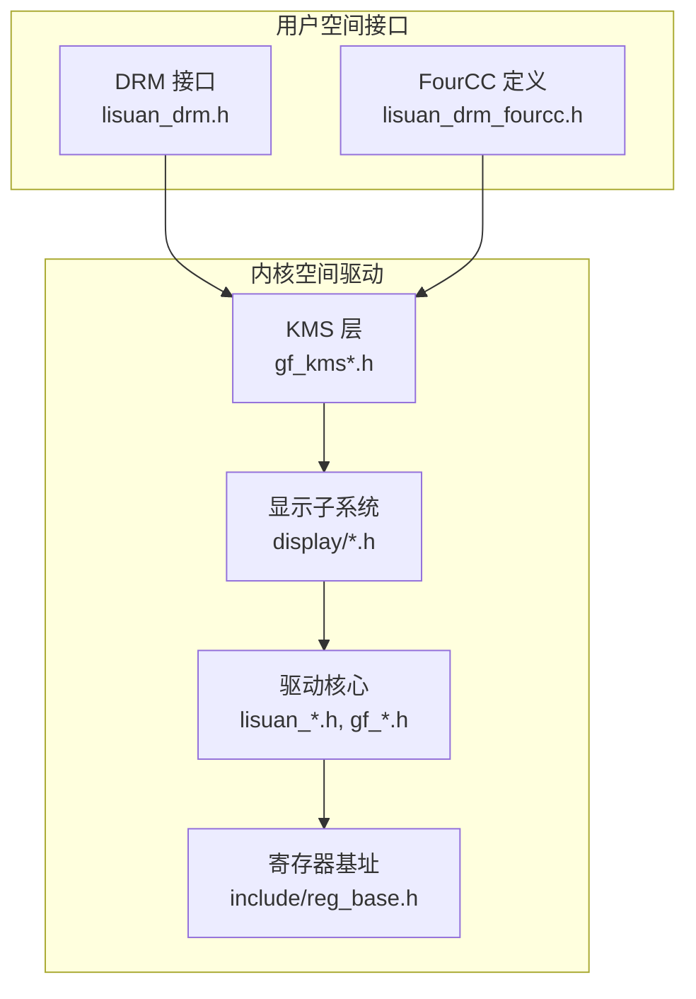
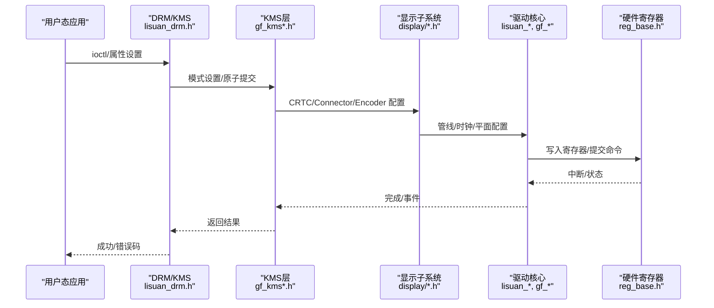
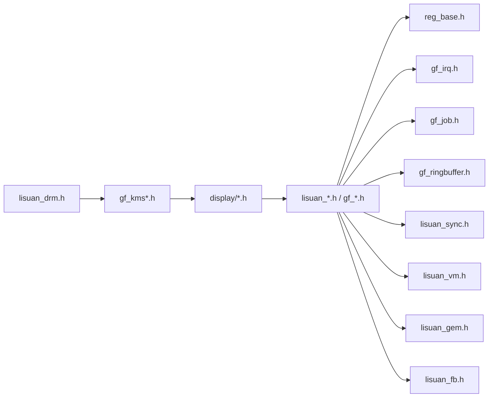

# API参考

<cite>
**本文引用的文件**   
- [lisuan_drv.h](file://_work/src/usr/src/lisuangpu-dkms-262.2.0.56/lisuan_drv.h)
- [lisuan_device.h](file://_work/src/usr/src/lisuangpu-dkms-262.2.0.56/lisuan_device.h)
- [lisuan_context.h](file://_work/src/usr/src/lisuangpu-dkms-262.2.0.56/lisuan_context.h)
- [lisuan_gem.h](file://_work/src/usr/src/lisuangpu-dkms-262.2.0.56/lisuan_gem.h)
- [lisuan_fb.h](file://_work/src/usr/src/lisuangpu-dkms-262.2.0.56/lisuan_fb.h)
- [lisuan_ring.h](file://_work/src/usr/src/lisuangpu-dkms-262.2.0.56/lisuan_ring.h)
- [lisuan_vm.h](file://_work/src/usr/src/lisuangpu-dkms-262.2.0.56/lisuan_vm.h)
- [lisuan_sync.h](file://_work/src/usr/src/lisuangpu-dkms-262.2.0.56/lisuan_sync.h)
- [gf_kms.h](file://_work/src/usr/src/lisuangpu-dkms-262.2.0.56/kms/gf_kms.h)
- [gf_kms_dm.h](file://_work/src/usr/src/lisuangpu-dkms-262.2.0.56/kms/gf_kms_dm.h)
- [gf_kms_hdr.h](file://_work/src/usr/src/lisuangpu-dkms-262.2.0.56/kms/gf_kms_hdr.h)
- [lisuan_drm.h](file://_work/src/usr/src/lisuangpu-dkms-262.2.0.56/include/lisuan_drm.h)
- [lisuan_drm_fourcc.h](file://_work/src/usr/src/lisuangpu-dkms-262.2.0.56/include/lisuan_drm_fourcc.h)
- [reg_base.h](file://_work/src/usr/src/lisuangpu-dkms-262.2.0.56/include/reg_base.h)
- [driver_settings.h](file://_work/src/usr/src/lisuangpu-dkms-262.2.0.56/include/driver_settings.h)
- [display.h](file://_work/src/usr/src/lisuangpu-dkms-262.2.0.56/display/display.h)
- [disp_device.h](file://_work/src/usr/src/lisuangpu-dkms-262.2.0.56/display/disp_device.h)
- [disp_connector.h](file://_work/src/usr/src/lisuangpu-dkms-262.2.0.56/display/connector/disp_connector.h)
- [disp_crtc.h](file://_work/src/usr/src/lisuangpu-dkms-262.2.0.56/display/crtc/disp_crtc.h)
- [disp_encoder.h](file://_work/src/usr/src/lisuangpu-dkms-262.2.0.56/display/encoder/disp_encoder.h)
- [disp_mode.h](file://_work/src/usr/src/lisuangpu-dkms-262.2.0.56/display/connector/disp_mode.h)
- [disp_pll.h](file://_work/src/usr/src/lisuangpu-dkms-262.2.0.56/display/crtc/disp_pll.h)
- [disp_pipe.h](file://_work/src/usr/src/lisuangpu-dkms-262.2.0.56/display/crtc/disp_pipe.h)
- [disp_plane.h](file://_work/src/usr/src/lisuangpu-dkms-262.2.0.56/display/crtc/disp_plane.h)
- [gf_irq.h](file://_work/src/usr/src/lisuangpu-dkms-262.2.0.56/gf_irq.h)
- [gf_job.h](file://_work/src/usr/src/lisuangpu-dkms-262.2.0.56/gf_job.h)
- [gf_ringbuffer.h](file://_work/src/usr/src/lisuangpu-dkms-262.2.0.56/gf_ringbuffer.h)
- [gf_trans.h](file://_work/src/usr/src/lisuangpu-dkms-262.2.0.56/gf_trans.h)
- [gf_debugfs.h](file://_work/src/usr/src/lisuangpu-dkms-262.2.0.56/gf_debugfs.h)
- [log_control.h](file://_work/src/usr/src/lisuangpu-dkms-262.2.0.56/log_control.h)
</cite>

## 目录
1. [简介](#简介)
2. [项目结构](#项目结构)
3. [核心组件](#核心组件)
4. [架构总览](#架构总览)
5. [详细组件分析](#详细组件分析)
6. [依赖关系分析](#依赖关系分析)
7. [性能考量](#性能考量)
8. [故障排查指南](#故障排查指南)
9. [结论](#结论)
10. [附录](#附录)

## 简介
本文件为丽山GPU驱动的API参考文档，面向内核空间驱动与用户空间接口（DRM/KMS）的开发者与维护者。内容涵盖：
- 公共接口、数据结构、常量与枚举
- 函数签名、参数说明、返回值与错误码
- 使用模式与代码示例路径
- 版本兼容性与弃用迁移建议
- 用户空间与内核空间接口差异

本参考基于仓库中的头文件与关键实现文件进行整理，确保与实际代码保持一致。

## 项目结构
该仓库采用分层组织方式：
- include：对外暴露的头文件（DRM/FourCC/寄存器基址/驱动设置等）
- kms：KMS/DMA/HDR/Pipe CRC等显示子系统相关接口
- display：显示管线（连接器、CRTC、编码器、模式、PLL、Pipe、Plane等）
- 驱动核心：设备、上下文、GEM、FB、Ring、VM、同步、调度、中断、作业、传输、调试、日志控制等

图表来源
- [lisuan_drm.h](file://_work/src/usr/src/lisuangpu-dkms-262.2.0.56/include/lisuan_drm.h)
- [lisuan_drm_fourcc.h](file://_work/src/usr/src/lisuangpu-dkms-262.2.0.56/include/lisuan_drm_fourcc.h)
- [gf_kms.h](file://_work/src/usr/src/lisuangpu-dkms-262.2.0.56/kms/gf_kms.h)
- [display.h](file://_work/src/usr/src/lisuangpu-dkms-262.2.0.56/display/display.h)
- [reg_base.h](file://_work/src/usr/src/lisuangpu-dkms-262.2.0.56/include/reg_base.h)

章节来源
- [lisuan_drv.h](file://_work/src/usr/src/lisuangpu-dkms-262.2.0.56/lisuan_drv.h)
- [lisuan_device.h](file://_work/src/usr/src/lisuangpu-dkms-262.2.0.56/lisuan_device.h)
- [display.h](file://_work/src/usr/src/lisuangpu-dkms-262.2.0.56/display/display.h)

## 核心组件
本节概述驱动的核心模块及其职责：
- 设备与上下文管理：设备初始化、资源分配、上下文创建/销毁
- GEM与帧缓冲：内存对象、缓冲区管理、DMA映射
- 渲染与命令提交：Ring缓冲、作业队列、同步原语
- 虚拟内存：地址空间、页表管理、IOMMU集成
- 中断与事件：硬件中断处理、事件上报
- 显示子系统：连接器、CRTC、编码器、模式与时序、PLL、Pipe、Plane
- 调试与日志：debugfs、日志级别控制

章节来源
- [lisuan_device.h](file://_work/src/usr/src/lisuangpu-dkms-262.2.0.56/lisuan_device.h)
- [lisuan_context.h](file://_work/src/usr/src/lisuangpu-dkms-262.2.0.56/lisuan_context.h)
- [lisuan_gem.h](file://_work/src/usr/src/lisuangpu-dkms-262.2.0.56/lisuan_gem.h)
- [lisuan_fb.h](file://_work/src/usr/src/lisuangpu-dkms-262.2.0.56/lisuan_fb.h)
- [lisuan_ring.h](file://_work/src/usr/src/lisuangpu-dkms-262.2.0.56/lisuan_ring.h)
- [lisuan_vm.h](file://_work/src/usr/src/lisuangpu-dkms-262.2.0.56/lisuan_vm.h)
- [lisuan_sync.h](file://_work/src/usr/src/lisuangpu-dkms-262.2.0.56/lisuan_sync.h)
- [gf_irq.h](file://_work/src/usr/src/lisuangpu-dkms-262.2.0.56/gf_irq.h)
- [gf_job.h](file://_work/src/usr/src/lisuangpu-dkms-262.2.0.56/gf_job.h)
- [gf_ringbuffer.h](file://_work/src/usr/src/lisuangpu-dkms-262.2.0.56/gf_ringbuffer.h)
- [gf_trans.h](file://_work/src/usr/src/lisuangpu-dkms-262.2.0.56/gf_trans.h)
- [display.h](file://_work/src/usr/src/lisuangpu-dkms-262.2.0.56/display/display.h)

## 架构总览
下图展示用户空间通过DRM/KMS调用进入内核驱动，再经由显示子系统与GPU核心交互的整体流程。

图表来源
- [lisuan_drm.h](file://_work/src/usr/src/lisuangpu-dkms-262.2.0.56/include/lisuan_drm.h)
- [gf_kms.h](file://_work/src/usr/src/lisuangpu-dkms-262.2.0.56/kms/gf_kms.h)
- [display.h](file://_work/src/usr/src/lisuangpu-dkms-262.2.0.56/display/display.h)
- [reg_base.h](file://_work/src/usr/src/lisuangpu-dkms-262.2.0.56/include/reg_base.h)

## 详细组件分析

### DRM与FourCC接口
- 目的：向用户空间暴露标准DRM接口与自定义FourCC格式
- 关键点：
  - DRM IOCTL定义与命令号
  - 自定义像素格式FourCC宏
  - 与KMS层的属性/模式设置对接

章节来源
- [lisuan_drm.h](file://_work/src/usr/src/lisuangpu-dkms-262.2.0.56/include/lisuan_drm.h)
- [lisuan_drm_fourcc.h](file://_work/src/usr/src/lisuangpu-dkms-262.2.0.56/include/lisuan_drm_fourcc.h)

### KMS层接口
- 目的：封装KMS原子操作、模式设置、HDR支持、Pipe CRC等
- 关键点：
  - 模式设置与原子提交
  - HDR元数据传递
  - Pipe CRC采集用于测试与验证

章节来源
- [gf_kms.h](file://_work/src/usr/src/lisuangpu-dkms-262.2.0.56/kms/gf_kms.h)
- [gf_kms_dm.h](file://_work/src/usr/src/lisuangpu-dkms-262.2.0.56/kms/gf_kms_dm.h)
- [gf_kms_hdr.h](file://_work/src/usr/src/lisuangpu-dkms-262.2.0.56/kms/gf_kms_hdr.h)

### 显示子系统（连接器/CRTC/编码器/模式/PLL/Pipe/Plane）
- 目的：实现显示管线的完整生命周期管理
- 关键点：
  - 连接器EDID/DisplayID解析
  - CRTC时序与刷新率计算
  - 编码器（DP/HDMI/DVO）输出配置
  - PLL频率锁定与分频
  - Pipe与Plane叠加与混合

章节来源
- [disp_connector.h](file://_work/src/usr/src/lisuangpu-dkms-262.2.0.56/display/connector/disp_connector.h)
- [disp_crtc.h](file://_work/src/usr/src/lisuangpu-dkms-262.2.0.56/display/crtc/disp_crtc.h)
- [disp_encoder.h](file://_work/src/usr/src/lisuangpu-dkms-262.2.0.56/display/encoder/disp_encoder.h)
- [disp_mode.h](file://_work/src/usr/src/lisuangpu-dkms-262.2.0.56/display/connector/disp_mode.h)
- [disp_pll.h](file://_work/src/usr/src/lisuangpu-dkms-262.2.0.56/display/crtc/disp_pll.h)
- [disp_pipe.h](file://_work/src/usr/src/lisuangpu-dkms-262.2.0.56/display/crtc/disp_pipe.h)
- [disp_plane.h](file://_work/src/usr/src/lisuangpu-dkms-262.2.0.56/display/crtc/disp_plane.h)

### 驱动核心（设备/上下文/GEM/FB/Ring/VM/同步/中断/作业/传输）
- 目的：提供GPU资源管理、命令提交、内存与同步机制
- 关键点：
  - 设备探测与初始化
  - 上下文切换与资源隔离
  - GEM对象生命周期与DMA映射
  - Ring缓冲与作业调度
  - VM地址空间与页表更新
  - 同步原语（Fence/Event）
  - 中断处理与事件上报
  - 数据传输与拷贝

章节来源
- [lisuan_device.h](file://_work/src/usr/src/lisuangpu-dkms-262.2.0.56/lisuan_device.h)
- [lisuan_context.h](file://_work/src/usr/src/lisuangpu-dkms-262.2.0.56/lisuan_context.h)
- [lisuan_gem.h](file://_work/src/usr/src/lisuangpu-dkms-262.2.0.56/lisuan_gem.h)
- [lisuan_fb.h](file://_work/src/usr/src/lisuangpu-dkms-262.2.0.56/lisuan_fb.h)
- [lisuan_ring.h](file://_work/src/usr/src/lisuangpu-dkms-262.2.0.56/lisuan_ring.h)
- [lisuan_vm.h](file://_work/src/usr/src/lisuangpu-dkms-262.2.0.56/lisuan_vm.h)
- [lisuan_sync.h](file://_work/src/usr/src/lisuangpu-dkms-262.2.0.56/lisuan_sync.h)
- [gf_irq.h](file://_work/src/usr/src/lisuangpu-dkms-262.2.0.56/gf_irq.h)
- [gf_job.h](file://_work/src/usr/src/lisuangpu-dkms-262.2.0.56/gf_job.h)
- [gf_ringbuffer.h](file://_work/src/usr/src/lisuangpu-dkms-262.2.0.56/gf_ringbuffer.h)
- [gf_trans.h](file://_work/src/usr/src/lisuangpu-dkms-262.2.0.56/gf_trans.h)

### 调试与日志
- 目的：提供运行时诊断能力
- 关键点：
  - debugfs节点与查询接口
  - 日志级别控制与开关

章节来源
- [gf_debugfs.h](file://_work/src/usr/src/lisuangpu-dkms-262.2.0.56/gf_debugfs.h)
- [log_control.h](file://_work/src/usr/src/lisuangpu-dkms-262.2.0.56/log_control.h)

## 依赖关系分析
驱动内部模块之间的依赖如下：

图表来源
- [lisuan_drm.h](file://_work/src/usr/src/lisuangpu-dkms-262.2.0.56/include/lisuan_drm.h)
- [gf_kms.h](file://_work/src/usr/src/lisuangpu-dkms-262.2.0.56/kms/gf_kms.h)
- [display.h](file://_work/src/usr/src/lisuangpu-dkms-262.2.0.56/display/display.h)
- [reg_base.h](file://_work/src/usr/src/lisuangpu-dkms-262.2.0.56/include/reg_base.h)
- [gf_irq.h](file://_work/src/usr/src/lisuangpu-dkms-262.2.0.56/gf_irq.h)
- [gf_job.h](file://_work/src/usr/src/lisuangpu-dkms-262.2.0.56/gf_job.h)
- [gf_ringbuffer.h](file://_work/src/usr/src/lisuangpu-dkms-262.2.0.56/gf_ringbuffer.h)
- [lisuan_sync.h](file://_work/src/usr/src/lisuangpu-dkms-262.2.0.56/lisuan_sync.h)
- [lisuan_vm.h](file://_work/src/usr/src/lisuangpu-dkms-262.2.0.56/lisuan_vm.h)
- [lisuan_gem.h](file://_work/src/usr/src/lisuangpu-dkms-262.2.0.56/lisuan_gem.h)
- [lisuan_fb.h](file://_work/src/usr/src/lisuangpu-dkms-262.2.0.56/lisuan_fb.h)

章节来源
- [lisuan_drv.h](file://_work/src/usr/src/lisuangpu-dkms-262.2.0.56/lisuan_drv.h)
- [driver_settings.h](file://_work/src/usr/src/lisuangpu-dkms-262.2.0.56/include/driver_settings.h)

## 性能考量
- 命令提交与批处理：合理合并命令以减少Ring缓冲写入次数
- 同步原语：避免过度等待，使用异步Fence减少CPU开销
- 内存管理：优先使用GEM共享内存，减少重复拷贝
- 中断处理：批量处理中断事件，降低延迟抖动
- 显示流水线：优化CRTC/Plane组合，减少重绘与闪烁

[本节为通用指导，不直接分析具体文件]

## 故障排查指南
- 使用debugfs节点查看驱动状态、寄存器快照与统计信息
- 检查日志级别与开关，定位异常路径
- 核对FourCC格式与缓冲区对齐要求
- 验证模式设置与时钟计算是否满足显示器规格
- 关注中断上报与事件同步是否正确

章节来源
- [gf_debugfs.h](file://_work/src/usr/src/lisuangpu-dkms-262.2.0.56/gf_debugfs.h)
- [log_control.h](file://_work/src/usr/src/lisuangpu-dkms-262.2.0.56/log_control.h)

## 结论
本参考文档梳理了丽山GPU驱动的用户空间与内核空间接口，覆盖DRM/KMS、显示子系统与驱动核心模块。通过模块化分析与图示，帮助开发者快速理解API职责、依赖关系与使用模式。建议在集成时严格遵循FourCC与模式规范，合理使用同步与内存管理接口，以获得稳定与高性能的显示与渲染体验。

[本节为总结性内容，不直接分析具体文件]

## 附录

### 用户空间与内核空间接口差异
- 用户空间：通过DRM IOCTL与属性访问驱动功能；FourCC格式由用户态指定
- 内核空间：实现KMS原子操作、显示管线配置、GPU命令提交与同步
- 数据面：用户态GEM对象在内核态进行DMA映射与地址转换
- 事件面：内核态中断与事件经DRM事件通道上报至用户态

章节来源
- [lisuan_drm.h](file://_work/src/usr/src/lisuangpu-dkms-262.2.0.56/include/lisuan_drm.h)
- [gf_kms.h](file://_work/src/usr/src/lisuangpu-dkms-262.2.0.56/kms/gf_kms.h)
- [lisuan_gem.h](file://_work/src/usr/src/lisuangpu-dkms-262.2.0.56/lisuan_gem.h)

### 版本兼容性与迁移指南
- 兼容性：保持DRM IOCTL与FourCC向后兼容，新增字段需带版本号
- 弃用策略：对旧接口添加弃用警告并提供替代路径
- 迁移步骤：
  - 替换已弃用的IOCTL或属性
  - 更新FourCC使用为新定义
  - 调整KMS原子提交参数以匹配新行为

章节来源
- [lisuan_drm.h](file://_work/src/usr/src/lisuangpu-dkms-262.2.0.56/include/lisuan_drm.h)
- [lisuan_drm_fourcc.h](file://_work/src/usr/src/lisuangpu-dkms-262.2.0.56/include/lisuan_drm_fourcc.h)
- [driver_settings.h](file://_work/src/usr/src/lisuangpu-dkms-262.2.0.56/include/driver_settings.h)

### 使用模式与示例路径
- 典型流程：打开设备 -> 创建上下文 -> 分配GEM对象 -> 提交作业 -> 等待同步 -> 释放资源
- 显示流程：枚举连接器 -> 选择模式 -> 设置CRTC/Plane -> 原子提交
- 示例路径（仅列出文件，不包含代码内容）：
  - 设备与上下文：[lisuan_device.h](file://_work/src/usr/src/lisuangpu-dkms-262.2.0.56/lisuan_device.h), [lisuan_context.h](file://_work/src/usr/src/lisuangpu-dkms-262.2.0.56/lisuan_context.h)
  - 内存与缓冲区：[lisuan_gem.h](file://_work/src/usr/src/lisuangpu-dkms-262.2.0.56/lisuan_gem.h), [lisuan_fb.h](file://_work/src/usr/src/lisuangpu-dkms-262.2.0.56/lisuan_fb.h)
  - 命令与同步：[lisuan_ring.h](file://_work/src/usr/src/lisuangpu-dkms-262.2.0.56/lisuan_ring.h), [lisuan_sync.h](file://_work/src/usr/src/lisuangpu-dkms-262.2.0.56/lisuan_sync.h)
  - 显示管线：[display.h](file://_work/src/usr/src/lisuangpu-dkms-262.2.0.56/display/display.h), [disp_crtc.h](file://_work/src/usr/src/lisuangpu-dkms-262.2.0.56/display/crtc/disp_crtc.h), [disp_connector.h](file://_work/src/usr/src/lisuangpu-dkms-262.2.0.56/display/connector/disp_connector.h)

[本节为使用模式概览，不直接分析具体文件]