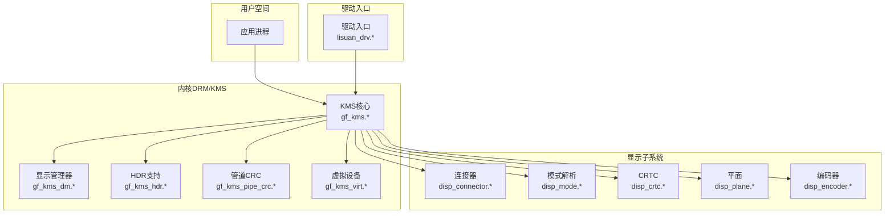
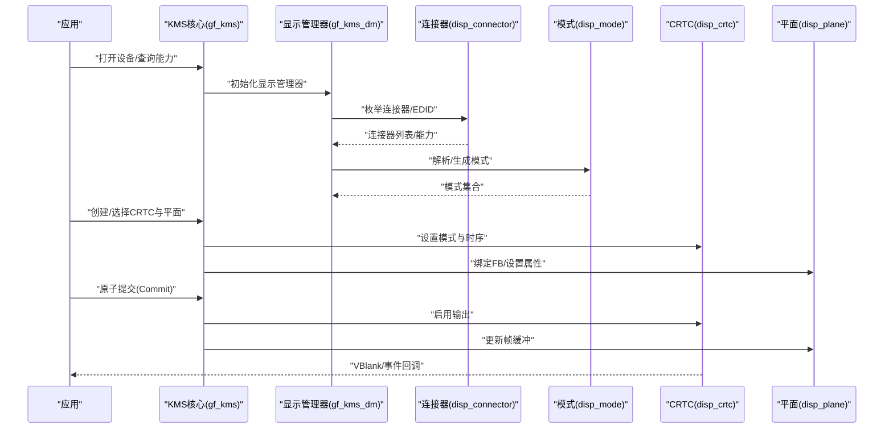
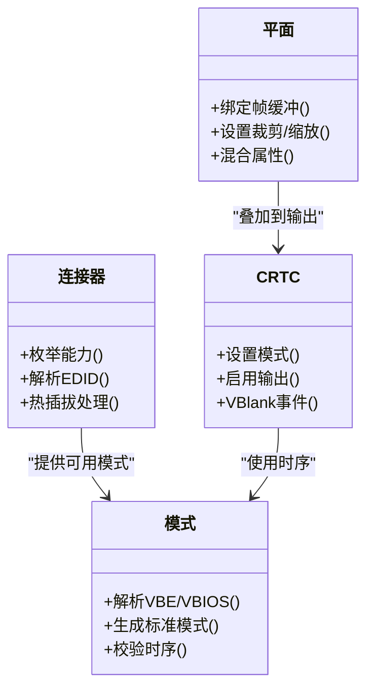
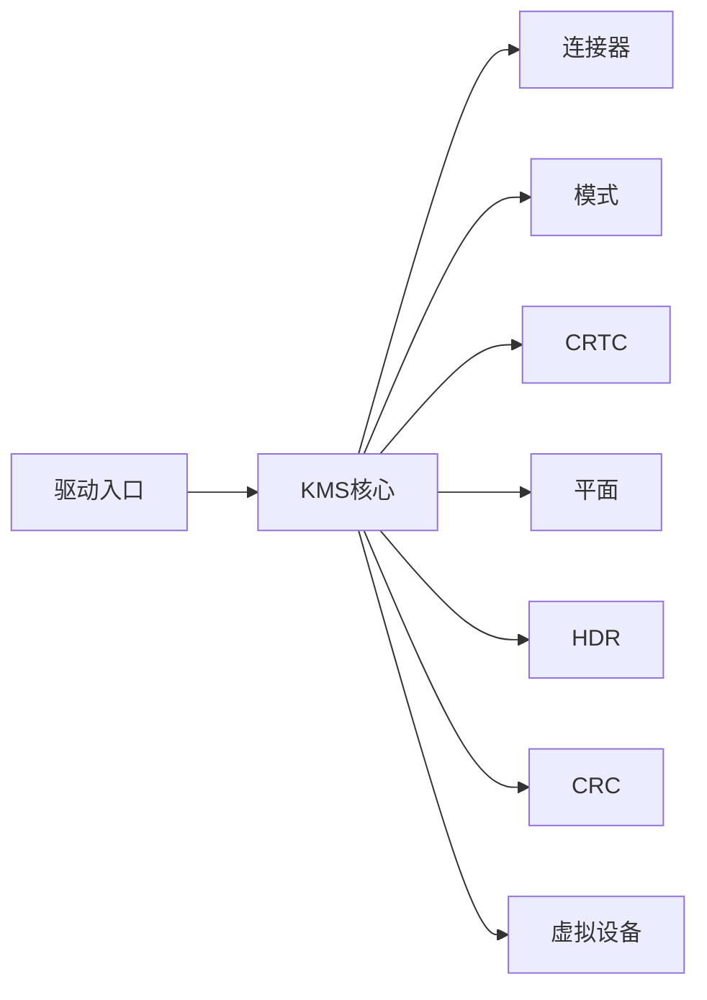

# DRM接口

<cite>
**本文档引用的文件**   
- [lisuan_drm.h](file://_work/src/usr/src/lisuan-dkms-262.2.0.56/include/lisuan_drm.h)
- [lisuan_drm_fourcc.h](file://_work/src/usr/src/lisuan-dkms-262.2.0.56/include/lisuan_drm_fourcc.h)
- [gf_kms.c](file://_work/src/usr/src/lisuan-dkms-262.2.0.56/kms/gf_kms.c)
- [gf_kms.h](file://_work/src/usr/src/lisuan-dkms-262.2.0.56/kms/gf_kms.h)
- [gf_kms_dm.c](file://_work/src/usr/src/lisuan-dkms-262.2.0.56/kms/gf_kms_dm.c)
- [gf_kms_dm.h](file://_work/src/usr/src/lisuan-dkms-262.2.0.56/kms/gf_kms_dm.h)
- [gf_kms_hdr.c](file://_work/src/usr/src/lisuan-dkms-262.2.0.56/kms/gf_kms_hdr.c)
- [gf_kms_hdr.h](file://_work/src/usr/src/lisuan-dkms-262.2.0.56/kms/gf_kms_hdr.h)
- [gf_kms_pipe_crc.c](file://_work/src/usr/src/lisuan-dkms-262.2.0.56/kms/gf_kms_pipe_crc.c)
- [gf_kms_pipe_crc.h](file://_work/src/usr/src/lisuan-dkms-262.2.0.56/kms/gf_kms_pipe_crc.h)
- [gf_kms_virt.c](file://_work/src/usr/src/lisuan-dkms-262.2.0.56/kms/gf_kms_virt.c)
- [gf_kms_virt.h](file://_work/src/usr/src/lisuan-dkms-262.2.0.56/kms/gf_kms_virt.h)
- [display.c](file://_work/src/usr/src/lisuan-dkms-262.2.0.56/display/display.c)
- [display.h](file://_work/src/usr/src/lisuan-dkms-262.2.0.56/display/display.h)
- [disp_connector.c](file://_work/src/usr/src/lisuan-dkms-262.2.0.56/display/connector/disp_connector.c)
- [disp_connector.h](file://_work/src/usr/src/lisuan-dkms-262.2.0.56/display/connector/disp_connector.h)
- [disp_mode.c](file://_work/src/usr/src/lisuan-dkms-262.2.0.56/display/connector/disp_mode.c)
- [disp_mode.h](file://_work/src/usr/src/lisuan-dkms-262.2.0.56/display/connector/disp_mode.h)
- [disp_crtc.c](file://_work/src/usr/src/lisuan-dkms-262.2.0.56/display/crtc/disp_crtc.c)
- [disp_crtc.h](file://_work/src/usr/src/lisuan-dkms-262.2.0.56/display/crtc/disp_crtc.h)
- [disp_plane.c](file://_work/src/usr/src/lisuan-dkms-262.2.0.56/display/crtc/disp_plane.c)
- [disp_plane.h](file://_work/src/usr/src/lisuan-dkms-262.2.0.56/display/crtc/disp_plane.h)
- [lisuan_drv.c](file://_work/src/usr/src/lisuan-dkms-262.2.0.56/lisuan_drv.c)
- [lisuan_drv.h](file://_work/src/usr/src/lisuan-dkms-262.2.0.56/lisuan_drv.h)
</cite>

## 目录
1. [简介](#简介)
2. [项目结构](#项目结构)
3. [核心组件](#核心组件)
4. [架构总览](#架构总览)
5. [详细组件分析](#详细组件分析)
6. [依赖关系分析](#依赖关系分析)
7. [性能考虑](#性能考虑)
8. [故障排查指南](#故障排查指南)
9. [结论](#结论)
10. [附录](#附录)

## 简介
本文件面向丽山GPU的DRM/KMS子系统，系统化梳理并文档化所有与DRM相关的结构体、枚举、常量宏以及函数接口。内容覆盖像素格式定义、属性设置、模式配置、连接器和编码器管理、CRTC/Plane管线控制等关键能力，并提供使用示例路径以便快速定位实现细节。文档旨在帮助开发者正确、高效地使用DRM接口完成图形渲染与显示控制。

## 项目结构
本项目采用分层组织方式：
- include层：对外暴露DRM头文件（如像素格式、DRM扩展接口）
- kms层：KMS驱动核心逻辑，封装设备、模式、原子提交、HDR、CRC等能力
- display层：具体硬件相关模块（连接器、编码器、CRTC、平面、时钟、中断、寄存器映射等）
- 驱动入口：设备初始化、注册、生命周期管理

图表来源
- [gf_kms.c:1-200](file://_work/src/usr/src/lisuan-dkms-262.2.0.56/kms/gf_kms.c#L1-L200)
- [gf_kms_dm.c:1-200](file://_work/src/usr/src/lisuan-dkms-262.2.0.56/kms/gf_kms_dm.c#L1-L200)
- [display.c:1-200](file://_work/src/usr/src/lisuan-dkms-262.2.0.56/display/display.c#L1-L200)
- [lisuan_drv.c:1-200](file://_work/src/usr/src/lisuan-dkms-262.2.0.56/lisuan_drv.c#L1-L200)

章节来源
- [lisuan_drv.c:1-200](file://_work/src/usr/src/lisuan-dkms-262.2.0.56/lisuan_drv.c#L1-L200)
- [lisuan_drv.h:1-200](file://_work/src/usr/src/lisuan-dkms-262.2.0.56/lisuan_drv.h#L1-L200)
- [display.c:1-200](file://_work/src/usr/src/lisuan-dkms-262.2.0.56/display/display.c#L1-L200)
- [display.h:1-200](file://_work/src/usr/src/lisuan-dkms-262.2.0.56/display/display.h#L1-L200)

## 核心组件
- DRM公共接口与像素格式
  - 提供DRM扩展头与FourCC像素格式定义，用于帧缓冲与纹理格式识别
- KMS核心与显示管理器
  - 封装设备对象、模式设置、原子提交、属性读写、连接/编码/CRTC/平面生命周期
- HDR与CRC调试
  - HDR色彩空间与元数据支持；管道CRC校验用于显示质量验证
- 虚拟设备支持
  - 便于在无真实硬件环境下进行开发与测试
- 显示子系统
  - 连接器（HDMI/DP/DVO）、模式解析、CRTC时序、平面混合与时钟/中断/寄存器访问

章节来源
- [lisuan_drm.h:1-200](file://_work/src/usr/src/lisuan-dkms-262.2.0.56/include/lisuan_drm.h#L1-L200)
- [lisuan_drm_fourcc.h:1-200](file://_work/src/usr/src/lisuan-dkms-262.2.0.56/include/lisuan_drm_fourcc.h#L1-L200)
- [gf_kms.h:1-200](file://_work/src/usr/src/lisuan-dkms-262.2.0.56/kms/gf_kms.h#L1-L200)
- [gf_kms.c:1-200](file://_work/src/usr/src/lisuan-dkms-262.2.0.56/kms/gf_kms.c#L1-L200)
- [gf_kms_dm.h:1-200](file://_work/src/usr/src/lisuan-dkms-262.2.0.56/kms/gf_kms_dm.h#L1-L200)
- [gf_kms_dm.c:1-200](file://_work/src/usr/src/lisuan-dkms-262.2.0.56/kms/gf_kms_dm.c#L1-L200)
- [gf_kms_hdr.h:1-200](file://_work/src/usr/src/lisuan-dkms-262.2.0.56/kms/gf_kms_hdr.h#L1-L200)
- [gf_kms_hdr.c:1-200](file://_work/src/usr/src/lisuan-dkms-262.2.0.56/kms/gf_kms_hdr.c#L1-L200)
- [gf_kms_pipe_crc.h:1-200](file://_work/src/usr/src/lisuan-dkms-262.2.0.56/kms/gf_kms_pipe_crc.h#L1-L200)
- [gf_kms_pipe_crc.c:1-200](file://_work/src/usr/src/lisuan-dkms-262.2.0.56/kms/gf_kms_pipe_crc.c#L1-L200)
- [gf_kms_virt.h:1-200](file://_work/src/usr/src/lisuan-dkms-262.2.0.56/kms/gf_kms_virt.h#L1-L200)
- [gf_kms_virt.c:1-200](file://_work/src/usr/src/lisuan-dkms-262.2.0.56/kms/gf_kms_virt.c#L1-L200)

## 架构总览
下图展示从应用到DRM/KMS再到显示子系统的调用链路与职责划分。

图表来源
- [gf_kms.c:1-200](file://_work/src/usr/src/lisuan-dkms-262.2.0.56/kms/gf_kms.c#L1-L200)
- [gf_kms_dm.c:1-200](file://_work/src/usr/src/lisuan-dkms-262.2.0.56/kms/gf_kms_dm.c#L1-L200)
- [disp_connector.c:1-200](file://_work/src/usr/src/lisuan-dkms-262.2.0.56/display/connector/disp_connector.c#L1-L200)
- [disp_mode.c:1-200](file://_work/src/usr/src/lisuan-dkms-262.2.0.56/display/connector/disp_mode.c#L1-L200)
- [disp_crtc.c:1-200](file://_work/src/usr/src/lisuan-dkms-262.2.0.56/display/crtc/disp_crtc.c#L1-L200)
- [disp_plane.c:1-200](file://_work/src/usr/src/lisuan-dkms-262.2.0.56/display/crtc/disp_plane.c#L1-L200)

## 详细组件分析

### DRM公共接口与像素格式
- 作用
  - 定义DRM扩展接口与像素格式（FourCC），供上层应用与KMS共同识别帧缓冲格式
- 关键点
  - 像素格式枚举与宏定义，确保跨平台一致性
  - DRM私有或厂商扩展的ioctl/属性命名约定
- 使用建议
  - 在创建帧缓冲时优先选择通用FourCC，避免平台差异
  - 结合KMS能力查询确认目标格式是否受支持

章节来源
- [lisuan_drm.h:1-200](file://_work/src/usr/src/lisuan-dkms-262.2.0.56/include/lisuan_drm.h#L1-L200)
- [lisuan_drm_fourcc.h:1-200](file://_work/src/usr/src/lisuan-dkms-262.2.0.56/include/lisuan_drm_fourcc.h#L1-L200)

### KMS核心与显示管理器
- 作用
  - 封装DRM设备、模式设置、原子提交、属性读写、资源枚举与管理
- 关键点
  - 原子提交流程：构建状态对象、校验、提交、回滚机制
  - 属性系统：连接器、CRTC、平面属性的统一读写
  - 资源管理：连接器、编码器、CRTC、平面的生命周期
- 使用建议
  - 始终通过原子API进行模式与属性变更，保证一致性
  - 合理拆分提交批次，减少锁竞争

章节来源
- [gf_kms.h:1-200](file://_work/src/usr/src/lisuan-dkms-262.2.0.56/kms/gf_kms.h#L1-L200)
- [gf_kms.c:1-200](file://_work/src/usr/src/lisuan-dkms-262.2.0.56/kms/gf_kms.c#L1-L200)
- [gf_kms_dm.h:1-200](file://_work/src/usr/src/lisuan-dkms-262.2.0.56/kms/gf_kms_dm.h#L1-L200)
- [gf_kms_dm.c:1-200](file://_work/src/usr/src/lisuan-dkms-262.2.0.56/kms/gf_kms_dm.c#L1-L200)

### HDR支持
- 作用
  - 提供HDR色彩空间与元数据相关能力，适配高动态范围显示
- 关键点
  - HDR属性与颜色空间协商
  - 与模式/平面属性的联动配置
- 使用建议
  - 在支持HDR的输出上启用相应属性，确保内容与显示器能力匹配

章节来源
- [gf_kms_hdr.h:1-200](file://_work/src/usr/src/lisuan-dkms-262.2.0.56/kms/gf_kms_hdr.h#L1-L200)
- [gf_kms_hdr.c:1-200](file://_work/src/usr/src/lisuan-dkms-262.2.0.56/kms/gf_kms_hdr.c#L1-L200)

### 管道CRC调试
- 作用
  - 提供管道CRC读取能力，用于显示质量验证与自动化测试
- 关键点
  - 管道级CRC采集与导出
  - 与CRTC/平面状态的关联
- 使用建议
  - 在CI或质检流程中启用CRC比对，保障画面一致性

章节来源
- [gf_kms_pipe_crc.h:1-200](file://_work/src/usr/src/lisuan-dkms-262.2.0.56/kms/gf_kms_pipe_crc.h#L1-L200)
- [gf_kms_pipe_crc.c:1-200](file://_work/src/usr/src/lisuan-dkms-262.2.0.56/kms/gf_kms_pipe_crc.c#L1-L200)

### 虚拟设备支持
- 作用
  - 提供无硬件环境下的DRM/KMS模拟，便于开发与调试
- 关键点
  - 虚拟连接器/模式/CRTC/平面实现
  - 与真实设备的接口一致性
- 使用建议
  - 开发阶段优先使用虚拟设备，降低对硬件依赖

章节来源
- [gf_kms_virt.h:1-200](file://_work/src/usr/src/lisuan-dkms-262.2.0.56/kms/gf_kms_virt.h#L1-L200)
- [gf_kms_virt.c:1-200](file://_work/src/usr/src/lisuan-dkms-262.2.0.56/kms/gf_kms_virt.c#L1-L200)

### 显示子系统：连接器、模式、CRTC、平面
- 连接器
  - 负责EDID解析、链路训练、热插拔事件上报
- 模式
  - 解析/生成显示模式，包括分辨率、刷新率、时序参数
- CRTC
  - 时序生成、扫描输出、VBlank事件
- 平面
  - 帧缓冲叠加、裁剪缩放、透明度与混合

图表来源
- [disp_connector.c:1-200](file://_work/src/usr/src/lisuan-dkms-262.2.0.56/display/connector/disp_connector.c#L1-L200)
- [disp_mode.c:1-200](file://_work/src/usr/src/lisuan-dkms-262.2.0.56/display/connector/disp_mode.c#L1-L200)
- [disp_crtc.c:1-200](file://_work/src/usr/src/lisuan-dkms-262.2.0.56/display/crtc/disp_crtc.c#L1-L200)
- [disp_plane.c:1-200](file://_work/src/usr/src/lisuan-dkms-262.2.0.56/display/crtc/disp_plane.c#L1-L200)

章节来源
- [disp_connector.h:1-200](file://_work/src/usr/src/lisuan-dkms-262.2.0.56/display/connector/disp_connector.h#L1-L200)
- [disp_mode.h:1-200](file://_work/src/usr/src/lisuan-dkms-262.2.0.56/display/connector/disp_mode.h#L1-L200)
- [disp_crtc.h:1-200](file://_work/src/usr/src/lisuan-dkms-262.2.0.56/display/crtc/disp_crtc.h#L1-L200)
- [disp_plane.h:1-200](file://_work/src/usr/src/lisuan-dkms-262.2.0.56/display/crtc/disp_plane.h#L1-L200)

### 驱动入口与设备生命周期
- 作用
  - 设备探测、初始化、DRM/KMS注册、资源释放
- 关键点
  - 与内核DRM框架的对接点
  - 错误处理与回滚策略
- 使用建议
  - 关注模块加载顺序与依赖，确保子系统就绪后再进行KMS操作

章节来源
- [lisuan_drv.c:1-200](file://_work/src/usr/src/lisuan-dkms-262.2.0.56/lisuan_drv.c#L1-L200)
- [lisuan_drv.h:1-200](file://_work/src/usr/src/lisuan-dkms-262.2.0.56/lisuan_drv.h#L1-L200)

## 依赖关系分析
KMS核心依赖显示子系统提供的连接器、模式、CRTC、平面等能力；HDR与CRC为可选增强功能；虚拟设备用于替代真实硬件。

图表来源
- [gf_kms.c:1-200](file://_work/src/usr/src/lisuan-dkms-262.2.0.56/kms/gf_kms.c#L1-L200)
- [gf_kms_dm.c:1-200](file://_work/src/usr/src/lisuan-dkms-262.2.0.56/kms/gf_kms_dm.c#L1-L200)
- [gf_kms_hdr.c:1-200](file://_work/src/usr/src/lisuan-dkms-262.2.0.56/kms/gf_kms_hdr.c#L1-L200)
- [gf_kms_pipe_crc.c:1-200](file://_work/src/usr/src/lisuan-dkms-262.2.0.56/kms/gf_kms_pipe_crc.c#L1-L200)
- [gf_kms_virt.c:1-200](file://_work/src/usr/src/lisuan-dkms-262.2.0.56/kms/gf_kms_virt.c#L1-L200)
- [lisuan_drv.c:1-200](file://_work/src/usr/src/lisuan-dkms-262.2.0.56/lisuan_drv.c#L1-L200)

章节来源
- [gf_kms.h:1-200](file://_work/src/usr/src/lisuan-dkms-262.2.0.56/kms/gf_kms.h#L1-L200)
- [display.c:1-200](file://_work/src/usr/src/lisuan-dkms-262.2.0.56/display/display.c#L1-L200)

## 性能考虑
- 原子提交合并：将多个属性与模式变更合并至一次提交，减少锁与上下文切换开销
- 帧缓冲复用：尽量复用已分配的GEM对象，避免频繁分配/释放
- 模式与属性缓存：对常用模式与属性进行缓存，缩短初始化时间
- 事件处理优化：批量处理VBlank与热插拔事件，避免阻塞主线程
- 调试功能开关：在生产环境中关闭CRC与调试输出，降低额外开销

[本节为通用指导，不直接分析具体文件]

## 故障排查指南
- 常见问题
  - 模式设置失败：检查时序参数与连接器能力是否匹配
  - 黑屏或闪烁：确认CRTC启用顺序与平面绑定是否正确
  - 颜色异常：核对像素格式与HDR属性设置
  - 性能抖动：检查提交频率与事件处理是否阻塞
- 排查步骤
  - 启用调试日志与CRC校验，定位问题阶段
  - 逐步简化提交内容，隔离问题源
  - 使用虚拟设备进行最小化复现

章节来源
- [gf_kms_pipe_crc.c:1-200](file://_work/src/usr/src/lisuan-dkms-262.2.0.56/kms/gf_kms_pipe_crc.c#L1-L200)
- [gf_kms_hdr.c:1-200](file://_work/src/usr/src/lisuan-dkms-262.2.0.56/kms/gf_kms_hdr.c#L1-L200)
- [gf_kms_virt.c:1-200](file://_work/src/usr/src/lisuan-dkms-262.2.0.56/kms/gf_kms_virt.c#L1-L200)

## 结论
丽山GPU DRM/KMS子系统以清晰的层次结构与完善的接口设计，提供了从像素格式到显示输出的完整能力。通过原子提交、属性系统与模块化设计，开发者可以高效地实现图形渲染与显示控制。建议在开发过程中充分利用虚拟设备与CRC调试能力，提升效率与稳定性。

[本节为总结性内容，不直接分析具体文件]

## 附录
- 使用示例路径（不含代码片段）
  - 打开DRM设备与查询能力：参考KMS核心初始化流程
  - 枚举连接器与模式：参考连接器与模式模块
  - 创建CRTC与平面并绑定帧缓冲：参考CRTC与平面模块
  - 原子提交与事件处理：参考KMS核心与事件回调
  - HDR与CRC调试：参考HDR与CRC模块

章节来源
- [gf_kms.c:1-200](file://_work/src/usr/src/lisuan-dkms-262.2.0.56/kms/gf_kms.c#L1-L200)
- [disp_connector.c:1-200](file://_work/src/usr/src/lisuan-dkms-262.2.0.56/display/connector/disp_connector.c#L1-L200)
- [disp_mode.c:1-200](file://_work/src/usr/src/lisuan-dkms-262.2.0.56/display/connector/disp_mode.c#L1-L200)
- [disp_crtc.c:1-200](file://_work/src/usr/src/lisuan-dkms-262.2.0.56/display/crtc/disp_crtc.c#L1-L200)
- [disp_plane.c:1-200](file://_work/src/usr/src/lisuan-dkms-262.2.0.56/display/crtc/disp_plane.c#L1-L200)
- [gf_kms_hdr.c:1-200](file://_work/src/usr/src/lisuan-dkms-262.2.0.56/kms/gf_kms_hdr.c#L1-L200)
- [gf_kms_pipe_crc.c:1-200](file://_work/src/usr/src/lisuan-dkms-262.2.0.56/kms/gf_kms_pipe_crc.c#L1-L200)