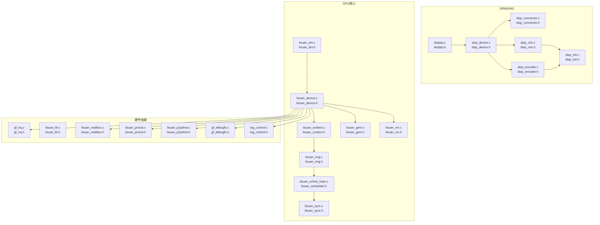
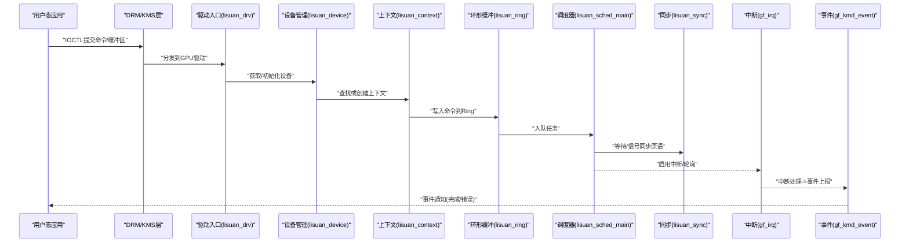
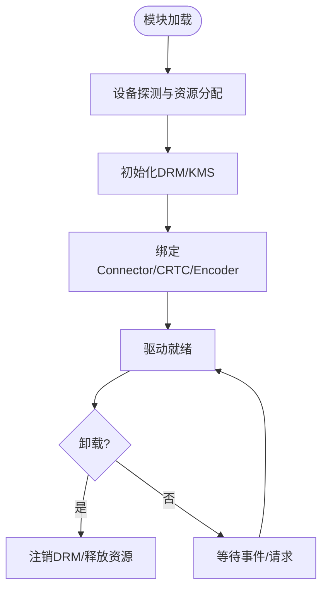
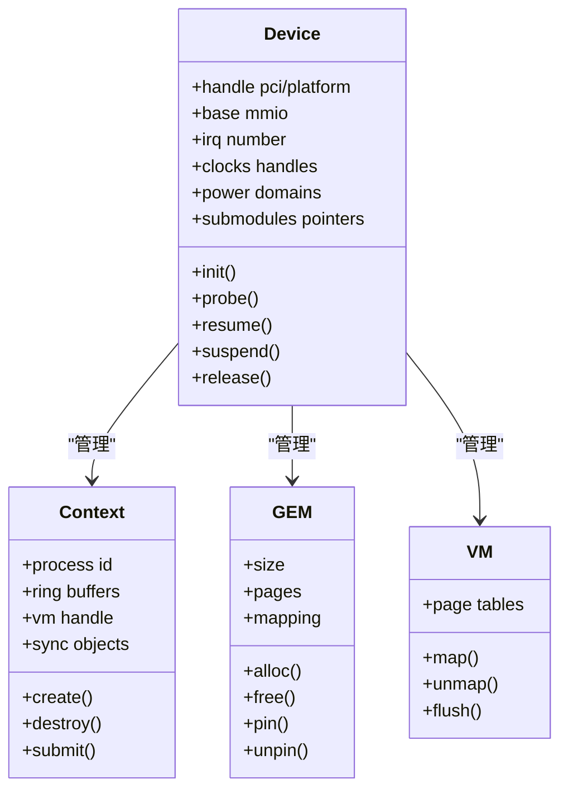
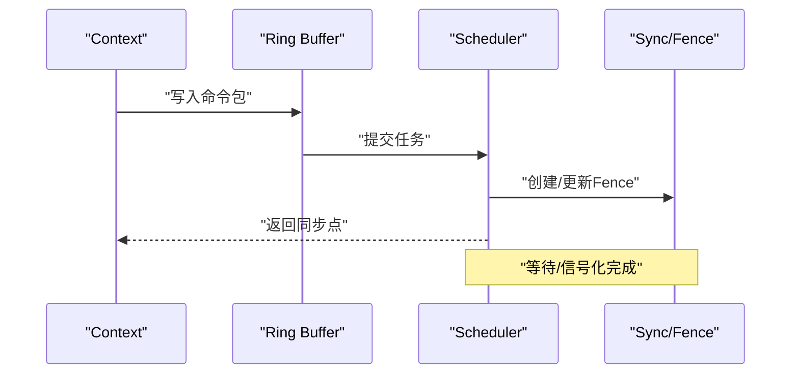
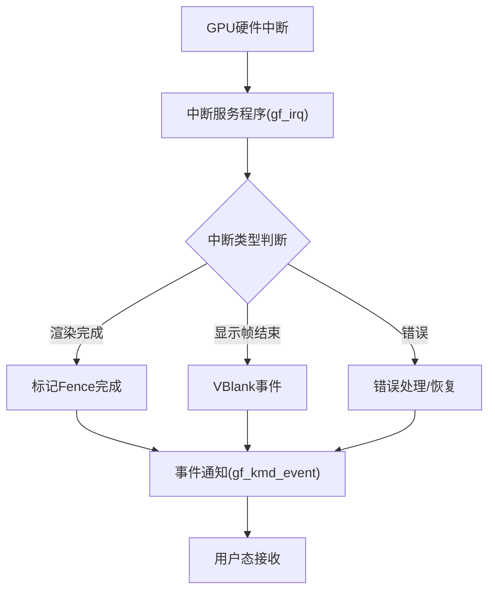
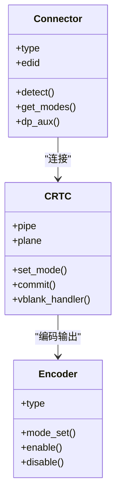
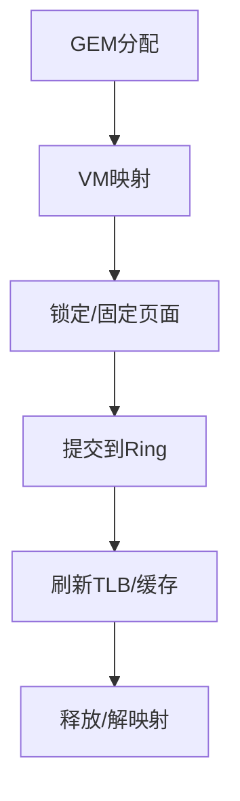
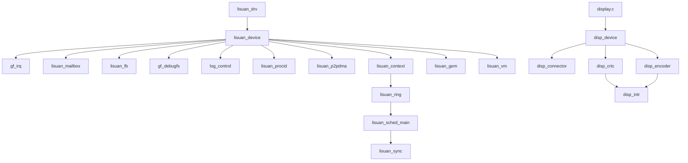

# 内核空间API

<cite>
**本文档引用的文件**
- [lisuan_drv.c](file://_work/src/usr/src/lisuan-dkms-262.2.0.56/lisuan_drv.c)
- [lisuan_device.c](file://_work/src/usr/src/lisuan-dkms-262.2.0.56/lisuan_device.c)
- [lisuan_context.c](file://_work/src/usr/src/lisuan-dkms-262.2.0.56/lisuan_context.c)
- [lisuan_gem.c](file://_work/src/usr/src/lisuan-dkms-262.2.0.56/lisuan_gem.c)
- [lisuan_vm.c](file://_work/src/usr/src/lisuan-dkms-262.2.0.56/lisuan_vm.c)
- [lisuan_ring.c](file://_work/src/usr/src/lisuan-dkms-262.2.0.56/lisuan_ring.c)
- [lisuan_sched_main.c](file://_work/src/usr/src/lisuan-dkms-262.2.0.56/lisuan_sched_main.c)
- [lisuan_sync.c](file://_work/src/usr/src/lisuan-dkms-262.2.0.56/lisuan_sync.c)
- [gf_irq.c](file://_work/src/usr/src/lisuan-dkms-262.2.0.56/gf_irq.c)
- [gf_kmd_event.c](file://_work/src/usr/src/lisuan-dkms-262.2.0.56/gf_kmd_event.c)
- [display.c](file://_work/src/usr/src/lisuan-dkms-262.2.0.56/display.c)
- [disp_device.c](file://_work/src/usr/src/lisuan-dkms-262.2.0.56/display/disp_device.c)
- [disp_connector.c](file://_work/src/usr/src/lisuan-dkms-262.2.0.56/display/connector/disp_connector.c)
- [disp_crtc.c](file://_work/src/usr/src/lisuan-dkms-262.2.0.56/display/crtc/disp_crtc.c)
- [disp_encoder.c](file://_work/src/usr/src/lisuan-dkms-262.2.0.56/display/encoder/disp_encoder.c)
- [disp_intr.c](file://_work/src/usr/src/lisuan-dkms-262.2.0.56/display/intr/disp_intr.c)
- [lisuan_fb.c](file://_work/src/usr/src/lisuan-dkms-262.2.0.56/lisuan_fb.c)
- [lisuan_mailbox.c](file://_work/src/usr/src/lisuan-dkms-262.2.0.56/lisuan_mailbox.c)
- [lisuan_procid.c](file://_work/src/usr/src/lisuan-dkms-262.2.0.56/lisuan_procid.c)
- [lisuan_p2pdma.c](file://_work/src/usr/src/lisuan-dkms-262.2.0.56/lisuan_p2pdma.c)
- [gf_debugfs.c](file://_work/src/usr/src/lisuan-dkms-262.2.0.56/gf_debugfs.c)
- [log_control.c](file://_work/src/usr/src/lisuan-dkms-262.2.0.56/log_control.c)
- [lisuan_drv.h](file://_work/src/usr/src/lisuan-dkms-262.2.0.56/lisuan_drv.h)
- [lisuan_device.h](file://_work/src/usr/src/lisuan-dkms-262.2.0.56/lisuan_device.h)
- [lisuan_context.h](file://_work/src/usr/src/lisuan-dkms-262.2.0.56/lisuan_context.h)
- [lisuan_gem.h](file://_work/src/usr/src/lisuan-dkms-262.2.0.56/lisuan_gem.h)
- [lisuan_vm.h](file://_work/src/usr/src/lisuan-dkms-262.2.0.56/lisuan_vm.h)
- [lisuan_ring.h](file://_work/src/usr/src/lisuan-dkms-262.2.0.56/lisuan_ring.h)
- [lisuan_scheduler.h](file://_work/src/usr/src/lisuan-dkms-262.2.0.56/lisuan_scheduler.h)
- [lisuan_sync.h](file://_work/src/usr/src/lisuan-dkms-262.2.0.56/lisuan_sync.h)
- [gf_irq.h](file://_work/src/usr/src/lisuan-dkms-262.2.0.56/gf_irq.h)
- [gf_kmd_event.h](file://_work/src/usr/src/lisuan-dkms-262.2.0.56/gf_kmd_event.h)
- [display.h](file://_work/src/usr/src/lisuan-dkms-262.2.0.56/display.h)
- [disp_device.h](file://_work/src/usr/src/lisuan-dkms-262.2.0.56/display/disp_device.h)
- [disp_connector.h](file://_work/src/usr/src/lisuan-dkms-262.2.0.56/display/connector/disp_connector.h)
- [disp_crtc.h](file://_work/src/usr/src/lisuan-dkms-262.2.0.56/display/crtc/disp_crtc.h)
- [disp_encoder.h](file://_work/src/usr/src/lisuan-dkms-262.2.0.56/display/encoder/disp_encoder.h)
- [disp_intr.h](file://_work/src/usr/src/lisuan-dkms-262.2.0.56/display/intr/disp_intr.h)
- [lisuan_fb.h](file://_work/src/usr/src/lisuan-dkms-262.2.0.56/lisuan_fb.h)
- [lisuan_mailbox.h](file://_work/src/usr/src/lisuan-dkms-262.2.0.56/lisuan_mailbox.h)
- [lisuan_procid.h](file://_work/src/usr/src/lisuan-dkms-262.2.0.56/lisuan_procid.h)
- [lisuan_p2pdma.h](file://_work/src/usr/src/lisuan-dkms-262.2.0.56/lisuan_p2pdma.h)
- [gf_debugfs.h](file://_work/src/usr/src/lisuan-dkms-262.2.0.56/gf_debugfs.h)
- [log_control.h](file://_work/src/usr/src/lisuan-dkms-262.2.0.56/log_control.h)
</cite>

## 目录
1. [简介](#简介)
2. [项目结构](#项目结构)
3. [核心组件](#核心组件)
4. [架构总览](#架构总览)
5. [详细组件分析](#详细组件分析)
6. [依赖关系分析](#依赖关系分析)
7. [性能考虑](#性能考虑)
8. [故障排查指南](#故障排查指南)
9. [结论](#结论)
10. [附录](#附录)

## 简介
本参考文档面向丽山GPU内核空间驱动开发者，系统化梳理内核模块导出的函数接口、事件处理机制与设备管理接口。内容覆盖初始化流程、设备探测、资源管理、错误处理、DRM子系统集成、中断处理与电源管理接口，并提供开发示例与调试技巧，帮助读者快速理解并高效扩展该GPU驱动。

## 项目结构
本项目采用分层组织：
- DRM/KMS层：负责与Linux DRM/KMS框架对接，提供显示管线、连接器、编码器、CRTC等对象模型。
- GPU核心层：负责上下文、调度、环形缓冲、同步原语、VM地址空间、GEM内存管理等。
- 硬件抽象层：寄存器定义、中断、时钟/电源、Mailbox通信等。
- 用户态交互：debugfs、日志控制、进程ID映射、P2P DMA等。

图表来源
- [display.c:1-200](file://_work/src/usr/src/lisuan-dkms-262.2.0.56/display.c#L1-L200)
- [disp_device.c:1-200](file://_work/src/usr/src/lisuan-dkms-262.2.0.56/display/disp_device.c#L1-L200)
- [disp_connector.c:1-200](file://_work/src/usr/src/lisuan-dkms-262.2.0.56/display/connector/disp_connector.c#L1-L200)
- [disp_crtc.c:1-200](file://_work/src/usr/src/lisuan-dkms-262.2.0.56/display/crtc/disp_crtc.c#L1-L200)
- [disp_encoder.c:1-200](file://_work/src/usr/src/lisuan-dkms-262.2.0.56/display/encoder/disp_encoder.c#L1-L200)
- [disp_intr.c:1-200](file://_work/src/usr/src/lisuan-dkms-262.2.0.56/display/intr/disp_intr.c#L1-L200)
- [lisuan_drv.c:1-200](file://_work/src/usr/src/lisuan-dkms-262.2.0.56/lisuan_drv.c#L1-L200)
- [lisuan_device.c:1-200](file://_work/src/usr/src/lisuan-dkms-262.2.0.56/lisuan_device.c#L1-L200)
- [lisuan_context.c:1-200](file://_work/src/usr/src/lisuan-dkms-262.2.0.56/lisuan_context.c#L1-L200)
- [lisuan_gem.c:1-200](file://_work/src/usr/src/lisuan-dkms-262.2.0.56/lisuan_gem.c#L1-L200)
- [lisuan_vm.c:1-200](file://_work/src/usr/src/lisuan-dkms-262.2.0.56/lisuan_vm.c#L1-L200)
- [lisuan_ring.c:1-200](file://_work/src/usr/src/lisuan-dkms-262.2.0.56/lisuan_ring.c#1-L200)
- [lisuan_sched_main.c:1-200](file://_work/src/usr/src/lisuan-dkms-262.2.0.56/lisuan_sched_main.c#L1-L200)
- [lisuan_sync.c:1-200](file://_work/src/usr/src/lisuan-dkms-262.2.0.56/lisuan_sync.c#L1-L200)
- [gf_irq.c:1-200](file://_work/src/usr/src/lisuan-dkms-262.2.0.56/gf_irq.c#L1-L200)
- [lisuan_fb.c:1-200](file://_work/src/usr/src/lisuan-dkms-262.2.0.56/lisuan_fb.c#L1-L200)
- [lisuan_mailbox.c:1-200](file://_work/src/usr/src/lisuan-dkms-262.2.0.56/lisuan_mailbox.c#L1-L200)
- [lisuan_procid.c:1-200](file://_work/src/usr/src/lisuan-dkms-262.2.0.56/lisuan_procid.c#L1-L200)
- [lisuan_p2pdma.c:1-200](file://_work/src/usr/src/lisuan-dkms-262.2.0.56/lisuan_p2pdma.c#L1-L200)
- [gf_debugfs.c:1-200](file://_work/src/usr/src/lisuan-dkms-262.2.0.56/gf_debugfs.c#L1-L200)
- [log_control.c:1-200](file://_work/src/usr/src/lisuan-dkms-262.2.0.56/log_control.c#L1-L200)

章节来源
- [lisuan_drv.c:1-200](file://_work/src/usr/src/lisuan-dkms-262.2.0.56/lisuan_drv.c#L1-L200)
- [display.c:1-200](file://_work/src/usr/src/lisuan-dkms-262.2.0.56/display.c#L1-L200)

## 核心组件
- 驱动入口与生命周期：模块加载、设备注册、DRM/KMS初始化、清理与卸载。
- 设备管理：PCI/平台设备探测、资源分配、电源状态切换、中断申请与释放。
- 上下文与调度：进程上下文创建/销毁、任务提交、队列调度、同步原语。
- 内存与VM：GEM对象、页表映射、地址空间管理、IOMMU/P2P支持。
- 显示子系统：Connector/CRTC/Encoder的DRM绑定、模式设置、扫描输出。
- 中断与事件：GPU中断路由、软中断/工作队列、事件上报到用户态。
- 调试与日志：debugfs节点、动态日志开关、性能计数。

章节来源
- [lisuan_drv.h:1-200](file://_work/src/usr/src/lisuan-dkms-262.2.0.56/lisuan_drv.h#L1-L200)
- [lisuan_device.h:1-200](file://_work/src/usr/src/lisuan-dkms-262.2.0.56/lisuan_device.h#L1-L200)
- [lisuan_context.h:1-200](file://_work/src/usr/src/lisuan-dkms-262.2.0.56/lisuan_context.h#L1-L200)
- [lisuan_gem.h:1-200](file://_work/src/usr/src/lisuan-dkms-262.2.0.56/lisuan_gem.h#L1-L200)
- [lisuan_vm.h:1-200](file://_work/src/usr/src/lisuan-dkms-262.2.0.56/lisuan_vm.h#L1-L200)
- [lisuan_ring.h:1-200](file://_work/src/usr/src/lisuan-dkms-262.2.0.56/lisuan_ring.h#L1-L200)
- [lisuan_scheduler.h:1-200](file://_work/src/usr/src/lisuan-dkms-262.2.0.56/lisuan_scheduler.h#L1-L200)
- [lisuan_sync.h:1-200](file://_work/src/usr/src/lisuan-dkms-262.2.0.56/lisuan_sync.h#L1-L200)
- [gf_irq.h:1-200](file://_work/src/usr/src/lisuan-dkms-262.2.0.56/gf_irq.h#L1-L200)
- [gf_kmd_event.h:1-200](file://_work/src/usr/src/lisuan-dkms-262.2.0.56/gf_kmd_event.h#L1-L200)
- [display.h:1-200](file://_work/src/usr/src/lisuan-dkms-262.2.0.56/display.h#L1-L200)
- [disp_device.h:1-200](file://_work/src/usr/src/lisuan-dkms-262.2.0.56/display/disp_device.h#L1-L200)
- [disp_connector.h:1-200](file://_work/src/usr/src/lisuan-dkms-262.2.0.56/display/connector/disp_connector.h#L1-L200)
- [disp_crtc.h:1-200](file://_work/src/usr/src/lisuan-dkms-262.2.0.56/display/crtc/disp_crtc.h#L1-L200)
- [disp_encoder.h:1-200](file://_work/src/usr/src/lisuan-dkms-262.2.0.56/display/encoder/disp_encoder.h#L1-L200)
- [disp_intr.h:1-200](file://_work/src/usr/src/lisuan-dkms-262.2.0.56/display/intr/disp_intr.h#L1-L200)
- [lisuan_fb.h:1-200](file://_work/src/usr/src/lisuan-dkms-262.2.0.56/lisuan_fb.h#L1-L200)
- [lisuan_mailbox.h:1-200](file://_work/src/usr/src/lisuan-dkms-262.2.0.56/lisuan_mailbox.h#L1-L200)
- [lisuan_procid.h:1-200](file://_work/src/usr/src/lisuan-dkms-262.2.0.56/lisuan_procid.h#L1-L200)
- [lisuan_p2pdma.h:1-200](file://_work/src/usr/src/lisuan-dkms-262.2.0.56/lisuan_p2pdma.h#L1-L200)
- [gf_debugfs.h:1-200](file://_work/src/usr/src/lisuan-dkms-262.2.0.56/gf_debugfs.h#L1-L200)
- [log_control.h:1-200](file://_work/src/usr/src/lisuan-dkms-262.2.0.56/log_control.h#L1-L200)

## 架构总览
下图展示从用户态调用到GPU执行的关键路径：应用通过DRM IOCTL进入内核，驱动创建或复用上下文，将命令封装为GEM对象并提交至Ring Buffer；调度器派发执行，GPU中断触发完成回调，最终通过事件通知用户态。

图表来源
- [lisuan_drv.c:1-200](file://_work/src/usr/src/lisuan-dkms-262.2.0.56/lisuan_drv.c#L1-L200)
- [lisuan_device.c:1-200](file://_work/src/usr/src/lisuan-dkms-262.2.0.56/lisuan_device.c#L1-L200)
- [lisuan_context.c:1-200](file://_work/src/usr/src/lisuan-dkms-262.2.0.56/lisuan_context.c#L1-L200)
- [lisuan_ring.c:1-200](file://_work/src/usr/src/lisuan-dkms-262.2.0.56/lisuan_ring.c#L1-L200)
- [lisuan_sched_main.c:1-200](file://_work/src/usr/src/lisuan-dkms-262.2.0.56/lisuan_sched_main.c#L1-L200)
- [lisuan_sync.c:1-200](file://_work/src/usr/src/lisuan-dkms-262.2.0.56/lisuan_sync.c#L1-L200)
- [gf_irq.c:1-200](file://_work/src/usr/src/lisuan-dkms-262.2.0.56/gf_irq.c#L1-L200)
- [gf_kmd_event.c:1-200](file://_work/src/usr/src/lisuan-dkms-262.2.0.56/gf_kmd_event.c#L1-L200)

## 详细组件分析

### 驱动入口与DRM/KMS集成
- 模块初始化：注册DRM驱动、设备探测、创建drm_device、初始化KMS对象（Connector/CRTC/Encoder）。
- 设备探测：匹配PCI/平台设备，解析固件/配置，建立MMIO/中断/时钟等资源句柄。
- KMS绑定：实现mode_config、encoder/connector/crtc的ops回调，完成显示流水线初始化。
- 清理流程：释放资源、注销DRM、关闭中断、撤销电源管理。

图表来源
- [lisuan_drv.c:1-200](file://_work/src/usr/src/lisuan-dkms-262.2.0.56/lisuan_drv.c#L1-L200)
- [display.c:1-200](file://_work/src/usr/src/lisuan-dkms-262.2.0.56/display.c#L1-L200)
- [disp_device.c:1-200](file://_work/src/usr/src/lisuan-dkms-262.2.0.56/display/disp_device.c#L1-L200)

章节来源
- [lisuan_drv.c:1-200](file://_work/src/usr/src/lisuan-dkms-262.2.0.56/lisuan_drv.c#L1-L200)
- [display.c:1-200](file://_work/src/usr/src/lisuan-dkms-262.2.0.56/display.c#L1-L200)
- [disp_device.c:1-200](file://_work/src/usr/src/lisuan-dkms-262.2.0.56/display/disp_device.c#L1-L200)

### 设备管理与资源管理
- 设备结构体：维护PCI/平台句柄、MMIO基址、中断号、时钟/电源域、子模块指针。
- 资源分配：按序申请MMIO、IRQ、DMA、时钟、电源；失败回滚已分配资源。
- 电源管理：实现suspend/resume、runtime PM回调，确保显示与GPU状态一致性。
- 错误处理：统一错误码、日志级别、资源泄漏防护。

图表来源
- [lisuan_device.c:1-200](file://_work/src/usr/src/lisuan-dkms-262.2.0.56/lisuan_device.c#L1-L200)
- [lisuan_context.c:1-200](file://_work/src/usr/src/lisuan-dkms-262.2.0.56/lisuan_context.c#L1-L200)
- [lisuan_gem.c:1-200](file://_work/src/usr/src/lisuan-dkms-262.2.0.56/lisuan_gem.c#L1-L200)
- [lisuan_vm.c:1-200](file://_work/src/usr/src/lisuan-dkms-262.2.0.56/lisuan_vm.c#L1-L200)

章节来源
- [lisuan_device.c:1-200](file://_work/src/usr/src/lisuan-dkms-262.2.0.56/lisuan_device.c#L1-L200)
- [lisuan_context.c:1-200](file://_work/src/usr/src/lisuan-dkms-262.2.0.56/lisuan_context.c#L1-L200)
- [lisuan_gem.c:1-200](file://_work/src/usr/src/lisuan-dkms-262.2.0.56/lisuan_gem.c#L1-L200)
- [lisuan_vm.c:1-200](file://_work/src/usr/src/lisuan-dkms-262.2.0.56/lisuan_vm.c#L1-L200)

### 上下文、调度与同步
- 上下文：每个进程一个上下文，包含Ring Buffer、VM句柄、同步对象集合。
- 调度：任务入队、优先级、抢占策略、超时回收。
- 同步：Fence/Syncobj，跨设备/跨进程同步，避免竞态。

图表来源
- [lisuan_context.c:1-200](file://_work/src/usr/src/lisuan-dkms-262.2.0.56/lisuan_context.c#L1-L200)
- [lisuan_ring.c:1-200](file://_work/src/usr/src/lisuan-dkms-262.2.0.56/lisuan_ring.c#L1-L200)
- [lisuan_sched_main.c:1-200](file://_work/src/usr/src/lisuan-dkms-262.2.0.56/lisuan_sched_main.c#L1-L200)
- [lisuan_sync.c:1-200](file://_work/src/usr/src/lisuan-dkms-262.2.0.56/lisuan_sync.c#L1-L200)

章节来源
- [lisuan_context.c:1-200](file://_work/src/usr/src/lisuan-dkms-262.2.0.56/lisuan_context.c#L1-L200)
- [lisuan_ring.c:1-200](file://_work/src/usr/src/lisuan-dkms-262.2.0.56/lisuan_ring.c#L1-L200)
- [lisuan_sched_main.c:1-200](file://_work/src/usr/src/lisuan-dkms-262.2.0.56/lisuan_sched_main.c#L1-L200)
- [lisuan_sync.c:1-200](file://_work/src/usr/src/lisuan-dkms-262.2.0.56/lisuan_sync.c#L1-L200)

### 中断处理与事件机制
- 中断路由：GPU中断源分类（渲染、显示、错误），屏蔽/使能控制。
- 软中断/工作队列：延迟处理耗时逻辑，避免硬中断上下文阻塞。
- 事件上报：将完成/错误事件推送到用户态等待队列或epoll。

图表来源
- [gf_irq.c:1-200](file://_work/src/usr/src/lisuan-dkms-262.2.0.56/gf_irq.c#L1-L200)
- [gf_kmd_event.c:1-200](file://_work/src/usr/src/lisuan-dkms-262.2.0.56/gf_kmd_event.c#L1-L200)
- [disp_intr.c:1-200](file://_work/src/usr/src/lisuan-dkms-262.2.0.56/display/intr/disp_intr.c#L1-L200)

章节来源
- [gf_irq.c:1-200](file://_work/src/usr/src/lisuan-dkms-262.2.0.56/gf_irq.c#L1-L200)
- [gf_kmd_event.c:1-200](file://_work/src/usr/src/lisuan-dkms-262.2.0.56/gf_kmd_event.c#L1-L200)
- [disp_intr.c:1-200](file://_work/src/usr/src/lisuan-dkms-262.2.0.56/display/intr/disp_intr.c#L1-L200)

### 显示子系统（DRM Connector/CRTC/Encoder）
- Connector：EDID读取、HDMI/DP链路训练、热插拔检测。
- CRTC：扫描出、时序配置、平面混合、HDR支持。
- Encoder：编码格式转换、DSC压缩、PHY控制。
- 模式设置：验证模式、原子提交、刷新流水线。

图表来源
- [disp_connector.c:1-200](file://_work/src/usr/src/lisuan-dkms-262.2.0.56/display/connector/disp_connector.c#L1-L200)
- [disp_crtc.c:1-200](file://_work/src/usr/src/lisuan-dkms-262.2.0.56/display/crtc/disp_crtc.c#L1-L200)
- [disp_encoder.c:1-200](file://_work/src/usr/src/lisuan-dkms-262.2.0.56/display/encoder/disp_encoder.c#L1-L200)

章节来源
- [disp_connector.c:1-200](file://_work/src/usr/src/lisuan-dkms-262.2.0.56/display/connector/disp_connector.c#L1-L200)
- [disp_crtc.c:1-200](file://_work/src/usr/src/lisuan-dkms-262.2.0.56/display/crtc/disp_crtc.c#L1-L200)
- [disp_encoder.c:1-200](file://_work/src/usr/src/lisuan-dkms-262.2.0.56/display/encoder/disp_encoder.c#L1-L200)

### 内存管理（GEM/VM/P2P）
- GEM对象：分配、映射、锁定/解锁、共享引用计数。
- VM：页表构建、地址重映射、TLB刷新。
- P2P DMA：直接访问其他设备内存，减少拷贝。

图表来源
- [lisuan_gem.c:1-200](file://_work/src/usr/src/lisuan-dkms-262.2.0.56/lisuan_gem.c#L1-L200)
- [lisuan_vm.c:1-200](file://_work/src/usr/src/lisuan-dkms-262.2.0.56/lisuan_vm.c#L1-L200)
- [lisuan_p2pdma.c:1-200](file://_work/src/usr/src/lisuan-dkms-262.2.0.56/lisuan_p2pdma.c#L1-L200)

章节来源
- [lisuan_gem.c:1-200](file://_work/src/usr/src/lisuan-dkms-262.2.0.56/lisuan_gem.c#L1-L200)
- [lisuan_vm.c:1-200](file://_work/src/usr/src/lisuan-dkms-262.2.0.56/lisuan_vm.c#L1-L200)
- [lisuan_p2pdma.c:1-200](file://_work/src/usr/src/lisuan-dkms-262.2.0.56/lisuan_p2pdma.c#L1-L200)

### 用户态交互与调试
- Mailbox：与固件/微控制器通信的命令通道。
- ProcID：进程ID映射与权限校验。
- Debugfs：运行时参数、统计信息、寄存器dump。
- 日志控制：动态开关、分级输出。

章节来源
- [lisuan_mailbox.c:1-200](file://_work/src/usr/src/lisuan-dkms-262.2.0.56/lisuan_mailbox.c#L1-L200)
- [lisuan_procid.c:1-200](file://_work/src/usr/src/lisuan-dkms-262.2.0.56/lisuan_procid.c#L1-L200)
- [gf_debugfs.c:1-200](file://_work/src/usr/src/lisuan-dkms-262.2.0.56/gf_debugfs.c#L1-L200)
- [log_control.c:1-200](file://_work/src/usr/src/lisuan-dkms-262.2.0.56/log_control.c#L1-L200)

## 依赖关系分析
- 模块耦合：驱动入口依赖设备管理；设备管理依赖中断、电源、时钟、Mailbox；显示子系统依赖中断与CRTC/Encoder。
- 外部依赖：Linux DRM/KMS、IOMMU、DMA API、Workqueue、Epoll、Sysfs/Debugfs。
- 潜在循环：应避免在初始化阶段互相依赖，使用延迟初始化或探针顺序控制。

图表来源
- [lisuan_drv.c:1-200](file://_work/src/usr/src/lisuan-dkms-262.2.0.56/lisuan_drv.c#L1-L200)
- [lisuan_device.c:1-200](file://_work/src/usr/src/lisuan-dkms-262.2.0.56/lisuan_device.c#L1-L200)
- [gf_irq.c:1-200](file://_work/src/usr/src/lisuan-dkms-262.2.0.56/gf_irq.c#L1-L200)
- [lisuan_mailbox.c:1-200](file://_work/src/usr/src/lisuan-dkms-262.2.0.56/lisuan_mailbox.c#L1-L200)
- [lisuan_fb.c:1-200](file://_work/src/usr/src/lisuan-dkms-262.2.0.56/lisuan_fb.c#L1-L200)
- [gf_debugfs.c:1-200](file://_work/src/usr/src/lisuan-dkms-262.2.0.56/gf_debugfs.c#L1-L200)
- [log_control.c:1-200](file://_work/src/usr/src/lisuan-dkms-262.2.0.56/log_control.c#L1-L200)
- [lisuan_procid.c:1-200](file://_work/src/usr/src/lisuan-dkms-262.2.0.56/lisuan_procid.c#L1-L200)
- [lisuan_p2pdma.c:1-200](file://_work/src/usr/src/lisuan-dkms-262.2.0.56/lisuan_p2pdma.c#L1-L200)
- [lisuan_context.c:1-200](file://_work/src/usr/src/lisuan-dkms-262.2.0.56/lisuan_context.c#L1-L200)
- [lisuan_ring.c:1-200](file://_work/src/usr/src/lisuan-dkms-262.2.0.56/lisuan_ring.c#L1-L200)
- [lisuan_sched_main.c:1-200](file://_work/src/usr/src/lisuan-dkms-262.2.0.56/lisuan_sched_main.c#L1-L200)
- [lisuan_sync.c:1-200](file://_work/src/usr/src/lisuan-dkms-262.2.0.56/lisuan_sync.c#L1-L200)
- [lisuan_gem.c:1-200](file://_work/src/usr/src/lisuan-dkms-262.2.0.56/lisuan_gem.c#L1-L200)
- [lisuan_vm.c:1-200](file://_work/src/usr/src/lisuan-dkms-262.2.0.56/lisuan_vm.c#L1-L200)
- [display.c:1-200](file://_work/src/usr/src/lisuan-dkms-262.2.0.56/display.c#L1-L200)
- [disp_device.c:1-200](file://_work/src/usr/src/lisuan-dkms-262.2.0.56/display/disp_device.c#L1-L200)
- [disp_connector.c:1-200](file://_work/src/usr/src/lisuan-dkms-262.2.0.56/display/connector/disp_connector.c#L1-L200)
- [disp_crtc.c:1-200](file://_work/src/usr/src/lisuan-dkms-262.2.0.56/display/crtc/disp_crtc.c#L1-L200)
- [disp_encoder.c:1-200](file://_work/src/usr/src/lisuan-dkms-262.2.0.56/display/encoder/disp_encoder.c#L1-L200)
- [disp_intr.c:1-200](file://_work/src/usr/src/lisuan-dkms-262.2.0.56/display/intr/disp_intr.c#L1-L200)

章节来源
- [lisuan_drv.c:1-200](file://_work/src/usr/src/lisuan-dkms-262.2.0.56/lisuan_drv.c#L1-L200)
- [lisuan_device.c:1-200](file://_work/src/usr/src/lisuan-dkms-262.2.0.56/lisuan_device.c#L1-L200)
- [display.c:1-200](file://_work/src/usr/src/lisuan-dkms-262.2.0.56/display.c#L1-L200)

## 性能考虑
- 批处理提交：合并小命令包，降低CPU开销。
- 零拷贝：优先使用GEM共享与P2P DMA。
- 中断节流：批量处理中断，避免频繁唤醒。
- 异步提交：非阻塞提交+事件回调，提高吞吐。
- 缓存一致性：合理刷新TLB/Cache，避免多余操作。

[本节为通用指导，不直接分析具体文件]

## 故障排查指南
- 常见问题：设备未识别、中断风暴、死锁、内存泄漏、显示黑屏。
- 定位手段：
  - 启用详细日志与debugfs节点，观察关键计数器。
  - 检查中断向量与屏蔽位，确认ISR是否被调用。
  - 使用dmesg与perf追踪系统调用与调度延迟。
  - 对Ring Buffer进行dump，核对命令序列。
- 恢复策略：重置GPU、重新初始化显示流水线、重建VM映射。

章节来源
- [gf_debugfs.c:1-200](file://_work/src/usr/src/lisuan-dkms-262.2.0.56/gf_debugfs.c#L1-L200)
- [log_control.c:1-200](file://_work/src/usr/src/lisuan-dkms-262.2.0.56/log_control.c#L1-L200)
- [gf_irq.c:1-200](file://_work/src/usr/src/lisuan-dkms-262.2.0.56/gf_irq.c#L1-L200)

## 结论
本参考文档系统梳理了丽山GPU内核空间API的核心组件与交互流程，涵盖DRM/KMS集成、设备与资源管理、中断与事件、内存与VM、调试与性能优化。遵循本文档的实践建议，可显著提升驱动稳定性与可维护性，并为后续功能扩展奠定基础。

## 附录
- 开发示例要点：
  - 初始化顺序：设备探测→资源分配→DRM/KMS绑定→中断注册。
  - 提交路径：GEM分配→VM映射→Ring写入→调度入队→等待同步。
  - 事件处理：中断分类→Fence完成→事件上报→用户态接收。
  - 错误处理：统一错误码→资源回滚→日志记录→恢复尝试。
- 调试技巧：
  - 使用debugfs查看寄存器与统计信息。
  - 开启动态日志，过滤关键模块。
  - 使用tracepoints与perf分析热点路径。
  - 模拟异常中断与OOM场景，验证健壮性。

[本节为通用指导，不直接分析具体文件]