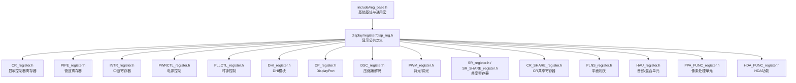
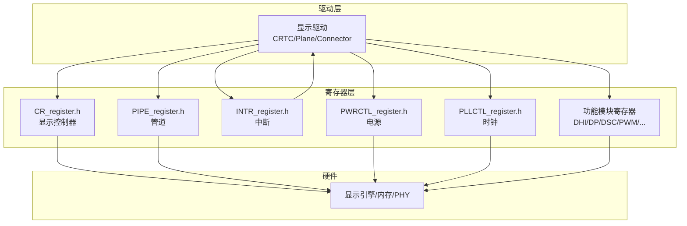
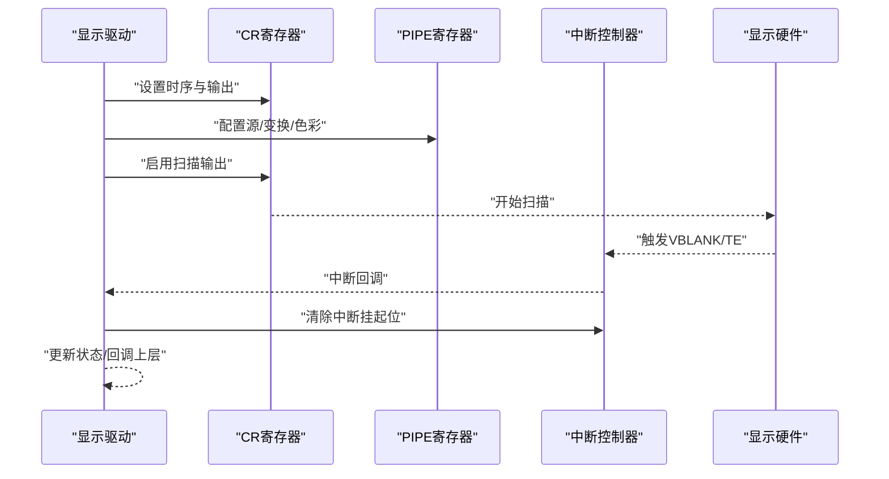
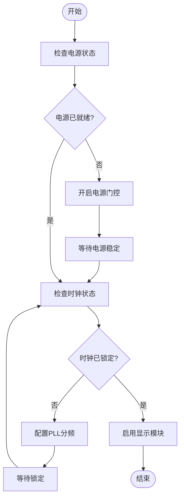
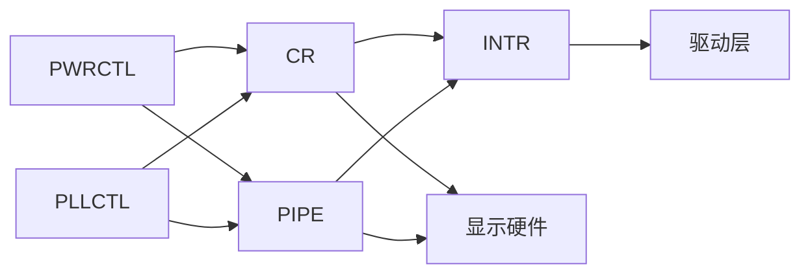

# 寄存器定义

<cite>
**本文引用的文件**   
- [reg_base.h](file://_work/src/usr/src/lisuan-gpu-dkms-262.2.0.56/include/reg_base.h)
- [disp_reg.h](file://_work/src/usr/src/lisuan-gpu-dkms-262.2.0.56/display/register/disp_reg.h)
- [CR_register.h](file://_work/src/usr/src/lisuan-gpu-dkms-262.2.0.56/display/register/CR_register.h)
- [PIPE_register.h](file://_work/src/usr/src/lisuan-gpu-dkms-262.2.0.56/display/register/PIPE_register.h)
- [INTR_register.h](file://_work/src/usr/src/lisuan-gpu-dkms-262.2.0.56/display/register/INTR_register.h)
- [PWRCTL_register.h](file://_work/src/usr/src/lisuan-gpu-dkms-262.2.0.56/display/register/PWRCTL_register.h)
- [PLLCTL_register.h](file://_work/src/usr/src/lisuan-gpu-dkms-262.2.0.56/display/register/PLLCTL_register.h)
- [DHI_register.h](file://_work/src/usr/src/lisuan-gpu-dkms-262.2.0.56/display/register/DHI_register.h)
- [DP_register.h](file://_work/src/usr/src/lisuan-gpu-dkms-262.2.0.56/display/register/DP_register.h)
- [DSC_register.h](file://_work/src/usr/src/lisuan-gpu-dkms-262.2.0.56/display/register/DSC_register.h)
- [PWM_register.h](file://_work/src/usr/src/lisuan-gpu-dkms-262.2.0.56/display/register/PWM_register.h)
- [SR_register.h](file://_work/src/usr/src/lisuan-gpu-dkms-262.2.0.56/display/register/SR_register.h)
- [SR_SHARE_register.h](file://_work/src/usr/src/lisuan-gpu-dkms-262.2.0.56/display/register/SR_SHARE_register.h)
- [CR_SHARE_register.h](file://_work/src/usr/src/lisuan-gpu-dkms-262.2.0.56/display/register/CR_SHARE_register.h)
- [PLNS_register.h](file://_work/src/usr/src/lisuan-gpu-dkms-262.2.0.56/display/register/PLNS_register.h)
- [HAU_register.h](file://_work/src/usr/src/lisuan-gpu-dkms-262.2.0.56/display/register/HAU_register.h)
- [PPA_FUNC_register.h](file://_work/src/usr/src/lisuan-gpu-dkms-262.2.0.56/display/register/PPA_FUNC_register.h)
- [HDA_FUNC_register.h](file://_work/src/usr/src/lisuan-gpu-dkms-262.2.0.56/display/register/HDA_FUNC_register.h)
</cite>

## 目录
1. [简介](#简介)
2. [项目结构](#项目结构)
3. [核心组件](#核心组件)
4. [架构总览](#架构总览)
5. [详细组件分析](#详细组件分析)
6. [依赖关系分析](#依赖关系分析)
7. [性能考虑](#性能考虑)
8. [故障排查指南](#故障排查指南)
9. [结论](#结论)
10. [附录](#附录)

## 简介
本参考文档面向丽山GPU显示子系统的硬件寄存器，系统化梳理基础基址、显示控制器（CR）、管道（PIPE）、中断（INTR）、电源与时钟（PWRCTL/PLLCTL）以及各功能模块（DHI、DP、DSC、PWM、SR/CR共享、PLNS、HAU、PPA、HDA等）的寄存器定义与使用要点。文档提供：
- 寄存器分组与地址空间概览
- 位域、读写权限与默认值的组织方式
- 典型操作流程（初始化、模式设置、中断处理）
- 安全访问与性能优化建议
- 常见问题定位方法

说明：由于仓库中寄存器头文件以宏和枚举形式定义具体位域与偏移，本文档不直接粘贴代码片段，而是通过“章节来源”指向对应文件行号，便于读者对照查阅。

## 项目结构
显示子系统寄存器定义集中在 display/register 目录下，按功能模块拆分多个头文件；公共基址与通用宏在 include/reg_base.h 与 display/register/disp_reg.h 中提供。

图表来源
- [reg_base.h:1-200](file://_work/src/usr/src/lisuan-gpu-dkms-262.2.0.56/include/reg_base.h#L1-L200)
- [disp_reg.h:1-200](file://_work/src/usr/src/lisuan-gpu-dkms-262.2.0.56/display/register/disp_reg.h#L1-L200)

章节来源
- [reg_base.h:1-200](file://_work/src/usr/src/lisuan-gpu-dkms-262.2.0.56/include/reg_base.h#L1-L200)
- [disp_reg.h:1-200](file://_work/src/usr/src/lisuan-gpu-dkms-262.2.0.56/display/register/disp_reg.h#L1-L200)

## 核心组件
- 基础基址与地址映射
  - 通过 reg_base.h 提供各类模块的基址宏，用于计算相对偏移后的绝对地址。
  - disp_reg.h 提供显示子系统公共常量、位掩码与字段名，供各模块头文件复用。
- 显示控制器（CR）
  - CR_register.h 定义全局显示控制器的使能、扫描输出、时序参数、状态标志等。
- 管道（PIPE）
  - PIPE_register.h 定义每个管道的源选择、缩放、颜色管理、裁剪、叠加顺序等。
- 中断（INTR）
  - INTR_register.h 定义中断屏蔽、挂起、状态位及事件类型。
- 电源与时钟（PWRCTL/PLLCTL）
  - PWRCTL_register.h 管理显示模块电源门控、复位、待机。
  - PLLCTL_register.h 管理显示时钟生成、分频、锁定状态。
- 功能模块
  - DHI_register.h：DHI接口相关寄存器。
  - DP_register.h：DisplayPort链路训练、辅助通道、帧缓冲指针等。
  - DSC_register.h：DSC压缩参数、速率控制、错误统计。
  - PWM_register.h：背光亮度、周期、占空比。
  - SR/CR_SHARE_register.h：跨模块共享数据与同步标志。
  - PLNS_register.h：平面属性与变换。
  - HAU_register.h：音频/混合单元配置。
  - PPA_FUNC_register.h：像素处理单元功能。
  - HDA_FUNC_register.h：HDA音频功能。

章节来源
- [CR_register.h:1-300](file://_work/src/usr/src/lisuan-gpu-dkms-262.2.0.56/display/register/CR_register.h#L1-L300)
- [PIPE_register.h:1-300](file://_work/src/usr/src/lisuan-gpu-dkms-262.2.0.56/display/register/PIPE_register.h#L1-L300)
- [INTR_register.h:1-200](file://_work/src/usr/src/lisuan-gpu-dkms-262.2.0.56/display/register/INTR_register.h#L1-L200)
- [PWRCTL_register.h:1-200](file://_work/src/usr/src/lisuan-gpu-dkms-262.2.0.56/display/register/PWRCTL_register.h#L1-L200)
- [PLLCTL_register.h:1-200](file://_work/src/usr/src/lisuan-gpu-dkms-262.2.0.56/display/register/PLLCTL_register.h#L1-L200)
- [DHI_register.h:1-200](file://_work/src/usr/src/lisuan-gpu-dkms-262.2.0.56/display/register/DHI_register.h#L1-L200)
- [DP_register.h:1-300](file://_work/src/usr/src/lisuan-gpu-dkms-262.2.0.56/display/register/DP_register.h#L1-L300)
- [DSC_register.h:1-200](file://_work/src/usr/src/lisuan-gpu-dkms-262.2.0.56/display/register/DSC_register.h#L1-L200)
- [PWM_register.h:1-200](file://_work/src/usr/src/lisuan-gpu-dkms-262.2.0.56/display/register/PWM_register.h#L1-L200)
- [SR_register.h:1-200](file://_work/src/usr/src/lisuan-gpu-dkms-262.2.0.56/display/register/SR_register.h#L1-L200)
- [SR_SHARE_register.h:1-200](file://_work/src/usr/src/lisuan-gpu-dkms-262.2.0.56/display/register/SR_SHARE_register.h#L1-L200)
- [CR_SHARE_register.h:1-200](file://_work/src/usr/src/lisuan-gpu-dkms-262.2.0.56/display/register/CR_SHARE_register.h#L1-L200)
- [PLNS_register.h:1-200](file://_work/src/usr/src/lisuan-gpu-dkms-262.2.0.56/display/register/PLNS_register.h#L1-L200)
- [HAU_register.h:1-200](file://_work/src/usr/src/lisuan-gpu-dkms-262.2.0.56/display/register/HAU_register.h#L1-L200)
- [PPA_FUNC_register.h:1-200](file://_work/src/usr/src/lisuan-gpu-dkms-262.2.0.56/display/register/PPA_FUNC_register.h#L1-L200)
- [HDA_FUNC_register.h:1-200](file://_work/src/usr/src/lisuan-gpu-dkms-262.2.0.56/display/register/HDA_FUNC_register.h#L1-L200)

## 架构总览
下图展示了显示子系统的关键模块与寄存器域的交互关系，以及驱动侧对寄存器的访问路径。

图表来源
- [disp_reg.h:1-200](file://_work/src/usr/src/lisuan-gpu-dkms-262.2.0.56/display/register/disp_reg.h#L1-L200)
- [CR_register.h:1-300](file://_work/src/usr/src/lisuan-gpu-dkms-262.2.0.56/display/register/CR_register.h#L1-L300)
- [PIPE_register.h:1-300](file://_work/src/usr/src/lisuan-gpu-dkms-262.2.0.56/display/register/PIPE_register.h#L1-L300)
- [INTR_register.h:1-200](file://_work/src/usr/src/lisuan-gpu-dkms-262.2.0.56/display/register/INTR_register.h#L1-L200)
- [PWRCTL_register.h:1-200](file://_work/src/usr/src/lisuan-gpu-dkms-262.2.0.56/display/register/PWRCTL_register.h#L1-L200)
- [PLLCTL_register.h:1-200](file://_work/src/usr/src/lisuan-gpu-dkms-262.2.0.56/display/register/PLLCTL_register.h#L1-L200)

## 详细组件分析

### 基础基址与公共定义
- 作用
  - 提供各模块基址宏与公共位域命名，确保地址计算一致性与可读性。
- 关键内容
  - 模块基址宏（如显示控制器、管道、中断、电源、时钟等）。
  - 公共位域命名规范（ENABLE、STATUS、MASK、FIELD_X_Y）。
  - 对齐与宽度约束（如32位对齐、位宽限制）。
- 使用建议
  - 所有寄存器访问统一通过“基址 + 偏移”的方式构造地址。
  - 优先使用公共宏进行位域操作，避免硬编码数值。

章节来源
- [reg_base.h:1-200](file://_work/src/usr/src/lisuan-gpu-dkms-262.2.0.56/include/reg_base.h#L1-L200)
- [disp_reg.h:1-200](file://_work/src/usr/src/lisuan-gpu-dkms-262.2.0.56/display/register/disp_reg.h#L1-L200)

### 显示控制器（CR）
- 职责
  - 控制显示扫描、时序、输出端口、全局使能与状态。
- 主要寄存器组
  - 全局控制：使能、复位、模式切换。
  - 时序参数：水平/垂直计数、消隐区间、刷新率相关。
  - 状态与诊断：扫描位置、VBLANK状态、错误标志。
- 典型流程
  - 初始化：关闭输出 -> 设置时序 -> 启用扫描 -> 等待稳定。
  - 运行时：动态调整分辨率或刷新率需遵循原子更新顺序。

章节来源
- [CR_register.h:1-300](file://_work/src/usr/src/lisuan-gpu-dkms-262.2.0.56/display/register/CR_register.h#L1-L300)

### 管道（PIPE）
- 职责
  - 每路管道负责一个显示源的合成与输出，包含源选择、缩放、色彩、裁剪、叠加顺序等。
- 主要寄存器组
  - 源配置：输入格式、缓冲区指针、步长。
  - 几何变换：缩放比例、旋转、镜像、裁剪矩形。
  - 色彩管理：伽马、色调、饱和度、对比度。
  - 合成与输出：图层优先级、透明度、目标区域。
- 典型流程
  - 配置源 -> 设置变换 -> 配置色彩 -> 提交帧 -> 等待完成。

章节来源
- [PIPE_register.h:1-300](file://_work/src/usr/src/lisuan-gpu-dkms-262.2.0.56/display/register/PIPE_register.h#L1-L300)

### 中断（INTR）
- 职责
  - 汇总并分发显示相关中断事件（VBLANK、TE、错误等），支持屏蔽与状态查询。
- 主要寄存器组
  - 中断屏蔽：按事件位屏蔽/允许。
  - 中断挂起：当前待处理的中断位。
  - 事件类型：VBLANK、TE、错误、链路状态变化等。
- 典型流程
  - 注册中断处理 -> 开启所需事件 -> 在中断中清挂起位 -> 执行回调。

章节来源
- [INTR_register.h:1-200](file://_work/src/usr/src/lisuan-gpu-dkms-262.2.0.56/display/register/INTR_register.h#L1-L200)

### 电源与时钟（PWRCTL/PLLCTL）
- 职责
  - 管理显示模块电源门控、复位序列与时钟生成（PLL分频、锁定检测）。
- 主要寄存器组
  - 电源门控：模块开关、复位释放、待机控制。
  - 时钟配置：参考源、分频系数、锁定状态、频率范围检查。
- 典型流程
  - 上电顺序：先开电源 -> 再启时钟 -> 等待锁定 -> 启用模块。
  - 下电顺序：禁用模块 -> 停止时钟 -> 关闭电源。

章节来源
- [PWRCTL_register.h:1-200](file://_work/src/usr/src/lisuan-gpu-dkms-262.2.0.56/display/register/PWRCTL_register.h#L1-L200)
- [PLLCTL_register.h:1-200](file://_work/src/usr/src/lisuan-gpu-dkms-262.2.0.56/display/register/PLLCTL_register.h#L1-L200)

### 功能模块（DHI/DP/DSC/PWM/SR/CR_SHARE/PLNS/HAU/PPA/HDA）
- DHI_register.h
  - DHI接口时序、数据格式、通道配置。
- DP_register.h
  - DisplayPort链路训练、辅助通道、帧缓冲指针、流控制。
- DSC_register.h
  - DSC压缩参数、速率控制、错误统计、调试信息。
- PWM_register.h
  - 背光周期、占空比、使能、校准。
- SR_register.h / SR_SHARE_register.h
  - 共享寄存器与跨模块同步标志，常用于帧同步与状态共享。
- CR_SHARE_register.h
  - 与CR相关的共享字段，协调全局显示状态。
- PLNS_register.h
  - 平面属性与变换，与PIPE协同工作。
- HAU_register.h
  - 音频/混合单元配置，与视频输出同步。
- PPA_FUNC_register.h
  - 像素处理单元功能，如格式转换、去噪、锐化。
- HDA_FUNC_register.h
  - HDA音频功能，与显示输出关联。

章节来源
- [DHI_register.h:1-200](file://_work/src/usr/src/lisuan-gpu-dkms-262.2.0.56/display/register/DHI_register.h#L1-L200)
- [DP_register.h:1-300](file://_work/src/usr/src/lisuan-gpu-dkms-262.2.0.56/display/register/DP_register.h#L1-L300)
- [DSC_register.h:1-200](file://_work/src/usr/src/lisuan-gpu-dkms-262.2.0.56/display/register/DSC_register.h#L1-L200)
- [PWM_register.h:1-200](file://_work/src/usr/src/lisuan-gpu-dkms-262.2.0.56/display/register/PWM_register.h#L1-L200)
- [SR_register.h:1-200](file://_work/src/usr/src/lisuan-gpu-dkms-262.2.0.56/display/register/SR_register.h#L1-L200)
- [SR_SHARE_register.h:1-200](file://_work/src/usr/src/lisuan-gpu-dkms-262.2.0.56/display/register/SR_SHARE_register.h#L1-L200)
- [CR_SHARE_register.h:1-200](file://_work/src/usr/src/lisuan-gpu-dkms-262.2.0.56/display/register/CR_SHARE_register.h#L1-L200)
- [PLNS_register.h:1-200](file://_work/src/usr/src/lisuan-gpu-dkms-262.2.0.56/display/register/PLNS_register.h#L1-L200)
- [HAU_register.h:1-200](file://_work/src/usr/src/lisuan-gpu-dkms-262.2.0.56/display/register/HAU_register.h#L1-L200)
- [PPA_FUNC_register.h:1-200](file://_work/src/usr/src/lisuan-gpu-dkms-262.2.0.56/display/register/PPA_FUNC_register.h#L1-L200)
- [HDA_FUNC_register.h:1-200](file://_work/src/usr/src/lisuan-gpu-dkms-262.2.0.56/display/register/HDA_FUNC_register.h#L1-L200)

### 典型操作流程（序列图）
以下序列图展示一次显示模式设置的典型调用链：驱动层组装参数 -> 写入CR/PIPE寄存器 -> 启动扫描 -> 等待中断确认。

图表来源
- [CR_register.h:1-300](file://_work/src/usr/src/lisuan-gpu-dkms-262.2.0.56/display/register/CR_register.h#L1-L300)
- [PIPE_register.h:1-300](file://_work/src/usr/src/lisuan-gpu-dkms-262.2.0.56/display/register/PIPE_register.h#L1-L300)
- [INTR_register.h:1-200](file://_work/src/usr/src/lisuan-gpu-dkms-262.2.0.56/display/register/INTR_register.h#L1-L200)

### 复杂逻辑流程图（时钟上电）

图表来源
- [PWRCTL_register.h:1-200](file://_work/src/usr/src/lisuan-gpu-dkms-262.2.0.56/display/register/PWRCTL_register.h#L1-L200)
- [PLLCTL_register.h:1-200](file://_work/src/usr/src/lisuan-gpu-dkms-262.2.0.56/display/register/PLLCTL_register.h#L1-L200)

## 依赖关系分析
- 模块耦合
  - CR与PIPE强耦合：CR负责全局扫描，PIPE负责源合成，二者需按序配置。
  - INTR与CR/PIPE：中断事件由硬件产生，驱动需在正确时机清位与回调。
  - PWRCTL/PLLCTL为底层依赖：其他模块必须在电源与时钟就绪后操作。
- 外部依赖
  - 内存与DMA：PIPE源缓冲区指针与步长需有效且对齐。
  - PHY与链路：DP/DHI需要PHY链路训练成功。
- 潜在循环依赖
  - 共享寄存器（SR/CR_SHARE）需谨慎设计同步协议，避免竞态。

图表来源
- [PWRCTL_register.h:1-200](file://_work/src/usr/src/lisuan-gpu-dkms-262.2.0.56/display/register/PWRCTL_register.h#L1-L200)
- [PLLCTL_register.h:1-200](file://_work/src/usr/src/lisuan-gpu-dkms-262.2.0.56/display/register/PLLCTL_register.h#L1-L200)
- [CR_register.h:1-300](file://_work/src/usr/src/lisuan-gpu-dkms-262.2.0.56/display/register/CR_register.h#L1-L300)
- [PIPE_register.h:1-300](file://_work/src/usr/src/lisuan-gpu-dkms-262.2.0.56/display/register/PIPE_register.h#L1-L300)
- [INTR_register.h:1-200](file://_work/src/usr/src/lisuan-gpu-dkms-262.2.0.56/display/register/INTR_register.h#L1-L200)

## 性能考虑
- 批量写入与原子更新
  - 将相关寄存器写入合并到最小批次数，减少总线开销。
  - 模式切换采用原子更新顺序（先写新值，再一次性启用），避免撕裂。
- 中断优化
  - 仅开启必要事件，避免频繁中断。
  - 在中断中快速清位与标记，耗时操作延后到软中断或工作队列。
- 时钟与电源
  - 合理设置PLL分频，避免频繁重锁。
  - 空闲时关闭不必要模块电源，降低功耗。
- 内存与DMA
  - 缓冲区对齐与步长符合硬件要求，减少拷贝与校验。
  - 使用零拷贝策略，避免重复分配。

[本节为通用指导，无需特定文件来源]

## 故障排查指南
- 无显示输出
  - 检查电源与时钟是否就绪（PWRCTL/PLLCTL状态位）。
  - 确认CR扫描输出已启用，PIPE源配置正确。
  - 查看中断挂起位是否有异常事件。
- 画面撕裂或闪烁
  - 检查VBLANK同步与原子更新顺序。
  - 确认PIPE缓冲区指针与步长有效。
- DP链路失败
  - 检查链路训练状态与辅助通道通信。
  - 确认PHY配置与时钟匹配。
- 背光异常
  - 检查PWM周期与占空比设置。
  - 验证电源门控与使能位。

章节来源
- [PWRCTL_register.h:1-200](file://_work/src/usr/src/lisuan-gpu-dkms-262.2.0.56/display/register/PWRCTL_register.h#L1-L200)
- [PLLCTL_register.h:1-200](file://_work/src/usr/src/lisuan-gpu-dkms-262.2.0.56/display/register/PLLCTL_register.h#L1-L200)
- [CR_register.h:1-300](file://_work/src/usr/src/lisuan-gpu-dkms-262.2.0.56/display/register/CR_register.h#L1-L300)
- [PIPE_register.h:1-300](file://_work/src/usr/src/lisuan-gpu-dkms-262.2.0.56/display/register/PIPE_register.h#L1-L300)
- [INTR_register.h:1-200](file://_work/src/usr/src/lisuan-gpu-dkms-262.2.0.56/display/register/INTR_register.h#L1-L200)
- [DP_register.h:1-300](file://_work/src/usr/src/lisuan-gpu-dkms-262.2.0.56/display/register/DP_register.h#L1-L300)
- [PWM_register.h:1-200](file://_work/src/usr/src/lisuan-gpu-dkms-262.2.0.56/display/register/PWM_register.h#L1-L200)

## 结论
本文系统梳理了丽山GPU显示子系统的寄存器定义与使用要点，涵盖基址与公共定义、CR/PIPE/INTR/PWRCTL/PLLCTL及各功能模块。通过图示与流程说明，帮助开发者理解寄存器间的依赖关系与典型操作路径。建议在实现中严格遵循原子更新、中断优化与安全访问原则，以获得稳定高效的显示体验。

[本节为总结，无需特定文件来源]

## 附录
- 寄存器操作示例（路径指引）
  - 读取状态位：参考 INTR_register.h 中的状态位定义与掩码。
  - 写入时序参数：参考 CR_register.h 中的时序寄存器组。
  - 配置管道源：参考 PIPE_register.h 中的源与变换寄存器。
  - 电源与时钟：参考 PWRCTL_register.h 与 PLLCTL_register.h 的使能与锁定流程。
- 最佳实践清单
  - 使用公共宏与位域命名，避免硬编码。
  - 批量写入与原子更新，减少总线与撕裂风险。
  - 仅开启必要中断，快速清位与延后耗时操作。
  - 电源与时钟上电/下电顺序严格遵守硬件要求。
  - 缓冲区对齐与步长符合硬件规范，避免DMA错误。

[本节为补充信息，无需特定文件来源]