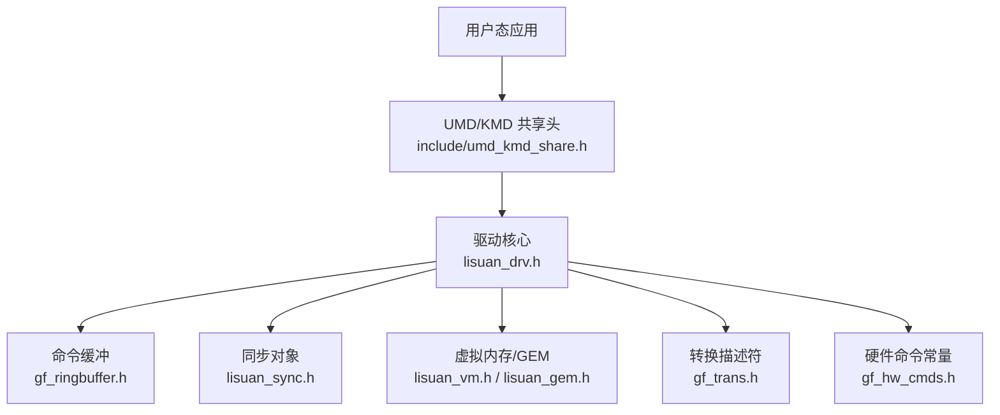
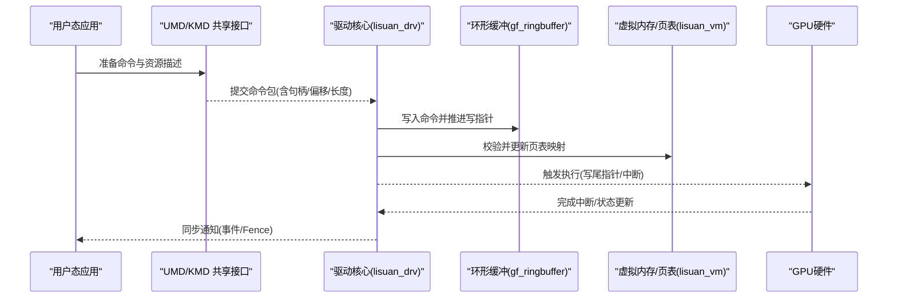
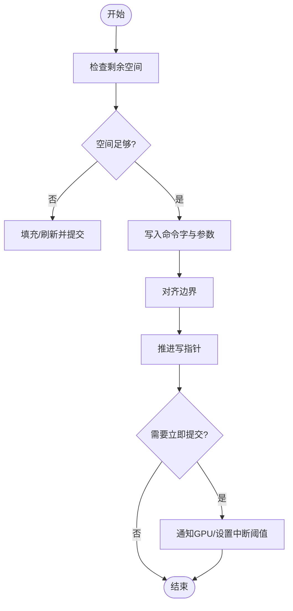
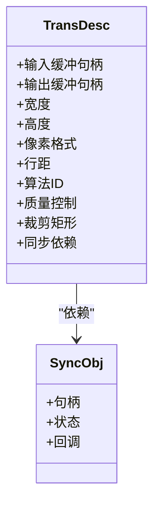
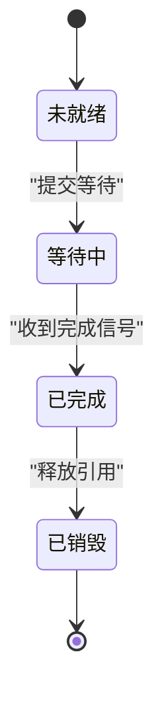
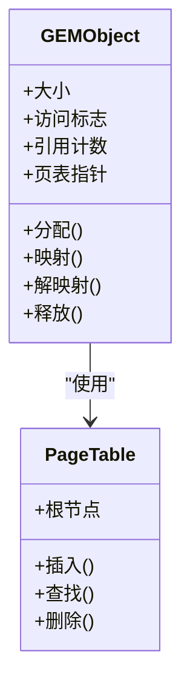
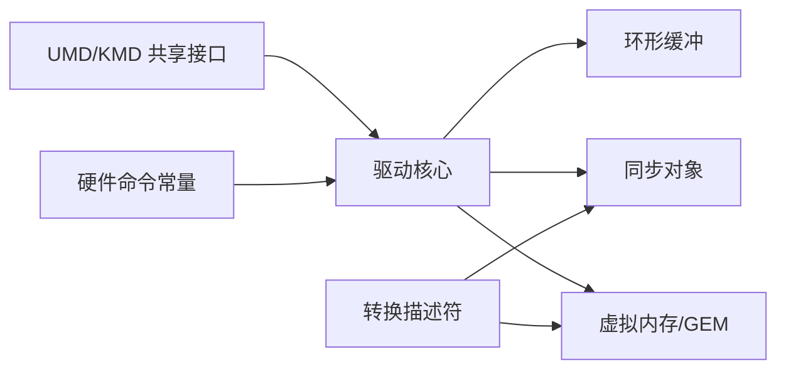

# 数据结构

<cite>
**本文引用的文件**   
- [gf_hw_cmds.h](file://_work/src/usr/src/lisuangpu-dkms-262.2.0.56/gf_hw_cmds.h)
- [gf_ringbuffer.h](file://_work/src/usr/src/lisuangpu-dkms-262.2.0.56/gf_ringbuffer.h)
- [lisuan_sync.h](file://_work/src/usr/src/lisuangpu-dkms-262.2.0.56/lisuan_sync.h)
- [lisuan_vm.h](file://_work/src/usr/src/lisuangpu-dkms-262.2.0.56/lisuan_vm.h)
- [lisuan_gem.h](file://_work/src/usr/src/lisuangpu-dkms-262.2.0.56/lisuan_gem.h)
- [lisuan_drv.h](file://_work/src/usr/src/lisuangpu-dkms-262.2.0.56/lisuan_drv.h)
- [gf_trans.h](file://_work/src/usr/src/lisuangpu-dkms-262.2.0.56/gf_trans.h)
- [include/um d_kmd_share.h](file://_work/src/usr/src/lisuangpu-dkms-262.2.0.56/include/umd_kmd_share.h)
- [include/rtsim_kmd_share.h](file://_work/src/usr/src/lisuangpu-dkms-262.2.0.56/include/rtsim_kmd_share.h)
</cite>

## 目录
1. [简介](#简介)
2. [项目结构](#项目结构)
3. [核心组件](#核心组件)
4. [架构总览](#架构总览)
5. [详细组件分析](#详细组件分析)
6. [依赖关系分析](#依赖关系分析)
7. [性能考虑](#性能考虑)
8. [故障排查指南](#故障排查指南)
9. [结论](#结论)
10. [附录](#附录)

## 简介
本文件面向丽山GPU驱动开发者与使用者，系统性梳理GPU侧的核心数据结构、命令格式、传输协议与相关常量。重点覆盖：
- GPU命令缓冲区（Ring Buffer）组织方式与提交流程
- 转换操作描述符（Trans）结构与字段语义
- 同步对象（Fence/Sync）模型与生命周期
- 虚拟内存（VM/GEM）映射与地址空间管理
- 用户态-内核态共享接口（KMD/UMD）关键结构体与常量

文档以“从概念到实现”的层次展开，配合图示帮助读者快速建立整体认知，并在各章节末尾给出“章节来源”，便于溯源至具体源码位置。

## 项目结构
围绕GPU数据结构的代码主要分布在以下模块：
- 硬件命令与寄存器定义：gf_hw_cmds.h
- 环形缓冲与提交：gf_ringbuffer.h
- 同步对象：lisuan_sync.h
- 虚拟内存与GEM：lisuan_vm.h、lisuan_gem.h
- 驱动入口与上下文：lisuan_drv.h
- 转换引擎描述符：gf_trans.h
- 用户态-内核态共享接口：include/umd_kmd_share.h、include/rtsim_kmd_share.h

图表来源 
- [gf_hw_cmds.h](file://_work/src/usr/src/lisuangpu-dkms-262.2.0.56/gf_hw_cmds.h)
- [gf_ringbuffer.h](file://_work/src/usr/src/lisuangpu-dkms-262.2.0.56/gf_ringbuffer.h)
- [lisuan_sync.h](file://_work/src/usr/src/lisuangpu-dkms-262.2.0.56/lisuan_sync.h)
- [lisuan_vm.h](file://_work/src/usr/src/lisuangpu-dkms-262.2.0.56/lisuan_vm.h)
- [lisuan_gem.h](file://_work/src/usr/src/lisuangpu-dkms-262.2.0.56/lisuan_gem.h)
- [lisuan_drv.h](file://_work/src/usr/src/lisuangpu-dkms-262.2.0.56/lisuan_drv.h)
- [gf_trans.h](file://_work/src/usr/src/lisuangpu-dkms-262.2.0.56/gf_trans.h)
- [include/um d_kmd_share.h](file://_work/src/usr/src/lisuangpu-dkms-262.2.0.56/include/umd_kmd_share.h)

章节来源
- [gf_hw_cmds.h](file://_work/src/usr/src/lisuangpu-dkms-262.2.0.56/gf_hw_cmds.h)
- [gf_ringbuffer.h](file://_work/src/usr/src/lisuangpu-dkms-262.2.0.56/gf_ringbuffer.h)
- [lisuan_sync.h](file://_work/src/usr/src/lisuangpu-dkms-262.2.0.56/lisuan_sync.h)
- [lisuan_vm.h](file://_work/src/usr/src/lisuangpu-dkms-262.2.0.56/lisuan_vm.h)
- [lisuan_gem.h](file://_work/src/usr/src/lisuangpu-dkms-262.2.0.56/lisuan_gem.h)
- [lisuan_drv.h](file://_work/src/usr/src/lisuangpu-dkms-262.2.0.56/lisuan_drv.h)
- [gf_trans.h](file://_work/src/usr/src/lisuangpu-dkms-262.2.0.56/gf_trans.h)
- [include/um d_kmd_share.h](file://_work/src/usr/src/lisuangpu-dkms-262.2.0.56/include/umd_kmd_share.h)

## 核心组件
本节概述GPU驱动中与数据结构相关的核心模块及其职责：
- 硬件命令与常量：定义GPU可识别的命令字、操作码、标志位等，供上层构造命令使用
- 环形缓冲（Ring Buffer）：承载GPU命令流，提供写入、提交、回环与边界检查能力
- 同步对象：用于CPU/GPU或GPU/GPU间的执行顺序与资源可见性保证
- 虚拟内存与GEM：负责GPU地址空间、页表、BO（Buffer Object）生命周期与映射
- 转换描述符：描述一次图像/数据转换任务的输入输出、参数与资源绑定
- UMD/KMD共享接口：用户态与内核态之间的契约，包含命令包、句柄、状态等

章节来源
- [gf_hw_cmds.h](file://_work/src/usr/src/lisuangpu-dkms-262.2.0.56/gf_hw_cmds.h)
- [gf_ringbuffer.h](file://_work/src/usr/src/lisuangpu-dkms-262.2.0.56/gf_ringbuffer.h)
- [lisuan_sync.h](file://_work/src/usr/src/lisuangpu-dkms-262.2.0.56/lisuan_sync.h)
- [lisuan_vm.h](file://_work/src/usr/src/lisuangpu-dkms-262.2.0.56/lisuan_vm.h)
- [lisuan_gem.h](file://_work/src/usr/src/lisuangpu-dkms-262.2.0.56/lisuan_gem.h)
- [gf_trans.h](file://_work/src/usr/src/lisuangpu-dkms-262.2.0.56/gf_trans.h)
- [include/um d_kmd_share.h](file://_work/src/usr/src/lisuangpu-dkms-262.2.0.56/include/umd_kmd_share.h)

## 架构总览
下图展示用户态到内核态的数据结构与调用路径，以及GPU命令在环形缓冲中的流转过程。

图表来源 
- [lisuan_drv.h](file://_work/src/usr/src/lisuangpu-dkms-262.2.0.56/lisuan_drv.h)
- [gf_ringbuffer.h](file://_work/src/usr/src/lisuangpu-dkms-262.2.0.56/gf_ringbuffer.h)
- [lisuan_vm.h](file://_work/src/usr/src/lisuangpu-dkms-262.2.0.56/lisuan_vm.h)
- [include/um d_kmd_share.h](file://_work/src/usr/src/lisuangpu-dkms-262.2.0.56/include/umd_kmd_share.h)

## 详细组件分析

### GPU命令缓冲区（Ring Buffer）
- 作用：作为GPU命令队列，按固定步长写入命令字与参数，维护读/写指针，支持回环与边界检查
- 关键字段（概念性说明）：
  - 基址与大小：指向物理/虚拟缓冲的首地址与容量
  - 读/写指针：指示已消费与待写入位置
  - 控制标志：是否启用回环、中断阈值、提交标记
- 典型操作：
  - 写入命令：对齐、填充、推进写指针
  - 提交：刷新缓存、通知GPU、设置完成回调
  - 回收：清理已完成命令、释放资源

图表来源 
- [gf_ringbuffer.h](file://_work/src/usr/src/lisuangpu-dkms-262.2.0.56/gf_ringbuffer.h)

章节来源
- [gf_ringbuffer.h](file://_work/src/usr/src/lisuangpu-dkms-262.2.0.56/gf_ringbuffer.h)

### 转换操作描述符（Trans）
- 作用：描述一次转换任务（如格式转换、缩放、色彩空间变换等）所需的输入/输出缓冲、参数与资源绑定
- 关键字段（概念性说明）：
  - 输入/输出缓冲句柄或地址：引用GEM对象或GPU地址
  - 尺寸与格式：宽、高、像素格式、行距等
  - 参数与控制：算法选择、质量、裁剪区域、使能标志
  - 同步依赖：前置/后置Fence，确保资源就绪与可见性
- 初始化要点：
  - 清零结构体，设置必填字段
  - 校验参数范围（尺寸、格式、对齐）
  - 绑定资源句柄并生成GPU地址
  - 关联同步对象，避免竞态

图表来源 
- [gf_trans.h](file://_work/src/usr/src/lisuangpu-dkms-262.2.0.56/gf_trans.h)
- [lisuan_sync.h](file://_work/src/usr/src/lisuangpu-dkms-262.2.0.56/lisuan_sync.h)

章节来源
- [gf_trans.h](file://_work/src/usr/src/lisuangpu-dkms-262.2.0.56/gf_trans.h)
- [lisuan_sync.h](file://_work/src/usr/src/lisuangpu-dkms-262.2.0.56/lisuan_sync.h)

### 同步对象（Fence/Sync）
- 作用：跨CPU/GPU或GPU/GPU的执行顺序与内存可见性保障
- 关键字段（概念性说明）：
  - 句柄/标识：唯一标识一个同步点
  - 状态：未就绪/等待中/已完成
  - 回调：完成时触发的回调函数
  - 引用计数：多消费者场景下的生命周期管理
- 生命周期：
  - 创建：分配并初始化
  - 等待：阻塞或轮询直到完成
  - 信号：由GPU或驱动在完成时置位
  - 销毁：释放资源并清理回调

图表来源 
- [lisuan_sync.h](file://_work/src/usr/src/lisuangpu-dkms-262.2.0.56/lisuan_sync.h)

章节来源
- [lisuan_sync.h](file://_work/src/usr/src/lisuangpu-dkms-262.2.0.56/lisuan_sync.h)

### 虚拟内存与GEM（VM/GEM）
- 作用：为GPU提供统一的地址空间与缓冲对象管理，包括页表构建、映射、换入换出与一致性
- 关键字段（概念性说明）：
  - BO（Buffer Object）：封装缓冲的生命周期、大小、访问属性
  - 页表项：虚拟地址到GPU物理地址的映射
  - 映射策略：一次性映射/按需映射、缓存一致性模式
- 关键操作：
  - 分配/释放：创建与销毁BO
  - 映射/解映射：建立/撤销GPU地址映射
  - 同步：与DMA/IO一致性与屏障

图表来源 
- [lisuan_gem.h](file://_work/src/usr/src/lisuangpu-dkms-262.2.0.56/lisuan_gem.h)
- [lisuan_vm.h](file://_work/src/usr/src/lisuangpu-dkms-262.2.0.56/lisuan_vm.h)

章节来源
- [lisuan_gem.h](file://_work/src/usr/src/lisuangpu-dkms-262.2.0.56/lisuan_gem.h)
- [lisuan_vm.h](file://_work/src/usr/src/lisuangpu-dkms-262.2.0.56/lisuan_vm.h)

### 用户态-内核态共享接口（UMD/KMD）
- 作用：定义用户态与内核态之间交互的结构体与常量，包括命令包、句柄、状态码、错误码等
- 关键字段（概念性说明）：
  - 命令包头部：类型、长度、版本、标志
  - 资源句柄：引用内核管理的对象（缓冲、同步点、上下文）
  - 返回状态：成功/失败及错误原因
- 使用要点：
  - 严格遵循ABI对齐与字节序
  - 校验版本兼容性
  - 安全处理无效句柄与越界访问

章节来源
- [include/um d_kmd_share.h](file://_work/src/usr/src/lisuangpu-dkms-262.2.0.56/include/umd_kmd_share.h)
- [include/rtsim_kmd_share.h](file://_work/src/usr/src/lisuangpu-dkms-262.2.0.56/include/rtsim_kmd_share.h)

### 硬件命令与常量
- 作用：定义GPU可识别的命令字、操作码、标志位与枚举值
- 关键字段（概念性说明）：
  - 命令类别：渲染、计算、拷贝、转换等
  - 操作码：具体指令编号
  - 标志位：使能/禁用某特性
  - 枚举值：像素格式、颜色空间、压缩模式等
- 使用建议：
  - 通过宏/枚举组合命令字，避免硬编码
  - 保持与硬件手册一致，定期校验

章节来源
- [gf_hw_cmds.h](file://_work/src/usr/src/lisuangpu-dkms-262.2.0.56/gf_hw_cmds.h)

## 依赖关系分析
各组件之间的依赖关系如下：
- 驱动核心依赖环形缓冲进行命令提交
- 转换描述符依赖同步对象与GEM对象
- 虚拟内存模块为所有缓冲对象提供地址映射
- UMD/KMD共享接口贯穿用户态与内核态通信

图表来源 
- [lisuan_drv.h](file://_work/src/usr/src/lisuangpu-dkms-262.2.0.56/lisuan_drv.h)
- [gf_ringbuffer.h](file://_work/src/usr/src/lisuangpu-dkms-262.2.0.56/gf_ringbuffer.h)
- [lisuan_sync.h](file://_work/src/usr/src/lisuangpu-dkms-262.2.0.56/lisuan_sync.h)
- [lisuan_vm.h](file://_work/src/usr/src/lisuangpu-dkms-262.2.0.56/lisuan_vm.h)
- [lisuan_gem.h](file://_work/src/usr/src/lisuangpu-dkms-262.2.0.56/lisuan_gem.h)
- [gf_trans.h](file://_work/src/usr/src/lisuangpu-dkms-262.2.0.56/gf_trans.h)
- [gf_hw_cmds.h](file://_work/src/usr/src/lisuangpu-dkms-262.2.0.56/gf_hw_cmds.h)
- [include/um d_kmd_share.h](file://_work/src/usr/src/lisuangpu-dkms-262.2.0.56/include/umd_kmd_share.h)

章节来源
- [lisuan_drv.h](file://_work/src/usr/src/lisuangpu-dkms-262.2.0.56/lisuan_drv.h)
- [gf_ringbuffer.h](file://_work/src/usr/src/lisuangpu-dkms-262.2.0.56/gf_ringbuffer.h)
- [lisuan_sync.h](file://_work/src/usr/src/lisuangpu-dkms-262.2.0.56/lisuan_sync.h)
- [lisuan_vm.h](file://_work/src/usr/src/lisuangpu-dkms-262.2.0.56/lisuan_vm.h)
- [lisuan_gem.h](file://_work/src/usr/src/lisuangpu-dkms-262.2.0.56/lisuan_gem.h)
- [gf_trans.h](file://_work/src/usr/src/lisuangpu-dkms-262.2.0.56/gf_trans.h)
- [gf_hw_cmds.h](file://_work/src/usr/src/lisuangpu-dkms-262.2.0.56/gf_hw_cmds.h)
- [include/um d_kmd_share.h](file://_work/src/usr/src/lisuangpu-dkms-262.2.0.56/include/umd_kmd_share.h)

## 性能考虑
- 命令批量提交：合并小命令以减少提交开销
- 对齐与填充：合理对齐命令与参数，避免总线浪费
- 异步执行：利用Fence减少CPU等待
- 内存一致性：选择合适的缓存策略与屏障，避免不必要刷新
- 错误快速失败：尽早校验参数，降低无效执行概率

[本节为通用指导，不直接分析具体文件]

## 故障排查指南
常见问题与定位思路：
- 命令提交失败：检查环形缓冲空间、对齐、提交标志
- 同步死锁：确认Fence生命周期与回调注册是否正确
- 地址映射错误：验证GEM对象状态、页表构建与权限
- 用户态-内核态不一致：核对ABI版本、结构体对齐与字节序

章节来源
- [gf_ringbuffer.h](file://_work/src/usr/src/lisuangpu-dkms-262.2.0.56/gf_ringbuffer.h)
- [lisuan_sync.h](file://_work/src/usr/src/lisuangpu-dkms-262.2.0.56/lisuan_sync.h)
- [lisuan_gem.h](file://_work/src/usr/src/lisuangpu-dkms-262.2.0.56/lisuan_gem.h)
- [lisuan_vm.h](file://_work/src/usr/src/lisuangpu-dkms-262.2.0.56/lisuan_vm.h)
- [include/um d_kmd_share.h](file://_work/src/usr/src/lisuangpu-dkms-262.2.0.56/include/umd_kmd_share.h)

## 结论
通过对丽山GPU驱动核心数据结构的系统梳理，明确了命令缓冲、转换描述符、同步对象、虚拟内存与共享接口的职责与协作方式。遵循本文档的规范与最佳实践，可有效提升驱动稳定性与性能，并为后续扩展奠定基础。

[本节为总结性内容，不直接分析具体文件]

## 附录
- 初始化示例（概念性步骤）：
  - 初始化命令缓冲：分配缓冲、设置大小与指针、启用回环
  - 构造转换描述符：填充输入/输出句柄、尺寸、格式、参数
  - 创建同步对象：分配句柄、设置回调、加入依赖链
  - 提交命令：写入环形缓冲、推进指针、触发GPU执行
  - 等待完成：轮询或阻塞等待Fence，处理回调
- 参考路径（不含代码片段）：
  - 命令缓冲写入与提交：见 gf_ringbuffer.h
  - 转换描述符字段与校验：见 gf_trans.h
  - 同步对象生命周期：见 lisuan_sync.h
  - GEM对象与页表映射：见 lisuan_gem.h、lisuan_vm.h
  - 用户态-内核态接口：见 include/umd_kmd_share.h、include/rtsim_kmd_share.h
  - 硬件命令常量：见 gf_hw_cmds.h

章节来源
- [gf_ringbuffer.h](file://_work/src/usr/src/lisuangpu-dkms-262.2.0.56/gf_ringbuffer.h)
- [gf_trans.h](file://_work/src/usr/src/lisuangpu-dkms-262.2.0.56/gf_trans.h)
- [lisuan_sync.h](file://_work/src/usr/src/lisuangpu-dkms-262.2.0.56/lisuan_sync.h)
- [lisuan_gem.h](file://_work/src/usr/src/lisuangpu-dkms-262.2.0.56/lisuan_gem.h)
- [lisuan_vm.h](file://_work/src/usr/src/lisuangpu-dkms-262.2.0.56/lisuan_vm.h)
- [include/um d_kmd_share.h](file://_work/src/usr/src/lisuangpu-dkms-262.2.0.56/include/umd_kmd_share.h)
- [include/rtsim_kmd_share.h](file://_work/src/usr/src/lisuangpu-dkms-262.2.0.56/include/rtsim_kmd_share.h)
- [gf_hw_cmds.h](file://_work/src/usr/src/lisuangpu-dkms-262.2.0.56/gf_hw_cmds.h)