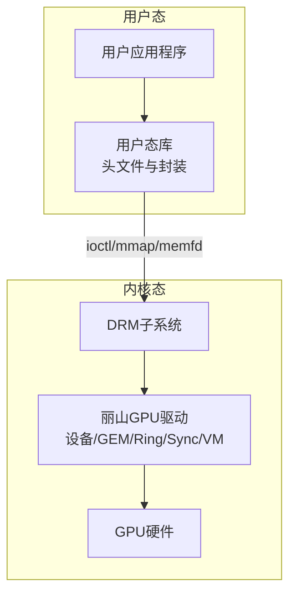
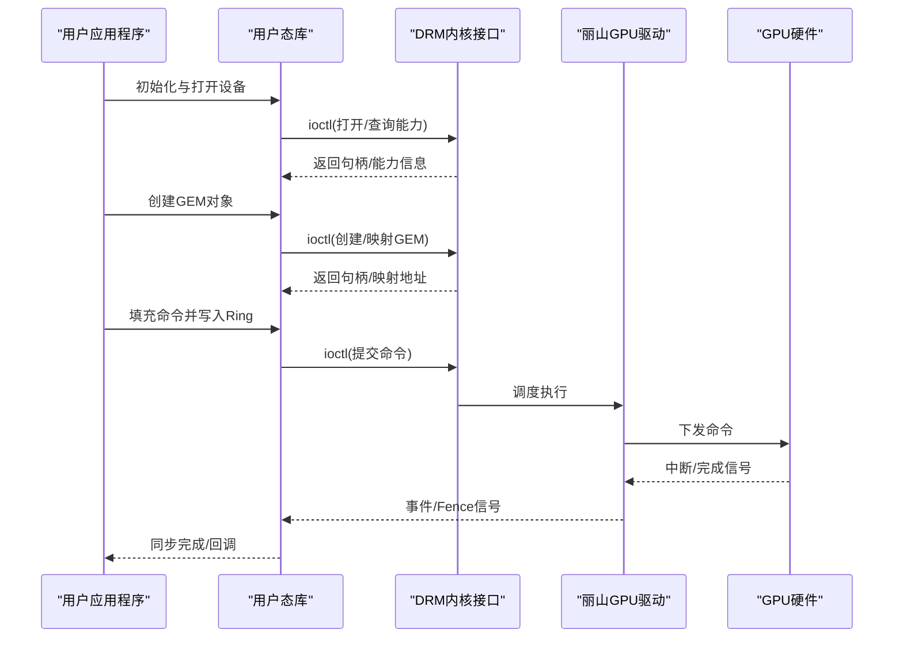
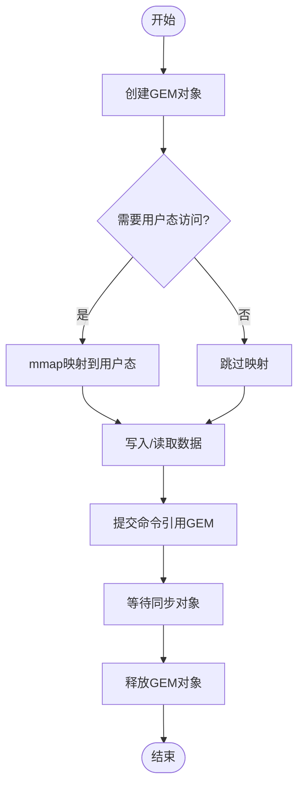
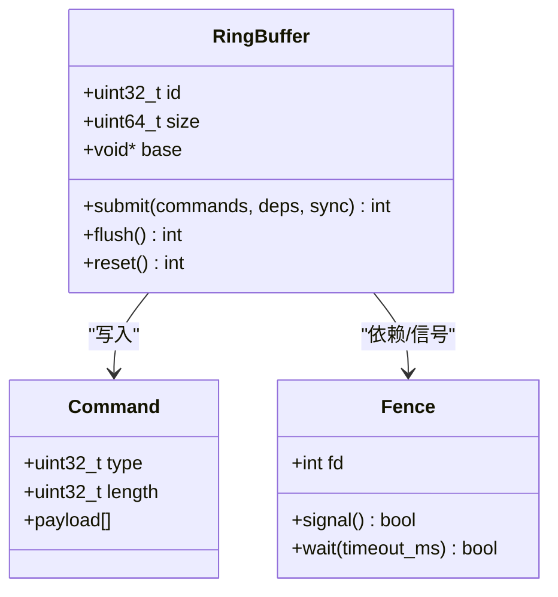
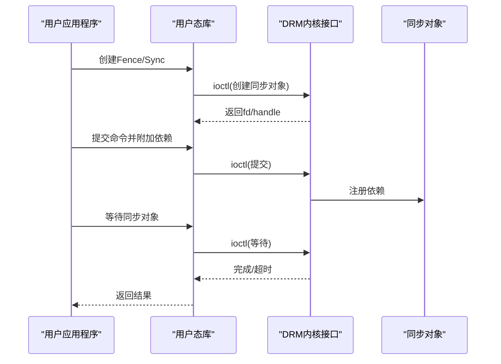
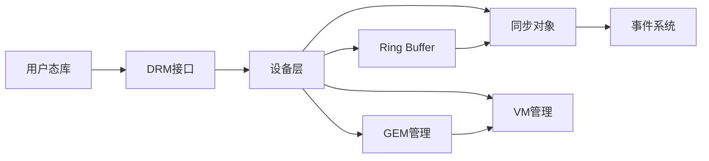

# 用户空间API

<cite>
**本文档引用的文件**   
- [lisuan_drv.h](file://_work/src/usr/src/lisuangpu-dkms-262.2.0.56/lisuan_drv.h)
- [lisuan_device.h](file://_work/src/usr/src/lisuangpu-dkms-262.2.0.56/lisuan_device.h)
- [lisuan_gem.h](file://_work/src/usr/src/lisuangpu-dkms-262.2.0.56/lisuan_gem.h)
- [lisuan_ring.h](file://_work/src/usr/src/lisuangpu-dkms-262.2.0.56/lisuan_ring.h)
- [lisuan_sync.h](file://_work/src/usr/src/lisuangpu-dkms-262.2.0.56/lisuan_sync.h)
- [lisuan_vm.h](file://_work/src/usr/src/lisuangpu-dkms-262.2.0.56/lisuan_vm.h)
- [gf_kmd_event.h](file://_work/src/usr/src/lisuangpu-dkms-262.2.0.56/gf_kmd_event.h)
- [gf_job.h](file://_work/src/usr/src/lisuangpu-dkms-262.2.0.56/gf_job.h)
- [gf_ringbuffer.h](file://_work/src/usr/src/lisuangpu-dkms-262.2.0.56/gf_ringbuffer.h)
- [lisuan_mailbox.h](file://_work/src/usr/src/lisuangpu-dkms-262.2.0.56/lisuan_mailbox.h)
- [lisuan_procid.h](file://_work/src/usr/src/lisuangpu-dkms-262.2.0.56/lisuan_procid.h)
- [lisuan_fb.h](file://_work/src/usr/src/lisuangpu-dkms-262.2.0.56/lisuan_fb.h)
- [lisuan_sched_fence.c](file://_work/src/usr/src/lisuangpu-dkms-262.2.0.56/lisuan_sched_fence.c)
- [lisuan_sync.c](file://_work/src/usr/src/lisuangpu-dkms-262.2.0.56/lisuan_sync.c)
- [lisuan_ring.c](file://_work/src/usr/src/lisuangpu-dkms-262.2.0.56/lisuan_ring.c)
- [lisuan_gem.c](file://_work/src/usr/src/lisuangpu-dkms-262.2.0.56/lisuan_gem.c)
- [lisuan_device.c](file://_work/src/usr/src/lisuangpu-dkms-262.2.0.56/lisuan_device.c)
- [lisuan_drv.c](file://_work/src/usr/src/lisuangpu-dkms-262.2.0.56/lisuan_drv.c)
- [gf_hw_cmds.h](file://_work/src/usr/src/lisuangpu-dkms-262.2.0.56/gf_hw_cmds.h)
- [gf_trans.h](file://_work/src/usr/src/lisuangpu-dkms-262.2.0.56/gf_trans.h)
- [include/umk_drm.h](file://_work/src/usr/src/lisuangpu-dkms-262.2.0.56/include/umk_drm.h)
- [include/umk_drm_fourcc.h](file://_work/src/usr/src/lisuangpu-dkms-262.0.56/include/umk_drm_fourcc.h)
</cite>

## 目录
1. [简介](#简介)
2. [项目结构](#项目结构)
3. [核心组件](#核心组件)
4. [架构总览](#架构总览)
5. [详细组件分析](#详细组件分析)
6. [依赖关系分析](#依赖关系分析)
7. [性能考虑](#性能考虑)
8. [故障排查指南](#故障排查指南)
9. [结论](#结论)
10. [附录](#附录)

## 简介
本文件面向丽山GPU的用户空间开发者，系统化梳理用户态应用程序可调用接口、共享内存结构与通信协议。重点覆盖：
- IOCTL命令与数据结构定义
- 显存对象（GEM）生命周期与映射
- 命令提交（Ring Buffer）流程
- 同步机制（Fence/Sync）与事件通知
- 内核-用户态通信路径
- 错误处理策略与最佳实践
- 典型应用开发示例与性能优化建议

## 项目结构
仓库包含驱动内核模块与用户态库两部分。用户态API主要位于 include 目录的头文件以及 usr 子树中的头文件与实现。关键目录与职责：
- include: 用户态可见的公共头文件（IOCTL、FourCC等）
- lisuan_*: 设备、GEM、Ring、Sync、VM、Mailbox、进程ID等核心模块
- gf_*: 硬件命令、任务、环形缓冲、传输、事件等
- kms/display/video_codec: KMS显示栈与视频编解码相关（与本API文档关联度较低）

[无图示来源，因为该图为概念性结构图]

## 核心组件
- IOCTL与公共接口：定义在 include 目录的头文件中，提供打开/关闭设备、查询能力、创建/销毁资源、提交命令、等待同步等入口。
- GEM显存管理：用户态通过GEM接口创建、映射、导入导出缓冲区对象，用于存放渲染/计算数据。
- Ring Buffer与命令提交：用户态将命令写入Ring Buffer，并通过提交接口触发执行。
- 同步与事件：基于Fence/Sync对象进行跨上下文/跨设备的同步；事件用于中断或完成通知。
- VM地址空间：为GPU提供虚拟地址映射，支持页表管理与IOMMU集成。
- Mailbox与进程隔离：用于进程间通信与权限控制。

章节来源
- [include/umk_drm.h](file://_work/src/usr/src/lisuangpu-dkms-262.2.0.56/include/umk_drm.h)
- [lisuan_gem.h](file://_work/src/usr/src/lisuangpu-dkms-262.2.0.56/lisuan_gem.h)
- [lisuan_ring.h](file://_work/src/usr/src/lisuangpu-dkms-262.2.0.56/lisuan_ring.h)
- [lisuan_sync.h](file://_work/src/usr/src/lisuangpu-dkms-262.2.0.56/lisuan_sync.h)
- [lisuan_vm.h](file://_work/src/usr/src/lisuangpu-dkms-262.2.0.56/lisuan_vm.h)
- [gf_kmd_event.h](file://_work/src/usr/src/lisuangpu-dkms-262.2.0.56/gf_kmd_event.h)
- [gf_job.h](file://_work/src/usr/src/lisuangpu-dkms-262.2.0.56/gf_job.h)
- [gf_ringbuffer.h](file://_work/src/usr/src/lisuangpu-dkms-262.2.0.56/gf_ringbuffer.h)
- [lisuan_mailbox.h](file://_work/src/usr/src/lisuangpu-dkms-262.2.0.56/lisuan_mailbox.h)
- [lisuan_procid.h](file://_work/src/usr/src/lisuangpu-dkms-262.2.0.56/lisuan_procid.h)

## 架构总览
用户态通过DRM子系统访问丽山GPU驱动。典型流程包括：
- 打开设备节点并获取句柄
- 创建GEM对象并映射到用户态
- 构造命令并提交至Ring Buffer
- 使用Fence/Sync进行同步
- 接收事件回调或轮询状态

图表来源
- [lisuan_drv.c](file://_work/src/usr/src/lisuangpu-dkms-262.2.0.56/lisuan_drv.c)
- [lisuan_device.c](file://_work/src/usr/src/lisuangpu-dkms-262.2.0.56/lisuan_device.c)
- [lisuan_gem.c](file://_work/src/usr/src/lisuangpu-dkms-262.2.0.56/lisuan_gem.c)
- [lisuan_ring.c](file://_work/src/usr/src/lisuangpu-dkms-262.2.0.56/lisuan_ring.c)
- [lisuan_sync.c](file://_work/src/usr/src/lisuangpu-dkms-262.2.0.56/lisuan_sync.c)
- [gf_kmd_event.h](file://_work/src/usr/src/lisuangpu-dkms-262.2.0.56/gf_kmd_event.h)

章节来源
- [lisuan_drv.c](file://_work/src/usr/src/lisuangpu-dkms-262.2.0.56/lisuan_drv.c)
- [lisuan_device.c](file://_work/src/usr/src/lisuangpu-dkms-262.2.0.56/lisuan_device.c)

## 详细组件分析

### IOCTL与公共接口
- 设备打开/关闭：用于建立用户态与驱动的会话，获取句柄。
- 能力查询：查询GPU特性（指令集、队列数量、最大提交大小等）。
- 资源管理：创建/销毁GEM对象、导入/导出缓冲区、设置属性。
- 命令提交：提交命令到指定队列，附带依赖与同步对象。
- 同步等待：等待Fence/Sync对象完成，支持超时与条件等待。
- 事件订阅：注册事件回调或文件描述符以接收完成通知。

章节来源
- [include/umk_drm.h](file://_work/src/usr/src/lisuangpu-dkms-262.2.0.56/include/umk_drm.h)

### GEM显存对象与映射
- 创建：指定尺寸、格式、用途（CPU/GPU可读/写），返回句柄。
- 映射：mmap到用户态地址空间，支持一致性或非一致性缓存策略。
- 导入/导出：与其他进程或子系统共享缓冲区（如DMA-BUF）。
- 释放：引用计数归零后回收显存。

图表来源
- [lisuan_gem.h](file://_work/src/usr/src/lisuangpu-dkms-262.2.0.56/lisuan_gem.h)
- [lisuan_gem.c](file://_work/src/usr/src/lisuangpu-dkms-262.2.0.56/lisuan_gem.c)

章节来源
- [lisuan_gem.h](file://_work/src/usr/src/lisuangpu-dkms-262.2.0.56/lisuan_gem.h)
- [lisuan_gem.c](file://_work/src/usr/src/lisuangpu-dkms-262.2.0.56/lisuan_gem.c)

### Ring Buffer与命令提交
- 队列选择：根据用途选择不同队列（渲染、计算、拷贝等）。
- 命令构造：按硬件命令格式填充Ring Buffer，注意对齐与边界。
- 提交参数：包含依赖Fence、同步对象、屏障、私有数据指针等。
- 执行与回退：提交失败时回滚已写入的命令，保证一致性。

图表来源
- [lisuan_ring.h](file://_work/src/usr/src/lisuangpu-dkms-262.2.0.56/lisuan_ring.h)
- [lisuan_ring.c](file://_work/src/usr/src/lisuangpu-dkms-262.2.0.56/lisuan_ring.c)
- [gf_ringbuffer.h](file://_work/src/usr/src/lisuangpu-dkms-262.2.0.56/gf_ringbuffer.h)
- [gf_job.h](file://_work/src/usr/src/lisuangpu-dkms-262.2.0.56/gf_job.h)

章节来源
- [lisuan_ring.h](file://_work/src/usr/src/lisuangpu-dkms-262.2.0.56/lisuan_ring.h)
- [lisuan_ring.c](file://_work/src/usr/src/lisuangpu-dkms-262.2.0.56/lisuan_ring.c)
- [gf_ringbuffer.h](file://_work/src/usr/src/lisuangpu-dkms-262.2.0.56/gf_ringbuffer.h)
- [gf_job.h](file://_work/src/usr/src/lisuangpu-dkms-262.2.0.56/gf_job.h)

### 同步机制（Fence/Sync）
- Fence对象：跨进程/跨设备同步原语，支持等待与信号。
- Sync对象：更复杂的同步语义（多依赖、条件完成）。
- 事件通知：通过文件描述符或回调方式通知完成。
- 超时与取消：支持超时等待与取消操作。

图表来源
- [lisuan_sync.h](file://_work/src/usr/src/lisuangpu-dkms-262.2.0.56/lisuan_sync.h)
- [lisuan_sync.c](file://_work/src/usr/src/lisuangpu-dkms-262.2.0.56/lisuan_sync.c)
- [gf_kmd_event.h](file://_work/src/usr/src/lisuangpu-dkms-262.2.0.56/gf_kmd_event.h)

章节来源
- [lisuan_sync.h](file://_work/src/usr/src/lisuangpu-dkms-262.2.0.56/lisuan_sync.h)
- [lisuan_sync.c](file://_work/src/usr/src/lisuangpu-dkms-262.2.0.56/lisuan_sync.c)
- [gf_kmd_event.h](file://_work/src/usr/src/lisuangpu-dkms-262.2.0.56/gf_kmd_event.h)

### VM地址空间管理
- 页表构建：用户态提供物理地址或句柄，驱动构建页表。
- IOMMU集成：支持IOMMU映射与域管理。
- 地址分配：动态分配GPU虚拟地址，避免冲突。
- 释放与回收：及时释放未使用的地址空间。

章节来源
- [lisuan_vm.h](file://_work/src/usr/src/lisuangpu-dkms-262.2.0.56/lisuan_vm.h)

### Mailbox与进程隔离
- Mailbox通道：用于进程间消息传递与资源授权。
- 权限控制：限制对敏感资源的访问。
- 审计与日志：记录关键操作以便调试。

章节来源
- [lisuan_mailbox.h](file://_work/src/usr/src/lisuangpu-dkms-262.2.0.56/lisuan_mailbox.h)
- [lisuan_procid.h](file://_work/src/usr/src/lisuangpu-dkms-262.2.0.56/lisuan_procid.h)

### 帧缓冲与显示
- 帧缓冲对象：用于显示输出的缓冲区管理。
- 模式设置：分辨率、刷新率等显示模式配置。
- 扫描输出：将帧缓冲内容输出到显示器。

章节来源
- [lisuan_fb.h](file://_work/src/usr/src/lisuangpu-dkms-262.2.0.56/lisuan_fb.h)

## 依赖关系分析
用户态API依赖DRM子系统与丽山GPU驱动模块。关键依赖链：
- 用户态库 -> DRM ioctl -> 驱动设备层 -> 硬件抽象层
- GEM对象 -> VM管理 -> 页表构建
- Ring Buffer -> 调度器 -> 硬件执行
- 同步对象 -> 事件系统 -> 中断处理

图表来源
- [lisuan_drv.c](file://_work/src/usr/src/lisuangpu-dkms-262.2.0.56/lisuan_drv.c)
- [lisuan_device.c](file://_work/src/usr/src/lisuangpu-dkms-262.2.0.56/lisuan_device.c)
- [lisuan_gem.c](file://_work/src/usr/src/lisuangpu-dkms-262.2.0.56/lisuan_gem.c)
- [lisuan_ring.c](file://_work/src/usr/src/lisuangpu-dkms-262.2.0.56/lisuan_ring.c)
- [lisuan_sync.c](file://_work/src/usr/src/lisuangpu-dkms-262.2.0.56/lisuan_sync.c)

章节来源
- [lisuan_drv.c](file://_work/src/usr/src/lisuangpu-dkms-262.2.0.56/lisuan_drv.c)
- [lisuan_device.c](file://_work/src/usr/src/lisuangpu-dkms-262.2.0.56/lisuan_device.c)

## 性能考虑
- 批量提交：合并多个小命令为大提交，减少ioctl开销。
- 异步执行：使用非阻塞提交与事件回调，提高吞吐。
- 缓存策略：合理选择GEM对象的缓存一致性，避免不必要的同步。
- 内存复用：重用GEM对象与Ring Buffer，减少分配开销。
- 并行队列：利用多队列并行执行不同任务。
- 零拷贝：通过DMA-BUF共享缓冲区，避免数据复制。

[本节为通用指导，无需特定文件来源]

## 故障排查指南
- 常见错误码：检查IOCTL返回值与错误码含义。
- 日志分析：启用驱动日志与用户态调试信息。
- 同步问题：检查Fence/Sync对象状态与依赖关系。
- 内存泄漏：监控GEM对象引用计数与映射情况。
- 性能瓶颈：使用性能分析工具定位热点。

章节来源
- [lisuan_drv.c](file://_work/src/usr/src/lisuangpu-dkms-262.2.0.56/lisuan_drv.c)
- [lisuan_device.c](file://_work/src/usr/src/lisuangpu-dkms-262.2.0.56/lisuan_device.c)

## 结论
丽山GPU用户空间API提供了完整的图形与计算加速能力。通过合理的接口使用、内存管理与同步策略，可以构建高性能的应用程序。建议开发者遵循最佳实践，充分利用并行性与异步特性，同时注意错误处理与性能优化。

[本节为总结性内容，无需特定文件来源]

## 附录
- FourCC格式：支持的像素格式定义
- 硬件命令：GPU指令集参考
- 传输协议：数据传输格式与对齐要求

章节来源
- [include/umk_drm_fourcc.h](file://_work/src/usr/src/lisuangpu-dkms-262.2.0.56/include/umk_drm_fourcc.h)
- [gf_hw_cmds.h](file://_work/src/usr/src/lisuangpu-dkms-262.2.0.56/gf_hw_cmds.h)
- [gf_trans.h](file://_work/src/usr/src/lisuangpu-dkms-262.2.0.56/gf_trans.h)