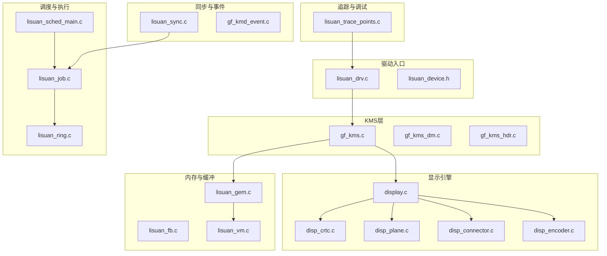
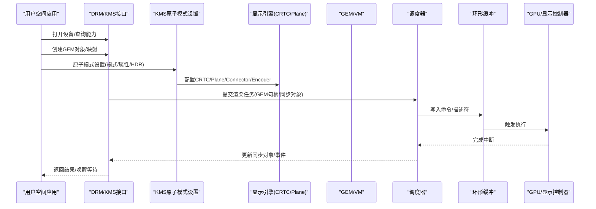
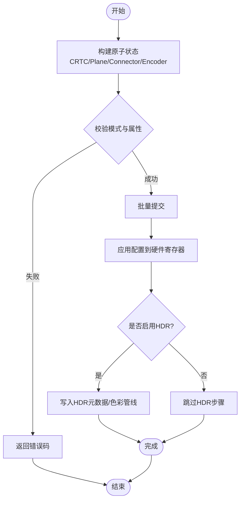
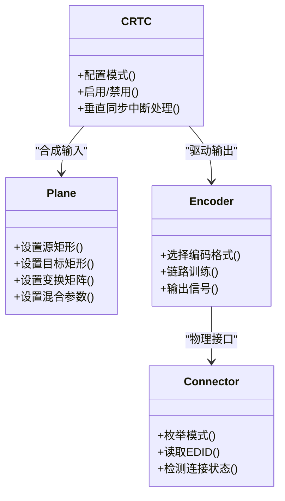
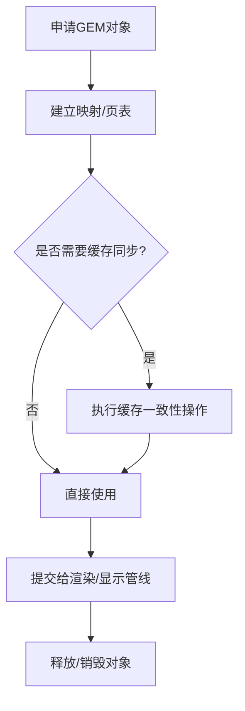
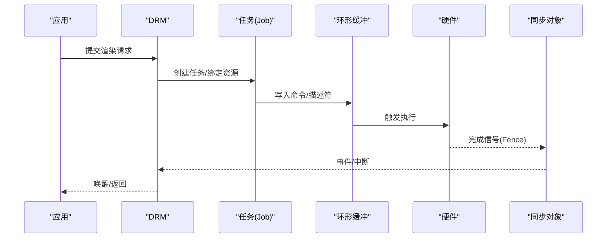
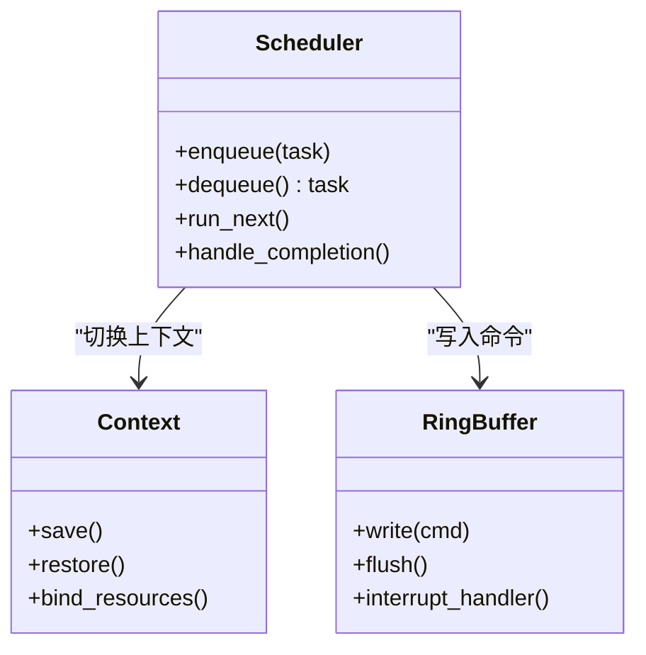
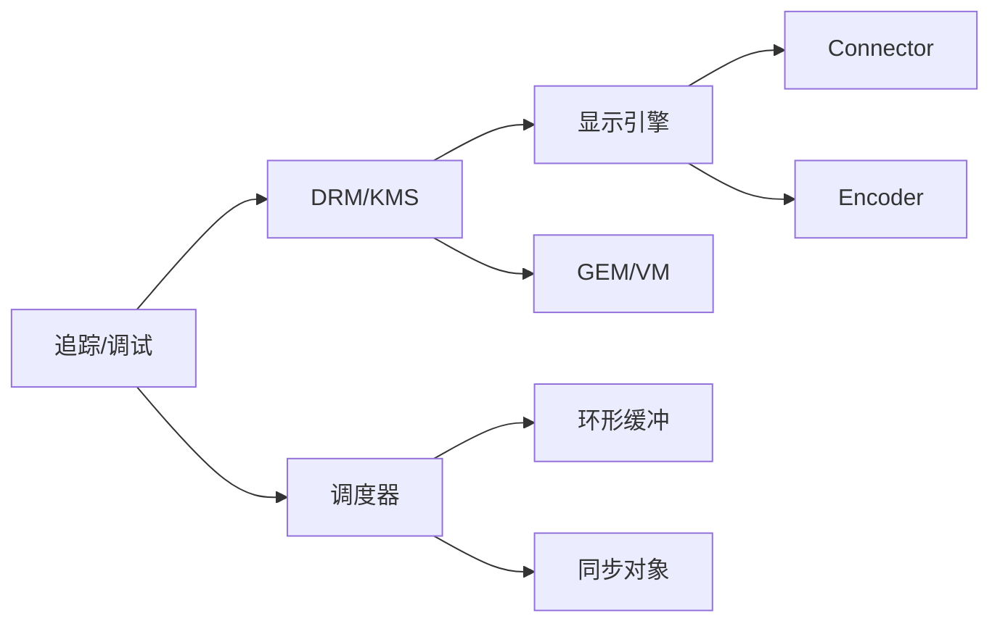

# DRM/KMS集成

<cite>
**本文档引用的文件**   
- [lisuan_drv.c](file://_work/src/usr/src/lisuan-gpu-dkms-262.2.0.56/lisuan_drv.c)
- [lisuan_device.h](file://_work/src/usr/src/lisuan-gpu-dkms-262.2.0.56/lisuan_device.h)
- [lisuan_gem.c](file://_work/src/usr/src/lisuan-gpu-dkms-262.2.0.56/lisuan_gem.c)
- [lisuan_sync.c](file://_work/src/usr/src/lisuan-gpu-dkms-262.2.0.56/lisuan_sync.c)
- [lisuan_ring.c](file://_work/src/usr/src/lisuan-gpu-dkms-262.2.0.56/lisuan_ring.c)
- [lisuan_sched_main.c](file://_work/src/usr/src/lisuan-gpu-dkms-262.2.0.56/lisuan_sched_main.c)
- [gf_kms.c](file://_work/src/usr/src/lisuan-gpu-dkms-262.2.0.56/kms/gf_kms.c)
- [gf_kms_dm.c](file://_work/src/usr/src/lisuan-gpu-dkms-262.2.0.56/kms/gf_kms_dm.c)
- [gf_kms_hdr.c](file://_work/src/usr/src/lisuan-gpu-dkms-262.2.0.56/kms/gf_kms_hdr.c)
- [display.c](file://_work/src/usr/src/lisuan-gpu-dkms-262.2.0.56/display/display.c)
- [disp_crtc.c](file://_work/src/usr/src/lisuan-gpu-dkms-262.2.0.56/display/crtc/disp_crtc.c)
- [disp_plane.c](file://_work/src/usr/src/lisuan-gpu-dkms-262.2.0.56/display/crtc/disp_plane.c)
- [disp_connector.c](file://_work/src/usr/src/lisuan-gpu-dkms-262.2.0.56/display/connector/disp_connector.c)
- [disp_encoder.c](file://_work/src/usr/src/lisuan-gpu-dkms-262.2.0.56/display/encoder/disp_encoder.c)
- [lisuan_fb.c](file://_work/src/usr/src/lisuan-gpu-dkms-262.2.0.56/lisuan_fb.c)
- [lisuan_vm.c](file://_work/src/usr/src/lisuan-gpu-dkms-262.2.0.56/lisuan_vm.c)
- [lisuan_context.c](file://_work/src/usr/src/lisuan-gpu-dkms-262.2.0.56/lisuan_context.c)
- [lisuan_job.c](file://_work/src/usr/src/lisuan-gpu-dkms-262.2.0.56/gf_job.c)
- [lisuan_trace_points.c](file://_work/src/usr/src/lisuan-gpu-dkms-262.2.0.56/lisuan_trace_points.c)
</cite>

## 目录
1. [简介](#简介)
2. [项目结构](#项目结构)
3. [核心组件](#核心组件)
4. [架构总览](#架构总览)
5. [详细组件分析](#详细组件分析)
6. [依赖关系分析](#依赖关系分析)
7. [性能考虑](#性能考虑)
8. [故障排查指南](#故障排查指南)
9. [结论](#结论)
10. [附录](#附录)

## 简介
本文件面向丽山GPU的DRM/KMS驱动集成，系统性阐述DRM框架接入方式、KMS模式实现、原子操作与HDR支持、GEM内存管理、同步对象与渲染管道，以及用户空间API使用与性能优化实践。文档以代码级分析为基础，辅以架构图与时序图，帮助读者快速理解并高效使用该驱动。

## 项目结构
本项目采用分层组织：内核模块入口、DRM/KMS子系统、显示引擎（CRTC/Plane/Connector/Encoder）、GEM与VM、调度与环形缓冲、同步与事件、调试与追踪等。关键目录与职责如下：
- 驱动入口与设备管理：lisuan_drv.c、lisuan_device.h
- KMS层：kms/gf_kms*.c（DRM/KMS接口、原子模式设置、HDR）
- 显示引擎：display/*（CRTC、Plane、Connector、Encoder、EDID/DisplayID、PLL/PWM/HDAudio等）
- GEM与显存：lisuan_gem.c、lisuan_fb.c、lisuan_vm.c
- 调度与执行：lisuan_ring.c、lisuan_sched_main.c、lisuan_job.c
- 同步与事件：lisuan_sync.c、gf_kmd_event.c
- 追踪与调试：lisuan_trace_points.c、gf_debugfs.c

图表来源
- [lisuan_drv.c](file://_work/src/usr/src/lisuan-gpu-dkms-262.2.0.56/lisuan_drv.c)
- [gf_kms.c](file://_work/src/usr/src/lisuan-gpu-dkms-262.2.0.56/kms/gf_kms.c)
- [display.c](file://_work/src/usr/src/lisuan-gpu-dkms-262.2.0.56/display/display.c)
- [disp_crtc.c](file://_work/src/usr/src/lisuan-gpu-dkms-262.2.0.56/display/crtc/disp_crtc.c)
- [disp_plane.c](file://_work/src/usr/src/lisuan-gpu-dkms-262.2.0.56/display/crtc/disp_plane.c)
- [disp_connector.c](file://_work/src/usr/src/lisuan-gpu-dkms-262.2.0.56/display/connector/disp_connector.c)
- [disp_encoder.c](file://_work/src/usr/src/lisuan-gpu-dkms-262.2.0.56/display/encoder/disp_encoder.c)
- [lisuan_gem.c](file://_work/src/usr/src/lisuan-gpu-dkms-262.2.0.56/lisuan_gem.c)
- [lisuan_fb.c](file://_work/src/usr/src/lisuan-gpu-dkms-262.2.0.56/lisuan_fb.c)
- [lisuan_vm.c](file://_work/src/usr/src/lisuan-gpu-dkms-262.2.0.56/lisuan_vm.c)
- [lisuan_ring.c](file://_work/src/usr/src/lisuan-gpu-dkms-262.2.0.56/lisuan_ring.c)
- [lisuan_sched_main.c](file://_work/src/usr/src/lisuan-gpu-dkms-262.2.0.56/lisuan_sched_main.c)
- [lisuan_job.c](file://_work/src/usr/src/lisuan-gpu-dkms-262.2.0.56/gf_job.c)
- [lisuan_sync.c](file://_work/src/usr/src/lisuan-gpu-dkms-262.2.0.56/lisuan_sync.c)
- [lisuan_trace_points.c](file://_work/src/usr/src/lisuan-gpu-dkms-262.2.0.56/lisuan_trace_points.c)

章节来源
- [lisuan_drv.c](file://_work/src/usr/src/lisuan-gpu-dkms-262.2.0.56/lisuan_drv.c)
- [lisuan_device.h](file://_work/src/usr/src/lisuan-gpu-dkms-262.2.0.56/lisuan_device.h)

## 核心组件
- DRM/KMS接口层：提供drm_driver、mode_config、原子模式设置回调、连接器和编码器枚举、属性与能力暴露。
- 显示引擎：CRTC负责时序与扫描输出；Plane负责图层合成；Connector/Encoder负责物理接口（HDMI/DP/DVO等）。
- GEM与帧缓冲：GEM对象封装显存分配、映射、缓存一致性；fbdev兼容层提供传统帧缓冲接口。
- 调度与执行：任务队列、环形缓冲、上下文切换、命令提交与完成通知。
- 同步与事件：Fence/隐式同步、显式sync_file、中断事件上报。
- HDR与色彩管理：色彩空间转换、EOTF、元数据注入与验证。

章节来源
- [gf_kms.c](file://_work/src/usr/src/lisuan-gpu-dkms-262.2.0.56/kms/gf_kms.c)
- [gf_kms_dm.c](file://_work/src/usr/src/lisuan-gpu-dkms-262.2.0.56/kms/gf_kms_dm.c)
- [gf_kms_hdr.c](file://_work/src/usr/src/lisuan-gpu-dkms-262.2.0.56/kms/gf_kms_hdr.c)
- [display.c](file://_work/src/usr/src/lisuan-gpu-dkms-262.2.0.56/display/display.c)
- [disp_crtc.c](file://_work/src/usr/src/lisuan-gpu-dkms-262.2.0.56/display/crtc/disp_crtc.c)
- [disp_plane.c](file://_work/src/usr/src/lisuan-gpu-dkms-262.2.0.56/display/crtc/disp_plane.c)
- [disp_connector.c](file://_work/src/usr/src/lisuan-gpu-dkms-262.2.0.56/display/connector/disp_connector.c)
- [disp_encoder.c](file://_work/src/usr/src/lisuan-gpu-dkms-262.2.0.56/display/encoder/disp_encoder.c)
- [lisuan_gem.c](file://_work/src/usr/src/lisuan-gpu-dkms-262.2.0.56/lisuan_gem.c)
- [lisuan_fb.c](file://_work/src/usr/src/lisuan-gpu-dkms-262.2.0.56/lisuan_fb.c)
- [lisuan_vm.c](file://_work/src/usr/src/lisuan-gpu-dkms-262.2.0.56/lisuan_vm.c)
- [lisuan_ring.c](file://_work/src/usr/src/lisuan-gpu-dkms-262.2.0.56/lisuan_ring.c)
- [lisuan_sched_main.c](file://_work/src/usr/src/lisuan-gpu-dkms-262.2.0.56/lisuan_sched_main.c)
- [lisuan_job.c](file://_work/src/usr/src/lisuan-gpu-dkms-262.2.0.56/gf_job.c)
- [lisuan_sync.c](file://_work/src/usr/src/lisuan-gpu-dkms-262.2.0.56/lisuan_sync.c)

## 架构总览
下图展示从用户空间到硬件的关键路径：应用通过DRM/KMS ioctl创建GEM对象并提交渲染任务，驱动将任务入队至调度器，写入环形缓冲，触发执行，完成后通过同步对象与中断通知用户空间。

图表来源
- [lisuan_drv.c](file://_work/src/usr/src/lisuan-gpu-dkms-262.2.0.56/lisuan_drv.c)
- [gf_kms.c](file://_work/src/usr/src/lisuan-gpu-dkms-262.2.0.56/kms/gf_kms.c)
- [gf_kms_dm.c](file://_work/src/usr/src/lisuan-gpu-dkms-262.2.0.56/kms/gf_kms_dm.c)
- [display.c](file://_work/src/usr/src/lisuan-gpu-dkms-262.2.0.56/display/display.c)
- [disp_crtc.c](file://_work/src/usr/src/lisuan-gpu-dkms-262.2.0.56/display/crtc/disp_crtc.c)
- [disp_plane.c](file://_work/src/usr/src/lisuan-gpu-dkms-262.2.0.56/display/crtc/disp_plane.c)
- [lisuan_gem.c](file://_work/src/usr/src/lisuan-gpu-dkms-262.2.0.56/lisuan_gem.c)
- [lisuan_vm.c](file://_work/src/usr/src/lisuan-gpu-dkms-262.2.0.56/lisuan_vm.c)
- [lisuan_ring.c](file://_work/src/usr/src/lisuan-gpu-dkms-262.2.0.56/lisuan_ring.c)
- [lisuan_sched_main.c](file://_work/src/usr/src/lisuan-gpu-dkms-262.2.0.56/lisuan_sched_main.c)
- [lisuan_job.c](file://_work/src/usr/src/lisuan-gpu-dkms-262.2.0.56/gf_job.c)
- [lisuan_sync.c](file://_work/src/usr/src/lisuan-gpu-dkms-262.2.0.56/lisuan_sync.c)

## 详细组件分析

### DRM/KMS接口与原子模式设置
- 驱动注册drm_driver与mode_config，暴露连接器、编码器、CRTC、Plane能力。
- 原子模式设置流程：构建状态对象、校验模式/属性（含HDR元数据）、批量提交、上屏。
- HDR支持：色彩空间/EOTF/元数据注入与验证，确保端到端高动态范围链路。

图表来源
- [gf_kms.c](file://_work/src/usr/src/lisuan-gpu-dkms-262.2.0.56/kms/gf_kms.c)
- [gf_kms_dm.c](file://_work/src/usr/src/lisuan-gpu-dkms-262.2.0.56/kms/gf_kms_dm.c)
- [gf_kms_hdr.c](file://_work/src/usr/src/lisuan-gpu-dkms-262.2.0.56/kms/gf_kms_hdr.c)
- [display.c](file://_work/src/usr/src/lisuan-gpu-dkms-262.2.0.56/display/display.c)

章节来源
- [gf_kms.c](file://_work/src/usr/src/lisuan-gpu-dkms-262.2.0.56/kms/gf_kms.c)
- [gf_kms_dm.c](file://_work/src/usr/src/lisuan-gpu-dkms-262.2.0.56/kms/gf_kms_dm.c)
- [gf_kms_hdr.c](file://_work/src/usr/src/lisuan-gpu-dkms-262.2.0.56/kms/gf_kms_hdr.c)
- [display.c](file://_work/src/usr/src/lisuan-gpu-dkms-262.2.0.56/display/display.c)

### 显示引擎：CRTC/Plane/Connector/Encoder
- CRTC：负责时序生成、扫描输出、刷新控制。
- Plane：图层叠加、缩放、旋转、混合参数。
- Connector/Encoder：物理接口适配（HDMI/DP/DVO），EDID/DisplayID解析，链路训练。
- 时钟与电源：PLL/PWM/HDAudio集成，保证稳定输出与音频同步。

图表来源
- [disp_crtc.c](file://_work/src/usr/src/lisuan-gpu-dkms-262.2.0.56/display/crtc/disp_crtc.c)
- [disp_plane.c](file://_work/src/usr/src/lisuan-gpu-dkms-262.2.0.56/display/crtc/disp_plane.c)
- [disp_connector.c](file://_work/src/usr/src/lisuan-gpu-dkms-262.2.0.56/display/connector/disp_connector.c)
- [disp_encoder.c](file://_work/src/usr/src/lisuan-gpu-dkms-262.2.0.56/display/encoder/disp_encoder.c)

章节来源
- [disp_crtc.c](file://_work/src/usr/src/lisuan-gpu-dkms-262.2.0.56/display/crtc/disp_crtc.c)
- [disp_plane.c](file://_work/src/usr/src/lisuan-gpu-dkms-262.2.0.56/display/crtc/disp_plane.c)
- [disp_connector.c](file://_work/src/usr/src/lisuan-gpu-dkms-262.2.0.56/display/connector/disp_connector.c)
- [disp_encoder.c](file://_work/src/usr/src/lisuan-gpu-dkms-262.2.0.56/display/encoder/disp_encoder.c)

### GEM内存管理与帧缓冲
- GEM对象：分配显存、建立页表、映射用户空间、缓存一致性维护。
- 帧缓冲：fbdev兼容层，提供传统帧缓冲接口与DMA映射。
- VM管理：地址空间、页表管理、IOMMU集成（如适用）。

图表来源
- [lisuan_gem.c](file://_work/src/usr/src/lisuan-gpu-dkms-262.2.0.56/lisuan_gem.c)
- [lisuan_fb.c](file://_work/src/usr/src/lisuan-gpu-dkms-262.2.0.56/lisuan_fb.c)
- [lisuan_vm.c](file://_work/src/usr/src/lisuan-gpu-dkms-262.2.0.56/lisuan_vm.c)

章节来源
- [lisuan_gem.c](file://_work/src/usr/src/lisuan-gpu-dkms-262.2.0.56/lisuan_gem.c)
- [lisuan_fb.c](file://_work/src/usr/src/lisuan-gpu-dkms-262.2.0.56/lisuan_fb.c)
- [lisuan_vm.c](file://_work/src/usr/src/lisuan-gpu-dkms-262.2.0.56/lisuan_vm.c)

### 同步对象与渲染管道
- 同步对象：Fence/隐式同步、显式sync_file、事件上报。
- 渲染管道：任务构建、上下文保存/恢复、命令写入环形缓冲、执行与完成回调。

图表来源
- [lisuan_job.c](file://_work/src/usr/src/lisuan-gpu-dkms-262.2.0.56/gf_job.c)
- [lisuan_ring.c](file://_work/src/usr/src/lisuan-gpu-dkms-262.2.0.56/lisuan_ring.c)
- [lisuan_sync.c](file://_work/src/usr/src/lisuan-gpu-dkms-262.2.0.56/lisuan_sync.c)

章节来源
- [lisuan_job.c](file://_work/src/usr/src/lisuan-gpu-dkms-262.2.0.56/gf_job.c)
- [lisuan_ring.c](file://_work/src/usr/src/lisuan-gpu-dkms-262.2.0.56/lisuan_ring.c)
- [lisuan_sync.c](file://_work/src/usr/src/lisuan-gpu-dkms-262.2.0.56/lisuan_sync.c)

### 调度器与上下文
- 调度器：任务排队、优先级、公平性、背压处理。
- 上下文：GPU上下文保存/恢复、资源隔离、多进程并发。

图表来源
- [lisuan_sched_main.c](file://_work/src/usr/src/lisuan-gpu-dkms-262.2.0.56/lisuan_sched_main.c)
- [lisuan_context.c](file://_work/src/usr/src/lisuan-gpu-dkms-262.2.0.56/lisuan_context.c)
- [lisuan_ring.c](file://_work/src/usr/src/lisuan-gpu-dkms-262.2.0.56/lisuan_ring.c)

章节来源
- [lisuan_sched_main.c](file://_work/src/usr/src/lisuan-gpu-dkms-262.2.0.56/lisuan_sched_main.c)
- [lisuan_context.c](file://_work/src/usr/src/lisuan-gpu-dkms-262.2.0.56/lisuan_context.c)
- [lisuan_ring.c](file://_work/src/usr/src/lisuan-gpu-dkms-262.2.0.56/lisuan_ring.c)

## 依赖关系分析
- DRM/KMS层依赖显示引擎与GEM/VM，用于模式设置与资源管理。
- 显示引擎依赖连接器/编码器，进行物理接口适配与时序控制。
- 调度器依赖环形缓冲与同步对象，确保任务有序执行与完成通知。
- 追踪与调试贯穿各层，便于问题定位与性能分析。

图表来源
- [lisuan_drv.c](file://_work/src/usr/src/lisuan-gpu-dkms-262.2.0.56/lisuan_drv.c)
- [gf_kms.c](file://_work/src/usr/src/lisuan-gpu-dkms-262.2.0.56/kms/gf_kms.c)
- [display.c](file://_work/src/usr/src/lisuan-gpu-dkms-262.2.0.56/display/display.c)
- [lisuan_gem.c](file://_work/src/usr/src/lisuan-gpu-dkms-262.2.0.56/lisuan_gem.c)
- [lisuan_vm.c](file://_work/src/usr/src/lisuan-gpu-dkms-262.2.0.56/lisuan_vm.c)
- [lisuan_ring.c](file://_work/src/usr/src/lisuan-gpu-dkms-262.2.0.56/lisuan_ring.c)
- [lisuan_sync.c](file://_work/src/usr/src/lisuan-gpu-dkms-262.2.0.56/lisuan_sync.c)
- [lisuan_trace_points.c](file://_work/src/usr/src/lisuan-gpu-dkms-262.2.0.56/lisuan_trace_points.c)

章节来源
- [lisuan_drv.c](file://_work/src/usr/src/lisuan-gpu-dkms-262.2.0.56/lisuan_drv.c)
- [lisuan_trace_points.c](file://_work/src/usr/src/lisuan-gpu-dkms-262.2.0.56/lisuan_trace_points.c)

## 性能考虑
- 减少不必要的缓存同步：仅在跨域访问时执行cache maintenance，避免频繁刷写。
- 批量化提交：合并多个小任务为一次提交，降低调度开销。
- 合理选择GEM分配策略：优先使用连续或可映射内存，减少页表复杂度。
- 利用原子模式设置：一次性提交所有更改，避免中间状态闪烁。
- 监控追踪点：通过追踪点分析瓶颈，调整队列深度与中断频率。

[本节为通用指导，不直接分析具体文件]

## 故障排查指南
- 常见问题：模式设置失败、HDR无效、渲染卡顿、同步死锁。
- 排查步骤：
  - 检查连接器/编码器状态与EDID解析结果。
  - 验证原子模式设置的返回值与日志。
  - 查看GEM对象映射与权限是否正确。
  - 确认同步对象状态与中断是否正常。
  - 启用追踪点与调试接口，收集运行时信息。

章节来源
- [lisuan_drv.c](file://_work/src/usr/src/lisuan-gpu-dkms-262.2.0.56/lisuan_drv.c)
- [lisuan_trace_points.c](file://_work/src/usr/src/lisuan-gpu-dkms-262.2.0.56/lisuan_trace_points.c)

## 结论
丽山GPU的DRM/KMS集成通过清晰的层次化设计与完善的内存、同步、调度机制，提供了高效的图形与显示能力。遵循最佳实践与性能优化建议，可在复杂应用场景中实现稳定、高性能的渲染与显示体验。

[本节为总结，不直接分析具体文件]

## 附录
- 用户空间API使用要点：
  - 打开设备与查询能力：获取DRM主设备节点，调用标准ioctl查询连接器、模式、属性。
  - 创建与映射GEM对象：分配显存、获取句柄、mmap映射到用户空间。
  - 原子模式设置：构建状态对象、设置模式与属性、批量提交。
  - 提交渲染任务：绑定GEM对象、设置同步对象、提交至调度器。
  - 等待完成：基于Fence或事件等待，避免忙等。
- 最佳实践：
  - 使用原子模式设置以减少闪烁与竞态。
  - 合理管理GEM生命周期，避免泄漏。
  - 利用追踪点进行性能分析与问题定位。
  - 针对HDR场景，确保端到端链路支持并正确配置元数据。

[本节为补充说明，不直接分析具体文件]