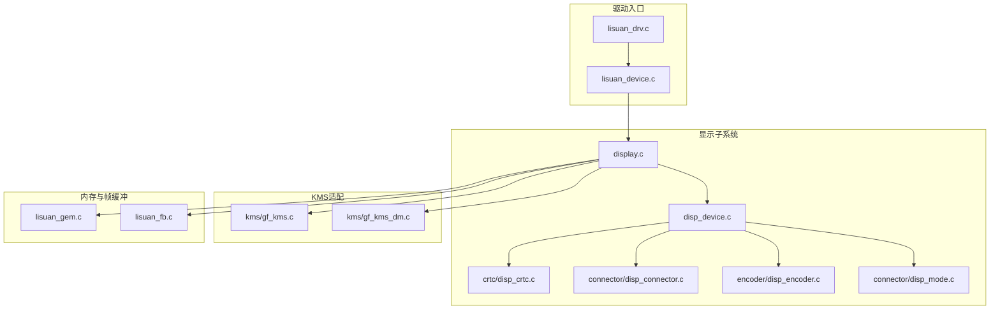
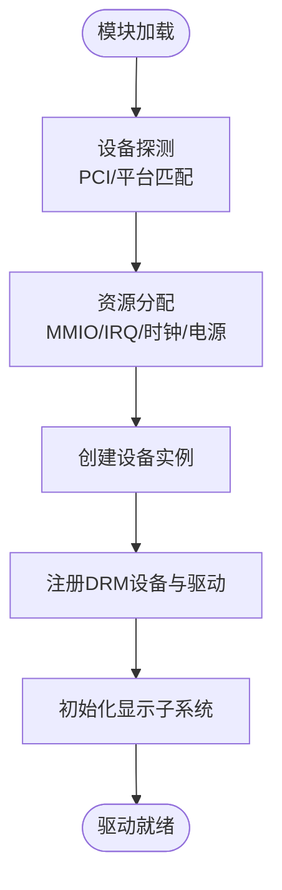
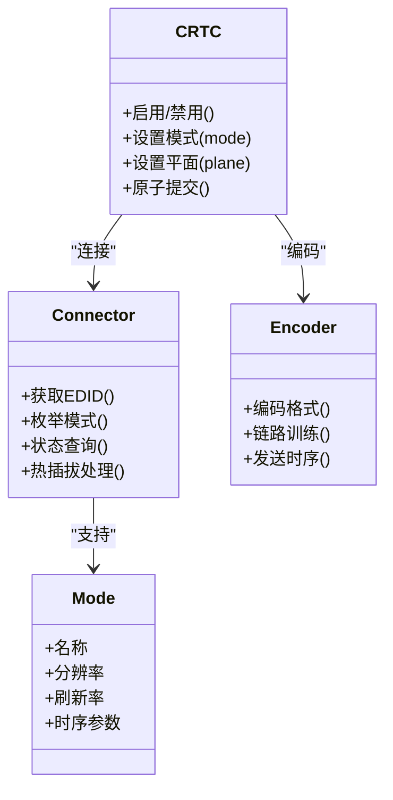
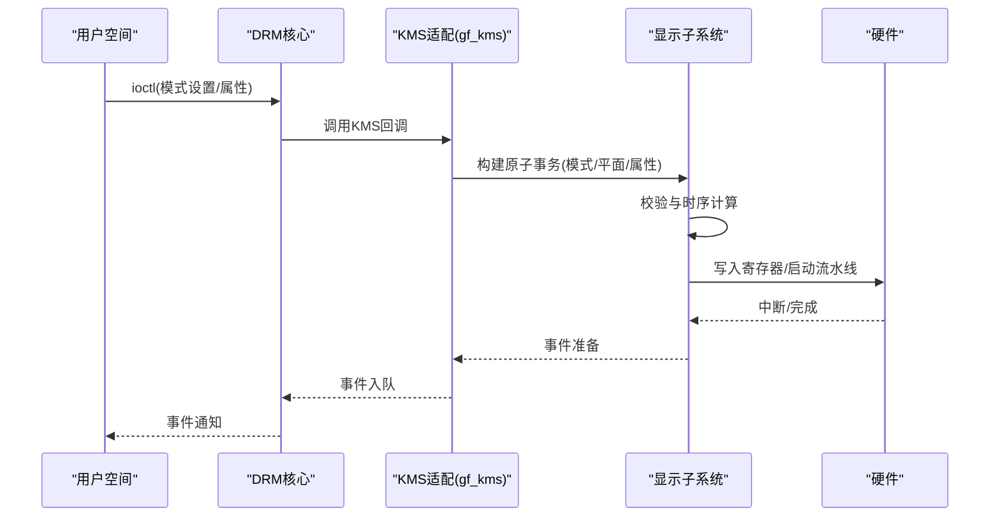
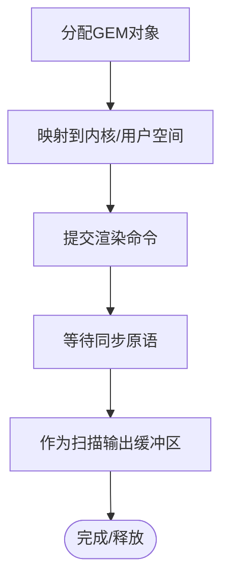
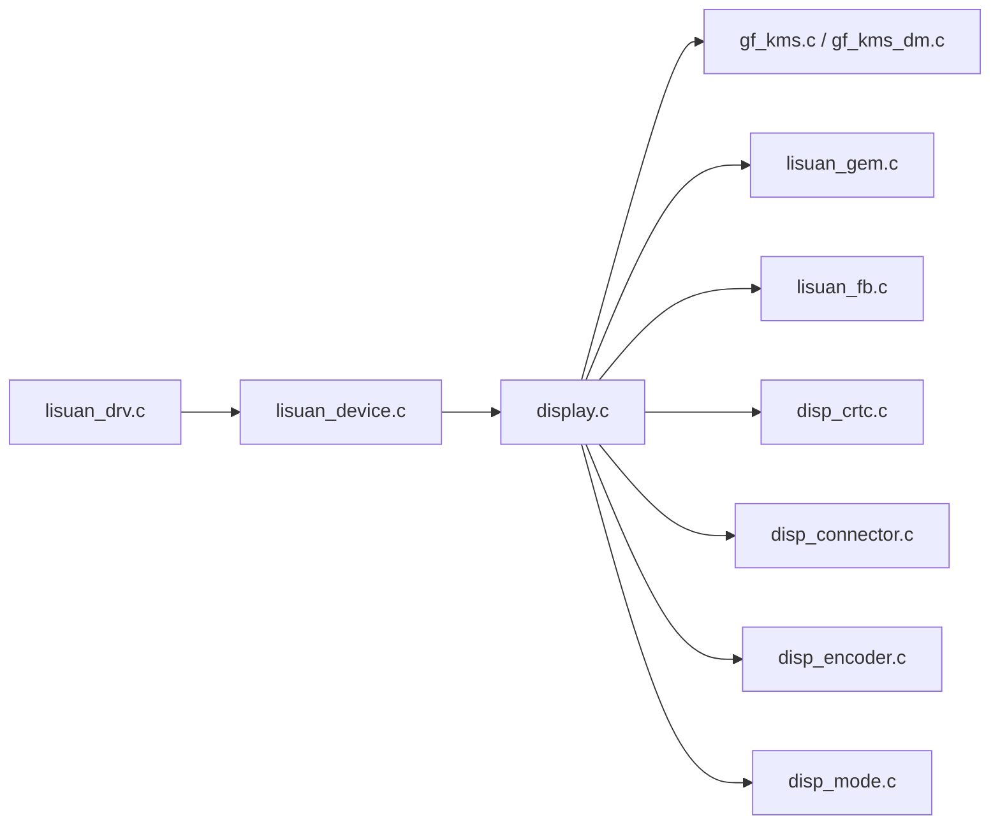

# DRM核心集成

<cite>
**本文档引用的文件**
- [lisuan_drv.c](file://_work/src/usr/src/lisuan-dkms-262.2.0.56/lisuan_drv.c)
- [lisuan_device.c](file://_work/src/usr/src/lisuan-dkms-262.2.0.56/lisuan_device.c)
- [display.c](file://_work/src/usr/src/lisuan-dkms-262.2.0.56/display.c)
- [disp_device.c](file://_work/src/usr/src/lisuan-dkms-262.2.0.56/display/disp_device.c)
- [gf_kms.c](file://_work/src/usr/src/lisuan-dkms-262.2.0.56/kms/gf_kms.c)
- [gf_kms_dm.c](file://_work/src/usr/src/lisuan-dkms-262.2.0.56/kms/gf_kms_dm.c)
- [disp_crtc.c](file://_work/src/usr/src/lisuan-dkms-262.2.0.56/display/crtc/disp_crtc.c)
- [disp_connector.c](file://_work/src/usr/src/lisuan-dkms-262.2.0.56/display/connector/disp_connector.c)
- [disp_encoder.c](file://_work/src/usr/src/lisuan-dkms-262.2.0.56/display/encoder/disp_encoder.c)
- [disp_mode.c](file://_work/src/usr/src/lisuan-dkms-262.2.0.56/display/connector/disp_mode.c)
- [lisuan_gem.c](file://_work/src/usr/src/lisuan-dkms-262.2.0.56/lisuan_gem.c)
- [lisuan_fb.c](file://_work/src/usr/src/lisuan-dkms-262.2.0.56/lisuan_fb.c)
- [lisuan_drv.h](file://_work/src/usr/src/lisuan-dkms-262.2.0.56/lisuan_drv.h)
- [lisuan_device.h](file://_work/src/usr/src/lisuan-dkms-262.2.0.56/lisuan_device.h)
- [display.h](file://_work/src/usr/src/lisuan-dkms-262.2.0.56/display/display.h)
- [disp_device.h](file://_work/src/usr/src/lisuan-dkms-262.2.0.56/display/disp_device.h)
- [gf_kms.h](file://_work/src/usr/src/lisuan-dkms-262.2.0.56/kms/gf_kms.h)
- [gf_kms_dm.h](file://_work/src/usr/src/lisuan-dkms-262.2.0.56/kms/gf_kms_dm.h)
- [disp_crtc.h](file://_work/src/usr/src/lisuan-dkms-262.2.0.56/display/crtc/disp_crtc.h)
- [disp_connector.h](file://_work/src/usr/src/lisuan-dkms-262.2.0.56/display/connector/disp_connector.h)
- [disp_encoder.h](file://_work/src/usr/src/lisuan-dkms-262.2.0.56/display/encoder/disp_encoder.h)
- [disp_mode.h](file://_work/src/usr/src/lisuan-dkms-262.2.0.56/display/connector/disp_mode.h)
- [lisuan_gem.h](file://_work/src/usr/src/lisuan-dkms-262.2.0.56/lisuan_gem.h)
- [lisuan_fb.h](file://_work/src/usr/src/lisuan-dkms-262.2.0.56/lisuan_fb.h)
</cite>

## 目录
1. [简介](#简介)
2. [项目结构](#项目结构)
3. [核心组件](#核心组件)
4. [架构总览](#架构总览)
5. [详细组件分析](#详细组件分析)
6. [依赖关系分析](#依赖关系分析)
7. [性能考虑](#性能考虑)
8. [故障排查指南](#故障排查指南)
9. [结论](#结论)
10. [附录](#附录)

## 简介
本文件面向丽山GPU的DRM/KMS驱动集成，系统性阐述DRM框架初始化、设备注册与驱动加载流程；解释KMS模式设置、显示管线配置与输出设备管理；文档化用户空间API（ioctl、属性、事件）；并提供可操作的集成示例、错误处理与性能优化建议。读者无需深入内核源码即可理解整体机制与最佳实践。

## 项目结构
本项目采用分层组织：
- 顶层驱动入口与设备抽象：lisuan_drv.*、lisuan_device.*
- 显示子系统：display/*（CRTC/Connector/Encoder/Mode等）
- KMS适配层：kms/*（KMS对象、模式管理、HDR/CRC等）
- GEM/FB内存与帧缓冲：lisuan_gem.*、lisuan_fb.*
- 寄存器与硬件抽象：display/register/*、display/common/*



图表来源
- [lisuan_drv.c:1-200](file://_work/src/usr/src/lisuan-dkms-262.2.0.56/lisuan_drv.c#L1-L200)
- [lisuan_device.c:1-200](file://_work/src/usr/src/lisuan-dkms-262.2.0.56/lisuan_device.c#L1-L200)
- [display.c:1-200](file://_work/src/usr/src/lisuan-dkms-262.2.0.56/display.c#L1-L200)
- [disp_device.c:1-200](file://_work/src/usr/src/lisuan-dkms-262.2.0.56/display/disp_device.c#L1-L200)
- [gf_kms.c:1-200](file://_work/src/usr/src/lisuan-dkms-262.2.0.56/kms/gf_kms.c#L1-L200)
- [gf_kms_dm.c:1-200](file://_work/src/usr/src/lisuan-dkms-262.2.0.56/kms/gf_kms_dm.c#L1-L200)
- [lisuan_gem.c:1-200](file://_work/src/usr/src/lisuan-dkms-262.2.0.56/lisuan_gem.c#L1-L200)
- [lisuan_fb.c:1-200](file://_work/src/usr/src/lisuan-dkms-262.2.0.56/lisuan_fb.c#L1-L200)

章节来源
- [lisuan_drv.c:1-200](file://_work/src/usr/src/lisuan-dkms-262.2.0.56/lisuan_drv.c#L1-L200)
- [lisuan_device.c:1-200](file://_work/src/usr/src/lisuan-dkms-262.2.0.56/lisuan_device.c#L1-L200)
- [display.c:1-200](file://_work/src/usr/src/lisuan-dkms-262.2.0.56/display.c#L1-L200)
- [disp_device.c:1-200](file://_work/src/usr/src/lisuan-dkms-262.2.0.56/display/disp_device.c#L1-L200)
- [gf_kms.c:1-200](file://_work/src/usr/src/lisuan-dkms-262.2.0.56/kms/gf_kms.c#L1-L200)
- [gf_kms_dm.c:1-200](file://_work/src/usr/src/lisuan-dkms-262.2.0.56/kms/gf_kms_dm.c#L1-L200)
- [lisuan_gem.c:1-200](file://_work/src/usr/src/lisuan-dkms-262.2.0.56/lisuan_gem.c#L1-L200)
- [lisuan_fb.c:1-200](file://_work/src/usr/src/lisuan-dkms-262.2.0.56/lisuan_fb.c#L1-L200)

## 核心组件
- 驱动入口与设备管理：负责PCI/平台枚举、资源分配、DRM设备创建、中断与电源管理、模块生命周期。
- 显示子系统：封装CRTC/Connector/Encoder/Plane/Mode等KMS实体，提供模式计算与时序配置、EDID解析、接口能力探测。
- KMS适配层：实现drm_driver回调、原子模式设置、属性管理、事件上报、调试接口。
- 内存与帧缓冲：GEM对象管理、DMA映射、页表与同步原语；FBDEV兼容层。

章节来源
- [lisuan_drv.h:1-200](file://_work/src/usr/src/lisuan-dkms-262.2.0.56/lisuan_drv.h#L1-L200)
- [lisuan_device.h:1-200](file://_work/src/usr/src/lisuan-dkms-262.2.0.56/lisuan_device.h#L1-L200)
- [display.h:1-200](file://_work/src/usr/src/lisuan-dkms-262.2.0.56/display/display.h#L1-L200)
- [disp_device.h:1-200](file://_work/src/usr/src/lisuan-dkms-262.2.0.56/display/disp_device.h#L1-L200)
- [gf_kms.h:1-200](file://_work/src/usr/src/lisuan-dkms-262.2.0.56/kms/gf_kms.h#L1-L200)
- [gf_kms_dm.h:1-200](file://_work/src/usr/src/lisuan-dkms-262.2.0.56/kms/gf_kms_dm.h#L1-L200)
- [lisuan_gem.h:1-200](file://_work/src/usr/src/lisuan-dkms-262.2.0.56/lisuan_gem.h#L1-L200)
- [lisuan_fb.h:1-200](file://_work/src/usr/src/lisuan-dkms-262.2.0.56/lisuan_fb.h#L1-L200)

## 架构总览
下图展示从驱动加载到KMS对象建立、再到用户空间调用的关键路径。

```mermaid
sequenceDiagram
participant Kernel as "内核"
participant Driver as "驱动入口(lisuan_drv)"
device as "设备管理(lisuan_device)"
display as "显示子(display)"
kms as "KMS适配(gf_kms)"
hw as "硬件/寄存器"
user as "用户空间应用"
Kernel->>Driver : 模块加载/PCI或平台探测
Driver->>device : 初始化设备、分配资源、注册中断
device-->>Driver : 设备就绪
Driver->>display : 初始化显示子系统
display->>hw : 读取VBT/EDID、枚举连接器
display-->>Driver : CRTC/Connector/Encoder就绪
Driver->>kms : 注册drm_driver、创建KMS对象
kms-->>Driver : KMS节点可用
user->>kms : ioctl(模式设置/属性/事件)
kms->>display : 原子模式设置/管线配置
display->>hw : 写入寄存器、启动扫描
display-->>kms : 完成/中断事件
kms-->>user : 事件通知/返回值
```

图表来源
- [lisuan_drv.c:1-200](file://_work/src/usr/src/lisuan-dkms-262.2.0.56/lisuan_drv.c#L1-L200)
- [lisuan_device.c:1-200](file://_work/src/usr/src/lisuan-dkms-262.2.0.56/lisuan_device.c#L1-L200)
- [display.c:1-200](file://_work/src/usr/src/lisuan-dkms-262.2.0.56/display.c#L1-L200)
- [gf_kms.c:1-200](file://_work/src/usr/src/lisuan-dkms-262.2.0.56/kms/gf_kms.c#L1-L200)

## 详细组件分析

### 驱动加载与设备注册
- 模块入口与探测：在驱动入口中完成设备识别、资源申请、中断与电源域初始化，随后创建并注册DRM设备。
- 设备抽象：统一封装寄存器访问、时钟/电源、中断上下文、锁与同步原语。
- DRM注册：填充drm_driver结构，注册字符设备节点，暴露ioctl入口。



图表来源
- [lisuan_drv.c:1-200](file://_work/src/usr/src/lisuan-dkms-262.2.0.56/lisuan_drv.c#L1-L200)
- [lisuan_device.c:1-200](file://_work/src/usr/src/lisuan-dkms-262.2.0.56/lisuan_device.c#L1-L200)

章节来源
- [lisuan_drv.c:1-200](file://_work/src/usr/src/lisuan-dkms-262.2.0.56/lisuan_drv.c#L1-L200)
- [lisuan_device.c:1-200](file://_work/src/usr/src/lisuan-dkms-262.2.0.56/lisuan_device.c#L1-L200)

### 显示子系统与KMS对象
- CRTC：负责时序生成、扫描控制、平面合成与更新。
- Connector：表示物理输出（HDMI/DP/eDP等），支持EDID解析与热插拔。
- Encoder：将像素数据转换为特定接口信号（TMDS/LVDS/DP）。
- Mode：分辨率与时序描述，包含标准模式与自定义模式。



图表来源
- [disp_crtc.c:1-200](file://_work/src/usr/src/lisuan-dkms-262.2.0.56/display/crtc/disp_crtc.c#L1-L200)
- [disp_connector.c:1-200](file://_work/src/usr/src/lisuan-dkms-262.2.0.56/display/connector/disp_connector.c#L1-L200)
- [disp_encoder.c:1-200](file://_work/src/usr/src/lisuan-dkms-262.2.0.56/display/encoder/disp_encoder.c#L1-L200)
- [disp_mode.c:1-200](file://_work/src/usr/src/lisuan-dkms-262.2.0.56/display/connector/disp_mode.c#L1-L200)

章节来源
- [disp_crtc.c:1-200](file://_work/src/usr/src/lisuan-dkms-262.2.0.56/display/crtc/disp_crtc.c#L1-L200)
- [disp_connector.c:1-200](file://_work/src/usr/src/lisuan-dkms-262.2.0.56/display/connector/disp_connector.c#L1-L200)
- [disp_encoder.c:1-200](file://_work/src/usr/src/lisuan-dkms-262.2.0.56/display/encoder/disp_encoder.c#L1-L200)
- [disp_mode.c:1-200](file://_work/src/usr/src/lisuan-dkms-262.2.0.56/display/connector/disp_mode.c#L1-L200)

### KMS模式设置与原子提交
- 模式设置：用户空间通过ioctl请求设置CRTC模式、Connector状态与属性。
- 原子提交：驱动内部构建原子事务，校验一致性后一次性提交，避免撕裂与中间态。
- 事件上报：VBlank/Flip完成等事件通过DRM事件通道返回用户空间。



图表来源
- [gf_kms.c:1-200](file://_work/src/usr/src/lisuan-dkms-262.2.0.56/kms/gf_kms.c#L1-L200)
- [gf_kms_dm.c:1-200](file://_work/src/usr/src/lisuan-dkms-262.2.0.56/kms/gf_kms_dm.c#L1-L200)
- [display.c:1-200](file://_work/src/usr/src/lisuan-dkms-262.2.0.56/display.c#L1-L200)

章节来源
- [gf_kms.c:1-200](file://_work/src/usr/src/lisuan-dkms-262.2.0.56/kms/gf_kms.c#L1-L200)
- [gf_kms_dm.c:1-200](file://_work/src/usr/src/lisuan-dkms-262.2.0.56/kms/gf_kms_dm.c#L1-L200)
- [display.c:1-200](file://_work/src/usr/src/lisuan-dkms-262.2.0.56/display.c#L1-L200)

### 内存与帧缓冲（GEM/FB）
- GEM对象：用于GPU/显示引擎共享内存，支持DMA映射、页表管理与同步。
- FBDEV兼容：提供传统帧缓冲接口，便于上层快速验证与兼容。
- 同步：使用Fence/Sync对象确保渲染与显示的一致性。



图表来源
- [lisuan_gem.c:1-200](file://_work/src/usr/src/lisuan-dkms-262.2.0.56/lisuan_gem.c#L1-L200)
- [lisuan_fb.c:1-200](file://_work/src/usr/src/lisuan-dkms-262.2.0.56/lisuan_fb.c#L1-L200)

章节来源
- [lisuan_gem.c:1-200](file://_work/src/usr/src/lisuan-dkms-262.2.0.56/lisuan_gem.c#L1-L200)
- [lisuan_fb.c:1-200](file://_work/src/usr/src/lisuan-dkms-262.2.0.56/lisuan_fb.c#L1-L200)

### 用户空间API（ioctl/属性/事件）
- ioctl：包括DRM通用接口与厂商扩展，用于模式设置、属性读写、缓冲操作、事件订阅。
- 属性：Connector/CRTC/Plane的属性（如亮度、缩放、色彩空间、HDR元数据）。
- 事件：VBlank、页面翻转完成、Hotplug等事件通过文件描述符返回。

章节来源
- [gf_kms.c:1-200](file://_work/src/usr/src/lisuan-dkms-262.2.0.56/kms/gf_kms.c#L1-L200)
- [gf_kms_dm.c:1-200](file://_work/src/usr/src/lisuan-dkms-262.2.0.56/kms/gf_kms_dm.c#L1-L200)
- [display.c:1-200](file://_work/src/usr/src/lisuan-dkms-262.2.0.56/display.c#L1-L200)

## 依赖关系分析
- 驱动入口依赖设备抽象与显示子系统初始化。
- 显示子系统依赖KMS适配层进行模式设置与事件上报。
- 内存子系统为显示管线提供扫描输出缓冲。



图表来源
- [lisuan_drv.c:1-200](file://_work/src/usr/src/lisuan-dkms-262.2.0.56/lisuan_drv.c#L1-L200)
- [lisuan_device.c:1-200](file://_work/src/usr/src/lisuan-dkms-262.2.0.56/lisuan_device.c#L1-L200)
- [display.c:1-200](file://_work/src/usr/src/lisuan-dkms-262.2.0.56/display.c#L1-L200)
- [gf_kms.c:1-200](file://_work/src/usr/src/lisuan-dkms-262.2.0.56/kms/gf_kms.c#L1-L200)
- [gf_kms_dm.c:1-200](file://_work/src/usr/src/lisuan-dkms-262.2.0.56/kms/gf_kms_dm.c#L1-L200)
- [lisuan_gem.c:1-200](file://_work/src/usr/src/lisuan-dkms-262.2.0.56/lisuan_gem.c#L1-L200)
- [lisuan_fb.c:1-200](file://_work/src/usr/src/lisuan-dkms-262.2.0.56/lisuan_fb.c#L1-L200)
- [disp_crtc.c:1-200](file://_work/src/usr/src/lisuan-dkms-262.2.0.56/display/crtc/disp_crtc.c#L1-L200)
- [disp_connector.c:1-200](file://_work/src/usr/src/lisuan-dkms-262.2.0.56/display/connector/disp_connector.c#L1-L200)
- [disp_encoder.c:1-200](file://_work/src/usr/src/lisuan-dkms-262.2.0.56/display/encoder/disp_encoder.c#L1-L200)
- [disp_mode.c:1-200](file://_work/src/usr/src/lisuan-dkms-262.2.0.56/display/connector/disp_mode.c#L1-L200)

章节来源
- [lisuan_drv.c:1-200](file://_work/src/usr/src/lisuan-dkms-262.2.0.56/lisuan_drv.c#L1-L200)
- [display.c:1-200](file://_work/src/usr/src/lisuan-dkms-262.2.0.56/display.c#L1-L200)
- [gf_kms.c:1-200](file://_work/src/usr/src/lisuan-dkms-262.2.0.56/kms/gf_kms.c#L1-L200)

## 性能考虑
- 原子提交：尽量使用原子模式设置，减少多次提交带来的抖动与撕裂。
- 缓冲复用：重用GEM对象，降低分配与映射开销。
- 中断与轮询：合理配置中断阈值，避免频繁唤醒；必要时使用轻量轮询。
- 时钟与电源：按需开启/关闭时钟与电源域，降低功耗。
- DMA与缓存：对齐缓冲区大小与步长，减少缓存一致性问题。
- 事件队列：批量处理事件，避免用户空间频繁系统调用。

[本节为通用指导，不直接分析具体文件]

## 故障排查指南
- 驱动加载失败：检查设备探测、资源分配与中断注册日志；确认模块依赖与内核版本。
- 无输出：验证Connector EDID解析、Encoder链路训练、CRTC模式计算与寄存器配置。
- 闪烁/撕裂：检查原子提交是否成功、VSync同步是否正确、缓冲切换时机。
- 事件丢失：确认事件队列容量与用户空间消费频率；检查中断屏蔽与优先级。
- 性能问题：分析CPU占用、中断频率、DMA带宽与缓存命中率。

章节来源
- [lisuan_drv.c:1-200](file://_work/src/usr/src/lisuan-dkms-262.2.0.56/lisuan_drv.c#L1-L200)
- [display.c:1-200](file://_work/src/usr/src/lisuan-dkms-262.2.0.56/display.c#L1-L200)
- [gf_kms.c:1-200](file://_work/src/usr/src/lisuan-dkms-262.2.0.56/kms/gf_kms.c#L1-L200)

## 结论
丽山GPU DRM/KMS集成以清晰的层次划分实现了从驱动入口到显示管线的完整通路。通过原子模式设置、统一的KMS对象模型与完善的内存/事件机制，既保证了功能完整性，也为性能优化提供了良好基础。遵循本文档的实践建议，可在保证稳定性的前提下获得更优的用户体验与系统效率。

[本节为总结性内容，不直接分析具体文件]

## 附录
- 集成步骤建议：
  - 初始化驱动与设备，注册DRM节点。
  - 初始化显示子系统，枚举Connector与模式。
  - 实现KMS回调，支持原子模式设置与事件上报。
  - 配置GEM/FB，确保缓冲与同步正确。
  - 用户空间测试：打开设备、查询能力、设置模式、订阅事件、循环渲染与扫描输出。
- 常见错误码与处理：
  - 资源不足：重试或降级模式。
  - 参数非法：回滚并提交最小变更集。
  - 超时：增加超时阈值或调整中断策略。

[本节为补充信息，不直接分析具体文件]