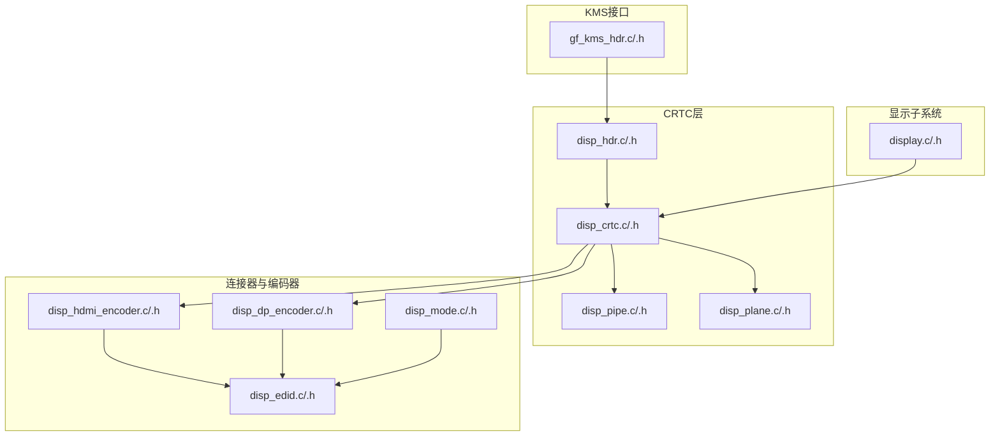
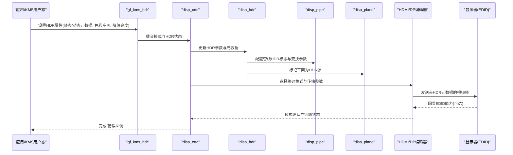
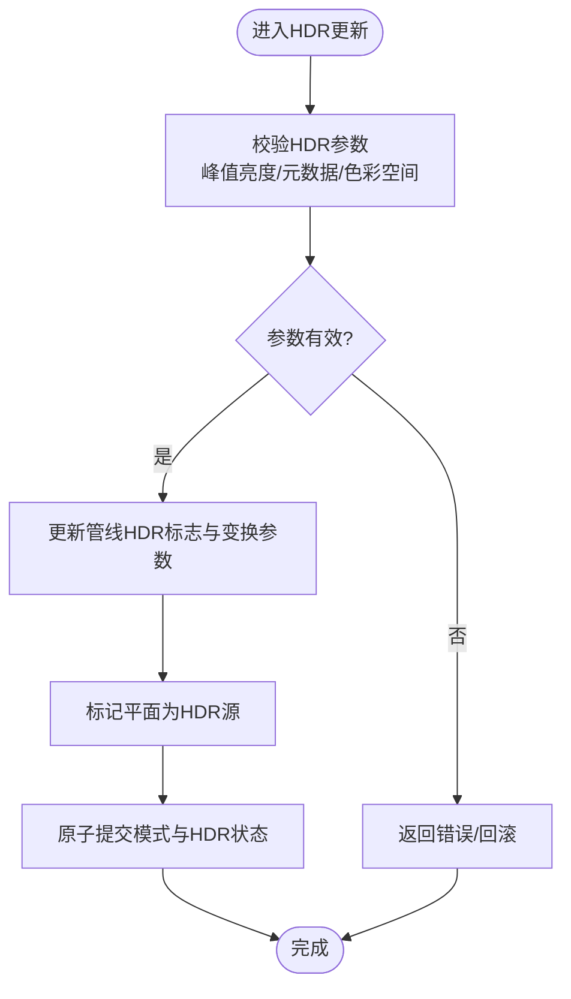
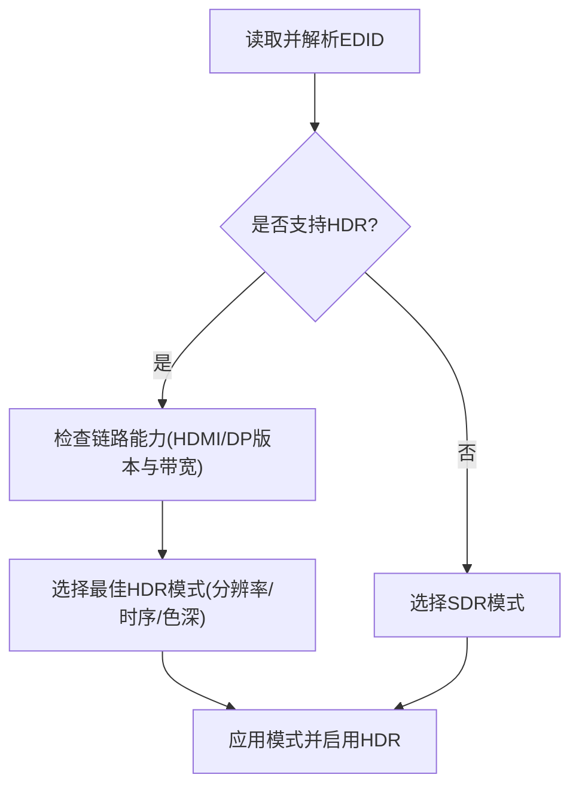
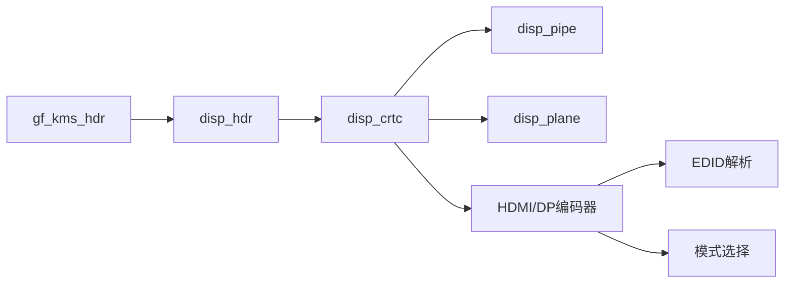

# HDR支持

<cite>
**本文档引用的文件**   
- [disp_hdr.c](file://_work/src/usr/src/lisuan-gpu-dkms-262.2.0.56/display/crtc/disp_hdr.c)
- [disp_hdr.h](file://_work/src/usr/src/lisuan-gpu-dkms-262.2.0.56/display/crtc/disp_hdr.h)
- [gf_kms_hdr.c](file://_work/src/usr/src/lisuan-gpu-dkms-262.2.0.56/kms/gf_kms_hdr.c)
- [gf_kms_hdr.h](file://_work/src/usr/src/lisuan-gpu-dkms-262.2.0.56/kms/gf_kms_hdr.h)
- [disp_edid.c](file://_work/src/usr/src/lisuan-gpu-dkms-262.2.0.56/display/connector/disp_edid.c)
- [disp_edid.h](file://_work/src/usr/src/lisuan-gpu-dkms-262.2.0.56/display/connector/disp_edid.h)
- [disp_mode.c](file://_work/src/usr/src/lisuan-gpu-dkms-262.2.0.56/display/connector/disp_mode.c)
- [disp_mode.h](file://_work/src/usr/src/lisuan-gpu-dkms-262.2.0.56/display/connector/disp_mode.h)
- [disp_hdmi_encoder.c](file://_work/src/usr/src/lisuan-gpu-dkms-262.2.0.56/display/encoder/disp_hdmi_encoder.c)
- [disp_hdmi_encoder.h](file://_work/src/usr/src/lisuan-gpu-dkms-262.2.0.56/display/encoder/disp_hdmi_encoder.h)
- [disp_dp_encoder.c](file://_work/src/usr/src/lisuan-gpu-dkms-262.2.0.56/display/encoder/disp_dp_encoder.c)
- [disp_dp_encoder.h](file://_work/src/usr/src/lisuan-gpu-dkms-262.2.0.56/display/encoder/disp_dp_encoder.h)
- [disp_crtc.c](file://_work/src/usr/src/lisuan-gpu-dkms-262.2.0.56/display/crtc/disp_crtc.c)
- [disp_crtc.h](file://_work/src/usr/src/lisuan-gpu-dkms-262.2.0.56/display/crtc/disp_crtc.h)
- [disp_pipe.c](file://_work/src/usr/src/lisuan-gpu-dkms-262.2.0.56/display/crtc/disp_pipe.c)
- [disp_pipe.h](file://_work/src/usr/src/lisuan-gpu-dkms-262.2.0.56/display/crtc/disp_pipe.h)
- [disp_plane.c](file://_work/src/usr/src/lisuan-gpu-dkms-262.2.0.56/display/crtc/disp_plane.c)
- [disp_plane.h](file://_work/src/usr/src/lisuan-gpu-dkms-262.2.0.56/display/crtc/disp_plane.h)
- [display.c](file://_work/src/usr/src/lisuan-gpu-dkms-262.2.0.56/display/display.c)
- [display.h](file://_work/src/usr/src/lisuan-gpu-dkms-262.2.0.56/display/display.h)
</cite>

## 目录
1. [简介](#简介)
2. [项目结构](#项目结构)
3. [核心组件](#核心组件)
4. [架构总览](#架构总览)
5. [详细组件分析](#详细组件分析)
6. [依赖关系分析](#依赖关系分析)
7. [性能考虑](#性能考虑)
8. [故障排查指南](#故障排查指南)
9. [结论](#结论)
10. [附录](#附录)

## 简介
本文件面向丽山GPU的HDR（高动态范围）显示支持，系统性阐述硬件能力、软件实现与配置流程。内容涵盖：
- HDR元数据管理（静态与动态）
- 色彩空间转换与色调映射算法
- 与显示设备的HDR能力协商（EDID解析、模式选择）
- HDR内容的渲染与输出配置示例
- 性能调优与兼容性注意事项

## 项目结构
HDR相关代码主要分布在以下模块：
- CRTC层：HDR控制、管线与平面处理
- KMS接口：用户态到内核态的HDR属性与状态同步
- 连接器与编码器：EDID解析、HDMI/DP传输与模式协商
- 显示子系统：整体初始化、模式设置与帧缓冲管理

图表来源
- [gf_kms_hdr.c](file://_work/src/usr/src/lisuan-gpu-dkms-262.2.0.56/kms/gf_kms_hdr.c)
- [disp_hdr.c](file://_work/src/usr/src/lisuan-gpu-dkms-262.2.0.56/display/crtc/disp_hdr.c)
- [disp_crtc.c](file://_work/src/usr/src/lisuan-gpu-dkms-262.2.0.56/display/crtc/disp_crtc.c)
- [disp_pipe.c](file://_work/src/usr/src/lisuan-gpu-dkms-262.2.0.56/display/crtc/disp_pipe.c)
- [disp_plane.c](file://_work/src/usr/src/lisuan-gpu-dkms-262.2.0.56/display/crtc/disp_plane.c)
- [disp_edid.c](file://_work/src/usr/src/lisuan-gpu-dkms-262.2.0.56/display/connector/disp_edid.c)
- [disp_mode.c](file://_work/src/usr/src/lisuan-gpu-dkms-262.2.0.56/display/connector/disp_mode.c)
- [disp_hdmi_encoder.c](file://_work/src/usr/src/lisuan-gpu-dkms-262.2.0.56/display/encoder/disp_hdmi_encoder.c)
- [disp_dp_encoder.c](file://_work/src/usr/src/lisuan-gpu-dkms-262.2.0.56/display/encoder/disp_dp_encoder.c)
- [display.c](file://_work/src/usr/src/lisuan-gpu-dkms-262.2.0.56/display/display.c)

章节来源
- [disp_hdr.c](file://_work/src/usr/src/lisuan-gpu-dkms-262.2.0.56/display/crtc/disp_hdr.c)
- [gf_kms_hdr.c](file://_work/src/usr/src/lisuan-gpu-dkms-262.2.0.56/kms/gf_kms_hdr.c)
- [disp_edid.c](file://_work/src/usr/src/lisuan-gpu-dkms-262.2.0.56/display/connector/disp_edid.c)
- [disp_mode.c](file://_work/src/usr/src/lisuan-gpu-dkms-262.2.0.56/display/connector/disp_mode.c)
- [disp_hdmi_encoder.c](file://_work/src/usr/src/lisuan-gpu-dkms-262.2.0.56/display/encoder/disp_hdmi_encoder.c)
- [disp_dp_encoder.c](file://_work/src/usr/src/lisuan-gpu-dkms-262.2.0.56/display/encoder/disp_dp_encoder.c)
- [disp_crtc.c](file://_work/src/usr/src/lisuan-gpu-dkms-262.2.0.56/display/crtc/disp_crtc.c)
- [display.c](file://_work/src/usr/src/lisuan-gpu-dkms-262.2.0.56/display/display.c)

## 核心组件
- HDR控制模块（CRTC层）：负责HDR元数据的注入、色调映射参数配置、以及管线/平面层的HDR标志位管理。
- KMS HDR接口：暴露用户态可设置的HDR属性（如静态/动态元数据、色彩空间、峰值亮度等），并驱动底层更新。
- EDID与模式协商：解析显示器EDID中的HDR能力（如BT.2020、HLG/PQ、静态/动态元数据支持），结合链路能力选择最佳模式。
- 编码器（HDMI/DP）：将HDR信号封装为对应传输格式（如HDMI 2.0a/2.1或DisplayPort 1.4），确保元数据随帧传输。

章节来源
- [disp_hdr.c](file://_work/src/usr/src/lisuan-gpu-dkms-262.2.0.56/display/crtc/disp_hdr.c)
- [gf_kms_hdr.c](file://_work/src/usr/src/lisuan-gpu-dkms-262.2.0.56/kms/gf_kms_hdr.c)
- [disp_edid.c](file://_work/src/usr/src/lisuan-gpu-dkms-262.2.0.56/display/connector/disp_edid.c)
- [disp_mode.c](file://_work/src/usr/src/lisuan-gpu-dkms-262.2.0.56/display/connector/disp_mode.c)
- [disp_hdmi_encoder.c](file://_work/src/usr/src/lisuan-gpu-dkms-262.2.0.56/display/encoder/disp_hdmi_encoder.c)
- [disp_dp_encoder.c](file://_work/src/usr/src/lisuan-gpu-dkms-262.2.0.56/display/encoder/disp_dp_encoder.c)

## 架构总览
下图展示从用户态KMS调用到硬件输出的HDR数据流与控制流。

图表来源
- [gf_kms_hdr.c](file://_work/src/usr/src/lisuan-gpu-dkms-262.2.0.56/kms/gf_kms_hdr.c)
- [disp_crtc.c](file://_work/src/usr/src/lisuan-gpu-dkms-262.2.0.56/display/crtc/disp_crtc.c)
- [disp_hdr.c](file://_work/src/usr/src/lisuan-gpu-dkms-262.2.0.56/display/crtc/disp_hdr.c)
- [disp_pipe.c](file://_work/src/usr/src/lisuan-gpu-dkms-262.2.0.56/display/crtc/disp_pipe.c)
- [disp_plane.c](file://_work/src/usr/src/lisuan-gpu-dkms-262.2.0.56/display/crtc/disp_plane.c)
- [disp_hdmi_encoder.c](file://_work/src/usr/src/lisuan-gpu-dkms-262.2.0.56/display/encoder/disp_hdmi_encoder.c)
- [disp_dp_encoder.c](file://_work/src/usr/src/lisuan-gpu-dkms-262.2.0.56/display/encoder/disp_dp_encoder.c)

## 详细组件分析

### HDR控制模块（CRTC层）
- 职责：维护当前HDR状态（静态/动态元数据、色调映射曲线、峰值亮度、色彩空间），在模式切换时下发至硬件寄存器。
- 关键流程：
  - 接收来自KMS的HDR属性变更请求
  - 校验参数合法性（如峰值亮度范围、元数据字段有效性）
  - 更新管线与平面的HDR标志
  - 触发原子提交，确保时序一致性

图表来源
- [disp_hdr.c](file://_work/src/usr/src/lisuan-gpu-dkms-262.2.0.56/display/crtc/disp_hdr.c)
- [disp_crtc.c](file://_work/src/usr/src/lisuan-gpu-dkms-262.2.0.56/display/crtc/disp_crtc.c)
- [disp_pipe.c](file://_work/src/usr/src/lisuan-gpu-dkms-262.2.0.56/display/crtc/disp_pipe.c)
- [disp_plane.c](file://_work/src/usr/src/lisuan-gpu-dkms-262.2.0.56/display/crtc/disp_plane.c)

章节来源
- [disp_hdr.c](file://_work/src/usr/src/lisuan-gpu-dkms-262.2.0.56/display/crtc/disp_hdr.c)
- [disp_crtc.c](file://_work/src/usr/src/lisuan-gpu-dkms-262.2.0.56/display/crtc/disp_crtc.c)
- [disp_pipe.c](file://_work/src/usr/src/lisuan-gpu-dkms-262.2.0.56/display/crtc/disp_pipe.c)
- [disp_plane.c](file://_work/src/usr/src/lisuan-gpu-dkms-262.2.0.56/display/crtc/disp_plane.c)

### KMS HDR接口
- 职责：暴露用户态API以设置HDR属性（如静态/动态元数据、色彩空间、峰值亮度），并在原子模式下进行状态同步。
- 关键点：
  - 属性类型与取值范围定义
  - 与CRTC/HDR模块的绑定与验证
  - 提交时的原子性保证与回滚机制

章节来源
- [gf_kms_hdr.c](file://_work/src/usr/src/lisuan-gpu-dkms-262.2.0.56/kms/gf_kms_hdr.c)
- [gf_kms_hdr.h](file://_work/src/usr/src/lisuan-gpu-dkms-262.2.0.56/kms/gf_kms_hdr.h)

### EDID解析与模式协商
- EDID能力识别：
  - 检测显示器是否支持HDR（如BT.2020色域、HLG/PQ、静态/动态元数据）
  - 解析最大亮度、支持的分辨率与时序
- 模式选择：
  - 根据EDID与链路能力（HDMI/DP版本、带宽）选择最优模式
  - 若不支持HDR，则回退到SDR模式

图表来源
- [disp_edid.c](file://_work/src/usr/src/lisuan-gpu-dkms-262.2.0.56/display/connector/disp_edid.c)
- [disp_mode.c](file://_work/src/usr/src/lisuan-gpu-dkms-262.2.0.56/display/connector/disp_mode.c)
- [disp_hdmi_encoder.c](file://_work/src/usr/src/lisuan-gpu-dkms-262.2.0.56/display/encoder/disp_hdmi_encoder.c)
- [disp_dp_encoder.c](file://_work/src/usr/src/lisuan-gpu-dkms-262.2.0.56/display/encoder/disp_dp_encoder.c)

章节来源
- [disp_edid.c](file://_work/src/usr/src/lisuan-gpu-dkms-262.2.0.56/display/connector/disp_edid.c)
- [disp_mode.c](file://_work/src/usr/src/lisuan-gpu-dkms-262.2.0.56/display/connector/disp_mode.c)
- [disp_hdmi_encoder.c](file://_work/src/usr/src/lisuan-gpu-dkms-262.2.0.56/display/encoder/disp_hdmi_encoder.c)
- [disp_dp_encoder.c](file://_work/src/usr/src/lisuan-gpu-dkms-262.2.0.56/display/encoder/disp_dp_encoder.c)

### 编码器（HDMI/DP）与HDR传输
- HDMI：
  - 根据HDMI版本与能力选择HDR编码（如HDMI 2.0a/2.1）
  - 确保元数据随帧传输（如静态/动态元数据块）
- DisplayPort：
  - 使用DP 1.4及以上版本以支持HDR
  - 配置DSC（如有）与比特率以满足带宽需求

章节来源
- [disp_hdmi_encoder.c](file://_work/src/usr/src/lisuan-gpu-dkms-262.2.0.56/display/encoder/disp_hdmi_encoder.c)
- [disp_dp_encoder.c](file://_work/src/usr/src/lisuan-gpu-dkms-262.2.0.56/display/encoder/disp_dp_encoder.c)

### 管线与平面（Pipeline & Plane）
- 管线：
  - 配置色彩空间转换（如RGB→BT.2020）
  - 启用色调映射单元（TMU）与峰值亮度限制
- 平面：
  - 标记HDR源平面，确保像素格式与色彩深度匹配
  - 合成阶段保持HDR线性度与元数据传递

章节来源
- [disp_pipe.c](file://_work/src/usr/src/lisuan-gpu-dkms-262.2.0.56/display/crtc/disp_pipe.c)
- [disp_plane.c](file://_work/src/usr/src/lisuan-gpu-dkms-262.2.0.56/display/crtc/disp_plane.c)

## 依赖关系分析
HDR功能依赖多层协作：KMS接口提供属性设置，CRTC/HDR模块协调管线与平面，编码器负责传输，EDID与模式模块决定能力与模式。

图表来源
- [gf_kms_hdr.c](file://_work/src/usr/src/lisuan-gpu-dkms-262.2.0.56/kms/gf_kms_hdr.c)
- [disp_hdr.c](file://_work/src/usr/src/lisuan-gpu-dkms-262.2.0.56/display/crtc/disp_hdr.c)
- [disp_crtc.c](file://_work/src/usr/src/lisuan-gpu-dkms-262.2.0.56/display/crtc/disp_crtc.c)
- [disp_pipe.c](file://_work/src/usr/src/lisuan-gpu-dkms-262.2.0.56/display/crtc/disp_pipe.c)
- [disp_plane.c](file://_work/src/usr/src/lisuan-gpu-dkms-262.2.0.56/display/crtc/disp_plane.c)
- [disp_hdmi_encoder.c](file://_work/src/usr/src/lisuan-gpu-dkms-262.2.0.56/display/encoder/disp_hdmi_encoder.c)
- [disp_dp_encoder.c](file://_work/src/usr/src/lisuan-gpu-dkms-262.2.0.56/display/encoder/disp_dp_encoder.c)
- [disp_edid.c](file://_work/src/usr/src/lisuan-gpu-dkms-262.2.0.56/display/connector/disp_edid.c)
- [disp_mode.c](file://_work/src/usr/src/lisuan-gpu-dkms-262.2.0.56/display/connector/disp_mode.c)

章节来源
- [gf_kms_hdr.c](file://_work/src/usr/src/lisuan-gpu-dkms-262.2.0.56/kms/gf_kms_hdr.c)
- [disp_hdr.c](file://_work/src/usr/src/lisuan-gpu-dkms-262.2.0.56/display/crtc/disp_hdr.c)
- [disp_crtc.c](file://_work/src/usr/src/lisuan-gpu-dkms-262.2.0.56/display/crtc/disp_crtc.c)
- [disp_edid.c](file://_work/src/usr/src/lisuan-gpu-dkms-262.2.0.56/display/connector/disp_edid.c)
- [disp_mode.c](file://_work/src/usr/src/lisuan-gpu-dkms-262.2.0.56/display/connector/disp_mode.c)
- [disp_hdmi_encoder.c](file://_work/src/usr/src/lisuan-gpu-dkms-262.2.0.56/display/encoder/disp_hdmi_encoder.c)
- [disp_dp_encoder.c](file://_work/src/usr/src/lisuan-gpu-dkms-262.2.0.56/display/encoder/disp_dp_encoder.c)

## 性能考虑
- 带宽与压缩：在高分辨率与高色深下启用DSC以降低带宽压力，避免丢帧。
- 元数据开销：动态元数据每帧更新会增加总线负载，需权衡刷新率与延迟。
- 管线并行：合理分配平面与管线资源，减少重绘与混合开销。
- 功耗管理：在低负载场景关闭不必要的HDR特性，降低功耗。

[本节为通用指导，不直接分析具体文件]

## 故障排查指南
- 无HDR输出：
  - 检查EDID是否声明HDR能力
  - 确认HDMI/DP版本与线缆质量满足带宽要求
  - 验证KMS属性设置是否正确（峰值亮度、色彩空间）
- 画面异常（过曝/欠曝）：
  - 调整峰值亮度与色调映射曲线
  - 检查源内容色彩空间与目标设备是否一致
- 闪烁或撕裂：
  - 启用垂直同步与原子提交
  - 检查模式时序与刷新率设置

章节来源
- [disp_edid.c](file://_work/src/usr/src/lisuan-gpu-dkms-262.2.0.56/display/connector/disp_edid.c)
- [disp_mode.c](file://_work/src/usr/src/lisuan-gpu-dkms-262.2.0.56/display/connector/disp_mode.c)
- [disp_hdmi_encoder.c](file://_work/src/usr/src/lisuan-gpu-dkms-262.2.0.56/display/encoder/disp_hdmi_encoder.c)
- [disp_dp_encoder.c](file://_work/src/usr/src/lisuan-gpu-dkms-262.2.0.56/display/encoder/disp_dp_encoder.c)
- [disp_crtc.c](file://_work/src/usr/src/lisuan-gpu-dkms-262.2.0.56/display/crtc/disp_crtc.c)

## 结论
丽山GPU的HDR支持通过KMS接口、CRTC/HDR模块、EDID与模式协商、以及HDMI/DP编码器协同工作，实现了从用户态配置到硬件输出的完整链路。正确理解各组件职责与交互流程，有助于优化性能并确保兼容性。

[本节为总结性内容，不直接分析具体文件]

## 附录
- 典型HDR内容渲染与输出配置步骤（概念性）：
  - 查询EDID并确认HDR能力
  - 选择HDR模式（分辨率、色深、刷新率）
  - 设置KMS HDR属性（静态/动态元数据、色彩空间、峰值亮度）
  - 提交原子模式并验证输出
  - 根据实际效果微调色调映射与峰值亮度

[本节为概念性说明，不直接分析具体文件]