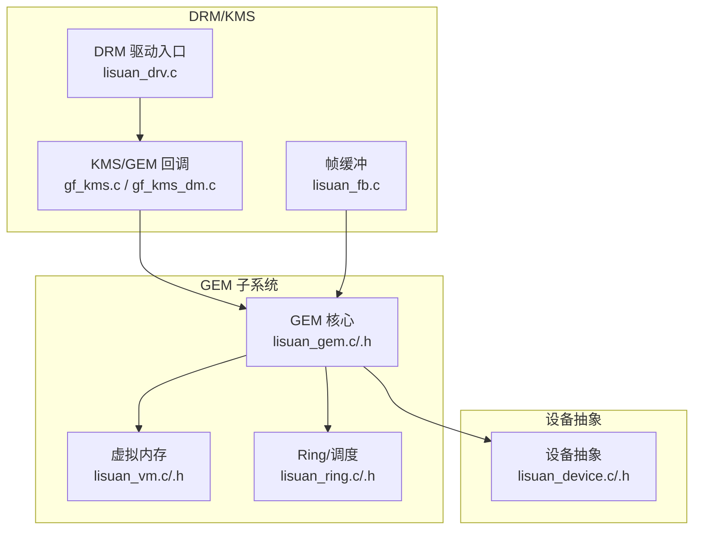
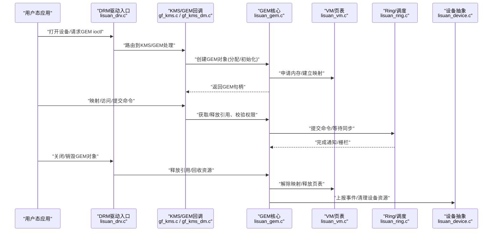
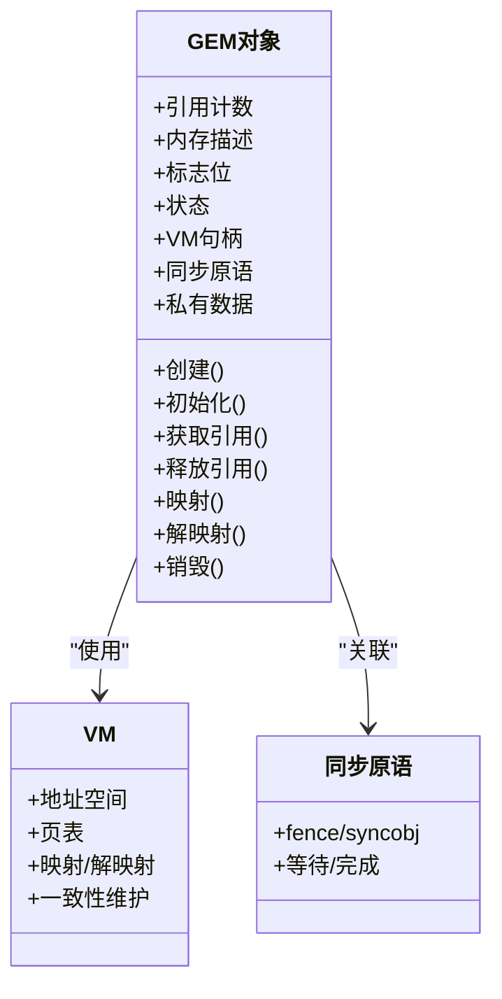
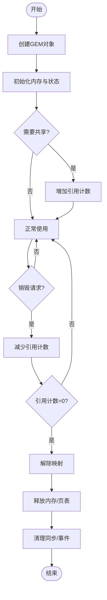
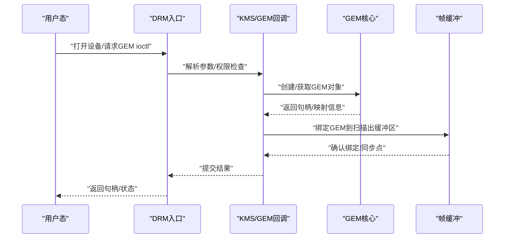
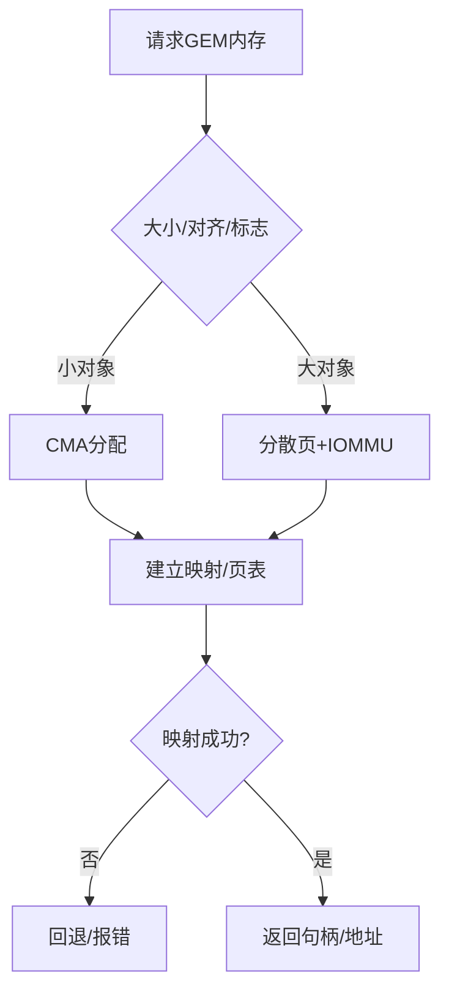
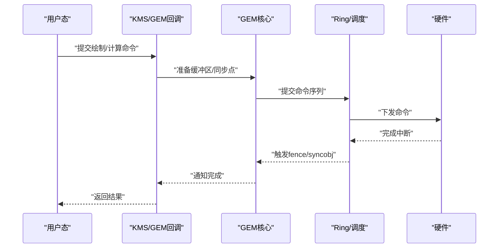
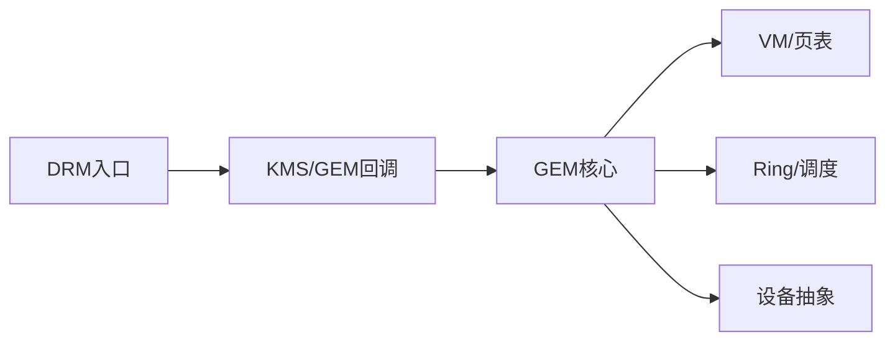

# GEM对象管理

<cite>
**本文引用的文件**   
- [lisuan_gem.c](file://_work/src/usr/src/lisuangpu-dkms-262.2.0.56/lisuan_gem.c)
- [lisuan_gem.h](file://_work/src/usr/src/lisuangpu-dkms-262.2.0.56/lisuan_gem.h)
- [lisuan_drv.c](file://_work/src/usr/src/lisuangpu-dkms-262.2.0.56/lisuan_drv.c)
- [lisuan_drv.h](file://_work/src/usr/src/lisuangpu-dkms-262.2.0.56/lisuan_drv.h)
- [lisuan_device.c](file://_work/src/usr/src/lisuangpu-dkms-262.2.0.56/lisuan_device.c)
- [lisuan_device.h](file://_work/src/usr/src/lisuangpu-dkms-262.2.0.56/lisuan_device.h)
- [lisuan_vm.c](file://_work/src/usr/src/lisuangpu-dkms-262.2.0.56/lisuan_vm.c)
- [lisuan_vm.h](file://_work/src/usr/src/lisuangpu-dkms-262.2.0.56/lisuan_vm.h)
- [lisuan_ring.c](file://_work/src/usr/src/lisuangpu-dkms-262.2.0.56/lisuan_ring.c)
- [lisuan_ring.h](file://_work/src/usr/src/lisuangpu-dkms-262.2.0.56/lisuan_ring.h)
- [gf_kms.c](file://_work/src/usr/src/lisuangpu-dkms-262.2.0.56/kms/gf_kms.c)
- [gf_kms_dm.c](file://_work/src/usr/src/lisuangpu-dkms-262.2.0.56/kms/gf_kms_dm.c)
- [lisuan_fb.c](file://_work/src/usr/src/lisuangpu-dkms-262.2.0.56/lisuan_fb.c)
- [lisuan_fb.h](file://_work/src/usr/src/lisuangpu-dkms-262.2.0.56/lisuan_fb.h)
</cite>

## 目录
1. [简介](#简介)
2. [项目结构](#项目结构)
3. [核心组件](#核心组件)
4. [架构总览](#架构总览)
5. [详细组件分析](#详细组件分析)
6. [依赖关系分析](#依赖关系分析)
7. [性能考虑](#性能考虑)
8. [故障排查指南](#故障排查指南)
9. [结论](#结论)
10. [附录](#附录)

## 简介
本文件面向丽山GPU的GEM（Graphics Execution Manager）对象管理子系统，系统性阐述GEM缓冲区对象的生命周期、数据结构与状态机、与DRM/KMS框架的集成方式、以及资源管理与错误处理的最佳实践。文档同时提供典型使用流程的图示与参考路径，帮助读者快速理解并正确实现GEM对象的创建、映射、同步与销毁。

## 项目结构
围绕GEM对象管理的代码主要分布在以下模块：
- GEM核心：定义GEM对象结构体、生命周期操作、引用计数、内存分配/释放、映射与同步接口等
- DRM驱动入口：注册DRM/GEM驱动回调、设备初始化、字符设备与ioctl分发
- 设备抽象：封装硬件相关能力、电源与时钟、中断与事件
- 虚拟内存（VM）：地址空间、页表、映射与IOMMU相关逻辑
- Ring/调度：命令提交、执行队列、同步原语
- KMS/FB：显示管线与帧缓冲，可能复用GEM对象作为扫描出缓冲区

图表来源
- [lisuan_drv.c](file://_work/src/usr/src/lisuangpu-dkms-262.2.0.56/lisuan_drv.c)
- [gf_kms.c](file://_work/src/usr/src/lisuangpu-dkms-262.2.0.56/kms/gf_kms.c)
- [gf_kms_dm.c](file://_work/src/usr/src/lisuangpu-dkms-262.2.0.56/kms/gf_kms_dm.c)
- [lisuan_gem.c](file://_work/src/usr/src/lisuangpu-dkms-262.2.0.56/lisuan_gem.c)
- [lisuan_vm.c](file://_work/src/usr/src/lisuangpu-dkms-262.2.0.56/lisuan_vm.c)
- [lisuan_ring.c](file://_work/src/usr/src/lisuangpu-dkms-262.2.0.56/lisuan_ring.c)
- [lisuan_device.c](file://_work/src/usr/src/lisuangpu-dkms-262.2.0.56/lisuan_device.c)
- [lisuan_fb.c](file://_work/src/usr/src/lisuangpu-dkms-262.2.0.56/lisuan_fb.c)

章节来源
- [lisuan_gem.c](file://_work/src/usr/src/lisuangpu-dkms-262.2.0.56/lisuan_gem.c)
- [lisuan_gem.h](file://_work/src/usr/src/lisuangpu-dkms-262.2.0.56/lisuan_gem.h)
- [lisuan_drv.c](file://_work/src/usr/src/lisuangpu-dkms-262.2.0.56/lisuan_drv.c)
- [lisuan_device.c](file://_work/src/usr/src/lisuangpu-dkms-262.2.0.56/lisuan_device.c)
- [lisuan_vm.c](file://_work/src/usr/src/lisuangpu-dkms-262.2.0.56/lisuan_vm.c)
- [lisuan_ring.c](file://_work/src/usr/src/lisuangpu-dkms-262.2.0.56/lisuan_ring.c)
- [gf_kms.c](file://_work/src/usr/src/lisuangpu-dkms-262.2.0.56/kms/gf_kms.c)
- [gf_kms_dm.c](file://_work/src/usr/src/lisuangpu-dkms-262.2.0.56/kms/gf_kms_dm.c)
- [lisuan_fb.c](file://_work/src/usr/src/lisuangpu-dkms-262.2.0.56/lisuan_fb.c)

## 核心组件
- GEM对象模型：封装缓冲区元数据、内存描述、标志位、引用计数、映射句柄、同步原语等
- 生命周期管理：创建、初始化、获取/释放引用、销毁；包含失败回滚与资源清理
- 内存与VM：物理/虚拟内存分配、页表构建、映射/解映射、一致性维护
- 同步与提交：与Ring/调度交互，提交命令、等待完成、栅栏/信号量
- DRM/KMS集成：DRM_GEM驱动回调、ioctls、KMS平面/帧缓冲绑定

章节来源
- [lisuan_gem.h](file://_work/src/usr/src/lisuangpu-dkms-262.2.0.56/lisuan_gem.h)
- [lisuan_gem.c](file://_work/src/usr/src/lisuangpu-dkms-262.2.0.56/lisuan_gem.c)
- [lisuan_vm.h](file://_work/src/usr/src/lisuangpu-dkms-262.2.0.56/lisuan_vm.h)
- [lisuan_vm.c](file://_work/src/usr/src/lisuangpu-dkms-262.2.0.56/lisuan_vm.c)
- [lisuan_ring.h](file://_work/src/usr/src/lisuangpu-dkms-262.2.0.56/lisuan_ring.h)
- [lisuan_ring.c](file://_work/src/usr/src/lisuangpu-dkms-262.2.0.56/lisuan_ring.c)

## 架构总览
下图展示从用户态到内核态的GEM对象调用链路与关键组件交互：

图表来源
- [lisuan_drv.c](file://_work/src/usr/src/lisuangpu-dkms-262.2.0.56/lisuan_drv.c)
- [gf_kms.c](file://_work/src/usr/src/lisuangpu-dkms-262.2.0.56/kms/gf_kms.c)
- [gf_kms_dm.c](file://_work/src/usr/src/lisuangpu-dkms-262.2.0.56/kms/gf_kms_dm.c)
- [lisuan_gem.c](file://_work/src/usr/src/lisuangpu-dkms-262.2.0.56/lisuan_gem.c)
- [lisuan_vm.c](file://_work/src/usr/src/lisuangpu-dkms-262.2.0.56/lisuan_vm.c)
- [lisuan_ring.c](file://_work/src/usr/src/lisuangpu-dkms-262.2.0.56/lisuan_ring.c)
- [lisuan_device.c](file://_work/src/usr/src/lisuangpu-dkms-262.2.0.56/lisuan_device.c)

## 详细组件分析

### GEM对象数据结构与属性
- 关键字段
  - 引用计数：用于多所有者共享与延迟释放
  - 内存描述：大小、对齐、缓存策略、是否可映射、是否独占
  - 标志位：只读/可写、CPU可见、GPU可见、DMA-capable、scanout等
  - 状态：未初始化、已分配、已映射、使用中、待回收
  - 关联对象：VM句柄、页表指针、同步原语（fence/syncobj）、私有数据
- 复杂度与布局
  - 对象头固定大小，内存描述按页或大块分配
  - 标志位采用位域，便于快速判断与掩码操作
  - 引用计数原子操作，避免竞态

图表来源
- [lisuan_gem.h](file://_work/src/usr/src/lisuangpu-dkms-262.2.0.56/lisuan_gem.h)
- [lisuan_vm.h](file://_work/src/usr/src/lisuangpu-dkms-262.2.0.56/lisuan_vm.h)

章节来源
- [lisuan_gem.h](file://_work/src/usr/src/lisuangpu-dkms-262.2.0.56/lisuan_gem.h)
- [lisuan_gem.c](file://_work/src/usr/src/lisuangpu-dkms-262.2.0.56/lisuan_gem.c)
- [lisuan_vm.h](file://_work/src/usr/src/lisuangpu-dkms-262.2.0.56/lisuan_vm.h)

### 生命周期与引用计数管理
- 创建与初始化
  - 分配GEM对象头与内存描述
  - 根据标志位选择内存类型（CMA/PCIe/IOMMU）
  - 初始化引用计数为1，状态置为“已分配”
- 引用计数
  - 获取引用：增加计数，记录所有者上下文
  - 释放引用：减少计数，若为0则进入销毁流程
- 销毁
  - 解除所有映射
  - 释放页表与内存
  - 清理同步原语与事件
  - 更新设备状态与统计

图表来源
- [lisuan_gem.c](file://_work/src/usr/src/lisuangpu-dkms-262.2.0.56/lisuan_gem.c)
- [lisuan_gem.h](file://_work/src/usr/src/lisuangpu-dkms-262.2.0.56/lisuan_gem.h)

章节来源
- [lisuan_gem.c](file://_work/src/usr/src/lisuangpu-dkms-262.2.0.56/lisuan_gem.c)
- [lisuan_gem.h](file://_work/src/usr/src/lisuangpu-dkms-262.2.0.56/lisuan_gem.h)

### 与DRM/KMS的集成
- DRM驱动入口
  - 注册字符设备、DRM设备、GEM驱动回调
  - 分发ioctl到具体处理函数
- KMS/GEM回调
  - 将GEM对象绑定到平面/帧缓冲
  - 处理扫描出、重绘、模式切换时的映射与同步
- 最佳实践
  - 在KMS路径中确保正确的锁顺序与同步原语
  - 避免在原子提交期间进行阻塞操作

图表来源
- [lisuan_drv.c](file://_work/src/usr/src/lisuangpu-dkms-262.2.0.56/lisuan_drv.c)
- [gf_kms.c](file://_work/src/usr/src/lisuangpu-dkms-262.2.0.56/kms/gf_kms.c)
- [gf_kms_dm.c](file://_work/src/usr/src/lisuangpu-dkms-262.2.0.56/kms/gf_kms_dm.c)
- [lisuan_gem.c](file://_work/src/usr/src/lisuangpu-dkms-262.2.0.56/lisuan_gem.c)
- [lisuan_fb.c](file://_work/src/usr/src/lisuangpu-dkms-262.2.0.56/lisuan_fb.c)

章节来源
- [lisuan_drv.c](file://_work/src/usr/src/lisuangpu-dkms-262.2.0.56/lisuan_drv.c)
- [gf_kms.c](file://_work/src/usr/src/lisuangpu-dkms-262.2.0.56/kms/gf_kms.c)
- [gf_kms_dm.c](file://_work/src/usr/src/lisuangpu-dkms-262.2.0.56/kms/gf_kms_dm.c)
- [lisuan_fb.c](file://_work/src/usr/src/lisuangpu-dkms-262.2.0.56/lisuan_fb.c)

### 内存与VM集成
- 内存分配策略
  - 小对象：连续物理内存（CMA）
  - 大对象：分散页+IOMMU映射
- 页表与映射
  - 构建/更新页表项
  - CPU/GPU一致性屏障
  - 按需映射与解映射
- 错误处理
  - 分配失败回退策略
  - 映射冲突检测与解决

图表来源
- [lisuan_vm.c](file://_work/src/usr/src/lisuangpu-dkms-262.2.0.56/lisuan_vm.c)
- [lisuan_vm.h](file://_work/src/usr/src/lisuangpu-dkms-262.2.0.56/lisuan_vm.h)

章节来源
- [lisuan_vm.c](file://_work/src/usr/src/lisuangpu-dkms-262.2.0.56/lisuan_vm.c)
- [lisuan_vm.h](file://_work/src/usr/src/lisuangpu-dkms-262.2.0.56/lisuan_vm.h)

### 同步与提交
- 与Ring/调度交互
  - 将GEM对象作为输入/输出缓冲区
  - 提交命令至Ring，设置依赖与完成信号
- 同步原语
  - fence/syncobj等待与触发
  - 批量提交减少同步开销
- 错误恢复
  - 超时与重试策略
  - 任务取消与资源清理

图表来源
- [lisuan_ring.c](file://_work/src/usr/src/lisuangpu-dkms-262.2.0.56/lisuan_ring.c)
- [lisuan_ring.h](file://_work/src/usr/src/lisuangpu-dkms-262.2.0.56/lisuan_ring.h)
- [lisuan_gem.c](file://_work/src/usr/src/lisuangpu-dkms-262.2.0.56/lisuan_gem.c)

章节来源
- [lisuan_ring.c](file://_work/src/usr/src/lisuangpu-dkms-262.2.0.56/lisuan_ring.c)
- [lisuan_gem.c](file://_work/src/usr/src/lisuangpu-dkms-262.2.0.56/lisuan_gem.c)

## 依赖关系分析
- 组件耦合
  - GEM核心依赖VM与Ring，间接依赖设备抽象
  - KMS/GEM回调依赖DRM入口与GEM核心
- 外部依赖
  - DRM/KMS框架、内存子系统、IOMMU、中断与事件
- 循环依赖
  - 通过接口抽象避免直接循环依赖

图表来源
- [lisuan_drv.c](file://_work/src/usr/src/lisuangpu-dkms-262.2.0.56/lisuan_drv.c)
- [gf_kms.c](file://_work/src/usr/src/lisuangpu-dkms-262.2.0.56/kms/gf_kms.c)
- [lisuan_gem.c](file://_work/src/usr/src/lisuangpu-dkms-262.2.0.56/lisuan_gem.c)
- [lisuan_vm.c](file://_work/src/usr/src/lisuangpu-dkms-262.2.0.56/lisuan_vm.c)
- [lisuan_ring.c](file://_work/src/usr/src/lisuangpu-dkms-262.2.0.56/lisuan_ring.c)
- [lisuan_device.c](file://_work/src/usr/src/lisuangpu-dkms-262.2.0.56/lisuan_device.c)

章节来源
- [lisuan_drv.c](file://_work/src/usr/src/lisuangpu-dkms-262.2.0.56/lisuan_drv.c)
- [lisuan_gem.c](file://_work/src/usr/src/lisuangpu-dkms-262.2.0.56/lisuan_gem.c)
- [lisuan_vm.c](file://_work/src/usr/src/lisuangpu-dkms-262.2.0.56/lisuan_vm.c)
- [lisuan_ring.c](file://_work/src/usr/src/lisuangpu-dkms-262.2.0.56/lisuan_ring.c)
- [lisuan_device.c](file://_work/src/usr/src/lisuangpu-dkms-262.2.0.56/lisuan_device.c)

## 性能考虑
- 内存分配
  - 优先使用CMA以减少碎片与映射开销
  - 大对象采用IOMMU提升灵活性但需权衡TLB压力
- 映射与缓存
  - 合理设置缓存策略，避免不必要的刷新
  - 批量映射/解映射降低系统调用次数
- 同步优化
  - 合并提交，减少fence数量
  - 使用无锁队列与环形缓冲提高吞吐
- 错误回退
  - 分配失败时自动降级策略，保证服务可用性

[本节为通用指导，不直接分析具体文件]

## 故障排查指南
- 常见问题
  - 内存不足：检查CMA池大小与IOMMU配置
  - 映射失败：验证权限与地址范围
  - 同步超时：检查中断与Ring状态
- 调试建议
  - 启用详细日志与跟踪点
  - 使用工具检查引用计数与映射状态
  - 隔离问题路径，逐步缩小范围

章节来源
- [lisuan_gem.c](file://_work/src/usr/src/lisuangpu-dkms-262.2.0.56/lisuan_gem.c)
- [lisuan_vm.c](file://_work/src/usr/src/lisuangpu-dkms-262.2.0.56/lisuan_vm.c)
- [lisuan_ring.c](file://_work/src/usr/src/lisuangpu-dkms-262.2.0.56/lisuan_ring.c)

## 结论
丽山GPU的GEM对象管理以清晰的数据结构与严谨的生命周期控制为核心，结合DRM/KMS框架提供统一的缓冲区抽象。通过合理的内存策略、同步机制与错误处理，可实现高效稳定的图形与计算任务执行。遵循本文档的最佳实践，有助于在复杂场景下保持系统的健壮性与性能。

[本节为总结性内容，不直接分析具体文件]

## 附录
- 典型使用模式（参考路径）
  - 创建GEM对象：[lisuan_gem.c](file://_work/src/usr/src/lisuangpu-dkms-262.2.0.56/lisuan_gem.c)
  - 映射与访问：[lisuan_gem.c](file://_work/src/usr/src/lisuangpu-dkms-262.2.0.56/lisuan_gem.c)
  - 提交命令与同步：[lisuan_ring.c](file://_work/src/usr/src/lisuangpu-dkms-262.2.0.56/lisuan_ring.c)
  - KMS绑定与扫描出：[gf_kms.c](file://_work/src/usr/src/lisuangpu-dkms-262.2.0.56/kms/gf_kms.c), [lisuan_fb.c](file://_work/src/usr/src/lisuangpu-dkms-262.2.0.56/lisuan_fb.c)
  - 销毁与资源回收：[lisuan_gem.c](file://_work/src/usr/src/lisuangpu-dkms-262.2.0.56/lisuan_gem.c)

[本节为参考指引，不直接分析具体文件]