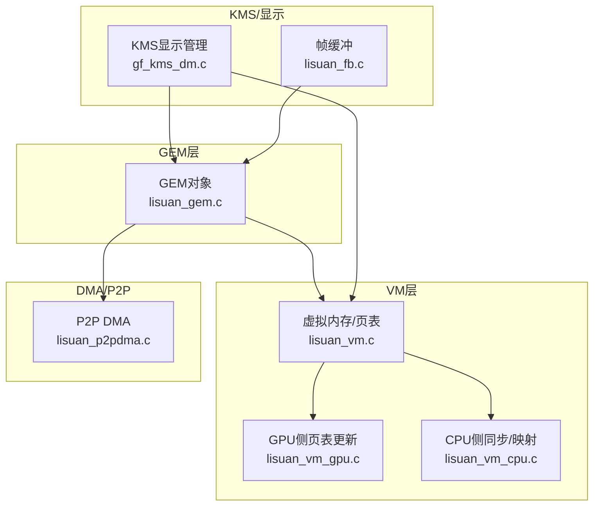
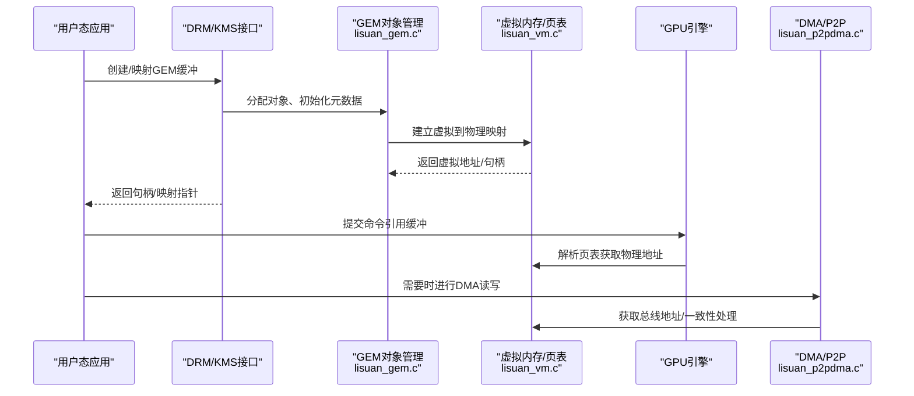
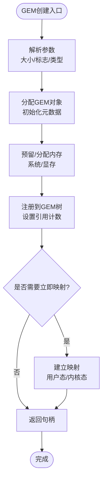
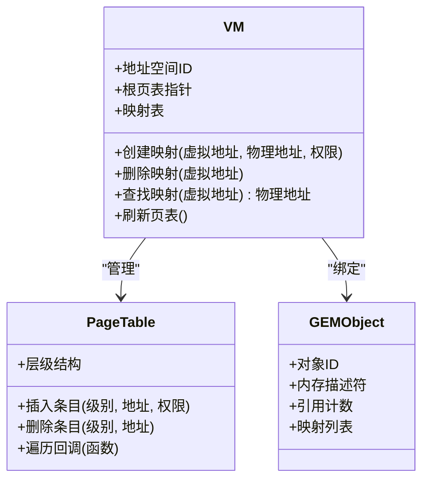
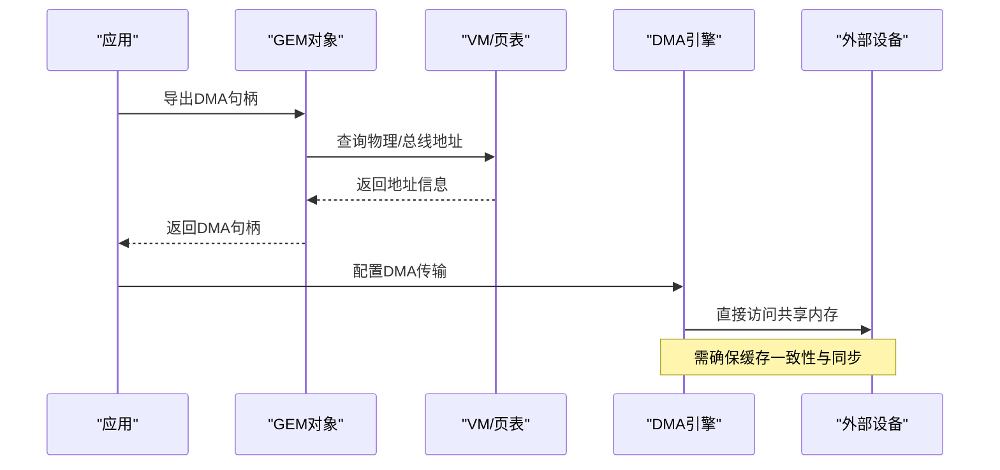
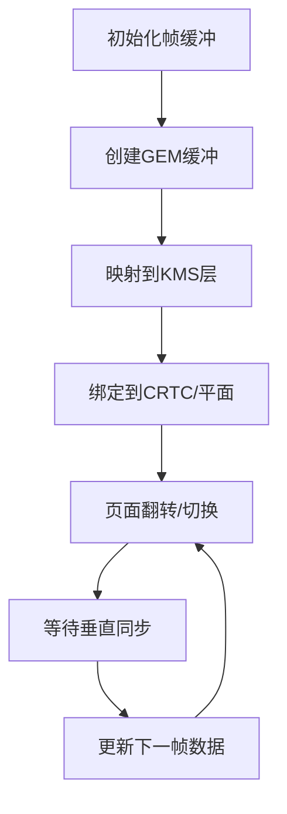
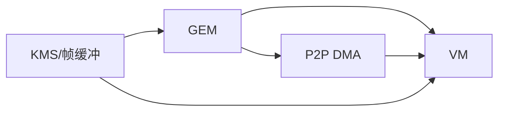

# 内存管理

<cite>
**本文引用的文件**   
- [lisuan_gem.c](file://_work/src/usr/src/lisuan-dkms-262.2.0.56/lisuan_gem.c)
- [lisuan_gem.h](file://_work/src/usr/src/lisuan-dkms-262.2.0.56/lisuan_gem.h)
- [lisuan_vm.c](file://_work/src/usr/src/lisuan-dkms-262.2.0.56/lisuan_vm.c)
- [lisuan_vm.h](file://_work/src/usr/src/lisuan-dkms-262.2.0.56/lisuan_vm.h)
- [lisuan_vm_gpu.c](file://_work/src/usr/src/lisuan-dkms-262.2.0.56/lisuan_vm_gpu.c)
- [lisuan_vm_cpu.c](file://_work/src/usr/src/lisuan-dkms-262.2.0.56/lisuan_vm_cpu.c)
- [lisuan_fb.c](file://_work/src/usr/src/lisuan-dkms-262.2.0.56/lisuan_fb.c)
- [lisuan_fb.h](file://_work/src/usr/src/lisuan-dkms-262.2.0.56/lisuan_fb.h)
- [gf_kms_dm.c](file://_work/src/usr/src/lisuan-dkms-262.2.0.56/gf_kms_dm.c)
- [gf_kms_dm.h](file://_work/src/usr/src/lisuan-dkms-262.2.0.56/gf_kms_dm.h)
- [lisuan_p2pdma.c](file://_work/src/usr/src/lisuan-dkms-262.2.0.56/lisuan_p2pdma.c)
- [lisuan_p2pdma.h](file://_work/src/usr/src/lisuan-dkms-262.2.0.56/lisuan_p2pdma.h)
</cite>

## 目录
1. [简介](#简介)
2. [项目结构](#项目结构)
3. [核心组件](#核心组件)
4. [架构总览](#架构总览)
5. [详细组件分析](#详细组件分析)
6. [依赖关系分析](#依赖关系分析)
7. [性能考量](#性能考量)
8. [故障排查指南](#故障排查指南)
9. [结论](#结论)
10. [附录](#附录)

## 简介
本文件面向丽山GPU驱动中的内存管理子系统，重点覆盖以下方面：
- GEM（Graphics Execution Manager）缓冲区对象的生命周期：创建、管理与销毁
- 虚拟内存管理器（VM）设计：页表管理、地址转换与内存映射机制
- DMA缓冲区处理：共享内存、零拷贝技术与缓存一致性保证
- 内存分配最佳实践：内存池使用、碎片化控制与性能优化策略
- 实际代码示例路径：以“文件:行号”形式给出关键实现位置，便于快速定位

## 项目结构
该子系统的核心代码集中在以下模块：
- GEM对象与缓冲管理：lisuan_gem.[ch]
- 虚拟内存与页表：lisuan_vm.[ch]、lisuan_vm_gpu.c、lisuan_vm_cpu.c
- 帧缓冲与显示路径：lisuan_fb.[ch]、gf_kms_dm.[ch]
- DMA与P2P支持：lisuan_p2pdma.[ch]

图表来源
- [lisuan_gem.c](file://_work/src/usr/src/lisuan-dkms-262.2.0.56/lisuan_gem.c)
- [lisuan_vm.c](file://_work/src/usr/src/lisuan-dkms-262.2.0.56/lisuan_vm.c)
- [lisuan_vm_gpu.c](file://_work/src/usr/src/lisuan-dkms-262.2.0.56/lisuan_vm_gpu.c)
- [lisuan_vm_cpu.c](file://_work/src/usr/src/lisuan-dkms-262.2.0.56/lisuan_vm_cpu.c)
- [gf_kms_dm.c](file://_work/src/usr/src/lisuan-dkms-262.2.0.56/gf_kms_dm.c)
- [lisuan_fb.c](file://_work/src/usr/src/lisuan-dkms-262.2.0.56/lisuan_fb.c)
- [lisuan_p2pdma.c](file://_work/src/usr/src/lisuan-dkms-262.2.0.56/lisuan_p2pdma.c)

章节来源
- [lisuan_gem.c](file://_work/src/usr/src/lisuan-dkms-262.2.0.56/lisuan_gem.c)
- [lisuan_vm.c](file://_work/src/usr/src/lisuan-dkms-262.2.0.56/lisuan_vm.c)
- [gf_kms_dm.c](file://_work/src/usr/src/lisuan-dkms-262.2.0.56/gf_kms_dm.c)
- [lisuan_fb.c](file://_work/src/usr/src/lisuan-dkms-262.2.0.56/lisuan_fb.c)
- [lisuan_p2pdma.c](file://_work/src/usr/src/lisuan-dkms-262.2.0.56/lisuan_p2pdma.c)

## 核心组件
- GEM缓冲区对象：封装物理内存、引用计数、映射状态、访问权限与设备私有数据。负责用户态与内核态之间的缓冲生命周期管理。
- 虚拟内存管理器（VM）：维护进程级或上下文级的地址空间、页表结构与映射关系，提供虚拟到物理的转换与IOMMU/PCIe总线地址生成。
- DMA/P2P：将GEM缓冲暴露给DMA引擎或其他设备，支持共享内存与零拷贝路径，确保缓存一致性与可见性。
- KMS/帧缓冲：将GEM缓冲作为扫描输出源，建立显示管线所需的映射与同步。

章节来源
- [lisuan_gem.h](file://_work/src/usr/src/lisuan-dkms-262.2.0.56/lisuan_gem.h)
- [lisuan_vm.h](file://_work/src/usr/src/lisuan-dkms-262.2.0.56/lisuan_vm.h)
- [lisuan_p2pdma.h](file://_work/src/usr/src/lisuan-dkms-262.2.0.56/lisuan_p2pdma.h)
- [lisuan_fb.h](file://_work/src/usr/src/lisuan-dkms-262.2.0.56/lisuan_fb.h)

## 架构总览
下图展示了从用户态请求到GPU执行的关键路径：用户态通过DRM/GEM接口创建缓冲，内核在GEM层分配并记录元数据；VM层建立页表映射；DMA/P2P为其他设备提供共享访问；KMS/显示路径将缓冲用于扫描输出。

图表来源
- [lisuan_gem.c](file://_work/src/usr/src/lisuan-dkms-262.2.0.56/lisuan_gem.c)
- [lisuan_vm.c](file://_work/src/usr/src/lisuan-dkms-262.2.0.56/lisuan_vm.c)
- [lisuan_p2pdma.c](file://_work/src/usr/src/lisuan-dkms-262.2.0.56/lisuan_p2pdma.c)

## 详细组件分析

### GEM缓冲区对象：创建、管理与销毁
- 创建流程
  - 接收用户态参数（大小、访问标志、类型等）
  - 分配内核数据结构，关联底层内存（系统内存或显存）
  - 注册到GEM对象树，设置引用计数与锁
  - 可选：预填充、对齐、属性标记（如不可交换、只读/可写）
- 管理流程
  - 引用计数与共享：多进程/多上下文共享同一缓冲
  - 映射与解映射：用户态mmap、内核态pin/unpin
  - 同步与屏障：与GPU/DMA操作的完成信号协调
- 销毁流程
  - 释放引用计数，当计数归零时触发回收
  - 解除所有映射，清理页表项
  - 释放底层内存资源，通知相关等待者

图表来源
- [lisuan_gem.c](file://_work/src/usr/src/lisuan-dkms-262.2.0.56/lisuan_gem.c)

章节来源
- [lisuan_gem.c](file://_work/src/usr/src/lisuan-dkms-262.2.0.56/lisuan_gem.c)
- [lisuan_gem.h](file://_work/src/usr/src/lisuan-dkms-262.2.0.56/lisuan_gem.h)

### 虚拟内存管理器（VM）：页表、地址转换与映射
- 设计要点
  - 每个上下文/进程拥有独立地址空间
  - 多级页表结构，支持大页与灵活粒度
  - 映射操作包括插入、删除、更新与遍历
- 地址转换
  - CPU侧：通过页表将虚拟地址转换为物理地址
  - GPU侧：通过IOMMU或设备特定寄存器将虚拟地址转换为总线地址
- 内存映射机制
  - 支持多种内存类型（系统内存、显存、UMA）
  - 映射权限控制（读/写/执行）
  - 与GEM对象绑定，确保生命周期一致

图表来源
- [lisuan_vm.c](file://_work/src/usr/src/lisuan-dkms-262.2.0.56/lisuan_vm.c)
- [lisuan_vm.h](file://_work/src/usr/src/lisuan-dkms-262.2.0.56/lisuan_vm.h)

章节来源
- [lisuan_vm.c](file://_work/src/usr/src/lisuan-dkms-262.2.0.56/lisuan_vm.c)
- [lisuan_vm.h](file://_work/src/usr/src/lisuan-dkms-262.2.0.56/lisuan_vm.h)
- [lisuan_vm_gpu.c](file://_work/src/usr/src/lisuan-dkms-262.2.0.56/lisuan_vm_gpu.c)
- [lisuan_vm_cpu.c](file://_work/src/usr/src/lisuan-dkms-262.2.0.56/lisuan_vm_cpu.c)

### DMA缓冲区与共享内存：零拷贝与缓存一致性
- 共享内存模式
  - 通过GEM对象导出DMA句柄，供其他设备直接访问
  - 避免数据复制，降低延迟与带宽占用
- 零拷贝技术
  - 使用IOMMU或统一寻址，使多个设备共享同一物理页
  - 结合内存屏障与同步原语保证可见性
- 缓存一致性保证
  - 对CPU/GPU/DMA共享区域进行必要的flush/invalidate
  - 根据内存类型选择一致的缓存策略（写回/直写）

图表来源
- [lisuan_p2pdma.c](file://_work/src/usr/src/lisuan-dkms-262.2.0.56/lisuan_p2pdma.c)
- [lisuan_gem.c](file://_work/src/usr/src/lisuan-dkms-262.2.0.56/lisuan_gem.c)
- [lisuan_vm.c](file://_work/src/usr/src/lisuan-dkms-262.2.0.56/lisuan_vm.c)

章节来源
- [lisuan_p2pdma.c](file://_work/src/usr/src/lisuan-dkms-262.2.0.56/lisuan_p2pdma.c)
- [lisuan_p2pdma.h](file://_work/src/usr/src/lisuan-dkms-262.2.0.56/lisuan_p2pdma.h)
- [lisuan_gem.c](file://_work/src/usr/src/lisuan-dkms-262.2.0.56/lisuan_gem.c)
- [lisuan_vm.c](file://_work/src/usr/src/lisuan-dkms-262.2.0.56/lisuan_vm.c)

### KMS/帧缓冲：显示路径中的内存使用
- 帧缓冲对象通常基于GEM缓冲，用于存储像素数据
- KMS层负责将缓冲映射到显示控制器，建立扫描输出路径
- 需要处理页面翻转、双缓冲与同步信号

图表来源
- [lisuan_fb.c](file://_work/src/usr/src/lisuan-dkms-262.2.0.56/lisuan_fb.c)
- [gf_kms_dm.c](file://_work/src/usr/src/lisuan-dkms-262.2.0.56/gf_kms_dm.c)

章节来源
- [lisuan_fb.c](file://_work/src/usr/src/lisuan-dkms-262.2.0.56/lisuan_fb.c)
- [lisuan_fb.h](file://_work/src/usr/src/lisuan-dkms-262.2.0.56/lisuan_fb.h)
- [gf_kms_dm.c](file://_work/src/usr/src/lisuan-dkms-262.2.0.56/gf_kms_dm.c)
- [gf_kms_dm.h](file://_work/src/usr/src/lisuan-dkms-262.2.0.56/gf_kms_dm.h)

## 依赖关系分析
- GEM依赖VM进行地址映射，依赖DMA/P2P进行共享访问
- VM依赖底层硬件能力（IOMMU、页表寄存器）
- KMS/帧缓冲依赖GEM与VM提供稳定的内存视图
- DMA/P2P依赖VM提供的总线地址与一致性保证

图表来源
- [lisuan_gem.c](file://_work/src/usr/src/lisuan-dkms-262.2.0.56/lisuan_gem.c)
- [lisuan_vm.c](file://_work/src/usr/src/lisuan-dkms-262.2.0.56/lisuan_vm.c)
- [lisuan_p2pdma.c](file://_work/src/usr/src/lisuan-dkms-262.2.0.56/lisuan_p2pdma.c)
- [lisuan_fb.c](file://_work/src/usr/src/lisuan-dkms-262.2.0.56/lisuan_fb.c)
- [gf_kms_dm.c](file://_work/src/usr/src/lisuan-dkms-262.2.0.56/gf_kms_dm.c)

章节来源
- [lisuan_gem.c](file://_work/src/usr/src/lisuan-dkms-262.2.0.56/lisuan_gem.c)
- [lisuan_vm.c](file://_work/src/usr/src/lisuan-dkms-262.2.0.56/lisuan_vm.c)
- [lisuan_p2pdma.c](file://_work/src/usr/src/lisuan-dkms-262.2.0.56/lisuan_p2pdma.c)
- [lisuan_fb.c](file://_work/src/usr/src/lisuan-dkms-262.2.0.56/lisuan_fb.c)
- [gf_kms_dm.c](file://_work/src/usr/src/lisuan-dkms-262.2.0.56/gf_kms_dm.c)

## 性能考量
- 内存池使用
  - 针对频繁分配的小对象，采用固定大小内存池减少碎片
  - 按用途分类池（纹理、顶点、命令缓冲），提高命中率
- 碎片化控制
  - 优先使用连续物理内存（如显存）以减少页表开销
  - 定期合并空闲块，必要时触发压缩或迁移
- 缓存一致性
  - 仅在必要时执行flush/invalidate，避免过度同步
  - 使用非缓存映射提升CPU访问速度，配合显式同步
- I/O路径优化
  - 批量映射/解映射，减少系统调用开销
  - 利用零拷贝与共享内存减少数据复制

[本节为通用指导，不直接分析具体文件]

## 故障排查指南
- 常见问题
  - 映射失败：检查权限、地址范围与内存类型
  - 访问违规：确认页表项有效性与缓存一致性
  - 性能下降：分析碎片率、同步频率与I/O路径
- 调试建议
  - 启用详细日志，记录映射/解映射事件
  - 使用工具检查页表状态与内存布局
  - 验证同步原语的正确使用（栅栏、信号量）

章节来源
- [lisuan_gem.c](file://_work/src/usr/src/lisuan-dkms-262.2.0.56/lisuan_gem.c)
- [lisuan_vm.c](file://_work/src/usr/src/lisuan-dkms-262.2.0.56/lisuan_vm.c)
- [lisuan_p2pdma.c](file://_work/src/usr/src/lisuan-dkms-262.2.0.56/lisuan_p2pdma.c)

## 结论
丽山GPU内存管理子系统通过GEM、VM与DMA/P2P的协同工作，提供了高效、灵活的缓冲管理与共享机制。遵循最佳实践可显著提升性能与稳定性。建议在实际开发中结合具体硬件特性进行调优，并充分利用零拷贝与内存池技术。

[本节为总结性内容，不直接分析具体文件]

## 附录
- 代码示例路径（仅列出关键实现位置，不包含代码内容）
  - GEM对象创建与管理：[lisuan_gem.c](file://_work/src/usr/src/lisuan-dkms-262.2.0.56/lisuan_gem.c)
  - VM页表管理与映射：[lisuan_vm.c](file://_work/src/usr/src/lisuan-dkms-262.2.0.56/lisuan_vm.c)、[lisuan_vm_gpu.c](file://_work/src/usr/src/lisuan-dkms-262.2.0.56/lisuan_vm_gpu.c)、[lisuan_vm_cpu.c](file://_work/src/usr/src/lisuan-dkms-262.2.0.56/lisuan_vm_cpu.c)
  - DMA/P2P共享内存：[lisuan_p2pdma.c](file://_work/src/usr/src/lisuan-dkms-262.2.0.56/lisuan_p2pdma.c)
  - KMS/帧缓冲集成：[lisuan_fb.c](file://_work/src/usr/src/lisuan-dkms-262.2.0.56/lisuan_fb.c)、[gf_kms_dm.c](file://_work/src/usr/src/lisuan-dkms-262.2.0.56/gf_kms_dm.c)

章节来源
- [lisuan_gem.c](file://_work/src/usr/src/lisuan-dkms-262.2.0.56/lisuan_gem.c)
- [lisuan_vm.c](file://_work/src/usr/src/lisuan-dkms-262.2.0.56/lisuan_vm.c)
- [lisuan_vm_gpu.c](file://_work/src/usr/src/lisuan-dkms-262.2.0.56/lisuan_vm_gpu.c)
- [lisuan_vm_cpu.c](file://_work/src/usr/src/lisuan-dkms-262.2.0.56/lisuan_vm_cpu.c)
- [lisuan_p2pdma.c](file://_work/src/usr/src/lisuan-dkms-262.2.0.56/lisuan_p2pdma.c)
- [lisuan_fb.c](file://_work/src/usr/src/lisuan-dkms-262.2.0.56/lisuan_fb.c)
- [gf_kms_dm.c](file://_work/src/usr/src/lisuan-dkms-262.2.0.56/gf_kms_dm.c)