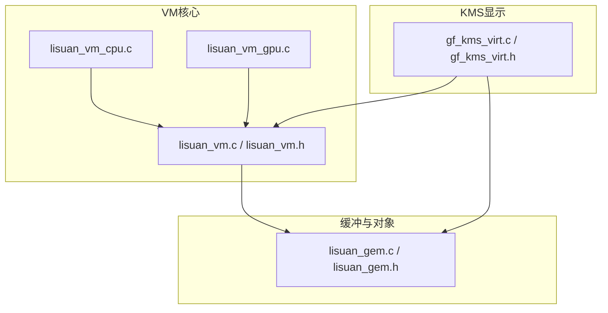
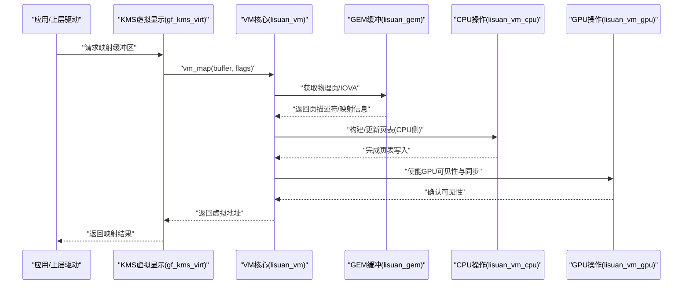
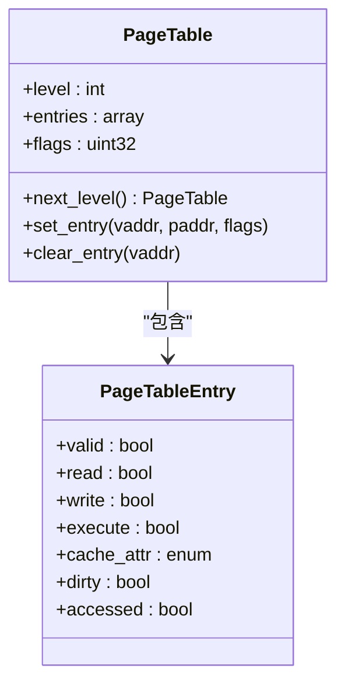
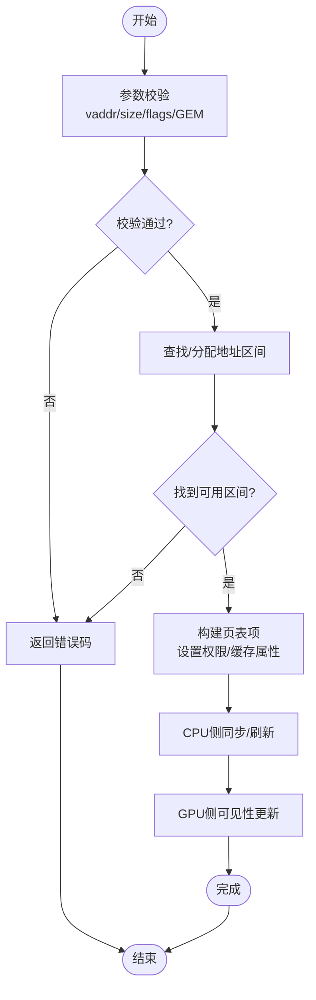
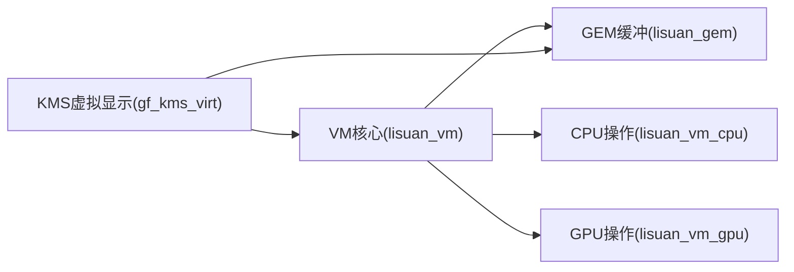

# 虚拟内存管理器

<cite>
**本文档引用的文件**
- [lisuan_vm.c](file://_work/src/usr/src/lisuangpu-dkms-262.2.0.56/lisuan_vm.c)
- [lisuan_vm.h](file://_work/src/usr/src/lisuangpu-dkms-262.2.0.56/lisuan_vm.h)
- [lisuan_vm_cpu.c](file://_work/src/usr/src/lisuangpu-dkms-262.2.0.56/lisuan_vm_cpu.c)
- [lisuan_vm_gpu.c](file://_work/src/usr/src/lisuangpu-dkms-262.2.0.56/lisuan_vm_gpu.c)
- [lisuan_gem.c](file://_work/src/usr/src/lisuangpu-dkms-262.2.0.56/lisuan_gem.c)
- [lisuan_gem.h](file://_work/src/usr/src/lisuangpu-dkms-262.2.0.56/lisuan_gem.h)
- [gf_kms_virt.c](file://_work/src/usr/src/lisuangpu-dkms-262.2.0.56/kms/gf_kms_virt.c)
- [gf_kms_virt.h](file://_work/src/usr/src/lisuangpu-dkms-262.2.0.56/kms/gf_kms_virt.h)
</cite>

## 目录
1. [简介](#简介)
2. [项目结构](#项目结构)
3. [核心组件](#核心组件)
4. [架构总览](#架构总览)
5. [详细组件分析](#详细组件分析)
6. [依赖关系分析](#依赖关系分析)
7. [性能考虑](#性能考虑)
8. [故障排查指南](#故障排查指南)
9. [结论](#结论)
10. [附录](#附录)

## 简介
本文件面向丽山GPU驱动中的虚拟内存管理器（VM），系统性阐述其虚拟地址空间管理机制，包括地址分配、映射与解除映射；页表结构与页表项格式（权限控制、缓存属性、同步机制）；虚拟到物理地址转换流程（含TLB管理与缓存一致性保证）；以及对外暴露的API接口说明（参数校验、错误处理与性能考量）。文档同时提供使用模式与最佳实践示例路径，帮助开发者正确集成与扩展。

## 项目结构
与虚拟内存管理相关的代码主要分布在以下模块：
- VM核心实现与头文件：定义VM对象、页表结构、映射/解映射接口及CPU/GPU侧操作
- GEM对象与缓冲管理：负责缓冲区生命周期、引用计数、共享与同步
- KMS虚拟显示相关：在显示管线中使用的虚拟内存辅助逻辑
- CPU/GPU侧VM操作：分别处理用户态/内核态或不同总线视角下的映射与同步

图表来源
- [lisuan_vm.c](file://_work/src/usr/src/lisuangpu-dkms-262.2.0.56/lisuan_vm.c)
- [lisuan_vm.h](file://_work/src/usr/src/lisuangpu-dkms-262.2.0.56/lisuan_vm.h)
- [lisuan_vm_cpu.c](file://_work/src/usr/src/lisuangpu-dkms-262.2.0.56/lisuan_vm_cpu.c)
- [lisuan_vm_gpu.c](file://_work/src/usr/src/lisuangpu-dkms-262.2.0.56/lisuan_vm_gpu.c)
- [lisuan_gem.c](file://_work/src/usr/src/lisuangpu-dkms-262.2.0.56/lisuan_gem.c)
- [lisuan_gem.h](file://_work/src/usr/src/lisuangpu-dkms-262.2.0.56/lisuan_gem.h)
- [gf_kms_virt.c](file://_work/src/usr/src/lisuangpu-dkms-262.2.0.56/kms/gf_kms_virt.c)
- [gf_kms_virt.h](file://_work/src/usr/src/lisuangpu-dkms-262.2.0.56/kms/gf_kms_virt.h)

章节来源
- [lisuan_vm.c](file://_work/src/usr/src/lisuangpu-dkms-262.2.0.56/lisuan_vm.c)
- [lisuan_vm.h](file://_work/src/usr/src/lisuangpu-dkms-262.2.0.56/lisuan_vm.h)
- [lisuan_gem.c](file://_work/src/usr/src/lisuangpu-dkms-262.2.0.56/lisuan_gem.c)
- [gf_kms_virt.c](file://_work/src/usr/src/lisuangpu-dkms-262.2.0.56/kms/gf_kms_virt.c)

## 核心组件
- VM对象与地址空间：维护进程/设备级虚拟地址区间、根页表指针、锁与统计信息
- 页表与页表项：多级页表结构，包含访问位、脏位、权限位、缓存属性位、有效位等
- 映射/解映射：将GEM缓冲区的物理页面映射到VM地址空间，支持多种缓存策略与权限
- CPU/GPU侧操作：CPU侧用于内核态访问与调试，GPU侧用于命令提交与硬件可见性
- 同步与一致性：通过屏障、刷新与失效操作确保多主体访问的一致性
- GEM集成：缓冲区创建、引用计数、共享句柄、DMA映射与IOMMU交互

章节来源
- [lisuan_vm.h](file://_work/src/usr/src/lisuangpu-dkms-262.2.0.56/lisuan_vm.h)
- [lisuan_vm.c](file://_work/src/usr/src/lisuangpu-dkms-262.2.0.56/lisuan_vm.c)
- [lisuan_gem.h](file://_work/src/usr/src/lisuangpu-dkms-262.2.0.56/lisuan_gem.h)
- [lisuan_gem.c](file://_work/src/usr/src/lisuangpu-dkms-262.2.0.56/lisuan_gem.c)

## 架构总览
下图展示VM子系统与GEM、CPU/GPU操作层之间的交互关系。VM作为中间层，向上为KMS/上层驱动提供统一的映射接口，向下协调GEM对象与底层页表更新。

图表来源
- [gf_kms_virt.c](file://_work/src/usr/src/lisuangpu-dkms-262.2.0.56/kms/gf_kms_virt.c)
- [lisuan_vm.c](file://_work/src/usr/src/lisuangpu-dkms-262.2.0.56/lisuan_vm.c)
- [lisuan_vm_cpu.c](file://_work/src/usr/src/lisuangpu-dkms-262.2.0.56/lisuan_vm_cpu.c)
- [lisuan_vm_gpu.c](file://_work/src/usr/src/lisuangpu-dkms-262.2.0.56/lisuan_vm_gpu.c)
- [lisuan_gem.c](file://_work/src/usr/src/lisuangpu-dkms-262.2.0.56/lisuan_gem.c)

## 详细组件分析

### VM对象与地址空间
- 职责：维护虚拟地址区间、根页表、并发锁、统计与调试信息
- 关键能力：
  - 初始化与销毁：分配根页表、设置默认权限与缓存属性
  - 地址区间管理：查找可用区间、拆分合并、冲突检测
  - 安全隔离：按进程/设备划分地址空间，防止越界访问

章节来源
- [lisuan_vm.h](file://_work/src/usr/src/lisuangpu-dkms-262.2.0.56/lisuan_vm.h)
- [lisuan_vm.c](file://_work/src/usr/src/lisuangpu-dkms-262.2.0.56/lisuan_vm.c)

### 页表结构与页表项格式
- 页表层级：通常采用多级页表（如两级或三级），根页表指针保存在VM对象中
- 页表项字段：
  - 有效位：表示该条目是否指向合法物理页
  - 权限位：读/写/执行控制，区分CPU/GPU访问权限
  - 缓存属性：可缓存/不可缓存/写回/写通等策略
  - 脏位/访问位：用于缺页与回收优化
- 对齐与粒度：页大小与对齐要求影响映射效率与碎片化

图表来源
- [lisuan_vm.h](file://_work/src/usr/src/lisuangpu-dkms-262.2.0.56/lisuan_vm.h)
- [lisuan_vm.c](file://_work/src/usr/src/lisuangpu-dkms-262.2.0.56/lisuan_vm.c)

章节来源
- [lisuan_vm.h](file://_work/src/usr/src/lisuangpu-dkms-262.2.0.56/lisuan_vm.h)
- [lisuan_vm.c](file://_work/src/usr/src/lisuangpu-dkms-262.2.0.56/lisuan_vm.c)

### 映射与解除映射流程
- 映射流程：
  - 参数校验：检查虚拟地址范围、对齐、权限标志与GEM对象有效性
  - 查找/分配区间：在VM地址空间中定位或分配连续区间
  - 页表构建：逐页计算偏移并写入页表项，设置权限与缓存属性
  - 同步与可见性：CPU侧完成后触发GPU侧可见性更新
- 解除映射流程：
  - 验证区间存在且未被其他实体占用
  - 清理页表项，释放引用计数
  - 刷新TLB与缓存一致性

图表来源
- [lisuan_vm.c](file://_work/src/usr/src/lisuangpu-dkms-262.2.0.56/lisuan_vm.c)
- [lisuan_vm_cpu.c](file://_work/src/usr/src/lisuangpu-dkms-262.2.0.56/lisuan_vm_cpu.c)
- [lisuan_vm_gpu.c](file://_work/src/usr/src/lisuangpu-dkms-262.2.0.56/lisuan_vm_gpu.c)
- [lisuan_gem.c](file://_work/src/usr/src/lisuangpu-dkms-262.2.0.56/lisuan_gem.c)

章节来源
- [lisuan_vm.c](file://_work/src/usr/src/lisuangpu-dkms-262.2.0.56/lisuan_vm.c)
- [lisuan_vm_cpu.c](file://_work/src/usr/src/lisuangpu-dkms-262.2.0.56/lisuan_vm_cpu.c)
- [lisuan_vm_gpu.c](file://_work/src/usr/src/lisuangpu-dkms-262.2.0.56/lisuan_vm_gpu.c)
- [lisuan_gem.c](file://_work/src/usr/src/lisuangpu-dkms-262.2.0.56/lisuan_gem.c)

### 虚拟到物理地址转换与TLB/缓存一致性
- 转换过程：
  - 根据虚拟地址逐级查页表，得到物理页基址与偏移
  - 组合得到最终物理地址，供总线或DMA使用
- TLB管理：
  - 映射变更后需刷新相关TLB条目，避免陈旧映射
  - 批量刷新与选择性刷新以平衡性能与一致性
- 缓存一致性：
  - 对可缓存区域，需要写回/失效操作确保CPU与GPU数据一致
  - 针对非缓存区域，依赖总线协议保证一致性

章节来源
- [lisuan_vm.c](file://_work/src/usr/src/lisuangpu-dkms-262.2.0.56/lisuan_vm.c)
- [lisuan_vm_cpu.c](file://_work/src/usr/src/lisuangpu-dkms-262.2.0.56/lisuan_vm_cpu.c)
- [lisuan_vm_gpu.c](file://_work/src/usr/src/lisuangpu-dkms-262.2.0.56/lisuan_vm_gpu.c)

### API接口说明
- 典型接口族：
  - 初始化/销毁：创建VM对象、分配根页表、释放资源
  - 映射接口：将GEM缓冲映射到VM地址空间，支持多种缓存与权限标志
  - 解除映射接口：撤销映射、清理页表项、释放引用
  - 查询接口：获取物理地址、页表状态、统计信息
- 参数校验：
  - 地址对齐、长度合法性、权限标志组合有效性
  - GEM对象状态检查（已创建、未销毁、可共享）
- 错误处理：
  - 常见错误码：无效参数、地址冲突、资源不足、权限拒绝
  - 失败路径需回滚已变更状态，保证一致性
- 性能考虑：
  - 批量映射减少系统调用开销
  - 合理选择缓存属性降低一致性成本
  - 避免频繁小粒度映射导致页表膨胀

章节来源
- [lisuan_vm.h](file://_work/src/usr/src/lisuangpu-dkms-262.2.0.56/lisuan_vm.h)
- [lisuan_vm.c](file://_work/src/usr/src/lisuangpu-dkms-262.2.0.56/lisuan_vm.c)
- [lisuan_gem.h](file://_work/src/usr/src/lisuangpu-dkms-262.2.0.56/lisuan_gem.h)
- [lisuan_gem.c](file://_work/src/usr/src/lisuangpu-dkms-262.2.0.56/lisuan_gem.c)

### 使用模式与最佳实践
- 推荐模式：
  - 一次性大区块映射优于多次小块映射
  - 明确缓存属性：渲染帧缓冲常用写回，命令缓冲常用不可缓存
  - 使用同步原语确保CPU/GPU访问顺序
- 避免反模式：
  - 频繁动态重映射造成TLB抖动
  - 跨域共享未做权限隔离导致越权访问
  - 忽略解除映射导致的资源泄漏

章节来源
- [lisuan_vm.c](file://_work/src/usr/src/lisuangpu-dkms-262.2.0.56/lisuan_vm.c)
- [lisuan_gem.c](file://_work/src/usr/src/lisuangpu-dkms-262.2.0.56/lisuan_gem.c)

## 依赖关系分析
VM子系统与GEM、KMS、CPU/GPU操作层的耦合关系如下：

图表来源
- [lisuan_vm.c](file://_work/src/usr/src/lisuangpu-dkms-262.2.0.56/lisuan_vm.c)
- [lisuan_gem.c](file://_work/src/usr/src/lisuangpu-dkms-262.2.0.56/lisuan_gem.c)
- [gf_kms_virt.c](file://_work/src/usr/src/lisuangpu-dkms-262.2.0.56/kms/gf_kms_virt.c)
- [lisuan_vm_cpu.c](file://_work/src/usr/src/lisuangpu-dkms-262.2.0.56/lisuan_vm_cpu.c)
- [lisuan_vm_gpu.c](file://_work/src/usr/src/lisuangpu-dkms-262.2.0.56/lisuan_vm_gpu.c)

章节来源
- [lisuan_vm.h](file://_work/src/usr/src/lisuangpu-dkms-262.2.0.56/lisuan_vm.h)
- [lisuan_gem.h](file://_work/src/usr/src/lisuangpu-dkms-262.2.0.56/lisuan_gem.h)
- [gf_kms_virt.h](file://_work/src/usr/src/lisuangpu-dkms-262.2.0.56/kms/gf_kms_virt.h)

## 性能考虑
- 映射粒度：尽量使用大页或大块映射以减少页表项数量与TLB压力
- 缓存策略：根据访问模式选择合适的缓存属性，避免不必要的写回/失效
- 同步开销：批量化同步操作，减少屏障次数
- 内存碎片：合并相邻映射，避免过度细分导致碎片化
- 监控与调优：统计映射次数、失败率、TLB命中率，指导参数调整

[本节为通用性能建议，不直接分析具体文件]

## 故障排查指南
- 常见问题：
  - 映射失败：检查地址对齐、权限标志、GEM对象状态
  - 访问异常：确认权限位与缓存属性设置是否正确
  - 数据不一致：检查同步原语与TLB刷新时机
- 诊断手段：
  - 打印VM统计信息与页表状态
  - 使用调试接口查看映射区间与引用计数
  - 捕获错误码并定位失败阶段

章节来源
- [lisuan_vm.c](file://_work/src/usr/src/lisuangpu-dkms-262.2.0.56/lisuan_vm.c)
- [lisuan_gem.c](file://_work/src/usr/src/lisuangpu-dkms-262.2.0.56/lisuan_gem.c)

## 结论
丽山GPU虚拟内存管理器通过清晰的VM对象模型、灵活的页表结构与完善的映射/解映射流程，为上层驱动与KMS提供了稳定高效的虚拟地址空间管理能力。结合GEM缓冲管理与CPU/GPU同步机制，实现了安全的地址转换与一致的缓存行为。遵循本文档的使用模式与最佳实践，可有效提升系统稳定性与性能。

[本节为总结性内容，不直接分析具体文件]

## 附录
- 术语表：
  - VM：虚拟内存管理器
  - GEM：图形执行管理（缓冲对象）
  - TLB：转译后备缓冲器
  - IOVA：输入输出虚拟地址
- 参考路径：
  - VM核心实现：[lisuan_vm.c](file://_work/src/usr/src/lisuangpu-dkms-262.2.0.56/lisuan_vm.c)、[lisuan_vm.h](file://_work/src/usr/src/lisuangpu-dkms-262.2.0.56/lisuan_vm.h)
  - CPU/GPU操作：[lisuan_vm_cpu.c](file://_work/src/usr/src/lisuangpu-dkms-262.2.0.56/lisuan_vm_cpu.c)、[lisuan_vm_gpu.c](file://_work/src/usr/src/lisuangpu-dkms-262.2.0.56/lisuan_vm_gpu.c)
  - GEM缓冲：[lisuan_gem.c](file://_work/src/usr/src/lisuangpu-dkms-262.2.0.56/lisuan_gem.c)、[lisuan_gem.h](file://_work/src/usr/src/lisuangpu-dkms-262.2.0.56/lisuan_gem.h)
  - KMS虚拟显示：[gf_kms_virt.c](file://_work/src/usr/src/lisuangpu-dkms-262.2.0.56/kms/gf_kms_virt.c)、[gf_kms_virt.h](file://_work/src/usr/src/lisuangpu-dkms-262.2.0.56/kms/gf_kms_virt.h)