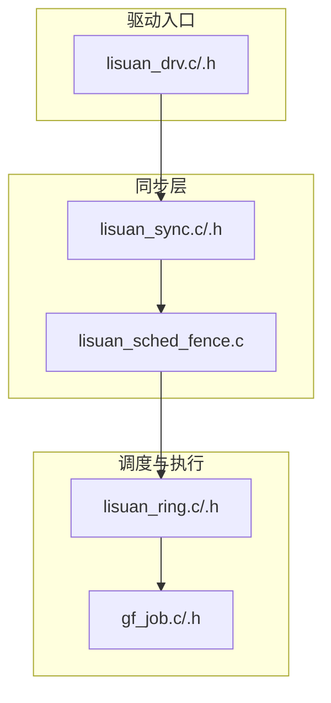
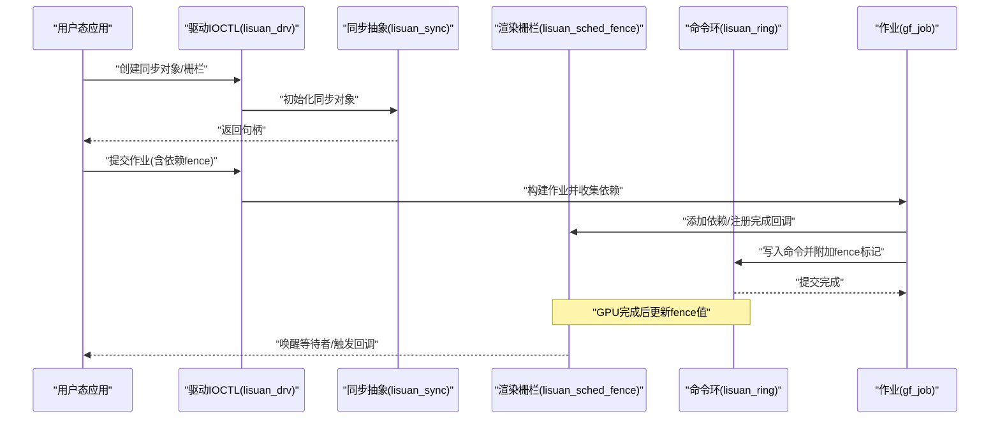
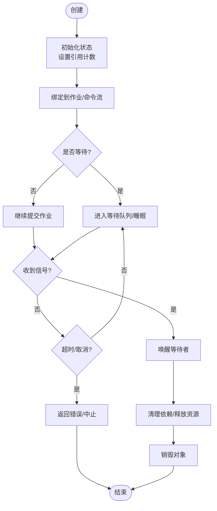
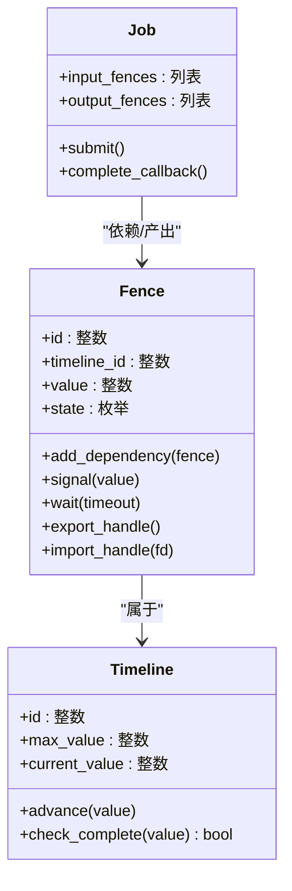
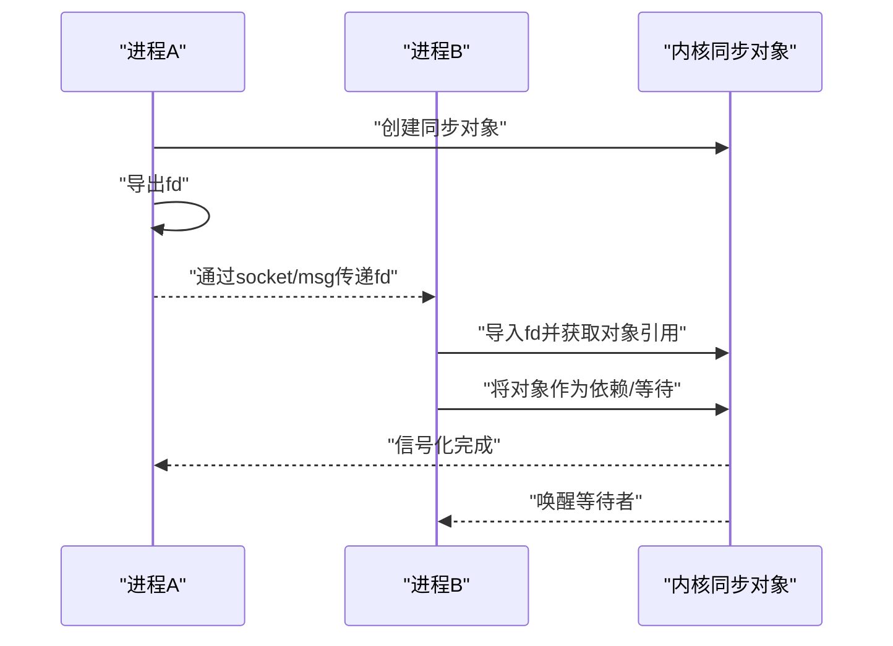
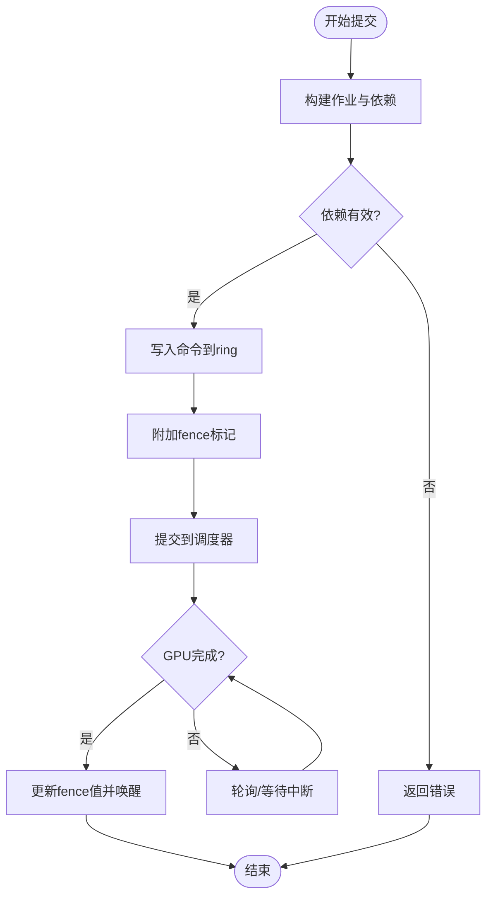
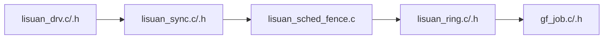

# 同步原语

<cite>
**本文引用的文件**   
- [lisuan_sync.c](file://_work/src/usr/src/lisuan-gpu-dkms-262.2.0.56/src/lisuan_sync.c)
- [lisuan_sync.h](file://_work/src/usr/src/lisuan-gpu-dkms-262.2.0.56/src/lisuan_sync.h)
- [lisuan_sched_fence.c](file://_work/src/usr/src/lisuan-gpu-dkms-262.2.0.56/src/lisuan_sched_fence.c)
- [lisuan_ring.c](file://_work/src/usr/src/lisuan-gpu-dkms-262.2.0.56/src/lisuan_ring.c)
- [lisuan_ring.h](file://_work/src/usr/src/lisuan-gpu-dkms-262.2.0.56/src/lisuan_ring.h)
- [gf_job.c](file://_work/src/usr/src/lisuan-gpu-dkms-262.2.0.56/src/gf_job.c)
- [gf_job.h](file://_work/src/usr/src/lisuan-gpu-dkms-262.2.0.56/src/gf_job.h)
- [lisuan_drv.c](file://_work/src/usr/src/lisuan-gpu-dkms-262.2.0.56/src/lisuan_drv.c)
- [lisuan_drv.h](file://_work/src/usr/src/lisuan-gpu-dkms-262.2.0.56/src/lisuan_drv.h)
</cite>

## 目录
1. [简介](#简介)
2. [项目结构](#项目结构)
3. [核心组件](#核心组件)
4. [架构总览](#架构总览)
5. [详细组件分析](#详细组件分析)
6. [依赖关系分析](#依赖关系分析)
7. [性能考虑](#性能考虑)
8. [故障排查指南](#故障排查指南)
9. [结论](#结论)
10. [附录：代码示例与最佳实践](#附录代码示例与最佳实践)

## 简介
本文件面向丽山GPU驱动的同步子系统，系统性说明同步对象的生命周期管理（创建、等待、信号通知）、渲染栅栏（Render Fence）的实现原理（时间线管理、依赖跟踪、完成通知），以及跨进程同步支持（文件描述符传递与共享同步对象）。同时给出多线程环境下的同步最佳实践（避免死锁、提升吞吐）和可操作的参考模式。

## 项目结构
与同步相关的核心实现集中在以下文件：
- 同步抽象与用户态接口：lisuan_sync.c / lisuan_sync.h
- 调度器与渲染栅栏：lisuan_sched_fence.c
- 命令环与提交路径：lisuan_ring.c / lisuan_ring.h
- 作业编排与依赖注入：gf_job.c / gf_job.h
- 驱动入口与 IOCTL 分发：lisuan_drv.c / lisuan_drv.h

**图表来源** 
- [lisuan_sync.c](file://_work/src/usr/src/lisuan-gpu-dkms-262.2.0.56/src/lisuan_sync.c)
- [lisuan_sync.h](file://_work/src/usr/src/lisuan-gpu-dkms-262.2.0.56/src/lisuan_sync.h)
- [lisuan_sched_fence.c](file://_work/src/usr/src/lisuan-gpu-dkms-262.2.0.56/src/lisuan_sched_fence.c)
- [lisuan_ring.c](file://_work/src/usr/src/lisuan-gpu-dkms-262.2.0.56/src/lisuan_ring.c)
- [lisuan_ring.h](file://_work/src/usr/src/lisuan-gpu-dkms-262.2.0.56/src/lisuan_ring.h)
- [gf_job.c](file://_work/src/usr/src/lisuan-gpu-dkms-262.2.0.56/src/gf_job.c)
- [gf_job.h](file://_work/src/usr/src/lisuan-gpu-dkms-262.2.0.56/src/gf_job.h)
- [lisuan_drv.c](file://_work/src/usr/src/lisuan-gpu-dkms-262.2.0.56/src/lisuan_drv.c)
- [lisuan_drv.h](file://_work/src/usr/src/lisuan-gpu-dkms-262.2.0.56/src/lisuan_drv.h)

**章节来源**
- [lisuan_sync.c](file://_work/src/usr/src/lisuan-gpu-dkms-262.2.0.56/src/lisuan_sync.c)
- [lisuan_sync.h](file://_work/src/usr/src/lisuan-gpu-dkms-262.2.0.56/src/lisuan_sync.h)
- [lisuan_sched_fence.c](file://_work/src/usr/src/lisuan-gpu-dkms-262.2.0.56/src/lisuan_sched_fence.c)
- [lisuan_ring.c](file://_work/src/usr/src/lisuan-gpu-dkms-262.2.0.56/src/lisuan_ring.c)
- [lisuan_ring.h](file://_work/src/usr/src/lisuan-gpu-dkms-262.2.0.56/src/lisuan_ring.h)
- [gf_job.c](file://_work/src/usr/src/lisuan-gpu-dkms-262.2.0.56/src/gf_job.c)
- [gf_job.h](file://_work/src/usr/src/lisuan-gpu-dkms-262.2.0.56/src/gf_job.h)
- [lisuan_drv.c](file://_work/src/usr/src/lisuan-gpu-dkms-262.2.0.56/src/lisuan_drv.c)
- [lisuan_drv.h](file://_work/src/usr/src/lisuan-gpu-dkms-262.2.0.56/src/lisuan_drv.h)

## 核心组件
- 同步对象抽象（Sync Object）
  - 负责统一封装内核/硬件同步语义，提供创建、等待、信号化等接口。
  - 典型生命周期：创建 -> 绑定到作业/命令流 -> 等待或轮询 -> 被信号化 -> 销毁。
- 渲染栅栏（Render Fence）
  - 基于时间线的同步点，用于表达“某条时间线上第 N 个槽位已完成”。
  - 关键能力：时间线推进、依赖添加、完成回调、跨进程句柄导出/导入。
- 命令环（Ring Buffer）
  - GPU 命令的环形缓冲区，提交时携带 fence 作为完成标记。
  - 在 ring 尾写入 fence 值，驱动侧通过中断或轮询检测完成。
- 作业（Job）
  - 将多个命令批次组织为一次提交单元，维护输入/输出依赖（fence 列表）。
  - 提交前合并依赖，提交后注册完成事件。

**章节来源**
- [lisuan_sync.c](file://_work/src/usr/src/lisuan-gpu-dkms-262.2.0.56/src/lisuan_sync.c)
- [lisuan_sync.h](file://_work/src/usr/src/lisuan-gpu-dkms-262.2.0.56/src/lisuan_sync.h)
- [lisuan_sched_fence.c](file://_work/src/usr/src/lisuan-gpu-dkms-262.2.0.56/src/lisuan_sched_fence.c)
- [lisuan_ring.c](file://_work/src/usr/src/lisuan-gpu-dkms-262.2.0.56/src/lisuan_ring.c)
- [lisuan_ring.h](file://_work/src/usr/src/lisuan-gpu-dkms-262.2.0.56/src/lisuan_ring.h)
- [gf_job.c](file://_work/src/usr/src/lisuan-gpu-dkms-262.2.0.56/src/gf_job.c)
- [gf_job.h](file://_work/src/usr/src/lisuan-gpu-dkms-262.2.0.56/src/gf_job.h)

## 架构总览
下图展示从用户态 IOCTL 到 GPU 执行的同步数据流与对象交互。

**图表来源** 
- [lisuan_drv.c](file://_work/src/usr/src/lisuan-gpu-dkms-262.2.0.56/src/lisuan_drv.c)
- [lisuan_sync.c](file://_work/src/usr/src/lisuan-gpu-dkms-262.2.0.56/src/lisuan_sync.c)
- [lisuan_sched_fence.c](file://_work/src/usr/src/lisuan-gpu-dkms-262.2.0.56/src/lisuan_sched_fence.c)
- [lisuan_ring.c](file://_work/src/usr/src/lisuan-gpu-dkms-262.2.0.56/src/lisuan_ring.c)
- [gf_job.c](file://_work/src/usr/src/lisuan-gpu-dkms-262.2.0.56/src/gf_job.c)

## 详细组件分析

### 同步对象（Sync Object）生命周期
- 创建
  - 用户态通过 IOCTL 请求创建同步对象；驱动侧分配内核对象并建立句柄映射。
  - 同步对象内部维护状态（未就绪/等待中/已信号化）及引用计数。
- 绑定与等待
  - 将同步对象作为依赖加入作业；等待方进入睡眠或自旋，直到对象被信号化。
  - 支持超时与取消，防止长时间阻塞。
- 信号化
  - 当 GPU 完成相关任务，驱动在 ring 尾部写入 fence 值，触发同步对象状态变更。
  - 所有等待者被唤醒，清理依赖并释放资源。
- 销毁
  - 引用计数归零时回收内存，确保无悬挂指针或竞态。

**图表来源** 
- [lisuan_sync.c](file://_work/src/usr/src/lisuan-gpu-dkms-262.2.0.56/src/lisuan_sync.c)
- [lisuan_sync.h](file://_work/src/usr/src/lisuan-gpu-dkms-262.2.0.56/src/lisuan_sync.h)

**章节来源**
- [lisuan_sync.c](file://_work/src/usr/src/lisuan-gpu-dkms-262.2.0.56/src/lisuan_sync.c)
- [lisuan_sync.h](file://_work/src/usr/src/lisuan-gpu-dkms-262.2.0.56/src/lisuan_sync.h)

### 渲染栅栏（Render Fence）实现原理
- 时间线管理
  - 每个 fence 关联一条时间线，时间线由单调递增的序列号组成。
  - 提交时在时间线槽位写入 fence 值，表示该槽位对应的命令已完成。
- 依赖关系跟踪
  - 作业提交前收集所有输入 fence，形成依赖集合。
  - 驱动在调度阶段检查依赖是否满足，不满足则挂起作业。
- 完成通知
  - GPU 中断或轮询检测到 ring 尾更新，驱动更新对应 fence 值。
  - 等待 fence 的线程/进程被唤醒，继续执行后续任务。

**图表来源** 
- [lisuan_sched_fence.c](file://_work/src/usr/src/lisuan-gpu-dkms-262.2.0.56/src/lisuan_sched_fence.c)
- [lisuan_ring.c](file://_work/src/usr/src/lisuan-gpu-dkms-262.2.0.56/src/lisuan_ring.c)
- [gf_job.c](file://_work/src/usr/src/lisuan-gpu-dkms-262.2.0.56/src/gf_job.c)

**章节来源**
- [lisuan_sched_fence.c](file://_work/src/usr/src/lisuan-gpu-dkms-262.2.0.56/src/lisuan_sched_fence.c)
- [lisuan_ring.c](file://_work/src/usr/src/lisuan-gpu-dkms-262.2.0.56/src/lisuan_ring.c)
- [gf_job.c](file://_work/src/usr/src/lisuan-gpu-dkms-262.2.0.56/src/gf_job.c)

### 跨进程同步（文件描述符传递与共享同步对象）
- 导出
  - 将内核中的 fence/sync 对象通过文件描述符导出，供其他进程使用。
  - 导出过程需校验权限、有效性，并增加引用计数。
- 导入
  - 接收对端 fd，解析并获取内核对象引用，建立本地句柄映射。
  - 导入后可直接作为依赖加入作业或进行等待。
- 安全与一致性
  - 跨进程共享需保证时间线语义一致，避免不同进程间的时间线错位。
  - 处理 fd 关闭、进程退出时的资源回收与状态清理。

**图表来源** 
- [lisuan_sync.c](file://_work/src/usr/src/lisuan-gpu-dkms-262.2.0.56/src/lisuan_sync.c)
- [lisuan_sync.h](file://_work/src/usr/src/lisuan-gpu-dkms-262.2.0.56/src/lisuan_sync.h)

**章节来源**
- [lisuan_sync.c](file://_work/src/usr/src/lisuan-gpu-dkms-262.2.0.56/src/lisuan_sync.c)
- [lisuan_sync.h](file://_work/src/usr/src/lisuan-gpu-dkms-262.2.0.56/src/lisuan_sync.h)

### 命令环与作业提交流程
- 命令环
  - 环形缓冲区承载 GPU 命令，提交时写入命令并记录 fence 位置。
  - 驱动在环尾插入 fence 指令，GPU 执行后更新 fence 值。
- 作业编排
  - 作业聚合多个命令批次，维护依赖列表与输出 fence。
  - 提交前验证依赖满足性，提交后注册完成回调。

**图表来源** 
- [lisuan_ring.c](file://_work/src/usr/src/lisuan-gpu-dkms-262.2.0.56/src/lisuan_ring.c)
- [lisuan_ring.h](file://_work/src/usr/src/lisuan-gpu-dkms-262.2.0.56/src/lisuan_ring.h)
- [gf_job.c](file://_work/src/usr/src/lisuan-gpu-dkms-262.2.0.56/src/gf_job.c)

**章节来源**
- [lisuan_ring.c](file://_work/src/usr/src/lisuan-gpu-dkms-262.2.0.56/src/lisuan_ring.c)
- [lisuan_ring.h](file://_work/src/usr/src/lisuan-gpu-dkms-262.2.0.56/src/lisuan_ring.h)
- [gf_job.c](file://_work/src/usr/src/lisuan-gpu-dkms-262.2.0.56/src/gf_job.c)

## 依赖关系分析
- 模块耦合
  - 驱动入口（lisuan_drv）暴露 IOCTL，调用同步抽象（lisuan_sync）。
  - 同步抽象协调渲染栅栏（lisuan_sched_fence）与命令环（lisuan_ring）。
  - 作业（gf_job）聚合依赖并在提交时注入 fence。
- 外部依赖
  - 内核同步原语（如等待队列、原子操作、中断上下文）。
  - 用户态 API（IOCTL、fd 传递机制）。

**图表来源** 
- [lisuan_drv.c](file://_work/src/usr/src/lisuan-gpu-dkms-262.2.0.56/src/lisuan_drv.c)
- [lisuan_sync.c](file://_work/src/usr/src/lisuan-gpu-dkms-262.2.0.56/src/lisuan_sync.c)
- [lisuan_sched_fence.c](file://_work/src/usr/src/lisuan-gpu-dkms-262.2.0.56/src/lisuan_sched_fence.c)
- [lisuan_ring.c](file://_work/src/usr/src/lisuan-gpu-dkms-262.2.0.56/src/lisuan_ring.c)
- [gf_job.c](file://_work/src/usr/src/lisuan-gpu-dkms-262.2.0.56/src/gf_job.c)

**章节来源**
- [lisuan_drv.c](file://_work/src/usr/src/lisuan-gpu-dkms-262.2.0.56/src/lisuan_drv.c)
- [lisuan_sync.c](file://_work/src/usr/src/lisuan-gpu-dkms-262.2.0.56/src/lisuan_sync.c)
- [lisuan_sched_fence.c](file://_work/src/usr/src/lisuan-gpu-dkms-262.2.0.56/src/lisuan_sched_fence.c)
- [lisuan_ring.c](file://_work/src/usr/src/lisuan-gpu-dkms-262.2.0.56/src/lisuan_ring.c)
- [gf_job.c](file://_work/src/usr/src/lisuan-gpu-dkms-262.2.0.56/src/gf_job.c)

## 性能考虑
- 减少不必要的等待
  - 尽量批量化依赖，避免频繁的小作业导致同步开销放大。
  - 使用非阻塞等待与超时策略，降低 CPU 占用。
- 合理的时间线设计
  - 单条时间线内顺序推进，避免跨时间线复杂依赖带来的抖动。
  - 控制时间线长度，防止值回绕与溢出。
- 中断与轮询平衡
  - 高吞吐场景优先使用中断驱动，低延迟场景可适度轮询。
- 内存与缓存友好
  - 命令批量写入，减少 ring 写入次数。
  - 避免在热点路径上进行昂贵的同步检查。

[本节为通用指导，无需特定文件来源]

## 故障排查指南
- 常见问题定位
  - 同步对象未信号化：检查 ring 尾写入逻辑与中断处理是否正常。
  - 依赖循环：确认作业依赖图无环，必要时引入中间 fence。
  - 跨进程 fd 失效：核对 fd 传递与导入流程，确保引用计数正确。
- 调试建议
  - 启用驱动 trace 点，观察 fence 值变化与等待队列状态。
  - 打印作业依赖列表与提交顺序，辅助定位时序问题。

**章节来源**
- [lisuan_sync.c](file://_work/src/usr/src/lisuan-gpu-dkms-262.2.0.56/src/lisuan_sync.c)
- [lisuan_sched_fence.c](file://_work/src/usr/src/lisuan-gpu-dkms-262.2.0.56/src/lisuan_sched_fence.c)
- [lisuan_ring.c](file://_work/src/usr/src/lisuan-gpu-dkms-262.2.0.56/src/lisuan_ring.c)
- [gf_job.c](file://_work/src/usr/src/lisuan-gpu-dkms-262.2.0.56/src/gf_job.c)

## 结论
丽山GPU同步子系统以同步对象与渲染栅栏为核心，结合命令环与作业编排，实现了高效、可扩展的跨进程同步能力。通过合理的时间线管理与依赖跟踪，可在多线程与多进程环境下保障数据一致性与执行顺序。遵循本文的最佳实践与排查建议，可有效避免死锁、提升吞吐并简化调试。

[本节为总结，无需特定文件来源]

## 附录：代码示例与最佳实践
- 正确的同步模式（步骤指引）
  - 创建同步对象/栅栏，保存句柄。
  - 构建作业并添加输入依赖（fence 列表）。
  - 提交作业，ring 尾部附加 fence 标记。
  - 等待 fence 完成（带超时），处理异常与取消。
  - 成功后清理依赖并销毁对象。
- 避免死锁
  - 禁止循环依赖；必要时拆分作业或使用中间 fence。
  - 统一等待顺序，避免多线程交叉持有锁。
- 性能优化技巧
  - 批量提交作业，减少同步开销。
  - 使用非阻塞等待与忙等退避策略。
  - 合理设置超时，避免无限等待。

[本节为概念性指导，无需特定文件来源]