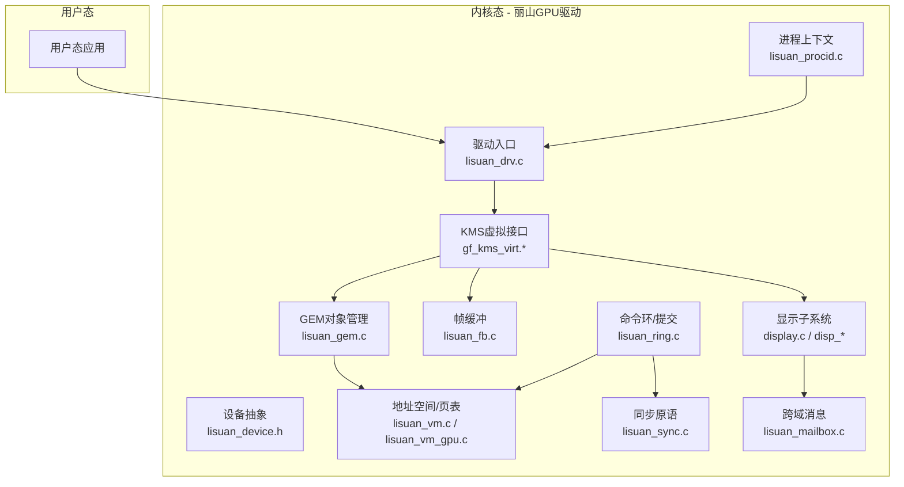
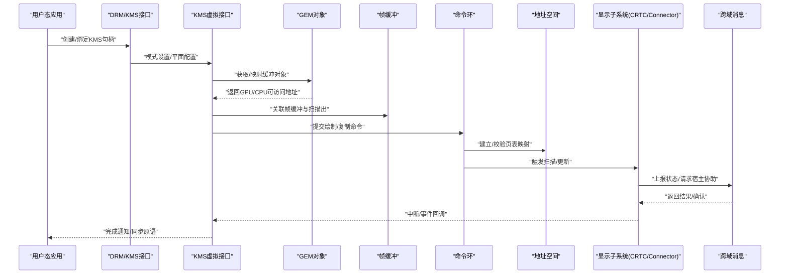
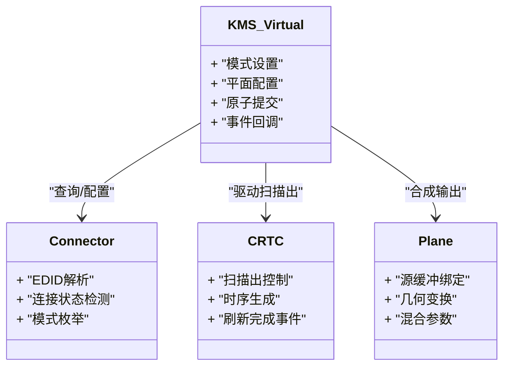
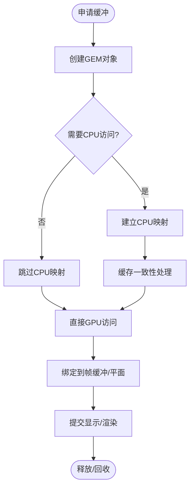
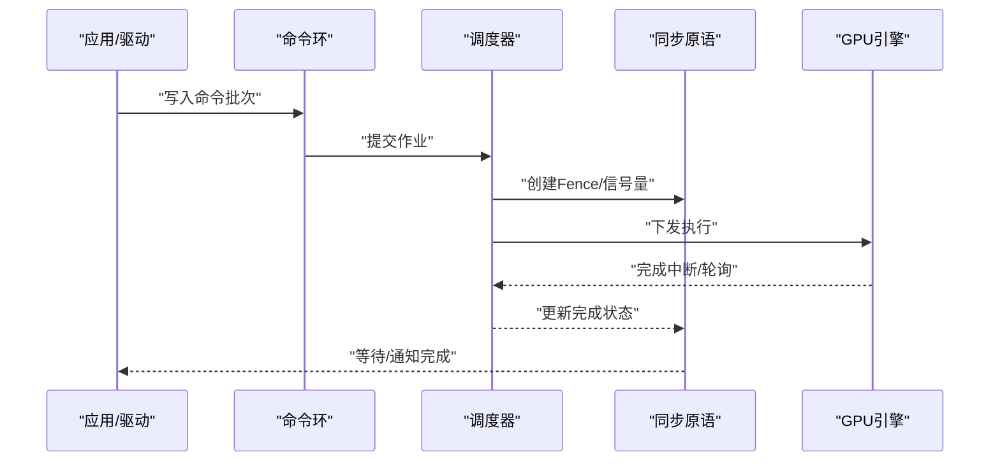
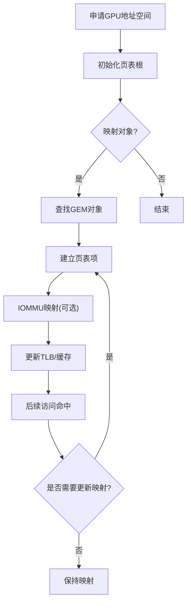
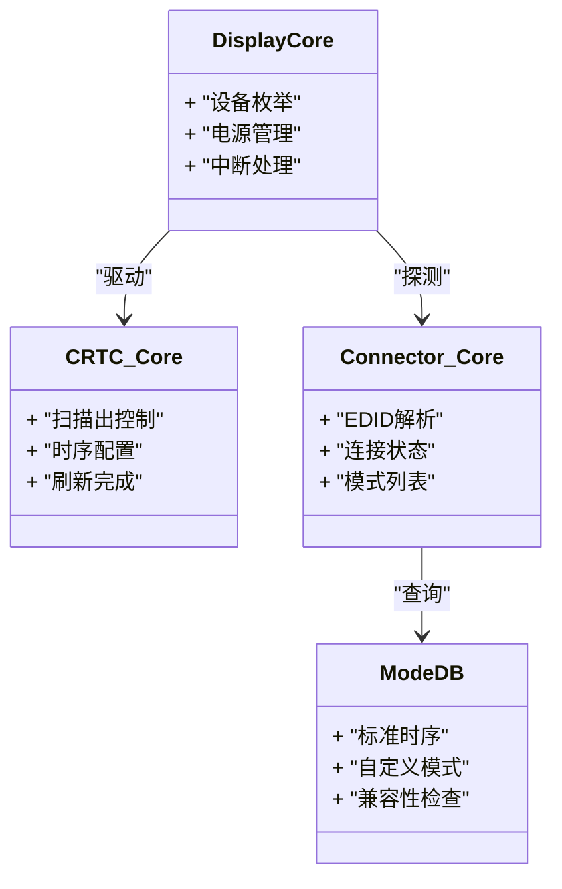
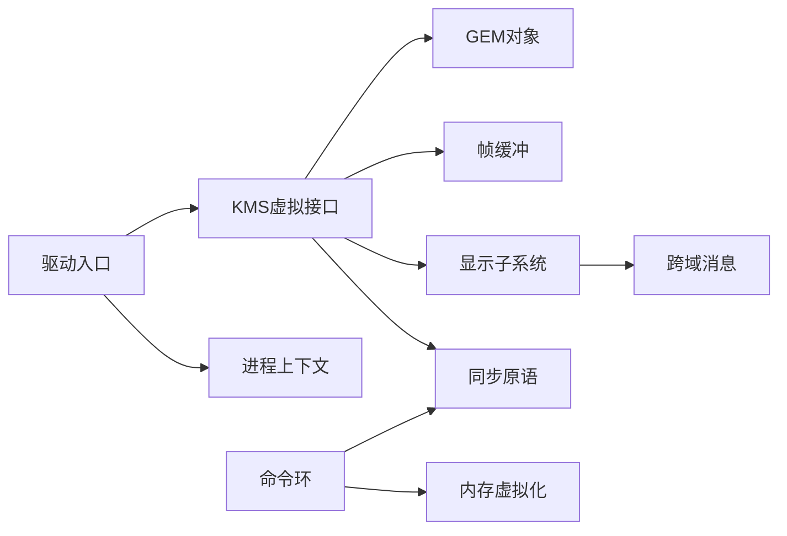

# 虚拟设备

<cite>
**本文引用的文件**   
- [lisuan_drv.c](file://_work/src/usr/src/lisuangpu-dkms-262.2.0.56/lisuan_drv.c)
- [lisuan_device.h](file://_work/src/usr/src/lisuangpu-dkms-262.2.0.56/lisuan_device.h)
- [lisuan_fb.c](file://_work/src/usr/src/lisuangpu-dkms-262.2.0.56/lisuan_fb.c)
- [lisuan_gem.c](file://_work/src/usr/src/lisuangpu-dkms-262.2.0.56/lisuan_gem.c)
- [gf_kms_virt.c](file://_work/src/usr/src/lisuangpu-dkms-262.2.0.56/kms/gf_kms_virt.c)
- [gf_kms_virt.h](file://_work/src/usr/src/lisuangpu-dkms-262.2.0.56/kms/gf_kms_virt.h)
- [lisuan_ring.c](file://_work/src/usr/src/lisuangpu-dkms-262.2.0.56/lisuan_ring.c)
- [lisuan_mailbox.c](file://_work/src/usr/src/lisuangpu-dkms-262.2.0.56/lisuan_mailbox.c)
- [lisuan_vm.c](file://_work/src/usr/src/lisuangpu-dkms-262.2.0.56/lisuan_vm.c)
- [lisuan_vm_gpu.c](file://_work/src/usr/src/lisuangpu-dkms-262.2.0.56/lisuan_vm_gpu.c)
- [display.c](file://_work/src/usr/src/lisuangpu-dkms-262.2.0.56/display/display.c)
- [disp_device.h](file://_work/src/usr/src/lisuangpu-dkms-262.2.0.56/display/disp_device.h)
- [disp_crtc.c](file://_work/src/usr/src/lisuangpu-dkms-262.2.0.56/display/crtc/disp_crtc.c)
- [disp_connector.c](file://_work/src/usr/src/lisuangpu-dkms-262.2.0.56/display/connector/disp_connector.c)
- [disp_mode.c](file://_work/src/usr/src/lisuangpu-dkms-262.2.0.56/display/connector/disp_mode.c)
- [lisuan_procid.c](file://_work/src/usr/src/lisuangpu-dkms-262.2.0.56/lisuan_procid.c)
- [lisuan_scheduler.h](file://_work/src/usr/src/lisuangpu-dkms-262.2.0.56/lisuan_scheduler.h)
- [lisuan_sync.c](file://_work/src/usr/src/lisuangpu-dkms-262.2.0.56/lisuan_sync.c)
</cite>

## 目录
1. [简介](#简介)
2. [项目结构](#项目结构)
3. [核心组件](#核心组件)
4. [架构总览](#架构总览)
5. [详细组件分析](#详细组件分析)
6. [依赖关系分析](#依赖关系分析)
7. [性能考量](#性能考量)
8. [故障排除指南](#故障排除指南)
9. [结论](#结论)
10. [附录](#附录)

## 简介
本文件面向丽山GPU虚拟设备的开发与使用者，系统性阐述虚拟化环境下的虚拟显示设备实现原理与工作机制。内容涵盖：
- 虚拟显示输出与帧缓冲管理（KMS/GEM/FB）
- Guest操作系统中的GPU访问机制（命令队列、内存虚拟化、同步）
- 与宿主系统的交互方式（数据传输、命令转发、中断/事件）
- 配置选项与性能特性
- 部署示例与常见问题排查

本说明以代码仓库为基础，结合模块职责与数据流进行分层讲解，帮助读者从整体到细节掌握该虚拟设备的设计与使用。

## 项目结构
项目采用“驱动层 + KMS + 显示子系统”的分层组织：
- 驱动入口与设备抽象：lisuan_drv.c、lisuan_device.h
- 图形内核子系统（KMS/GEM/FB）：gf_kms_virt.*、lisuan_fb.c、lisuan_gem.c
- 命令执行与调度：lisuan_ring.c、lisuan_scheduler.h、lisuan_sync.c
- 内存与地址空间：lisuan_vm.c、lisuan_vm_gpu.c
- 进程上下文与会话：lisuan_procid.c
- 显示管线与连接器：display.c、disp_device.h、disp_crtc.c、disp_connector.c、disp_mode.c
- 跨域通信：lisuan_mailbox.c

图表来源
- [lisuan_drv.c](file://_work/src/usr/src/lisuangpu-dkms-262.2.0.56/lisuan_drv.c)
- [lisuan_device.h](file://_work/src/usr/src/lisuangpu-dkms-262.2.0.56/lisuan_device.h)
- [gf_kms_virt.c](file://_work/src/usr/src/lisuangpu-dkms-262.2.0.56/kms/gf_kms_virt.c)
- [lisuan_gem.c](file://_work/src/usr/src/lisuangpu-dkms-262.2.0.56/lisuan_gem.c)
- [lisuan_fb.c](file://_work/src/usr/src/lisuangpu-dkms-262.2.0.56/lisuan_fb.c)
- [lisuan_vm.c](file://_work/src/usr/src/lisuangpu-dkms-262.2.0.56/lisuan_vm.c)
- [lisuan_vm_gpu.c](file://_work/src/usr/src/lisuangpu-dkms-262.2.0.56/lisuan_vm_gpu.c)
- [lisuan_ring.c](file://_work/src/usr/src/lisuangpu-dkms-262.2.0.56/lisuan_ring.c)
- [lisuan_sync.c](file://_work/src/usr/src/lisuangpu-dkms-262.2.0.56/lisuan_sync.c)
- [lisuan_procid.c](file://_work/src/usr/src/lisuangpu-dkms-262.2.0.56/lisuan_procid.c)
- [display.c](file://_work/src/usr/src/lisuangpu-dkms-262.2.0.56/display/display.c)
- [disp_device.h](file://_work/src/usr/src/lisuangpu-dkms-262.2.0.56/display/disp_device.h)
- [disp_crtc.c](file://_work/src/usr/src/lisuangpu-dkms-262.2.0.56/display/crtc/disp_crtc.c)
- [disp_connector.c](file://_work/src/usr/src/lisuangpu-dkms-262.2.0.56/display/connector/disp_connector.c)
- [lisuan_mailbox.c](file://_work/src/usr/src/lisuangpu-dkms-262.2.0.56/lisuan_mailbox.c)

章节来源
- [lisuan_drv.c](file://_work/src/usr/src/lisuangpu-dkms-262.2.0.56/lisuan_drv.c)
- [lisuan_device.h](file://_work/src/usr/src/lisuangpu-dkms-262.2.0.56/lisuan_device.h)
- [gf_kms_virt.c](file://_work/src/usr/src/lisuangpu-dkms-262.2.0.56/kms/gf_kms_virt.c)
- [lisuan_gem.c](file://_work/src/usr/src/lisuangpu-dkms-262.2.0.56/lisuan_gem.c)
- [lisuan_fb.c](file://_work/src/usr/src/lisuangpu-dkms-262.2.0.56/lisuan_fb.c)
- [display.c](file://_work/src/usr/src/lisuangpu-dkms-262.2.0.56/display/display.c)

## 核心组件
- 驱动入口与设备初始化：负责PCI/平台枚举、资源分配、注册KMS与字符设备、建立进程上下文与调度器。
- KMS虚拟接口：为Guest暴露标准KMS API，将模式设置、平面/管道操作映射到虚拟显示管线。
- GEM对象与帧缓冲：统一内存对象生命周期管理，提供共享缓冲、DMA映射、零拷贝路径。
- 命令环与调度：封装GPU命令提交、执行顺序、完成通知与同步原语。
- 内存虚拟化：构建Guest可见的GPU地址空间，维护页表与IOMMU映射。
- 显示子系统：CRTC/编码器/连接器的抽象，支持模式查询、时序生成、EDID读取等。
- 跨域消息：用于Guest与宿主之间的控制面与数据面通信（如远程渲染或直通）。

章节来源
- [lisuan_drv.c](file://_work/src/usr/src/lisuangpu-dkms-262.2.0.56/lisuan_drv.c)
- [lisuan_device.h](file://_work/src/usr/src/lisuangpu-dkms-262.2.0.56/lisuan_device.h)
- [gf_kms_virt.c](file://_work/src/usr/src/lisuangpu-dkms-262.2.0.56/kms/gf_kms_virt.c)
- [lisuan_gem.c](file://_work/src/usr/src/lisuangpu-dkms-262.2.0.56/lisuan_gem.c)
- [lisuan_fb.c](file://_work/src/usr/src/lisuangpu-dkms-262.2.0.56/lisuan_fb.c)
- [lisuan_ring.c](file://_work/src/usr/src/lisuangpu-dkms-262.2.0.56/lisuan_ring.c)
- [lisuan_vm.c](file://_work/src/usr/src/lisuangpu-dkms-262.2.0.56/lisuan_vm.c)
- [lisuan_vm_gpu.c](file://_work/src/usr/src/lisuangpu-dkms-262.2.0.56/lisuan_vm_gpu.c)
- [display.c](file://_work/src/usr/src/lisuangpu-dkms-262.2.0.56/display/display.c)
- [disp_crtc.c](file://_work/src/usr/src/lisuangpu-dkms-262.2.0.56/display/crtc/disp_crtc.c)
- [disp_connector.c](file://_work/src/usr/src/lisuangpu-dkms-262.2.0.56/display/connector/disp_connector.c)

## 架构总览
下图展示从用户态应用到显示输出的关键调用链与数据面路径，体现KMS/GEM/显示子系统的协作以及跨域消息的作用。

图表来源
- [gf_kms_virt.c](file://_work/src/usr/src/lisuangpu-dkms-262.2.0.56/kms/gf_kms_virt.c)
- [lisuan_gem.c](file://_work/src/usr/src/lisuangpu-dkms-262.2.0.56/lisuan_gem.c)
- [lisuan_fb.c](file://_work/src/usr/src/lisuangpu-dkms-262.2.0.56/lisuan_fb.c)
- [lisuan_ring.c](file://_work/src/usr/src/lisuangpu-dkms-262.2.0.56/lisuan_ring.c)
- [lisuan_vm.c](file://_work/src/usr/src/lisuangpu-dkms-262.2.0.56/lisuan_vm.c)
- [display.c](file://_work/src/usr/src/lisuangpu-dkms-262.2.0.56/display/display.c)
- [lisuan_mailbox.c](file://_work/src/usr/src/lisuangpu-dkms-262.2.0.56/lisuan_mailbox.c)

## 详细组件分析

### 虚拟KMS接口（gf_kms_virt.*）
- 职责：在虚拟化场景下对KMS API进行适配与隔离，屏蔽底层硬件差异，向Guest暴露一致的显示能力。
- 关键点：
  - 模式枚举与时序计算：通过连接器与模式模块获取可用分辨率与时序。
  - CRTC/平面/管道：组合源图像、混合、缩放、旋转等操作。
  - 事件与同步：基于同步原语保证提交顺序与可见性。
  - 跨域协作：必要时通过消息通道与宿主协同处理显示任务。

图表来源
- [gf_kms_virt.c](file://_work/src/usr/src/lisuangpu-dkms-262.2.0.56/kms/gf_kms_virt.c)
- [gf_kms_virt.h](file://_work/src/usr/src/lisuangpu-dkms-262.2.0.56/kms/gf_kms_virt.h)
- [disp_connector.c](file://_work/src/usr/src/lisuangpu-dkms-262.2.0.56/display/connector/disp_connector.c)
- [disp_crtc.c](file://_work/src/usr/src/lisuangpu-dkms-262.2.0.56/display/crtc/disp_crtc.c)

章节来源
- [gf_kms_virt.c](file://_work/src/usr/src/lisuangpu-dkms-262.2.0.56/kms/gf_kms_virt.c)
- [gf_kms_virt.h](file://_work/src/usr/src/lisuangpu-dkms-262.2.0.56/kms/gf_kms_virt.h)
- [disp_connector.c](file://_work/src/usr/src/lisuangpu-dkms-262.2.0.56/display/connector/disp_connector.c)
- [disp_crtc.c](file://_work/src/usr/src/lisuangpu-dkms-262.2.0.56/display/crtc/disp_crtc.c)

### 帧缓冲与GEM对象（lisuan_fb.c、lisuan_gem.c）
- 职责：统一管理显存/系统内存对象的生命周期、映射策略与共享语义；为KMS与渲染管线提供缓冲抽象。
- 关键点：
  - 对象创建/销毁、引用计数、锁粒度控制。
  - CPU/GPU一致性、缓存维护与屏障。
  - DMA/IOMMU映射、零拷贝路径优化。
  - 与帧缓冲层的绑定，支持传统fbdev兼容。

图表来源
- [lisuan_gem.c](file://_work/src/usr/src/lisuangpu-dkms-262.2.0.56/lisuan_gem.c)
- [lisuan_fb.c](file://_work/src/usr/src/lisuangpu-dkms-262.2.0.56/lisuan_fb.c)

章节来源
- [lisuan_gem.c](file://_work/src/usr/src/lisuangpu-dkms-262.2.0.56/lisuan_gem.c)
- [lisuan_fb.c](file://_work/src/usr/src/lisuangpu-dkms-262.2.0.56/lisuan_fb.c)

### 命令环与调度（lisuan_ring.c、lisuan_scheduler.h、lisuan_sync.c）
- 职责：封装GPU命令提交、执行队列、完成通知与同步原语，确保多进程/多线程并发安全。
- 关键点：
  - 环形缓冲区写入、边界检查、批处理打包。
  - 调度器按优先级/公平性选择作业。
  - Fence/信号量等同步机制，避免数据竞争。
  - 错误回滚与重试策略。

图表来源
- [lisuan_ring.c](file://_work/src/usr/src/lisuangpu-dkms-262.2.0.56/lisuan_ring.c)
- [lisuan_scheduler.h](file://_work/src/usr/src/lisuangpu-dkms-262.2.0.56/lisuan_scheduler.h)
- [lisuan_sync.c](file://_work/src/usr/src/lisuangpu-dkms-262.2.0.56/lisuan_sync.c)

章节来源
- [lisuan_ring.c](file://_work/src/usr/src/lisuangpu-dkms-262.2.0.56/lisuan_ring.c)
- [lisuan_scheduler.h](file://_work/src/usr/src/lisuangpu-dkms-262.2.0.56/lisuan_scheduler.h)
- [lisuan_sync.c](file://_work/src/usr/src/lisuangpu-dkms-262.2.0.56/lisuan_sync.c)

### 内存虚拟化（lisuan_vm.c、lisuan_vm_gpu.c）
- 职责：为Guest构建GPU可见的地址空间，维护页表、IOMMU映射与权限控制。
- 关键点：
  - 页表构建与更新、缺页处理。
  - 共享对象的映射策略（只读/读写/写时复制）。
  - 与GEM对象的生命周期联动。
  - 安全隔离与越界保护。

图表来源
- [lisuan_vm.c](file://_work/src/usr/src/lisuangpu-dkms-262.2.0.56/lisuan_vm.c)
- [lisuan_vm_gpu.c](file://_work/src/usr/src/lisuangpu-dkms-262.2.0.56/lisuan_vm_gpu.c)

章节来源
- [lisuan_vm.c](file://_work/src/usr/src/lisuangpu-dkms-262.2.0.56/lisuan_vm.c)
- [lisuan_vm_gpu.c](file://_work/src/usr/src/lisuangpu-dkms-262.2.0.56/lisuan_vm_gpu.c)

### 显示子系统（display.c、disp_device.h、disp_crtc.c、disp_connector.c、disp_mode.c）
- 职责：抽象显示硬件能力，提供模式设置、扫描出控制、连接器状态管理与EDID解析。
- 关键点：
  - 模式库与时序计算，支持多种分辨率与刷新率。
  - CRTC流水线编排，平面叠加与色彩空间转换。
  - 连接器热插拔检测与EDID读取。
  - 与KMS接口的对接与事件上报。

图表来源
- [display.c](file://_work/src/usr/src/lisuangpu-dkms-262.2.0.56/display/display.c)
- [disp_device.h](file://_work/src/usr/src/lisuangpu-dkms-262.2.0.56/display/disp_device.h)
- [disp_crtc.c](file://_work/src/usr/src/lisuangpu-dkms-262.2.0.56/display/crtc/disp_crtc.c)
- [disp_connector.c](file://_work/src/usr/src/lisuangpu-dkms-262.2.0.56/display/connector/disp_connector.c)
- [disp_mode.c](file://_work/src/usr/src/lisuangpu-dkms-262.2.0.56/display/connector/disp_mode.c)

章节来源
- [display.c](file://_work/src/usr/src/lisuangpu-dkms-262.2.0.56/display/display.c)
- [disp_device.h](file://_work/src/usr/src/lisuangpu-dkms-262.2.0.56/display/disp_device.h)
- [disp_crtc.c](file://_work/src/usr/src/lisuangpu-dkms-262.2.0.56/display/crtc/disp_crtc.c)
- [disp_connector.c](file://_work/src/usr/src/lisuangpu-dkms-262.2.0.56/display/connector/disp_connector.c)
- [disp_mode.c](file://_work/src/usr/src/lisuangpu-dkms-262.2.0.56/display/connector/disp_mode.c)

### 跨域消息（lisuan_mailbox.c）
- 职责：在Guest与宿主之间传递控制与数据消息，支撑远程渲染、直通或协同加速。
- 关键点：
  - 消息队列、序列化/反序列化、超时与重试。
  - 权限校验与资源隔离。
  - 与显示子系统的事件/中断集成。

章节来源
- [lisuan_mailbox.c](file://_work/src/usr/src/lisuangpu-dkms-262.2.0.56/lisuan_mailbox.c)

### 进程上下文与会话（lisuan_procid.c）
- 职责：维护每个进程的GPU上下文、资源配额与权限，确保多租户安全与公平调度。
- 关键点：
  - 会话创建/销毁、资源限制、审计日志。
  - 与调度器、命令环、内存虚拟化的协作。

章节来源
- [lisuan_procid.c](file://_work/src/usr/src/lisuangpu-dkms-262.2.0.56/lisuan_procid.c)

## 依赖关系分析
- 驱动入口依赖KMS虚拟接口、GEM、FB、显示子系统与跨域消息。
- KMS虚拟接口依赖GEM、FB、显示子系统与同步原语。
- 命令环依赖内存虚拟化与调度器。
- 显示子系统依赖连接器、CRTC与模式数据库。
- 跨域消息独立于具体渲染路径，但可与显示子系统耦合以实现协同。

图表来源
- [lisuan_drv.c](file://_work/src/usr/src/lisuangpu-dkms-262.2.0.56/lisuan_drv.c)
- [gf_kms_virt.c](file://_work/src/usr/src/lisuangpu-dkms-262.2.0.56/kms/gf_kms_virt.c)
- [lisuan_gem.c](file://_work/src/usr/src/lisuangpu-dkms-262.2.0.56/lisuan_gem.c)
- [lisuan_fb.c](file://_work/src/usr/src/lisuangpu-dkms-262.2.0.56/lisuan_fb.c)
- [display.c](file://_work/src/usr/src/lisuangpu-dkms-262.2.0.56/display/display.c)
- [lisuan_ring.c](file://_work/src/usr/src/lisuangpu-dkms-262.2.0.56/lisuan_ring.c)
- [lisuan_vm.c](file://_work/src/usr/src/lisuangpu-dkms-262.2.0.56/lisuan_vm.c)
- [lisuan_sync.c](file://_work/src/usr/src/lisuangpu-dkms-262.2.0.56/lisuan_sync.c)
- [lisuan_mailbox.c](file://_work/src/usr/src/lisuangpu-dkms-262.2.0.56/lisuan_mailbox.c)

章节来源
- [lisuan_drv.c](file://_work/src/usr/src/lisuangpu-dkms-262.2.0.56/lisuan_drv.c)
- [gf_kms_virt.c](file://_work/src/usr/src/lisuangpu-dkms-262.2.0.56/kms/gf_kms_virt.c)
- [lisuan_gem.c](file://_work/src/usr/src/lisuangpu-dkms-262.2.0.56/lisuan_gem.c)
- [lisuan_fb.c](file://_work/src/usr/src/lisuangpu-dkms-262.2.0.56/lisuan_fb.c)
- [display.c](file://_work/src/usr/src/lisuangpu-dkms-262.2.0.56/display/display.c)
- [lisuan_ring.c](file://_work/src/usr/src/lisuangpu-dkms-262.2.0.56/lisuan_ring.c)
- [lisuan_vm.c](file://_work/src/usr/src/lisuangpu-dkms-262.2.0.56/lisuan_vm.c)
- [lisuan_sync.c](file://_work/src/usr/src/lisuangpu-dkms-262.2.0.56/lisuan_sync.c)
- [lisuan_mailbox.c](file://_work/src/usr/src/lisuangpu-dkms-262.2.0.56/lisuan_mailbox.c)

## 性能考量
- 零拷贝路径：优先使用GEM对象共享与DMA映射，减少CPU拷贝。
- 批处理提交：合并小命令为批次，降低调度与上下文切换开销。
- 异步执行：利用Fence/信号量实现非阻塞提交与并行渲染。
- 内存访问局部性：合理布局缓冲与纹理，提高带宽利用率。
- 中断与轮询平衡：高吞吐场景倾向轮询，低延迟场景使用中断。
- 跨域消息优化：批量传输、压缩与去重，降低网络/总线开销。

[本节为通用指导，不直接分析具体文件]

## 故障排除指南
- 无法枚举设备：检查驱动加载、PCI/平台资源、固件版本与依赖模块。
- 模式设置失败：确认连接器状态、EDID可读、时序合法性与CRTC能力。
- 黑屏/闪烁：核对扫描出时序、平面叠加顺序、帧缓冲绑定与刷新事件。
- 渲染卡顿：检查命令环积压、调度器负载、内存映射与缓存一致性。
- 跨域通信异常：验证消息队列、超时重试、权限与资源配额。
- 崩溃/死锁：定位同步原语使用、锁顺序与中断上下文行为。

章节来源
- [lisuan_drv.c](file://_work/src/usr/src/lisuangpu-dkms-262.2.0.56/lisuan_drv.c)
- [disp_connector.c](file://_work/src/usr/src/lisuangpu-dkms-262.2.0.56/display/connector/disp_connector.c)
- [disp_crtc.c](file://_work/src/usr/src/lisuangpu-dkms-262.2.0.56/display/crtc/disp_crtc.c)
- [lisuan_ring.c](file://_work/src/usr/src/lisuangpu-dkms-262.2.0.56/lisuan_ring.c)
- [lisuan_sync.c](file://_work/src/usr/src/lisuangpu-dkms-262.2.0.56/lisuan_sync.c)
- [lisuan_mailbox.c](file://_work/src/usr/src/lisuangpu-dkms-262.2.0.56/lisuan_mailbox.c)

## 结论
丽山GPU虚拟设备通过KMS/GEM/FB与显示子系统的分层设计，在虚拟化环境中提供了稳定、可扩展且安全的图形能力。其命令环与内存虚拟化保证了高效的执行与隔离，跨域消息机制则扩展了与宿主的协作能力。合理配置与调优可获得良好的性能与稳定性。

[本节为总结，不直接分析具体文件]

## 附录
- 部署建议：
  - 启用必要的内核模块与固件，确保权限与资源充足。
  - 根据Guest需求选择合适的模式与刷新率，避免超出CRTC能力。
  - 调整命令批大小与调度策略，匹配工作负载特征。
  - 监控跨域消息队列长度与延迟，及时扩容或限流。
- 常用诊断工具：
  - 查看KMS模式与连接器状态、事件统计。
  - 检查GEM对象数量、映射与引用计数。
  - 观察命令环水位、调度器负载与同步原语状态。
  - 采集跨域消息的吞吐与错误码。

[本节为补充信息，不直接分析具体文件]