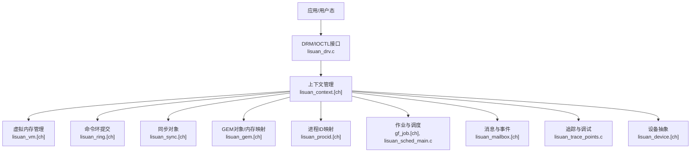
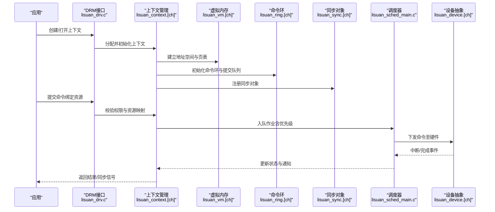
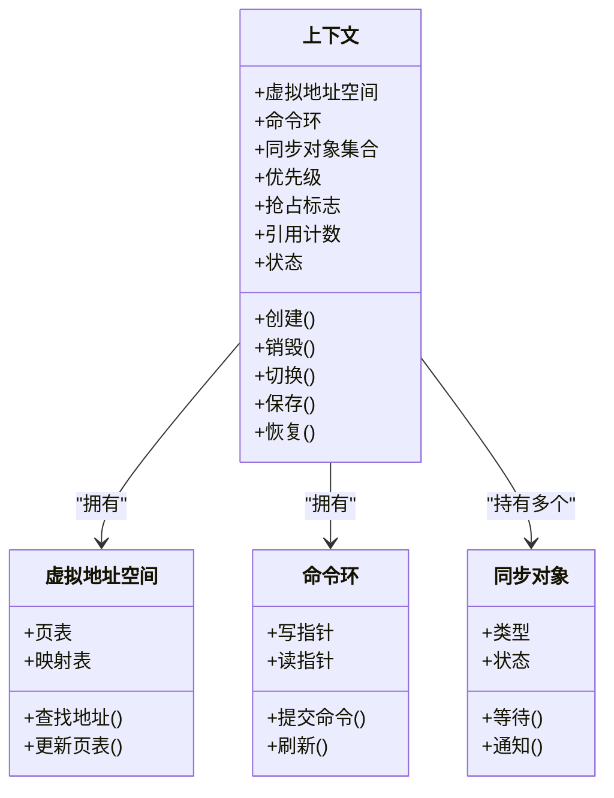
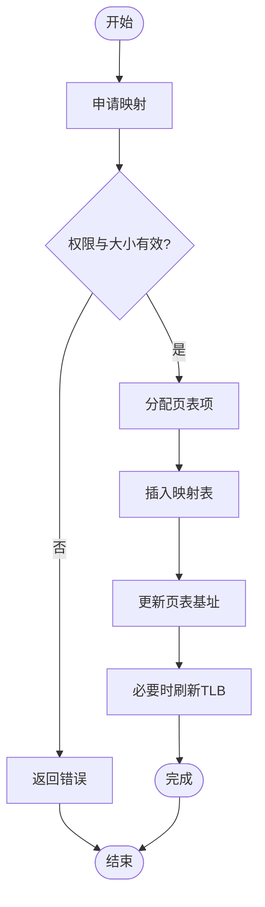
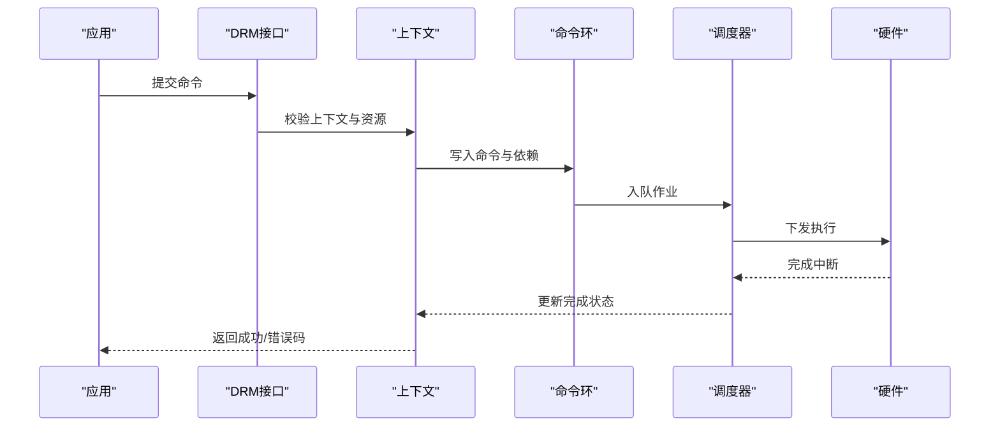
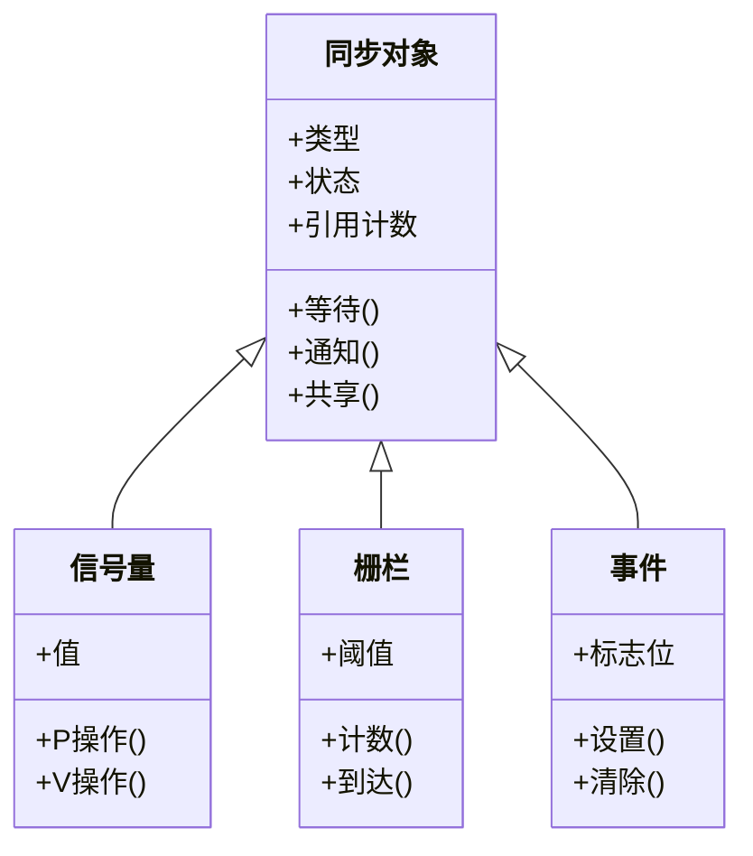
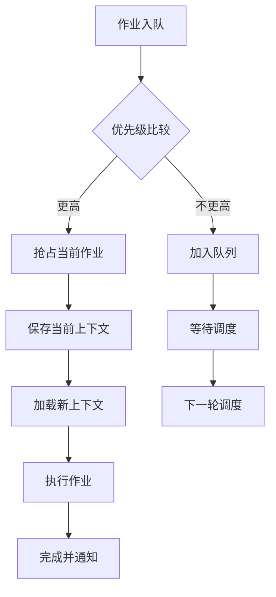
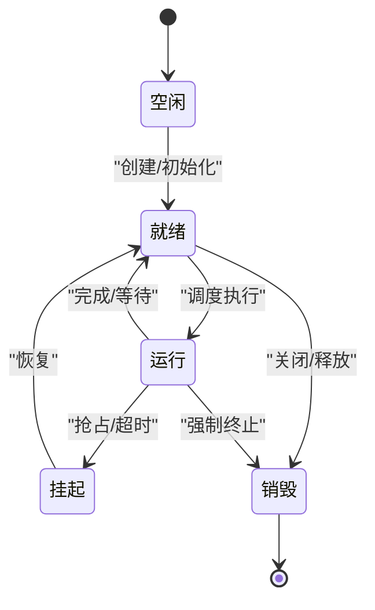
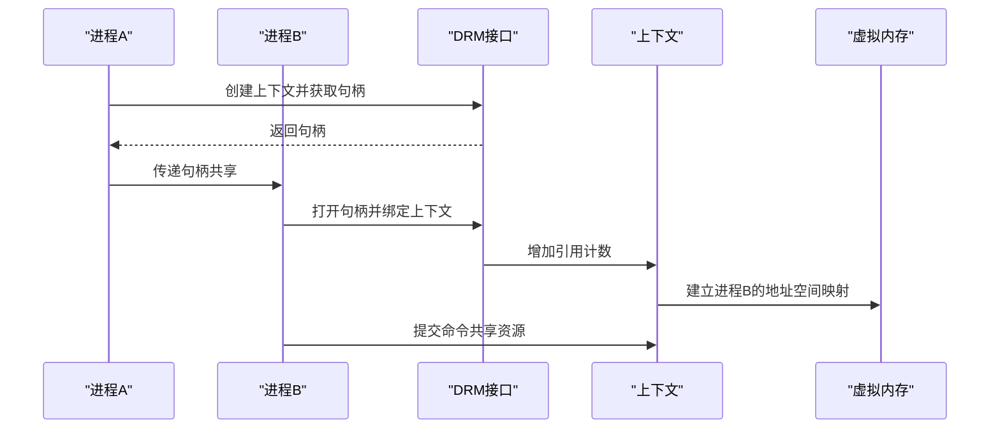
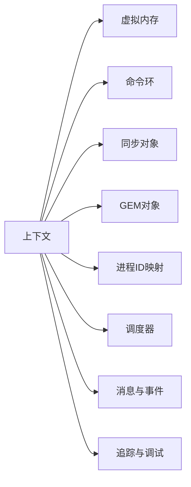

# GPU上下文管理

<cite>
**本文档引用的文件**   
- [lisuan_context.c](file://_work/src/usr/src/lisuan-dkms-262.2.0.56/lisuan_context.c)
- [lisuan_context.h](file://_work/src/usr/src/lisuan-dkms-262.2.0.56/lisuan_context.h)
- [lisuan_device.c](file://_work/src/usr/src/lisuan-dkms-262.2.0.56/lisuan_device.c)
- [lisuan_device.h](file://_work/src/usr/src/lisuan-dkms-262.2.0.56/lisuan_device.h)
- [lisuan_drv.c](file://_work/src/usr/src/lisuan-dkms-262.2.0.56/lisuan_drv.c)
- [lisuan_drv.h](file://_work/src/usr/src/lisuan-dkms-262.2.0.56/lisuan_drv.h)
- [lisuan_vm.c](file://_work/src/usr/src/lisuan-dkms-262.2.0.56/lisuan_vm.c)
- [lisuan_vm.h](file://_work/src/usr/src/lisuan-dkms-262.2.0.56/lisuan_vm.h)
- [lisuan_ring.c](file://_work/src/usr/src/lisuan-dkms-262.2.0.56/lisuan_ring.c)
- [lisuan_ring.h](file://_work/src/usr/src/lisuan-dkms-262.2.0.56/lisuan_ring.h)
- [lisuan_sync.c](file://_work/src/usr/src/lisuan-dkms-262.2.0.56/lisuan_sync.c)
- [lisuan_sync.h](file://_work/src/usr/src/lisuan-dkms-262.2.0.56/lisuan_sync.h)
- [lisuan_gem.c](file://_work/src/usr/src/lisuan-dkms-262.2.0.56/lisuan_gem.c)
- [lisuan_gem.h](file://_work/src/usr/src/lisuan-dkms-262.2.0.56/lisuan_gem.h)
- [lisuan_procid.c](file://_work/src/usr/src/lisuan-dkms-262.2.0.56/lisuan_procid.c)
- [lisuan_procid.h](file://_work/src/usr/src/lisuan-dkms-262.2.0.56/lisuan_procid.h)
- [gf_job.c](file://_work/src/usr/src/lisuan-dkms-262.2.0.56/gf_job.c)
- [gf_job.h](file://_work/src/usr/src/lisuan-dkms-262.2.0.56/gf_job.h)
- [lisuan_sched_main.c](file://_work/src/usr/src/lisuan-dkms-262.2.0.56/lisuan_sched_main.c)
- [lisuan_scheduler.h](file://_work/src/usr/src/lisuan-dkms-262.2.0.56/lisuan_scheduler.h)
- [lisuan_mailbox.c](file://_work/src/usr/src/lisuan-dkms-262.2.0.56/lisuan_mailbox.c)
- [lisuan_mailbox.h](file://_work/src/usr/src/lisuan-dkms-262.2.0.56/lisuan_mailbox.h)
- [lisuan_trace_points.c](file://_work/src/usr/src/lisuan-dkms-262.2.0.56/lisuan_trace_points.c)
- [lisuan_trace.h](file://_work/src/usr/src/lisuan-dkms-262.2.0.56/lisuan_trace.h)
</cite>

## 目录
1. [简介](#简介)
2. [项目结构](#项目结构)
3. [核心组件](#核心组件)
4. [架构总览](#架构总览)
5. [详细组件分析](#详细组件分析)
6. [依赖关系分析](#依赖关系分析)
7. [性能考虑](#性能考虑)
8. [故障排查指南](#故障排查指南)
9. [结论](#结论)
10. [附录](#附录)

## 简介
本技术文档面向丽山GPU驱动中的“上下文管理模块”，围绕用户态与内核态上下文的创建、销毁、切换与同步机制展开，系统阐述数据结构设计、内存映射与资源隔离策略、优先级与抢占、异常处理、状态转换与保存恢复、以及多进程共享模式。同时提供API使用示例、性能优化建议与常见问题解决方案，帮助开发者高效集成并稳定运行GPU任务。

## 项目结构
本项目采用分层组织：设备驱动入口、上下文管理、虚拟内存、环形缓冲、同步原语、作业调度、进程ID管理等模块相互协作，形成完整的GPU上下文生命周期管理能力。关键文件包括：
- 上下文定义与实现：lisuan_context.[ch]
- 设备与驱动入口：lisuan_device.[ch], lisuan_drv.[ch]
- 虚拟地址空间与页表：lisuan_vm.[ch]
- 命令环与提交通道：lisuan_ring.[ch]
- 同步对象与栅栏：lisuan_sync.[ch]
- GEM对象与内存映射：lisuan_gem.[ch]
- 进程上下文标识：lisuan_procid.[ch]
- 作业与调度：gf_job.[ch], lisuan_sched_main.c, lisuan_scheduler.h
- 消息与事件：lisuan_mailbox.[ch]
- 追踪与调试：lisuan_trace_points.c, lisuan_trace.h

图表来源
- [lisuan_drv.c](file://_work/src/usr/src/lisuan-dkms-262.2.0.56/lisuan_drv.c)
- [lisuan_context.c](file://_work/src/usr/src/lisuan-dkms-262.2.0.56/lisuan_context.c)
- [lisuan_vm.c](file://_work/src/usr/src/lisuan-dkms-262.2.0.56/lisuan_vm.c)
- [lisuan_ring.c](file://_work/src/usr/src/lisuan-dkms-262.2.0.56/lisuan_ring.c)
- [lisuan_sync.c](file://_work/src/usr/src/lisuan-dkms-262.2.0.56/lisuan_sync.c)
- [lisuan_gem.c](file://_work/src/usr/src/lisuan-dkms-262.2.0.56/lisuan_gem.c)
- [lisuan_procid.c](file://_work/src/usr/src/lisuan-dkms-262.2.0.56/lisuan_procid.c)
- [gf_job.c](file://_work/src/usr/src/lisuan-dkms-262.2.0.56/gf_job.c)
- [lisuan_sched_main.c](file://_work/src/usr/src/lisuan-dkms-262.2.0.56/lisuan_sched_main.c)
- [lisuan_mailbox.c](file://_work/src/usr/src/lisuan-dkms-262.2.0.56/lisuan_mailbox.c)
- [lisuan_trace_points.c](file://_work/src/usr/src/lisuan-dkms-262.2.0.56/lisuan_trace_points.c)
- [lisuan_device.c](file://_work/src/usr/src/lisuan-dkms-262.2.0.56/lisuan_device.c)

章节来源
- [lisuan_drv.c](file://_work/src/usr/src/lisuan-dkms-262.2.0.56/lisuan_drv.c)
- [lisuan_context.c](file://_work/src/usr/src/lisuan-dkms-262.2.0.56/lisuan_context.c)
- [lisuan_device.c](file://_work/src/usr/src/lisuan-dkms-262.2.0.56/lisuan_device.c)

## 核心组件
- 上下文对象：封装用户态与内核态的GPU上下文信息，包含虚拟地址空间、命令环、同步对象集合、资源句柄、优先级与抢占标志等。
- 虚拟内存管理：维护每个上下文的页表与地址映射，支持用户态缓冲区到GPU可访问地址的转换与保护。
- 命令环与提交：将GPU命令写入环形缓冲，通过提交接口触发执行，并提供完成通知。
- 同步对象：用于跨上下文或跨进程的同步，如信号量、栅栏、事件。
- GEM对象：图形内存对象的生命周期管理与映射控制，确保资源隔离与安全访问。
- 进程ID映射：将用户态进程上下文与内核态GPU上下文关联，支持多进程共享与权限控制。
- 作业与调度：将上下文提交的命令包装为作业，交由调度器按优先级与抢占策略执行。
- 消息与事件：上下文间或上下文与驱动间的异步通知机制。
- 追踪与调试：记录上下文生命周期、状态转换、提交与同步的关键点，便于问题定位。

章节来源
- [lisuan_context.h](file://_work/src/usr/src/lisuan-dkms-262.2.0.56/lisuan_context.h)
- [lisuan_vm.h](file://_work/src/usr/src/lisuan-dkms-262.2.0.56/lisuan_vm.h)
- [lisuan_ring.h](file://_work/src/usr/src/lisuan-dkms-262.2.0.56/lisuan_ring.h)
- [lisuan_sync.h](file://_work/src/usr/src/lisuan-dkms-262.2.0.56/lisuan_sync.h)
- [lisuan_gem.h](file://_work/src/usr/src/lisuan-dkms-262.2.0.56/lisuan_gem.h)
- [lisuan_procid.h](file://_work/src/usr/src/lisuan-dkms-262.2.0.56/lisuan_procid.h)
- [gf_job.h](file://_work/src/usr/src/lisuan-dkms-262.2.0.56/gf_job.h)
- [lisuan_scheduler.h](file://_work/src/usr/src/lisuan-dkms-262.2.0.56/lisuan_scheduler.h)
- [lisuan_mailbox.h](file://_work/src/usr/src/lisuan-dkms-262.2.0.56/lisuan_mailbox.h)
- [lisuan_trace.h](file://_work/src/usr/src/lisuan-dkms-262.2.0.56/lisuan_trace.h)

## 架构总览
下图展示GPU上下文在驱动层的核心交互流程：用户态通过DRM接口创建/切换上下文，驱动分配内核态上下文对象，建立虚拟地址空间，绑定命令环与同步对象，提交作业后由调度器执行，并通过消息与追踪反馈状态。

图表来源
- [lisuan_drv.c](file://_work/src/usr/src/lisuan-dkms-262.2.0.56/lisuan_drv.c)
- [lisuan_context.c](file://_work/src/usr/src/lisuan-dkms-262.2.0.56/lisuan_context.c)
- [lisuan_vm.c](file://_work/src/usr/src/lisuan-dkms-262.2.0.56/lisuan_vm.c)
- [lisuan_ring.c](file://_work/src/usr/src/lisuan-dkms-262.2.0.56/lisuan_ring.c)
- [lisuan_sync.c](file://_work/src/usr/src/lisuan-dkms-262.2.0.56/lisuan_sync.c)
- [lisuan_sched_main.c](file://_work/src/usr/src/lisuan-dkms-262.2.0.56/lisuan_sched_main.c)
- [lisuan_device.c](file://_work/src/usr/src/lisuan-dkms-262.2.0.56/lisuan_device.c)

## 详细组件分析

### 上下文对象与生命周期
- 创建：DRM接口接收创建请求，分配内核态上下文对象，初始化虚拟地址空间、命令环、同步对象集合、优先级与抢占标志。
- 切换：当前活跃上下文切换时，需刷新页表基址、寄存器上下文、命令环指针，并确保资源锁定与锁存。
- 销毁：释放所有引用计数，清理页表、命令环、同步对象，解除与设备的绑定，回收内存。
- 保存/恢复：在挂起/恢复场景下，保存寄存器状态、页表基址、命令环位置、同步对象状态，恢复时重建映射并恢复执行点。

图表来源
- [lisuan_context.h](file://_work/src/usr/src/lisuan-dkms-262.2.0.56/lisuan_context.h)
- [lisuan_vm.h](file://_work/src/usr/src/lisuan-dkms-262.2.0.56/lisuan_vm.h)
- [lisuan_ring.h](file://_work/src/usr/src/lisuan-dkms-262.2.0.56/lisuan_ring.h)
- [lisuan_sync.h](file://_work/src/usr/src/lisuan-dkms-262.2.0.56/lisuan_sync.h)

章节来源
- [lisuan_context.c](file://_work/src/usr/src/lisuan-dkms-262.2.0.56/lisuan_context.c)
- [lisuan_context.h](file://_work/src/usr/src/lisuan-dkms-262.2.0.56/lisuan_context.h)

### 虚拟内存与内存映射
- 用户态缓冲区到GPU地址的映射：通过GEM对象获取句柄，驱动侧建立页表映射，保证只读/读写权限与缓存一致性。
- 地址隔离：每个上下文独立页表，避免越界访问；支持共享对象的引用计数与权限检查。
- 动态更新：在上下文切换或资源重映射时，更新页表基址与TLB失效策略。

图表来源
- [lisuan_vm.c](file://_work/src/usr/src/lisuan-dkms-262.2.0.56/lisuan_vm.c)
- [lisuan_gem.c](file://_work/src/usr/src/lisuan-dkms-262.2.0.56/lisuan_gem.c)

章节来源
- [lisuan_vm.c](file://_work/src/usr/src/lisuan-dkms-262.2.0.56/lisuan_vm.c)
- [lisuan_vm.h](file://_work/src/usr/src/lisuan-dkms-262.2.0.56/lisuan_vm.h)
- [lisuan_gem.c](file://_work/src/usr/src/lisuan-dkms-262.2.0.56/lisuan_gem.c)
- [lisuan_gem.h](file://_work/src/usr/src/lisuan-dkms-262.2.0.56/lisuan_gem.h)

### 命令环与提交机制
- 环形缓冲：维护写指针与读指针，批量写入命令以减少系统调用开销。
- 提交接口：将命令与依赖同步对象打包为作业，入队调度器。
- 完成通知：硬件中断或轮询检测完成位，回调通知上层。

图表来源
- [lisuan_ring.c](file://_work/src/usr/src/lisuan-dkms-262.2.0.56/lisuan_ring.c)
- [lisuan_ring.h](file://_work/src/usr/src/lisuan-dkms-262.2.0.56/lisuan_ring.h)
- [gf_job.c](file://_work/src/usr/src/lisuan-dkms-262.2.0.56/gf_job.c)
- [lisuan_sched_main.c](file://_work/src/usr/src/lisuan-dkms-262.2.0.56/lisuan_sched_main.c)

章节来源
- [lisuan_ring.c](file://_work/src/usr/src/lisuan-dkms-262.2.0.56/lisuan_ring.c)
- [lisuan_ring.h](file://_work/src/usr/src/lisuan-dkms-262.2.0.56/lisuan_ring.h)
- [gf_job.c](file://_work/src/usr/src/lisuan-dkms-262.2.0.56/gf_job.c)
- [gf_job.h](file://_work/src/usr/src/lisuan-dkms-262.2.0.56/gf_job.h)

### 同步对象与多进程共享
- 同步类型：信号量、栅栏、事件，支持跨上下文与跨进程共享。
- 引用计数：共享对象通过引用计数管理生命周期，避免提前释放。
- 等待/通知：等待方阻塞或自旋，通知方更新状态并唤醒等待者。

图表来源
- [lisuan_sync.c](file://_work/src/usr/src/lisuan-dkms-262.2.0.56/lisuan_sync.c)
- [lisuan_sync.h](file://_work/src/usr/src/lisuan-dkms-262.2.0.56/lisuan_sync.h)

章节来源
- [lisuan_sync.c](file://_work/src/usr/src/lisuan-dkms-262.2.0.56/lisuan_sync.c)
- [lisuan_sync.h](file://_work/src/usr/src/lisuan-dkms-262.2.0.56/lisuan_sync.h)

### 优先级管理与抢占机制
- 优先级：每个上下文具有优先级字段，调度器按优先级选择作业执行。
- 抢占：高优先级作业可抢占低优先级作业的执行，需保存/恢复上下文状态。
- 公平性：防止饥饿，引入时间片或权重策略。

图表来源
- [lisuan_sched_main.c](file://_work/src/usr/src/lisuan-dkms-262.2.0.56/lisuan_sched_main.c)
- [lisuan_scheduler.h](file://_work/src/usr/src/lisuan-dkms-262.2.0.56/lisuan_scheduler.h)
- [lisuan_context.c](file://_work/src/usr/src/lisuan-dkms-262.2.0.56/lisuan_context.c)

章节来源
- [lisuan_sched_main.c](file://_work/src/usr/src/lisuan-dkms-262.2.0.56/lisuan_sched_main.c)
- [lisuan_scheduler.h](file://_work/src/usr/src/lisuan-dkms-262.2.0.56/lisuan_scheduler.h)
- [lisuan_context.c](file://_work/src/usr/src/lisuan-dkms-262.2.0.56/lisuan_context.c)

### 异常处理与状态转换
- 状态机：上下文存在空闲、就绪、运行、挂起、销毁等状态，转换需满足前置条件。
- 异常路径：资源不足、权限错误、硬件错误等，需回滚已分配资源并通知上层。
- 日志与追踪：记录状态转换与异常点，便于定位问题。

图表来源
- [lisuan_context.c](file://_work/src/usr/src/lisuan-dkms-262.2.0.56/lisuan_context.c)
- [lisuan_trace_points.c](file://_work/src/usr/src/lisuan-dkms-262.2.0.56/lisuan_trace_points.c)

章节来源
- [lisuan_context.c](file://_work/src/usr/src/lisuan-dkms-262.2.0.56/lisuan_context.c)
- [lisuan_trace_points.c](file://_work/src/usr/src/lisuan-dkms-262.2.0.56/lisuan_trace_points.c)

### 多进程共享模式
- 进程ID映射：将用户态进程ID与内核态上下文关联，支持多进程共享同一GPU上下文。
- 权限控制：基于进程UID/GID与能力集限制访问。
- 资源隔离：每个进程有独立的虚拟地址空间，共享对象通过句柄传递。

图表来源
- [lisuan_procid.c](file://_work/src/usr/src/lisuan-dkms-262.2.0.56/lisuan_procid.c)
- [lisuan_context.c](file://_work/src/usr/src/lisuan-dkms-262.2.0.56/lisuan_context.c)
- [lisuan_vm.c](file://_work/src/usr/src/lisuan-dkms-262.2.0.56/lisuan_vm.c)

章节来源
- [lisuan_procid.c](file://_work/src/usr/src/lisuan-dkms-262.2.0.56/lisuan_procid.c)
- [lisuan_procid.h](file://_work/src/usr/src/lisuan-dkms-262.2.0.56/lisuan_procid.h)
- [lisuan_context.c](file://_work/src/usr/src/lisuan-dkms-262.2.0.56/lisuan_context.c)
- [lisuan_vm.c](file://_work/src/usr/src/lisuan-dkms-262.2.0.56/lisuan_vm.c)

## 依赖关系分析
上下文模块依赖虚拟内存、命令环、同步对象、GEM对象、进程ID映射、作业调度、消息与追踪等子系统。耦合关系如下：

图表来源
- [lisuan_context.c](file://_work/src/usr/src/lisuan-dkms-262.2.0.56/lisuan_context.c)
- [lisuan_vm.c](file://_work/src/usr/src/lisuan-dkms-262.2.0.56/lisuan_vm.c)
- [lisuan_ring.c](file://_work/src/usr/src/lisuan-dkms-262.2.0.56/lisuan_ring.c)
- [lisuan_sync.c](file://_work/src/usr/src/lisuan-dkms-262.2.0.56/lisuan_sync.c)
- [lisuan_gem.c](file://_work/src/usr/src/lisuan-dkms-262.2.0.56/lisuan_gem.c)
- [lisuan_procid.c](file://_work/src/usr/src/lisuan-dkms-262.2.0.56/lisuan_procid.c)
- [lisuan_sched_main.c](file://_work/src/usr/src/lisuan-dkms-262.2.0.56/lisuan_sched_main.c)
- [lisuan_mailbox.c](file://_work/src/usr/src/lisuan-dkms-262.2.0.56/lisuan_mailbox.c)
- [lisuan_trace_points.c](file://_work/src/usr/src/lisuan-dkms-262.2.0.56/lisuan_trace_points.c)

章节来源
- [lisuan_context.c](file://_work/src/usr/src/lisuan-dkms-262.2.0.56/lisuan_context.c)

## 性能考虑
- 批处理提交：合并多个命令到一次提交，减少系统调用与调度开销。
- 零拷贝映射：尽量使用DMA-BUF或共享内存，避免数据复制。
- 异步提交：非阻塞提交与回调机制，提升吞吐。
- TLB优化：合理刷新策略，避免频繁TLB失效。
- 优先级调优：根据负载调整上下文优先级，避免低优先级饿死。
- 资源复用：重用GEM对象与同步对象，减少分配与释放成本。

[本节为通用指导，无需特定文件来源]

## 故障排查指南
- 常见问题
  - 上下文创建失败：检查权限、资源配额、驱动版本兼容性。
  - 命令提交卡住：确认同步对象状态、命令环是否满、硬件中断是否正常。
  - 内存映射错误：验证GEM对象权限、地址范围、缓存一致性。
  - 抢占导致崩溃：检查保存/恢复逻辑是否正确，是否存在未初始化状态。
- 调试手段
  - 启用追踪点：记录上下文状态转换、提交与同步关键点。
  - 查看日志：驱动层与用户态日志结合定位问题。
  - 工具辅助：使用性能分析工具观察CPU/GPU利用率与延迟。

章节来源
- [lisuan_trace_points.c](file://_work/src/usr/src/lisuan-dkms-262.2.0.56/lisuan_trace_points.c)
- [lisuan_trace.h](file://_work/src/usr/src/lisuan-dkms-262.2.0.56/lisuan_trace.h)

## 结论
丽山GPU上下文管理模块通过清晰的分层设计与完善的同步、内存映射、调度机制，提供了稳定高效的GPU资源管理能力。开发者应遵循API规范，合理使用优先级与抢占，关注性能优化与异常处理，以确保系统在多进程、多上下文场景下的稳定性与吞吐。

[本节为总结，无需特定文件来源]

## 附录
- API使用示例（概念性描述）
  - 创建上下文：调用DRM接口创建上下文，获取句柄，用于后续命令提交。
  - 切换上下文：在需要时切换至目标上下文，确保资源与状态正确加载。
  - 提交命令：准备命令缓冲区，绑定资源句柄，提交作业并等待完成。
  - 销毁上下文：释放所有引用，清理资源，确保无悬挂句柄。
- 最佳实践
  - 最小化上下文切换频率，批量提交命令。
  - 使用异步提交与事件通知，避免阻塞。
  - 合理设置优先级，避免高优先级独占。
  - 定期监控追踪与日志，及时发现潜在问题。

[本节为补充说明，无需特定文件来源]