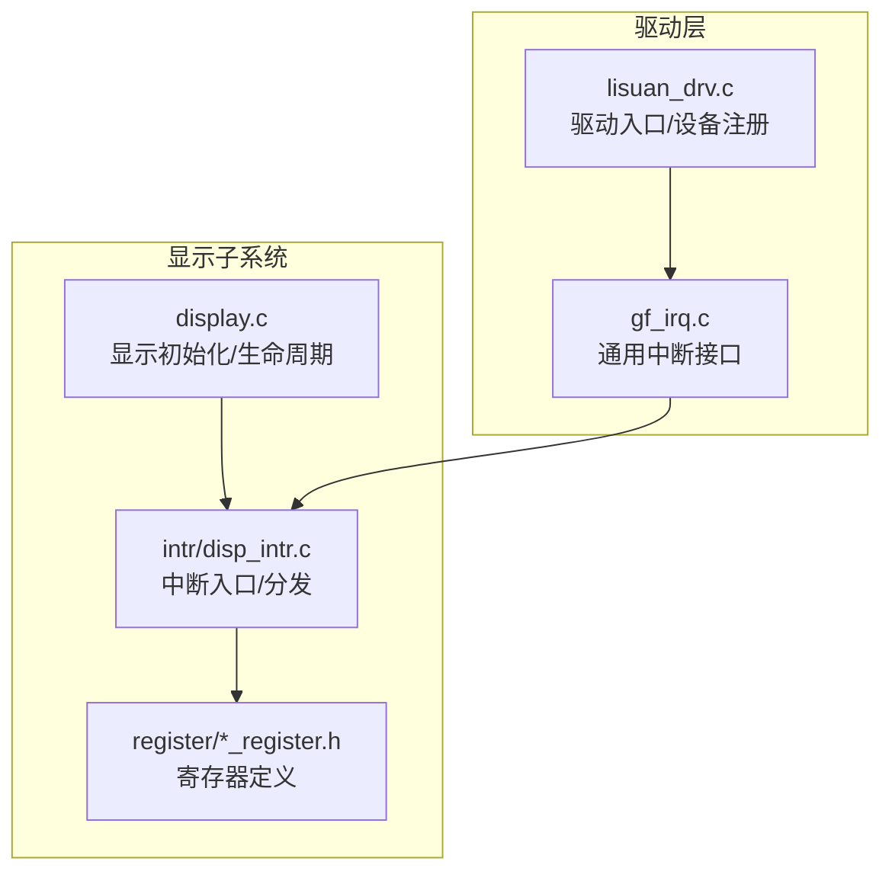
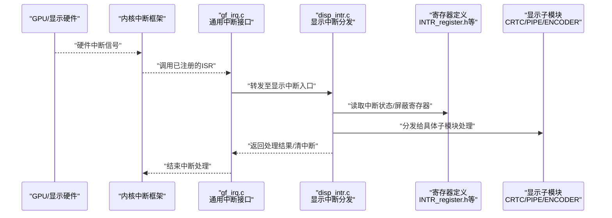
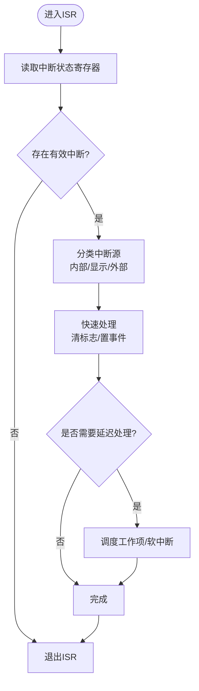
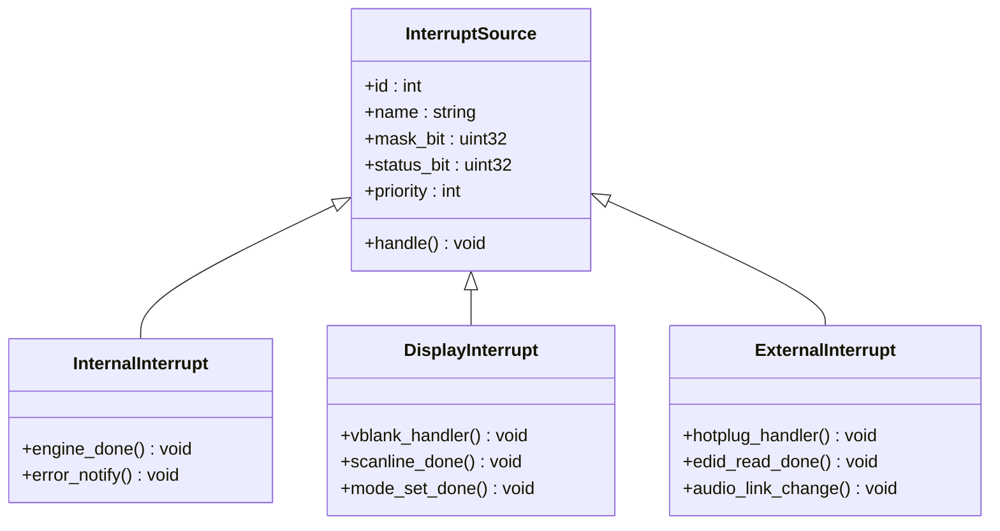
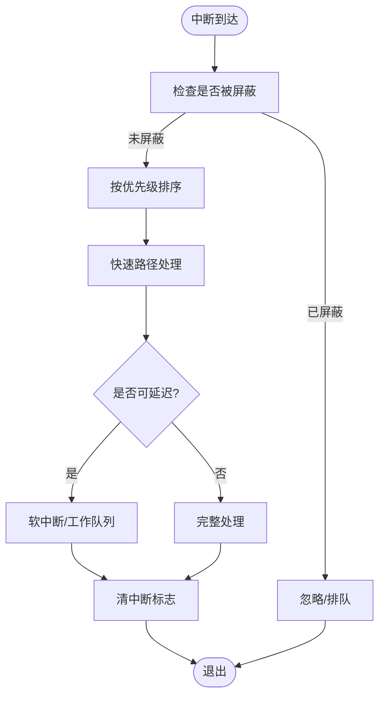
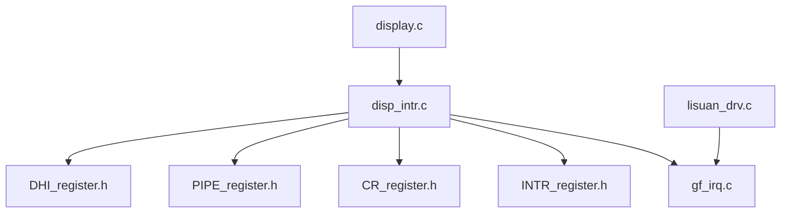

# GPU中断处理

<cite>
**本文引用的文件**   
- [disp_intr.c](file://_work/src/usr/src/lisuanpu-dkms-262.2.0.56/display/intr/disp_intr.c)
- [disp_intr.h](file://_work/src/usr/src/lisuanpu-dkms-262.2.0.56/display/intr/disp_intr.h)
- [gf_irq.c](file://_work/src/usr/src/lisuanpu-dkms-262.2.0.56/gf_irq.c)
- [gf_irq.h](file://_work/src/usr/src/lisuanpu-dkms-262.2.0.56/gf_irq.h)
- [INTR_register.h](file://_work/src/usr/src/lisuanpu-dkms-262.2.0.56/display/register/INTR_register.h)
- [CR_register.h](file://_work/src/usr/src/lisuanpu-dkms-262.2.0.56/display/register/CR_register.h)
- [PIPE_register.h](file://_work/src/usr/src/lisuanpu-dkms-262.2.0.56/display/register/PIPE_register.h)
- [DHI_register.h](file://_work/src/usr/src/lisuanpu-dkms-262.2.0.56/display/register/DHI_register.h)
- [display.c](file://_work/src/usr/src/lisuanpu-dkms-262.2.0.56/display/display.c)
- [display.h](file://_work/src/usr/src/lisuanpu-dkms-262.2.0.56/display/display.h)
- [lisuan_drv.c](file://_work/src/usr/src/lisuanpu-dkms-262.2.0.56/lisuan_drv.c)
- [lisuan_drv.h](file://_work/src/usr/src/lisuanpu-dkms-262.2.0.56/lisuan_drv.h)
</cite>

## 目录
1. [简介](#简介)
2. [项目结构](#项目结构)
3. [核心组件](#核心组件)
4. [架构总览](#架构总览)
5. [详细组件分析](#详细组件分析)
6. [依赖关系分析](#依赖关系分析)
7. [性能考虑](#性能考虑)
8. [故障排查指南](#故障排查指南)
9. [结论](#结论)
10. [附录](#附录)

## 简介
本技术文档围绕丽山GPU的显示子系统中断处理机制展开，重点覆盖：
- 中断向量表与中断服务程序（ISR）的组织方式
- 中断上下文切换与延迟处理（软中断/工作队列）
- GPU内部中断、显示相关中断、外部设备中断的处理流程
- 中断屏蔽、优先级管理与延迟处理机制
- 中断统计、性能分析与故障诊断方法
- 中断配置示例、调试技巧与高负载优化建议
- 常见中断问题的排查与解决方案

## 项目结构
本项目采用按功能模块划分的组织方式。与中断处理直接相关的代码主要分布在以下目录与文件：
- display/intr：显示子系统中断入口、分发与注册
- register：寄存器定义（含中断相关寄存器）
- gf_irq.*：通用中断接口与驱动层集成
- display.c / display.h：显示子系统初始化与中断生命周期管理
- lisuan_drv.*：驱动入口与设备级中断注册

图表来源 
- [display.c:1-200](file://_work/src/usr/src/lisuanpu-dkms-262.2.0.56/display/display.c#L1-L200)
- [disp_intr.c:1-200](file://_work/src/usr/src/lisuanpu-dkms-262.2.0.56/display/intr/disp_intr.c#L1-L200)
- [gf_irq.c:1-200](file://_work/src/usr/src/lisuanpu-dkms-262.2.0.56/gf_irq.c#L1-L200)
- [lisuan_drv.c:1-200](file://_work/src/usr/src/lisuanpu-dkms-262.2.0.56/lisuan_drv.c#L1-L200)

章节来源
- [display.c:1-200](file://_work/src/usr/src/lisuanpu-dkms-262.2.0.56/display/display.c#L1-L200)
- [disp_intr.c:1-200](file://_work/src/usr/src/lisuanpu-dkms-262.2.0.56/display/intr/disp_intr.c#L1-L200)
- [gf_irq.c:1-200](file://_work/src/usr/src/lisuanpu-dkms-262.2.0.56/gf_irq.c#L1-L200)
- [lisuan_drv.c:1-200](file://_work/src/usr/src/lisuanpu-dkms-262.2.0.56/lisuan_drv.c#L1-L200)

## 核心组件
- 中断入口与分发（disp_intr.c/h）
  - 负责将硬件中断映射到具体显示子系统的处理函数
  - 维护中断向量表、屏蔽/使能控制、状态读取与清除
- 通用中断接口（gf_irq.c/h）
  - 提供与内核中断框架对接的统一API
  - 封装IRQ申请、释放、共享中断处理等
- 寄存器定义（INTR_register.h 及相关寄存器头文件）
  - 定义中断源、掩码、状态位、优先级等寄存器字段
- 显示子系统生命周期（display.c/h）
  - 在初始化阶段完成中断注册与清理，协调各模块的中断使用

章节来源
- [disp_intr.c:1-200](file://_work/src/usr/src/lisuanpu-dkms-262.2.0.56/display/intr/disp_intr.c#L1-L200)
- [disp_intr.h:1-200](file://_work/src/usr/src/lisuanpu-dkms-262.2.0.56/display/intr/disp_intr.h#L1-L200)
- [gf_irq.c:1-200](file://_work/src/usr/src/lisuanpu-dkms-262.2.0.56/gf_irq.c#L1-L200)
- [gf_irq.h:1-200](file://_work/src/usr/src/lisuanpu-dkms-262.2.0.56/gf_irq.h#L1-L200)
- [INTR_register.h:1-200](file://_work/src/usr/src/lisuanpu-dkms-262.2.0.56/display/register/INTR_register.h#L1-L200)
- [display.c:1-200](file://_work/src/usr/src/lisuanpu-dkms-262.2.0.56/display/display.c#L1-L200)

## 架构总览
下图展示了从硬件中断到显示子系统处理的整体流程，包括中断向量表、ISR、上下文切换与延迟处理路径。

图表来源 
- [gf_irq.c:1-200](file://_work/src/usr/src/lisuanpu-dkms-262.2.0.56/gf_irq.c#L1-L200)
- [disp_intr.c:1-200](file://_work/src/usr/src/lisuanpu-dkms-262.2.0.56/display/intr/disp_intr.c#L1-L200)
- [INTR_register.h:1-200](file://_work/src/usr/src/lisuanpu-dkms-262.2.0.56/display/register/INTR_register.h#L1-L200)

## 详细组件分析

### 中断向量表与ISR实现
- 中断向量表
  - 由驱动在初始化时建立，将硬件中断号映射到统一的ISR入口
  - 支持共享中断场景，多个设备共用同一IRQ时需逐条检查并处理
- ISR职责
  - 快速读取中断状态寄存器，识别有效中断源
  - 根据中断类型进行最小化处理（如置标志、唤醒等待队列或调度工作项）
  - 及时清除中断标志，避免重复触发
- 上下文切换
  - 在中断上下文中仅做轻量操作，重活下沉到软中断或工作队列
  - 保证原子性与可重入性，避免长时间持有锁

图表来源 
- [disp_intr.c:1-200](file://_work/src/usr/src/lisuanpu-dkms-262.2.0.56/display/intr/disp_intr.c#L1-L200)
- [gf_irq.c:1-200](file://_work/src/usr/src/lisuanpu-dkms-262.2.0.56/gf_irq.c#L1-L200)

章节来源
- [disp_intr.c:1-200](file://_work/src/usr/src/lisuanpu-dkms-262.2.0.56/display/intr/disp_intr.c#L1-L200)
- [gf_irq.c:1-200](file://_work/src/usr/src/lisuanpu-dkms-262.2.0.56/gf_irq.c#L1-L200)

### GPU内部中断、显示相关中断与外部设备中断
- GPU内部中断
  - 例如引擎完成、错误异常、内存管理器通知等
  - 通常通过专用寄存器位表示，需快速响应以避免流水线阻塞
- 显示相关中断
  - CRTC帧同步、扫描结束、VBLANK、模式切换完成等
  - 与显示时序强相关，要求低抖动与确定性
- 外部设备中断
  - HDMI/DP热插拔、EDID读取、音频链路变化等
  - 需要与连接器/编码器模块协作，可能涉及I2C/SPI总线访问

图表来源 
- [disp_intr.h:1-200](file://_work/src/usr/src/lisuanpu-dkms-262.2.0.56/display/intr/disp_intr.h#L1-L200)
- [INTR_register.h:1-200](file://_work/src/usr/src/lisuanpu-dkms-262.2.0.56/display/register/INTR_register.h#L1-L200)

章节来源
- [disp_intr.h:1-200](file://_work/src/usr/src/lisuanpu-dkms-262.2.0.56/display/intr/disp_intr.h#L1-L200)
- [INTR_register.h:1-200](file://_work/src/usr/src/lisuanpu-dkms-262.2.0.56/display/register/INTR_register.h#L1-L200)

### 中断屏蔽、优先级管理与延迟处理
- 中断屏蔽
  - 通过写掩码寄存器启用/禁用特定中断源
  - 在关键临界区临时屏蔽，防止重入与竞态
- 优先级管理
  - 依据中断源的实时性需求设置优先级
  - 高优先级中断优先处理，必要时合并低优先级事件
- 延迟处理
  - 使用软中断或工作队列执行耗时任务（如EDID解析、模式切换）
  - 确保中断上下文的原子性与可抢占性约束

图表来源 
- [disp_intr.c:1-200](file://_work/src/usr/src/lisuanpu-dkms-262.2.0.56/display/intr/disp_intr.c#L1-L200)
- [gf_irq.c:1-200](file://_work/src/usr/src/lisuanpu-dkms-262.2.0.56/gf_irq.c#L1-L200)

章节来源
- [disp_intr.c:1-200](file://_work/src/usr/src/lisuanpu-dkms-262.2.0.56/display/intr/disp_intr.c#L1-L200)
- [gf_irq.c:1-200](file://_work/src/usr/src/lisuanpu-dkms-262.2.0.56/gf_irq.c#L1-L200)

### 中断统计、性能分析与故障诊断
- 统计指标
  - 中断次数、平均处理时长、峰值处理时长、丢弃/超时计数
  - 不同中断源的分布比例与热点路径
- 性能分析
  - 使用内核trace工具记录ISR时间线
  - 结合perf采样定位热点函数
- 故障诊断
  - 检查中断标志位是否正确清零
  - 验证屏蔽/使能逻辑是否符合预期
  - 观察是否存在中断风暴或漏中断

章节来源
- [disp_intr.c:1-200](file://_work/src/usr/src/lisuanpu-dkms-262.2.0.56/display/intr/disp_intr.c#L1-L200)
- [gf_irq.c:1-200](file://_work/src/usr/src/lisuanpu-dkms-262.2.0.56/gf_irq.c#L1-L200)

### 中断配置示例与调试技巧
- 配置步骤
  - 在驱动初始化中申请IRQ并注册ISR
  - 根据设备能力配置中断源与优先级
  - 为每个子模块注册回调函数
- 调试技巧
  - 开启详细日志，输出中断源与处理路径
  - 使用动态调试开关控制输出级别
  - 模拟中断注入以验证鲁棒性

章节来源
- [lisuan_drv.c:1-200](file://_work/src/usr/src/lisuanpu-dkms-262.2.0.56/lisuan_drv.c#L1-L200)
- [display.c:1-200](file://_work/src/usr/src/lisuanpu-dkms-262.2.0.56/display/display.c#L1-L200)

### 高负载场景下的优化建议
- 减少ISR中的锁竞争，尽量使用无锁数据结构
- 合并频繁的小中断为批量处理
- 合理设置中断亲和性，绑定CPU核降低缓存失效
- 对显示相关中断采用预测性调度，提前准备数据

章节来源
- [disp_intr.c:1-200](file://_work/src/usr/src/lisuanpu-dkms-262.2.0.56/display/intr/disp_intr.c#L1-L200)
- [gf_irq.c:1-200](file://_work/src/usr/src/lisuanpu-dkms-262.2.0.56/gf_irq.c#L1-L200)

## 依赖关系分析
- 组件耦合
  - disp_intr依赖gf_irq提供的通用中断接口
  - 所有中断处理均依赖寄存器定义头文件
  - display模块负责生命周期管理，协调各子模块的中断使用
- 外部依赖
  - 内核中断框架（IRQ子系统）
  - 可能的DMA、I2C/SPI总线用于外部设备通信

图表来源 
- [disp_intr.c:1-200](file://_work/src/usr/src/lisuanpu-dkms-262.2.0.56/display/intr/disp_intr.c#L1-L200)
- [gf_irq.c:1-200](file://_work/src/usr/src/lisuanpu-dkms-262.2.0.56/gf_irq.c#L1-L200)
- [INTR_register.h:1-200](file://_work/src/usr/src/lisuanpu-dkms-262.2.0.56/display/register/INTR_register.h#L1-L200)
- [CR_register.h:1-200](file://_work/src/usr/src/lisuanpu-dkms-262.2.0.56/display/register/CR_register.h#L1-L200)
- [PIPE_register.h:1-200](file://_work/src/usr/src/lisuanpu-dkms-262.2.0.56/display/register/PIPE_register.h#L1-L200)
- [DHI_register.h:1-200](file://_work/src/usr/src/lisuanpu-dkms-262.2.0.56/display/register/DHI_register.h#L1-L200)
- [display.c:1-200](file://_work/src/usr/src/lisuanpu-dkms-262.2.0.56/display/display.c#L1-L200)
- [lisuan_drv.c:1-200](file://_work/src/usr/src/lisuanpu-dkms-262.2.0.56/lisuan_drv.c#L1-L200)

章节来源
- [disp_intr.c:1-200](file://_work/src/usr/src/lisuanpu-dkms-262.2.0.56/display/intr/disp_intr.c#L1-L200)
- [gf_irq.c:1-200](file://_work/src/usr/src/lisuanpu-dkms-262.2.0.56/gf_irq.c#L1-L200)
- [display.c:1-200](file://_work/src/usr/src/lisuanpu-dkms-262.2.0.56/display/display.c#L1-L200)
- [lisuan_drv.c:1-200](file://_work/src/usr/src/lisuanpu-dkms-262.2.0.56/lisuan_drv.c#L1-L200)

## 性能考虑
- 中断处理应尽量短小精悍，避免阻塞与睡眠
- 使用批处理与合并策略降低中断频率
- 合理分配CPU亲和性，减少跨核迁移开销
- 对热点路径进行无锁化改造，提升并发性能

[本节为通用指导，不直接分析具体文件]

## 故障排查指南
- 常见问题
  - 中断风暴：检查屏蔽逻辑与状态清零
  - 漏中断：确认ISR是否完整处理所有源
  - 优先级倒置：调整优先级与调度策略
- 诊断步骤
  - 启用详细日志，捕获中断序列
  - 使用trace工具分析时间线
  - 模拟异常条件验证恢复能力

章节来源
- [disp_intr.c:1-200](file://_work/src/usr/src/lisuanpu-dkms-262.2.0.56/display/intr/disp_intr.c#L1-L200)
- [gf_irq.c:1-200](file://_work/src/usr/src/lisuanpu-dkms-262.2.0.56/gf_irq.c#L1-L200)

## 结论
丽山GPU的显示子系统中断处理通过清晰的分层设计与模块化实现，确保了高效、可靠的中断响应。通过合理的屏蔽、优先级与延迟处理机制，系统能够在高负载下保持稳定。配合完善的统计、性能分析与故障诊断方法，开发者可以快速定位并解决中断相关问题。

[本节为总结性内容，不直接分析具体文件]

## 附录
- 术语表
  - ISR：中断服务程序
  - VBLANK：垂直空白中断
  - EDID：扩展显示标识数据
- 参考文件
  - 寄存器定义：INTR_register.h、CR_register.h、PIPE_register.h、DHI_register.h
  - 中断处理：disp_intr.c、gf_irq.c
  - 生命周期：display.c、lisuan_drv.c

[本节为补充信息，不直接分析具体文件]