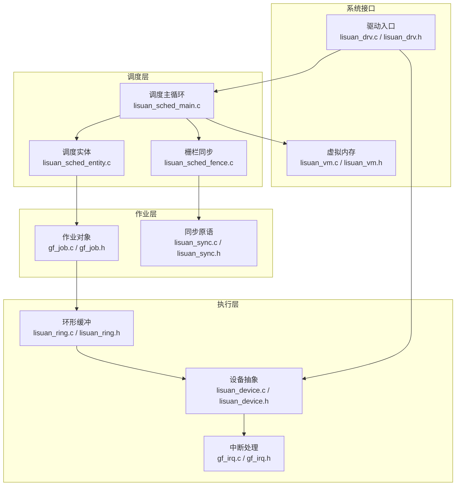
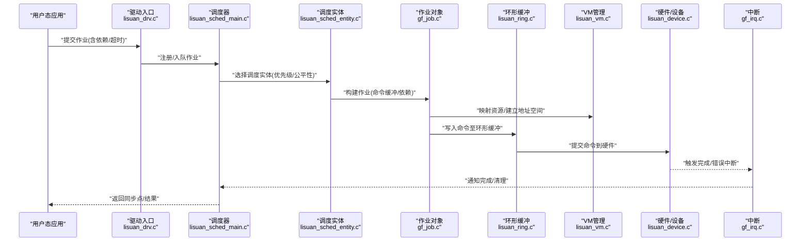
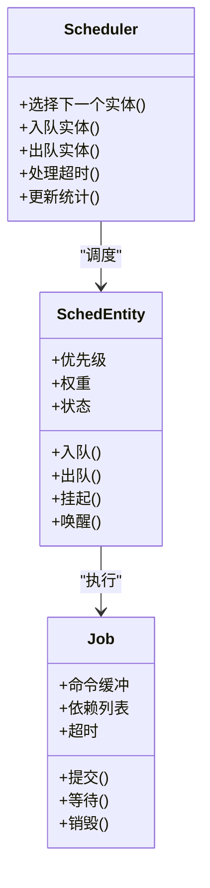
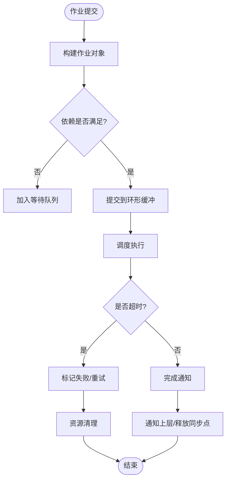
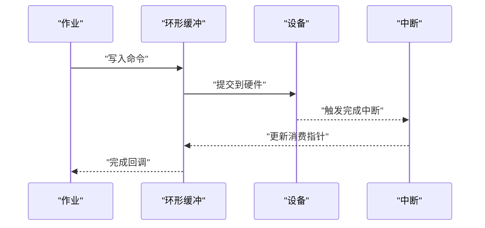
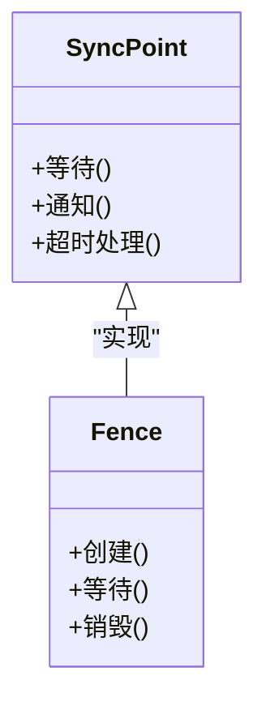
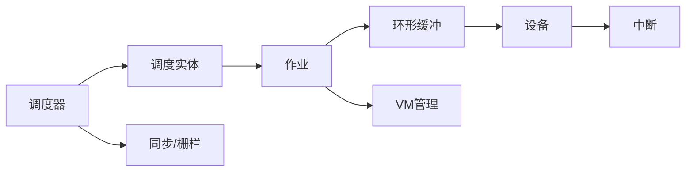

# GPU作业调度

<cite>
**本文引用的文件**   
- [lisuan_sched_main.c](file://_work/src/usr/src/lisuangpu-dkms-262.2.0.56/lisuan_sched_main.c)
- [lisuan_scheduler.h](file://_work/src/usr/src/lisuangpu-dkms-262.2.0.56/lisuan_scheduler.h)
- [lisuan_sched_entity.c](file://_work/src/usr/src/lisuangpu-dkms-262.2.0.56/lisuan_sched_entity.c)
- [lisuan_sched_fence.c](file://_work/src/usr/src/lisuangpu-dkms-262.2.0.56/lisuan_sched_fence.c)
- [gf_job.c](file://_work/src/usr/src/lisuangpu-dkms-262.2.0.56/gf_job.c)
- [gf_job.h](file://_work/src/usr/src/lisuangpu-dkms-262.2.0.56/gf_job.h)
- [lisuan_ring.c](file://_work/src/usr/src/lisuangpu-dkms-262.2.0.56/lisuan_ring.c)
- [lisuan_ring.h](file://_work/src/usr/src/lisuangpu-dkms-262.2.0.56/lisuan_ring.h)
- [lisuan_device.c](file://_work/src/usr/src/lisuangpu-dkms-262.2.0.56/lisuan_device.c)
- [lisuan_device.h](file://_work/src/usr/src/lisuangpu-dkms-262.2.0.56/lisuan_device.h)
- [lisuan_drv.c](file://_work/src/usr/src/lisuangpu-dkms-262.2.0.56/lisuan_drv.c)
- [lisuan_drv.h](file://_work/src/usr/src/lisuangpu-dkms-262.2.0.56/lisuan_drv.h)
- [lisuan_vm.c](file://_work/src/usr/src/lisuangpu-dkms-262.2.0.56/lisuan_vm.c)
- [lisuan_vm.h](file://_work/src/usr/src/lisuangpu-dkms-262.2.0.56/lisuan_vm.h)
- [lisuan_sync.c](file://_work/src/usr/src/lisuangpu-dkms-262.2.0.56/lisuan_sync.c)
- [lisuan_sync.h](file://_work/src/usr/src/lisuangpu-dkms-262.2.0.56/lisuan_sync.h)
- [gf_irq.c](file://_work/src/usr/src/lisuangpu-dkms-262.2.0.56/gf_irq.c)
- [gf_irq.h](file://_work/src/usr/src/lisuangpu-dkms-262.2.0.56/gf_irq.h)
- [lisuan_trace_points.c](file://_work/src/usr/src/lisuangpu-dkms-262.2.0.56/lisuan_trace_points.c)
- [lisuan_trace.h](file://_work/src/usr/src/lisuangpu-dkms-262.2.0.56/lisuan_trace.h)
</cite>

## 目录
1. [简介](#简介)
2. [项目结构](#项目结构)
3. [核心组件](#核心组件)
4. [架构总览](#架构总览)
5. [详细组件分析](#详细组件分析)
6. [依赖关系分析](#依赖关系分析)
7. [性能考虑](#性能考虑)
8. [故障排查指南](#故障排查指南)
9. [结论](#结论)
10. [附录](#附录)

## 简介
本技术文档面向丽山GPU驱动中的作业调度子系统，围绕“作业提交—排队—调度—执行—完成”的完整生命周期展开。重点覆盖：
- 作业类型与优先级策略
- 并发控制与负载均衡
- 作业依赖关系管理、超时处理与错误恢复
- 调度算法选择、公平性保证与实时作业支持
- 作业API使用示例（以路径引用为主）
- 性能调优参数与监控指标
- 调试工具与性能分析方法

## 项目结构
调度相关代码集中在驱动内核模块中，关键目录与职责如下：
- 调度器与实体：负责作业队列、调度策略、实体生命周期
- 作业对象：封装命令缓冲、资源、同步原语
- 环形缓冲与设备抽象：承载命令流、中断与硬件交互
- VM/内存管理：地址空间与资源映射
- 同步与事件：跨域同步、等待与通知
- 追踪与日志：可观测性与性能分析

图表来源
- [lisuan_sched_main.c](file://_work/src/usr/src/lisuangpu-dkms-262.2.0.56/lisuan_sched_main.c)
- [lisuan_scheduler.h](file://_work/src/usr/src/lisuangpu-dkms-262.2.0.56/lisuan_scheduler.h)
- [lisuan_sched_entity.c](file://_work/src/usr/src/lisuangpu-dkms-262.2.0.56/lisuan_sched_entity.c)
- [gf_job.c](file://_work/src/usr/src/lisuangpu-dkms-262.2.0.56/gf_job.c)
- [lisuan_ring.c](file://_work/src/usr/src/lisuangpu-dkms-262.2.0.56/lisuan_ring.c)
- [lisuan_device.c](file://_work/src/usr/src/lisuangpu-dkms-262.2.0.56/lisuan_device.c)
- [gf_irq.c](file://_work/src/usr/src/lisuangpu-dkms-262.2.0.56/gf_irq.c)
- [lisuan_drv.c](file://_work/src/usr/src/lisuangpu-dkms-262.2.0.56/lisuan_drv.c)
- [lisuan_vm.c](file://_work/src/usr/src/lisuangpu-dkms-262.2.0.56/lisuan_vm.c)

章节来源
- [lisuan_scheduler.h](file://_work/src/usr/src/lisuangpu-dkms-262.2.0.56/lisuan_scheduler.h)
- [lisuan_sched_main.c](file://_work/src/usr/src/lisuangpu-dkms-262.2.0.56/lisuan_sched_main.c)
- [lisuan_sched_entity.c](file://_work/src/usr/src/lisuangpu-dkms-262.2.0.56/lisuan_sched_entity.c)
- [gf_job.h](file://_work/src/usr/src/lisuangpu-dkms-262.2.0.56/gf_job.h)
- [lisuan_ring.h](file://_work/src/usr/src/lisuangpu-dkms-262.2.0.56/lisuan_ring.h)
- [lisuan_device.h](file://_work/src/usr/src/lisuangpu-dkms-262.2.0.56/lisuan_device.h)
- [lisuan_drv.h](file://_work/src/usr/src/lisuangpu-dkms-262.2.0.56/lisuan_drv.h)
- [lisuan_vm.h](file://_work/src/usr/src/lisuangpu-dkms-262.2.0.56/lisuan_vm.h)

## 核心组件
- 调度器与实体
  - 调度主循环负责从就绪队列挑选实体并派发执行，维护调度状态与时序。
  - 调度实体封装单个上下文或队列的执行单元，包含优先级、权重与运行态。
- 作业对象
  - 封装命令缓冲、依赖关系、资源句柄、超时与回调。
  - 提供创建、入队、提交、等待与销毁的生命周期方法。
- 环形缓冲与设备
  - 环形缓冲承载GPU命令流；设备抽象屏蔽底层差异，提供提交、轮询与中断能力。
- 同步与栅栏
  - 提供跨进程/跨设备的同步点，支撑作业间依赖与顺序约束。
- 虚拟内存
  - 管理GPU可见的地址空间与资源映射，确保作业访问安全。
- 中断与追踪
  - 中断用于完成通知与错误上报；追踪点用于性能分析与问题定位。

章节来源
- [lisuan_sched_main.c](file://_work/src/usr/src/lisuangpu-dkms-262.2.0.56/lisuan_sched_main.c)
- [lisuan_sched_entity.c](file://_work/src/usr/src/lisuangpu-dkms-262.2.0.56/lisuan_sched_entity.c)
- [gf_job.c](file://_work/src/usr/src/lisuangpu-dkms-262.2.0.56/gf_job.c)
- [lisuan_sync.c](file://_work/src/usr/src/lisuangpu-dkms-262.2.0.56/lisuan_sync.c)
- [lisuan_vm.c](file://_work/src/usr/src/lisuangpu-dkms-262.2.0.56/lisuan_vm.c)
- [gf_irq.c](file://_work/src/usr/src/lisuangpu-dkms-262.2.0.56/gf_irq.c)
- [lisuan_trace_points.c](file://_work/src/usr/src/lisuangpu-dkms-262.2.0.56/lisuan_trace_points.c)

## 架构总览
下图展示从用户态提交到GPU执行的端到端流程，以及关键组件间的调用关系。

图表来源
- [lisuan_drv.c](file://_work/src/usr/src/lisuangpu-dkms-262.2.0.56/lisuan_drv.c)
- [lisuan_sched_main.c](file://_work/src/usr/src/lisuangpu-dkms-262.2.0.56/lisuan_sched_main.c)
- [lisuan_sched_entity.c](file://_work/src/usr/src/lisuangpu-dkms-262.2.0.56/lisuan_sched_entity.c)
- [gf_job.c](file://_work/src/usr/src/lisuangpu-dkms-262.2.0.56/gf_job.c)
- [lisuan_ring.c](file://_work/src/usr/src/lisuangpu-dkms-262.2.0.56/lisuan_ring.c)
- [lisuan_vm.c](file://_work/src/usr/src/lisuangpu-dkms-262.2.0.56/lisuan_vm.c)
- [lisuan_device.c](file://_work/src/usr/src/lisuangpu-dkms-262.2.0.56/lisuan_device.c)
- [gf_irq.c](file://_work/src/usr/src/lisuangpu-dkms-262.2.0.56/gf_irq.c)

## 详细组件分析

### 调度器与实体
- 调度主循环
  - 维护就绪队列、运行队列与完成队列。
  - 依据优先级、权重与公平性策略选择下一个实体执行。
  - 处理超时与重试逻辑，保障系统稳定性。
- 调度实体
  - 封装上下文、队列、优先级与运行状态。
  - 提供入队、出队、挂起、唤醒等状态迁移。
  - 与作业对象协作，完成依赖解析与资源准备。

图表来源
- [lisuan_sched_main.c](file://_work/src/usr/src/lisuangpu-dkms-262.2.0.56/lisuan_sched_main.c)
- [lisuan_sched_entity.c](file://_work/src/usr/src/lisuangpu-dkms-262.2.0.56/lisuan_sched_entity.c)
- [gf_job.c](file://_work/src/usr/src/lisuangpu-dkms-262.2.0.56/gf_job.c)

章节来源
- [lisuan_sched_main.c](file://_work/src/usr/src/lisuangpu-dkms-262.2.0.56/lisuan_sched_main.c)
- [lisuan_sched_entity.c](file://_work/src/usr/src/lisuangpu-dkms-262.2.0.56/lisuan_sched_entity.c)
- [gf_job.c](file://_work/src/usr/src/lisuangpu-dkms-262.2.0.56/gf_job.c)

### 作业对象与依赖管理
- 作业类型
  - 计算型、渲染型、拷贝型等，不同类别影响资源占用与调度权重。
- 依赖关系
  - 通过同步原语（如信号量/栅栏）表达先后顺序。
  - 依赖解析在入队时进行，未满足则延迟执行。
- 超时与重试
  - 作业级超时阈值，触发失败回滚与重试策略。
  - 失败路径包含资源释放与状态清理。

图表来源
- [gf_job.c](file://_work/src/usr/src/lisuangpu-dkms-262.2.0.56/gf_job.c)
- [lisuan_sync.c](file://_work/src/usr/src/lisuangpu-dkms-262.2.0.56/lisuan_sync.c)
- [lisuan_ring.c](file://_work/src/usr/src/lisuangpu-dkms-262.2.0.56/lisuan_ring.c)

章节来源
- [gf_job.c](file://_work/src/usr/src/lisuangpu-dkms-262.2.0.56/gf_job.c)
- [lisuan_sync.c](file://_work/src/usr/src/lisuangpu-dkms-262.2.0.56/lisuan_sync.c)
- [lisuan_ring.c](file://_work/src/usr/src/lisuangpu-dkms-262.2.0.56/lisuan_ring.c)

### 环形缓冲与设备抽象
- 环形缓冲
  - 作为命令流的载体，支持并发写入与硬件消费。
  - 提供边界检查、对齐与批处理能力。
- 设备抽象
  - 统一提交接口，屏蔽不同硬件差异。
  - 提供轮询与中断两种完成检测方式。

图表来源
- [lisuan_ring.c](file://_work/src/usr/src/lisuangpu-dkms-262.2.0.56/lisuan_ring.c)
- [lisuan_device.c](file://_work/src/usr/src/lisuangpu-dkms-262.2.0.56/lisuan_device.c)
- [gf_irq.c](file://_work/src/usr/src/lisuangpu-dkms-262.2.0.56/gf_irq.c)

章节来源
- [lisuan_ring.c](file://_work/src/usr/src/lisuangpu-dkms-262.2.0.56/lisuan_ring.c)
- [lisuan_device.c](file://_work/src/usr/src/lisuangpu-dkms-262.2.0.56/lisuan_device.c)
- [gf_irq.c](file://_work/src/usr/src/lisuangpu-dkms-262.2.0.56/gf_irq.c)

### 同步与栅栏
- 同步原语
  - 提供跨进程/跨设备的等待与通知机制。
  - 支持超时等待与条件唤醒。
- 栅栏
  - 作为作业完成的同步点，供上层阻塞或异步回调。

图表来源
- [lisuan_sync.c](file://_work/src/usr/src/lisuangpu-dkms-262.2.0.56/lisuan_sync.c)
- [lisuan_sched_fence.c](file://_work/src/usr/src/lisuangpu-dkms-262.2.0.56/lisuan_sched_fence.c)

章节来源
- [lisuan_sync.c](file://_work/src/usr/src/lisuangpu-dkms-262.2.0.56/lisuan_sync.c)
- [lisuan_sched_fence.c](file://_work/src/usr/src/lisuangpu-dkms-262.2.0.56/lisuan_sched_fence.c)

### 虚拟内存与资源映射
- 地址空间管理
  - 为每个作业分配独立的GPU可见地址空间。
  - 支持动态映射与回收。
- 资源保护
  - 权限检查与越界保护，防止非法访问。

章节来源
- [lisuan_vm.c](file://_work/src/usr/src/lisuangpu-dkms-262.2.0.56/lisuan_vm.c)
- [lisuan_vm.h](file://_work/src/usr/src/lisuangpu-dkms-262.2.0.56/lisuan_vm.h)

### 驱动入口与系统集成
- 驱动初始化
  - 注册调度器、设备与中断处理。
- 用户态接口
  - 暴露作业提交、查询与同步的API。

章节来源
- [lisuan_drv.c](file://_work/src/usr/src/lisuangpu-dkms-262.2.0.56/lisuan_drv.c)
- [lisuan_drv.h](file://_work/src/usr/src/lisuangpu-dkms-262.2.0.56/lisuan_drv.h)

## 依赖关系分析
- 组件耦合
  - 调度器依赖实体与作业对象；实体依赖同步原语；作业依赖环形缓冲与VM。
- 外部依赖
  - 中断控制器、设备寄存器、内存管理子系统。
- 潜在循环依赖
  - 通过分层与接口隔离避免循环；必要时引入事件总线解耦。

图表来源
- [lisuan_sched_main.c](file://_work/src/usr/src/lisuangpu-dkms-262.2.0.56/lisuan_sched_main.c)
- [lisuan_sched_entity.c](file://_work/src/usr/src/lisuangpu-dkms-262.2.0.56/lisuan_sched_entity.c)
- [gf_job.c](file://_work/src/usr/src/lisuangpu-dkms-262.2.0.56/gf_job.c)
- [lisuan_ring.c](file://_work/src/usr/src/lisuangpu-dkms-262.2.0.56/lisuan_ring.c)
- [lisuan_vm.c](file://_work/src/usr/src/lisuangpu-dkms-262.2.0.56/lisuan_vm.c)
- [lisuan_device.c](file://_work/src/usr/src/lisuangpu-dkms-262.2.0.56/lisuan_device.c)
- [gf_irq.c](file://_work/src/usr/src/lisuangpu-dkms-262.2.0.56/gf_irq.c)
- [lisuan_sync.c](file://_work/src/usr/src/lisuangpu-dkms-262.2.0.56/lisuan_sync.c)

章节来源
- [lisuan_scheduler.h](file://_work/src/usr/src/lisuangpu-dkms-262.2.0.56/lisuan_scheduler.h)
- [lisuan_sched_main.c](file://_work/src/usr/src/lisuangpu-dkms-262.2.0.56/lisuan_sched_main.c)
- [lisuan_sched_entity.c](file://_work/src/usr/src/lisuangpu-dkms-262.2.0.56/lisuan_sched_entity.c)
- [gf_job.h](file://_work/src/usr/src/lisuangpu-dkms-262.2.0.56/gf_job.h)
- [lisuan_ring.h](file://_work/src/usr/src/lisuangpu-dkms-262.2.0.56/lisuan_ring.h)
- [lisuan_device.h](file://_work/src/usr/src/lisuangpu-dkms-262.2.0.56/lisuan_device.h)
- [lisuan_sync.h](file://_work/src/usr/src/lisuangpu-dkms-262.2.0.56/lisuan_sync.h)

## 性能考虑
- 调度算法选择
  - 基于优先级的加权轮转，兼顾高优先级作业的响应性与低优先级作业的吞吐。
- 公平性保证
  - 按权重分配CPU/GPU时间片，防止饥饿。
- 并发控制
  - 限制同时运行的作业数，避免资源争用。
- 负载均衡
  - 根据设备负载动态调整入队策略，分散热点。
- 实时作业支持
  - 为实时作业预留专用队列与抢占机制，降低抖动。
- 监控指标
  - 作业延迟、吞吐、队列长度、中断频率、错误率。
- 调优参数
  - 队列深度、超时阈值、批大小、中断合并窗口。

[本节为通用指导，不直接分析具体文件]

## 故障排查指南
- 常见问题
  - 作业卡死：检查依赖是否满足、超时设置是否合理。
  - 资源泄漏：确认作业销毁路径与资源释放。
  - 中断丢失：验证中断注册与处理逻辑。
- 调试工具
  - 启用追踪点，采集调度与执行轨迹。
  - 打印关键状态（队列长度、作业状态、错误码）。
- 恢复策略
  - 自动重试与降级执行，结合超时与熔断。

章节来源
- [lisuan_trace_points.c](file://_work/src/usr/src/lisuangpu-dkms-262.2.0.56/lisuan_trace_points.c)
- [lisuan_trace.h](file://_work/src/usr/src/lisuangpu-dkms-262.2.0.56/lisuan_trace.h)
- [gf_irq.c](file://_work/src/usr/src/lisuangpu-dkms-262.2.0.56/gf_irq.c)
- [gf_job.c](file://_work/src/usr/src/lisuangpu-dkms-262.2.0.56/gf_job.c)

## 结论
丽山GPU作业调度系统通过清晰的层次划分与模块化设计，实现了高效的作业提交、排队、调度与执行。其优先级策略、公平性保证、依赖管理与超时恢复机制共同保障了系统的稳定性与性能。借助追踪与监控手段，可在复杂场景下快速定位问题并进行优化。

[本节为总结，不直接分析具体文件]

## 附录
- API使用示例（路径引用）
  - 作业创建与提交：参考 [gf_job.c](file://_work/src/usr/src/lisuangpu-dkms-262.2.0.56/gf_job.c)
  - 依赖设置与等待：参考 [lisuan_sync.c](file://_work/src/usr/src/lisuangpu-dkms-262.2.0.56/lisuan_sync.c)
  - 调度器入队与出队：参考 [lisuan_sched_main.c](file://_work/src/usr/src/lisuangpu-dkms-262.2.0.56/lisuan_sched_main.c)
  - 环形缓冲写入：参考 [lisuan_ring.c](file://_work/src/usr/src/lisuangpu-dkms-262.2.0.56/lisuan_ring.c)
  - 设备提交与中断：参考 [lisuan_device.c](file://_work/src/usr/src/lisuangpu-dkms-262.2.0.56/lisuan_device.c)、[gf_irq.c](file://_work/src/usr/src/lisuangpu-dkms-262.2.0.56/gf_irq.c)
- 性能调优参数（路径引用）
  - 队列深度与超时：参考 [lisuan_scheduler.h](file://_work/src/usr/src/lisuangpu-dkms-262.2.0.56/lisuan_scheduler.h)
  - 批大小与中断合并：参考 [lisuan_ring.h](file://_work/src/usr/src/lisuangpu-dkms-262.2.0.56/lisuan_ring.h)
- 监控指标（路径引用）
  - 追踪点定义与采集：参考 [lisuan_trace.h](file://_work/src/usr/src/lisuangpu-dkms-262.2.0.56/lisuan_trace.h)、[lisuan_trace_points.c](file://_work/src/usr/src/lisuangpu-dkms-262.2.0.56/lisuan_trace_points.c)