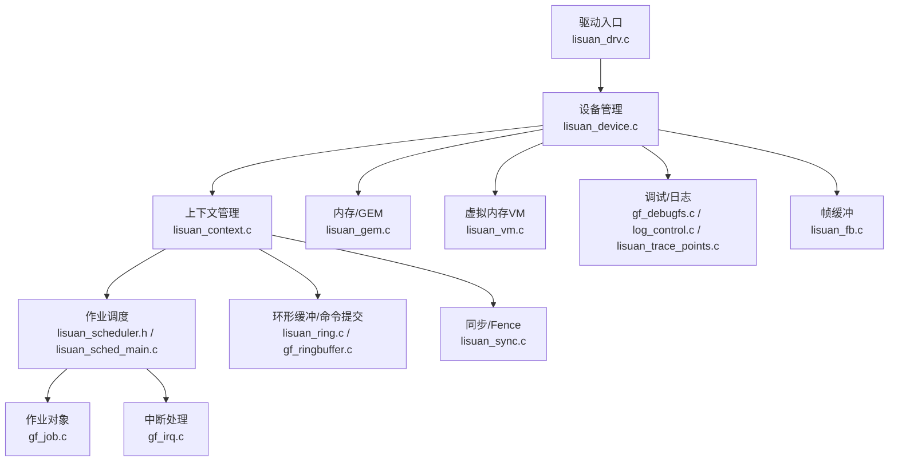
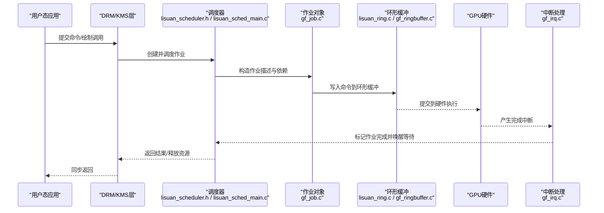
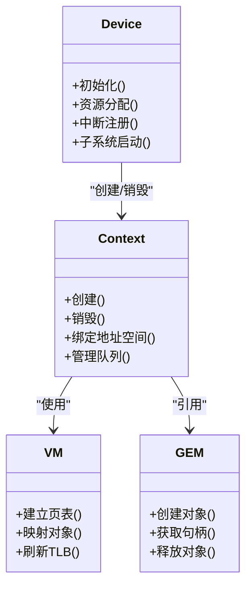
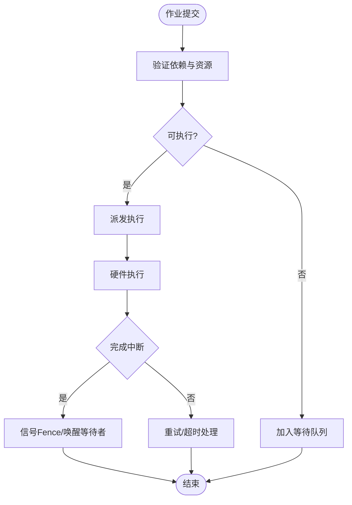
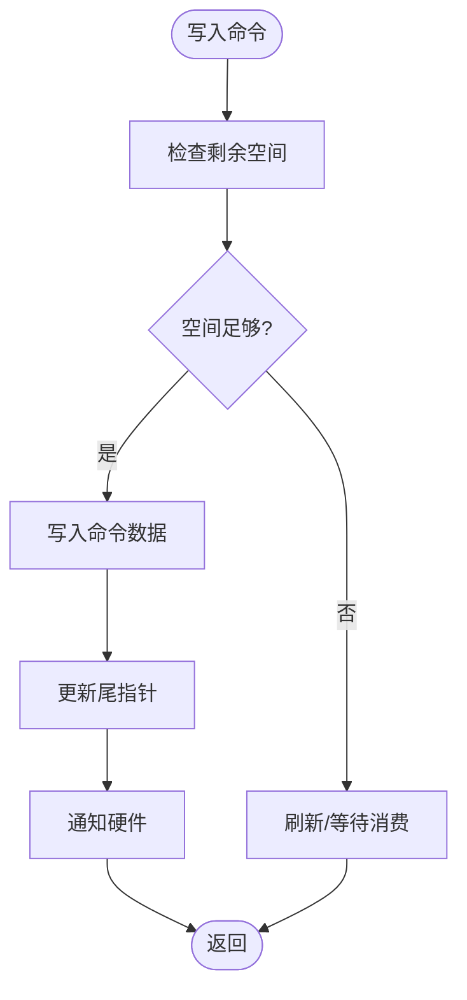
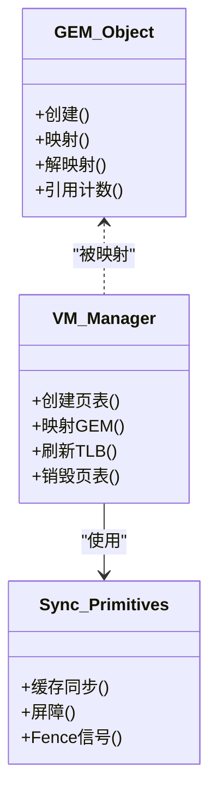
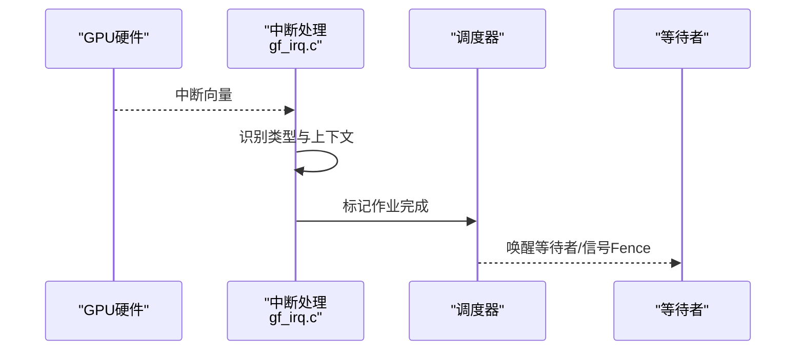
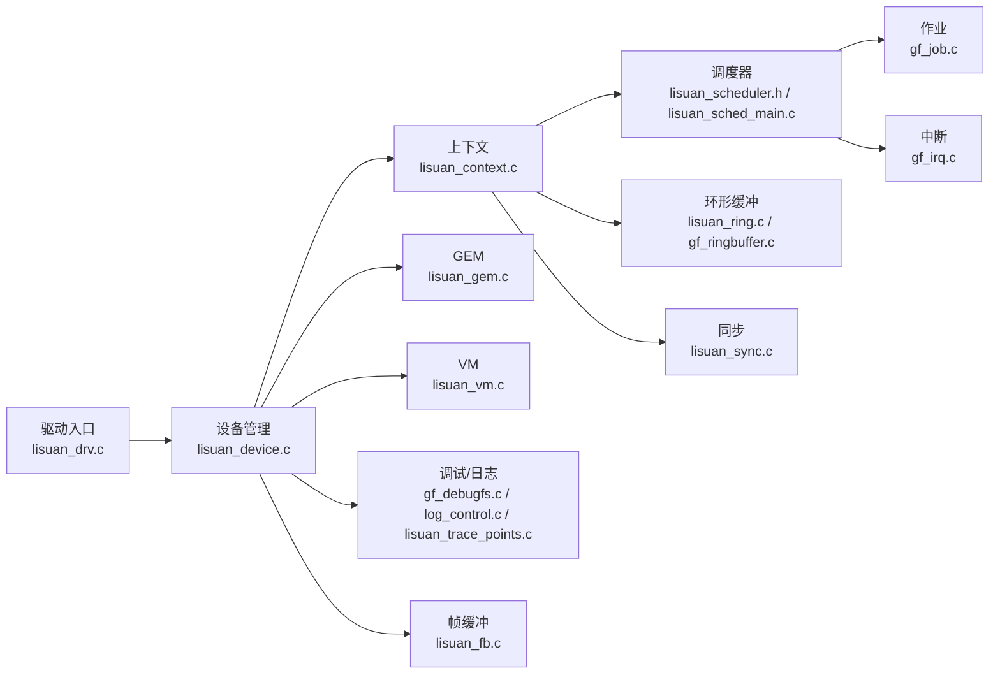

# GPU核心

<cite>
**本文档引用的文件**   
- [lisuan_drv.c](file://_work/src/usr/src/lisuan-dkms-262.2.0.56/lisuan_drv.c)
- [lisuan_device.c](file://_work/src/usr/src/lisuan-dkms-262.2.0.56/lisuan_device.c)
- [lisuan_context.c](file://_work/src/usr/src/lisuan-dkms-262.2.0.56/lisuan_context.c)
- [lisuan_ring.c](file://_work/src/usr/src/lisuan-dkms-262.2.0.56/lisuan_ring.c)
- [gf_ringbuffer.c](file://_work/src/usr/src/lisuan-dkms-262.2.0.56/gf_ringbuffer.c)
- [gf_job.c](file://_work/src/usr/src/lisuan-dkms-262.2.0.56/gf_job.c)
- [lisuan_scheduler.h](file://_work/src/usr/src/lisuan-dkms-262.2.0.56/lisuan_scheduler.h)
- [lisuan_sched_main.c](file://_work/src/usr/src/lisuan-dkms-262.2.0.56/lisuan_sched_main.c)
- [lisuan_vm.c](file://_work/src/usr/src/lisuan-dkms-262.2.0.56/lisuan_vm.c)
- [lisuan_gem.c](file://_work/src/usr/src/lisuan-dkms-262.2.0.56/lisuan_gem.c)
- [lisuan_sync.c](file://_work/src/usr/src/lisuan-dkms-262.2.0.56/lisuan_sync.c)
- [gf_irq.c](file://_work/src/usr/src/lisuan-dkms-262.2.0.56/gf_irq.c)
- [gf_debugfs.c](file://_work/src/usr/src/lisuan-dkms-262.2.0.56/gf_debugfs.c)
- [log_control.c](file://_work/src/usr/src/lisuan-dkms-262.2.0.56/log_control.c)
- [lisuan_trace_points.c](file://_work/src/usr/src/lisuan-dkms-262.2.0.56/lisuan_trace_points.c)
- [lisuan_fb.c](file://_work/src/usr/src/lisuan-dkms-262.2.0.56/lisuan_fb.c)
</cite>

## 目录
1. [简介](#简介)
2. [项目结构](#项目结构)
3. [核心组件](#核心组件)
4. [架构总览](#架构总览)
5. [详细组件分析](#详细组件分析)
6. [依赖关系分析](#依赖关系分析)
7. [性能考虑](#性能考虑)
8. [故障排查指南](#故障排查指南)
9. [结论](#结论)
10. [附录](#附录)

## 简介
本技术文档面向丽山GPU核心组件，系统性阐述GPU设备初始化、上下文管理、作业调度与环形缓冲区的实现，并详细说明GPU命令提交、执行流程与错误处理机制。同时覆盖性能监控、调试接口与电源管理的实现要点，提供API使用示例与性能优化建议，帮助开发者高效集成与调优。

## 项目结构
该仓库包含显示子系统（display）、KMS驱动、视频编解码、以及GPU核心驱动代码。GPU核心相关的关键目录与文件如下：
- 驱动入口与设备管理：lisuan_drv.c、lisuan_device.c
- 上下文与资源管理：lisuan_context.c、lisuan_gem.c、lisuan_vm.c
- 作业与调度：gf_job.c、lisuan_scheduler.h、lisuan_sched_main.c
- 环形缓冲区与命令提交：lisuan_ring.c、gf_ringbuffer.c
- 中断与事件：gf_irq.c、gf_kmd_event.c
- 同步与 fences：lisuan_sync.c
- 调试与日志：gf_debugfs.c、log_control.c、lisuan_trace_points.c
- 帧缓冲与用户态交互：lisuan_fb.c

图表来源
- [lisuan_drv.c](file://_work/src/usr/src/lisuan-dkms-262.2.0.56/lisuan_drv.c)
- [lisuan_device.c](file://_work/src/usr/src/lisuan-dkms-262.2.0.56/lisuan_device.c)
- [lisuan_context.c](file://_work/src/usr/src/lisuan-dkms-262.2.0.56/lisuan_context.c)
- [lisuan_gem.c](file://_work/src/usr/src/lisuan-dkms-262.2.0.56/lisuan_gem.c)
- [lisuan_vm.c](file://_work/src/usr/src/lisuan-dkms-262.2.0.56/lisuan_vm.c)
- [lisuan_scheduler.h](file://_work/src/usr/src/lisuan-dkms-262.2.0.56/lisuan_scheduler.h)
- [lisuan_sched_main.c](file://_work/src/usr/src/lisuan-dkms-262.2.0.56/lisuan_sched_main.c)
- [gf_job.c](file://_work/src/usr/src/lisuan-dkms-262.2.0.56/gf_job.c)
- [lisuan_ring.c](file://_work/src/usr/src/lisuan-dkms-262.2.0.56/lisuan_ring.c)
- [gf_ringbuffer.c](file://_work/src/usr/src/lisuan-dkms-262.2.0.56/gf_ringbuffer.c)
- [gf_irq.c](file://_work/src/usr/src/lisuan-dkms-262.2.0.56/gf_irq.c)
- [lisuan_sync.c](file://_work/src/usr/src/lisuan-dkms-262.2.0.56/lisuan_sync.c)
- [gf_debugfs.c](file://_work/src/usr/src/lisuan-dkms-262.2.0.56/gf_debugfs.c)
- [log_control.c](file://_work/src/usr/src/lisuan-dkms-262.2.0.56/log_control.c)
- [lisuan_trace_points.c](file://_work/src/usr/src/lisuan-dkms-262.2.0.56/lisuan_trace_points.c)
- [lisuan_fb.c](file://_work/src/usr/src/lisuan-dkms-262.2.0.56/lisuan_fb.c)

章节来源
- [lisuan_drv.c](file://_work/src/usr/src/lisuan-dkms-262.2.0.56/lisuan_drv.c)
- [lisuan_device.c](file://_work/src/usr/src/lisuan-dkms-262.2.0.56/lisuan_device.c)

## 核心组件
- 设备初始化与生命周期管理：负责PCI/平台枚举、资源分配、时钟与电源域配置、中断注册、子系统初始化。
- 上下文管理：创建/销毁GPU上下文，维护私有状态、地址空间映射、队列与资源句柄。
- 作业调度：抽象作业模型，维护就绪/运行/完成队列，支持优先级与公平性策略。
- 环形缓冲区与命令提交：封装命令写入、边界检查、回环指针更新、提交到硬件。
- 内存与VM：GEM对象管理、页表构建、地址转换、缓存一致性。
- 同步与Fence：跨内核/用户态同步原语，等待与信号机制。
- 中断与事件：GPU中断路由、任务顶半部/底半部分离、事件上报。
- 调试与日志：debugfs接口、动态日志级别、trace点。
- 帧缓冲：简单FB对象与DMA映射，用于测试与基础显示路径。

章节来源
- [lisuan_device.c](file://_work/src/usr/src/lisuan-dkms-262.2.0.56/lisuan_device.c)
- [lisuan_context.c](file://_work/src/usr/src/lisuan-dkms-262.2.0.56/lisuan_context.c)
- [lisuan_scheduler.h](file://_work/src/usr/src/lisuan-dkms-262.2.0.56/lisuan_scheduler.h)
- [lisuan_sched_main.c](file://_work/src/usr/src/lisuan-dkms-262.2.0.56/lisuan_sched_main.c)
- [gf_job.c](file://_work/src/usr/src/lisuan-dkms-262.2.0.56/gf_job.c)
- [lisuan_ring.c](file://_work/src/usr/src/lisuan-dkms-262.2.0.56/lisuan_ring.c)
- [gf_ringbuffer.c](file://_work/src/usr/src/lisuan-dkms-262.2.0.56/gf_ringbuffer.c)
- [lisuan_vm.c](file://_work/src/usr/src/lisuan-dkms-262.2.0.56/lisuan_vm.c)
- [lisuan_gem.c](file://_work/src/usr/src/lisuan-dkms-262.2.0.56/lisuan_gem.c)
- [lisuan_sync.c](file://_work/src/usr/src/lisuan-dkms-262.2.0.56/lisuan_sync.c)
- [gf_irq.c](file://_work/src/usr/src/lisuan-dkms-262.2.0.56/gf_irq.c)
- [gf_debugfs.c](file://_work/src/usr/src/lisuan-dkms-262.2.0.56/gf_debugfs.c)
- [log_control.c](file://_work/src/usr/src/lisuan-dkms-262.2.0.56/log_control.c)
- [lisuan_trace_points.c](file://_work/src/usr/src/lisuan-dkms-262.2.0.56/lisuan_trace_points.c)
- [lisuan_fb.c](file://_work/src/usr/src/lisuan-dkms-262.2.0.56/lisuan_fb.c)

## 架构总览
GPU核心采用分层设计：上层通过KMS/DRM或用户态API提交作业；调度器将作业入队并按策略派发至引擎；命令写入环形缓冲区后由硬件执行；完成后触发中断，驱动清理资源并通知等待者。

图表来源
- [lisuan_scheduler.h](file://_work/src/usr/src/lisuan-dkms-262.2.0.56/lisuan_scheduler.h)
- [lisuan_sched_main.c](file://_work/src/usr/src/lisuan-dkms-262.2.0.56/lisuan_sched_main.c)
- [gf_job.c](file://_work/src/usr/src/lisuan-dkms-262.2.0.56/gf_job.c)
- [lisuan_ring.c](file://_work/src/usr/src/lisuan-dkms-262.2.0.56/lisuan_ring.c)
- [gf_ringbuffer.c](file://_work/src/usr/src/lisuan-dkms-262.2.0.56/gf_ringbuffer.c)
- [gf_irq.c](file://_work/src/usr/src/lisuan-dkms-262.2.0.56/gf_irq.c)

## 详细组件分析

### 设备初始化与上下文管理
- 设备初始化：在驱动入口中完成设备探测、资源映射、时钟/电源域启用、中断注册、子系统初始化（如VM、GEM、调度器）。
- 上下文管理：为每个进程/线程创建独立上下文，隔离地址空间、寄存器状态、队列与资源引用计数。

图表来源
- [lisuan_device.c](file://_work/src/usr/src/lisuan-dkms-262.2.0.56/lisuan_device.c)
- [lisuan_context.c](file://_work/src/usr/src/lisuan-dkms-262.2.0.56/lisuan_context.c)
- [lisuan_vm.c](file://_work/src/usr/src/lisuan-dkms-262.2.0.56/lisuan_vm.c)
- [lisuan_gem.c](file://_work/src/usr/src/lisuan-dkms-262.2.0.56/lisuan_gem.c)

章节来源
- [lisuan_device.c](file://_work/src/usr/src/lisuan-dkms-262.2.0.56/lisuan_device.c)
- [lisuan_context.c](file://_work/src/usr/src/lisuan-dkms-262.2.0.56/lisuan_context.c)
- [lisuan_vm.c](file://_work/src/usr/src/lisuan-dkms-262.2.0.56/lisuan_vm.c)
- [lisuan_gem.c](file://_work/src/usr/src/lisuan-dkms-262.2.0.56/lisuan_gem.c)

### 作业调度与执行流程
- 作业模型：封装命令序列、依赖关系、资源锁定、完成回调。
- 调度策略：按优先级与公平性选择作业，避免饥饿与死锁。
- 执行路径：调度器从就绪队列取出作业，交由引擎执行，完成后触发中断回调。

图表来源
- [lisuan_scheduler.h](file://_work/src/usr/src/lisuan-dkms-262.2.0.56/lisuan_scheduler.h)
- [lisuan_sched_main.c](file://_work/src/usr/src/lisuan-dkms-262.2.0.56/lisuan_sched_main.c)
- [gf_job.c](file://_work/src/usr/src/lisuan-dkms-262.2.0.56/gf_job.c)

章节来源
- [lisuan_scheduler.h](file://_work/src/usr/src/lisuan-dkms-262.2.0.56/lisuan_scheduler.h)
- [lisuan_sched_main.c](file://_work/src/usr/src/lisuan-dkms-262.2.0.56/lisuan_sched_main.c)
- [gf_job.c](file://_work/src/usr/src/lisuan-dkms-262.2.0.56/gf_job.c)

### 环形缓冲区与命令提交
- 环形缓冲：固定大小内存区域，维护写指针与尾指针，支持回绕与边界检查。
- 命令写入：批量写入命令，确保对齐与完整性，必要时插入屏障。
- 提交机制：更新尾指针并通知硬件，保证可见性与顺序性。

图表来源
- [lisuan_ring.c](file://_work/src/usr/src/lisuan-dkms-262.2.0.56/lisuan_ring.c)
- [gf_ringbuffer.c](file://_work/src/usr/src/lisuan-dkms-262.2.0.56/gf_ringbuffer.c)

章节来源
- [lisuan_ring.c](file://_work/src/usr/src/lisuan-dkms-262.2.0.56/lisuan_ring.c)
- [gf_ringbuffer.c](file://_work/src/usr/src/lisuan-dkms-262.2.0.56/gf_ringbuffer.c)

### 内存管理与VM
- GEM对象：统一内存对象抽象，支持共享、映射、缓存一致性控制。
- VM页表：构建GPU虚拟地址到物理地址的映射，支持按需刷新与失效。
- 同步：在CPU/GPU访问间进行必要的缓存操作与屏障。

图表来源
- [lisuan_gem.c](file://_work/src/usr/src/lisuan-dkms-262.2.0.56/lisuan_gem.c)
- [lisuan_vm.c](file://_work/src/usr/src/lisuan-dkms-262.2.0.56/lisuan_vm.c)
- [lisuan_sync.c](file://_work/src/usr/src/lisuan-dkms-262.2.0.56/lisuan_sync.c)

章节来源
- [lisuan_gem.c](file://_work/src/usr/src/lisuan-dkms-262.2.0.56/lisuan_gem.c)
- [lisuan_vm.c](file://_work/src/usr/src/lisuan-dkms-262.2.0.56/lisuan_vm.c)
- [lisuan_sync.c](file://_work/src/usr/src/lisuan-dkms-262.2.0.56/lisuan_sync.c)

### 中断与事件处理
- 中断路由：区分正常完成与异常错误，记录上下文以便恢复。
- 任务分离：顶半部快速处理，底半部完成清理与回调。
- 事件上报：向调度器与等待者传递完成信号。

图表来源
- [gf_irq.c](file://_work/src/usr/src/lisuan-dkms-262.2.0.56/gf_irq.c)
- [lisuan_scheduler.h](file://_work/src/usr/src/lisuan-dkms-262.2.0.56/lisuan_scheduler.h)

章节来源
- [gf_irq.c](file://_work/src/usr/src/lisuan-dkms-262.2.0.56/gf_irq.c)

### 调试、日志与性能监控
- debugfs接口：暴露寄存器、队列状态、作业统计等调试信息。
- 动态日志：分级日志控制，便于生产环境裁剪输出。
- trace点：关键路径埋点，配合perf/ftrace进行分析。

章节来源
- [gf_debugfs.c](file://_work/src/usr/src/lisuan-dkms-262.2.0.56/gf_debugfs.c)
- [log_control.c](file://_work/src/usr/src/lisuan-dkms-262.2.0.56/log_control.c)
- [lisuan_trace_points.c](file://_work/src/usr/src/lisuan-dkms-262.2.0.56/lisuan_trace_points.c)

### 帧缓冲与基础显示路径
- FB对象：创建帧缓冲对象，映射到显存，供简单显示路径使用。
- DMA映射：确保CPU/GPU一致性与可见性。

章节来源
- [lisuan_fb.c](file://_work/src/usr/src/lisuan-dkms-262.2.0.56/lisuan_fb.c)

## 依赖关系分析
GPU核心各模块之间存在清晰的依赖关系：驱动入口依赖设备管理；设备管理依赖上下文、内存、VM、调度器；调度器依赖作业对象与环形缓冲；中断处理与调度器协作完成异步执行。

图表来源
- [lisuan_drv.c](file://_work/src/usr/src/lisuan-dkms-262.2.0.56/lisuan_drv.c)
- [lisuan_device.c](file://_work/src/usr/src/lisuan-dkms-262.2.0.56/lisuan_device.c)
- [lisuan_context.c](file://_work/src/usr/src/lisuan-dkms-262.2.0.56/lisuan_context.c)
- [lisuan_gem.c](file://_work/src/usr/src/lisuan-dkms-262.2.0.56/lisuan_gem.c)
- [lisuan_vm.c](file://_work/src/usr/src/lisuan-dkms-262.2.0.56/lisuan_vm.c)
- [lisuan_scheduler.h](file://_work/src/usr/src/lisuan-dkms-262.2.0.56/lisuan_scheduler.h)
- [lisuan_sched_main.c](file://_work/src/usr/src/lisuan-dkms-262.2.0.56/lisuan_sched_main.c)
- [gf_job.c](file://_work/src/usr/src/lisuan-dkms-262.2.0.56/gf_job.c)
- [lisuan_ring.c](file://_work/src/usr/src/lisuan-dkms-262.2.0.56/lisuan_ring.c)
- [gf_ringbuffer.c](file://_work/src/usr/src/lisuan-dkms-262.2.0.56/gf_ringbuffer.c)
- [gf_irq.c](file://_work/src/usr/src/lisuan-dkms-262.2.0.56/gf_irq.c)
- [lisuan_sync.c](file://_work/src/usr/src/lisuan-dkms-262.2.0.56/lisuan_sync.c)
- [gf_debugfs.c](file://_work/src/usr/src/lisuan-dkms-262.2.0.56/gf_debugfs.c)
- [log_control.c](file://_work/src/usr/src/lisuan-dkms-262.2.0.56/log_control.c)
- [lisuan_trace_points.c](file://_work/src/usr/src/lisuan-dkms-262.2.0.56/lisuan_trace_points.c)
- [lisuan_fb.c](file://_work/src/usr/src/lisuan-dkms-262.2.0.56/lisuan_fb.c)

章节来源
- [lisuan_drv.c](file://_work/src/usr/src/lisuan-dkms-262.2.0.56/lisuan_drv.c)
- [lisuan_device.c](file://_work/src/usr/src/lisuan-dkms-262.2.0.56/lisuan_device.c)

## 性能考虑
- 批处理与合并：尽量合并小作业为大批次，减少调度与提交开销。
- 环形缓冲容量：合理设置大小以平衡延迟与吞吐，避免频繁刷新。
- 依赖最小化：减少不必要的同步点，利用Fence精确同步。
- 内存布局：对齐与连续内存提升带宽利用率，减少碎片。
- 中断频率：降低中断率，采用批量完成上报。
- 功耗管理：空闲时降频/关闭时钟，负载上升时平滑恢复。

[本节为通用指导，不直接分析具体文件]

## 故障排查指南
- 常见错误分类：
  - 提交失败：检查环形缓冲空间、权限与依赖。
  - 执行卡住：查看中断是否触发、作业是否被调度、是否存在死锁。
  - 内存错误：确认VM映射正确、缓存一致性操作完整。
- 调试手段：
  - 使用debugfs导出队列状态、寄存器快照与统计信息。
  - 开启动态日志与trace点，定位关键路径。
  - 结合系统profiler分析CPU/GPU热点。
- 恢复策略：
  - 重置GPU上下文与队列，清理僵尸作业。
  - 重新建立VM映射与页表，刷新TLB。

章节来源
- [gf_debugfs.c](file://_work/src/usr/src/lisuan-dkms-262.2.0.56/gf_debugfs.c)
- [log_control.c](file://_work/src/usr/src/lisuan-dkms-262.2.0.56/log_control.c)
- [lisuan_trace_points.c](file://_work/src/usr/src/lisuan-dkms-262.2.0.56/lisuan_trace_points.c)

## 结论
丽山GPU核心通过清晰的分层设计与模块化实现，提供了稳定的设备初始化、上下文隔离、作业调度、命令提交与中断处理能力。借助完善的调试与监控接口，开发者可有效定位问题并进行性能优化。遵循本文档的实践建议，可在复杂应用场景中获得更高的吞吐与更低的延迟。

[本节为总结性内容，不直接分析具体文件]

## 附录
- API使用示例（概念性）：
  - 创建上下文：申请GPU上下文，绑定地址空间与队列。
  - 提交作业：构造作业描述，写入环形缓冲，提交并等待Fence。
  - 资源管理：创建/映射GEM对象，建立VM映射，使用完毕后释放。
  - 调试查询：通过debugfs读取队列状态、作业统计与寄存器信息。
- 性能优化清单：
  - 批处理合并、减少同步点、优化内存布局、降低中断频率、合理设置环形缓冲大小、启用功耗管理策略。

[本节为补充说明，不直接分析具体文件]