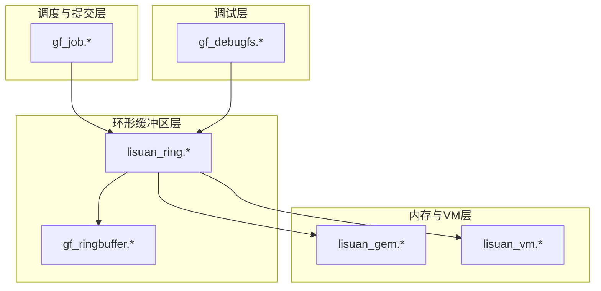
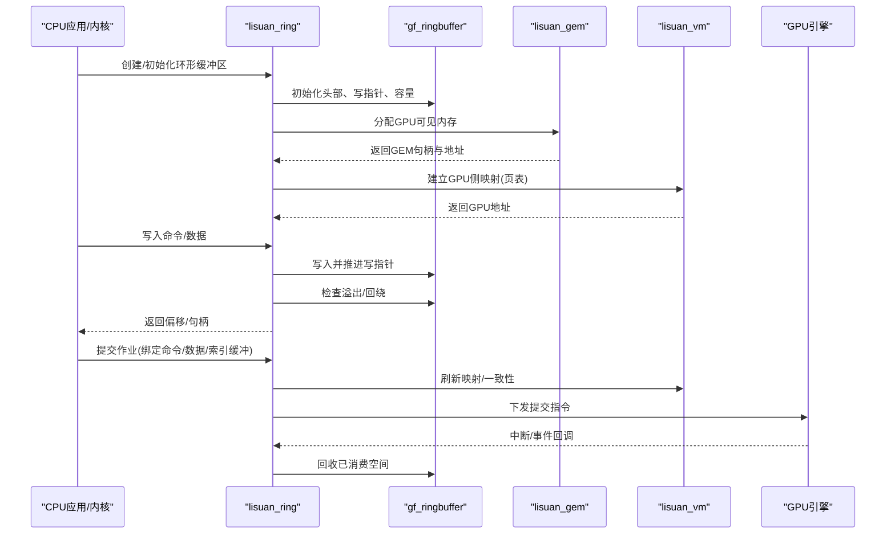
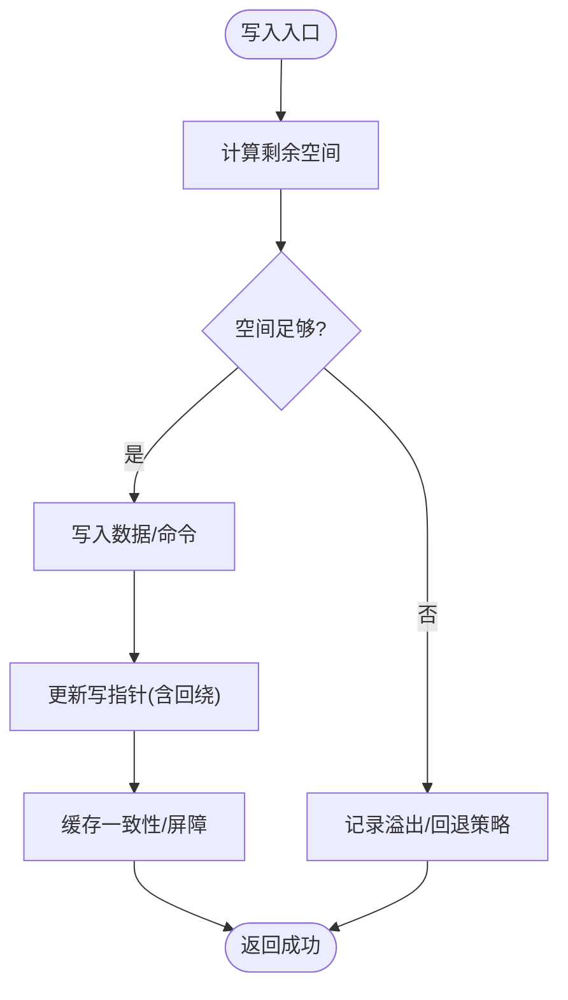
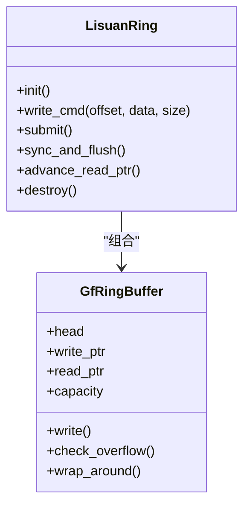
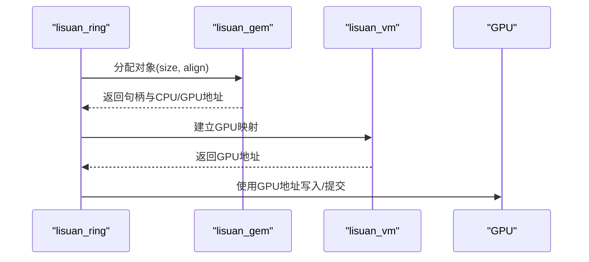
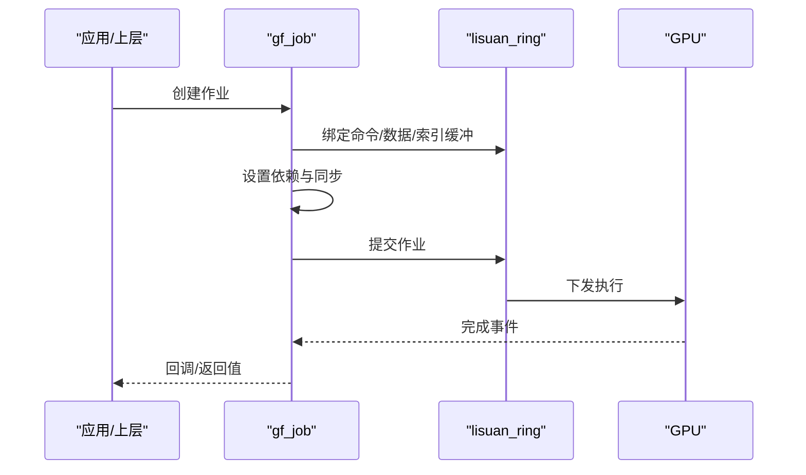
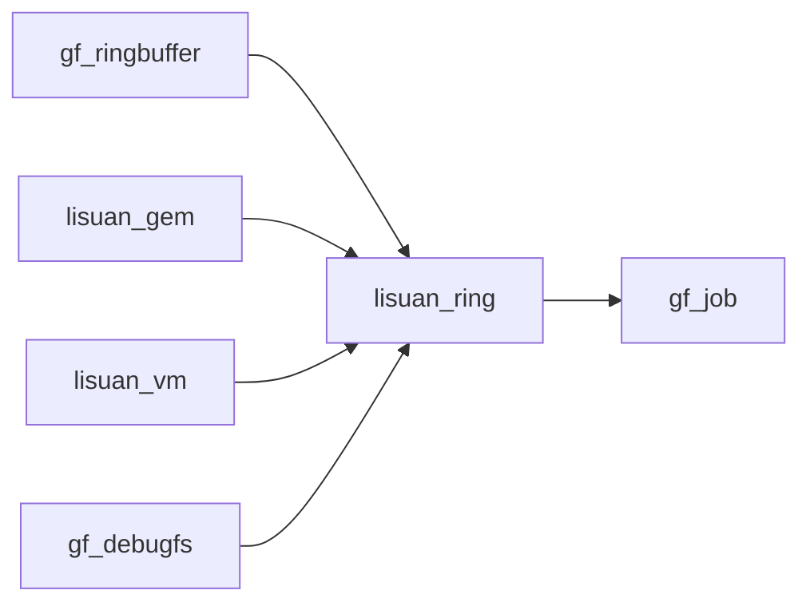

# GPU环形缓冲区

<cite>
**本文引用的文件**   
- [gf_ringbuffer.c](file://_work/src/usr/src/lisuan-gpu-dkms-262.2.0.56/gf_ringbuffer.c)
- [gf_ringbuffer.h](file://_work/src/usr/src/lisuan-gpu-dkms-262.2.0.56/gf_ringbuffer.h)
- [lisuan_ring.c](file://_work/src/usr/src/lisuan-gpu-dkms-262.2.0.56/lisuan_ring.c)
- [lisuan_ring.h](file://_work/src/usr/src/lisuan-gpu-dkms-262.2.0.56/lisuan_ring.h)
- [lisuan_gem.c](file://_work/src/usr/src/lisuan-gpu-dkms-262.2.0.56/lisuan_gem.c)
- [lisuan_gem.h](file://_work/src/usr/src/lisuan-gpu-dkms-262.2.0.56/lisuan_gem.h)
- [gf_job.c](file://_work/src/usr/src/lisuan-gpu-dkms-262.2.0.56/gf_job.c)
- [gf_job.h](file://_work/src/usr/src/lisuan-gpu-dkms-262.2.0.56/gf_job.h)
- [lisuan_vm.c](file://_work/src/usr/src/lisuan-gpu-dkms-262.2.0.56/lisuan_vm.c)
- [lisuan_vm.h](file://_work/src/usr/src/lisuan-gpu-dkms-262.2.0.56/lisuan_vm.h)
- [gf_debugfs.c](file://_work/src/usr/src/lisuan-gpu-dkms-262.2.0.56/gf_debugfs.c)
- [gf_debugfs.h](file://_work/src/usr/src/lisuan-gpu-dkms-262.2.0.56/gf_debugfs.h)
</cite>

## 目录
1. [简介](#简介)
2. [项目结构](#项目结构)
3. [核心组件](#核心组件)
4. [架构总览](#架构总览)
5. [详细组件分析](#详细组件分析)
6. [依赖关系分析](#依赖关系分析)
7. [性能考虑](#性能考虑)
8. [故障排查指南](#故障排查指南)
9. [结论](#结论)
10. [附录](#附录)

## 简介
本技术文档面向丽山GPU驱动中的“环形缓冲区子系统”，围绕以下目标展开：
- 解释环形缓冲区的内存布局、读写指针管理与同步机制
- 说明命令缓冲区、数据缓冲区与索引缓冲区的实现细节
- 阐述缓冲区分配策略、内存对齐要求与缓存一致性处理
- 详述缓冲区溢出检测、回绕处理与错误恢复机制
- 提供API使用示例、性能优化技巧与内存泄漏检测方法
- 给出调试工具的使用指南

## 项目结构
与环形缓冲区相关的核心代码位于驱动源码的以下位置：
- gf_ringbuffer.*：通用环形缓冲区抽象与基础操作
- lisuan_ring.*：丽山GPU平台特定的环形缓冲区封装与调度集成
- lisuan_gem.*：GEM对象管理，负责GPU可见内存分配、映射与生命周期
- lisuan_vm.*：虚拟内存与页表管理，用于将用户/GEM空间映射到GPU地址空间
- gf_job.*：作业/提交管线，负责将命令与资源绑定并提交至GPU执行
- gf_debugfs.*：调试接口，暴露环形缓冲区状态与统计信息

图表来源
- [gf_ringbuffer.c:1-200](file://_work/src/usr/src/lisuan-gpu-dkms-262.2.0.56/gf_ringbuffer.c#L1-L200)
- [lisuan_ring.c:1-200](file://_work/src/usr/src/lisuan-gpu-dkms-262.2.0.56/lisuan_ring.c#L1-L200)
- [lisuan_gem.c:1-200](file://_work/src/usr/src/lisuan-gpu-dkms-262.2.0.56/lisuan_gem.c#L1-L200)
- [lisuan_vm.c:1-200](file://_work/src/usr/src/lisuan-gpu-dkms-262.2.0.56/lisuan_vm.c#L1-L200)
- [gf_job.c:1-200](file://_work/src/usr/src/lisuan-gpu-dkms-262.2.0.56/gf_job.c#L1-L200)
- [gf_debugfs.c:1-200](file://_work/src/usr/src/lisuan-gpu-dkms-262.2.0.56/gf_debugfs.c#L1-L200)

章节来源
- [gf_ringbuffer.h:1-200](file://_work/src/usr/src/lisuan-gpu-dkms-262.2.0.56/gf_ringbuffer.h#L1-L200)
- [lisuan_ring.h:1-200](file://_work/src/usr/src/lisuan-gpu-dkms-262.2.0.56/lisuan_ring.h#L1-L200)

## 核心组件
- 通用环形缓冲区（gf_ringbuffer）：提供统一的环形缓冲区数据结构、写入/读取接口、回绕逻辑、容量检查与基本同步原语。
- 平台环形封装（lisuan_ring）：在通用环形缓冲区之上，结合丽山GPU的提交语义、上下文切换、屏障与事件通知等特性进行封装。
- GEM对象（lisuan_gem）：负责GPU可访问内存的分配、引用计数、映射与释放；为环形缓冲区及其内容提供物理/虚拟地址。
- 虚拟内存（lisuan_vm）：维护GPU侧页表，将GEM对象或用户空间映射到GPU地址空间，确保命令与数据对GPU可见。
- 作业提交（gf_job）：将命令缓冲区、数据缓冲区、索引缓冲区打包成作业，提交到调度器并等待完成。
- 调试接口（gf_debugfs）：导出环形缓冲区水位、指针、错误计数等信息，便于运行时诊断。

章节来源
- [gf_ringbuffer.c:1-200](file://_work/src/usr/src/lisuan-gpu-dkms-262.2.0.56/gf_ringbuffer.c#L1-L200)
- [lisuan_ring.c:1-200](file://_work/src/usr/src/lisuan-gpu-dkms-262.2.0.56/lisuan_ring.c#L1-L200)
- [lisuan_gem.c:1-200](file://_work/src/usr/src/lisuan-gpu-dkms-262.2.0.56/lisuan_gem.c#L1-L200)
- [lisuan_vm.c:1-200](file://_work/src/usr/src/lisuan-gpu-dkms-262.2.0.56/lisuan_vm.c#L1-L200)
- [gf_job.c:1-200](file://_work/src/usr/src/lisuan-gpu-dkms-262.2.0.56/gf_job.c#L1-L200)
- [gf_debugfs.c:1-200](file://_work/src/usr/src/lisuan-gpu-dkms-262.2.0.56/gf_debugfs.c#L1-L200)

## 架构总览
环形缓冲区子系统由“通用环形缓冲区 + 平台封装 + 内存/VM + 作业提交 + 调试”五层构成。CPU侧通过通用接口写入命令与数据，平台封装负责与GPU硬件交互，内存/VM层保证地址可见性与一致性，作业提交层组织执行序列，调试层提供观测能力。

图表来源
- [lisuan_ring.c:1-200](file://_work/src/usr/src/lisuan-gpu-dkms-262.2.0.56/lisuan_ring.c#L1-L200)
- [gf_ringbuffer.c:1-200](file://_work/src/usr/src/lisuan-gpu-dkms-262.2.0.56/gf_ringbuffer.c#L1-L200)
- [lisuan_gem.c:1-200](file://_work/src/usr/src/lisuan-gpu-dkms-262.2.0.56/lisuan_gem.c#L1-L200)
- [lisuan_vm.c:1-200](file://_work/src/usr/src/lisuan-gpu-dkms-262.2.0.56/lisuan_vm.c#L1-L200)

## 详细组件分析

### 通用环形缓冲区（gf_ringbuffer）
- 内存布局
  - 头部字段：包含缓冲区大小、写指针、读指针、标志位、版本/校验等
  - 数据区：按固定粒度对齐的命令/数据槽位，支持循环回绕
- 指针管理
  - 写指针：单调递增并在达到边界时回绕
  - 读指针：由GPU消费后推进，CPU侧仅在确认安全时推进
- 同步机制
  - 基于原子变量/自旋锁保护写路径
  - 读路径通常由GPU异步推进，CPU侧通过屏障或事件同步
- 溢出检测与回绕
  - 写入前计算剩余空间，不足则触发回绕或拒绝写入
  - 记录溢出计数以便调试
- 缓存一致性
  - 在CPU写入后调用必要的内存屏障/flush，确保GPU可见性

图表来源
- [gf_ringbuffer.c:1-200](file://_work/src/usr/src/lisuan-gpu-dkms-262.2.0.56/gf_ringbuffer.c#L1-L200)

章节来源
- [gf_ringbuffer.h:1-200](file://_work/src/usr/src/lisuan-gpu-dkms-262.2.0.56/gf_ringbuffer.h#L1-L200)
- [gf_ringbuffer.c:1-200](file://_work/src/usr/src/lisuan-gpu-dkms-262.2.0.56/gf_ringbuffer.c#L1-L200)

### 平台环形封装（lisuan_ring）
- 职责
  - 封装通用环形缓冲区，提供丽山GPU特定的提交、上下文切换、屏障与事件
  - 管理多个队列（如命令队列、数据队列、索引队列）
- 关键流程
  - 初始化：分配GEM对象、建立VM映射、初始化环形头
  - 写入：对齐命令/数据，填充描述符，推进写指针
  - 提交：组装提交包，刷新一致性，下发给GPU
  - 回收：根据GPU进度推进读指针，释放资源

图表来源
- [lisuan_ring.c:1-200](file://_work/src/usr/src/lisuan-gpu-dkms-262.2.0.56/lisuan_ring.c#L1-L200)
- [gf_ringbuffer.c:1-200](file://_work/src/usr/src/lisuan-gpu-dkms-262.2.0.56/gf_ringbuffer.c#L1-L200)

章节来源
- [lisuan_ring.h:1-200](file://_work/src/usr/src/lisuan-gpu-dkms-262.2.0.56/lisuan_ring.h#L1-L200)
- [lisuan_ring.c:1-200](file://_work/src/usr/src/lisuan-gpu-dkms-262.2.0.56/lisuan_ring.c#L1-L200)

### 内存与VM（lisuan_gem 与 lisuan_vm）
- GEM对象
  - 分配GPU可见内存，管理引用计数与映射
  - 提供句柄、地址、大小、对齐属性
- VM映射
  - 构建GPU页表，将GEM对象映射到GPU地址空间
  - 支持共享映射、权限控制、一致性刷新

图表来源
- [lisuan_gem.c:1-200](file://_work/src/usr/src/lisuan-gpu-dkms-262.2.0.56/lisuan_gem.c#L1-L200)
- [lisuan_vm.c:1-200](file://_work/src/usr/src/lisuan-gpu-dkms-262.2.0.56/lisuan_vm.c#L1-L200)

章节来源
- [lisuan_gem.h:1-200](file://_work/src/usr/src/lisuan-gpu-dkms-262.2.0.56/lisuan_gem.h#L1-L200)
- [lisuan_vm.h:1-200](file://_work/src/usr/src/lisuan-gpu-dkms-262.2.0.56/lisuan_vm.h#L1-L200)

### 作业提交（gf_job）
- 作用
  - 将命令缓冲区、数据缓冲区、索引缓冲区打包为作业
  - 绑定资源、设置依赖与同步点、提交到调度器
- 流程
  - 创建作业 -> 绑定缓冲区 -> 设置依赖 -> 提交 -> 等待完成/回调

图表来源
- [gf_job.c:1-200](file://_work/src/usr/src/lisuan-gpu-dkms-262.2.0.56/gf_job.c#L1-L200)
- [lisuan_ring.c:1-200](file://_work/src/usr/src/lisuan-gpu-dkms-262.2.0.56/lisuan_ring.c#L1-L200)

章节来源
- [gf_job.h:1-200](file://_work/src/usr/src/lisuan-gpu-dkms-262.2.0.56/gf_job.h#L1-L200)
- [gf_job.c:1-200](file://_work/src/usr/src/lisuan-gpu-dkms-262.2.0.56/gf_job.c#L1-L200)

### 调试接口（gf_debugfs）
- 功能
  - 导出环形缓冲区水位、指针、溢出计数、提交统计
  - 支持动态开关日志级别与采样
- 使用
  - 通过debugfs节点读取状态，辅助定位卡顿、死锁、溢出等问题

章节来源
- [gf_debugfs.h:1-200](file://_work/src/usr/src/lisuan-gpu-dkms-262.2.0.56/gf_debugfs.h#L1-L200)
- [gf_debugfs.c:1-200](file://_work/src/usr/src/lisuan-gpu-dkms-262.2.0.56/gf_debugfs.c#L1-L200)

## 依赖关系分析
- 耦合关系
  - lisuan_ring 依赖 gf_ringbuffer 作为底层环形缓冲区实现
  - lisuan_ring 依赖 lisuan_gem 与 lisuan_vm 进行内存分配与映射
  - gf_job 依赖 lisuan_ring 进行提交与同步
  - gf_debugfs 依赖 lisuan_ring 获取运行时状态
- 潜在风险
  - 循环依赖需避免（例如ring不应反向依赖job）
  - 内存与VM的生命周期必须严格管理，防止悬挂指针

图表来源
- [lisuan_ring.c:1-200](file://_work/src/usr/src/lisuan-gpu-dkms-262.2.0.56/lisuan_ring.c#L1-L200)
- [gf_ringbuffer.c:1-200](file://_work/src/usr/src/lisuan-gpu-dkms-262.2.0.56/gf_ringbuffer.c#L1-L200)
- [lisuan_gem.c:1-200](file://_work/src/usr/src/lisuan-gpu-dkms-262.2.0.56/lisuan_gem.c#L1-L200)
- [lisuan_vm.c:1-200](file://_work/src/usr/src/lisuan-gpu-dkms-262.2.0.56/lisuan_vm.c#L1-L200)
- [gf_job.c:1-200](file://_work/src/usr/src/lisuan-gpu-dkms-262.2.0.56/gf_job.c#L1-L200)
- [gf_debugfs.c:1-200](file://_work/src/usr/src/lisuan-gpu-dkms-262.2.0.56/gf_debugfs.c#L1-L200)

章节来源
- [lisuan_ring.h:1-200](file://_work/src/usr/src/lisuan-gpu-dkms-262.2.0.56/lisuan_ring.h#L1-L200)
- [gf_ringbuffer.h:1-200](file://_work/src/usr/src/lisuan-gpu-dkms-262.2.0.56/gf_ringbuffer.h#L1-L200)

## 性能考虑
- 写入批量与合并
  - 尽量批量写入命令/数据，减少屏障与同步开销
- 对齐与粒度
  - 遵循命令/数据对齐要求，避免跨边界写入导致的额外拷贝
- 缓存一致性
  - 最小化flush频率，仅在必要时刷新一致性
- 回绕策略
  - 合理设置缓冲区大小，降低回绕频率
- 提交批处理
  - 将多个作业合并提交，提高GPU利用率
- 资源复用
  - 重用GEM对象与映射，减少分配/销毁成本

[本节为通用指导，不直接分析具体文件]

## 故障排查指南
- 常见问题
  - 缓冲区溢出：检查写入量与容量，观察溢出计数
  - 指针不同步：核对读/写指针推进时机与屏障
  - 映射失效：确认VM映射是否有效，GPU地址是否正确
  - 死锁/卡顿：查看提交队列长度与完成事件
- 调试步骤
  - 通过gf_debugfs读取水位、指针、错误计数
  - 启用更详细的日志，定位写入失败点
  - 检查GEM对象生命周期与引用计数
  - 验证VM映射与一致性刷新顺序

章节来源
- [gf_debugfs.c:1-200](file://_work/src/usr/src/lisuan-gpu-dkms-262.2.0.56/gf_debugfs.c#L1-L200)
- [lisuan_ring.c:1-200](file://_work/src/usr/src/lisuan-gpu-dkms-262.2.0.56/lisuan_ring.c#L1-L200)
- [gf_ringbuffer.c:1-200](file://_work/src/usr/src/lisuan-gpu-dkms-262.2.0.56/gf_ringbuffer.c#L1-L200)

## 结论
丽山GPU环形缓冲区子系统通过通用环形缓冲区抽象与平台封装相结合，实现了高效、可靠的命令与数据传输。借助GEM与VM层，系统确保了内存可见性与一致性；通过作业提交层，完成了与GPU执行的解耦与调度。配合调试接口，可有效定位问题并优化性能。

[本节为总结，不直接分析具体文件]

## 附录
- API使用示例（概念性）
  - 初始化：创建环形缓冲区，分配GEM对象，建立VM映射
  - 写入：对齐写入命令/数据，推进写指针，必要时刷新一致性
  - 提交：绑定命令/数据/索引缓冲，设置依赖，提交作业
  - 回收：等待GPU完成，推进读指针，释放资源
- 内存泄漏检测
  - 跟踪GEM对象引用计数，确保释放路径正确
  - 监控VM映射数量，避免悬挂映射
  - 使用调试接口统计未释放资源
- 最佳实践
  - 批量写入与提交，减少同步开销
  - 合理设置缓冲区大小，平衡内存占用与回绕频率
  - 严格遵循对齐与一致性要求，避免不可预测行为

[本节为补充说明，不直接分析具体文件]