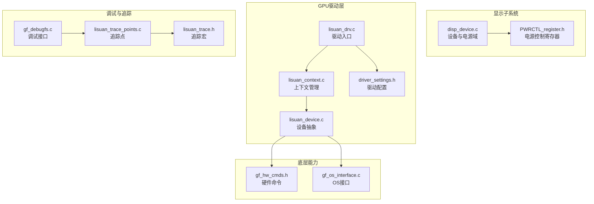
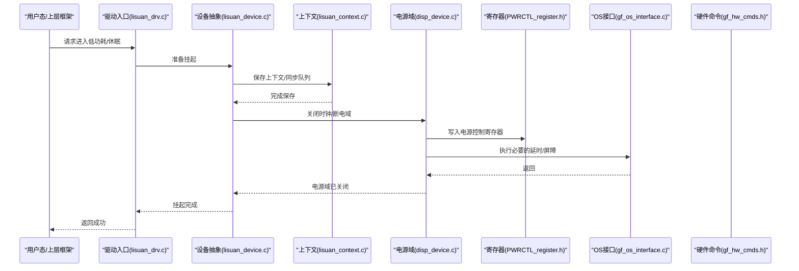
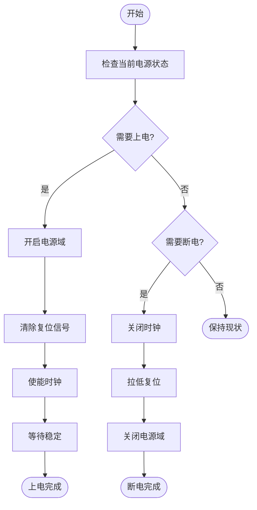
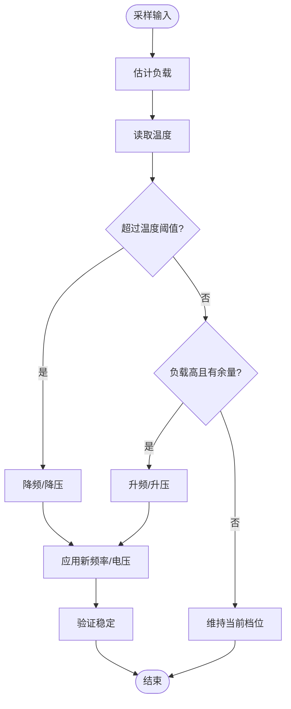
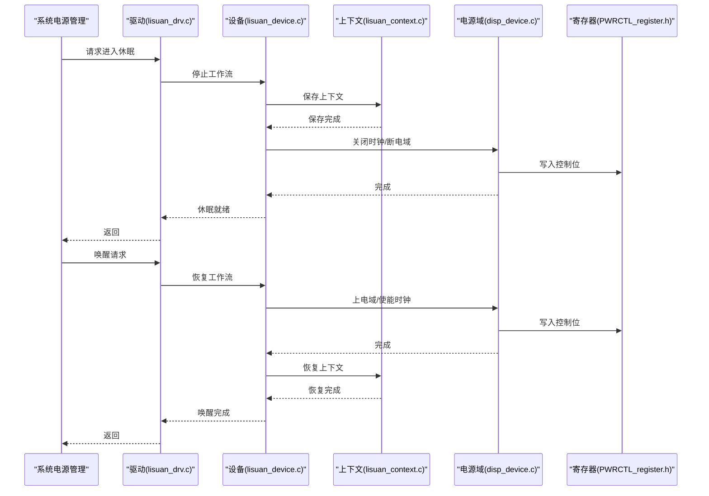
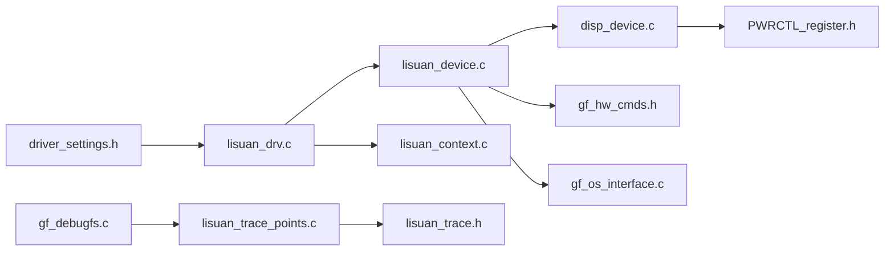

# GPU电源管理

<cite>
**本文引用的文件**   
- [PWRCTL_register.h](file://_work/src/usr/src/lisuangpu-dkms-262.2.0.56/display/register/PWRCTL_register.h)
- [disp_device.c](file://_work/src/usr/src/lisuangpu-dkms-262.2.0.56/display/disp_device.c)
- [gf_debugfs.c](file://_work/src/usr/src/lisuangpu-dkms-262.2.0.56/gf_debugfs.c)
- [lisuan_drv.c](file://_work/src/usr/src/lisuangpu-dkms-262.2.0.56/lisuan_drv.c)
- [driver_settings.h](file://_work/src/usr/src/lisuangpu-dkms-262.2.0.56/include/driver_settings.h)
- [lisuan_context.c](file://_work/src/usr/src/lisuangpu-dkms-262.2.0.56/lisuan_context.c)
- [lisuan_device.c](file://_work/src/usr/src/lisuangpu-dkms-262.2.0.56/lisuan_device.c)
- [gf_hw_cmds.h](file://_work/src/usr/src/lisuangpu-dkms-262.2.0.56/gf_hw_cmds.h)
- [gf_os_interface.c](file://_work/src/usr/src/lisuangpu-dkms-262.2.0.56/gf_os_interface.c)
- [lisuan_trace_points.c](file://_work/src/usr/src/lisuangpu-dkms-262.2.0.56/lisuan_trace_points.c)
- [lisuan_trace.h](file://_work/src/usr/src/lisuangpu-dkms-262.2.0.56/lisuan_trace.h)
</cite>

## 目录
1. [简介](#简介)
2. [项目结构](#项目结构)
3. [核心组件](#核心组件)
4. [架构总览](#架构总览)
5. [详细组件分析](#详细组件分析)
6. [依赖关系分析](#依赖关系分析)
7. [性能考量](#性能考量)
8. [故障排查指南](#故障排查指南)
9. [结论](#结论)
10. [附录](#附录)

## 简介
本技术文档面向丽山GPU的电源管理模块，聚焦于时钟管理、电压调节与功耗控制机制，涵盖动态频率缩放（DVFS）、电源域管理、休眠/唤醒流程、温度监控与过热保护、节能策略、电源状态转换、功耗统计与能效优化。同时提供API使用示例、功耗分析方法与电池续航优化建议，并给出电源相关问题的诊断与调试工具使用指南。

## 项目结构
本项目为显示与GPU驱动源码集合，电源管理相关内容主要分布在以下位置：
- 寄存器定义：display/register 下的 PWRCTL 等寄存器头文件
- 设备初始化与电源域管理：display/disp_device.c
- 内核接口与驱动入口：lisuan_drv.c
- 调试接口与统计：gf_debugfs.c
- 驱动配置与默认参数：include/driver_settings.h
- 上下文与设备抽象：lisuan_context.c、lisuan_device.c
- 硬件命令与OS接口：gf_hw_cmds.h、gf_os_interface.c
- 追踪与事件：lisuan_trace_points.c、lisuan_trace.h

图表来源 
- [disp_device.c](file://_work/src/usr/src/lisuangpu-dkms-262.2.0.56/display/disp_device.c)
- [PWRCTL_register.h](file://_work/src/usr/src/lisuangpu-dkms-262.2.0.56/display/register/PWRCTL_register.h)
- [lisuan_drv.c](file://_work/src/usr/src/lisuangpu-dkms-262.2.0.56/lisuan_drv.c)
- [lisuan_context.c](file://_work/src/usr/src/lisuangpu-dkms-262.2.0.56/lisuan_context.c)
- [lisuan_device.c](file://_work/src/usr/src/lisuangpu-dkms-262.2.0.56/lisuan_device.c)
- [driver_settings.h](file://_work/src/usr/src/lisuangpu-dkms-262.2.0.56/include/driver_settings.h)
- [gf_debugfs.c](file://_work/src/usr/src/lisuangpu-dkms-262.2.0.56/gf_debugfs.c)
- [lisuan_trace_points.c](file://_work/src/usr/src/lisuangpu-dkms-262.2.0.56/lisuan_trace_points.c)
- [lisuan_trace.h](file://_work/src/usr/src/lisuangpu-dkms-262.2.0.56/lisuan_trace.h)
- [gf_hw_cmds.h](file://_work/src/usr/src/lisuangpu-dkms-262.2.0.56/gf_hw_cmds.h)
- [gf_os_interface.c](file://_work/src/usr/src/lisuangpu-dkms-262.2.0.56/gf_os_interface.c)

章节来源
- [disp_device.c](file://_work/src/usr/src/lisuangpu-dkms-262.2.0.56/display/disp_device.c)
- [PWRCTL_register.h](file://_work/src/usr/src/lisuangpu-dkms-262.2.0.56/display/register/PWRCTL_register.h)
- [lisuan_drv.c](file://_work/src/usr/src/lisuangpu-dkms-262.2.0.56/lisuan_drv.c)
- [driver_settings.h](file://_work/src/usr/src/lisuangpu-dkms-262.2.0.56/include/driver_settings.h)
- [gf_debugfs.c](file://_work/src/usr/src/lisuangpu-dkms-262.2.0.56/gf_debugfs.c)
- [lisuan_context.c](file://_work/src/usr/src/lisuangpu-dkms-262.2.0.56/lisuan_context.c)
- [lisuan_device.c](file://_work/src/usr/src/lisuangpu-dkms-262.2.0.56/lisuan_device.c)
- [gf_hw_cmds.h](file://_work/src/usr/src/lisuangpu-dkms-262.2.0.56/gf_hw_cmds.h)
- [gf_os_interface.c](file://_work/src/usr/src/lisuangpu-dkms-262.2.0.56/gf_os_interface.c)
- [lisuan_trace_points.c](file://_work/src/usr/src/lisuangpu-dkms-262.2.0.56/lisuan_trace_points.c)
- [lisuan_trace.h](file://_work/src/usr/src/lisuangpu-dkms-262.2.0.56/lisuan_trace.h)

## 核心组件
- 电源控制寄存器集：定义电源域开关、时钟门控、复位控制、电压/频率相关字段，用于精确控制GPU子系统的能耗状态。
- 设备与电源域管理：负责在设备初始化、运行时切换与挂起/恢复过程中对电源域进行上电/断电、时钟使能/关闭、复位序列等操作。
- 驱动入口与生命周期：驱动加载/卸载、设备探测与初始化、电源回调注册，协调上层框架与底层电源域管理。
- 调试与统计接口：通过debugfs暴露电源状态、功耗计数、温度阈值、DVFS表等信息，便于分析与定位问题。
- 配置与默认策略：驱动设置中定义默认功耗策略、温度阈值、DVFS档位、节能开关等。
- 上下文与设备抽象：封装GPU上下文创建/销毁、资源分配与释放，配合电源状态进行一致性管理。
- 硬件命令与OS接口：下发硬件命令到GPU引擎，调用OS接口完成延时、中断、内存屏障等原子操作。
- 追踪与事件：记录关键电源事件（如状态切换、温度告警、频率调整）以便离线分析。

章节来源
- [PWRCTL_register.h](file://_work/src/usr/src/lisuangpu-dkms-262.2.0.56/display/register/PWRCTL_register.h)
- [disp_device.c](file://_work/src/usr/src/lisuangpu-dkms-262.2.0.56/display/disp_device.c)
- [lisuan_drv.c](file://_work/src/usr/src/lisuangpu-dkms-262.2.0.56/lisuan_drv.c)
- [gf_debugfs.c](file://_work/src/usr/src/lisuangpu-dkms-262.2.0.56/gf_debugfs.c)
- [driver_settings.h](file://_work/src/usr/src/lisuangpu-dkms-262.2.0.56/include/driver_settings.h)
- [lisuan_context.c](file://_work/src/usr/src/lisuangpu-dkms-262.2.0.56/lisuan_context.c)
- [lisuan_device.c](file://_work/src/usr/src/lisuangpu-dkms-262.2.0.56/lisuan_device.c)
- [gf_hw_cmds.h](file://_work/src/usr/src/lisuangpu-dkms-262.2.0.56/gf_hw_cmds.h)
- [gf_os_interface.c](file://_work/src/usr/src/lisuangpu-dkms-262.2.0.56/gf_os_interface.c)
- [lisuan_trace_points.c](file://_work/src/usr/src/lisuangpu-dkms-262.2.0.56/lisuan_trace_points.c)
- [lisuan_trace.h](file://_work/src/usr/src/lisuangpu-dkms-262.2.0.56/lisuan_trace.h)

## 架构总览
GPU电源管理采用分层架构：驱动入口与设备抽象位于上层，电源域管理与寄存器操作位于中层，硬件命令与OS接口位于下层。追踪与调试贯穿全链路，确保可观测性与可维护性。

图表来源 
- [lisuan_drv.c](file://_work/src/usr/src/lisuangpu-dkms-262.2.0.56/lisuan_drv.c)
- [lisuan_device.c](file://_work/src/usr/src/lisuangpu-dkms-262.2.0.56/lisuan_device.c)
- [lisuan_context.c](file://_work/src/usr/src/lisuangpu-dkms-262.2.0.56/lisuan_context.c)
- [disp_device.c](file://_work/src/usr/src/lisuangpu-dkms-262.2.0.56/display/disp_device.c)
- [PWRCTL_register.h](file://_work/src/usr/src/lisuangpu-dkms-262.2.0.56/display/register/PWRCTL_register.h)
- [gf_os_interface.c](file://_work/src/usr/src/lisuangpu-dkms-262.2.0.56/gf_os_interface.c)
- [gf_hw_cmds.h](file://_work/src/usr/src/lisuangpu-dkms-262.2.0.56/gf_hw_cmds.h)

## 详细组件分析

### 电源控制寄存器与域管理
- 功能要点：
  - 定义电源域开关位、时钟门控位、复位控制位，以及电压/频率相关字段。
  - 支持按域粒度上电/断电，避免全局影响。
  - 结合时钟门控实现细粒度节能。
- 典型流程：
  - 上电：依次开启电源域、解除复位、使能时钟、等待稳定。
  - 断电：关闭时钟、拉低复位、关闭电源域。
- 注意事项：
  - 顺序不可逆，需遵循硬件时序要求。
  - 并发访问需加锁或原子操作。

章节来源
- [PWRCTL_register.h](file://_work/src/usr/src/lisuangpu-dkms-262.2.0.56/display/register/PWRCTL_register.h)
- [disp_device.c](file://_work/src/usr/src/lisuangpu-dkms-262.2.0.56/display/disp_device.c)

#### 电源域上电/断电流程图

图表来源 
- [disp_device.c](file://_work/src/usr/src/lisuangpu-dkms-262.2.0.56/display/disp_device.c)
- [PWRCTL_register.h](file://_work/src/usr/src/lisuangpu-dkms-262.2.0.56/display/register/PWRCTL_register.h)

### 动态频率缩放（DVFS）与时钟管理
- 目标：根据负载与温度动态调整频率/电压，平衡性能与功耗。
- 关键点：
  - 维护DVFS表（频率-电压-功耗估算）。
  - 基于负载采样（如任务队列长度、渲染帧率）选择目标档位。
  - 时钟管理需与电源域协同，避免在运行中直接关断。
- 安全约束：
  - 频率切换前需确保无活跃命令提交。
  - 切换后验证时钟稳定与状态一致。

章节来源
- [driver_settings.h](file://_work/src/usr/src/lisuangpu-dkms-262.2.0.56/include/driver_settings.h)
- [lisuan_device.c](file://_work/src/usr/src/lisuangpu-dkms-262.2.0.56/lisuan_device.c)
- [gf_hw_cmds.h](file://_work/src/usr/src/lisuangpu-dkms-262.2.0.56/gf_hw_cmds.h)

#### DVFS决策流程图

图表来源 
- [driver_settings.h](file://_work/src/usr/src/lisuangpu-dkms-262.2.0.56/include/driver_settings.h)
- [lisuan_device.c](file://_work/src/usr/src/lisuangpu-dkms-262.2.0.56/lisuan_device.c)

### 温度监控与过热保护
- 监控来源：内部温度传感器或外部热敏数据。
- 保护策略：
  - 多级阈值触发降频、限功率、强制休眠。
  - 达到紧急阈值时立即关闭非必要电源域。
- 实现要点：
  - 周期性采样与中断触发相结合。
  - 与DVFS联动，快速响应温度变化。

章节来源
- [driver_settings.h](file://_work/src/usr/src/lisuangpu-dkms-262.2.0.56/include/driver_settings.h)
- [lisuan_device.c](file://_work/src/usr/src/lisuangpu-dkms-262.2.0.56/lisuan_device.c)

### 休眠/唤醒流程
- 休眠路径：
  - 停止渲染与命令提交，保存上下文。
  - 关闭时钟与电源域，必要时复位。
- 唤醒路径：
  - 恢复电源域与复位，使能时钟。
  - 重建上下文，恢复队列与状态。
- 风险点：
  - 唤醒后需校验时钟与电源状态一致性。
  - 避免在未完成恢复前接受新任务。

章节来源
- [lisuan_drv.c](file://_work/src/usr/src/lisuangpu-dkms-262.2.0.56/lisuan_drv.c)
- [lisuan_context.c](file://_work/src/usr/src/lisuangpu-dkms-262.2.0.56/lisuan_context.c)
- [lisuan_device.c](file://_work/src/usr/src/lisuangpu-dkms-262.2.0.56/lisuan_device.c)
- [disp_device.c](file://_work/src/usr/src/lisuangpu-dkms-262.2.0.56/display/disp_device.c)

#### 休眠/唤醒序列图

图表来源 
- [lisuan_drv.c](file://_work/src/usr/src/lisuangpu-dkms-262.2.0.56/lisuan_drv.c)
- [lisuan_device.c](file://_work/src/usr/src/lisuangpu-dkms-262.2.0.56/lisuan_device.c)
- [lisuan_context.c](file://_work/src/usr/src/lisuangpu-dkms-262.2.0.56/lisuan_context.c)
- [disp_device.c](file://_work/src/usr/src/lisuangpu-dkms-262.2.0.56/display/disp_device.c)
- [PWRCTL_register.h](file://_work/src/usr/src/lisuangpu-dkms-262.2.0.56/display/register/PWRCTL_register.h)

### 功耗统计与能效优化
- 统计维度：
  - 各电源域电流/功耗累计。
  - 频率档位占用时间占比。
  - 温度峰值与持续时间。
- 优化手段：
  - 空闲快速休眠、短时任务合并。
  - 按需开启电源域，减少常驻功耗。
  - 合理调度降低峰值功耗。

章节来源
- [gf_debugfs.c](file://_work/src/usr/src/lisuangpu-dkms-262.2.0.56/gf_debugfs.c)
- [lisuan_trace_points.c](file://_work/src/usr/src/lisuangpu-dkms-262.2.0.56/lisuan_trace_points.c)
- [lisuan_trace.h](file://_work/src/usr/src/lisuangpu-dkms-262.2.0.56/lisuan_trace.h)

### API使用示例（概念性）
- 获取电源状态：查询debugfs节点，输出当前电源域状态、频率档位、温度。
- 设置DVFS策略：通过配置接口修改DVFS表或阈值，观察日志与追踪点。
- 触发休眠/唤醒：调用驱动电源回调，验证状态转换与恢复。
- 读取功耗统计：从debugfs或追踪点导出历史数据，进行离线分析。

章节来源
- [gf_debugfs.c](file://_work/src/usr/src/lisuangpu-dkms-262.2.0.56/gf_debugfs.c)
- [lisuan_drv.c](file://_work/src/usr/src/lisuangpu-dkms-262.2.0.56/lisuan_drv.c)

## 依赖关系分析
电源管理涉及多层依赖：驱动入口依赖设备抽象与上下文；设备抽象依赖电源域管理与寄存器；电源域管理依赖OS接口与硬件命令；调试与追踪贯穿全链路。

图表来源 
- [lisuan_drv.c](file://_work/src/usr/src/lisuangpu-dkms-262.2.0.56/lisuan_drv.c)
- [lisuan_device.c](file://_work/src/usr/src/lisuangpu-dkms-262.2.0.56/lisuan_device.c)
- [lisuan_context.c](file://_work/src/usr/src/lisuangpu-dkms-262.2.0.56/lisuan_context.c)
- [disp_device.c](file://_work/src/usr/src/lisuangpu-dkms-262.2.0.56/display/disp_device.c)
- [PWRCTL_register.h](file://_work/src/usr/src/lisuangpu-dkms-262.2.0.56/display/register/PWRCTL_register.h)
- [gf_hw_cmds.h](file://_work/src/usr/src/lisuangpu-dkms-262.2.0.56/gf_hw_cmds.h)
- [gf_os_interface.c](file://_work/src/usr/src/lisuangpu-dkms-262.2.0.56/gf_os_interface.c)
- [gf_debugfs.c](file://_work/src/usr/src/lisuangpu-dkms-262.2.0.56/gf_debugfs.c)
- [lisuan_trace_points.c](file://_work/src/usr/src/lisuangpu-dkms-262.2.0.56/lisuan_trace_points.c)
- [lisuan_trace.h](file://_work/src/usr/src/lisuangpu-dkms-262.2.0.56/lisuan_trace.h)
- [driver_settings.h](file://_work/src/usr/src/lisuangpu-dkms-262.2.0.56/include/driver_settings.h)

章节来源
- [lisuan_drv.c](file://_work/src/usr/src/lisuangpu-dkms-262.2.0.56/lisuan_drv.c)
- [lisuan_device.c](file://_work/src/usr/src/lisuangpu-dkms-262.2.0.56/lisuan_device.c)
- [lisuan_context.c](file://_work/src/usr/src/lisuangpu-dkms-262.2.0.56/lisuan_context.c)
- [disp_device.c](file://_work/src/usr/src/lisuangpu-dkms-262.2.0.56/display/disp_device.c)
- [PWRCTL_register.h](file://_work/src/usr/src/lisuangpu-dkms-262.2.0.56/display/register/PWRCTL_register.h)
- [gf_hw_cmds.h](file://_work/src/usr/src/lisuangpu-dkms-262.2.0.56/gf_hw_cmds.h)
- [gf_os_interface.c](file://_work/src/usr/src/lisuangpu-dkms-262.2.0.56/gf_os_interface.c)
- [gf_debugfs.c](file://_work/src/usr/src/lisuangpu-dkms-262.2.0.56/gf_debugfs.c)
- [lisuan_trace_points.c](file://_work/src/usr/src/lisuangpu-dkms-262.2.0.56/lisuan_trace_points.c)
- [lisuan_trace.h](file://_work/src/usr/src/lisuangpu-dkms-262.2.0.56/lisuan_trace.h)
- [driver_settings.h](file://_work/src/usr/src/lisuangpu-dkms-262.2.0.56/include/driver_settings.h)

## 性能考量
- 频率切换开销：避免频繁切换，采用迟滞与窗口化采样。
- 电源域切换延迟：批量操作减少寄存器写入次数。
- 温度响应速度：提高采样频率与中断优先级，缩短保护动作延迟。
- 统计精度：合理采样周期，避免过度采集影响性能。

[本节为通用指导，不直接分析具体文件]

## 故障排查指南
- 常见问题：
  - 休眠失败：检查电源域关闭顺序与时钟门控位。
  - 唤醒异常：确认上下文恢复与队列状态一致性。
  - 过热降频：查看温度阈值与DVFS表是否合理。
  - 功耗偏高：分析常驻电源域与高频占用时间。
- 调试工具：
  - debugfs：读取电源状态、DVFS表、温度、功耗统计。
  - 追踪点：启用关键事件，导出日志进行离线分析。
  - 日志级别：提升驱动日志等级以获取更多细节。
- 操作步骤：
  - 复现问题并收集日志与追踪数据。
  - 检查电源域状态与寄存器值。
  - 逐步缩小范围，定位具体环节。

章节来源
- [gf_debugfs.c](file://_work/src/usr/src/lisuangpu-dkms-262.2.0.56/gf_debugfs.c)
- [lisuan_trace_points.c](file://_work/src/usr/src/lisuangpu-dkms-262.2.0.56/lisuan_trace_points.c)
- [lisuan_trace.h](file://_work/src/usr/src/lisuangpu-dkms-262.2.0.56/lisuan_trace.h)
- [PWRCTL_register.h](file://_work/src/usr/src/lisuangpu-dkms-262.2.0.56/display/register/PWRCTL_register.h)

## 结论
丽山GPU电源管理模块通过清晰的层次结构与完善的寄存器定义，实现了精细化的时钟与电源域控制。结合DVFS、温度监控与追踪调试，能够在保证性能的同时有效降低功耗。建议在部署中合理配置DVFS表与温度阈值，并结合调试工具持续优化能效表现。

[本节为总结性内容，不直接分析具体文件]

## 附录
- 术语说明：
  - 电源域：GPU内可按独立供电控制的逻辑或物理区域。
  - 时钟门控：在不使用时关闭时钟以降低动态功耗。
  - DVFS：动态电压频率缩放，依据负载调整工作点。
- 参考路径：
  - 电源控制寄存器：display/register/PWRCTL_register.h
  - 设备与电源域：display/disp_device.c
  - 驱动入口：lisuan_drv.c
  - 调试接口：gf_debugfs.c
  - 配置与策略：include/driver_settings.h
  - 上下文与设备：lisuan_context.c、lisuan_device.c
  - 硬件命令与OS接口：gf_hw_cmds.h、gf_os_interface.c
  - 追踪与事件：lisuan_trace_points.c、lisuan_trace.h

[本节为补充信息，不直接分析具体文件]