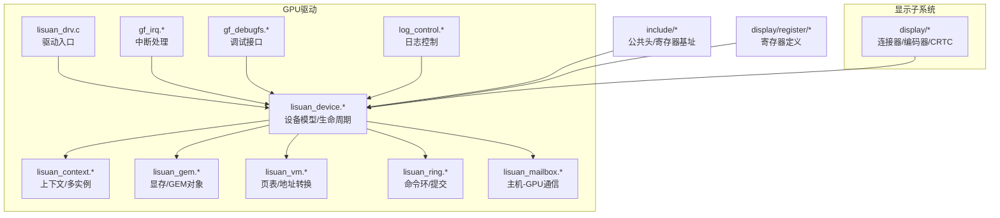
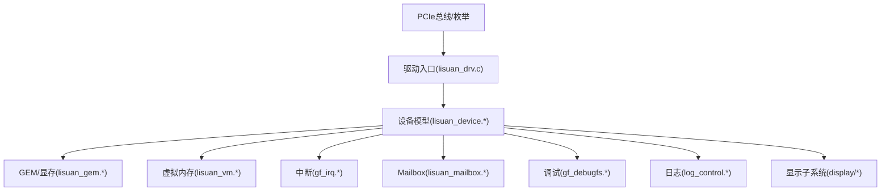
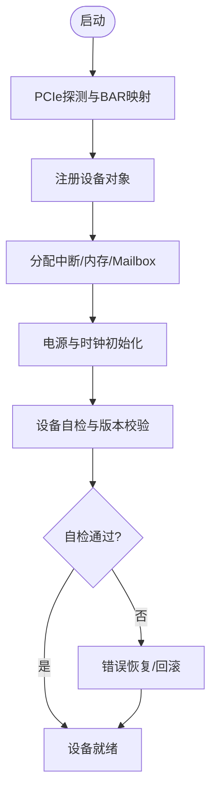
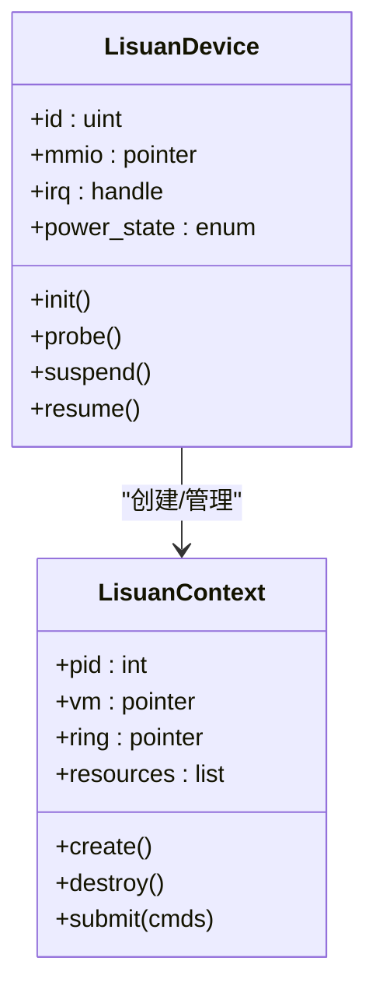
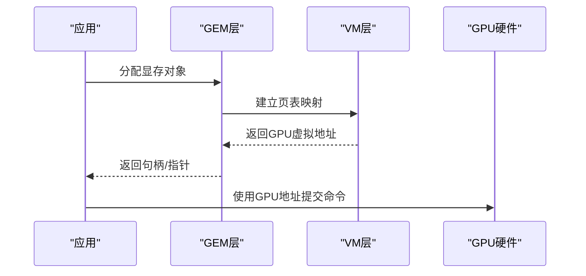
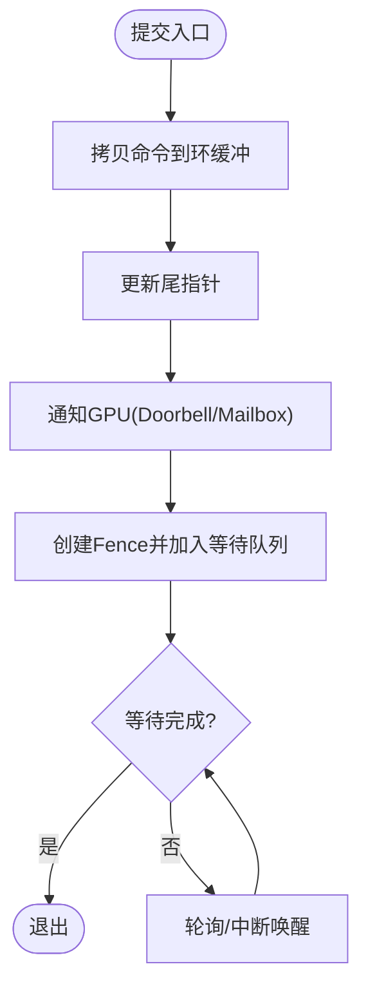
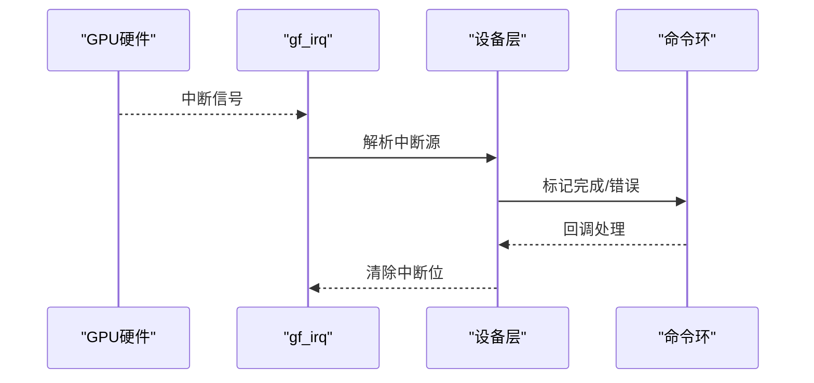
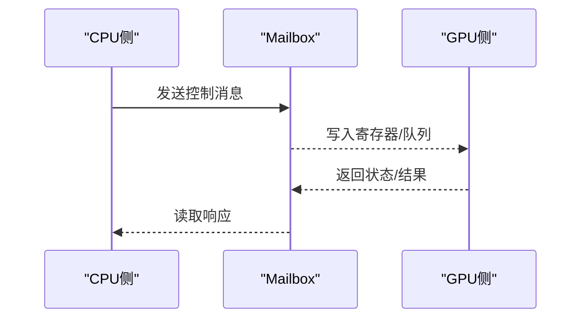
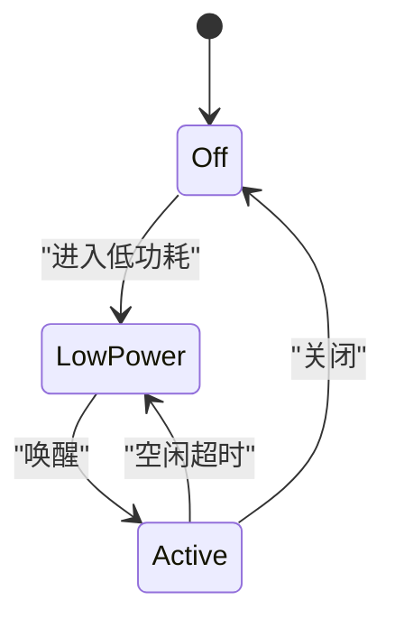
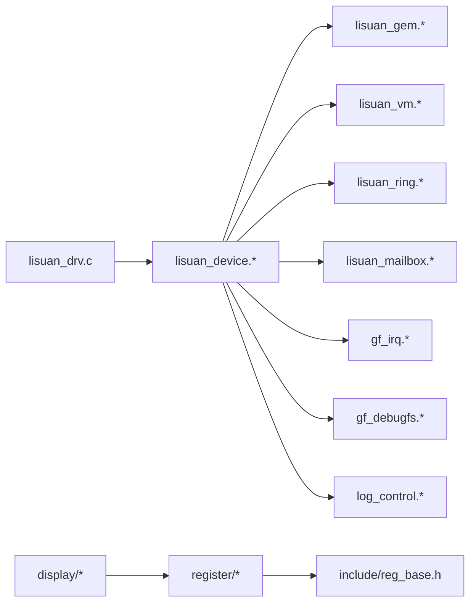

# GPU设备管理

<cite>
**本文引用的文件**   
- [lisuan_drv.c](file://_work/src/usr/src/lisuangpu-dkms-262.2.0.56/lisuan_drv.c)
- [lisuan_device.h](file://_work/src/usr/src/lisuangpu-dkms-262.2.0.56/lisuan_device.h)
- [lisuan_device.c](file://_work/src/usr/src/lisuangpu-dkms-262.2.0.56/lisuan_device.c)
- [gf_irq.h](file://_work/src/usr/src/lisuangpu-dkms-262.2.0.56/gf_irq.h)
- [gf_irq.c](file://_work/src/usr/src/lisuangpu-dkms-262.2.0.56/gf_irq.c)
- [lisuan_ring.h](file://_work/src/usr/src/lisuangpu-dkms-262.2.0.56/lisuan_ring.h)
- [lisuan_ring.c](file://_work/src/usr/src/lisuangpu-dkms-262.2.0.56/lisuan_ring.c)
- [lisuan_vm.h](file://_work/src/usr/src/lisuangpu-dkms-262.2.0.56/lisuan_vm.h)
- [lisuan_vm.c](file://_work/src/usr/src/lisuangpu-dkms-262.2.0.56/lisuan_vm.c)
- [lisuan_gem.h](file://_work/src/usr/src/lisuangpu-dkms-262.2.0.56/lisuan_gem.h)
- [lisuan_gem.c](file://_work/src/usr/src/lisuangpu-dkms-262.2.0.56/lisuan_gem.c)
- [lisuan_mailbox.h](file://_work/src/usr/src/lisuangpu-dkms-262.2.0.56/lisuan_mailbox.h)
- [lisuan_mailbox.c](file://_work/src/usr/src/lisuangpu-dkms-262.2.0.56/lisuan_mailbox.c)
- [lisuan_context.h](file://_work/src/usr/src/lisuangpu-dkms-262.2.0.56/lisuan_context.h)
- [lisuan_context.c](file://_work/src/usr/src/lisuangpu-dkms-262.2.0.56/lisuan_context.c)
- [lisuan_fb.h](file://_work/src/usr/src/lisuangpu-dkms-262.2.0.56/lisuan_fb.h)
- [lisuan_fb.c](file://_work/src/usr/src/lisuangpu-dkms-262.2.0.56/lisuan_fb.c)
- [gf_debugfs.h](file://_work/src/usr/src/lisuangpu-dkms-262.2.0.56/gf_debugfs.h)
- [gf_debugfs.c](file://_work/src/usr/src/lisuangpu-dkms-262.2.0.56/gf_debugfs.c)
- [log_control.h](file://_work/src/usr/src/lisuangpu-dkms-262.2.0.56/log_control.h)
- [log_control.c](file://_work/src/usr/src/lisuangpu-dkms-262.2.0.56/log_control.c)
- [driver_settings.h](file://_work/src/usr/src/lisuangpu-dkms-262.2.0.56/include/driver_settings.h)
- [reg_base.h](file://_work/src/usr/src/lisuangpu-dkms-262.2.0.56/include/reg_base.h)
- [PWRCTL_register.h](file://_work/src/usr/src/lisuangpu-dkms-262.2.0.56/display/register/PWRCTL_register.h)
- [INTR_register.h](file://_work/src/usr/src/lisuangpu-dkms-262.2.0.56/display/register/INTR_register.h)
</cite>

## 目录
1. [简介](#简介)
2. [项目结构](#项目结构)
3. [核心组件](#核心组件)
4. [架构总览](#架构总览)
5. [详细组件分析](#详细组件分析)
6. [依赖关系分析](#依赖关系分析)
7. [性能考虑](#性能考虑)
8. [故障排除指南](#故障排除指南)
9. [结论](#结论)
10. [附录](#附录)

## 简介
本技术文档面向丽山GPU设备管理模块，系统性阐述GPU设备的初始化流程、设备探测机制、PCIe接口处理与电源管理实现；深入说明设备注册、资源分配、中断处理与错误恢复机制；并覆盖设备状态管理、热插拔支持（如适用）与多实例管理的实现细节。同时提供设备配置参数、调试接口与故障排除指南，并通过代码片段路径展示如何正确初始化与配置GPU设备。

## 项目结构
该仓库包含显示子系统与GPU内核驱动两部分。GPU设备管理相关代码主要位于：
- lisuan_*：GPU设备模型、上下文、内存管理、环形缓冲、调度、VM等
- gf_*：通用框架（IRQ、调试、事件、传输等）
- display/*：显示管线（连接器、编码器、CRTC、PLL、中断等），与GPU协同工作
- include/*：公共头文件与寄存器基地址定义
- display/register/*：硬件寄存器定义（含电源、中断等）

图表来源
- [lisuan_drv.c](file://_work/src/usr/src/lisuangpu-dkms-262.2.0.56/lisuan_drv.c)
- [lisuan_device.h](file://_work/src/usr/src/lisuangpu-dkms-262.2.0.56/lisuan_device.h)
- [lisuan_device.c](file://_work/src/usr/src/lisuangpu-dkms-262.2.0.56/lisuan_device.c)
- [gf_irq.h](file://_work/src/usr/src/lisuangpu-dkms-262.2.0.56/gf_irq.h)
- [gf_debugfs.h](file://_work/src/usr/src/lisuangpu-dkms-262.2.0.56/gf_debugfs.h)
- [driver_settings.h](file://_work/src/usr/src/lisuangpu-dkms-262.2.0.56/include/driver_settings.h)
- [reg_base.h](file://_work/src/usr/src/lisuangpu-dkms-262.2.0.56/include/reg_base.h)
- [PWRCTL_register.h](file://_work/src/usr/src/lisuangpu-dkms-262.2.0.56/display/register/PWRCTL_register.h)
- [INTR_register.h](file://_work/src/usr/src/lisuangpu-dkms-262.2.0.56/display/register/INTR_register.h)

章节来源
- [lisuan_drv.c](file://_work/src/usr/src/lisuangpu-dkms-262.2.0.56/lisuan_drv.c)
- [lisuan_device.h](file://_work/src/usr/src/lisuangpu-dkms-262.2.0.56/lisuan_device.h)
- [lisuan_device.c](file://_work/src/usr/src/lisuangpu-dkms-262.2.0.56/lisuan_device.c)
- [gf_irq.h](file://_work/src/usr/src/lisuangpu-dkms-262.2.0.56/gf_irq.h)
- [gf_debugfs.h](file://_work/src/usr/src/lisuangpu-dkms-262.2.0.56/gf_debugfs.h)
- [driver_settings.h](file://_work/src/usr/src/lisuangpu-dkms-262.2.0.56/include/driver_settings.h)
- [reg_base.h](file://_work/src/usr/src/lisuangpu-dkms-262.2.0.56/include/reg_base.h)
- [PWRCTL_register.h](file://_work/src/usr/src/lisuangpu-dkms-262.2.0.56/display/register/PWRCTL_register.h)
- [INTR_register.h](file://_work/src/usr/src/lisuangpu-dkms-262.2.0.56/display/register/INTR_register.h)

## 核心组件
- 驱动入口与PCIe探测：负责PCI枚举、BAR映射、中断申请、设备注册到内核子系统。
- 设备模型与生命周期：封装设备句柄、资源管理、上电/下电序列、错误恢复。
- 上下文与多实例：每个进程或渲染队列拥有独立上下文，隔离状态与资源。
- 内存与GEM：显存分配、页面管理、DMA映射、缓存一致性。
- 虚拟内存（VM）：页表构建、地址转换、IOMMU集成。
- 命令环与提交：命令缓冲区写入、提交、同步与回收。
- 中断处理：统一的中断分发、任务顶半部/底半部、错误上报。
- 主机-GPU通信：Mailbox用于控制与状态交换。
- 调试与日志：debugfs接口、动态日志级别控制。

章节来源
- [lisuan_drv.c](file://_work/src/usr/src/lisuangpu-dkms-262.2.0.56/lisuan_drv.c)
- [lisuan_device.h](file://_work/src/usr/src/lisuangpu-dkms-262.2.0.56/lisuan_device.h)
- [lisuan_device.c](file://_work/src/usr/src/lisuangpu-dkms-262.2.0.56/lisuan_device.c)
- [lisuan_context.h](file://_work/src/usr/src/lisuangpu-dkms-262.2.0.56/lisuan_context.h)
- [lisuan_gem.h](file://_work/src/usr/src/lisuangpu-dkms-262.2.0.56/lisuan_gem.h)
- [lisuan_vm.h](file://_work/src/usr/src/lisuangpu-dkms-262.2.0.56/lisuan_vm.h)
- [lisuan_ring.h](file://_work/src/usr/src/lisuangpu-dkms-262.2.0.56/lisuan_ring.h)
- [gf_irq.h](file://_work/src/usr/src/lisuangpu-dkms-262.2.0.56/gf_irq.h)
- [lisuan_mailbox.h](file://_work/src/usr/src/lisuangpu-dkms-262.2.0.56/lisuan_mailbox.h)
- [gf_debugfs.h](file://_work/src/usr/src/lisuangpu-dkms-262.2.0.56/gf_debugfs.h)
- [log_control.h](file://_work/src/usr/src/lisuangpu-dkms-262.2.0.56/log_control.h)

## 架构总览
下图展示了GPU驱动的顶层架构与关键交互：PCIe探测后创建设备对象，初始化内存、VM、中断、Mailbox与显示子系统，随后暴露用户态接口。

图表来源
- [lisuan_drv.c](file://_work/src/usr/src/lisuangpu-dkms-262.2.0.56/lisuan_drv.c)
- [lisuan_device.h](file://_work/src/usr/src/lisuangpu-dkms-262.2.0.56/lisuan_device.h)
- [lisuan_device.c](file://_work/src/usr/src/lisuangpu-dkms-262.2.0.56/lisuan_device.c)
- [gf_irq.h](file://_work/src/usr/src/lisuangpu-dkms-262.2.0.56/gf_irq.h)
- [lisuan_gem.h](file://_work/src/usr/src/lisuangpu-dkms-262.2.0.56/lisuan_gem.h)
- [lisuan_vm.h](file://_work/src/usr/src/lisuangpu-dkms-262.2.0.56/lisuan_vm.h)
- [lisuan_mailbox.h](file://_work/src/usr/src/lisuangpu-dkms-262.2.0.56/lisuan_mailbox.h)
- [gf_debugfs.h](file://_work/src/usr/src/lisuangpu-dkms-262.2.0.56/gf_debugfs.h)
- [log_control.h](file://_work/src/usr/src/lisuangpu-dkms-262.2.0.56/log_control.h)

## 详细组件分析

### 设备初始化与PCIe探测
- PCIe探测与BAR映射：在驱动入口中完成设备识别、BAR空间映射、MMIO访问能力检查。
- 设备注册：将设备注册到内核子系统，建立设备句柄与全局链表。
- 资源分配：为中断、内存、寄存器窗口、Mailbox通道分配资源。
- 上电序列：依据电源寄存器定义执行时钟使能、复位释放、电源门控开启。
- 自检与版本校验：读取设备ID/版本寄存器，确保固件与驱动兼容。

图表来源
- [lisuan_drv.c](file://_work/src/usr/src/lisuangpu-dkms-262.2.0.56/lisuan_drv.c)
- [lisuan_device.h](file://_work/src/usr/src/lisuangpu-dkms-262.2.0.56/lisuan_device.h)
- [lisuan_device.c](file://_work/src/usr/src/lisuangpu-dkms-262.2.0.56/lisuan_device.c)
- [reg_base.h](file://_work/src/usr/src/lisuangpu-dkms-262.2.0.56/include/reg_base.h)
- [PWRCTL_register.h](file://_work/src/usr/src/lisuangpu-dkms-262.2.0.56/display/register/PWRCTL_register.h)

章节来源
- [lisuan_drv.c](file://_work/src/usr/src/lisuangpu-dkms-262.2.0.56/lisuan_drv.c)
- [lisuan_device.h](file://_work/src/usr/src/lisuangpu-dkms-262.2.0.56/lisuan_device.h)
- [lisuan_device.c](file://_work/src/usr/src/lisuangpu-dkms-262.2.0.56/lisuan_device.c)
- [reg_base.h](file://_work/src/usr/src/lisuangpu-dkms-262.2.0.56/include/reg_base.h)
- [PWRCTL_register.h](file://_work/src/usr/src/lisuangpu-dkms-262.2.0.56/display/register/PWRCTL_register.h)

### 设备探测机制与多实例管理
- 设备探测：遍历PCI设备，匹配厂商/设备ID，调用探测回调。
- 多实例：同一物理设备可被多个上下文共享，但每个进程拥有独立上下文；若存在多GPU，按设备索引区分。
- 实例生命周期：创建上下文时分配私有资源，销毁时释放并清理引用计数。

图表来源
- [lisuan_device.h](file://_work/src/usr/src/lisuangpu-dkms-262.2.0.56/lisuan_device.h)
- [lisuan_context.h](file://_work/src/usr/src/lisuangpu-dkms-262.2.0.56/lisuan_context.h)

章节来源
- [lisuan_device.h](file://_work/src/usr/src/lisuangpu-dkms-262.2.0.56/lisuan_device.h)
- [lisuan_context.h](file://_work/src/usr/src/lisuangpu-dkms-262.2.0.56/lisuan_context.h)

### 资源分配与内存管理（GEM/VM）
- GEM对象：分配显存、设置缓存策略、建立CPU/GPU可见映射。
- VM页表：构建页表项、处理缺页、支持IOMMU。
- DMA映射：对共享缓冲区进行DMA绑定，保证一致性。

图表来源
- [lisuan_gem.h](file://_work/src/usr/src/lisuangpu-dkms-262.2.0.56/lisuan_gem.h)
- [lisuan_gem.c](file://_work/src/usr/src/lisuangpu-dkms-262.2.0.56/lisuan_gem.c)
- [lisuan_vm.h](file://_work/src/usr/src/lisuangpu-dkms-262.2.0.56/lisuan_vm.h)
- [lisuan_vm.c](file://_work/src/usr/src/lisuangpu-dkms-262.2.0.56/lisuan_vm.c)

章节来源
- [lisuan_gem.h](file://_work/src/usr/src/lisuangpu-dkms-262.2.0.56/lisuan_gem.h)
- [lisuan_gem.c](file://_work/src/usr/src/lisuangpu-dkms-262.2.0.56/lisuan_gem.c)
- [lisuan_vm.h](file://_work/src/usr/src/lisuangpu-dkms-262.2.0.56/lisuan_vm.h)
- [lisuan_vm.c](file://_work/src/usr/src/lisuangpu-dkms-262.2.0.56/lisuan_vm.c)

### 命令环与提交流程
- 环形缓冲：维护写指针、读指针、边界检查、溢出保护。
- 提交：将命令拷贝至环缓冲，更新尾指针，触发GPU执行。
- 同步：使用 fence/sync对象等待执行完成。

图表来源
- [lisuan_ring.h](file://_work/src/usr/src/lisuangpu-dkms-262.2.0.56/lisuan_ring.h)
- [lisuan_ring.c](file://_work/src/usr/src/lisuangpu-dkms-262.2.0.56/lisuan_ring.c)

章节来源
- [lisuan_ring.h](file://_work/src/usr/src/lisuangpu-dkms-262.2.0.56/lisuan_ring.h)
- [lisuan_ring.c](file://_work/src/usr/src/lisuangpu-dkms-262.2.0.56/lisuan_ring.c)

### 中断处理与错误恢复
- 中断注册：申请IRQ、设置ISR、绑定顶半部/底半部。
- 中断分发：根据中断源路由到对应处理器（渲染、显示、错误）。
- 错误恢复：检测超时、死锁、校验错误，尝试重置或降级运行。

图表来源
- [gf_irq.h](file://_work/src/usr/src/lisuangpu-dkms-262.2.0.56/gf_irq.h)
- [gf_irq.c](file://_work/src/usr/src/lisuangpu-dkms-262.2.0.56/gf_irq.c)
- [lisuan_ring.h](file://_work/src/usr/src/lisuangpu-dkms-262.2.0.56/lisuan_ring.h)
- [INTR_register.h](file://_work/src/usr/src/lisuangpu-dkms-262.2.0.56/display/register/INTR_register.h)

章节来源
- [gf_irq.h](file://_work/src/usr/src/lisuangpu-dkms-262.2.0.56/gf_irq.h)
- [gf_irq.c](file://_work/src/usr/src/lisuangpu-dkms-262.2.0.56/gf_irq.c)
- [lisuan_ring.h](file://_work/src/usr/src/lisuangpu-dkms-262.2.0.56/lisuan_ring.h)
- [INTR_register.h](file://_work/src/usr/src/lisuangpu-dkms-262.2.0.56/display/register/INTR_register.h)

### 主机-GPU通信（Mailbox）
- Mailbox通道：用于控制命令、状态查询、事件通知。
- 协议：请求-响应模式，带超时与重试。
- 安全：校验消息长度、权限与合法性。

图表来源
- [lisuan_mailbox.h](file://_work/src/usr/src/lisuangpu-dkms-262.2.0.56/lisuan_mailbox.h)
- [lisuan_mailbox.c](file://_work/src/usr/src/lisuangpu-dkms-262.2.0.56/lisuan_mailbox.c)

章节来源
- [lisuan_mailbox.h](file://_work/src/usr/src/lisuangpu-dkms-262.2.0.56/lisuan_mailbox.h)
- [lisuan_mailbox.c](file://_work/src/usr/src/lisuangpu-dkms-262.2.0.56/lisuan_mailbox.c)

### 电源管理与显示子系统协作
- 电源状态：D0/D3等状态切换，时钟门控、复位控制。
- 显示协作：与连接器/编码器/CRTC协调，避免冲突。
- 节能策略：空闲检测、延迟上电、按需唤醒。

图表来源
- [PWRCTL_register.h](file://_work/src/usr/src/lisuangpu-dkms-262.2.0.56/display/register/PWRCTL_register.h)
- [lisuan_device.h](file://_work/src/usr/src/lisuangpu-dkms-262.2.0.56/lisuan_device.h)

章节来源
- [PWRCTL_register.h](file://_work/src/usr/src/lisuangpu-dkms-262.2.0.56/display/register/PWRCTL_register.h)
- [lisuan_device.h](file://_work/src/usr/src/lisuangpu-dkms-262.2.0.56/lisuan_device.h)

### 设备状态管理与热插拔支持
- 状态机：初始化、就绪、挂起、恢复、错误等状态。
- 热插拔：若支持PCIe热插拔，需实现add/remove回调、资源重配。
- 一致性：状态变更需原子操作与锁保护。

章节来源
- [lisuan_device.h](file://_work/src/usr/src/lisuangpu-dkms-262.2.0.56/lisuan_device.h)
- [lisuan_device.c](file://_work/src/usr/src/lisuangpu-dkms-262.2.0.56/lisuan_device.c)

### 调试接口与日志控制
- debugfs：暴露设备信息、寄存器快照、性能计数器。
- 日志：动态调整日志级别，过滤关键路径输出。
- 诊断：崩溃转储、堆栈跟踪、错误码映射。

章节来源
- [gf_debugfs.h](file://_work/src/usr/src/lisuangpu-dkms-262.2.0.56/gf_debugfs.h)
- [gf_debugfs.c](file://_work/src/usr/src/lisuangpu-dkms-262.2.0.56/gf_debugfs.c)
- [log_control.h](file://_work/src/usr/src/lisuangpu-dkms-262.2.0.56/log_control.h)
- [log_control.c](file://_work/src/usr/src/lisuangpu-dkms-262.2.0.56/log_control.c)

## 依赖关系分析
- 驱动入口依赖设备模型、中断、调试、日志。
- 设备模型依赖内存、VM、Ring、Mailbox。
- 显示子系统依赖寄存器定义与公共头。

图表来源
- [lisuan_drv.c](file://_work/src/usr/src/lisuangpu-dkms-262.2.0.56/lisuan_drv.c)
- [lisuan_device.h](file://_work/src/usr/src/lisuangpu-dkms-262.2.0.56/lisuan_device.h)
- [lisuan_gem.h](file://_work/src/usr/src/lisuangpu-dkms-262.2.0.56/lisuan_gem.h)
- [lisuan_vm.h](file://_work/src/usr/src/lisuangpu-dkms-262.2.0.56/lisuan_vm.h)
- [lisuan_ring.h](file://_work/src/usr/src/lisuangpu-dkms-262.2.0.56/lisuan_ring.h)
- [lisuan_mailbox.h](file://_work/src/usr/src/lisuangpu-dkms-262.2.0.56/lisuan_mailbox.h)
- [gf_irq.h](file://_work/src/usr/src/lisuangpu-dkms-262.2.0.56/gf_irq.h)
- [gf_debugfs.h](file://_work/src/usr/src/lisuangpu-dkms-262.2.0.56/gf_debugfs.h)
- [log_control.h](file://_work/src/usr/src/lisuangpu-dkms-262.2.0.56/log_control.h)
- [reg_base.h](file://_work/src/usr/src/lisuangpu-dkms-262.2.0.56/include/reg_base.h)

章节来源
- [lisuan_drv.c](file://_work/src/usr/src/lisuangpu-dkms-262.2.0.56/lisuan_drv.c)
- [lisuan_device.h](file://_work/src/usr/src/lisuangpu-dkms-262.2.0.56/lisuan_device.h)
- [lisuan_gem.h](file://_work/src/usr/src/lisuangpu-dkms-262.2.0.56/lisuan_gem.h)
- [lisuan_vm.h](file://_work/src/usr/src/lisuangpu-dkms-262.2.0.56/lisuan_vm.h)
- [lisuan_ring.h](file://_work/src/usr/src/lisuangpu-dkms-262.2.0.56/lisuan_ring.h)
- [lisuan_mailbox.h](file://_work/src/usr/src/lisuangpu-dkms-262.2.0.56/lisuan_mailbox.h)
- [gf_irq.h](file://_work/src/usr/src/lisuangpu-dkms-262.2.0.56/gf_irq.h)
- [gf_debugfs.h](file://_work/src/usr/src/lisuangpu-dkms-262.2.0.56/gf_debugfs.h)
- [log_control.h](file://_work/src/usr/src/lisuangpu-dkms-262.2.0.56/log_control.h)
- [reg_base.h](file://_work/src/usr/src/lisuangpu-dkms-262.2.0.56/include/reg_base.h)

## 性能考虑
- 减少上下文切换：批量提交命令，合并同步点。
- 零拷贝优化：GEM对象复用、DMA-BUF共享。
- 中断节流：合理设置中断频率，避免风暴。
- 电源管理：空闲时进入低功耗，按需唤醒。
- 缓存一致性：明确CPU/GPU缓存策略，避免不必要刷新。

[本节为通用指导，不直接分析具体文件]

## 故障排除指南
- 常见问题
  - 设备无法识别：检查PCIe枚举、BAR映射、驱动加载顺序。
  - 中断丢失：确认IRQ分配、屏蔽位、ISR注册。
  - 显存不足：检查GEM分配策略、页表容量、碎片整理。
  - 命令提交失败：验证环缓冲边界、权限、命令格式。
  - 电源异常：核对电源序列、复位时序、时钟使能。
- 调试步骤
  - 启用详细日志，定位错误码与堆栈。
  - 通过debugfs查看寄存器快照与性能计数器。
  - 使用Mailbox查询设备状态与错误寄存器。
  - 复现问题并收集dmesg与core dump。

章节来源
- [gf_debugfs.h](file://_work/src/usr/src/lisuangpu-dkms-262.2.0.56/gf_debugfs.h)
- [gf_debugfs.c](file://_work/src/usr/src/lisuangpu-dkms-262.2.0.56/gf_debugfs.c)
- [log_control.h](file://_work/src/usr/src/lisuangpu-dkms-262.2.0.56/log_control.h)
- [log_control.c](file://_work/src/usr/src/lisuangpu-dkms-262.2.0.56/log_control.c)
- [lisuan_mailbox.h](file://_work/src/usr/src/lisuangpu-dkms-262.2.0.56/lisuan_mailbox.h)
- [lisuan_mailbox.c](file://_work/src/usr/src/lisuangpu-dkms-262.2.0.56/lisuan_mailbox.c)

## 结论
丽山GPU设备管理模块以清晰的层次化设计实现了从PCIe探测到命令提交的完整链路。通过GEM/VM、Ring、IRQ、Mailbox等组件的协同，提供了稳定高效的GPU资源管理与显示协作能力。合理的电源管理与调试接口为系统可靠性与可维护性提供了保障。

[本节为总结，不直接分析具体文件]

## 附录

### 设备配置参数
- 驱动参数：通过driver_settings.h中的宏定义控制行为（如日志级别、超时阈值、最大实例数）。
- 运行时参数：通过debugfs节点动态调整（如中断频率、电源策略）。
- 环境变量：部分功能可通过环境变量开关（如测试模式、调试标志）。

章节来源
- [driver_settings.h](file://_work/src/usr/src/lisuangpu-dkms-262.2.0.56/include/driver_settings.h)
- [gf_debugfs.h](file://_work/src/usr/src/lisuangpu-dkms-262.2.0.56/gf_debugfs.h)

### 代码示例路径（初始化与配置）
- 初始化流程参考：
  - [lisuan_drv.c](file://_work/src/usr/src/lisuangpu-dkms-262.2.0.56/lisuan_drv.c)
  - [lisuan_device.c](file://_work/src/usr/src/lisuangpu-dkms-262.2.0.56/lisuan_device.c)
- 资源分配与VM设置参考：
  - [lisuan_gem.c](file://_work/src/usr/src/lisuangpu-dkms-262.2.0.56/lisuan_gem.c)
  - [lisuan_vm.c](file://_work/src/usr/src/lisuangpu-dkms-262.2.0.56/lisuan_vm.c)
- 中断与Mailbox配置参考：
  - [gf_irq.c](file://_work/src/usr/src/lisuangpu-dkms-262.2.0.56/gf_irq.c)
  - [lisuan_mailbox.c](file://_work/src/usr/src/lisuangpu-dkms-262.2.0.56/lisuan_mailbox.c)
- 调试与日志参考：
  - [gf_debugfs.c](file://_work/src/usr/src/lisuangpu-dkms-262.2.0.56/gf_debugfs.c)
  - [log_control.c](file://_work/src/usr/src/lisuangpu-dkms-262.2.0.56/log_control.c)