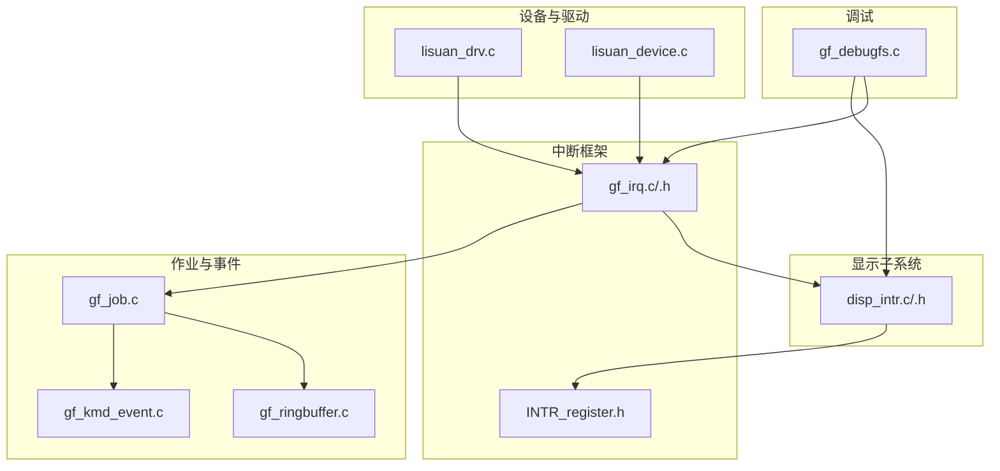
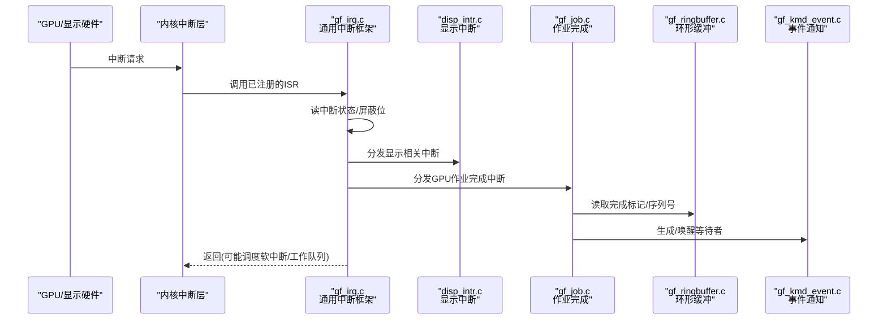
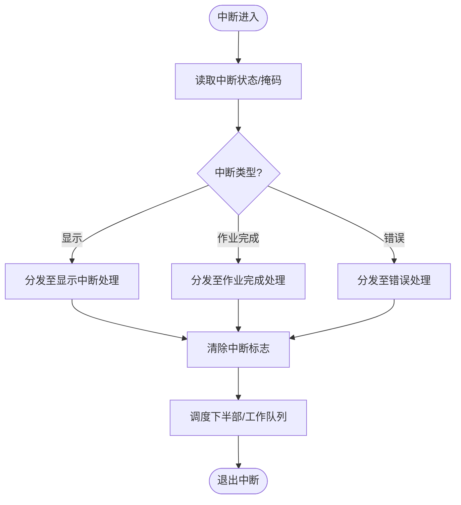
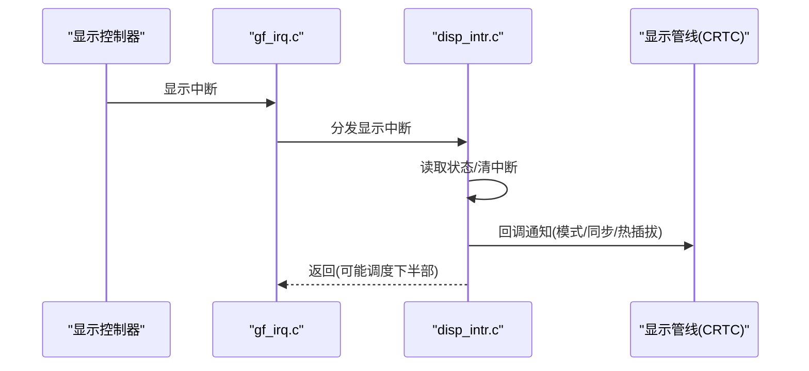
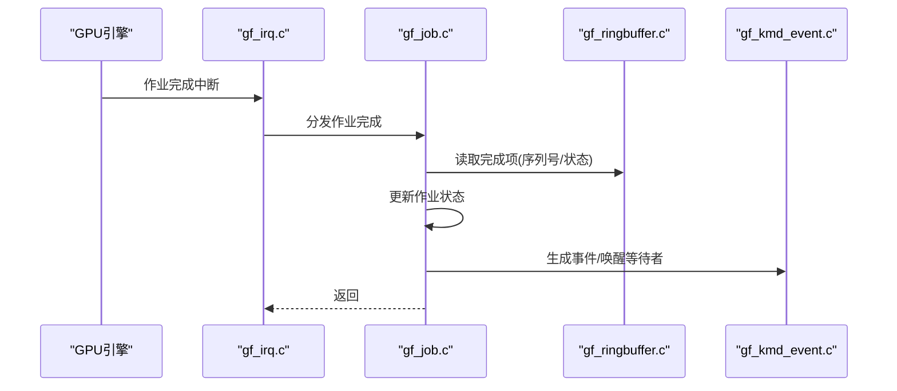
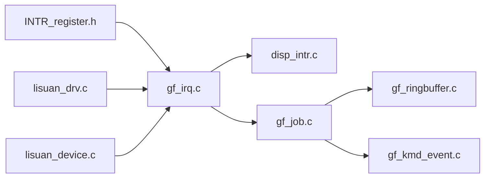

# 中断处理

<cite>
**本文引用的文件**   
- [gf_irq.c](file://_work/src/usr/src/lisuan-dkms-262.2.0.56/gf_irq.c)
- [gf_irq.h](file://_work/src/usr/src/lisuan-dkms-262.2.0.56/gf_irq.h)
- [disp_intr.c](file://_work/src/usr/src/lisuan-dkms-262.2.0.56/display/intr/disp_intr.c)
- [disp_intr.h](file://_work/src/usr/src/lisuan-dkms-262.2.0.56/display/intr/disp_intr.h)
- [INTR_register.h](file://_work/src/usr/src/lisuan-dkms-262.2.0.56/display/register/INTR_register.h)
- [lisuan_drv.c](file://_work/src/usr/src/lisuan-dkms-262.2.0.56/lisuan_drv.c)
- [lisuan_device.c](file://_work/src/usr/src/lisuan-dkms-262.2.0.56/lisuan_device.c)
- [gf_job.c](file://_work/src/usr/src/lisuan-dkms-262.2.0.56/gf_job.c)
- [gf_ringbuffer.c](file://_work/src/usr/src/lisuan-dkms-262.2.0.56/gf_ringbuffer.c)
- [gf_kmd_event.c](file://_work/src/usr/src/lisuan-dkms-262.2.0.56/gf_kmd_event.c)
- [gf_debugfs.c](file://_work/src/usr/src/lisuan-dkms-262.2.0.56/gf_debugfs.c)
</cite>

## 目录
1. [简介](#简介)
2. [项目结构](#项目结构)
3. [核心组件](#核心组件)
4. [架构总览](#架构总览)
5. [详细组件分析](#详细组件分析)
6. [依赖关系分析](#依赖关系分析)
7. [性能考虑](#性能考虑)
8. [故障排查指南](#故障排查指南)
9. [结论](#结论)
10. [附录](#附录)

## 简介
本文件面向丽山GPU驱动的中断子系统，系统性阐述中断注册、分发与处理的完整流程，覆盖显示相关中断、GPU作业完成中断与错误中断的处理路径。文档同时说明中断上下文的限制、延迟处理策略（软中断/工作队列）以及性能优化技术，并提供基于调试接口的诊断方法与常见问题定位思路。

## 项目结构
围绕中断处理的关键代码分布在以下模块：
- 通用中断框架与上下文管理：gf_irq.c/.h
- 显示子系统中断：display/intr/disp_intr.c/.h
- 寄存器定义：display/register/INTR_register.h
- 设备初始化与中断入口绑定：lisuan_drv.c、lisuan_device.c
- GPU作业调度与完成事件：gf_job.c、gf_ringbuffer.c、gf_kmd_event.c
- 调试接口：gf_debugfs.c

图表来源
- [gf_irq.c](file://_work/src/usr/src/lisuan-dkms-262.2.0.56/gf_irq.c)
- [gf_irq.h](file://_work/src/usr/src/lisuan-dkms-262.2.0.56/gf_irq.h)
- [disp_intr.c](file://_work/src/usr/src/lisuan-dkms-262.2.0.56/display/intr/disp_intr.c)
- [disp_intr.h](file://_work/src/usr/src/lisuan-dkms-262.2.0.56/display/intr/disp_intr.h)
- [INTR_register.h](file://_work/src/usr/src/lisuan-dkms-262.2.0.56/display/register/INTR_register.h)
- [lisuan_drv.c](file://_work/src/usr/src/lisuan-dkms-262.2.0.56/lisuan_drv.c)
- [lisuan_device.c](file://_work/src/usr/src/lisuan-dkms-262.2.0.56/lisuan_device.c)
- [gf_job.c](file://_work/src/usr/src/lisuan-dkms-262.2.0.56/gf_job.c)
- [gf_ringbuffer.c](file://_work/src/usr/src/lisuan-dkms-262.2.0.56/gf_ringbuffer.c)
- [gf_kmd_event.c](file://_work/src/usr/src/lisuan-dkms-262.2.0.56/gf_kmd_event.c)
- [gf_debugfs.c](file://_work/src/usr/src/lisuan-dkms-262.2.0.56/gf_debugfs.c)

章节来源
- [gf_irq.c](file://_work/src/usr/src/lisuan-dkms-262.2.0.56/gf_irq.c)
- [gf_irq.h](file://_work/src/usr/src/lisuan-dkms-262.2.0.56/gf_irq.h)
- [disp_intr.c](file://_work/src/usr/src/lisuan-dkms-262.2.0.56/display/intr/disp_intr.c)
- [disp_intr.h](file://_work/src/usr/src/lisuan-dkms-262.2.0.56/display/intr/disp_intr.h)
- [INTR_register.h](file://_work/src/usr/src/lisuan-dkms-262.2.0.56/display/register/INTR_register.h)
- [lisuan_drv.c](file://_work/src/usr/src/lisuan-dkms-262.2.0.56/lisuan_drv.c)
- [lisuan_device.c](file://_work/src/usr/src/lisuan-dkms-262.2.0.56/lisuan_device.c)
- [gf_job.c](file://_work/src/usr/src/lisuan-dkms-262.2.0.56/gf_job.c)
- [gf_ringbuffer.c](file://_work/src/usr/src/lisuan-dkms-262.2.0.56/gf_ringbuffer.c)
- [gf_kmd_event.c](file://_work/src/usr/src/lisuan-dkms-262.2.0.56/gf_kmd_event.c)
- [gf_debugfs.c](file://_work/src/usr/src/lisuan-dkms-262.2.0.56/gf_debugfs.c)

## 核心组件
- 通用中断框架（gf_irq.c/.h）
  - 负责中断向量注册、屏蔽/使能、共享中断分发、上下文保存/恢复、软中断与工作队列的调度。
  - 提供统一的“中断句柄”抽象，便于上层按功能域（显示、GPU、错误）挂载处理器。
- 显示中断（disp_intr.c/.h）
  - 解析显示相关中断源（如VBLANK、HPD、流水线状态等），将关键动作下沉到下半部（如模式切换、同步信号上报）。
- 寄存器定义（INTR_register.h）
  - 集中定义中断掩码、状态位、优先级与路由字段，供上层统一读写。
- 设备与驱动入口（lisuan_drv.c、lisuan_device.c）
  - 在设备初始化阶段完成中断资源申请、映射与注册；在退出时释放资源并注销中断。
- 作业与事件（gf_job.c、gf_ringbuffer.c、gf_kmd_event.c）
  - 作业完成中断触发后，读取环形缓冲中的完成标记，更新作业状态并向用户态或内核等待者通知。
- 调试接口（gf_debugfs.c）
  - 暴露中断统计、最近一次中断时间戳、未决中断位图等，辅助定位问题。

章节来源
- [gf_irq.c](file://_work/src/usr/src/lisuan-dkms-262.2.0.56/gf_irq.c)
- [gf_irq.h](file://_work/src/usr/src/lisuan-dkms-262.2.0.56/gf_irq.h)
- [disp_intr.c](file://_work/src/usr/src/lisuan-dkms-262.2.0.56/display/intr/disp_intr.c)
- [disp_intr.h](file://_work/src/usr/src/lisuan-dkms-262.2.0.56/display/intr/disp_intr.h)
- [INTR_register.h](file://_work/src/usr/src/lisuan-dkms-262.2.0.56/display/register/INTR_register.h)
- [lisuan_drv.c](file://_work/src/usr/src/lisuan-dkms-262.2.0.56/lisuan_drv.c)
- [lisuan_device.c](file://_work/src/usr/src/lisuan-dkms-262.2.0.56/lisuan_device.c)
- [gf_job.c](file://_work/src/usr/src/lisuan-dkms-262.2.0.56/gf_job.c)
- [gf_ringbuffer.c](file://_work/src/usr/src/lisuan-dkms-262.2.0.56/gf_ringbuffer.c)
- [gf_kmd_event.c](file://_work/src/usr/src/lisuan-dkms-262.2.0.56/gf_kmd_event.c)
- [gf_debugfs.c](file://_work/src/usr/src/lisuan-dkms-262.2.0.56/gf_debugfs.c)

## 架构总览
中断从硬件产生到应用可见的整体流程如下：

图表来源
- [gf_irq.c](file://_work/src/usr/src/lisuan-dkms-262.2.0.56/gf_irq.c)
- [disp_intr.c](file://_work/src/usr/src/lisuan-dkms-262.2.0.56/display/intr/disp_intr.c)
- [gf_job.c](file://_work/src/usr/src/lisuan-dkms-262.2.0.56/gf_job.c)
- [gf_ringbuffer.c](file://_work/src/usr/src/lisuan-dkms-262.2.0.56/gf_ringbuffer.c)
- [gf_kmd_event.c](file://_work/src/usr/src/lisuan-dkms-262.2.0.56/gf_kmd_event.c)

## 详细组件分析

### 通用中断框架（gf_irq.c/.h）
- 职责
  - 注册/注销中断向量，维护中断描述符与回调表。
  - 在中断顶半部快速识别中断源、清除待处理标志，并将耗时逻辑移交下半部。
  - 支持共享中断的分发，避免多设备竞争。
- 关键设计点
  - 中断上下文限制：禁止阻塞、禁止长时间持有自旋锁、禁止睡眠。
  - 下半部策略：优先使用软中断/任务队列，减少CPU抢占开销。
  - 批量处理：对高频中断进行合并计数，降低系统调用频率。
- 典型流程
  - ISR进入→读状态寄存器→分类→清中断→调度下半部→返回。

图表来源
- [gf_irq.c](file://_work/src/usr/src/lisuan-dkms-262.2.0.56/gf_irq.c)
- [gf_irq.h](file://_work/src/usr/src/lisuan-dkms-262.2.0.56/gf_irq.h)

章节来源
- [gf_irq.c](file://_work/src/usr/src/lisuan-dkms-262.2.0.56/gf_irq.c)
- [gf_irq.h](file://_work/src/usr/src/lisuan-dkms-262.2.0.56/gf_irq.h)

### 显示中断（disp_intr.c/.h）
- 职责
  - 解析显示控制器产生的中断（如垂直空白、热插拔、流水线就绪等）。
  - 将显示相关的重配置、同步信号上报、电源/时钟门控联动等动作放入下半部执行。
- 关键设计点
  - 快速路径：仅做状态读取与标志清理，避免在顶半部进行复杂计算。
  - 去抖与防抖：对热插拔等外部事件增加延时确认，避免抖动导致重复处理。
  - 与CRTC/编码器协作：通过回调机制通知上层显示管线。

图表来源
- [disp_intr.c](file://_work/src/usr/src/lisuan-dkms-262.2.0.56/display/intr/disp_intr.c)
- [disp_intr.h](file://_work/src/usr/src/lisuan-dkms-262.2.0.56/display/intr/disp_intr.h)

章节来源
- [disp_intr.c](file://_work/src/usr/src/lisuan-dkms-262.2.0.56/display/intr/disp_intr.c)
- [disp_intr.h](file://_work/src/usr/src/lisuan-dkms-262.2.0.56/display/intr/disp_intr.h)

### GPU作业完成中断（gf_job.c + gf_ringbuffer.c）
- 职责
  - 当GPU完成一个或多个作业后，触发完成中断。
  - 读取环形缓冲中的完成记录（序列号/状态），更新作业对象状态，唤醒等待者。
- 关键设计点
  - 批处理：在一次中断中尽可能消费多个完成项，减少中断次数。
  - 无锁/低锁：利用内存屏障与原子操作保证一致性，避免长持锁。
  - 事件通知：通过事件队列或等待队列向用户态或内核消费者通知。

图表来源
- [gf_job.c](file://_work/src/usr/src/lisuan-dkms-262.2.0.56/gf_job.c)
- [gf_ringbuffer.c](file://_work/src/usr/src/lisuan-dkms-262.2.0.56/gf_ringbuffer.c)
- [gf_kmd_event.c](file://_work/src/usr/src/lisuan-dkms-262.2.0.56/gf_kmd_event.c)

章节来源
- [gf_job.c](file://_work/src/usr/src/lisuan-dkms-262.2.0.56/gf_job.c)
- [gf_ringbuffer.c](file://_work/src/usr/src/lisuan-dkms-262.2.0.56/gf_ringbuffer.c)
- [gf_kmd_event.c](file://_work/src/usr/src/lisuan-dkms-262.2.0.56/gf_kmd_event.c)

### 错误中断处理
- 职责
  - 捕获GPU异常、总线错误、校验失败等错误中断。
  - 收集错误上下文（寄存器快照、堆栈信息），上报日志并尝试恢复（复位、重置队列、清理资源）。
- 关键设计点
  - 快速隔离：尽快屏蔽错误源，防止级联中断风暴。
  - 可观测性：记录错误码、时间戳、当前作业ID，便于事后分析。
  - 恢复策略：根据错误类型选择最小化恢复路径（如重置单个引擎而非全芯片复位）。

章节来源
- [gf_irq.c](file://_work/src/usr/src/lisuan-dkms-262.2.0.56/gf_irq.c)
- [gf_job.c](file://_work/src/usr/src/lisuan-dkms-262.2.0.56/gf_job.c)
- [gf_debugfs.c](file://_work/src/usr/src/lisuan-dkms-262.2.0.56/gf_debugfs.c)

### 设备初始化与中断绑定（lisuan_drv.c、lisuan_device.c）
- 职责
  - 在驱动加载阶段申请中断、映射MMIO、注册ISR与分发器。
  - 在卸载阶段释放资源，确保中断不再触发。
- 关键设计点
  - 幂等初始化：支持多次探测与热插拔场景下的安全重建。
  - 资源顺序：先分配再注册，失败回滚要彻底。

章节来源
- [lisuan_drv.c](file://_work/src/usr/src/lisuan-dkms-262.2.0.56/lisuan_drv.c)
- [lisuan_device.c](file://_work/src/usr/src/lisuan-dkms-262.2.0.56/lisuan_device.c)

## 依赖关系分析
- 组件耦合
  - gf_irq.c 作为中枢，依赖寄存器定义（INTR_register.h）与具体领域处理器（disp_intr.c、gf_job.c）。
  - 显示中断与显示管线解耦，通过回调接口通信，降低耦合度。
  - 作业完成中断与环形缓冲强关联，需保证内存一致性与访问顺序。
- 外部依赖
  - 内核中断子系统、工作队列/软中断、等待队列与事件通知机制。
- 潜在循环依赖
  - 通过回调与事件机制避免直接相互引用，保持单向依赖。

图表来源
- [INTR_register.h](file://_work/src/usr/src/lisuan-dkms-262.2.0.56/display/register/INTR_register.h)
- [gf_irq.c](file://_work/src/usr/src/lisuan-dkms-262.2.0.56/gf_irq.c)
- [disp_intr.c](file://_work/src/usr/src/lisuan-dkms-262.2.0.56/display/intr/disp_intr.c)
- [gf_job.c](file://_work/src/usr/src/lisuan-dkms-262.2.0.56/gf_job.c)
- [gf_ringbuffer.c](file://_work/src/usr/src/lisuan-dkms-262.2.0.56/gf_ringbuffer.c)
- [gf_kmd_event.c](file://_work/src/usr/src/lisuan-dkms-262.2.0.56/gf_kmd_event.c)
- [lisuan_drv.c](file://_work/src/usr/src/lisuan-dkms-262.2.0.56/lisuan_drv.c)
- [lisuan_device.c](file://_work/src/usr/src/lisuan-dkms-262.2.0.56/lisuan_device.c)

章节来源
- [gf_irq.c](file://_work/src/usr/src/lisuan-dkms-262.2.0.56/gf_irq.c)
- [disp_intr.c](file://_work/src/usr/src/lisuan-dkms-262.2.0.56/display/intr/disp_intr.c)
- [gf_job.c](file://_work/src/usr/src/lisuan-dkms-262.2.0.56/gf_job.c)
- [gf_ringbuffer.c](file://_work/src/usr/src/lisuan-dkms-262.2.0.56/gf_ringbuffer.c)
- [gf_kmd_event.c](file://_work/src/usr/src/lisuan-dkms-262.2.0.56/gf_kmd_event.c)
- [lisuan_drv.c](file://_work/src/usr/src/lisuan-dkms-262.2.0.56/lisuan_drv.c)
- [lisuan_device.c](file://_work/src/usr/src/lisuan-dkms-262.2.0.56/lisuan_device.c)
- [INTR_register.h](file://_work/src/usr/src/lisuan-dkms-262.2.0.56/display/register/INTR_register.h)

## 性能考虑
- 中断上下文限制
  - 禁止睡眠、避免大对象拷贝、避免动态分配；所有耗时操作移至下半部。
- 延迟处理策略
  - 使用软中断/任务队列批量处理，减少上下文切换与锁竞争。
  - 对高频短小中断采用合并计数与阈值触发，降低系统负载。
- 数据路径优化
  - 环形缓冲零拷贝读取，使用内存屏障保证可见性。
  - 事件通知采用轻量级唤醒，避免广播式唤醒造成惊群。
- 可观测性
  - 通过调试接口输出中断统计、延迟分布与错误计数，指导调优。

[本节为通用性能建议，不直接分析具体文件]

## 故障排查指南
- 常用调试接口
  - 查看中断统计与最近中断时间戳：通过调试文件系统接口获取。
  - 检查未决中断位图与屏蔽状态：核对寄存器位是否按预期设置。
  - 打印错误上下文：捕获错误时的寄存器快照与作业ID。
- 常见问题定位
  - 中断风暴：检查屏蔽位是否正确设置，是否存在未清中断标志。
  - 作业卡死：核对环形缓冲指针与完成标记，检查内存屏障与顺序。
  - 显示异常：验证热插拔去抖、模式切换回调链路与CRTC状态一致性。
- 建议步骤
  - 启用详细日志，复现问题并抓取中断统计。
  - 逐步缩小范围：先确认中断是否到达，再检查分发是否正确，最后定位具体处理器。
  - 结合硬件手册与寄存器定义，比对实际位值与期望值。

章节来源
- [gf_debugfs.c](file://_work/src/usr/src/lisuan-dkms-262.2.0.56/gf_debugfs.c)
- [gf_irq.c](file://_work/src/usr/src/lisuan-dkms-262.2.0.56/gf_irq.c)
- [gf_job.c](file://_work/src/usr/src/lisuan-dkms-262.2.0.56/gf_job.c)
- [disp_intr.c](file://_work/src/usr/src/lisuan-dkms-262.2.0.56/display/intr/disp_intr.c)

## 结论
丽山GPU中断处理系统以gf_irq为核心，将显示、作业完成与错误三类中断解耦处理，遵循中断上下文限制并通过下半部实现延迟处理。借助环形缓冲与事件机制，系统在高频中断下仍能保持良好吞吐与低延迟。配合调试接口与系统化排查方法，可有效定位与解决常见中断相关问题。

[本节为总结性内容，不直接分析具体文件]

## 附录
- 术语
  - 顶半部：中断服务程序（ISR），快速响应并清中断。
  - 下半部：软中断/工作队列，执行耗时逻辑。
  - 环形缓冲：用于生产者-消费者模型的高效数据结构。
- 参考路径
  - 中断框架：gf_irq.c/.h
  - 显示中断：disp_intr.c/.h
  - 寄存器定义：INTR_register.h
  - 设备初始化：lisuan_drv.c、lisuan_device.c
  - 作业与事件：gf_job.c、gf_ringbuffer.c、gf_kmd_event.c
  - 调试接口：gf_debugfs.c

[本节为补充信息，不直接分析具体文件]