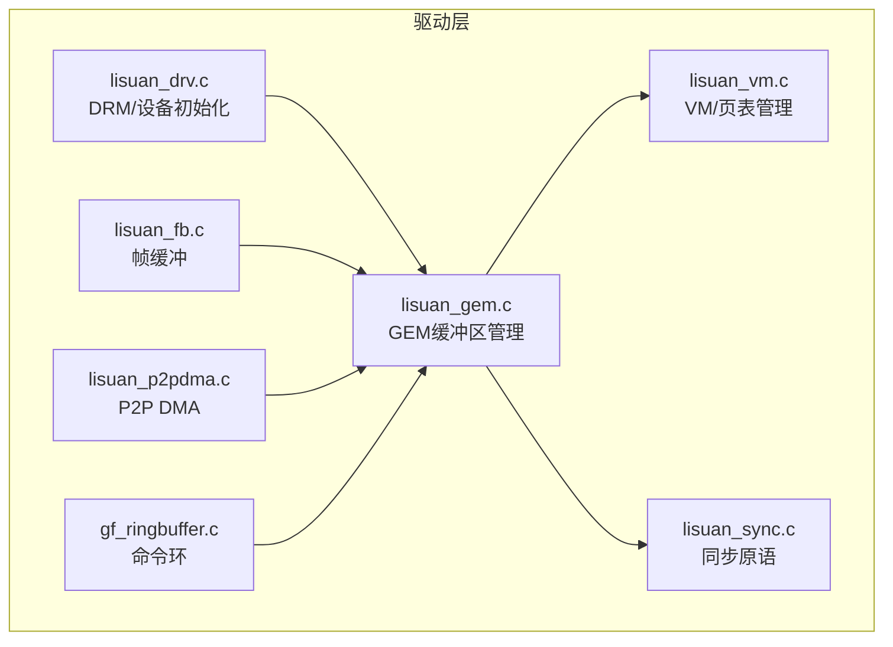
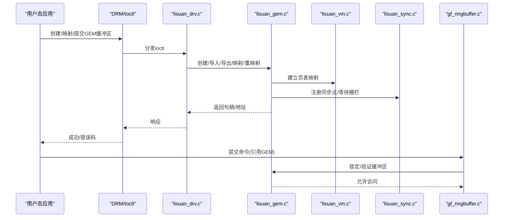
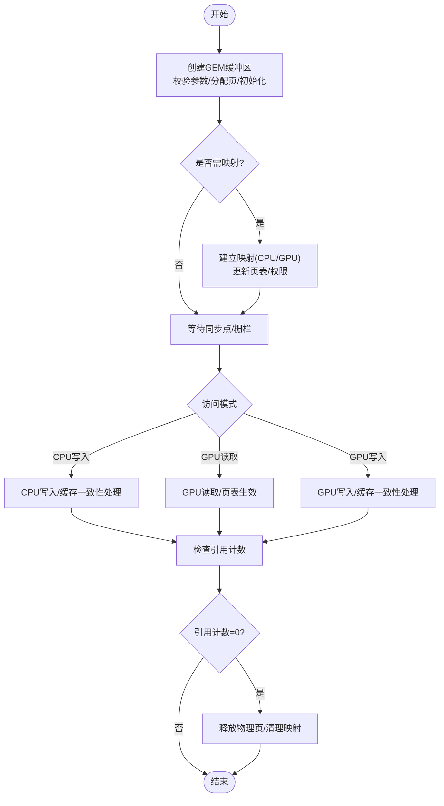
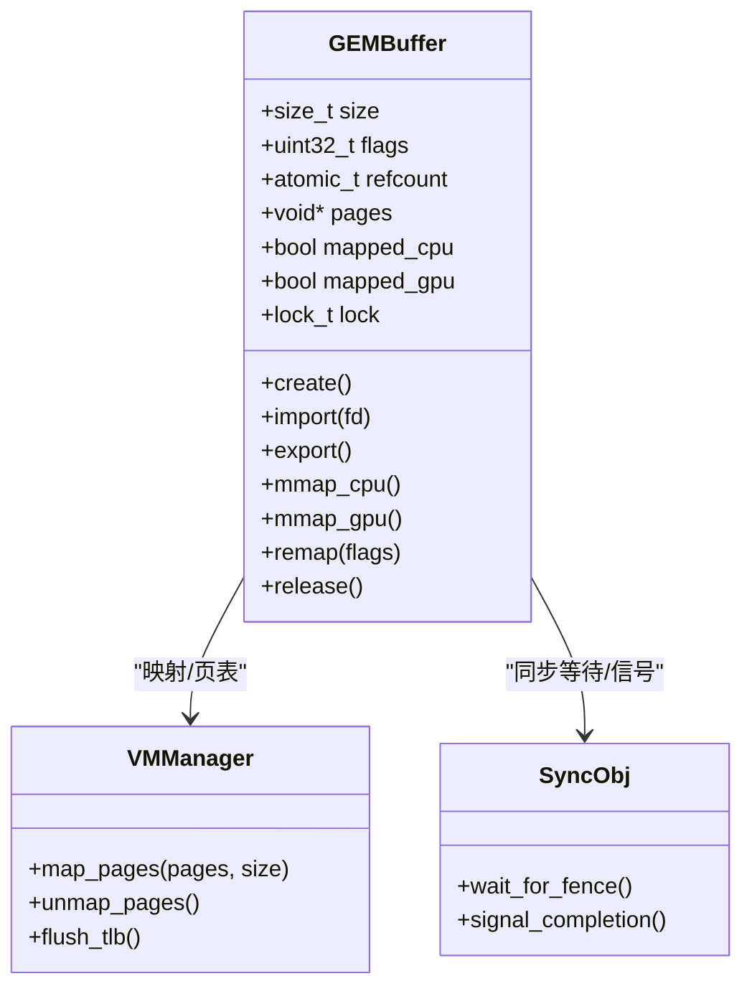
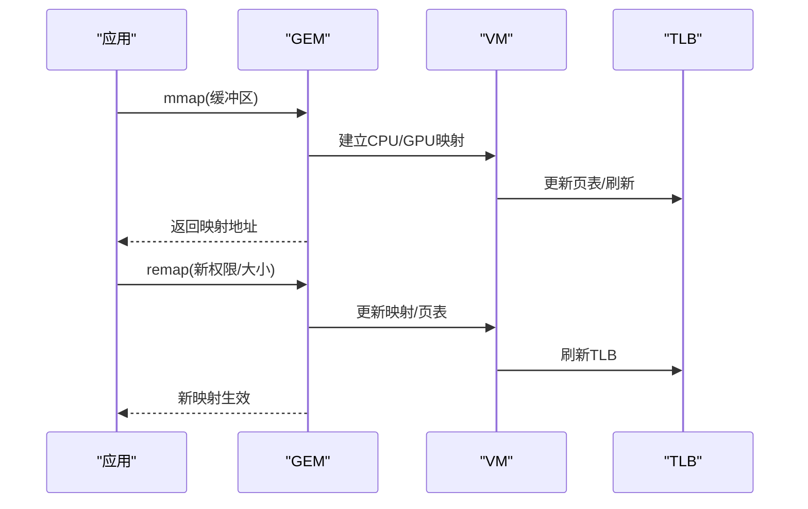
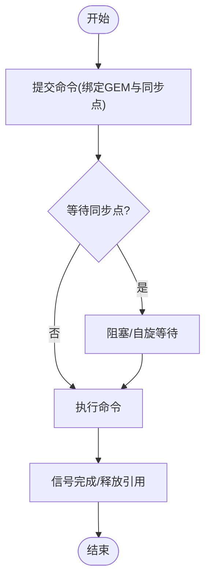
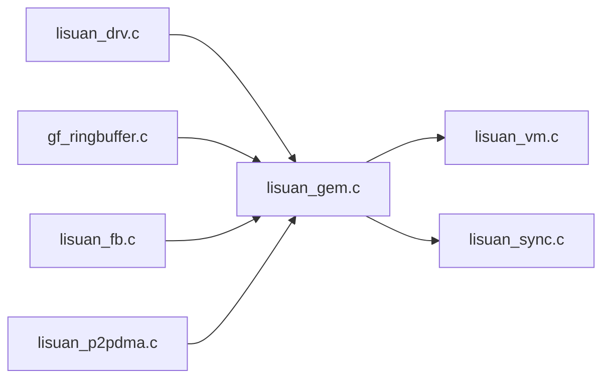

# GEM缓冲区管理

<cite>
**本文引用的文件**
- [lisuan_gem.c](file://_work/src/usr/src/lisuangpu-dkms-262.2.0.56/lisuan_gem.c)
- [lisuan_gem.h](file://_work/src/usr/src/lisuangpu-dkms-262.2.0.56/lisuan_gem.h)
- [lisuan_drv.c](file://_work/src/usr/src/lisuangpu-dkms-262.2.0.56/lisuan_drv.c)
- [lisuan_drv.h](file://_work/src/usr/src/lisuangpu-dkms-262.2.0.56/lisuan_drv.h)
- [lisuan_vm.c](file://_work/src/usr/src/lisuangpu-dkms-262.2.0.56/lisuan_vm.c)
- [lisuan_vm.h](file://_work/src/usr/src/lisuangpu-dkms-262.2.0.56/lisuan_vm.h)
- [lisuan_sync.c](file://_work/src/usr/src/lisuangpu-dkms-262.2.0.56/lisuan_sync.c)
- [lisuan_sync.h](file://_work/src/usr/src/lisuangpu-dkms-262.2.0.56/lisuan_sync.h)
- [gf_ringbuffer.c](file://_work/src/usr/src/lisuangpu-dkms-262.2.0.56/gf_ringbuffer.c)
- [gf_ringbuffer.h](file://_work/src/usr/src/lisuangpu-dkms-262.2.0.56/gf_ringbuffer.h)
- [lisuan_fb.c](file://_work/src/usr/src/lisuangpu-dkms-262.2.0.56/lisuan_fb.c)
- [lisuan_fb.h](file://_work/src/usr/src/lisuangpu-dkms-262.2.0.56/lisuan_fb.h)
- [lisuan_p2pdma.c](file://_work/src/usr/src/lisuangpu-dkms-262.2.0.56/lisuan_p2pdma.c)
- [lisuan_p2pdma.h](file://_work/src/usr/src/lisuangpu-dkms-262.2.0.56/lisuan_p2pdma.h)
</cite>

## 目录
1. [简介](#简介)
2. [项目结构](#项目结构)
3. [核心组件](#核心组件)
4. [架构总览](#架构总览)
5. [详细组件分析](#详细组件分析)
6. [依赖关系分析](#依赖关系分析)
7. [性能考虑](#性能考虑)
8. [故障排查指南](#故障排查指南)
9. [结论](#结论)
10. [附录](#附录)

## 简介
本技术文档面向丽山GPU的GEM（Graphics Execution Manager）缓冲区管理系统，围绕缓冲区的生命周期、内存分配策略、引用计数与同步原语展开，系统阐述缓冲区对象结构设计、内存映射接口与共享机制。文档覆盖创建、销毁、重映射与故障处理的完整流程，并提供最佳实践与性能调优建议，帮助开发者正确高效地使用GEM缓冲区。

## 项目结构
本项目中，GEM缓冲区管理主要位于驱动内核模块的“lisan”子系统中，关键文件包括：
- GEM核心实现与头文件：lisuan_gem.c / lisuan_gem.h
- 设备驱动入口与DRM集成：lisuan_drv.c / lisuan_drv.h
- 虚拟内存管理与页表：lisuan_vm.c / lisuan_vm.h
- 同步与栅栏：lisuan_sync.c / lisuan_sync.h
- 环形缓冲区（命令提交）：gf_ringbuffer.c / gf_ringbuffer.h
- 帧缓冲与显示路径：lisuan_fb.c / lisuan_fb.h
- P2P DMA与跨设备访问：lisuan_p2pdma.c / lisuan_p2pdma.h

图表来源
- [lisuan_drv.c](file://_work/src/usr/src/lisuangpu-dkms-262.2.0.56/lisuan_drv.c)
- [lisuan_gem.c](file://_work/src/usr/src/lisuangpu-dkms-262.2.0.56/lisuan_gem.c)
- [lisuan_vm.c](file://_work/src/usr/src/lisuangpu-dkms-262.2.0.56/lisuan_vm.c)
- [lisuan_sync.c](file://_work/src/usr/src/lisuangpu-dkms-262.2.0.56/lisuan_sync.c)
- [lisuan_fb.c](file://_work/src/usr/src/lisuangpu-dkms-262.2.0.56/lisuan_fb.c)
- [lisuan_p2pdma.c](file://_work/src/usr/src/lisuangpu-dkms-262.2.0.56/lisuan_p2pdma.c)
- [gf_ringbuffer.c](file://_work/src/usr/src/lisuangpu-dkms-262.2.0.56/gf_ringbuffer.c)

章节来源
- [lisuan_gem.c](file://_work/src/usr/src/lisuangpu-dkms-262.2.0.56/lisuan_gem.c)
- [lisuan_gem.h](file://_work/src/usr/src/lisuangpu-dkms-262.2.0.56/lisuan_gem.h)
- [lisuan_drv.c](file://_work/src/usr/src/lisuangpu-dkms-262.2.0.56/lisuan_drv.c)
- [lisuan_drv.h](file://_work/src/usr/src/lisuangpu-dkms-262.2.0.56/lisuan_drv.h)
- [lisuan_vm.c](file://_work/src/usr/src/lisuangpu-dkms-262.2.0.56/lisuan_vm.c)
- [lisuan_vm.h](file://_work/src/usr/src/lisuangpu-dkms-262.2.0.56/lisuan_vm.h)
- [lisuan_sync.c](file://_work/src/usr/src/lisuangpu-dkms-262.2.0.56/lisuan_sync.c)
- [lisuan_sync.h](file://_work/src/usr/src/lisuangpu-dkms-262.2.0.56/lisuan_sync.h)
- [gf_ringbuffer.c](file://_work/src/usr/src/lisuangpu-dkms-262.2.0.56/gf_ringbuffer.c)
- [gf_ringbuffer.h](file://_work/src/usr/src/lisuangpu-dkms-262.2.0.56/gf_ringbuffer.h)
- [lisuan_fb.c](file://_work/src/usr/src/lisuangpu-dkms-262.2.0.56/lisuan_fb.c)
- [lisuan_fb.h](file://_work/src/usr/src/lisuangpu-dkms-262.2.0.56/lisuan_fb.h)
- [lisuan_p2pdma.c](file://_work/src/usr/src/lisuangpu-dkms-262.2.0.56/lisuan_p2pdma.c)
- [lisuan_p2pdma.h](file://_work/src/usr/src/lisuangpu-dkms-262.2.0.56/lisuan_p2pdma.h)

## 核心组件
- GEM缓冲区对象：封装物理页、大小、标志位、引用计数、锁与映射状态，提供创建、导入、导出、映射、重映射、释放等接口。
- 虚拟内存管理：负责将GEM缓冲区的物理页映射到GPU/进程地址空间，维护页表与TLB一致性。
- 同步原语：基于DRM fence或自定义同步对象，协调CPU/GPU/其他设备对缓冲区的访问顺序。
- 环形缓冲区：承载GPU命令，引用GEM缓冲区作为输入输出资源。
- 帧缓冲：用于显示路径，通常以GEM缓冲区为背屏。
- P2P DMA：支持跨设备直接内存访问，复用GEM缓冲区的物理页。

章节来源
- [lisuan_gem.c](file://_work/src/usr/src/lisuangpu-dkms-262.2.0.56/lisuan_gem.c)
- [lisuan_gem.h](file://_work/src/usr/src/lisuangpu-dkms-262.2.0.56/lisuan_gem.h)
- [lisuan_vm.c](file://_work/src/usr/src/lisuangpu-dkms-262.2.0.56/lisuan_vm.c)
- [lisuan_vm.h](file://_work/src/usr/src/lisuangpu-dkms-262.2.0.56/lisuan_vm.h)
- [lisuan_sync.c](file://_work/src/usr/src/lisuangpu-dkms-262.2.0.56/lisuan_sync.c)
- [lisuan_sync.h](file://_work/src/usr/src/lisuangpu-dkms-262.2.0.56/lisuan_sync.h)
- [gf_ringbuffer.c](file://_work/src/usr/src/lisuangpu-dkms-262.2.0.56/gf_ringbuffer.c)
- [gf_ringbuffer.h](file://_work/src/usr/src/lisuangpu-dkms-262.2.0.56/gf_ringbuffer.h)
- [lisuan_fb.c](file://_work/src/usr/src/lisuangpu-dkms-262.2.0.56/lisuan_fb.c)
- [lisuan_fb.h](file://_work/src/usr/src/lisuangpu-dkms-262.2.0.56/lisuan_fb.h)
- [lisuan_p2pdma.c](file://_work/src/usr/src/lisuangpu-dkms-262.2.0.56/lisuan_p2pdma.c)
- [lisuan_p2pdma.h](file://_work/src/usr/src/lisuangpu-dkms-262.2.0.56/lisuan_p2pdma.h)

## 架构总览
GEM缓冲区管理的整体架构如下：用户态通过DRM ioctl调用进入内核，驱动层在lisuan_drv中分发请求至GEM子系统；GEM负责缓冲区的生命周期与内存布局，VM子系统完成地址映射；同步子系统确保多主体访问的一致性；环形缓冲与显示/P2P路径消费GEM缓冲区。

图表来源
- [lisuan_drv.c](file://_work/src/usr/src/lisuangpu-dkms-262.2.0.56/lisuan_drv.c)
- [lisuan_gem.c](file://_work/src/usr/src/lisuangpu-dkms-262.2.0.56/lisuan_gem.c)
- [lisuan_vm.c](file://_work/src/usr/src/lisuangpu-dkms-262.2.0.56/lisuan_vm.c)
- [lisuan_sync.c](file://_work/src/usr/src/lisuangpu-dkms-262.2.0.56/lisuan_sync.c)
- [gf_ringbuffer.c](file://_work/src/usr/src/lisuangpu-dkms-262.2.0.56/gf_ringbuffer.c)

## 详细组件分析

### GEM缓冲区对象与生命周期
- 设计要点
  - 缓冲区对象包含：大小、对齐、标志位（可缓存、可共享、只读/可写）、引用计数、锁、映射状态、关联的页表项。
  - 生命周期阶段：创建→引用获取→映射/使用→同步等待→释放。
  - 引用计数：每个持有者（进程、设备、命令队列）增加引用；释放时递减，归零则回收物理页并清理映射。
- 关键操作
  - 创建：校验参数、分配物理页、初始化元数据、设置默认权限。
  - 导入/导出：与其他驱动或进程共享，采用DMA-BUF或私有fd机制。
  - 映射：CPU侧mmap或GEM mmap，建立用户态指针；GPU侧由VM建立页表。
  - 重映射：调整权限或大小（受限于底层分配器），更新映射与TLB。
  - 销毁：等待所有使用者完成，释放引用，回收内存。

图表来源
- [lisuan_gem.c](file://_work/src/usr/src/lisuangpu-dkms-262.2.0.56/lisuan_gem.c)
- [lisuan_gem.h](file://_work/src/usr/src/lisuangpu-dkms-262.2.0.56/lisuan_gem.h)

章节来源
- [lisuan_gem.c](file://_work/src/usr/src/lisuangpu-dkms-262.2.0.56/lisuan_gem.c)
- [lisuan_gem.h](file://_work/src/usr/src/lisuangpu-dkms-262.2.0.56/lisuan_gem.h)

### 内存分配策略与对齐要求
- 分配策略
  - 优先使用连续物理页以满足GPU DMA需求；若失败则回退到分散页+IOMMU映射。
  - 支持多种缓存属性（非缓存、写合并、读写回写），根据用途选择。
- 对齐要求
  - 常见对齐：4KB页对齐、64KB大页对齐、特定硬件要求的边界（如扫描线对齐）。
  - 显示路径可能需要行对齐与色深对齐。
- 优化建议
  - 批量分配减少碎片；重用缓冲区避免频繁分配释放。
  - 合理设置缓存属性以减少不必要的刷新。

章节来源
- [lisuan_gem.c](file://_work/src/usr/src/lisuangpu-dkms-262.2.0.56/lisuan_gem.c)
- [lisuan_vm.c](file://_work/src/usr/src/lisuangpu-dkms-262.2.0.56/lisuan_vm.c)

### 引用计数与共享机制
- 引用计数
  - 每个GEM对象维护原子引用计数；创建、导入、映射、命令引用均会增加。
  - 释放前必须等待所有引用释放，防止use-after-free。
- 共享机制
  - 进程间共享：通过fd传递GEM句柄或DMA-BUF fd。
  - 设备间共享：P2P DMA直接访问物理页，避免拷贝。
  - 显示共享：帧缓冲以GEM为背屏，CRTC读取时保持可见性。

图表来源
- [lisuan_gem.c](file://_work/src/usr/src/lisuangpu-dkms-262.2.0.56/lisuan_gem.c)
- [lisuan_vm.c](file://_work/src/usr/src/lisuangpu-dkms-262.2.0.56/lisuan_vm.c)
- [lisuan_sync.c](file://_work/src/usr/src/lisuangpu-dkms-262.2.0.56/lisuan_sync.c)

章节来源
- [lisuan_gem.c](file://_work/src/usr/src/lisuangpu-dkms-262.2.0.56/lisuan_gem.c)
- [lisuan_vm.c](file://_work/src/usr/src/lisuangpu-dkms-262.2.0.56/lisuan_vm.c)
- [lisuan_sync.c](file://_work/src/usr/src/lisuangpu-dkms-262.2.0.56/lisuan_sync.c)

### 内存映射接口与重映射流程
- 映射接口
  - CPU映射：mmap返回用户态指针，注意缓存一致性与屏障。
  - GPU映射：由VM建立页表，命令提交时自动生效。
- 重映射
  - 修改权限（只读→读写）或大小（扩展/收缩），需更新映射与TLB。
  - 重映射前需确保无并发访问，必要时加锁并等待同步点。

图表来源
- [lisuan_gem.c](file://_work/src/usr/src/lisuangpu-dkms-262.2.0.56/lisuan_gem.c)
- [lisuan_vm.c](file://_work/src/usr/src/lisuangpu-dkms-262.2.0.56/lisuan_vm.c)

章节来源
- [lisuan_gem.c](file://_work/src/usr/src/lisuangpu-dkms-262.2.0.56/lisuan_gem.c)
- [lisuan_vm.c](file://_work/src/usr/src/lisuangpu-dkms-262.2.0.56/lisuan_vm.c)

### 同步原语与访问协调
- 同步对象
  - 基于DRM fence或自定义同步对象，标记缓冲区就绪/完成。
  - 命令提交时绑定同步点，确保数据可见性。
- 访问协调
  - CPU写入后需刷缓存或插入屏障，GPU读取前等待同步。
  - 多设备共享时需按序访问，避免竞态。

图表来源
- [lisuan_sync.c](file://_work/src/usr/src/lisuangpu-dkms-262.2.0.56/lisuan_sync.c)
- [gf_ringbuffer.c](file://_work/src/usr/src/lisuangpu-dkms-262.2.0.56/gf_ringbuffer.c)

章节来源
- [lisuan_sync.c](file://_work/src/usr/src/lisuangpu-dkms-262.2.0.56/lisuan_sync.c)
- [gf_ringbuffer.c](file://_work/src/usr/src/lisuangpu-dkms-262.2.0.56/gf_ringbuffer.c)

### 帧缓冲与显示路径
- 帧缓冲以GEM缓冲区为背屏，CRTC周期性读取像素数据。
- 需要保证显示路径的可见性与一致性，避免撕裂与闪烁。
- 支持双缓冲/三缓冲切换，提升流畅度。

章节来源
- [lisuan_fb.c](file://_work/src/usr/src/lisuangpu-dkms-262.2.0.56/lisuan_fb.c)
- [lisuan_fb.h](file://_work/src/usr/src/lisuangpu-dkms-262.2.0.56/lisuan_fb.h)

### P2P DMA与跨设备共享
- P2P DMA直接访问GEM缓冲区的物理页，避免CPU拷贝。
- 适用于多设备协同处理（如编解码与显示）。
- 需确保设备间内存一致性与访问权限。

章节来源
- [lisuan_p2pdma.c](file://_work/src/usr/src/lisuangpu-dkms-262.2.0.56/lisuan_p2pdma.c)
- [lisuan_p2pdma.h](file://_work/src/usr/src/lisuangpu-dkms-262.2.0.56/lisuan_p2pdma.h)

## 依赖关系分析
GEM子系统依赖VM进行地址映射，依赖同步子系统协调访问，被环形缓冲、帧缓冲、P2P DMA等模块消费。驱动入口统一调度各子系统。

图表来源
- [lisuan_drv.c](file://_work/src/usr/src/lisuangpu-dkms-262.2.0.56/lisuan_drv.c)
- [lisuan_gem.c](file://_work/src/usr/src/lisuangpu-dkms-262.2.0.56/lisuan_gem.c)
- [lisuan_vm.c](file://_work/src/usr/src/lisuangpu-dkms-262.2.0.56/lisuan_vm.c)
- [lisuan_sync.c](file://_work/src/usr/src/lisuangpu-dkms-262.2.0.56/lisuan_sync.c)
- [gf_ringbuffer.c](file://_work/src/usr/src/lisuangpu-dkms-262.2.0.56/gf_ringbuffer.c)
- [lisuan_fb.c](file://_work/src/usr/src/lisuangpu-dkms-262.2.0.56/lisuan_fb.c)
- [lisuan_p2pdma.c](file://_work/src/usr/src/lisuangpu-dkms-262.2.0.56/lisuan_p2pdma.c)

章节来源
- [lisuan_drv.c](file://_work/src/usr/src/lisuangpu-dkms-262.2.0.56/lisuan_drv.c)
- [lisuan_gem.c](file://_work/src/usr/src/lisuangpu-dkms-262.2.0.56/lisuan_gem.c)
- [lisuan_vm.c](file://_work/src/usr/src/lisuangpu-dkms-262.2.0.56/lisuan_vm.c)
- [lisuan_sync.c](file://_work/src/usr/src/lisuangpu-dkms-262.2.0.56/lisuan_sync.c)
- [gf_ringbuffer.c](file://_work/src/usr/src/lisuangpu-dkms-262.2.0.56/gf_ringbuffer.c)
- [lisuan_fb.c](file://_work/src/usr/src/lisuangpu-dkms-262.2.0.56/lisuan_fb.c)
- [lisuan_p2pdma.c](file://_work/src/usr/src/lisuangpu-dkms-262.2.0.56/lisuan_p2pdma.c)

## 性能考虑
- 内存对齐与布局
  - 遵循硬件对齐要求，减少填充与浪费。
  - 使用大页减少页表开销。
- 访问模式优化
  - 批量写入/读取，减少同步次数。
  - 避免频繁重映射，尽量复用映射。
- 缓存一致性
  - 合理设置缓存属性，减少不必要的刷新。
  - 在CPU/GPU边界插入屏障。
- 资源复用
  - 重用缓冲区与同步对象，降低分配开销。
  - 池化管理高频使用的缓冲区。

[本节为通用指导，不直接分析具体文件]

## 故障排查指南
- 常见问题
  - 映射失败：检查权限、对齐、可用内存。
  - 同步死锁：确认等待顺序与超时设置。
  - 数据不一致：检查缓存一致性与屏障。
  - 崩溃/段错误：验证引用计数与释放时机。
- 调试手段
  - 启用驱动日志与trace点。
  - 使用工具检查页表与TLB状态。
  - 模拟负载定位瓶颈。

章节来源
- [lisuan_gem.c](file://_work/src/usr/src/lisuangpu-dkms-262.2.0.56/lisuan_gem.c)
- [lisuan_sync.c](file://_work/src/usr/src/lisuangpu-dkms-262.2.0.56/lisuan_sync.c)

## 结论
丽山GPU的GEM缓冲区管理系统通过清晰的对象模型、严格的引用计数与同步机制，提供了安全高效的内存共享与访问能力。结合合理的分配策略、映射接口与性能调优，可构建稳定且高性能的图形与计算应用。

[本节为总结，不直接分析具体文件]

## 附录
- 最佳实践清单
  - 明确缓冲区用途，选择合适的缓存属性与对齐。
  - 最小化映射与重映射频率，复用资源。
  - 正确使用同步原语，避免竞态与死锁。
  - 监控引用计数，确保及时释放。
- 代码示例路径
  - 创建与映射：参考GEM创建与映射接口实现。
  - 同步与提交：参考环形缓冲与同步对象使用。
  - 显示与P2P：参考帧缓冲与P2P DMA集成。

[本节为附录，不直接分析具体文件]