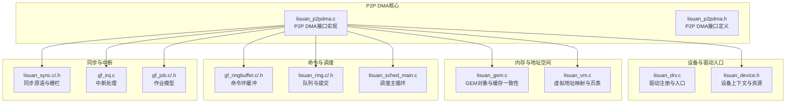
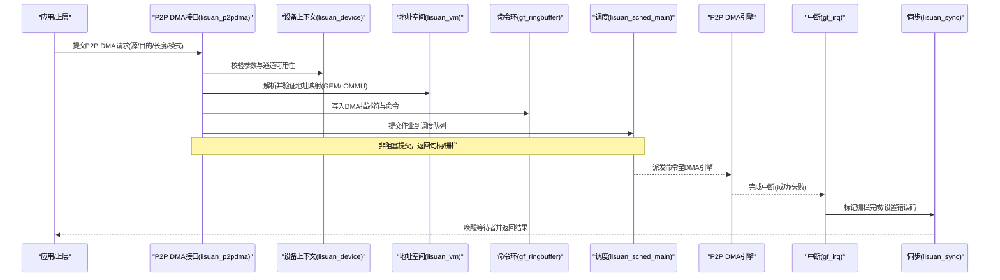
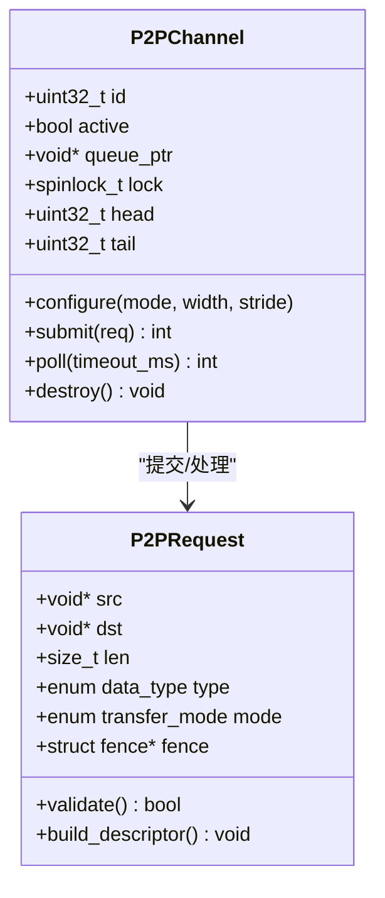
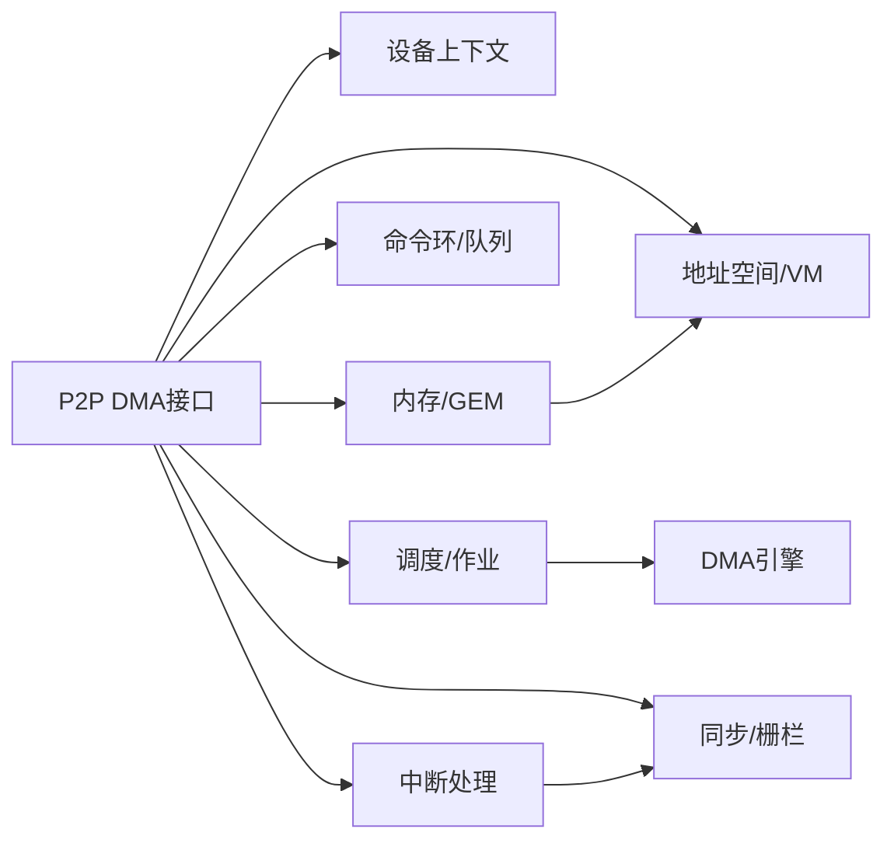
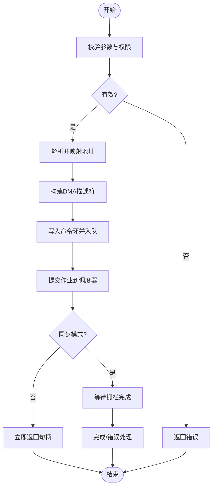

# P2P DMA传输

<cite>
**本文档引用的文件**   
- [lisuan_p2pdma.c](file://_work/src/usr/src/lisuangpu-dkms-262.2.0.56/lisuan_p2pdma.c)
- [lisuan_p2pdma.h](file://_work/src/usr/src/lisuangpu-dkms-262.2.0.56/lisuan_p2pdma.h)
- [lisuan_drv.c](file://_work/src/usr/src/lisuangpu-dkms-262.2.0.56/lisuan_drv.c)
- [lisuan_device.h](file://_work/src/usr/src/lisuangpu-dkms-262.2.0.56/lisuan_device.h)
- [lisuan_gem.c](file://_work/src/usr/src/lisuangpu-dkms-262.2.0.56/lisuan_gem.c)
- [lisuan_vm.c](file://_work/src/usr/src/lisuangpu-dkms-262.2.0.56/lisuan_vm.c)
- [gf_ringbuffer.c](file://_work/src/usr/src/lisuangpu-dkms-262.2.0.56/gf_ringbuffer.c)
- [gf_ringbuffer.h](file://_work/src/usr/src/lisuangpu-dkms-262.2.0.56/gf_ringbuffer.h)
- [lisuan_ring.c](file://_work/src/usr/src/lisuangpu-dkms-262.2.0.56/lisuan_ring.c)
- [lisuan_ring.h](file://_work/src/usr/src/lisuangpu-dkms-262.2.0.56/lisuan_ring.h)
- [lisuan_sched_main.c](file://_work/src/usr/src/lisuangpu-dkms-262.2.0.56/lisuan_sched_main.c)
- [lisuan_sync.c](file://_work/src/usr/src/lisuangpu-dkms-262.2.0.56/lisuan_sync.c)
- [lisuan_sync.h](file://_work/src/usr/src/lisuangpu-dkms-262.2.0.56/lisuan_sync.h)
- [gf_irq.c](file://_work/src/usr/src/lisuangpu-dkms-262.2.0.56/gf_irq.c)
- [gf_job.c](file://_work/src/usr/src/lisuangpu-dkms-262.2.0.56/gf_job.c)
- [gf_job.h](file://_work/src/usr/src/lisuangpu-dkms-262.2.0.56/gf_job.h)
</cite>

## 目录
1. [简介](#简介)
2. [项目结构](#项目结构)
3. [核心组件](#核心组件)
4. [架构总览](#架构总览)
5. [详细组件分析](#详细组件分析)
6. [依赖关系分析](#依赖关系分析)
7. [性能考虑](#性能考虑)
8. [故障排查指南](#故障排查指南)
9. [结论](#结论)
10. [附录](#附录)

## 简介
本技术文档面向丽山GPU的P2P（Peer-to-Peer）DMA传输子系统，系统性阐述其工作原理、数据路径与优化策略。内容覆盖：
- P2P DMA初始化流程、通道配置与数据流控制机制
- 传输请求提交、完成通知与错误处理
- 不同数据类型与传输模式的性能特征
- 使用最佳实践：缓冲区对齐、传输大小优化、并发控制
- 高效P2P数据传输操作示例与参考路径

## 项目结构
P2P DMA相关代码主要位于驱动模块的“lisuan_*”子系统中，围绕设备抽象、内存管理（GEM/VM）、环形缓冲与调度、中断与同步等关键模块协同工作。下图给出与P2P DMA相关的核心文件组织概览。

图表来源
- [lisuan_p2pdma.c:1-200](file://_work/src/usr/src/lisuangpu-dkms-262.2.0.56/lisuan_p2pdma.c#L1-L200)
- [lisuan_p2pdma.h:1-200](file://_work/src/usr/src/lisuangpu-dkms-262.2.0.56/lisuan_p2pdma.h#L1-L200)
- [lisuan_drv.c:1-200](file://_work/src/usr/src/lisuangpu-dkms-262.2.0.56/lisuan_drv.c#L1-L200)
- [lisuan_device.h:1-200](file://_work/src/usr/src/lisuangpu-dkms-262.2.0.56/lisuan_device.h#L1-L200)
- [lisuan_gem.c:1-200](file://_work/src/usr/src/lisuangpu-dkms-262.2.0.56/lisuan_gem.c#L1-L200)
- [lisuan_vm.c:1-200](file://_work/src/usr/src/lisuangpu-dkms-262.2.0.56/lisuan_vm.c#L1-L200)
- [gf_ringbuffer.c:1-200](file://_work/src/usr/src/lisuangpu-dkms-262.2.0.56/gf_ringbuffer.c#L1-L200)
- [gf_ringbuffer.h:1-200](file://_work/src/usr/src/lisuangpu-dkms-262.2.0.56/gf_ringbuffer.h#L1-L200)
- [lisuan_ring.c:1-200](file://_work/src/usr/src/lisuangpu-dkms-262.2.0.56/lisuan_ring.c#L1-L200)
- [lisuan_ring.h:1-200](file://_work/src/usr/src/lisuangpu-dkms-262.2.0.56/lisuan_ring.h#L1-L200)
- [lisuan_sched_main.c:1-200](file://_work/src/usr/src/lisuangpu-dkms-262.2.0.56/lisuan_sched_main.c#L1-L200)
- [lisuan_sync.c:1-200](file://_work/src/usr/src/lisuangpu-dkms-262.2.0.56/lisuan_sync.c#L1-L200)
- [lisuan_sync.h:1-200](file://_work/src/usr/src/lisuangpu-dkms-262.2.0.56/lisuan_sync.h#L1-L200)
- [gf_irq.c:1-200](file://_work/src/usr/src/lisuangpu-dkms-262.2.0.56/gf_irq.c#L1-L200)
- [gf_job.c:1-200](file://_work/src/usr/src/lisuangpu-dkms-262.2.0.56/gf_job.c#L1-L200)
- [gf_job.h:1-200](file://_work/src/usr/src/lisuangpu-dkms-262.2.0.56/gf_job.h#L1-L200)

章节来源
- [lisuan_p2pdma.c:1-200](file://_work/src/usr/src/lisuangpu-dkms-262.2.0.56/lisuan_p2pdma.c#L1-L200)
- [lisuan_p2pdma.h:1-200](file://_work/src/usr/src/lisuangpu-dkms-262.2.0.56/lisuan_p2pdma.h#L1-L200)
- [lisuan_drv.c:1-200](file://_work/src/usr/src/lisuangpu-dkms-262.2.0.56/lisuan_drv.c#L1-L200)
- [lisuan_device.h:1-200](file://_work/src/usr/src/lisuangpu-dkms-262.2.0.56/lisuan_device.h#L1-L200)

## 核心组件
- P2P DMA接口层：提供P2P传输的API封装，负责参数校验、通道选择、命令构建与提交。
- 设备上下文：维护P2P通道状态、资源句柄、队列指针与锁保护。
- 内存与地址空间：通过GEM对象与VM页表将用户态/内核态缓冲区映射为设备可见的物理或IOMMU地址。
- 命令环与队列：以环形缓冲承载DMA描述符与命令，支持批量提交与流水线执行。
- 调度与作业：将P2P请求包装为作业，进入调度器排队并分配执行队列。
- 同步与中断：基于栅栏/事件对象进行完成通知；中断服务程序处理完成与错误上报。

章节来源
- [lisuan_p2pdma.c:1-200](file://_work/src/usr/src/lisuangpu-dkms-262.2.0.56/lisuan_p2pdma.c#L1-L200)
- [lisuan_device.h:1-200](file://_work/src/usr/src/lisuangpu-dkms-262.2.0.56/lisuan_device.h#L1-L200)
- [lisuan_gem.c:1-200](file://_work/src/usr/src/lisuangpu-dkms-262.2.0.56/lisuan_gem.c#L1-L200)
- [lisuan_vm.c:1-200](file://_work/src/usr/src/lisuangpu-dkms-262.2.0.56/lisuan_vm.c#L1-L200)
- [gf_ringbuffer.c:1-200](file://_work/src/usr/src/lisuangpu-dkms-262.2.0.56/gf_ringbuffer.c#L1-L200)
- [lisuan_ring.c:1-200](file://_work/src/usr/src/lisuangpu-dkms-262.2.0.56/lisuan_ring.c#L1-L200)
- [lisuan_sched_main.c:1-200](file://_work/src/usr/src/lisuangpu-dkms-262.2.0.56/lisuan_sched_main.c#L1-L200)
- [lisuan_sync.c:1-200](file://_work/src/usr/src/lisuangpu-dkms-262.2.0.56/lisuan_sync.c#L1-L200)
- [gf_irq.c:1-200](file://_work/src/usr/src/lisuangpu-dkms-262.2.0.56/gf_irq.c#L1-L200)
- [gf_job.c:1-200](file://_work/src/usr/src/lisuangpu-dkms-262.2.0.56/gf_job.c#L1-L200)

## 架构总览
P2P DMA的整体数据流从应用调用开始，经驱动接口进入DMA引擎，最终由硬件完成并触发中断，驱动侧更新同步对象并唤醒等待者。

图表来源
- [lisuan_p2pdma.c:1-200](file://_work/src/usr/src/lisuangpu-dkms-262.2.0.56/lisuan_p2pdma.c#L1-L200)
- [lisuan_device.h:1-200](file://_work/src/usr/src/lisuangpu-dkms-262.2.0.56/lisuan_device.h#L1-L200)
- [lisuan_vm.c:1-200](file://_work/src/usr/src/lisuangpu-dkms-262.2.0.56/lisuan_vm.c#L1-L200)
- [gf_ringbuffer.c:1-200](file://_work/src/usr/src/lisuangpu-dkms-262.2.0.56/gf_ringbuffer.c#L1-L200)
- [lisuan_sched_main.c:1-200](file://_work/src/usr/src/lisuangpu-dkms-262.2.0.56/lisuan_sched_main.c#L1-L200)
- [gf_irq.c:1-200](file://_work/src/usr/src/lisuangpu-dkms-262.2.0.56/gf_irq.c#L1-L200)
- [lisuan_sync.c:1-200](file://_work/src/usr/src/lisuangpu-dkms-262.2.0.56/lisuan_sync.c#L1-L200)

## 详细组件分析

### P2P DMA接口层（lisuan_p2pdma.c/h）
- 职责
  - 暴露P2P DMA API：初始化、通道配置、提交传输、查询状态、销毁资源
  - 参数校验：缓冲区对齐、长度对齐、方向、类型、超时
  - 命令构建：生成DMA描述符，填充源/目的地址、步长、控制位
  - 提交与轮询：将命令写入环缓冲并提交给调度器，支持异步与同步两种模式
- 关键数据结构
  - P2P通道描述：包含队列指针、状态标志、锁、计数器
  - 传输请求：源/目的地址、长度、类型、模式、回调/栅栏
- 错误处理
  - 参数非法、地址不可访问、环满、硬件错误码映射为用户态错误

图表来源
- [lisuan_p2pdma.c:1-200](file://_work/src/usr/src/lisuangpu-dkms-262.2.0.56/lisuan_p2pdma.c#L1-L200)
- [lisuan_p2pdma.h:1-200](file://_work/src/usr/src/lisuangpu-dkms-262.2.0.56/lisuan_p2pdma.h#L1-L200)

章节来源
- [lisuan_p2pdma.c:1-200](file://_work/src/usr/src/lisuangpu-dkms-262.2.0.56/lisuan_p2pdma.c#L1-L200)
- [lisuan_p2pdma.h:1-200](file://_work/src/usr/src/lisuangpu-dkms-262.2.0.56/lisuan_p2pdma.h#L1-L200)

### 设备上下文与资源管理（lisuan_device.h）
- 职责
  - 维护全局设备实例、P2P通道数组、寄存器基址、中断向量
  - 提供通道获取/释放、资源加锁/解锁、状态查询
- 关键点
  - 通道生命周期：创建、配置、启用、禁用、销毁
  - 并发安全：自旋锁保护共享资源，避免竞态

章节来源
- [lisuan_device.h:1-200](file://_work/src/usr/src/lisuangpu-dkms-262.2.0.56/lisuan_device.h#L1-L200)

### 内存与地址空间（lisuan_gem.c / lisuan_vm.c）
- 职责
  - GEM对象：分配/释放、引用计数、缓存一致性（flush/invalidate）
  - VM映射：建立用户/内核到设备的地址映射，处理IOMMU转换
- 关键点
  - 对齐要求：按页对齐或硬件最小粒度对齐
  - 可见性：在提交前确保CPU写回，读取前确保设备刷新

章节来源
- [lisuan_gem.c:1-200](file://_work/src/usr/src/lisuangpu-dkms-262.2.0.56/lisuan_gem.c#L1-L200)
- [lisuan_vm.c:1-200](file://_work/src/usr/src/lisuangpu-dkms-262.2.0.56/lisuan_vm.c#L1-L200)

### 命令环与队列（gf_ringbuffer.c/.h / lisuan_ring.c/.h）
- 职责
  - 环形缓冲：固定大小、头尾指针、溢出检测、批量写入
  - 队列提交：将DMA命令打包后提交到指定队列
- 关键点
  - 原子更新：头尾指针的原子操作保证多生产者安全
  - 批量化：合并小传输以减少命令开销

章节来源
- [gf_ringbuffer.c:1-200](file://_work/src/usr/src/lisuangpu-dkms-262.2.0.56/gf_ringbuffer.c#L1-L200)
- [gf_ringbuffer.h:1-200](file://_work/src/usr/src/lisuangpu-dkms-262.2.0.56/gf_ringbuffer.h#L1-L200)
- [lisuan_ring.c:1-200](file://_work/src/usr/src/lisuangpu-dkms-262.2.0.56/lisuan_ring.c#L1-L200)
- [lisuan_ring.h:1-200](file://_work/src/usr/src/lisuangpu-dkms-262.2.0.56/lisuan_ring.h#L1-L200)

### 调度与作业（lisuan_sched_main.c / gf_job.c/.h）
- 职责
  - 作业模型：将P2P请求封装为作业，携带依赖、优先级、回调
  - 调度策略：FIFO/优先级，公平分配执行时间片
- 关键点
  - 依赖链：支持跨作业的数据依赖与顺序约束
  - 背压：队列满时拒绝新作业或延迟提交

章节来源
- [lisuan_sched_main.c:1-200](file://_work/src/usr/src/lisuangpu-dkms-262.2.0.56/lisuan_sched_main.c#L1-L200)
- [gf_job.c:1-200](file://_work/src/usr/src/lisuangpu-dkms-262.2.0.56/gf_job.c#L1-L200)
- [gf_job.h:1-200](file://_work/src/usr/src/lisuangpu-dkms-262.2.0.56/gf_job.h#L1-L200)

### 同步与中断（lisuan_sync.c/.h / gf_irq.c）
- 职责
  - 同步原语：栅栏、事件对象、等待/唤醒
  - 中断处理：接收硬件完成/错误，更新状态并触发回调
- 关键点
  - 低开销等待：优先使用无忙等机制（如wait_event_interruptible）
  - 错误传播：将硬件错误码转换为标准错误码并上抛

章节来源
- [lisuan_sync.c:1-200](file://_work/src/usr/src/lisuangpu-dkms-262.2.0.56/lisuan_sync.c#L1-L200)
- [lisuan_sync.h:1-200](file://_work/src/usr/src/lisuangpu-dkms-262.2.0.56/lisuan_sync.h#L1-L200)
- [gf_irq.c:1-200](file://_work/src/usr/src/lisuangpu-dkms-262.2.0.56/gf_irq.c#L1-L200)

## 依赖关系分析
P2P DMA子系统与各模块的依赖如下：

图表来源
- [lisuan_p2pdma.c:1-200](file://_work/src/usr/src/lisuangpu-dkms-262.2.0.56/lisuan_p2pdma.c#L1-L200)
- [lisuan_device.h:1-200](file://_work/src/usr/src/lisuangpu-dkms-262.2.0.56/lisuan_device.h#L1-L200)
- [lisuan_gem.c:1-200](file://_work/src/usr/src/lisuangpu-dkms-262.2.0.56/lisuan_gem.c#L1-L200)
- [lisuan_vm.c:1-200](file://_work/src/usr/src/lisuangpu-dkms-262.2.0.56/lisuan_vm.c#L1-L200)
- [gf_ringbuffer.c:1-200](file://_work/src/usr/src/lisuangpu-dkms-262.2.0.56/gf_ringbuffer.c#L1-L200)
- [lisuan_ring.c:1-200](file://_work/src/usr/src/lisuangpu-dkms-262.2.0.56/lisuan_ring.c#L1-L200)
- [lisuan_sched_main.c:1-200](file://_work/src/usr/src/lisuangpu-dkms-262.2.0.56/lisuan_sched_main.c#L1-L200)
- [lisuan_sync.c:1-200](file://_work/src/usr/src/lisuangpu-dkms-262.2.0.56/lisuan_sync.c#L1-L200)
- [gf_irq.c:1-200](file://_work/src/usr/src/lisuangpu-dkms-262.2.0.56/gf_irq.c#L1-L200)

章节来源
- [lisuan_p2pdma.c:1-200](file://_work/src/usr/src/lisuangpu-dkms-262.2.0.56/lisuan_p2pdma.c#L1-L200)
- [lisuan_device.h:1-200](file://_work/src/usr/src/lisuangpu-dkms-262.2.0.56/lisuan_device.h#L1-L200)

## 性能考虑
- 缓冲区对齐
  - 源/目的地址需满足硬件最小粒度对齐（通常为页或块大小），避免拆分与额外拷贝
  - 长度对齐到传输宽度或块大小，减少碎片化
- 传输大小优化
  - 合并小请求为大块传输以降低命令开销与调度次数
  - 根据带宽与延迟特性选择最优分块大小（例如4KB~64KB）
- 并发控制
  - 使用多队列并行提交，避免单队列瓶颈
  - 限制并发数以避免背压与OOM
- 内存可见性
  - 提交前对源数据进行CPU写回，读取前对目的数据进行设备刷新
- 中断与轮询
  - 大传输优先使用中断+等待；小传输可考虑轮询降低延迟
- 数据类型与模式
  - 线性连续传输优于分散聚合（scatter-gather）
  - 选择合适的数据宽度（8/16/32/64bit）与步长匹配硬件总线

[本节为通用指导，不直接分析具体文件]

## 故障排查指南
- 常见问题
  - 参数非法：长度未对齐、地址越界、类型不支持
  - 资源不足：环缓冲满、队列占用、内存不足
  - 硬件错误：DMA错误码、超时、中断丢失
- 定位步骤
  - 检查P2P接口返回值与错误码映射
  - 查看环缓冲头尾指针与剩余空间
  - 确认GEM对象引用计数与映射有效性
  - 捕获中断日志与错误寄存器状态
- 恢复策略
  - 重置通道、清空队列、重新建立映射
  - 降级传输大小或切换模式重试

章节来源
- [lisuan_p2pdma.c:1-200](file://_work/src/usr/src/lisuangpu-dkms-262.2.0.56/lisuan_p2pdma.c#L1-L200)
- [gf_ringbuffer.c:1-200](file://_work/src/usr/src/lisuangpu-dkms-262.2.0.56/gf_ringbuffer.c#L1-L200)
- [lisuan_gem.c:1-200](file://_work/src/usr/src/lisuangpu-dkms-262.2.0.56/lisuan_gem.c#L1-L200)
- [gf_irq.c:1-200](file://_work/src/usr/src/lisuangpu-dkms-262.2.0.56/gf_irq.c#L1-L200)

## 结论
P2P DMA子系统通过清晰的接口层、稳健的地址空间管理、高效的命令环与调度、以及可靠的同步与中断机制，实现了高性能、可扩展的点对点数据传输。遵循对齐与大小优化、合理并发控制与错误处理策略，可在多种负载下获得稳定吞吐与低延迟表现。

[本节为总结性内容，不直接分析具体文件]

## 附录

### 初始化与配置流程
- 初始化步骤
  - 加载驱动并注册设备
  - 分配并初始化P2P通道
  - 配置传输模式、宽度、步长
  - 建立内存映射与地址空间
- 通道配置要点
  - 启用/禁用通道、设置优先级
  - 绑定队列与中断向量
  - 设置超时与重试策略

章节来源
- [lisuan_drv.c:1-200](file://_work/src/usr/src/lisuangpu-dkms-262.2.0.56/lisuan_drv.c#L1-L200)
- [lisuan_p2pdma.c:1-200](file://_work/src/usr/src/lisuangpu-dkms-262.2.0.56/lisuan_p2pdma.c#L1-L200)
- [lisuan_device.h:1-200](file://_work/src/usr/src/lisuangpu-dkms-262.2.0.56/lisuan_device.h#L1-L200)

### 传输请求提交流程

图表来源
- [lisuan_p2pdma.c:1-200](file://_work/src/usr/src/lisuangpu-dkms-262.2.0.56/lisuan_p2pdma.c#L1-L200)
- [gf_ringbuffer.c:1-200](file://_work/src/usr/src/lisuangpu-dkms-262.2.0.56/gf_ringbuffer.c#L1-L200)
- [lisuan_sched_main.c:1-200](file://_work/src/usr/src/lisuangpu-dkms-262.2.0.56/lisuan_sched_main.c#L1-L200)
- [lisuan_sync.c:1-200](file://_work/src/usr/src/lisuangpu-dkms-262.2.0.56/lisuan_sync.c#L1-L200)

### 完成通知与错误处理流程
- 完成通知
  - 硬件中断触发，ISR解析状态并更新栅栏
  - 唤醒等待进程，返回结果
- 错误处理
  - 记录错误码与上下文信息
  - 清理资源并回滚状态
  - 向上层报告标准错误码

章节来源
- [gf_irq.c:1-200](file://_work/src/usr/src/lisuangpu-dkms-262.2.0.56/gf_irq.c#L1-L200)
- [lisuan_sync.c:1-200](file://_work/src/usr/src/lisuangpu-dkms-262.2.0.56/lisuan_sync.c#L1-L200)
- [lisuan_p2pdma.c:1-200](file://_work/src/usr/src/lisuangpu-dkms-262.2.0.56/lisuan_p2pdma.c#L1-L200)

### 高效P2P数据传输操作示例（参考路径）
- 典型流程
  - 申请GEM对象并映射到用户态
  - 准备源/目的缓冲区并确保对齐
  - 构造P2P请求并提交传输
  - 等待栅栏完成并检查结果
- 参考实现位置
  - 接口定义与调用入口：[lisuan_p2pdma.h:1-200](file://_work/src/usr/src/lisuangpu-dkms-262.2.0.56/lisuan_p2pdma.h#L1-L200)
  - 接口实现与错误处理：[lisuan_p2pdma.c:1-200](file://_work/src/usr/src/lisuangpu-dkms-262.2.0.56/lisuan_p2pdma.c#L1-L200)
  - 内存管理与映射：[lisuan_gem.c:1-200](file://_work/src/usr/src/lisuangpu-dkms-262.2.0.56/lisuan_gem.c#L1-L200), [lisuan_vm.c:1-200](file://_work/src/usr/src/lisuangpu-dkms-262.2.0.56/lisuan_vm.c#L1-L200)
  - 命令环与提交：[gf_ringbuffer.c:1-200](file://_work/src/usr/src/lisuangpu-dkms-262.2.0.56/gf_ringbuffer.c#L1-L200), [lisuan_ring.c:1-200](file://_work/src/usr/src/lisuangpu-dkms-262.2.0.56/lisuan_ring.c#L1-L200)
  - 调度与同步：[lisuan_sched_main.c:1-200](file://_work/src/usr/src/lisuangpu-dkms-262.2.0.56/lisuan_sched_main.c#L1-L200), [lisuan_sync.c:1-200](file://_work/src/usr/src/lisuangpu-dkms-262.2.0.56/lisuan_sync.c#L1-L200)
  - 中断与错误：[gf_irq.c:1-200](file://_work/src/usr/src/lisuangpu-dkms-262.2.0.56/gf_irq.c#L1-L200)

[本节为示例指引，不直接展示代码内容]