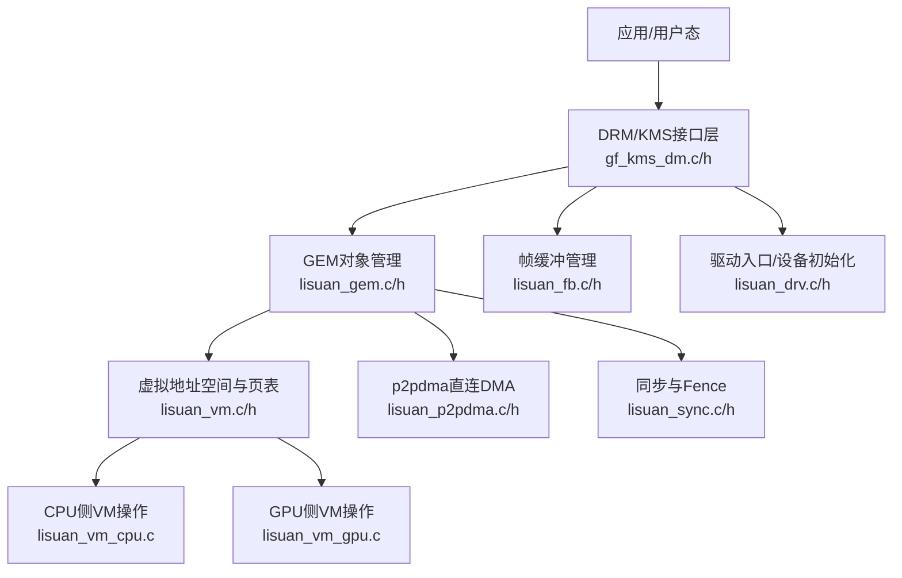
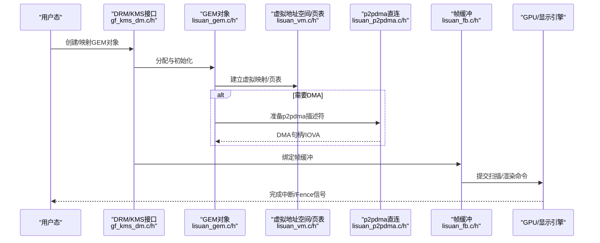
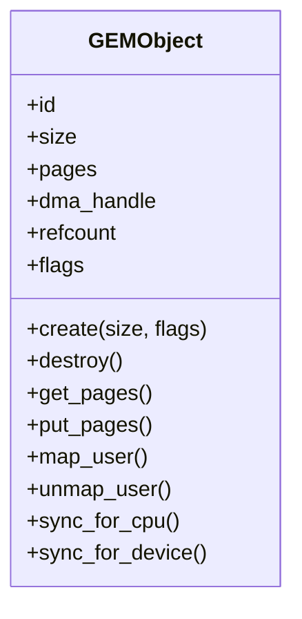
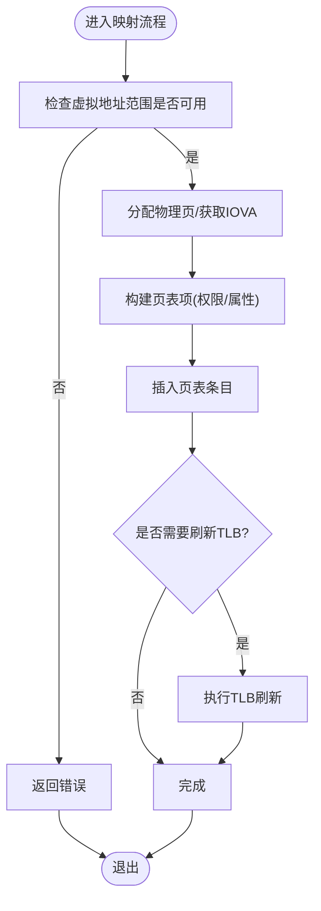
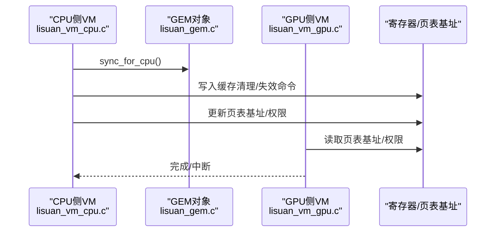
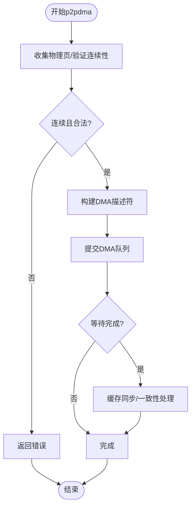
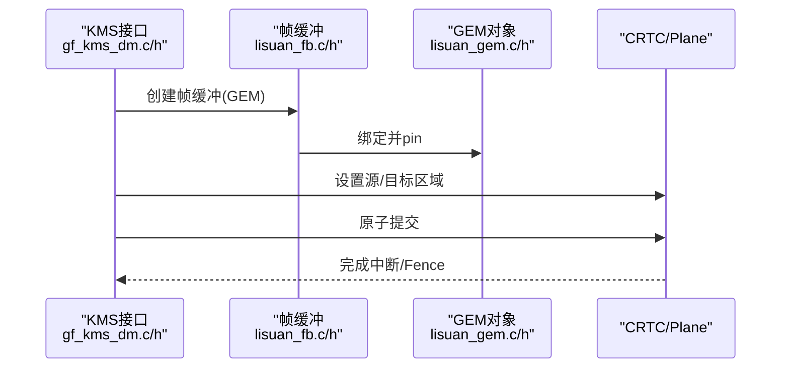
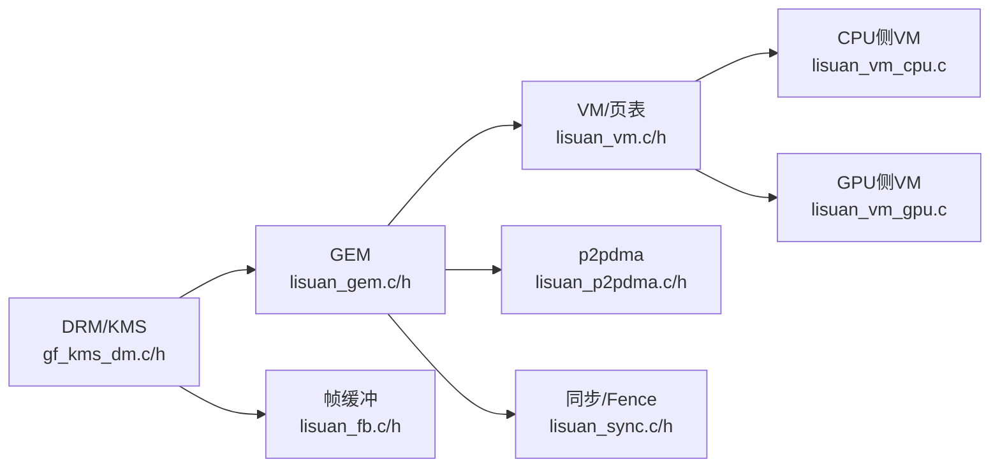

# 内存管理

<cite>
**本文引用的文件**   
- [lisuan_gem.c](file://_work/src/usr/src/lisuan-gpu-dkms-262.2.0.56/kms/lisuan_gem.c)
- [lisuan_gem.h](file://_work/src/usr/src/lisuan-gpu-dkms-262.2.0.56/kms/lisuan_gem.h)
- [lisuan_vm.c](file://_work/src/usr/src/lisuan-gpu-dkms-262.2.0.56/kms/lisuan_vm.c)
- [lisuan_vm.h](file://_work/src/usr/src/lisuan-gpu-dkms-262.2.0.56/kms/lisuan_vm.h)
- [lisuan_vm_cpu.c](file://_work/src/usr/src/lisuan-gpu-dkms-262.2.0.56/kms/lisuan_vm_cpu.c)
- [lisuan_vm_gpu.c](file://_work/src/usr/src/lisuan-gpu-dkms-262.2.0.56/kms/lisuan_vm_gpu.c)
- [lisuan_p2pdma.c](file://_work/src/usr/src/lisuan-gpu-dkms-262.2.0.56/kms/lisuan_p2pdma.c)
- [lisuan_p2pdma.h](file://_work/src/usr/src/lisuan-gpu-dkms-262.2.0.56/kms/lisuan_p2pdma.h)
- [lisuan_fb.c](file://_work/src/usr/src/lisuan-gpu-dkms-262.2.0.56/kms/lisuan_fb.c)
- [lisuan_fb.h](file://_work/src/usr/src/lisuan-gpu-dkms-262.2.0.56/kms/lisuan_fb.h)
- [gf_kms_dm.c](file://_work/src/usr/src/lisuan-gpu-dkms-262.2.0.56/kms/gf_kms_dm.c)
- [gf_kms_dm.h](file://_work/src/usr/src/lisuan-gpu-dkms-262.2.0.56/kms/gf_kms_dm.h)
- [lisuan_drv.c](file://_work/src/usr/src/lisuan-gpu-dkms-262.2.0.56/kms/lisuan_drv.c)
- [lisuan_drv.h](file://_work/src/usr/src/lisuan-gpu-dkms-262.2.0.56/kms/lisuan_drv.h)
- [lisuan_sync.c](file://_work/src/usr/src/lisuan-gpu-dkms-262.2.0.56/kms/lisuan_sync.c)
- [lisuan_sync.h](file://_work/src/usr/src/lisuan-gpu-dkms-262.2.0.56/kms/lisuan_sync.h)
</cite>

## 目录
1. [简介](#简介)
2. [项目结构](#项目结构)
3. [核心组件](#核心组件)
4. [架构总览](#架构总览)
5. [详细组件分析](#详细组件分析)
6. [依赖关系分析](#依赖关系分析)
7. [性能考虑](#性能考虑)
8. [故障排查指南](#故障排查指南)
9. [结论](#结论)
10. [附录](#附录)

## 简介
本技术文档面向丽山GPU驱动中的内存子系统，围绕GEM缓冲区管理、虚拟内存映射、页表管理、DMA传输与CPU-GPU一致性、缓存同步与内存保护机制展开。文档同时覆盖帧缓冲管理、p2pdma直连传输路径以及内存池优化策略，并提供内存分配最佳实践与性能调优建议，帮助开发者在显示与图形管线中高效、安全地使用GPU内存。

## 项目结构
该仓库的内存管理相关代码主要位于 kms 子目录，按职责划分为：
- GEM对象与缓冲区生命周期管理
- 虚拟地址空间与页表构建/维护
- CPU/GPU侧VM操作与一致性处理
- p2pdma直连DMA通道
- 帧缓冲（FB）与KMS显示路径集成
- 同步原语与 fences
- 驱动入口与设备初始化

图表来源
- [gf_kms_dm.c:1-200](file://_work/src/usr/src/lisuan-gpu-dkms-262.2.0.56/kms/gf_kms_dm.c#L1-L200)
- [lisuan_gem.c:1-200](file://_work/src/usr/src/lisuan-gpu-dkms-262.2.0.56/kms/lisuan_gem.c#L1-L200)
- [lisuan_vm.c:1-200](file://_work/src/usr/src/lisuan-gpu-dkms-262.2.0.56/kms/lisuan_vm.c#L1-L200)
- [lisuan_vm_cpu.c:1-200](file://_work/src/usr/src/lisuan-gpu-dkms-262.2.0.56/kms/lisuan_vm_cpu.c#L1-L200)
- [lisuan_vm_gpu.c:1-200](file://_work/src/usr/src/lisuan-gpu-dkms-262.2.0.56/kms/lisuan_vm_gpu.c#L1-L200)
- [lisuan_p2pdma.c:1-200](file://_work/src/usr/src/lisuan-gpu-dkms-262.2.0.56/kms/lisuan_p2pdma.c#L1-L200)
- [lisuan_fb.c:1-200](file://_work/src/usr/src/lisuan-gpu-dkms-262.2.0.56/kms/lisuan_fb.c#L1-L200)
- [lisuan_sync.c:1-200](file://_work/src/usr/src/lisuan-gpu-dkms-262.2.0.56/kms/lisuan_sync.c#L1-L200)
- [lisuan_drv.c:1-200](file://_work/src/usr/src/lisuan-gpu-dkms-262.2.0.56/kms/lisuan_drv.c#L1-L200)

章节来源
- [lisuan_gem.c:1-200](file://_work/src/usr/src/lisuan-gpu-dkms-262.2.0.56/kms/lisuan_gem.c#L1-L200)
- [lisuan_vm.c:1-200](file://_work/src/usr/src/lisuan-gpu-dkms-262.2.0.56/kms/lisuan_vm.c#L1-L200)
- [lisuan_p2pdma.c:1-200](file://_work/src/usr/src/lisuan-gpu-dkms-262.2.0.56/kms/lisuan_p2pdma.c#L1-L200)
- [lisuan_fb.c:1-200](file://_work/src/usr/src/lisuan-gpu-dkms-262.2.0.56/kms/lisuan_fb.c#L1-L200)
- [gf_kms_dm.c:1-200](file://_work/src/usr/src/lisuan-gpu-dkms-262.2.0.56/kms/gf_kms_dm.c#L1-L200)
- [lisuan_drv.c:1-200](file://_work/src/usr/src/lisuan-gpu-dkms-262.2.0.56/kms/lisuan_drv.c#L1-L200)

## 核心组件
- GEM缓冲区管理：负责对象创建、引用计数、内存获取/释放、映射与共享、缓存一致性控制。
- 虚拟内存映射与页表：维护进程/设备级虚拟地址空间，建立并更新页表项，支持多种内存类型与权限位。
- CPU/GPU侧VM操作：提供CPU端映射/撤销映射、TLB刷新；GPU端页表加载与上下文切换。
- p2pdma直连传输：绕过内核页表，直接对物理页进行DMA，降低拷贝开销。
- 帧缓冲管理：将GEM对象与显示管线绑定，支持扫描输出、模式切换与原子提交。
- 同步与Fence：协调CPU/GPU/显示引擎访问顺序，确保数据可见性与一致性。

章节来源
- [lisuan_gem.h:1-200](file://_work/src/usr/src/lisuan-gpu-dkms-262.2.0.56/kms/lisuan_gem.h#L1-L200)
- [lisuan_vm.h:1-200](file://_work/src/usr/src/lisuan-gpu-dkms-262.2.0.56/kms/lisuan_vm.h#L1-L200)
- [lisuan_p2pdma.h:1-200](file://_work/src/usr/src/lisuan-gpu-dkms-262.2.0.56/kms/lisuan_p2pdma.h#L1-L200)
- [lisuan_fb.h:1-200](file://_work/src/usr/src/lisuan-gpu-dkms-262.2.0.56/kms/lisuan_fb.h#L1-L200)
- [lisuan_sync.h:1-200](file://_work/src/usr/src/lisuan-gpu-dkms-262.2.0.56/kms/lisuan_sync.h#L1-L200)

## 架构总览
下图展示从用户态到硬件的关键路径：用户通过DRM/KMS接口请求GEM对象，驱动在虚拟地址空间中建立映射，必要时通过p2pdma进行零拷贝DMA，最终由显示引擎消费帧缓冲。

图表来源
- [gf_kms_dm.c:1-200](file://_work/src/usr/src/lisuan-gpu-dkms-262.2.0.56/kms/gf_kms_dm.c#L1-L200)
- [lisuan_gem.c:1-200](file://_work/src/usr/src/lisuan-gpu-dkms-262.2.0.56/kms/lisuan_gem.c#L1-L200)
- [lisuan_vm.c:1-200](file://_work/src/usr/src/lisuan-gpu-dkms-262.2.0.56/kms/lisuan_vm.c#L1-L200)
- [lisuan_p2pdma.c:1-200](file://_work/src/usr/src/lisuan-gpu-dkms-262.2.0.56/kms/lisuan_p2pdma.c#L1-L200)
- [lisuan_fb.c:1-200](file://_work/src/usr/src/lisuan-gpu-dkms-262.2.0.56/kms/lisuan_fb.c#L1-L200)

## 详细组件分析

### GEM缓冲区管理
- 职责：封装显存/系统内存分配、引用计数、映射、共享、缓存一致性控制。
- 关键点：
  - 对象生命周期：创建、pin/unpin、mmap、import/export、销毁。
  - 内存类型：可写/只读、不可交换、UMA/VRAM等。
  - 一致性：读写前调用flush/invalidate，避免脏缓存导致的数据不一致。
  - 错误处理：分配失败、权限不足、越界访问等。

图表来源
- [lisuan_gem.h:1-200](file://_work/src/usr/src/lisuan-gpu-dkms-262.2.0.56/kms/lisuan_gem.h#L1-L200)
- [lisuan_gem.c:1-200](file://_work/src/usr/src/lisuan-gpu-dkms-262.2.0.56/kms/lisuan_gem.c#L1-L200)

章节来源
- [lisuan_gem.c:1-200](file://_work/src/usr/src/lisuan-gpu-dkms-262.2.0.56/kms/lisuan_gem.c#L1-L200)
- [lisuan_gem.h:1-200](file://_work/src/usr/src/lisuan-gpu-dkms-262.2.0.56/kms/lisuan_gem.h#L1-L200)

### 虚拟内存映射与页表管理
- 职责：维护进程/设备级虚拟地址空间，构建/更新页表，支持权限与属性位。
- 关键点：
  - 地址区间分配与回收。
  - 页表项设置：可读/可写/可执行、缓存属性、IOMMU IOVA。
  - TLB刷新与上下文切换。
  - CPU/GPU侧操作分离，保证并发安全。

图表来源
- [lisuan_vm.c:1-200](file://_work/src/usr/src/lisuan-gpu-dkms-262.2.0.56/kms/lisuan_vm.c#L1-L200)
- [lisuan_vm.h:1-200](file://_work/src/usr/src/lisuan-gpu-dkms-262.2.0.56/kms/lisuan_vm.h#L1-L200)

章节来源
- [lisuan_vm.c:1-200](file://_work/src/usr/src/lisuan-gpu-dkms-262.2.0.56/kms/lisuan_vm.c#L1-L200)
- [lisuan_vm.h:1-200](file://_work/src/usr/src/lisuan-gpu-dkms-262.2.0.56/kms/lisuan_vm.h#L1-L200)

### CPU/GPU侧VM操作与一致性
- CPU侧：
  - 映射/撤销映射、缓存清理/失效、TLB刷新。
  - 与GEM对象的sync_for_cpu/sync_for_device协同。
- GPU侧：
  - 页表基址加载、上下文切换、权限校验。
  - 与调度器协作，确保命令提交时页表有效。

图表来源
- [lisuan_vm_cpu.c:1-200](file://_work/src/usr/src/lisuan-gpu-dkms-262.2.0.56/kms/lisuan_vm_cpu.c#L1-L200)
- [lisuan_vm_gpu.c:1-200](file://_work/src/usr/src/lisuan-gpu-dkms-262.2.0.56/kms/lisuan_vm_gpu.c#L1-L200)
- [lisuan_gem.c:1-200](file://_work/src/usr/src/lisuan-gpu-dkms-262.2.0.56/kms/lisuan_gem.c#L1-L200)

章节来源
- [lisuan_vm_cpu.c:1-200](file://_work/src/usr/src/lisuan-gpu-dkms-262.2.0.56/kms/lisuan_vm_cpu.c#L1-L200)
- [lisuan_vm_gpu.c:1-200](file://_work/src/usr/src/lisuan-gpu-dkms-262.2.0.56/kms/lisuan_vm_gpu.c#L1-L200)

### p2pdma直连传输
- 目标：绕过内核页表，直接对物理页进行DMA，减少拷贝与延迟。
- 关键点：
  - 物理页收集与验证。
  - DMA描述符构建与提交。
  - 错误恢复与资源释放。
  - 与GEM对象的生命周期绑定，防止提前释放。

图表来源
- [lisuan_p2pdma.c:1-200](file://_work/src/usr/src/lisuan-gpu-dkms-262.2.0.56/kms/lisuan_p2pdma.c#L1-L200)
- [lisuan_p2pdma.h:1-200](file://_work/src/usr/src/lisuan-gpu-dkms-262.2.0.56/kms/lisuan_p2pdma.h#L1-L200)

章节来源
- [lisuan_p2pdma.c:1-200](file://_work/src/usr/src/lisuan-gpu-dkms-262.2.0.56/kms/lisuan_p2pdma.c#L1-L200)
- [lisuan_p2pdma.h:1-200](file://_work/src/usr/src/lisuan-gpu-dkms-262.2.0.56/kms/lisuan_p2pdma.h#L1-L200)

### 帧缓冲管理与显示路径
- 职责：将GEM对象作为帧缓冲，绑定到CRTC/Plane，支持模式切换与原子提交。
- 关键点：
  - 帧缓冲创建/销毁、格式与步幅计算。
  - 与GEM对象关联，确保生命周期一致。
  - 与KMS接口协作，完成提交与回退。

图表来源
- [lisuan_fb.c:1-200](file://_work/src/usr/src/lisuan-gpu-dkms-262.2.0.56/kms/lisuan_fb.c#L1-L200)
- [lisuan_fb.h:1-200](file://_work/src/usr/src/lisuan-gpu-dkms-262.2.0.56/kms/lisuan_fb.h#L1-L200)
- [gf_kms_dm.c:1-200](file://_work/src/usr/src/lisuan-gpu-dkms-262.2.0.56/kms/gf_kms_dm.c#L1-L200)

章节来源
- [lisuan_fb.c:1-200](file://_work/src/usr/src/lisuan-gpu-dkms-262.2.0.56/kms/lisuan_fb.c#L1-L200)
- [gf_kms_dm.c:1-200](file://_work/src/usr/src/lisuan-gpu-dkms-262.2.0.56/kms/gf_kms_dm.c#L1-L200)

### 同步与Fence
- 职责：协调CPU/GPU/显示引擎访问顺序，确保数据可见性与一致性。
- 关键点：
  - Fence创建/等待/信号。
  - 与GEM对象的sync_for_cpu/sync_for_device配合。
  - 与调度器协作，避免死锁与竞态。

章节来源
- [lisuan_sync.c:1-200](file://_work/src/usr/src/lisuan-gpu-dkms-262.2.0.56/kms/lisuan_sync.c#L1-L200)
- [lisuan_sync.h:1-200](file://_work/src/usr/src/lisuan-gpu-dkms-262.2.0.56/kms/lisuan_sync.h#L1-L200)

## 依赖关系分析
- 模块耦合：
  - DRM/KMS依赖GEM对象与帧缓冲。
  - GEM依赖VM与p2pdma。
  - VM依赖CPU/GPU侧实现。
  - 同步贯穿所有路径。
- 外部依赖：
  - IOMMU/IOVA、DMA API、内核页管理。
- 潜在循环依赖：
  - 需避免GEM与VM互相强引用，使用弱引用或回调。

图表来源
- [gf_kms_dm.c:1-200](file://_work/src/usr/src/lisuan-gpu-dkms-262.2.0.56/kms/gf_kms_dm.c#L1-L200)
- [lisuan_gem.c:1-200](file://_work/src/usr/src/lisuan-gpu-dkms-262.2.0.56/kms/lisuan_gem.c#L1-L200)
- [lisuan_vm.c:1-200](file://_work/src/usr/src/lisuan-gpu-dkms-262.2.0.56/kms/lisuan_vm.c#L1-L200)
- [lisuan_vm_cpu.c:1-200](file://_work/src/usr/src/lisuan-gpu-dkms-262.2.0.56/kms/lisuan_vm_cpu.c#L1-L200)
- [lisuan_vm_gpu.c:1-200](file://_work/src/usr/src/lisuan-gpu-dkms-262.2.0.56/kms/lisuan_vm_gpu.c#L1-L200)
- [lisuan_p2pdma.c:1-200](file://_work/src/usr/src/lisuan-gpu-dkms-262.2.0.56/kms/lisuan_p2pdma.c#L1-L200)
- [lisuan_fb.c:1-200](file://_work/src/usr/src/lisuan-gpu-dkms-262.2.0.56/kms/lisuan_fb.c#L1-L200)
- [lisuan_sync.c:1-200](file://_work/src/usr/src/lisuan-gpu-dkms-262.2.0.56/kms/lisuan_sync.c#L1-L200)

章节来源
- [lisuan_drv.c:1-200](file://_work/src/usr/src/lisuan-gpu-dkms-262.2.0.56/kms/lisuan_drv.c#L1-L200)
- [lisuan_drv.h:1-200](file://_work/src/usr/src/lisuan-gpu-dkms-262.2.0.56/kms/lisuan_drv.h#L1-L200)

## 性能考虑
- 内存分配策略：
  - 优先使用大页/连续物理页以降低IOMMU压力。
  - 复用GEM对象与页缓存，减少频繁分配/释放。
- 缓存一致性：
  - 仅在必要时机调用sync_for_cpu/sync_for_device，避免过度刷新。
  - 合理设置缓存属性（如write-back/write-combining）。
- DMA优化：
  - 使用p2pdma减少拷贝，合并小DMA为批量提交。
  - 对齐大小与步幅，提升总线利用率。
- 页表与TLB：
  - 批量更新页表，减少TLB刷新次数。
  - 使用上下文切换时一次性加载页表基址。
- 显示路径：
  - 双缓冲/三缓冲减少撕裂与等待。
  - 原子提交避免部分更新导致的闪烁。

[本节为通用指导，不直接分析具体文件]

## 故障排查指南
- 常见问题：
  - 分配失败：检查内存碎片、限制参数、IOMMU容量。
  - 数据不一致：确认sync_for_cpu/sync_for_device调用位置与顺序。
  - 权限错误：核对页表权限位与GEM对象标志。
  - DMA异常：验证物理页连续性、描述符合法性、队列状态。
- 调试手段：
  - 启用驱动日志与trace点。
  - 使用内核工具检查页表、IOMMU映射、Fence状态。
  - 复现最小用例，隔离问题模块。

章节来源
- [lisuan_gem.c:1-200](file://_work/src/usr/src/lisuan-gpu-dkms-262.2.0.56/kms/lisuan_gem.c#L1-L200)
- [lisuan_vm.c:1-200](file://_work/src/usr/src/lisuan-gpu-dkms-262.2.0.56/kms/lisuan_vm.c#L1-L200)
- [lisuan_p2pdma.c:1-200](file://_work/src/usr/src/lisuan-gpu-dkms-262.2.0.56/kms/lisuan_p2pdma.c#L1-L200)
- [lisuan_sync.c:1-200](file://_work/src/usr/src/lisuan-gpu-dkms-262.2.0.56/kms/lisuan_sync.c#L1-L200)

## 结论
丽山GPU内存管理系统以GEM为核心，结合虚拟地址空间、页表管理与p2pdma直连DMA，构建了高效、安全的显存与系统内存共享机制。通过合理的缓存同步、内存保护与帧缓冲管理，支撑了显示与图形管线的高性能运行。遵循本文的最佳实践与调优建议，可在复杂应用场景中获得稳定与高效的内存使用体验。

[本节为总结性内容，不直接分析具体文件]

## 附录
- 术语：
  - GEM：Graphics Execution Manager，图形执行管理器。
  - p2pdma：Peer-to-Peer DMA，点对点DMA。
  - TLB：Translation Lookaside Buffer，地址转换后备缓冲。
  - Fence：同步原语，用于跨设备/线程同步。
- 参考路径：
  - GEM对象定义与API：[lisuan_gem.h](file://_work/src/usr/src/lisuan-gpu-dkms-262.2.0.56/kms/lisuan_gem.h)
  - VM与页表实现：[lisuan_vm.c](file://_work/src/usr/src/lisuan-gpu-dkms-262.2.0.56/kms/lisuan_vm.c)
  - p2pdma实现：[lisuan_p2pdma.c](file://_work/src/usr/src/lisuan-gpu-dkms-262.2.0.56/kms/lisuan_p2pdma.c)
  - 帧缓冲与KMS集成：[lisuan_fb.c](file://_work/src/usr/src/lisuan-gpu-dkms-262.2.0.56/kms/lisuan_fb.c), [gf_kms_dm.c](file://_work/src/usr/src/lisuan-gpu-dkms-262.2.0.56/kms/gf_kms_dm.c)
  - 同步与Fence：[lisuan_sync.c](file://_work/src/usr/src/lisuan-gpu-dkms-262.2.0.56/kms/lisuan_sync.c)