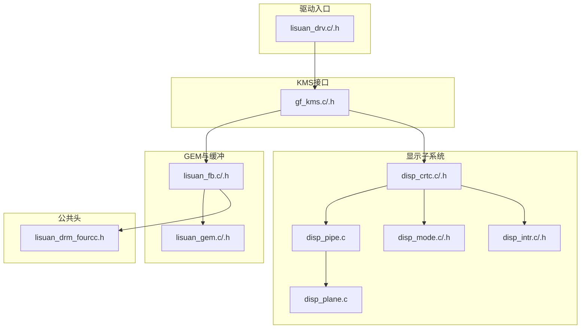
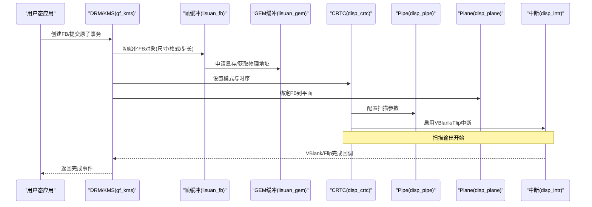
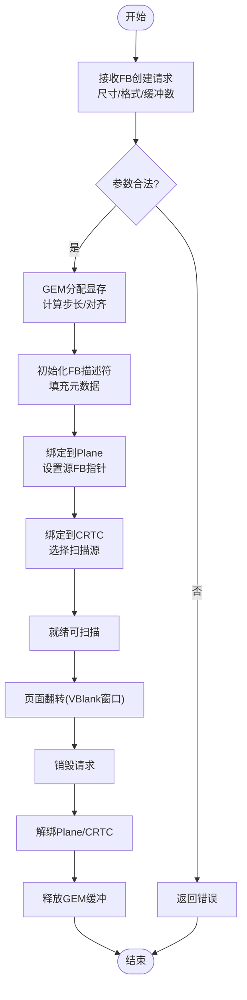
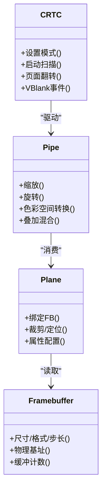
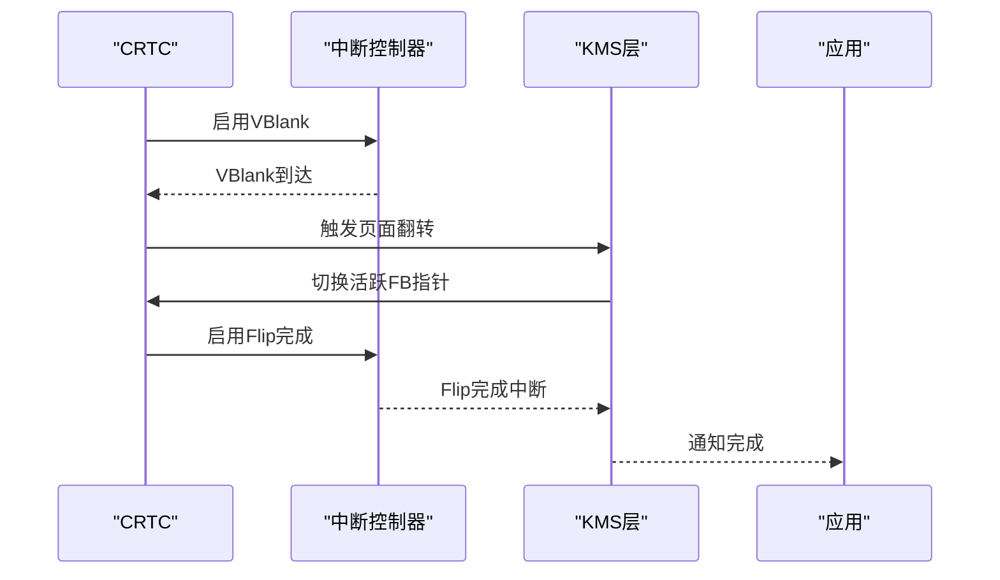
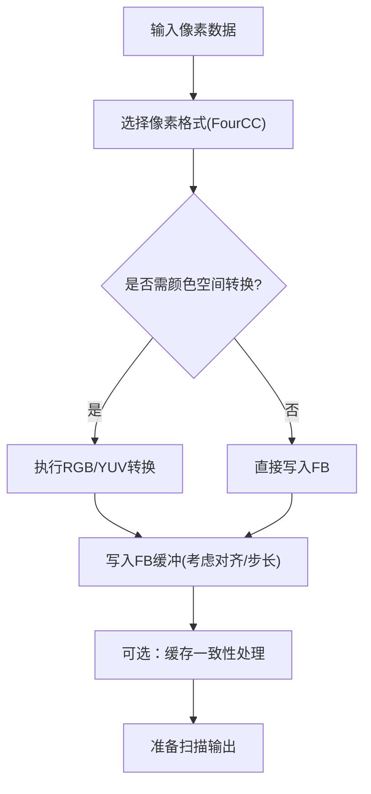
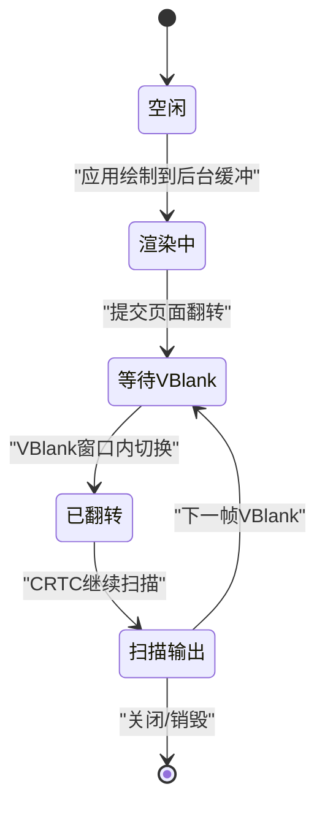
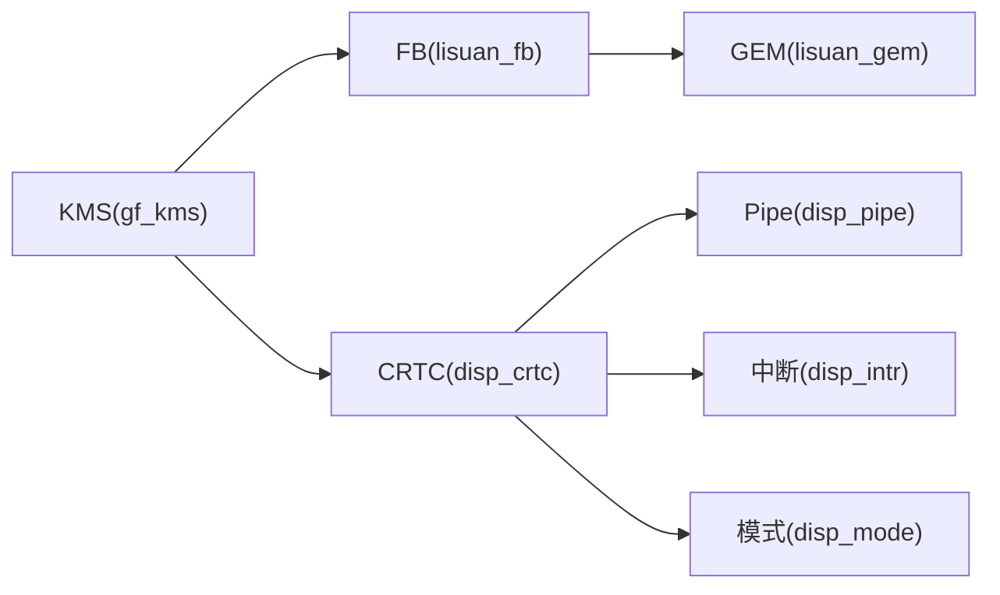

# 帧缓冲管理

<cite>
**本文引用的文件**   
- [lisuan_fb.c](file://_work/src/usr/src/lisuangpu-dkms-262.2.0.56/lisuan_fb.c)
- [lisuan_fb.h](file://_work/src/usr/src/lisuangpu-dkms-262.2.0.56/lisuan_fb.h)
- [lisuan_gem.c](file://_work/src/usr/src/lisuangpu-dkms-262.2.0.56/lisuan_gem.c)
- [lisuan_gem.h](file://_work/src/usr/src/lisuangpu-dkms-262.2.0.56/lisuan_gem.h)
- [display.c](file://_work/src/usr/src/lisuangpu-dkms-262.2.0.56/display/display.c)
- [display.h](file://_work/src/usr/src/lisuangpu-dkms-262.2.0.56/display/display.h)
- [disp_crtc.c](file://_work/src/usr/src/lisuangpu-dkms-262.2.0.56/display/crtc/disp_crtc.c)
- [disp_crtc.h](file://_work/src/usr/src/lisuangpu-dkms-262.2.0.56/display/crtc/disp_crtc.h)
- [disp_pipe.c](file://_work/src/usr/src/lisuangpu-dkms-262.2.0.56/display/crtc/disp_pipe.c)
- [disp_plane.c](file://_work/src/usr/src/lisuangpu-dkms-262.2.0.56/display/crtc/disp_plane.c)
- [lisuan_drv.c](file://_work/src/usr/src/lisuangpu-dkms-262.2.0.56/lisuan_drv.c)
- [lisuan_drv.h](file://_work/src/usr/src/lisuangpu-dkms-262.2.0.56/lisuan_drv.h)
- [gf_kms.c](file://_work/src/usr/src/lisuangpu-dkms-262.2.0.56/kms/gf_kms.c)
- [gf_kms.h](file://_work/src/usr/src/lisuangpu-dkms-262.2.0.56/kms/gf_kms.h)
- [lisuan_drm_fourcc.h](file://_work/src/usr/src/lisuangpu-dkms-262.2.0.56/include/lisuan_drm_fourcc.h)
- [disp_mode.c](file://_work/src/usr/src/lisuangpu-dkms-262.2.0.56/display/connector/disp_mode.c)
- [disp_mode.h](file://_work/src/usr/src/lisuangpu-dkms-262.2.0.56/display/connector/disp_mode.h)
- [disp_intr.c](file://_work/src/usr/src/lisuangpu-dkms-262.2.0.56/display/intr/disp_intr.c)
- [disp_intr.h](file://_work/src/usr/src/lisuangpu-dkms-262.2.0.56/display/intr/disp_intr.h)
</cite>

## 目录
1. [简介](#简介)
2. [项目结构](#项目结构)
3. [核心组件](#核心组件)
4. [架构总览](#架构总览)
5. [详细组件分析](#详细组件分析)
6. [依赖关系分析](#依赖关系分析)
7. [性能考量](#性能考量)
8. [故障排查指南](#故障排查指南)
9. [结论](#结论)
10. [附录](#附录)

## 简介
本技术文档面向丽山GPU的帧缓冲管理系统，系统性阐述帧缓冲对象（FB）的创建、管理与销毁流程；说明与显示引擎（CRTC/Pipe/Plane）的集成方式、扫描输出机制与刷新同步；深入分析内存布局、像素格式支持与颜色空间转换；并覆盖双缓冲、页面翻转与垂直同步的实现细节。同时提供配置选项、性能监控与调试方法，以及从用户态到内核态的交互示例路径，帮助开发者快速上手与排障。

## 项目结构
本项目采用分层组织：
- 驱动入口与设备初始化：lisuan_drv.*
- KMS接口层：gf_kms.*
- GEM内存与缓冲对象：lisuan_gem.*
- 帧缓冲抽象与管理：lisuan_fb.*
- 显示子系统（CRTC/Pipe/Plane/Connector/Encoder）：display/*
- 中断与同步：display/intr/*
- 模式与时序：display/connector/disp_mode.*
- 像素格式定义：include/lisuan_drm_fourcc.h

图表来源
- [lisuan_drv.c](file://_work/src/usr/src/lisuangpu-dkms-262.2.0.56/lisuan_drv.c)
- [gf_kms.c](file://_work/src/usr/src/lisuangpu-dkms-262.2.0.56/kms/gf_kms.c)
- [lisuan_gem.c](file://_work/src/usr/src/lisuangpu-dkms-262.2.0.56/lisuan_gem.c)
- [lisuan_fb.c](file://_work/src/usr/src/lisuangpu-dkms-262.2.0.56/lisuan_fb.c)
- [disp_crtc.c](file://_work/src/usr/src/lisuangpu-dkms-262.2.0.56/display/crtc/disp_crtc.c)
- [disp_pipe.c](file://_work/src/usr/src/lisuangpu-dkms-262.2.0.56/display/crtc/disp_pipe.c)
- [disp_plane.c](file://_work/src/usr/src/lisuangpu-dkms-262.2.0.56/display/crtc/disp_plane.c)
- [disp_mode.c](file://_work/src/usr/src/lisuangpu-dkms-262.2.0.56/display/connector/disp_mode.c)
- [disp_intr.c](file://_work/src/usr/src/lisuangpu-dkms-262.2.0.56/display/intr/disp_intr.c)
- [lisuan_drm_fourcc.h](file://_work/src/usr/src/lisuangpu-dkms-262.2.0.56/include/lisuan_drm_fourcc.h)

章节来源
- [lisuan_drv.c](file://_work/src/usr/src/lisuangpu-dkms-262.2.0.56/lisuan_drv.c)
- [lisuan_drv.h](file://_work/src/usr/src/lisuangpu-dkms-262.2.0.56/lisuan_drv.h)
- [gf_kms.c](file://_work/src/usr/src/lisuangpu-dkms-262.2.0.56/kms/gf_kms.c)
- [gf_kms.h](file://_work/src/usr/src/lisuangpu-dkms-262.2.0.56/kms/gf_kms.h)

## 核心组件
- 帧缓冲抽象（lisuan_fb）：封装DRM帧缓冲对象的生命周期，包括创建、映射、更新与销毁，协调GEM缓冲与显示管线。
- GEM缓冲（lisuan_gem）：负责显存分配、物理地址获取、缓存一致性处理及共享内存语义。
- KMS接口（gf_kms）：暴露DRM/KMS API，将用户态请求转译为内核态操作，协调FB、CRTC、Plane等。
- 显示引擎（CRTC/Pipe/Plane）：实现扫描输出、混合、缩放、旋转、色彩空间转换与页面翻转。
- 模式与时序（disp_mode）：解析EDID/BIOS信息，生成时序参数，供CRTC使用。
- 中断与同步（disp_intr）：VBLANK/Flip完成中断，驱动垂直同步与页面翻转完成通知。

章节来源
- [lisuan_fb.c](file://_work/src/usr/src/lisuangpu-dkms-262.2.0.56/lisuan_fb.c)
- [lisuan_fb.h](file://_work/src/usr/src/lisuangpu-dkms-262.2.0.56/lisuan_fb.h)
- [lisuan_gem.c](file://_work/src/usr/src/lisuangpu-dkms-262.2.0.56/lisuan_gem.c)
- [lisuan_gem.h](file://_work/src/usr/src/lisuangpu-dkms-262.2.0.56/lisuan_gem.h)
- [gf_kms.c](file://_work/src/usr/src/lisuangpu-dkms-262.2.0.56/kms/gf_kms.c)
- [gf_kms.h](file://_work/src/usr/src/lisuangpu-dkms-262.2.0.56/kms/gf_kms.h)
- [disp_crtc.c](file://_work/src/usr/src/lisuangpu-dkms-262.2.0.56/display/crtc/disp_crtc.c)
- [disp_crtc.h](file://_work/src/usr/src/lisuangpu-dkms-262.2.0.56/display/crtc/disp_crtc.h)
- [disp_pipe.c](file://_work/src/usr/src/lisuangpu-dkms-262.2.0.56/display/crtc/disp_pipe.c)
- [disp_plane.c](file://_work/src/usr/src/lisuangpu-dkms-262.2.0.56/display/crtc/disp_plane.c)
- [disp_mode.c](file://_work/src/usr/src/lisuangpu-dkms-262.2.0.56/display/connector/disp_mode.c)
- [disp_mode.h](file://_work/src/usr/src/lisuangpu-dkms-262.2.0.56/display/connector/disp_mode.h)
- [disp_intr.c](file://_work/src/usr/src/lisuangpu-dkms-262.2.0.56/display/intr/disp_intr.c)
- [disp_intr.h](file://_work/src/usr/src/lisuangpu-dkms-262.2.0.56/display/intr/disp_intr.h)

## 架构总览
下图展示从用户态到硬件的关键调用链与数据流，涵盖FB创建、绑定至Plane/CRTC、扫描输出与VSync/Flip完成。

图表来源
- [gf_kms.c](file://_work/src/usr/src/lisuangpu-dkms-262.2.0.56/kms/gf_kms.c)
- [lisuan_fb.c](file://_work/src/usr/src/lisuangpu-dkms-262.2.0.56/lisuan_fb.c)
- [lisuan_gem.c](file://_work/src/usr/src/lisuangpu-dkms-262.2.0.56/lisuan_gem.c)
- [disp_crtc.c](file://_work/src/usr/src/lisuangpu-dkms-262.2.0.56/display/crtc/disp_crtc.c)
- [disp_pipe.c](file://_work/src/usr/src/lisuangpu-dkms-262.2.0.56/display/crtc/disp_pipe.c)
- [disp_plane.c](file://_work/src/usr/src/lisuangpu-dkms-262.2.0.56/display/crtc/disp_plane.c)
- [disp_intr.c](file://_work/src/usr/src/lisuangpu-dkms-262.2.0.56/display/intr/disp_intr.c)

## 详细组件分析

### 帧缓冲对象生命周期（创建、管理与销毁）
- 创建流程
  - 用户态通过DRM/KMS接口请求创建FB，指定尺寸、像素格式、缓冲区数量（单/双缓冲）。
  - 内核态在lisuan_fb中构造FB描述符，计算步长、对齐与偏移，关联GEM缓冲对象。
  - lisuan_gem负责分配显存、建立页表映射、处理缓存一致性（如需要）。
- 管理流程
  - 绑定到Plane：将FB的物理基址与元数据写入Plane寄存器，支持裁剪、缩放、旋转、颜色空间转换。
  - 绑定到CRTC：设置当前扫描源为某Plane，CRTC根据模式与时序进行扫描输出。
  - 页面翻转：在VBlank窗口内切换活跃FB指针，避免撕裂。
- 销毁流程
  - 解除Plane/CRTC引用，释放GEM缓冲，清理映射与同步对象。

图表来源
- [lisuan_fb.c](file://_work/src/usr/src/lisuangpu-dkms-262.2.0.56/lisuan_fb.c)
- [lisuan_gem.c](file://_work/src/usr/src/lisuangpu-dkms-262.2.0.56/lisuan_gem.c)
- [disp_plane.c](file://_work/src/usr/src/lisuangpu-dkms-262.2.0.56/display/crtc/disp_plane.c)
- [disp_crtc.c](file://_work/src/usr/src/lisuangpu-dkms-262.2.0.56/display/crtc/disp_crtc.c)

章节来源
- [lisuan_fb.c](file://_work/src/usr/src/lisuangpu-dkms-262.2.0.56/lisuan_fb.c)
- [lisuan_fb.h](file://_work/src/usr/src/lisuangpu-dkms-262.2.0.56/lisuan_fb.h)
- [lisuan_gem.c](file://_work/src/usr/src/lisuangpu-dkms-262.2.0.56/lisuan_gem.c)
- [lisuan_gem.h](file://_work/src/usr/src/lisuangpu-dkms-262.2.0.56/lisuan_gem.h)
- [disp_plane.c](file://_work/src/usr/src/lisuangpu-dkms-262.2.0.56/display/crtc/disp_plane.c)
- [disp_crtc.c](file://_work/src/usr/src/lisuangpu-dkms-262.2.0.56/display/crtc/disp_crtc.c)

### 与显示引擎的集成（CRTC/Pipe/Plane）
- CRTC：负责模式设置、扫描时序、VBlank事件、页面翻转控制。
- Pipe：执行像素流水线（缩放、旋转、色彩空间转换、叠加）。
- Plane：作为FB的输入源，支持多平面合成。
- 集成要点
  - FB必须满足对齐与格式要求，由FourCC定义。
  - 页面翻转需在VBlank窗口内安全切换，避免撕裂。
  - 颜色空间转换（如RGB↔YUV）由Pipe或专用模块处理。

图表来源
- [disp_crtc.c](file://_work/src/usr/src/lisuangpu-dkms-262.2.0.56/display/crtc/disp_crtc.c)
- [disp_crtc.h](file://_work/src/usr/src/lisuangpu-dkms-262.2.0.56/display/crtc/disp_crtc.h)
- [disp_pipe.c](file://_work/src/usr/src/lisuangpu-dkms-262.2.0.56/display/crtc/disp_pipe.c)
- [disp_plane.c](file://_work/src/usr/src/lisuangpu-dkms-262.2.0.56/display/crtc/disp_plane.c)
- [lisuan_fb.c](file://_work/src/usr/src/lisuangpu-dkms-262.2.0.56/lisuan_fb.c)

章节来源
- [disp_crtc.c](file://_work/src/usr/src/lisuangpu-dkms-262.2.0.56/display/crtc/disp_crtc.c)
- [disp_crtc.h](file://_work/src/usr/src/lisuangpu-dkms-262.2.0.56/display/crtc/disp_crtc.h)
- [disp_pipe.c](file://_work/src/usr/src/lisuangpu-dkms-262.2.0.56/display/crtc/disp_pipe.c)
- [disp_plane.c](file://_work/src/usr/src/lisuangpu-dkms-262.2.0.56/display/crtc/disp_plane.c)

### 扫描输出机制与刷新同步
- 扫描输出：CRTC按模式与时序逐行读取Plane输出的像素数据，经Pipe处理后送至编码器/连接器。
- 刷新同步：
  - VBlank中断用于标记一帧结束，确保页面翻转在安全窗口执行。
  - 页面翻转完成后触发Flip完成中断，通知上层应用。
- 关键路径
  - 模式设置 → 启动扫描 → VBlank等待 → 页面翻转 → Flip完成中断。

图表来源
- [disp_crtc.c](file://_work/src/usr/src/lisuangpu-dkms-262.2.0.56/display/crtc/disp_crtc.c)
- [disp_intr.c](file://_work/src/usr/src/lisuangpu-dkms-262.2.0.56/display/intr/disp_intr.c)
- [gf_kms.c](file://_work/src/usr/src/lisuangpu-dkms-262.2.0.56/kms/gf_kms.c)

章节来源
- [disp_crtc.c](file://_work/src/usr/src/lisuangpu-dkms-262.2.0.56/display/crtc/disp_crtc.c)
- [disp_intr.c](file://_work/src/usr/src/lisuangpu-dkms-262.2.0.56/display/intr/disp_intr.c)
- [gf_kms.c](file://_work/src/usr/src/lisuangpu-dkms-262.2.0.56/kms/gf_kms.c)

### 内存布局、像素格式与颜色空间转换
- 内存布局
  - FB包含多个缓冲（双缓冲/三缓冲），每个缓冲有基址、步长、行高、像素格式。
  - 对齐要求通常由硬件限制（如块大小、缓存行对齐）。
- 像素格式
  - 由FourCC定义（如RGB888、XRGB8888、NV12等），不同格式影响步长与采样方式。
- 颜色空间转换
  - Pipe或专用模块支持RGB↔YUV转换，HDR扩展需额外元数据。
  - 转换质量与性能受分辨率、帧率与硬件能力影响。

图表来源
- [lisuan_fb.c](file://_work/src/usr/src/lisuangpu-dkms-262.2.0.56/lisuan_fb.c)
- [lisuan_gem.c](file://_work/src/usr/src/lisuangpu-dkms-262.2.0.56/lisuan_gem.c)
- [lisuan_drm_fourcc.h](file://_work/src/usr/src/lisuangpu-dkms-262.2.0.56/include/lisuan_drm_fourcc.h)
- [disp_pipe.c](file://_work/src/usr/src/lisuangpu-dkms-262.2.0.56/display/crtc/disp_pipe.c)

章节来源
- [lisuan_fb.c](file://_work/src/usr/src/lisuangpu-dkms-262.2.0.56/lisuan_fb.c)
- [lisuan_gem.c](file://_work/src/usr/src/lisuangpu-dkms-262.2.0.56/lisuan_gem.c)
- [lisuan_drm_fourcc.h](file://_work/src/usr/src/lisuangpu-dkms-262.2.0.56/include/lisuan_drm_fourcc.h)
- [disp_pipe.c](file://_work/src/usr/src/lisuangpu-dkms-262.2.0.56/display/crtc/disp_pipe.c)

### 双缓冲、页面翻转与垂直同步
- 双缓冲机制
  - 前台缓冲（正在扫描）与后台缓冲（渲染目标）分离，减少撕裂。
  - 渲染完成后在VBlank窗口内切换指针。
- 页面翻转
  - 原子事务中提交新FB，CRTC在合适时机切换。
  - 支持异步提交与同步等待。
- 垂直同步
  - VBlank中断保证时序正确性，避免画面撕裂。
  - Flip完成中断用于应用侧同步。

图表来源
- [disp_crtc.c](file://_work/src/usr/src/lisuangpu-dkms-262.2.0.56/display/crtc/disp_crtc.c)
- [disp_intr.c](file://_work/src/usr/src/lisuangpu-dkms-262.2.0.56/display/intr/disp_intr.c)
- [gf_kms.c](file://_work/src/usr/src/lisuangpu-dkms-262.2.0.56/kms/gf_kms.c)

章节来源
- [disp_crtc.c](file://_work/src/usr/src/lisuangpu-dkms-262.2.0.56/display/crtc/disp_crtc.c)
- [disp_intr.c](file://_work/src/usr/src/lisuangpu-dkms-262.2.0.56/display/intr/disp_intr.c)
- [gf_kms.c](file://_work/src/usr/src/lisuangpu-dkms-262.2.0.56/kms/gf_kms.c)

### 代码示例与交互路径（不展示具体代码内容）
- 创建FB并绑定到Plane/CRTC
  - 参考路径：[lisuan_fb.c](file://_work/src/usr/src/lisuangpu-dkms-262.2.0.56/lisuan_fb.c)、[lisuan_gem.c](file://_work/src/usr/src/lisuangpu-dkms-262.2.0.56/lisuan_gem.c)、[disp_plane.c](file://_work/src/usr/src/lisuangpu-dkms-262.2.0.56/display/crtc/disp_plane.c)、[disp_crtc.c](file://_work/src/usr/src/lisuangpu-dkms-262.2.0.56/display/crtc/disp_crtc.c)
- 页面翻转与VSync等待
  - 参考路径：[gf_kms.c](file://_work/src/usr/src/lisuangpu-dkms-262.2.0.56/kms/gf_kms.c)、[disp_crtc.c](file://_work/src/usr/src/lisuangpu-dkms-262.2.0.56/display/crtc/disp_crtc.c)、[disp_intr.c](file://_work/src/usr/src/lisuangpu-dkms-262.2.0.56/display/intr/disp_intr.c)
- 销毁FB与资源释放
  - 参考路径：[lisuan_fb.c](file://_work/src/usr/src/lisuangpu-dkms-262.2.0.56/lisuan_fb.c)、[lisuan_gem.c](file://_work/src/usr/src/lisuangpu-dkms-262.2.0.56/lisuan_gem.c)

章节来源
- [lisuan_fb.c](file://_work/src/usr/src/lisuangpu-dkms-262.2.0.56/lisuan_fb.c)
- [lisuan_gem.c](file://_work/src/usr/src/lisuangpu-dkms-262.2.0.56/lisuan_gem.c)
- [disp_plane.c](file://_work/src/usr/src/lisuangpu-dkms-262.2.0.56/display/crtc/disp_plane.c)
- [disp_crtc.c](file://_work/src/usr/src/lisuangpu-dkms-262.2.0.56/display/crtc/disp_crtc.c)
- [gf_kms.c](file://_work/src/usr/src/lisuangpu-dkms-262.2.0.56/kms/gf_kms.c)
- [disp_intr.c](file://_work/src/usr/src/lisuangpu-dkms-262.2.0.56/display/intr/disp_intr.c)

## 依赖关系分析
- 模块耦合
  - KMS层依赖FB/GEM/CRTC/Plane，形成清晰的分层。
  - FB与GEM强耦合（内存管理），与显示子系统松耦合（通过标准接口）。
- 外部依赖
  - 模式与时序依赖连接器/编码器（HDMI/DP等）。
  - 中断依赖底层中断控制器。

图表来源
- [gf_kms.c](file://_work/src/usr/src/lisuangpu-dkms-262.2.0.56/kms/gf_kms.c)
- [lisuan_fb.c](file://_work/src/usr/src/lisuangpu-dkms-262.2.0.56/lisuan_fb.c)
- [lisuan_gem.c](file://_work/src/usr/src/lisuangpu-dkms-262.2.0.56/lisuan_gem.c)
- [disp_crtc.c](file://_work/src/usr/src/lisuangpu-dkms-262.2.0.56/display/crtc/disp_crtc.c)
- [disp_pipe.c](file://_work/src/usr/src/lisuangpu-dkms-262.2.0.56/display/crtc/disp_pipe.c)
- [disp_mode.c](file://_work/src/usr/src/lisuangpu-dkms-262.2.0.56/display/connector/disp_mode.c)
- [disp_intr.c](file://_work/src/usr/src/lisuangpu-dkms-262.2.0.56/display/intr/disp_intr.c)

章节来源
- [gf_kms.c](file://_work/src/usr/src/lisuangpu-dkms-262.2.0.56/kms/gf_kms.c)
- [lisuan_fb.c](file://_work/src/usr/src/lisuangpu-dkms-262.2.0.56/lisuan_fb.c)
- [lisuan_gem.c](file://_work/src/usr/src/lisuangpu-dkms-262.2.0.56/lisuan_gem.c)
- [disp_crtc.c](file://_work/src/usr/src/lisuangpu-dkms-262.2.0.56/display/crtc/disp_crtc.c)
- [disp_mode.c](file://_work/src/usr/src/lisuangpu-dkms-262.2.0.56/display/connector/disp_mode.c)
- [disp_intr.c](file://_work/src/usr/src/lisuangpu-dkms-262.2.0.56/display/intr/disp_intr.c)

## 性能考量
- 内存带宽
  - 高分辨率与高帧率下，FB读写带宽成为瓶颈，建议合理选择像素格式与压缩。
- 缓存一致性
  - CPU/GPU共享内存时需正确处理缓存一致性，避免脏数据导致显示异常。
- 页面翻转开销
  - 频繁翻转会增加中断与调度开销，建议批量提交与最小化变更。
- 颜色空间转换
  - 实时转换消耗算力，尽量在源头提供匹配格式以减少转换。

## 故障排查指南
- 常见问题
  - 画面撕裂：检查VBlank与页面翻转时序是否正确。
  - 黑屏/花屏：确认FB基址、步长、对齐与格式设置。
  - 卡顿/掉帧：分析VBlank等待与CPU/GPU负载。
- 调试手段
  - 打印关键路径日志（FB创建、绑定、翻转）。
  - 使用系统工具监控中断与延迟（VBlank/Flip完成）。
  - 验证模式与时序参数是否符合显示器规格。

章节来源
- [disp_crtc.c](file://_work/src/usr/src/lisuangpu-dkms-262.2.0.56/display/crtc/disp_crtc.c)
- [disp_intr.c](file://_work/src/usr/src/lisuangpu-dkms-262.2.0.56/display/intr/disp_intr.c)
- [lisuan_fb.c](file://_work/src/usr/src/lisuangpu-dkms-262.2.0.56/lisuan_fb.c)
- [lisuan_gem.c](file://_work/src/usr/src/lisuangpu-dkms-262.2.0.56/lisuan_gem.c)

## 结论
丽山GPU的帧缓冲管理系统以清晰的层次结构与模块化设计，实现了高效的FB生命周期管理、与显示引擎的深度集成以及可靠的刷新同步。通过合理的内存布局、像素格式支持与颜色空间转换策略，结合双缓冲与页面翻转机制，可在保证画质的同时提升性能与稳定性。开发者应重点关注VBlank时序、缓存一致性与资源释放，以获得最佳体验。

## 附录
- 配置选项
  - 像素格式选择：依据应用场景与硬件能力权衡带宽与画质。
  - 缓冲数量：双缓冲适合低延迟，三缓冲可降低卡顿但增加显存占用。
  - 颜色空间：根据输入源与显示器能力选择RGB或YUV。
- 性能监控
  - 统计VBlank/Flip中断频率与延迟。
  - 监控显存使用与带宽利用率。
- 调试方法
  - 启用详细日志，记录FB创建/绑定/翻转过程。
  - 使用示波器或逻辑分析仪验证时序信号。