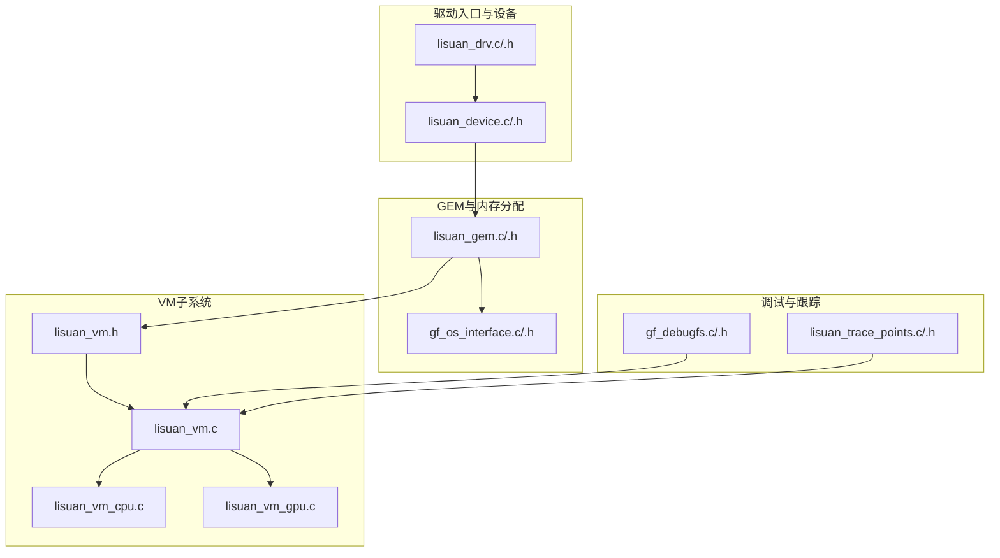
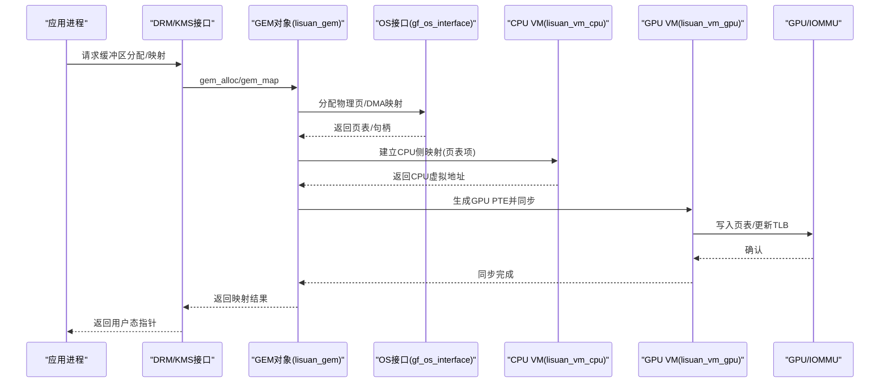
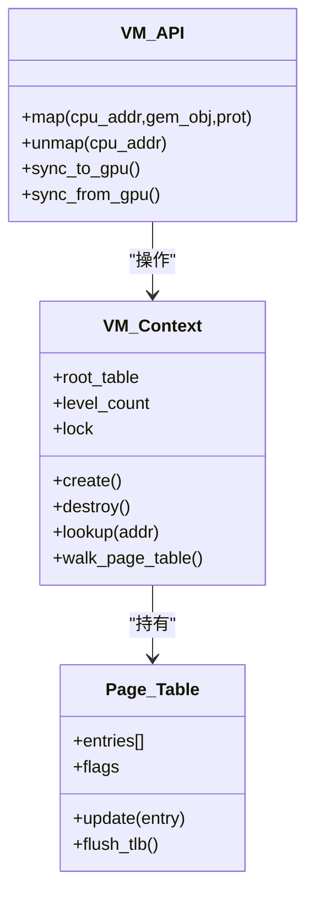
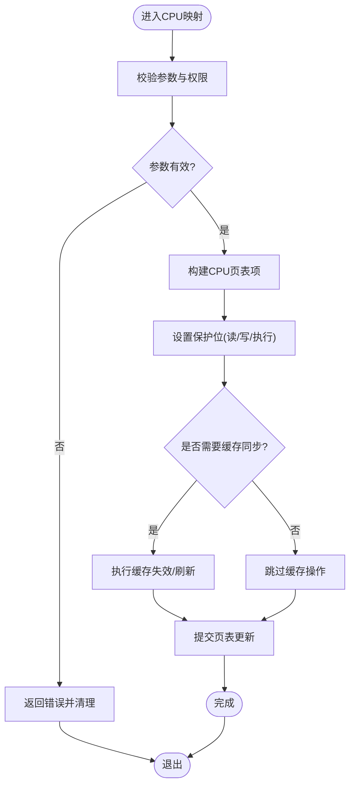
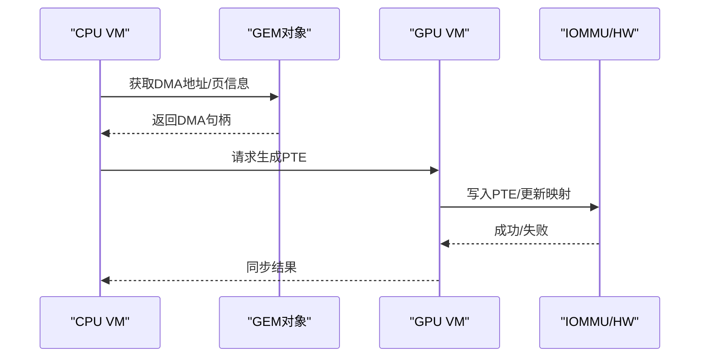
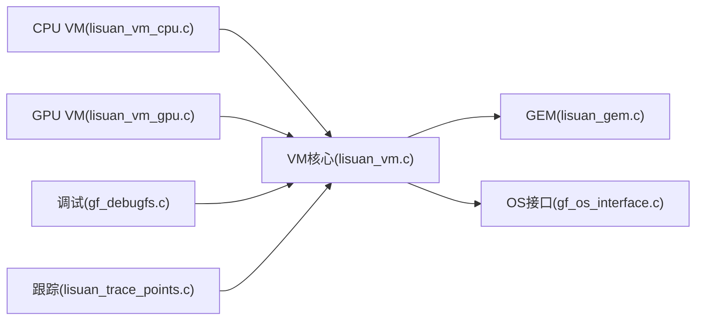

# CPU侧虚拟内存管理

<cite>
**本文档引用的文件**   
- [lisuan_vm.c](file://_work/src/usr/src/lisuangpu-dkms-262.2.0.56/lisuan_vm.c)
- [lisuan_vm.h](file://_work/src/usr/src/lisuangpu-dkms-262.2.0.56/lisuan_vm.h)
- [lisuan_vm_cpu.c](file://_work/src/usr/src/lisuangpu-dkms-262.2.0.56/lisuan_vm_cpu.c)
- [lisuan_vm_gpu.c](file://_work/src/usr/src/lisuangpu-dkms-262.2.0.56/lisuan_vm_gpu.c)
- [lisuan_gem.c](file://_work/src/usr/src/lisuangpu-dkms-262.2.0.56/lisuan_gem.c)
- [lisuan_gem.h](file://_work/src/usr/src/lisuangpu-dkms-262.2.0.56/lisuan_gem.h)
- [gf_os_interface.c](file://_work/src/usr/src/lisuangpu-dkms-262.2.0.56/gf_os_interface.c)
- [gf_os_interface.h](file://_work/src/usr/src/lisuangpu-dkms-262.2.0.56/gf_os_interface.h)
- [lisuan_drv.c](file://_work/src/usr/src/lisuangpu-dkms-262.2.0.56/lisuan_drv.c)
- [lisuan_drv.h](file://_work/src/usr/src/lisuangpu-dkms-262.2.0.56/lisuan_drv.h)
- [lisuan_device.c](file://_work/src/usr/src/lisuangpu-dkms-262.2.0.56/lisuan_device.c)
- [lisuan_device.h](file://_work/src/usr/src/lisuangpu-dkms-262.2.0.56/lisuan_device.h)
- [gf_debugfs.c](file://_work/src/usr/src/lisuangpu-dkms-262.2.0.56/gf_debugfs.c)
- [gf_debugfs.h](file://_work/src/usr/src/lisuangpu-dkms-262.2.0.56/gf_debugfs.h)
- [lisuan_trace_points.c](file://_work/src/usr/src/lisuangpu-dkms-262.2.0.56/lisuan_trace_points.c)
- [lisuan_trace.h](file://_work/src/usr/src/lisuangpu-dkms-262.2.0.56/lisuan_trace.h)
</cite>

## 目录
1. [简介](#简介)
2. [项目结构](#项目结构)
3. [核心组件](#核心组件)
4. [架构总览](#架构总览)
5. [详细组件分析](#详细组件分析)
6. [依赖关系分析](#依赖关系分析)
7. [性能考量](#性能考量)
8. [故障排查指南](#故障排查指南)
9. [结论](#结论)
10. [附录](#附录)

## 简介
本技术文档聚焦于丽山GPU驱动中CPU侧的虚拟内存管理模块，围绕以下目标展开：
- 解释CPU地址空间的分配与管理机制，包括用户空间与内核空间的内存布局。
- 深入分析页表创建、更新与同步过程，以及CPU缓存一致性维护策略。
- 说明CPU侧的内存映射操作、页面保护机制与访问权限控制。
- 提供内存泄漏检测、调试工具使用与性能监控方法。
- 阐述与Linux内核内存管理子系统的集成方式与接口适配。
- 给出具体代码示例路径，展示如何进行CPU侧内存操作与调试技巧。

该模块位于内核态驱动层，负责将GEM对象（图形显存/系统内存）映射到CPU可访问的地址空间，并协调与GPU侧VM的同步与一致性。

## 项目结构
与CPU侧虚拟内存管理相关的核心源码集中在以下文件：
- VM抽象与通用逻辑：lisuan_vm.c / lisuan_vm.h
- CPU侧VM实现：lisuan_vm_cpu.c
- GPU侧VM实现：lisuan_vm_gpu.c
- GEM对象与内存分配：lisuan_gem.c / lisuan_gem.h
- OS抽象与内核接口：gf_os_interface.c / gf_os_interface.h
- 驱动入口与设备上下文：lisuan_drv.c / lisuan_drv.h, lisuan_device.c / lisuan_device.h
- 调试与跟踪：gf_debugfs.c / gf_debugfs.h, lisuan_trace_points.c / lisuan_trace.h

图表来源
- [lisuan_drv.c](file://_work/src/usr/src/lisuangpu-dkms-262.2.0.56/lisuan_drv.c)
- [lisuan_device.c](file://_work/src/usr/src/lisuangpu-dkms-262.2.0.56/lisuan_device.c)
- [lisuan_gem.c](file://_work/src/usr/src/lisuangpu-dkms-262.2.0.56/lisuan_gem.c)
- [gf_os_interface.c](file://_work/src/usr/src/lisuangpu-dkms-262.2.0.56/gf_os_interface.c)
- [lisuan_vm.c](file://_work/src/usr/src/lisuangpu-dkms-262.2.0.56/lisuan_vm.c)
- [lisuan_vm_cpu.c](file://_work/src/usr/src/lisuangpu-dkms-262.2.0.56/lisuan_vm_cpu.c)
- [lisuan_vm_gpu.c](file://_work/src/usr/src/lisuangpu-dkms-262.2.0.56/lisuan_vm_gpu.c)
- [gf_debugfs.c](file://_work/src/usr/src/lisuangpu-dkms-262.2.0.56/gf_debugfs.c)
- [lisuan_trace_points.c](file://_work/src/usr/src/lisuangpu-dkms-262.2.0.56/lisuan_trace_points.c)

章节来源
- [lisuan_vm.c](file://_work/src/usr/src/lisuangpu-dkms-262.2.0.56/lisuan_vm.c)
- [lisuan_vm.h](file://_work/src/usr/src/lisuangpu-dkms-262.2.0.56/lisuan_vm.h)
- [lisuan_vm_cpu.c](file://_work/src/usr/src/lisuangpu-dkms-262.2.0.56/lisuan_vm_cpu.c)
- [lisuan_vm_gpu.c](file://_work/src/usr/src/lisuangpu-dkms-262.2.0.56/lisuan_vm_gpu.c)
- [lisuan_gem.c](file://_work/src/usr/src/lisuangpu-dkms-262.2.0.56/lisuan_gem.c)
- [gf_os_interface.c](file://_work/src/usr/src/lisuangpu-dkms-262.2.0.56/gf_os_interface.c)
- [lisuan_drv.c](file://_work/src/usr/src/lisuangpu-dkms-262.2.0.56/lisuan_drv.c)
- [lisuan_device.c](file://_work/src/usr/src/lisuangpu-dkms-262.2.0.56/lisuan_device.c)
- [gf_debugfs.c](file://_work/src/usr/src/lisuangpu-dkms-262.2.0.56/gf_debugfs.c)
- [lisuan_trace_points.c](file://_work/src/usr/src/lisuanggpu-dkms-262.2.0.56/lisuan_trace_points.c)

## 核心组件
- VM抽象层（lisuan_vm.c/h）：定义VM上下文、页表描述符、映射生命周期与同步原语；提供统一的API供CPU/GPU侧实现调用。
- CPU侧VM（lisuan_vm_cpu.c）：实现CPU地址空间内的映射、解映射、页表构建与刷新、缓存一致性处理（如需要）。
- GPU侧VM（lisuan_vm_gpu.c）：实现GPU页表项（PTE）生成、IOMMU/PCIe DMA映射、与CPU侧页表的同步。
- GEM对象（lisuan_gem.c/h）：封装图形缓冲区的分配、引用计数、共享与映射；为VM提供底层物理页或DMA句柄。
- OS接口（gf_os_interface.c/h）：封装Linux内核内存管理接口（如kmalloc/vmalloc、page alloc、dma mapping、mmap等），屏蔽平台差异。
- 调试与跟踪（gf_debugfs.c/h, lisuan_trace_points.c/h）：暴露调试节点与trace点，便于观察VM状态、映射统计与性能指标。

章节来源
- [lisuan_vm.c](file://_work/src/usr/src/lisuangpu-dkms-262.2.0.56/lisuan_vm.c)
- [lisuan_vm.h](file://_work/src/usr/src/lisuangpu-dkms-262.2.0.56/lisuan_vm.h)
- [lisuan_vm_cpu.c](file://_work/src/usr/src/lisuangpu-dkms-262.2.0.56/lisuan_vm_cpu.c)
- [lisuan_vm_gpu.c](file://_work/src/usr/src/lisuangpu-dkms-262.2.0.56/lisuan_vm_gpu.c)
- [lisuan_gem.c](file://_work/src/usr/src/lisuangpu-dkms-262.2.0.56/lisuan_gem.c)
- [gf_os_interface.c](file://_work/src/usr/src/lisuangpu-dkms-262.2.0.56/gf_os_interface.c)
- [gf_debugfs.c](file://_work/src/usr/src/lisuangpu-dkms-262.2.0.56/gf_debugfs.c)
- [lisuan_trace_points.c](file://_work/src/usr/src/lisuangpu-dkms-262.2.0.56/lisuan_trace_points.c)

## 架构总览
下图展示了CPU侧虚拟内存管理与Linux内核内存子系统、GEM对象及GPU侧VM之间的交互关系。

图表来源
- [lisuan_gem.c](file://_work/src/usr/src/lisuangpu-dkms-262.2.0.56/lisuan_gem.c)
- [gf_os_interface.c](file://_work/src/usr/src/lisuangpu-dkms-262.2.0.56/gf_os_interface.c)
- [lisuan_vm_cpu.c](file://_work/src/usr/src/lisuangpu-dkms-262.2.0.56/lisuan_vm_cpu.c)
- [lisuan_vm_gpu.c](file://_work/src/usr/src/lisuangpu-dkms-262.2.0.56/lisuan_vm_gpu.c)

## 详细组件分析

### VM抽象层与生命周期
- 职责：定义VM上下文结构、页表根/级别、映射区间、锁与同步原语；提供创建、销毁、查询、遍历等统一接口。
- 关键点：
  - 页表层级与粒度：根据硬件页大小（如4KB/2MB）配置多级页表。
  - 并发安全：读写分离锁保护页表更新，避免竞态。
  - 错误处理：对重复映射、越界、权限冲突进行校验与回滚。

图表来源
- [lisuan_vm.h](file://_work/src/usr/src/lisuangpu-dkms-262.2.0.56/lisuan_vm.h)
- [lisuan_vm.c](file://_work/src/usr/src/lisuangpu-dkms-262.2.0.56/lisuan_vm.c)

章节来源
- [lisuan_vm.h](file://_work/src/usr/src/lisuangpu-dkms-262.2.0.56/lisuan_vm.h)
- [lisuan_vm.c](file://_work/src/usr/src/lisuangpu-dkms-262.2.0.56/lisuan_vm.c)

### CPU侧VM实现（lisuan_vm_cpu.c）
- 职责：在CPU地址空间内建立映射，维护页表项，处理缓存一致性（必要时执行cache flush/invalidate）。
- 关键流程：
  - 映射：解析GEM对象的页信息，构造CPU页表项，设置保护位（读/写/执行）。
  - 更新：动态调整映射范围，支持重映射与权限变更。
  - 同步：在GPU写入后，确保CPU读取前执行必要的缓存失效；反之亦然。
  - 错误处理：非法地址、权限不足、重复映射时返回错误码并清理资源。

图表来源
- [lisuan_vm_cpu.c](file://_work/src/usr/src/lisuangpu-dkms-262.2.0.56/lisuan_vm_cpu.c)

章节来源
- [lisuan_vm_cpu.c](file://_work/src/usr/src/lisuangpu-dkms-262.2.0.56/lisuan_vm_cpu.c)

### GPU侧VM实现（lisuan_vm_gpu.c）
- 职责：生成GPU页表项（PTE），通过IOMMU或PCIe DMA映射与CPU侧页表同步，确保GPU可见性。
- 关键流程：
  - PTE构建：从GEM对象获取DMA地址，填充PTE字段（基址、属性、标志）。
  - 同步：向GPU寄存器或内存写PTE，触发TLB更新。
  - 一致性：配合CPU侧的缓存操作，保证数据一致性。
  - 错误处理：IOMMU失败、DMA映射异常时回滚并上报。

图表来源
- [lisuan_vm_gpu.c](file://_work/src/usr/src/lisuangpu-dkms-262.2.0.56/lisuan_vm_gpu.c)
- [lisuan_gem.c](file://_work/src/usr/src/lisuangpu-dkms-262.2.0.56/lisuan_gem.c)

章节来源
- [lisuan_vm_gpu.c](file://_work/src/usr/src/lisuangpu-dkms-262.2.0.56/lisuan_vm_gpu.c)
- [lisuan_gem.c](file://_work/src/usr/src/lisuangpu-dkms-262.2.0.56/lisuan_gem.c)

### GEM对象与内存分配（lisuan_gem.c/h）
- 职责：封装图形缓冲区的分配、引用计数、共享与映射；为VM提供物理页或DMA句柄。
- 关键点：
  - 分配策略：优先使用连续物理页，必要时回退到分散页。
  - 引用计数：多进程/多线程共享时的生命周期管理。
  - 映射接口：提供CPU与GPU映射所需的信息（页表、DMA地址、保护位）。

章节来源
- [lisuan_gem.c](file://_work/src/usr/src/lisuangpu-dkms-262.2.0.56/lisuan_gem.c)
- [lisuan_gem.h](file://_work/src/usr/src/lisuangpu-dkms-262.2.0.56/lisuan_gem.h)

### OS接口与Linux内核集成（gf_os_interface.c/h）
- 职责：封装Linux内核内存管理接口，包括kmalloc/vmalloc、page分配、dma mapping、mmap等。
- 集成要点：
  - 与drm_gem_*、dma_buf、iommu API对接。
  - 处理不同架构的缓存一致性与屏障指令。
  - 错误码转换与日志记录。

章节来源
- [gf_os_interface.c](file://_work/src/usr/src/lisuangpu-dkms-262.2.0.56/gf_os_interface.c)
- [gf_os_interface.h](file://_work/src/usr/src/lisuangpu-dkms-262.2.0.56/gf_os_interface.h)

### 调试与跟踪（gf_debugfs.c/h, lisuan_trace_points.c/h）
- 职责：提供调试节点与trace点，用于观察VM状态、映射统计、性能指标。
- 常用功能：
  - 打印当前VM页表摘要、映射区间、错误计数。
  - 启用/禁用特定trace点，输出到ftrace或perf。
  - 导出内存泄漏统计与热点路径。

章节来源
- [gf_debugfs.c](file://_work/src/usr/src/lisuangpu-dkms-262.2.0.56/gf_debugfs.c)
- [gf_debugfs.h](file://_work/src/usr/src/lisuangpu-dkms-262.2.0.56/gf_debugfs.h)
- [lisuan_trace_points.c](file://_work/src/usr/src/lisuangpu-dkms-262.2.0.56/lisuan_trace_points.c)
- [lisuan_trace.h](file://_work/src/usr/src/lisuangpu-dkms-262.2.0.56/lisuan_trace.h)

## 依赖关系分析
- 模块耦合：
  - VM抽象层依赖GEM对象以获取页信息，依赖OS接口以调用内核API。
  - CPU/GPU VM分别依赖OS接口与硬件抽象（IOMMU/DMA）。
  - 调试与跟踪模块独立，但可订阅VM事件。
- 潜在循环依赖：无直接循环，通过接口解耦。
- 外部依赖：Linux内核内存管理、DMA/IOMMU子系统、DRM/KMS框架。

图表来源
- [lisuan_vm.c](file://_work/src/usr/src/lisuangpu-dkms-262.2.0.56/lisuan_vm.c)
- [lisuan_gem.c](file://_work/src/usr/src/lisuangpu-dkms-262.2.0.56/lisuan_gem.c)
- [gf_os_interface.c](file://_work/src/usr/src/lisuangpu-dkms-262.2.0.56/gf_os_interface.c)
- [lisuan_vm_cpu.c](file://_work/src/usr/src/lisuangpu-dkms-262.2.0.56/lisuan_vm_cpu.c)
- [lisuan_vm_gpu.c](file://_work/src/usr/src/lisuangpu-dkms-262.2.0.56/lisuan_vm_gpu.c)
- [gf_debugfs.c](file://_work/src/usr/src/lisuangpu-dkms-262.2.0.56/gf_debugfs.c)
- [lisuan_trace_points.c](file://_work/src/usr/src/lisuangpu-dkms-262.2.0.56/lisuan_trace_points.c)

章节来源
- [lisuan_vm.c](file://_work/src/usr/src/lisuangpu-dkms-262.2.0.56/lisuan_vm.c)
- [lisuan_gem.c](file://_work/src/usr/src/lisuangpu-dkms-262.2.0.56/lisuan_gem.c)
- [gf_os_interface.c](file://_work/src/usr/src/lisuangpu-dkms-262.2.0.56/gf_os_interface.c)
- [lisuan_vm_cpu.c](file://_work/src/usr/src/lisuangpu-dkms-262.2.0.56/lisuan_vm_cpu.c)
- [lisuan_vm_gpu.c](file://_work/src/usr/src/lisuangpu-dkms-262.2.0.56/lisuan_vm_gpu.c)
- [gf_debugfs.c](file://_work/src/usr/src/lisuangpu-dkms-262.2.0.56/gf_debugfs.c)
- [lisuan_trace_points.c](file://_work/src/usr/src/lisuangpu-dkms-262.2.0.56/lisuan_trace_points.c)

## 性能考量
- 页表更新开销：批量更新与延迟刷新可减少TLB miss。
- 缓存一致性：仅在必要时执行cache flush/invalidate，避免过度同步。
- 映射粒度：合理选择页大小（大页减少页表项数量）。
- 并发访问：读写分离锁与RCU优化提升高并发下的吞吐。
- I/O路径：最小化DMA映射次数，复用已存在的映射。

[本节为通用指导，不直接分析具体文件]

## 故障排查指南
- 常见问题：
  - 映射失败：检查参数合法性、权限位、地址范围。
  - 数据不一致：确认缓存同步顺序与屏障指令。
  - 内存泄漏：通过调试节点统计未释放的GEM对象与映射。
- 调试步骤：
  - 启用trace点，观察映射/解映射序列。
  - 查看debugfs中的VM摘要与错误计数。
  - 使用perf/ftrace定位热点路径。
- 参考实现：
  - 错误处理与日志：见OS接口与VM核心模块的错误分支。
  - 调试节点：见gf_debugfs.c中的procfs/sysfs接口。
  - 跟踪点：见lisuan_trace_points.c中的trace定义。

章节来源
- [gf_debugfs.c](file://_work/src/usr/src/lisuangpu-dkms-262.2.0.56/gf_debugfs.c)
- [gf_debugfs.h](file://_work/src/usr/src/lisuangpu-dkms-262.2.0.56/gf_debugfs.h)
- [lisuan_trace_points.c](file://_work/src/usr/src/lisuangpu-dkms-262.2.0.56/lisuan_trace_points.c)
- [lisuan_trace.h](file://_work/src/usr/src/lisuangpu-dkms-262.2.0.56/lisuan_trace.h)
- [gf_os_interface.c](file://_work/src/usr/src/lisuangpu-dkms-262.2.0.56/gf_os_interface.c)
- [lisuan_vm.c](file://_work/src/usr/src/lisuangpu-dkms-262.2.0.56/lisuan_vm.c)

## 结论
丽山GPU驱动的CPU侧虚拟内存管理模块通过清晰的层次划分与接口抽象，实现了与Linux内核内存子系统的高效集成。CPU/GPU VM协同工作，确保页表正确构建、同步与一致性维护。借助调试与跟踪工具，可有效定位问题并优化性能。建议在实际部署中关注映射粒度、缓存同步与并发访问模式，以获得最佳吞吐与稳定性。

[本节为总结，不直接分析具体文件]

## 附录
- 代码示例路径（用于了解CPU侧内存操作与调试技巧）：
  - CPU侧映射流程：[lisuan_vm_cpu.c](file://_work/src/usr/src/lisuangpu-dkms-262.2.0.56/lisuan_vm_cpu.c)
  - GPU侧PTE同步：[lisuan_vm_gpu.c](file://_work/src/usr/src/lisuangpu-dkms-262.2.0.56/lisuan_vm_gpu.c)
  - GEM对象分配与映射：[lisuan_gem.c](file://_work/src/usr/src/lisuangpu-dkms-262.2.0.56/lisuan_gem.c)
  - OS接口封装：[gf_os_interface.c](file://_work/src/usr/src/lisuangpu-dkms-262.2.0.56/gf_os_interface.c)
  - 调试节点与跟踪：[gf_debugfs.c](file://_work/src/usr/src/lisuangpu-dkms-262.2.0.56/gf_debugfs.c), [lisuan_trace_points.c](file://_work/src/usr/src/lisuangpu-dkms-262.2.0.56/lisuan_trace_points.c)

[本节为附录，不直接分析具体文件]