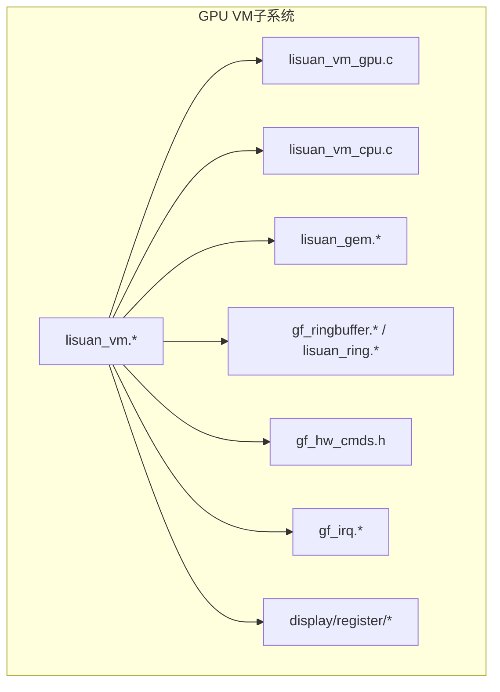
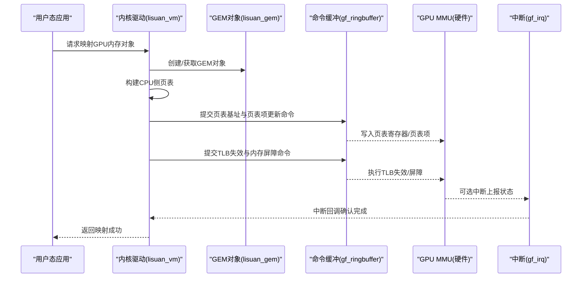
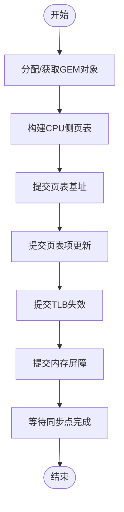
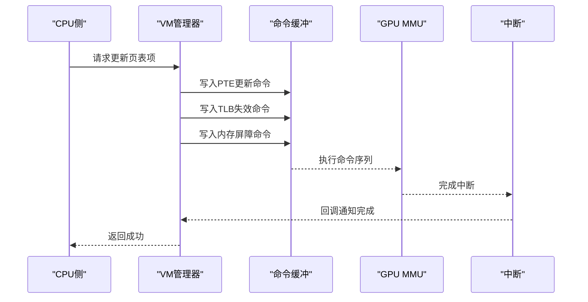
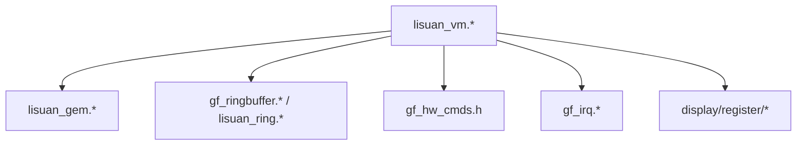

# GPU侧虚拟内存管理

<cite>
**本文引用的文件**   
- [lisuan_vm.c](file://_work/src/usr/src/lisuangpu-dkms-262.2.0.56/lisuan_vm.c)
- [lisuan_vm.h](file://_work/src/usr/src/lisuangpu-dkms-262.2.0.56/lisuan_vm.h)
- [lisuan_vm_gpu.c](file://_work/src/usr/src/lisuangpu-dkms-262.2.0.56/lisuan_vm_gpu.c)
- [lisuan_vm_cpu.c](file://_work/src/usr/src/lisuangpu-dkms-262.2.0.56/lisuan_vm_cpu.c)
- [lisuan_gem.c](file://_work/src/usr/src/lisuangpu-dkms-262.2.0.56/lisuan_gem.c)
- [lisuan_gem.h](file://_work/src/usr/src/lisuangpu-dkms-262.2.0.56/lisuan_gem.h)
- [gf_ringbuffer.c](file://_work/src/usr/src/lisuangpu-dkms-262.2.0.56/gf_ringbuffer.c)
- [gf_ringbuffer.h](file://_work/src/usr/src/lisuangpu-dkms-262.2.0.56/gf_ringbuffer.h)
- [lisuan_ring.c](file://_work/src/usr/src/lisuangpu-dkms-262.2.0.56/lisuan_ring.c)
- [lisuan_ring.h](file://_work/src/usr/src/lisuangpu-dkms-262.2.0.56/lisuan_ring.h)
- [gf_hw_cmds.h](file://_work/src/usr/src/lisuangpu-dkms-262.2.0.56/gf_hw_cmds.h)
- [gf_irq.c](file://_work/src/usr/src/lisuangpu-dkms-262.56/gf_irq.c)
- [gf_irq.h](file://_work/src/usr/src/lisuangpu-dkms-262.2.0.56/gf_irq.h)
- [disp_reg.h](file://_work/src/usr/src/lisuangpu-dkms-262.2.0.56/display/register/disp_reg.h)
- [CR_register.h](file://_work/src/usr/src/lisuangpu-dkms-262.2.0.56/display/register/CR_register.h)
- [PIPE_register.h](file://_work/src/usr/src/lisuangpu-dkms-262.2.0.56/display/register/PIPE_register.h)
</cite>

## 目录
1. [简介](#简介)
2. [项目结构](#项目结构)
3. [核心组件](#核心组件)
4. [架构总览](#架构总览)
5. [详细组件分析](#详细组件分析)
6. [依赖关系分析](#依赖关系分析)
7. [性能考虑](#性能考虑)
8. [故障排查指南](#故障排查指南)
9. [结论](#结论)
10. [附录](#附录)

## 简介
本技术文档聚焦丽山GPU的GPU侧虚拟内存管理模块，系统性阐述GPU地址空间的特殊需求与硬件限制、GPU专用页表格式与地址转换单元（MMU）行为、GPU内存映射建立流程、页表更新机制与硬件同步策略。同时覆盖GPU侧内存访问模式、缓存策略与带宽优化、内存保护机制、异常处理与错误恢复流程，以及与GPU硬件寄存器交互和命令队列集成的实现方式。文档面向希望深入理解并调优GPU侧虚拟内存子系统的设计师与工程师，提供从架构到代码级的完整说明与可视化图示。

## 项目结构
本项目采用分层组织：显示子系统位于display目录，通用驱动框架位于根目录下的C源文件集合。GPU侧虚拟内存管理相关代码集中在以下文件：
- lisuan_vm.*：VM抽象、CPU/GPU侧接口与公共逻辑
- lisuan_vm_gpu.c：GPU侧VM实现（页表构建、TLB同步、MMU配置）
- lisuan_vm_cpu.c：CPU侧辅助（页表遍历、一致性维护）
- lisuan_gem.*：GEM对象与内存分配、映射生命周期
- gf_ringbuffer.* / lisuan_ring.*：命令缓冲与提交路径
- gf_hw_cmds.h：硬件命令定义
- gf_irq.*：中断与事件处理
- display/register/*：显示相关寄存器定义（用于上下文中的地址与通道配置）

图表来源
- [lisuan_vm.c:1-200](file://_work/src/usr/src/lisuangpu-dkms-262.2.0.56/lisuan_vm.c#L1-L200)
- [lisuan_vm_gpu.c:1-200](file://_work/src/usr/src/lisuangpu-dkms-262.2.0.56/lisuan_vm_gpu.c#L1-L200)
- [lisuan_vm_cpu.c:1-200](file://_work/src/usr/src/lisuangpu-dkms-262.2.0.56/lisuan_vm_cpu.c#L1-L200)
- [lisuan_gem.c:1-200](file://_work/src/usr/src/lisuangpu-dkms-262.2.0.56/lisuan_gem.c#L1-L200)
- [gf_ringbuffer.c:1-200](file://_work/src/usr/src/lisuangpu-dkms-262.2.0.56/gf_ringbuffer.c#L1-L200)
- [lisuan_ring.c:1-200](file://_work/src/usr/src/lisuangpu-dkms-262.2.0.56/lisuan_ring.c#L1-L200)
- [gf_hw_cmds.h:1-200](file://_work/src/usr/src/lisuangpu-dkms-262.2.0.56/gf_hw_cmds.h#L1-L200)
- [gf_irq.c:1-200](file://_work/src/usr/src/lisuangpu-dkms-262.2.0.56/gf_irq.c#L1-L200)
- [disp_reg.h:1-200](file://_work/src/usr/src/lisuangpu-dkms-262.2.0.56/display/register/disp_reg.h#L1-L200)

章节来源
- [lisuan_vm.c:1-200](file://_work/src/usr/src/lisuangpu-dkms-262.2.0.56/lisuan_vm.c#L1-L200)
- [lisuan_vm.h:1-200](file://_work/src/usr/src/lisuangpu-dkms-262.2.0.56/lisuan_vm.h#L1-L200)
- [lisuan_gem.c:1-200](file://_work/src/usr/src/lisuangpu-dkms-262.2.0.56/lisuan_gem.c#L1-L200)
- [gf_ringbuffer.c:1-200](file://_work/src/usr/src/lisuangpu-dkms-262.2.0.56/gf_ringbuffer.c#L1-L200)
- [lisuan_ring.c:1-200](file://_work/src/usr/src/lisuangpu-dkms-262.2.0.56/lisuan_ring.c#L1-L200)

## 核心组件
- VM抽象层（lisuan_vm.*）：定义GPU虚拟地址空间、页表树结构、映射/解映射API、权限与属性封装。
- GPU侧VM实现（lisuan_vm_gpu.c）：负责将CPU侧页表下发至GPU MMU，执行TLB失效与同步，处理页表更新原子性。
- CPU侧VM辅助（lisuan_vm_cpu.c）：遍历页表、生成GPU可识别的页表项、维护一致性屏障。
- GEM对象（lisuan_gem.*）：管理GPU可见内存对象的分配、引用计数、映射生命周期与共享语义。
- 命令缓冲（gf_ringbuffer.* / lisuan_ring.*）：承载页表更新、TLB同步、内存屏障等命令序列，确保顺序与可见性。
- 硬件命令（gf_hw_cmds.h）：定义页表基址、页表项、TLB操作、内存屏障等指令编码。
- 中断与事件（gf_irq.*）：上报MMU异常、页表更新完成、同步点完成等事件。
- 寄存器定义（display/register/*）：包含与显示相关的地址通道、管道配置等寄存器位域，便于在显示路径中验证VM映射。

章节来源
- [lisuan_vm.h:1-200](file://_work/src/usr/src/lisuangpu-dkms-262.2.0.56/lisuan_vm.h#L1-L200)
- [lisuan_vm.c:1-200](file://_work/src/usr/src/lisuangpu-dkms-262.2.0.56/lisuan_vm.c#L1-L200)
- [lisuan_vm_gpu.c:1-200](file://_work/src/usr/src/lisuangpu-dkms-262.2.0.56/lisuan_vm_gpu.c#L1-L200)
- [lisuan_vm_cpu.c:1-200](file://_work/src/usr/src/lisuangpu-dkms-262.2.0.56/lisuan_vm_cpu.c#L1-L200)
- [lisuan_gem.h:1-200](file://_work/src/usr/src/lisuangpu-dkms-262.2.0.56/lisuan_gem.h#L1-L200)
- [lisuan_gem.c:1-200](file://_work/src/usr/src/lisuangpu-dkms-262.2.0.56/lisuan_gem.c#L1-L200)
- [gf_ringbuffer.h:1-200](file://_work/src/usr/src/lisuangpu-dkms-262.2.0.56/gf_ringbuffer.h#L1-L200)
- [gf_ringbuffer.c:1-200](file://_work/src/usr/src/lisuangpu-dkms-262.2.0.56/gf_ringbuffer.c#L1-L200)
- [lisuan_ring.h:1-200](file://_work/src/usr/src/lisuangpu-dkms-262.2.0.56/lisuan_ring.h#L1-L200)
- [lisuan_ring.c:1-200](file://_work/src/usr/src/lisuangpu-dkms-262.2.0.56/lisuan_ring.c#L1-L200)
- [gf_hw_cmds.h:1-200](file://_work/src/usr/src/lisuangpu-dkms-262.2.0.56/gf_hw_cmds.h#L1-L200)
- [gf_irq.h:1-200](file://_work/src/usr/src/lisuangpu-dkms-262.2.0.56/gf_irq.h#L1-L200)
- [gf_irq.c:1-200](file://_work/src/usr/src/lisuangpu-dkms-262.2.0.56/gf_irq.c#L1-L200)
- [disp_reg.h:1-200](file://_work/src/usr/src/lisuangpu-dkms-262.2.0.56/display/register/disp_reg.h#L1-L200)

## 架构总览
GPU侧虚拟内存管理的整体架构围绕“CPU侧页表构建 + GPU侧MMU加载 + 命令队列同步”展开。CPU侧负责维护进程级或设备级页表树，GPU侧通过命令缓冲将页表基址与关键页表项写入MMU寄存器，随后触发TLB失效与内存屏障，确保GPU访问的一致性与可见性。

图表来源
- [lisuan_vm.c:1-200](file://_work/src/usr/src/lisuangpu-dkms-262.2.0.56/lisuan_vm.c#L1-L200)
- [lisuan_gem.c:1-200](file://_work/src/usr/src/lisuangpu-dkms-262.2.0.56/lisuan_gem.c#L1-L200)
- [gf_ringbuffer.c:1-200](file://_work/src/usr/src/lisuangpu-dkms-262.2.0.56/gf_ringbuffer.c#L1-L200)
- [gf_irq.c:1-200](file://_work/src/usr/src/lisuangpu-dkms-262.2.0.56/gf_irq.c#L1-L200)

## 详细组件分析

### GPU地址空间与MMU特性
- 地址空间划分：GPU通常拥有独立的物理地址空间视图，需通过VM将CPU虚拟地址映射为GPU可访问的物理地址。
- 页表格式：GPU页表项包含物理页帧号、权限位（读/写/执行）、缓存属性（不可缓存/写合并/写回）、块大小与粒度。
- 地址转换单元：支持多级页表（如PTE/PDE/PUD），TLB缓存最近使用的转换结果，需要显式失效以保持一致性。
- 对齐与粒度：页表项粒度通常为4KB或更大（大页），需保证起始地址与长度对齐。

章节来源
- [lisuan_vm.h:1-200](file://_work/src/usr/src/lisuangpu-dkms-262.2.0.56/lisuan_vm.h#L1-L200)
- [gf_hw_cmds.h:1-200](file://_work/src/usr/src/lisuangpu-dkms-262.2.0.56/gf_hw_cmds.h#L1-L200)

### 内存映射建立流程
- 步骤概览：
  - 申请或查找GEM对象，确定物理页与属性。
  - 构建CPU侧页表树，填充PTE/PDE。
  - 将页表基址与关键页表项通过命令缓冲提交给GPU。
  - 提交TLB失效与内存屏障命令，确保GPU看到最新映射。
  - 等待完成（同步点/ fence），返回给用户态。
- 关键点：
  - 原子性：页表更新需在单一命令批次内完成，避免部分更新导致的访问异常。
  - 可见性：使用内存屏障与TLB失效保证一致性。
  - 权限：根据对象用途设置读写/执行权限，防止越权访问。

图表来源
- [lisuan_vm.c:1-200](file://_work/src/usr/src/lisuangpu-dkms-262.2.0.56/lisuan_vm.c#L1-L200)
- [lisuan_gem.c:1-200](file://_work/src/usr/src/lisuangpu-dkms-262.2.0.56/lisuan_gem.c#L1-L200)
- [gf_ringbuffer.c:1-200](file://_work/src/usr/src/lisuangpu-dkms-262.2.0.56/gf_ringbuffer.c#L1-L200)

章节来源
- [lisuan_vm.c:1-200](file://_work/src/usr/src/lisuangpu-dkms-262.2.0.56/lisuan_vm.c#L1-L200)
- [lisuan_gem.c:1-200](file://_work/src/usr/src/lisuangpu-dkms-262.2.0.56/lisuan_gem.c#L1-L200)
- [gf_ringbuffer.c:1-200](file://_work/src/usr/src/lisuangpu-dkms-262.2.0.56/gf_ringbuffer.c#L1-L200)

### 页表更新机制与硬件同步
- 增量更新：仅更新变化的页表项，减少命令量。
- 批处理：将多个PTE更新合并为一个命令批次，提高吞吐。
- 同步策略：
  - 内存屏障：确保CPU写入对GPU可见。
  - TLB失效：使GPU重新读取页表，避免陈旧转换。
  - Fence/同步点：等待GPU完成更新后再进行后续操作。
- 错误恢复：若更新失败，回滚已提交的命令，保持VM一致性。

图表来源
- [lisuan_vm_gpu.c:1-200](file://_work/src/usr/src/lisuangpu-dkms-262.2.0.56/lisuan_vm_gpu.c#L1-L200)
- [gf_ringbuffer.c:1-200](file://_work/src/usr/src/lisuangpu-dkms-262.2.0.56/gf_ringbuffer.c#L1-L200)
- [gf_irq.c:1-200](file://_work/src/usr/src/lisuangpu-dkms-262.2.0.56/gf_irq.c#L1-L200)

章节来源
- [lisuan_vm_gpu.c:1-200](file://_work/src/usr/src/lisuangpu-dkms-262.2.0.56/lisuan_vm_gpu.c#L1-L200)
- [gf_ringbuffer.c:1-200](file://_work/src/usr/src/lisuangpu-dkms-262.2.0.56/gf_ringbuffer.c#L1-L200)
- [gf_irq.c:1-200](file://_work/src/usr/src/lisuangpu-dkms-262.2.0.56/gf_irq.c#L1-L200)

### GPU侧内存访问模式与缓存策略
- 访问模式：
  - 流式访问：适合视频解码/编码，优先顺序访问与大页。
  - 随机访问：适合纹理采样，需关注TLB命中率。
  - 批量访问：适合计算任务，需高带宽与低延迟。
- 缓存策略：
  - 不可缓存：用于控制寄存器与命令缓冲。
  - 写合并：适合顺序写入，提升带宽。
  - 写回：适合频繁读写的缓冲区，减少总线压力。
- 带宽优化：
  - 大页映射：减少页表项数量，降低TLB压力。
  - 对齐与合并：对齐起始地址与长度，合并连续访问。
  - 预取与分块：按工作负载特征调整数据布局。

章节来源
- [gf_hw_cmds.h:1-200](file://_work/src/usr/src/lisuangpu-dkms-262.2.0.56/gf_hw_cmds.h#L1-L200)
- [lisuan_vm_cpu.c:1-200](file://_work/src/usr/src/lisuangpu-dkms-262.2.0.56/lisuan_vm_cpu.c#L1-L200)

### 内存保护机制、异常处理与错误恢复
- 内存保护：
  - 权限位：读/写/执行权限，防止非法访问。
  - 区域隔离：不同进程/设备的地址空间隔离。
  - 只读映射：用于共享只读资源，提升安全性。
- 异常处理：
  - MMU缺页：触发缺页中断，动态加载页表项。
  - 权限违规：记录日志并终止非法访问。
  - 地址越界：检查边界条件，返回错误码。
- 错误恢复：
  - 回滚：撤销未完成的页表更新。
  - 重试：在资源可用时重试操作。
  - 降级：切换到安全模式或禁用危险功能。

章节来源
- [lisuan_vm.h:1-200](file://_work/src/usr/src/lisuangpu-dkms-262.2.0.56/lisuan_vm.h#L1-L200)
- [gf_irq.c:1-200](file://_work/src/usr/src/lisuangpu-dkms-262.2.0.56/gf_irq.c#L1-L200)

### 与GPU硬件寄存器的交互与命令队列集成
- 寄存器交互：
  - 页表基址寄存器：设置GPU页表根指针。
  - 页表项寄存器：直接写入PTE/PDE。
  - TLB控制寄存器：触发TLB失效与刷新。
  - 内存屏障寄存器：确保写入可见性。
- 命令队列集成：
  - 命令缓冲：承载页表更新、TLB操作、屏障命令。
  - 提交路径：将命令序列提交到GPU执行队列。
  - 同步点：使用fence等待命令完成。
  - 中断回调：处理命令完成与异常事件。

章节来源
- [gf_hw_cmds.h:1-200](file://_work/src/usr/src/lisuangpu-dkms-262.2.0.56/gf_hw_cmds.h#L1-L200)
- [gf_ringbuffer.c:1-200](file://_work/src/usr/src/lisuangpu-dkms-262.2.0.56/gf_ringbuffer.c#L1-L200)
- [lisuan_ring.c:1-200](file://_work/src/usr/src/lisuangpu-dkms-262.2.0.56/lisuan_ring.c#L1-L200)
- [gf_irq.c:1-200](file://_work/src/usr/src/lisuangpu-dkms-262.2.0.56/gf_irq.c#L1-L200)

## 依赖关系分析
GPU侧虚拟内存管理模块依赖以下组件：
- GEM对象：提供内存对象的生命周期管理。
- 命令缓冲：承载GPU命令序列。
- 硬件命令：定义GPU可执行的指令编码。
- 中断处理：处理异步事件与异常。
- 寄存器定义：提供硬件接口位域。

图表来源
- [lisuan_vm.c:1-200](file://_work/src/usr/src/lisuangpu-dkms-262.2.0.56/lisuan_vm.c#L1-L200)
- [lisuan_gem.c:1-200](file://_work/src/usr/src/lisuangpu-dkms-262.2.0.56/lisuan_gem.c#L1-L200)
- [gf_ringbuffer.c:1-200](file://_work/src/usr/src/lisuangpu-dkms-262.2.0.56/gf_ringbuffer.c#L1-L200)
- [gf_hw_cmds.h:1-200](file://_work/src/usr/src/lisuangpu-dkms-262.2.0.56/gf_hw_cmds.h#L1-L200)
- [gf_irq.c:1-200](file://_work/src/usr/src/lisuangpu-dkms-262.2.0.56/gf_irq.c#L1-L200)
- [disp_reg.h:1-200](file://_work/src/usr/src/lisuangpu-dkms-262.2.0.56/display/register/disp_reg.h#L1-L200)

章节来源
- [lisuan_vm.c:1-200](file://_work/src/usr/src/lisuangpu-dkms-262.2.0.56/lisuan_vm.c#L1-L200)
- [lisuan_gem.c:1-200](file://_work/src/usr/src/lisuangpu-dkms-262.2.0.56/lisuan_gem.c#L1-L200)
- [gf_ringbuffer.c:1-200](file://_work/src/usr/src/lisuangpu-dkms-262.2.0.56/gf_ringbuffer.c#L1-L200)
- [gf_hw_cmds.h:1-200](file://_work/src/usr/src/lisuangpu-dkms-262.2.0.56/gf_hw_cmds.h#L1-L200)
- [gf_irq.c:1-200](file://_work/src/usr/src/lisuangpu-dkms-262.2.0.56/gf_irq.c#L1-L200)
- [disp_reg.h:1-200](file://_work/src/usr/src/lisuangpu-dkms-262.2.0.56/display/register/disp_reg.h#L1-L200)

## 性能考虑
- 页表粒度选择：大页减少页表项数量，提升TLB命中率，但可能浪费内存。
- 批处理优化：合并多个页表更新命令，减少命令缓冲开销。
- 缓存属性调优：根据访问模式选择合适的缓存策略（不可缓存/写合并/写回）。
- 同步点粒度：合理设置fence，避免过度等待。
- 中断处理：减少中断频率，批量处理事件。

[本节为通用指导，不直接分析具体文件]

## 故障排查指南
- 常见问题：
  - 映射失败：检查GEM对象状态与权限设置。
  - 访问异常：确认页表项正确性与TLB失效是否执行。
  - 性能下降：分析TLB命中率与缓存属性是否合理。
  - 死锁：检查同步点与中断回调是否正确释放。
- 调试方法：
  - 打印页表状态：输出当前页表项与权限。
  - 监控命令缓冲：查看命令序列是否完整。
  - 捕获中断：分析异常类型与堆栈信息。
  - 寄存器转储：检查MMU与TLB状态寄存器。

章节来源
- [gf_irq.c:1-200](file://_work/src/usr/src/lisuangpu-dkms-262.2.0.56/gf_irq.c#L1-L200)
- [gf_ringbuffer.c:1-200](file://_work/src/usr/src/lisuangpu-dkms-262.2.0.56/gf_ringbuffer.c#L1-L200)
- [gf_hw_cmds.h:1-200](file://_work/src/usr/src/lisuangpu-dkms-262.2.0.56/gf_hw_cmds.h#L1-L200)

## 结论
丽山GPU的GPU侧虚拟内存管理模块通过清晰的层次结构与严格的同步策略，实现了高效、安全的内存映射与访问。结合GEM对象、命令缓冲与中断处理，形成了完整的内存管理闭环。在实际应用中，应根据工作负载特点优化页表粒度、缓存属性与同步策略，以获得最佳性能与稳定性。

[本节为总结性内容，不直接分析具体文件]

## 附录
- 术语表：
  - VM：虚拟内存
  - PTE：页表项
  - TLB：转译后备缓冲器
  - GEM：图形执行管理器
  - MMU：内存管理单元
- 参考文件：
  - [lisuan_vm.h](file://_work/src/usr/src/lisuangpu-dkms-262.2.0.56/lisuan_vm.h)
  - [lisuan_vm.c](file://_work/src/usr/src/lisuangpu-dkms-262.2.0.56/lisuan_vm.c)
  - [lisuan_vm_gpu.c](file://_work/src/usr/src/lisuangpu-dkms-262.2.0.56/lisuan_vm_gpu.c)
  - [lisuan_vm_cpu.c](file://_work/src/usr/src/lisuangpu-dkms-262.2.0.56/lisuan_vm_cpu.c)
  - [lisuan_gem.h](file://_work/src/usr/src/lisuangpu-dkms-262.2.0.56/lisuan_gem.h)
  - [lisuan_gem.c](file://_work/src/usr/src/lisuangpu-dkms-262.2.0.56/lisuan_gem.c)
  - [gf_ringbuffer.h](file://_work/src/usr/src/lisuangpu-dkms-262.2.0.56/gf_ringbuffer.h)
  - [gf_ringbuffer.c](file://_work/src/usr/src/lisuangpu-dkms-262.2.0.56/gf_ringbuffer.c)
  - [lisuan_ring.h](file://_work/src/usr/src/lisuangpu-dkms-262.2.0.56/lisuan_ring.h)
  - [lisuan_ring.c](file://_work/src/usr/src/lisuangpu-dkms-262.2.0.56/lisuan_ring.c)
  - [gf_hw_cmds.h](file://_work/src/usr/src/lisuangpu-dkms-262.2.0.56/gf_hw_cmds.h)
  - [gf_irq.h](file://_work/src/usr/src/lisuangpu-dkms-262.2.0.56/gf_irq.h)
  - [gf_irq.c](file://_work/src/usr/src/lisuangpu-dkms-262.2.0.56/gf_irq.c)
  - [disp_reg.h](file://_work/src/usr/src/lisuangpu-dkms-262.2.0.56/display/register/disp_reg.h)
  - [CR_register.h](file://_work/src/usr/src/lisuangpu-dkms-262.2.0.56/display/register/CR_register.h)
  - [PIPE_register.h](file://_work/src/usr/src/lisuangpu-dkms-262.2.0.56/display/register/PIPE_register.h)