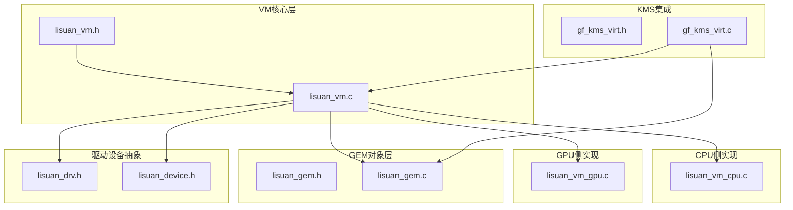
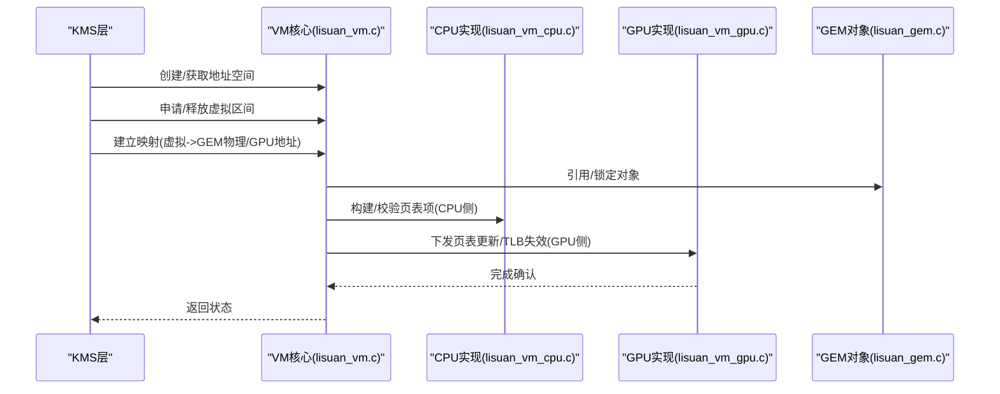
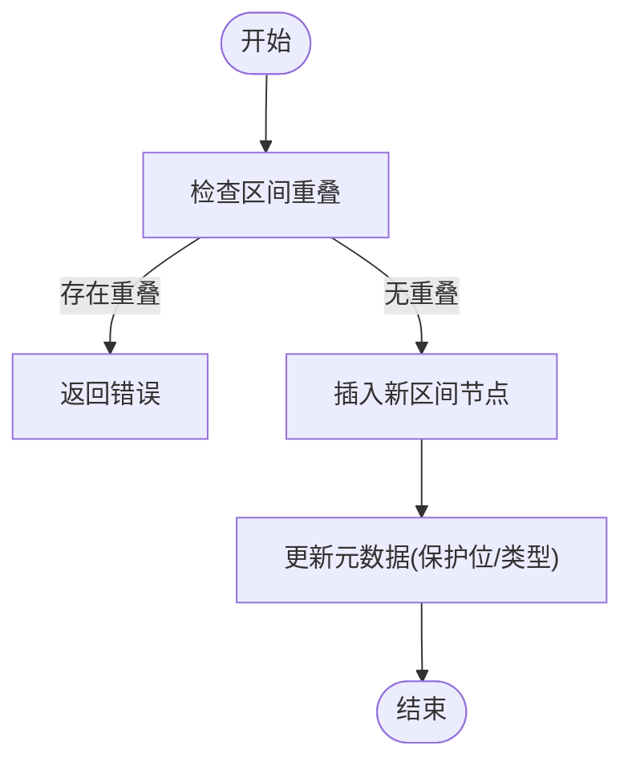
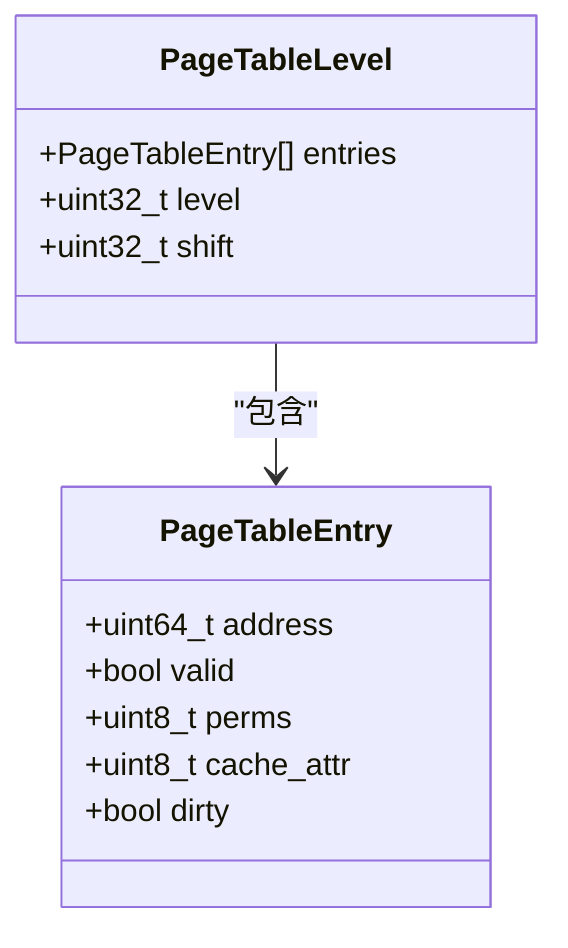
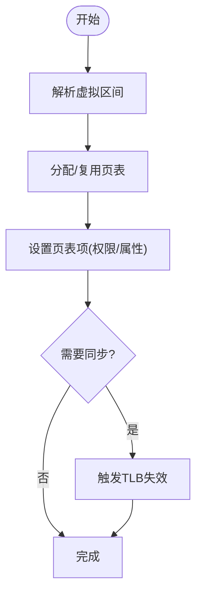
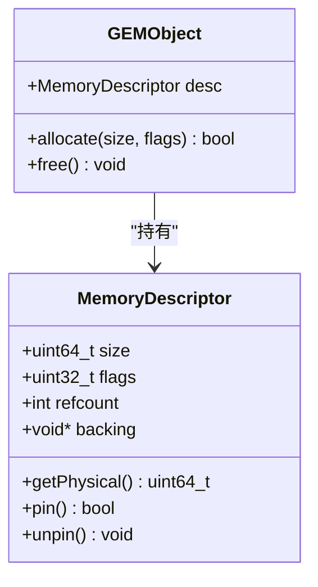
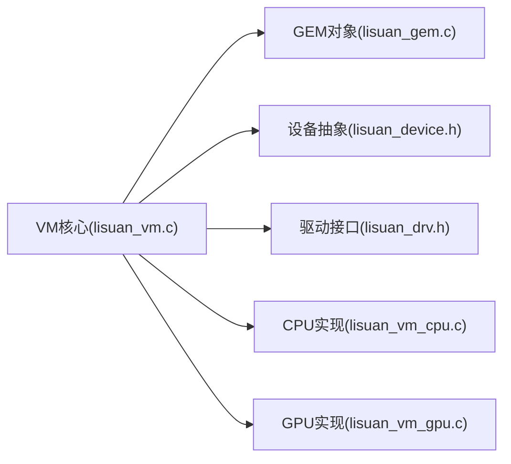

# 虚拟内存核心架构

<cite>
**本文档引用的文件**
- [lisuan_vm.h](file://_work/src/usr/src/lisuangpu-dkms-262.2.0.56/lisuan_vm.h)
- [lisuan_vm.c](file://_work/src/usr/src/lisuangpu-dkms-262.2.0.56/lisuan_vm.c)
- [lisuan_vm_cpu.c](file://_work/src/usr/src/lisuangpu-dkms-262.2.0.56/lisuan_vm_cpu.c)
- [lisuan_vm_gpu.c](file://_work/src/usr/src/lisuangpu-dkms-262.2.0.56/lisuan_vm_gpu.c)
- [lisuan_gem.h](file://_work/src/usr/src/lisuangpu-dkms-262.2.0.56/lisuan_gem.h)
- [lisuan_gem.c](file://_work/src/usr/src/lisuangpu-dkms-262.2.0.56/lisuan_gem.c)
- [lisuan_drv.h](file://_work/src/usr/src/lisuangpu-dkms-262.2.0.56/lisuan_drv.h)
- [lisuan_device.h](file://_work/src/usr/src/lisuangpu-dkms-262.2.0.56/lisuan_device.h)
- [gf_kms_virt.h](file://_work/src/usr/src/lisuangpu-dkms-262.2.0.56/kms/gf_kms_virt.h)
- [gf_kms_virt.c](file://_work/src/usr/src/lisuangpu-dkms-262.2.0.56/kms/gf_kms_virt.c)
</cite>

## 目录
1. [简介](#简介)
2. [项目结构](#项目结构)
3. [核心组件](#核心组件)
4. [架构总览](#架构总览)
5. [详细组件分析](#详细组件分析)
6. [依赖关系分析](#依赖关系分析)
7. [性能考虑](#性能考虑)
8. [故障排查指南](#故障排查指南)
9. [结论](#结论)
10. [附录](#附录)

## 简介
本技术文档围绕丽山GPU的虚拟内存（VM）核心架构，系统性阐述其设计模式、核心数据结构与接口定义，覆盖地址空间管理、页表层次结构、内存区域管理以及CPU/GPU共享的内存描述符与页表项格式。文档还包含虚拟内存的申请、释放、映射与解除映射的核心算法流程，解释权限控制机制、配置参数、错误处理策略与性能优化建议，并提供实际API使用示例与最佳实践，帮助读者快速理解并正确使用该子系统。

## 项目结构
本项目采用分层与按功能模块组织的方式：
- VM核心层：负责地址空间、页表、区域管理与转换逻辑
- CPU侧实现：面向用户态/内核态的CPU路径操作
- GPU侧实现：面向GPU硬件的页表更新与同步
- GEM对象层：提供显存/系统内存对象的分配、引用计数与生命周期管理
- KMS集成：将虚拟内存能力暴露给显示子系统

图表来源
- [lisuan_vm.h](file://_work/src/usr/src/lisuangpu-dkms-262.2.0.56/lisuan_vm.h)
- [lisuan_vm.c](file://_work/src/usr/src/lisuangpu-dkms-262.2.0.56/lisuan_vm.c)
- [lisuan_vm_cpu.c](file://_work/src/usr/src/lisuangpu-dkms-262.2.0.56/lisuan_vm_cpu.c)
- [lisuan_vm_gpu.c](file://_work/src/usr/src/lisuangpu-dkms-262.2.0.56/lisuan_vm_gpu.c)
- [lisuan_gem.h](file://_work/src/usr/src/lisuangpu-dkms-262.2.0.56/lisuan_gem.h)
- [lisuan_gem.c](file://_work/src/usr/src/lisuangpu-dkms-262.2.0.56/lisuan_gem.c)
- [gf_kms_virt.h](file://_work/src/usr/src/lisuangpu-dkms-262.2.0.56/kms/gf_kms_virt.h)
- [gf_kms_virt.c](file://_work/src/usr/src/lisuangpu-dkms-262.2.0.56/kms/gf_kms_virt.c)
- [lisuan_drv.h](file://_work/src/usr/src/lisuangpu-dkms-262.2.0.56/lisuan_drv.h)
- [lisuan_device.h](file://_work/src/usr/src/lisuangpu-dkms-262.2.0.56/lisuan_device.h)

章节来源
- [lisuan_vm.h](file://_work/src/usr/src/lisuangpu-dkms-262.2.0.56/lisuan_vm.h)
- [lisuan_vm.c](file://_work/src/usr/src/lisuangpu-dkms-262.2.0.56/lisuan_vm.c)
- [lisuan_vm_cpu.c](file://_work/src/usr/src/lisuangpu-dkms-262.2.0.56/lisuan_vm_cpu.c)
- [lisuan_vm_gpu.c](file://_work/src/usr/src/lisuangpu-dkms-262.2.0.56/lisuan_vm_gpu.c)
- [lisuan_gem.h](file://_work/src/usr/src/lisuangpu-dkms-262.2.0.56/lisuan_gem.h)
- [lisuan_gem.c](file://_work/src/usr/src/lisuangpu-dkms-262.2.0.56/lisuan_gem.c)
- [gf_kms_virt.h](file://_work/src/usr/src/lisuangpu-dkms-262.2.0.56/kms/gf_kms_virt.h)
- [gf_kms_virt.c](file://_work/src/usr/src/lisuangpu-dkms-262.2.0.56/kms/gf_kms_virt.c)
- [lisuan_drv.h](file://_work/src/usr/src/lisuangpu-dkms-262.2.0.56/lisuan_drv.h)
- [lisuan_device.h](file://_work/src/usr/src/lisuangpu-dkms-262.2.0.56/lisuan_device.h)

## 核心组件
- 地址空间管理：维护进程/上下文相关的虚拟地址区间，支持多级别页表与区域划分
- 页表层次结构：多级页表（如PTE/PMD/PUD等），支持大页与常规页混合
- 内存区域管理：基于区间的映射元数据，记录基址、长度、保护位与类型
- 地址转换机制：将虚拟地址逐级解析为物理地址或GPU可寻址地址，含权限检查
- CPU/GPU共享描述符：统一的数据结构与页表项格式，确保一致性
- 映射/解除映射：批量更新页表，保证可见性与同步

章节来源
- [lisuan_vm.h](file://_work/src/usr/src/lisuangpu-dkms-262.2.0.56/lisuan_vm.h)
- [lisuan_vm.c](file://_work/src/usr/src/lisuangpu-dkms-262.2.0.56/lisuan_vm.c)
- [lisuan_vm_cpu.c](file://_work/src/usr/src/lisuangpu-dkms-262.2.0.56/lisuan_vm_cpu.c)
- [lisuan_vm_gpu.c](file://_work/src/usr/src/lisuangpu-dkms-262.2.0.56/lisuan_vm_gpu.c)

## 架构总览
下图展示了从KMS到VM核心、再到CPU/GPU实现的调用链与职责分工。KMS通过虚拟内存接口创建/销毁地址空间并进行映射；VM核心协调GEM对象生命周期与页表构建；CPU路径用于用户态/内核态的直接操作；GPU路径负责将页表写入硬件并触发TLB失效。

图表来源
- [gf_kms_virt.c](file://_work/src/usr/src/lisuangpu-dkms-262.2.0.56/kms/gf_kms_virt.c)
- [lisuan_vm.c](file://_work/src/usr/src/lisuangpu-dkms-262.2.0.56/lisuan_vm.c)
- [lisuan_vm_cpu.c](file://_work/src/usr/src/lisuangpu-dkms-262.2.0.56/lisuan_vm_cpu.c)
- [lisuan_vm_gpu.c](file://_work/src/usr/src/lisuangpu-dkms-262.2.0.56/lisuan_vm_gpu.c)
- [lisuan_gem.c](file://_work/src/usr/src/lisuangpu-dkms-262.2.0.56/lisuan_gem.c)

## 详细组件分析

### 地址空间与区域管理
- 地址空间：每个GPU上下文拥有独立地址空间，维护根页表指针与区间树
- 区域：以起始/结束地址、保护位、类型标识组织，支持合并与拆分
- 查找与插入：基于区间树的O(log n)查找，避免重叠冲突

图表来源
- [lisuan_vm.h](file://_work/src/usr/src/lisuangpu-dkms-262.2.0.56/lisuan_vm.h)
- [lisuan_vm.c](file://_work/src/usr/src/lisuangpu-dkms-262.2.0.56/lisuan_vm.c)

章节来源
- [lisuan_vm.h](file://_work/src/usr/src/lisuangpu-dkms-262.2.0.56/lisuan_vm.h)
- [lisuan_vm.c](file://_work/src/usr/src/lisuangpu-dkms-262.2.0.56/lisuan_vm.c)

### 页表层次结构与页表项格式
- 层次：典型的多级页表（例如PTE/PMD/PUD），支持大页以提升吞吐
- PTE字段：物理/GPU地址、有效位、读写/执行权限、缓存属性、脏位
- 一致性：CPU与GPU共享同一套页表项格式，确保跨视角一致

图表来源
- [lisuan_vm.h](file://_work/src/usr/src/lisuangpu-dkms-262.2.0.56/lisuan_vm.h)
- [lisuan_vm.c](file://_work/src/usr/src/lisuangpu-dkms-262.2.0.56/lisuan_vm.c)

章节来源
- [lisuan_vm.h](file://_work/src/usr/src/lisuangpu-dkms-262.2.0.56/lisuan_vm.h)
- [lisuan_vm.c](file://_work/src/usr/src/lisuangpu-dkms-262.2.0.56/lisuan_vm.c)

### 映射与解除映射算法
- 映射流程：解析目标区间，按需分配中间页表，设置PTE，必要时触发TLB失效
- 解除映射：撤销PTE，回收空页表，更新区间树，清理引用计数
- 并发安全：加锁保护地址空间，避免竞态

图表来源
- [lisuan_vm.c](file://_work/src/usr/src/lisuangpu-dkms-262.2.0.56/lisuan_vm.c)
- [lisuan_vm_gpu.c](file://_work/src/usr/src/lisuangpu-dkms-262.2.0.56/lisuan_vm_gpu.c)

章节来源
- [lisuan_vm.c](file://_work/src/usr/src/lisuangpu-dkms-262.2.0.56/lisuan_vm.c)
- [lisuan_vm_gpu.c](file://_work/src/usr/src/lisuangpu-dkms-262.2.0.56/lisuan_vm_gpu.c)

### CPU与GPU共享的内存描述符
- 描述符：统一的结构体封装对象类型、大小、访问属性、引用计数
- 生命周期：GEM对象在映射时增加引用，解除映射时释放
- 一致性：CPU与GPU读取同一份描述符，避免不一致

图表来源
- [lisuan_gem.h](file://_work/src/usr/src/lisuangpu-dkms-262.2.0.56/lisuan_gem.h)
- [lisuan_gem.c](file://_work/src/usr/src/lisuangpu-dkms-262.2.0.56/lisuan_gem.c)

章节来源
- [lisuan_gem.h](file://_work/src/usr/src/lisuangpu-dkms-262.2.0.56/lisuan_gem.h)
- [lisuan_gem.c](file://_work/src/usr/src/lisuangpu-dkms-262.2.0.56/lisuan_gem.c)

### 权限控制机制
- 权限位：读/写/执行权限，结合缓存属性与一致性要求
- 校验：在映射前进行权限合法性检查，防止非法访问
- 动态调整：支持运行时修改权限（需谨慎同步）

章节来源
- [lisuan_vm.h](file://_work/src/usr/src/lisuangpu-dkms-262.2.0.56/lisuan_vm.h)
- [lisuan_vm.c](file://_work/src/usr/src/lisuangpu-dkms-262.2.0.56/lisuan_vm.c)

### 地址转换机制
- 转换过程：从虚拟地址逐级查页表，得到物理/GPU地址
- 异常处理：缺页、权限错误、无效地址的处理策略
- 性能优化：大页减少页表层级，降低转换开销

章节来源
- [lisuan_vm.c](file://_work/src/usr/src/lisuangpu-dkms-262.2.0.56/lisuan_vm.c)
- [lisuan_vm_gpu.c](file://_work/src/usr/src/lisuangpu-dkms-262.2.0.56/lisuan_vm_gpu.c)

### KMS集成与虚拟内存接口
- 接口：创建/销毁地址空间、映射/解除映射、查询信息
- 使用场景：帧缓冲、纹理、命令缓冲区等的虚拟地址管理
- 最佳实践：批量映射、延迟分配、合理权限设置

章节来源
- [gf_kms_virt.h](file://_work/src/usr/src/lisuangpu-dkms-262.2.0.56/kms/gf_kms_virt.h)
- [gf_kms_virt.c](file://_work/src/usr/src/lisuangpu-dkms-262.2.0.56/kms/gf_kms_virt.c)

## 依赖关系分析
VM核心依赖GEM对象管理、设备抽象与驱动接口；CPU/GPU实现分别负责各自路径的页表构建与硬件交互。

图表来源
- [lisuan_vm.c](file://_work/src/usr/src/lisuangpu-dkms-262.2.0.56/lisuan_vm.c)
- [lisuan_gem.c](file://_work/src/usr/src/lisuangpu-dkms-262.2.0.56/lisuan_gem.c)
- [lisuan_device.h](file://_work/src/usr/src/lisuangpu-dkms-262.2.0.56/lisuan_device.h)
- [lisuan_drv.h](file://_work/src/usr/src/lisuangpu-dkms-262.2.0.56/lisuan_drv.h)
- [lisuan_vm_cpu.c](file://_work/src/usr/src/lisuangpu-dkms-262.2.0.56/lisuan_vm_cpu.c)
- [lisuan_vm_gpu.c](file://_work/src/usr/src/lisuangpu-dkms-262.2.0.56/lisuan_vm_gpu.c)

章节来源
- [lisuan_vm.c](file://_work/src/usr/src/lisuangpu-dkms-262.2.0.56/lisuan_vm.c)
- [lisuan_gem.c](file://_work/src/usr/src/lisuangpu-dkms-262.2.0.56/lisuan_gem.c)
- [lisuan_device.h](file://_work/src/usr/src/lisuangpu-dkms-262.2.0.56/lisuan_device.h)
- [lisuan_drv.h](file://_work/src/usr/src/lisuangpu-dkms-262.2.0.56/lisuan_drv.h)
- [lisuan_vm_cpu.c](file://_work/src/usr/src/lisuangpu-dkms-262.2.0.56/lisuan_vm_cpu.c)
- [lisuan_vm_gpu.c](file://_work/src/usr/src/lisuangpu-dkms-262.2.0.56/lisuan_vm_gpu.c)

## 性能考虑
- 大页映射：减少页表层级与TLB缺失，提升带宽密集型任务性能
- 批量操作：合并多次映射/解除映射，降低锁竞争与同步开销
- 延迟分配：按需分配页表与物理页，降低启动成本
- 缓存属性：根据访问模式设置合适的缓存与一致性属性
- 并发控制：细粒度锁与无锁路径结合，提高并行度

[本节为通用指导，不直接分析具体文件]

## 故障排查指南
- 常见错误：
  - 地址越界：检查区间边界与对齐
  - 权限错误：核对映射时的权限位设置
  - 缺页：确认底层物理/GPU地址是否已分配
  - 同步失败：检查TLB失效与队列提交状态
- 调试手段：
  - 打印页表状态与区间树
  - 启用日志与追踪点
  - 使用工具验证一致性

章节来源
- [lisuan_vm.c](file://_work/src/usr/src/lisuangpu-dkms-262.2.0.56/lisuan_vm.c)
- [lisuan_vm_gpu.c](file://_work/src/usr/src/lisuangpu-dkms-262.2.0.56/lisuan_vm_gpu.c)

## 结论
丽山GPU虚拟内存核心通过清晰的层次化设计与统一的描述符格式，实现了高效、安全的地址转换与资源管理。借助KMS集成与GEM对象模型，开发者可以便捷地进行内存映射与生命周期管理。遵循本文的最佳实践与性能建议，可在复杂图形与计算场景中取得稳定且高效的运行效果。

[本节为总结性内容，不直接分析具体文件]

## 附录

### API使用示例与最佳实践
- 创建地址空间：
  - 调用VM核心接口创建新地址空间，绑定到当前上下文
  - 参考路径：[gf_kms_virt.c](file://_work/src/usr/src/lisuangpu-dkms-262.2.0.56/kms/gf_kms_virt.c)
- 申请虚拟区间：
  - 使用区间分配函数，指定大小与对齐要求
  - 参考路径：[lisuan_vm.c](file://_work/src/usr/src/lisuangpu-dkms-262.2.0.56/lisuan_vm.c)
- 建立映射：
  - 将GEM对象映射至虚拟区间，设置权限与缓存属性
  - 参考路径：[lisuan_vm.c](file://_work/src/usr/src/lisuangpu-dkms-262.2.0.56/lisuan_vm.c), [lisuan_vm_gpu.c](file://_work/src/usr/src/lisuangpu-dkms-262.2.0.56/lisuan_vm_gpu.c)
- 解除映射与释放：
  - 撤销映射，回收区间与对象引用
  - 参考路径：[lisuan_vm.c](file://_work/src/usr/src/lisuangpu-dkms-262.2.0.56/lisuan_vm.c), [lisuan_gem.c](file://_work/src/usr/src/lisuangpu-dkms-262.2.0.56/lisuan_gem.c)

章节来源
- [gf_kms_virt.c](file://_work/src/usr/src/lisuangpu-dkms-262.2.0.56/kms/gf_kms_virt.c)
- [lisuan_vm.c](file://_work/src/usr/src/lisuangpu-dkms-262.2.0.56/lisuan_vm.c)
- [lisuan_vm_gpu.c](file://_work/src/usr/src/lisuangpu-dkms-262.2.0.56/lisuan_vm_gpu.c)
- [lisuan_gem.c](file://_work/src/usr/src/lisuangpu-dkms-262.2.0.56/lisuan_gem.c)