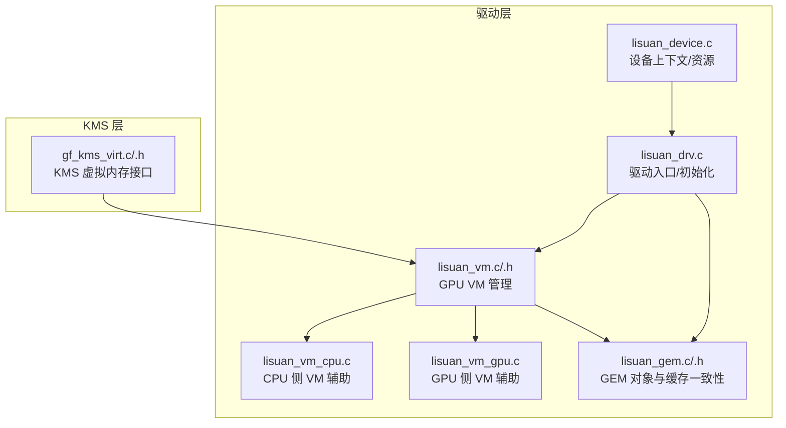
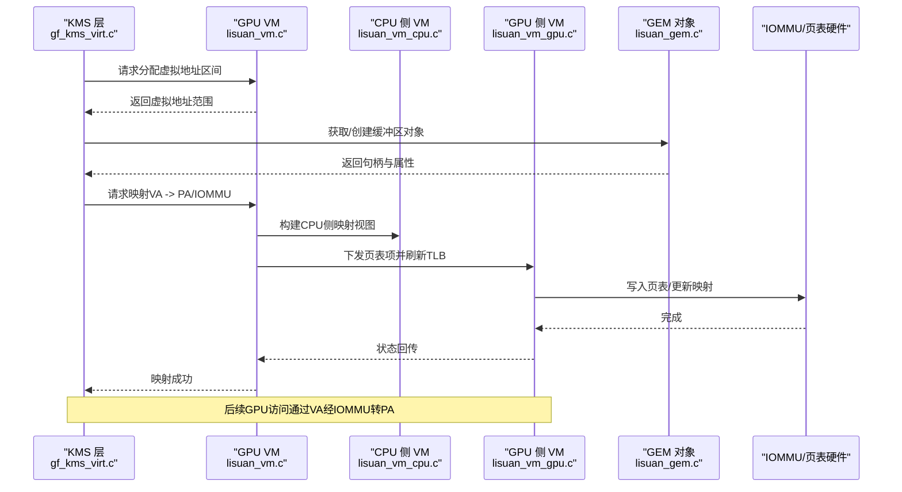
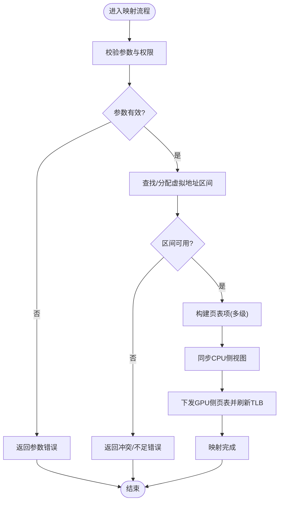
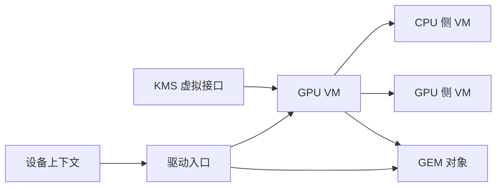

# 虚拟内存管理

<cite>
**本文引用的文件**   
- [lisuan_vm.c](file://_work/src/usr/src/lisuangpu-dkms-262.2.0.56/lisuan_vm.c)
- [lisuan_vm.h](file://_work/src/usr/src/lisuangpu-dkms-262.2.0.56/lisuan_vm.h)
- [lisuan_vm_cpu.c](file://_work/src/usr/src/lisuangpu-dkms-262.2.0.56/lisuan_vm_cpu.c)
- [lisuan_vm_gpu.c](file://_work/src/usr/src/lisuangpu-dkms-262.2.0.56/lisuan_vm_gpu.c)
- [lisuan_gem.c](file://_work/src/usr/src/lisuangpu-dkms-262.2.0.56/lisuan_gem.c)
- [lisuan_gem.h](file://_work/src/usr/src/lisuangpu-dkms-262.2.0.56/lisuan_gem.h)
- [lisuan_drv.c](file://_work/src/usr/src/lisuangpu-dkms-262.2.0.56/lisuan_drv.c)
- [lisuan_device.c](file://_work/src/usr/src/lisuangpu-dkms-262.2.0.56/lisuan_device.c)
- [gf_kms_virt.c](file://_work/src/usr/src/lisuangpu-dkms-262.2.0.56/kms/gf_kms_virt.c)
- [gf_kms_virt.h](file://_work/src/usr/src/lisuangpu-dkms-262.2.0.56/kms/gf_kms_virt.h)
</cite>

## 目录
1. [简介](#简介)
2. [项目结构](#项目结构)
3. [核心组件](#核心组件)
4. [架构总览](#架构总览)
5. [详细组件分析](#详细组件分析)
6. [依赖关系分析](#依赖关系分析)
7. [性能考虑](#性能考虑)
8. [故障排查指南](#故障排查指南)
9. [结论](#结论)
10. [附录](#附录)

## 简介
本技术文档面向丽山GPU的虚拟内存管理系统，系统性阐述CPU与GPU侧的虚拟地址空间映射机制、页表结构与地址转换流程，覆盖虚拟内存的申请/释放、映射/解除映射等关键操作。文档同时对比CPU侧与GPU侧实现差异与协作方式，说明内存保护、权限控制与错误处理策略，并提供配置选项、性能监控与调试工具使用建议，以及通过代码路径指引展示如何进行内存映射与地址转换操作。

## 项目结构
本项目中虚拟内存相关代码主要分布在驱动层与KMS层：
- 驱动层（VM/GEM）：负责GPU虚拟地址空间管理、页表构建、与GEM对象绑定及IOMMU映射。
- KMS层：提供用户态可见的虚拟内存接口，用于显示管线与缓冲区的地址分配与映射。
- 设备初始化与驱动入口：负责子系统初始化、资源管理与生命周期协调。

图表来源
- [lisuan_vm.c](file://_work/src/usr/src/lisuangpu-dkms-262.2.0.56/lisuan_vm.c)
- [lisuan_vm.h](file://_work/src/usr/src/lisuangpu-dkms-262.2.0.56/lisuan_vm.h)
- [lisuan_vm_cpu.c](file://_work/src/usr/src/lisuangpu-dkms-262.2.0.56/lisuan_vm_cpu.c)
- [lisuan_vm_gpu.c](file://_work/src/usr/src/lisuangpu-dkms-262.2.0.56/lisuan_vm_gpu.c)
- [lisuan_gem.c](file://_work/src/usr/src/lisuangpu-dkms-262.2.0.56/lisuan_gem.c)
- [lisuan_gem.h](file://_work/src/usr/src/lisuangpu-dkms-262.2.0.56/lisuan_gem.h)
- [lisuan_drv.c](file://_work/src/usr/src/lisuangpu-dkms-262.2.0.56/lisuan_drv.c)
- [lisuan_device.c](file://_work/src/usr/src/lisuangpu-dkms-262.2.0.56/lisuan_device.c)
- [gf_kms_virt.c](file://_work/src/usr/src/lisuangpu-dkms-262.2.0.56/kms/gf_kms_virt.c)
- [gf_kms_virt.h](file://_work/src/usr/src/lisuangpu-dkms-262.2.0.56/kms/gf_kms_virt.h)

章节来源
- [lisuan_vm.c](file://_work/src/usr/src/lisuangpu-dkms-262.2.0.56/lisuan_vm.c)
- [lisuan_vm.h](file://_work/src/usr/src/lisuangpu-dkms-262.2.0.56/lisuan_vm.h)
- [lisuan_gem.c](file://_work/src/usr/src/lisuangpu-dkms-262.2.0.56/lisuan_gem.c)
- [lisuan_gem.h](file://_work/src/usr/src/lisuangpu-dkms-262.2.0.56/lisuan_gem.h)
- [lisuan_drv.c](file://_work/src/usr/src/lisuangpu-dkms-262.2.0.56/lisuan_drv.c)
- [lisuan_device.c](file://_work/src/usr/src/lisuangpu-dkms-262.2.0.56/lisuan_device.c)
- [gf_kms_virt.c](file://_work/src/usr/src/lisuangpu-dkms-262.2.0.56/kms/gf_kms_virt.c)
- [gf_kms_virt.h](file://_work/src/usr/src/lisuangpu-dkms-262.2.0.56/kms/gf_kms_virt.h)

## 核心组件
- GPU 虚拟地址空间管理器（VM）
  - 职责：维护GPU虚拟地址区间、页表树、映射关系、权限位与同步原语；提供申请/释放、映射/解除映射、查询物理地址等能力。
  - 关键抽象：地址区间节点、页表项、映射描述符、锁与事件。
- CPU 侧 VM 辅助模块
  - 职责：在CPU侧维护与GPU一致的映射视图，处理缓存一致性、页表更新与同步屏障。
- GPU 侧 VM 辅助模块
  - 职责：将页表项下发至GPU硬件或IOMMU，执行TLB刷新与访问权限校验。
- GEM 对象与缓存一致性
  - 职责：封装显存/系统内存对象，提供引用计数、缓存一致性操作、DMA/IOMMU映射接口。
- KMS 虚拟内存接口
  - 职责：向显示子系统暴露虚拟内存分配/映射API，供CRTC/Plane/编码器使用。

章节来源
- [lisuan_vm.h](file://_work/src/usr/src/lisuangpu-dkms-262.2.0.56/lisuan_vm.h)
- [lisuan_vm.c](file://_work/src/usr/src/lisuangpu-dkms-262.2.0.56/lisuan_vm.c)
- [lisuan_vm_cpu.c](file://_work/src/usr/src/lisuangpu-dkms-262.2.0.56/lisuan_vm_cpu.c)
- [lisuan_vm_gpu.c](file://_work/src/usr/src/lisuangpu-dkms-262.2.0.56/lisuan_vm_gpu.c)
- [lisuan_gem.h](file://_work/src/usr/src/lisuangpu-dkms-262.2.0.56/lisuan_gem.h)
- [lisuan_gem.c](file://_work/src/usr/src/lisuangpu-dkms-262.2.0.56/lisuan_gem.c)
- [gf_kms_virt.h](file://_work/src/usr/src/lisuangpu-dkms-262.2.0.56/kms/gf_kms_virt.h)
- [gf_kms_virt.c](file://_work/src/usr/src/lisuangpu-dkms-262.2.0.56/kms/gf_kms_virt.c)

## 架构总览
下图展示了从KMS到驱动层的调用链路与数据流，包括虚拟地址分配、页表构建、IOMMU映射与GPU访问路径。

图表来源
- [gf_kms_virt.c](file://_work/src/usr/src/lisuangpu-dkms-262.2.0.56/kms/gf_kms_virt.c)
- [lisuan_vm.c](file://_work/src/usr/src/lisuangpu-dkms-262.2.0.56/lisuan_vm.c)
- [lisuan_vm_cpu.c](file://_work/src/usr/src/lisuangpu-dkms-262.2.0.56/lisuan_vm_cpu.c)
- [lisuan_vm_gpu.c](file://_work/src/usr/src/lisuangpu-dkms-262.2.0.56/lisuan_vm_gpu.c)
- [lisuan_gem.c](file://_work/src/usr/src/lisuangpu-dkms-262.2.0.56/lisuan_gem.c)

## 详细组件分析

### GPU 虚拟地址空间管理器（VM）
- 设计要点
  - 采用区间树/红黑树组织虚拟地址区间，支持快速查找与合并。
  - 页表为多级结构，按页大小粒度映射，支持混合粒度以提升利用率。
  - 映射描述符记录VA起点、长度、PA/IOMMU地址、权限位、标志位与引用计数。
  - 并发安全：读写分离锁、区间锁、跨层级顺序锁保证并发插入/删除正确性。
- 关键流程
  - 申请/释放：分配/回收虚拟地址区间，维护区间树与统计信息。
  - 映射/解除映射：校验冲突、构建页表项、更新CPU/GPU视图、刷新TLB。
  - 查询：根据VA解析页表得到PA/IOMMU地址与权限。
- 错误处理
  - 冲突检测、越界检查、重复映射、权限不足、资源不足等错误码分类。
  - 失败回滚：部分构建时确保原子性与一致性。

图表来源
- [lisuan_vm.c](file://_work/src/usr/src/lisuangpu-dkms-262.2.0.56/lisuan_vm.c)
- [lisuan_vm.h](file://_work/src/usr/src/lisuangpu-dkms-262.2.0.56/lisuan_vm.h)

章节来源
- [lisuan_vm.c](file://_work/src/usr/src/lisuangpu-dkms-262.2.0.56/lisuan_vm.c)
- [lisuan_vm.h](file://_work/src/usr/src/lisuangpu-dkms-262.2.0.56/lisuan_vm.h)

### CPU 侧 VM 辅助模块
- 职责
  - 维护CPU侧映射视图，处理缓存一致性（flush/invalidate）。
  - 与GPU侧页表保持一致性，必要时进行延迟更新与批量提交。
- 关键点
  - 使用内存屏障与写合并策略减少总线压力。
  - 对大页/混合粒度映射进行特殊处理，避免不必要的拆分。

章节来源
- [lisuan_vm_cpu.c](file://_work/src/usr/src/lisuangpu-dkms-262.2.0.56/lisuan_vm_cpu.c)

### GPU 侧 VM 辅助模块
- 职责
  - 将页表项写入IOMMU/硬件页表，触发TLB失效。
  - 校验访问权限，上报访问违规事件。
- 关键点
  - 批量下发页表项以降低命令开销。
  - 异步刷新与完成回调，避免阻塞CPU路径。

章节来源
- [lisuan_vm_gpu.c](file://_work/src/usr/src/lisuangpu-dkms-262.2.0.56/lisuan_vm_gpu.c)

### GEM 对象与缓存一致性
- 职责
  - 封装显存/系统内存对象，提供引用计数、共享语义与生命周期管理。
  - 提供DMA/IOMMU映射接口，支持不同内存类型（可缓存/不可缓存）。
- 关键点
  - 缓存一致性：读前invalidate、写后flush，支持脏标记与延迟写回。
  - 多进程共享：基于fd/句柄传递，内核侧去重与权限继承。

章节来源
- [lisuan_gem.h](file://_work/src/usr/src/lisuangpu-dkms-262.2.0.56/lisuan_gem.h)
- [lisuan_gem.c](file://_work/src/usr/src/lisuangpu-dkms-262.2.0.56/lisuan_gem.c)

### KMS 虚拟内存接口
- 职责
  - 为显示管线（CRTC/Plane/Encoder）提供虚拟内存分配与映射API。
  - 与驱动层VM交互，完成VA到PA/IOMMU的绑定。
- 关键点
  - 高层API屏蔽底层复杂性，提供统一的内存模型。
  - 错误传播与日志输出，便于上层定位问题。

章节来源
- [gf_kms_virt.h](file://_work/src/usr/src/lisuangpu-dkms-262.2.0.56/kms/gf_kms_virt.h)
- [gf_kms_virt.c](file://_work/src/usr/src/lisuangpu-dkms-262.2.0.56/kms/gf_kms_virt.c)

### 驱动入口与设备上下文
- 职责
  - 初始化VM子系统、GEM子系统、中断与调度。
  - 管理设备资源、电源状态与热插拔事件。
- 关键点
  - 启动顺序与依赖关系严格，确保子系统就绪后再暴露接口。
  - 清理路径需保证反向顺序释放，避免悬空指针与资源泄漏。

章节来源
- [lisuan_drv.c](file://_work/src/usr/src/lisuangpu-dkms-262.2.0.56/lisuan_drv.c)
- [lisuan_device.c](file://_work/src/usr/src/lisuangpu-dkms-262.2.0.56/lisuan_device.c)

## 依赖关系分析
- 组件耦合
  - KMS 依赖 VM/GEM；VM 依赖 CPU/GPU 辅助模块；驱动入口依赖所有子系统。
- 外部依赖
  - IOMMU/页表硬件、内核内存管理、同步原语、中断与调度框架。
- 潜在循环依赖
  - 通过分层与接口隔离避免循环；若存在间接依赖，应引入事件/回调解耦。

图表来源
- [gf_kms_virt.c](file://_work/src/usr/src/lisuangpu-dkms-262.2.0.56/kms/gf_kms_virt.c)
- [lisuan_vm.c](file://_work/src/usr/src/lisuangpu-dkms-262.2.0.56/lisuan_vm.c)
- [lisuan_vm_cpu.c](file://_work/src/usr/src/lisuangpu-dkms-262.2.0.56/lisuan_vm_cpu.c)
- [lisuan_vm_gpu.c](file://_work/src/usr/src/lisuangpu-dkms-262.2.0.56/lisuan_vm_gpu.c)
- [lisuan_gem.c](file://_work/src/usr/src/lisuangpu-dkms-262.2.0.56/lisuan_gem.c)
- [lisuan_drv.c](file://_work/src/usr/src/lisuangpu-dkms-262.2.0.56/lisuan_drv.c)
- [lisuan_device.c](file://_work/src/usr/src/lisuangpu-dkms-262.2.0.56/lisuan_device.c)

章节来源
- [lisuan_vm.c](file://_work/src/usr/src/lisuangpu-dkms-262.2.0.56/lisuan_vm.c)
- [lisuan_gem.c](file://_work/src/usr/src/lisuangpu-dkms-262.2.0.56/lisuan_gem.c)
- [lisuan_drv.c](file://_work/src/usr/src/lisuangpu-dkms-262.2.0.56/lisuan_drv.c)
- [lisuan_device.c](file://_work/src/usr/src/lisuangpu-dkms-262.2.0.56/lisuan_device.c)
- [gf_kms_virt.c](file://_work/src/usr/src/lisuangpu-dkms-262.2.0.56/kms/gf_kms_virt.c)

## 性能考虑
- 页表构建与刷新
  - 批量下发页表项，减少命令次数；合并相邻映射以降低页表深度。
  - 按需刷新TLB，避免全局失效带来的抖动。
- 缓存一致性
  - 使用脏标记与延迟写回，减少不必要的flush；对齐访问提升总线效率。
- 并发与锁粒度
  - 细粒度区间锁与读写分离，降低热点竞争；避免长持有锁。
- 内存类型选择
  - 选择合适的内存类型（可缓存/不可缓存/写合并），平衡一致性与带宽。
- 监控与调优
  - 统计映射次数、TLB命中率、页表项数量、内存碎片率；结合perf与trace点定位瓶颈。

[本节为通用指导，不直接分析具体文件]

## 故障排查指南
- 常见问题
  - 映射冲突：检查VA区间是否重叠、权限是否允许、是否重复映射。
  - 访问违规：核对权限位、边界检查、IOMMU映射是否正确。
  - 性能退化：关注TLB失效频率、缓存一致性开销、锁竞争。
- 诊断手段
  - 启用详细日志与trace点，捕获映射/解除映射序列。
  - 使用内核调试工具查看区间树、页表项与引用计数。
  - 针对特定场景复现，逐步缩小问题范围。
- 恢复策略
  - 失败回滚确保一致性；必要时重置VM或重建页表。
  - 隔离问题对象，避免影响其他进程/管线。

章节来源
- [lisuan_vm.c](file://_work/src/usr/src/lisuangpu-dkms-262.2.0.56/lisuan_vm.c)
- [lisuan_vm_gpu.c](file://_work/src/usr/src/lisuangpu-dkms-262.2.0.56/lisuan_vm_gpu.c)
- [lisuan_gem.c](file://_work/src/usr/src/lisuangpu-dkms-262.2.0.56/lisuan_gem.c)

## 结论
丽山GPU虚拟内存管理系统通过分层设计与清晰的职责划分，实现了CPU与GPU侧的高效协作。VM模块负责地址空间与页表管理，CPU/GPU辅助模块分别处理一致性与硬件下发，GEM对象提供统一的内存抽象，KMS接口屏蔽底层复杂性。通过合理的错误处理、性能优化与调试手段，可在复杂显示与计算场景中稳定运行。

[本节为总结，不直接分析具体文件]

## 附录
- 配置选项建议
  - 页表级别与粒度：根据内存分布与访问模式调整，平衡命中率与空间占用。
  - 缓存策略：按对象用途选择可缓存/不可缓存，减少一致性开销。
  - 并发参数：调整锁粒度与队列长度，匹配负载特征。
- 性能监控
  - 指标：映射/解除映射次数、TLB命中率、页表项数量、内存碎片率、延迟分布。
  - 工具：内核trace、perf、自定义统计接口。
- 调试工具
  - 日志等级与trace点开关，聚焦关键路径。
  - 可视化区间树与页表项，辅助定位冲突与异常。
- 代码示例指引
  - 虚拟内存申请与释放：参考VM模块的区间分配/回收函数路径。
  - 映射与解除映射：参考VM与CPU/GPU辅助模块的映射流程函数路径。
  - 地址转换：参考VM的VA解析与页表遍历函数路径。
  - KMS接口使用：参考gf_kms_virt中的分配/映射API调用路径。

章节来源
- [lisuan_vm.c](file://_work/src/usr/src/lisuangpu-dkms-262.2.0.56/lisuan_vm.c)
- [lisuan_vm_cpu.c](file://_work/src/usr/src/lisuangpu-dkms-262.2.0.56/lisuan_vm_cpu.c)
- [lisuan_vm_gpu.c](file://_work/src/usr/src/lisuangpu-dkms-262.2.0.56/lisuan_vm_gpu.c)
- [lisuan_gem.c](file://_work/src/usr/src/lisuangpu-dkms-262.2.0.56/lisuan_gem.c)
- [gf_kms_virt.c](file://_work/src/usr/src/lisuangpu-dkms-262.2.0.56/kms/gf_kms_virt.c)