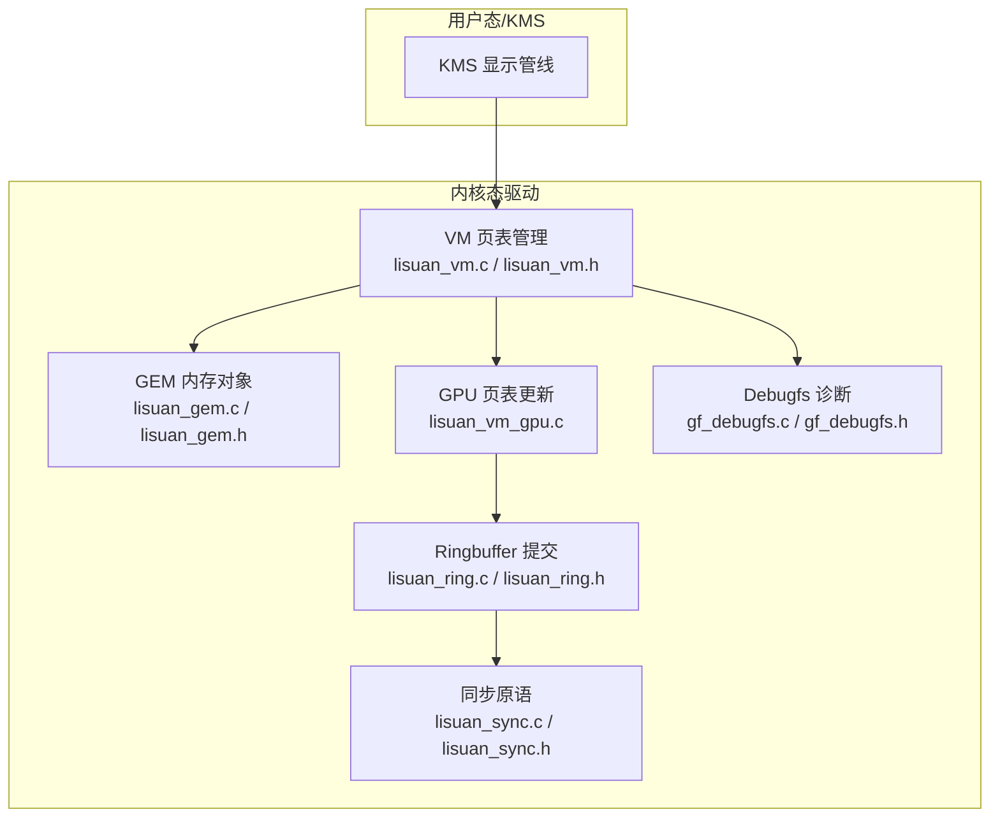
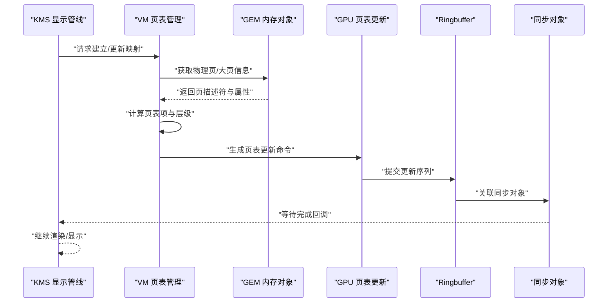
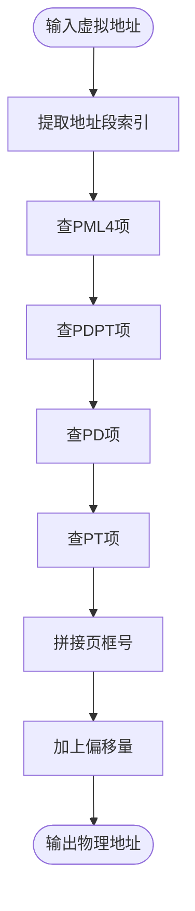
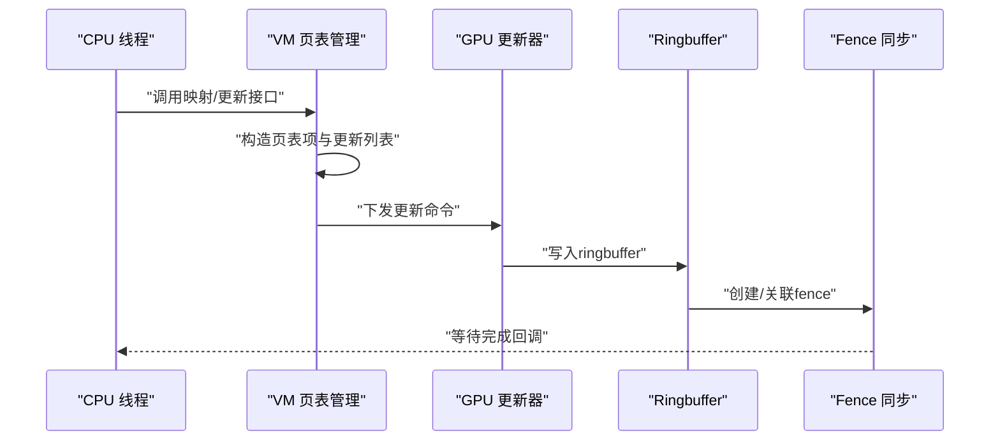
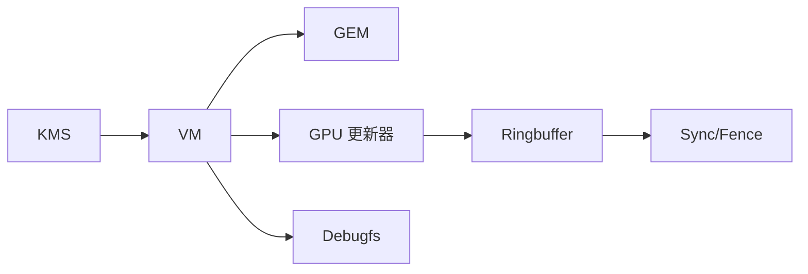

# 页表管理机制

<cite>
**本文引用的文件**   
- [lisuan_vm.c](file://_work/src/usr/src/lisuan-dkms-262.2.0.56/lisuan_vm.c)
- [lisuan_vm.h](file://_work/src/usr/src/lisuan-dkms-262.2.0.56/lisuan_vm.h)
- [lisuan_vm_gpu.c](file://_work/src/usr/src/lisuan-dkms-262.2.0.56/lisuan_vm_gpu.c)
- [lisuan_gem.c](file://_work/src/usr/src/lisuan-dkms-262.2.0.56/lisuan_gem.c)
- [lisuan_gem.h](file://_work/src/usr/src/lisuan-dkms-262.2.0.56/lisuan_gem.h)
- [gf_kms.c](file://_work/src/usr/src/lisuan-dkms-262.2.0.56/gf_kms.c)
- [gf_kms.h](file://_work/src/usr/src/lisuan-dkms-262.2.0.56/gf_kms.h)
- [lisuan_drv.c](file://_work/src/usr/src/lisuan-dkms-262.2.0.56/lisuan_drv.c)
- [lisuan_drv.h](file://_work/src/usr/src/lisuan-dkms-262.2.0.56/lisuan_drv.h)
- [lisuan_ring.c](file://_work/src/usr/src/lisuan-dkms-262.2.0.56/lisuan_ring.c)
- [lisuan_ring.h](file://_work/src/usr/src/lisuan-dkms-262.2.0.56/lisuan_ring.h)
- [lisuan_sync.c](file://_work/src/usr/src/lisuan-dkms-262.2.0.56/lisuan_sync.c)
- [lisuan_sync.h](file://_work/src/usr/src/lisuan-dkms-262.2.0.56/lisuan_sync.h)
- [gf_debugfs.c](file://_work/src/usr/src/lisuan-dkms-262.2.0.56/gf_debugfs.c)
- [gf_debugfs.h](file://_work/src/usr/src/lisuan-dkms-262.2.0.56/gf_debugfs.h)
</cite>

## 目录
1. [简介](#简介)
2. [项目结构](#项目结构)
3. [核心组件](#核心组件)
4. [架构总览](#架构总览)
5. [详细组件分析](#详细组件分析)
6. [依赖关系分析](#依赖关系分析)
7. [性能考量](#性能考量)
8. [故障排除指南](#故障排除指南)
9. [结论](#结论)
10. [附录](#附录)

## 简介
本技术文档面向丽山GPU驱动中的页表管理系统，围绕多级页表结构设计、页表项格式与地址转换算法、分配策略与内存布局、更新与同步机制、并发访问控制、调试与统计工具、大页支持与碎片化规避等主题进行系统化阐述。文档旨在帮助开发者快速理解并高效使用页表子系统，同时为问题定位与性能优化提供可操作的方法论。

## 项目结构
与页表管理直接相关的代码主要分布在以下模块：
- VM（虚拟内存）层：负责多级页表构建、映射/解映射、地址转换、CPU/GPU侧一致性维护
- GEM（图形内存对象）层：负责显存对象的分配、引用计数、与VM层的绑定
- KMS（内核模式设置）层：在显示管线中触发页表更新与提交
- Ringbuffer与同步：用于将页表更新命令提交到GPU执行，保证顺序与可见性
- Debugfs：暴露页表状态、统计信息与诊断接口

图表来源
- [lisuan_vm.c:1-200](file://_work/src/usr/src/lisuan-dkms-262.2.0.56/lisuan_vm.c#L1-L200)
- [lisuan_vm.h:1-200](file://_work/src/usr/src/lisuan-dkms-262.2.0.56/lisuan_vm.h#L1-L200)
- [lisuan_vm_gpu.c:1-200](file://_work/src/usr/src/lisuan-dkms-262.2.0.56/lisuan_vm_gpu.c#L1-L200)
- [lisuan_gem.c:1-200](file://_work/src/usr/src/lisuan-dkms-262.2.0.56/lisuan_gem.c#L1-L200)
- [lisuan_ring.c:1-200](file://_work/src/usr/src/lisuan-dkms-262.2.0.56/lisuan_ring.c#L1-L200)
- [lisuan_sync.c:1-200](file://_work/src/usr/src/lisuan-dkms-262.2.0.56/lisuan_sync.c#L1-L200)
- [gf_debugfs.c:1-200](file://_work/src/usr/src/lisuan-dkms-262.2.0.56/gf_debugfs.c#L1-L200)

章节来源
- [lisuan_vm.c:1-200](file://_work/src/usr/src/lisuan-dkms-262.2.0.56/lisuan_vm.c#L1-L200)
- [lisuan_vm.h:1-200](file://_work/src/usr/src/lisuan-dkms-262.2.0.56/lisuan_vm.h#L1-L200)
- [lisuan_gem.c:1-200](file://_work/src/usr/src/lisuan-dkms-262.2.0.56/lisuan_gem.c#L1-L200)
- [lisuan_gem.h:1-200](file://_work/src/usr/src/lisuan-dkms-262.2.0.56/lisuan_gem.h#L1-L200)
- [gf_kms.c:1-200](file://_work/src/usr/src/lisuan-dkms-262.2.0.56/gf_kms.c#L1-L200)
- [lisuan_ring.c:1-200](file://_work/src/usr/src/lisuan-dkms-262.2.0.56/lisuan_ring.c#L1-L200)
- [lisuan_sync.c:1-200](file://_work/src/usr/src/lisuan-dkms-262.2.0.56/lisuan_sync.c#L1-L200)
- [gf_debugfs.c:1-200](file://_work/src/usr/src/lisuan-dkms-262.2.0.56/gf_debugfs.c#L1-L200)

## 核心组件
- VM 页表管理（lisuan_vm.c / lisuan_vm.h）
  - 职责：构建多级页表（如PML4/PDPT/PD/PT），维护进程级或设备级地址空间，提供映射/解映射、查询、刷新接口
  - 关键能力：支持多种页面大小（4KB/2MB/1GB），按粒度选择合适层级；维护TLB失效与一致性；记录统计信息
- GPU 页表更新（lisuan_vm_gpu.c）
  - 职责：将页表项写入GPU可访问的页表基址，生成并下发更新命令至ringbuffer
  - 关键能力：批量更新、原子提交、与同步对象关联
- GEM 内存对象（lisuan_gem.c / lisuan_gem.h）
  - 职责：封装显存分配、引用计数、与VM绑定/解绑、缓存一致性处理
  - 关键能力：支持不同内存域（系统内存/显存）、大页对齐、碎片化规避
- KMS 集成（gf_kms.c / gf_kms.h）
  - 职责：在显示流水线前触发页表更新，确保帧缓冲可见性
- Ringbuffer 与同步（lisuan_ring.c / lisuan_sync.c）
  - 职责：有序提交页表更新命令，等待GPU完成，避免竞态
- Debugfs（gf_debugfs.c / gf_debugfs.h）
  - 职责：导出页表树、映射关系、统计指标、错误注入点

章节来源
- [lisuan_vm.c:1-200](file://_work/src/usr/src/lisuan-dkms-262.2.0.56/lisuan_vm.c#L1-L200)
- [lisuan_vm.h:1-200](file://_work/src/usr/src/lisuan-dkms-262.2.0.56/lisuan_vm.h#L1-L200)
- [lisuan_vm_gpu.c:1-200](file://_work/src/usr/src/lisuan-dkms-262.2.0.56/lisuan_vm_gpu.c#L1-L200)
- [lisuan_gem.c:1-200](file://_work/src/usr/src/lisuan-dkms-262.2.0.56/lisuan_gem.c#L1-L200)
- [lisuan_gem.h:1-200](file://_work/src/usr/src/lisuan-dkms-262.2.0.56/lisuan_gem.h#L1-L200)
- [gf_kms.c:1-200](file://_work/src/usr/src/lisuan-dkms-262.2.0.56/gf_kms.c#L1-L200)
- [lisuan_ring.c:1-200](file://_work/src/usr/src/lisuan-dkms-262.2.0.56/lisuan_ring.c#L1-L200)
- [lisuan_sync.c:1-200](file://_work/src/usr/src/lisuan-dkms-262.2.0.56/lisuan_sync.c#L1-L200)
- [gf_debugfs.c:1-200](file://_work/src/usr/src/lisuan-dkms-262.2.0.56/gf_debugfs.c#L1-L200)

## 架构总览
下图展示了从KMS到VM再到GPU的完整数据与控制流，包括页表构建、更新与提交的关键路径。

图表来源
- [gf_kms.c:1-200](file://_work/src/usr/src/lisuan-dkms-262.2.0.56/gf_kms.c#L1-L200)
- [lisuan_vm.c:1-200](file://_work/src/usr/src/lisuan-dkms-262.2.0.56/lisuan_vm.c#L1-L200)
- [lisuan_gem.c:1-200](file://_work/src/usr/src/lisuan-dkms-262.2.0.56/lisuan_gem.c#L1-L200)
- [lisuan_vm_gpu.c:1-200](file://_work/src/usr/src/lisuan-dkms-262.2.0.56/lisuan_vm_gpu.c#L1-L200)
- [lisuan_ring.c:1-200](file://_work/src/usr/src/lisuan-dkms-262.2.0.56/lisuan_ring.c#L1-L200)
- [lisuan_sync.c:1-200](file://_work/src/usr/src/lisuan-dkms-262.2.0.56/lisuan_sync.c#L1-L200)

## 详细组件分析

### 多级页表结构与页表项格式
- 层级设计
  - 典型四级结构：PML4 -> PDPT -> PD -> PT，适配64位地址空间
  - 根据目标页面大小选择最优层级：4KB走PT，2MB走PD，1GB走PDPT/PML4直连
- 页表项字段
  - 存在位、读写权限、可执行位、缓存属性、页框号、保留位
  - 大页标志位用于指示非叶子节点是否为大页映射
- 地址转换算法
  - 提取地址各段作为索引，逐级查找页表项，组合得到物理地址
  - 支持混合粒度映射，需校验边界与对齐约束

图表来源
- [lisuan_vm.c:1-200](file://_work/src/usr/src/lisuan-dkms-262.2.0.56/lisuan_vm.c#L1-L200)
- [lisuan_vm.h:1-200](file://_work/src/usr/src/lisuan-dkms-262.2.0.56/lisuan_vm.h#L1-L200)

章节来源
- [lisuan_vm.c:1-200](file://_work/src/usr/src/lisuan-dkms-262.2.0.56/lisuan_vm.c#L1-L200)
- [lisuan_vm.h:1-200](file://_work/src/usr/src/lisuan-dkms-262.2.0.56/lisuan_vm.h#L1-L200)

### 页表分配策略与内存布局
- 分配策略
  - 按需分配：首次访问时创建缺失的页表层级
  - 预分配：对热点区域预建页表以减少延迟
  - 合并策略：相邻小页尽量合并为大页以降低页表规模
- 内存布局
  - 页表数组连续存放，便于批量更新与缓存友好
  - 对齐要求：页表基址按页面大小对齐，提升硬件查找效率
- 大页支持
  - 优先尝试1GB/2MB映射，失败回退到4KB
  - 大页标记位与常规页项区分，避免误解析

章节来源
- [lisuan_vm.c:1-200](file://_work/src/usr/src/lisuan-dkms-262.2.0.56/lisuan_vm.c#L1-L200)
- [lisuan_gem.c:1-200](file://_work/src/usr/src/lisuan-dkms-262.2.0.56/lisuan_gem.c#L1-L200)

### 页表更新机制与同步策略
- 更新流程
  - CPU侧修改页表项后，通过GPU侧接口写入设备页表基址
  - 生成批量更新命令，加入ringbuffer并提交
- 同步机制
  - 使用同步对象（fence）确保GPU完成后再释放或重用资源
  - 跨上下文共享同步对象，避免重复刷新
- 一致性保证
  - TLB失效：在关键路径后触发TLB flush，确保新映射生效
  - 内存屏障：保证CPU写可见性与顺序

图表来源
- [lisuan_vm.c:1-200](file://_work/src/usr/src/lisuan-dkms-262.2.0.56/lisuan_vm.c#L1-L200)
- [lisuan_vm_gpu.c:1-200](file://_work/src/usr/src/lisuan-dkms-262.2.0.56/lisuan_vm_gpu.c#L1-L200)
- [lisuan_ring.c:1-200](file://_work/src/usr/src/lisuan-dkms-262.2.0.56/lisuan_ring.c#L1-L200)
- [lisuan_sync.c:1-200](file://_work/src/usr/src/lisuan-dkms-262.2.0.56/lisuan_sync.c#L1-L200)

章节来源
- [lisuan_vm.c:1-200](file://_work/src/usr/src/lisuan-dkms-262.2.0.56/lisuan_vm.c#L1-L200)
- [lisuan_vm_gpu.c:1-200](file://_work/src/usr/src/lisuan-dkms-262.2.0.56/lisuan_vm_gpu.c#L1-L200)
- [lisuan_ring.c:1-200](file://_work/src/usr/src/lisuan-dkms-262.2.0.56/lisuan_ring.c#L1-L200)
- [lisuan_sync.c:1-200](file://_work/src/usr/src/lisuan-dkms-262.2.0.56/lisuan_sync.c#L1-L200)

### 并发访问控制
- 锁策略
  - 每进程/设备级自旋锁保护页表结构
  - 细粒度锁：按页表层级或区间加锁，减少竞争
- 无锁优化
  - 读多写少场景采用RCU风格遍历
  - 原子更新页表项，配合内存屏障
- 中断安全
  - 中断上下文中仅做最小必要更新，避免阻塞

章节来源
- [lisuan_vm.c:1-200](file://_work/src/usr/src/lisuan-dkms-262.2.0.56/lisuan_vm.c#L1-L200)
- [lisuan_sync.c:1-200](file://_work/src/usr/src/lisuan-dkms-262.2.0.56/lisuan_sync.c#L1-L200)

### 调试工具、统计与性能分析
- Debugfs接口
  - 导出当前进程的页表树、映射关系、大页使用情况
  - 提供错误注入点以验证健壮性
- 统计指标
  - 页表项数量、命中率、TLB失效次数、更新延迟分布
- 分析方法
  - 结合perf与tracepoint定位热点路径
  - 对比不同页面大小下的吞吐与延迟

章节来源
- [gf_debugfs.c:1-200](file://_work/src/usr/src/lisuan-dkms-262.2.0.56/gf_debugfs.c#L1-L200)
- [gf_debugfs.h:1-200](file://_work/src/usr/src/lisuan-dkms-262.2.0.56/gf_debugfs.h#L1-L200)

### 不同页面大小与大页管理
- 支持粒度
  - 4KB标准页、2MB大页、1GB超大页
- 选择策略
  - 优先大页，失败回退；动态调整以适应工作负载
- 碎片化规避
  - 对齐分配、合并相邻映射、延迟拆分

章节来源
- [lisuan_vm.c:1-200](file://_work/src/usr/src/lisuan-dkms-262.2.0.56/lisuan_vm.c#L1-L200)
- [lisuan_gem.c:1-200](file://_work/src/usr/src/lisuan-dkms-262.2.0.56/lisuan_gem.c#L1-L200)

### 高级用法示例与故障排除技巧
- 高级用法
  - 批量映射：一次性建立多个连续区域的映射，减少函数调用开销
  - 异步更新：结合fence实现非阻塞更新，提高吞吐
  - 热路径优化：对频繁访问区域预建大页映射
- 故障排除
  - 检查页表项权限与缓存属性是否匹配
  - 确认TLB失效时机是否正确
  - 使用debugfs查看映射异常与统计指标

章节来源
- [lisuan_vm.c:1-200](file://_work/src/usr/src/lisuan-dkms-262.2.0.56/lisuan_vm.c#L1-L200)
- [gf_debugfs.c:1-200](file://_work/src/usr/src/lisuan-dkms-262.2.0.56/gf_debugfs.c#L1-L200)

## 依赖关系分析
VM层依赖GEM获取物理页信息，依赖GPU更新器写入设备页表，依赖ringbuffer提交命令，依赖sync保证顺序。KMS在显示路径中触发更新。

图表来源
- [gf_kms.c:1-200](file://_work/src/usr/src/lisuan-dkms-262.2.0.56/gf_kms.c#L1-L200)
- [lisuan_vm.c:1-200](file://_work/src/usr/src/lisuan-dkms-262.2.0.56/lisuan_vm.c#L1-L200)
- [lisuan_gem.c:1-200](file://_work/src/usr/src/lisuan-dkms-262.2.0.56/lisuan_gem.c#L1-L200)
- [lisuan_vm_gpu.c:1-200](file://_work/src/usr/src/lisuan-dkms-262.2.0.56/lisuan_vm_gpu.c#L1-L200)
- [lisuan_ring.c:1-200](file://_work/src/usr/src/lisuan-dkms-262.2.0.56/lisuan_ring.c#L1-L200)
- [lisuan_sync.c:1-200](file://_work/src/usr/src/lisuan-dkms-262.2.0.56/lisuan_sync.c#L1-L200)
- [gf_debugfs.c:1-200](file://_work/src/usr/src/lisuan-dkms-262.2.0.56/gf_debugfs.c#L1-L200)

章节来源
- [lisuan_vm.c:1-200](file://_work/src/usr/src/lisuan-dkms-262.2.0.56/lisuan_vm.c#L1-L200)
- [lisuan_gem.c:1-200](file://_work/src/usr/src/lisuan-dkms-262.2.0.56/lisuan_gem.c#L1-L200)
- [lisuan_vm_gpu.c:1-200](file://_work/src/usr/src/lisuan-dkms-262.2.0.56/lisuan_vm_gpu.c#L1-L200)
- [lisuan_ring.c:1-200](file://_work/src/usr/src/lisuan-dkms-262.2.0.56/lisuan_ring.c#L1-L200)
- [lisuan_sync.c:1-200](file://_work/src/usr/src/lisuan-dkms-262.2.0.56/lisuan_sync.c#L1-L200)
- [gf_debugfs.c:1-200](file://_work/src/usr/src/lisuan-dkms-262.2.0.56/gf_debugfs.c#L1-L200)

## 性能考量
- 减少函数调用与拷贝：批量构建页表项，避免逐条更新
- 利用大页降低页表规模与TLB压力
- 合理设置缓存属性（如Write-Back/Write-Through）平衡一致性与带宽
- 使用异步提交与fence重叠CPU/GPU工作
- 监控TLB失效频率，优化映射稳定性

[本节为通用指导，不直接分析具体文件]

## 故障排除指南
- 常见问题
  - 映射权限错误导致GPU访问异常
  - TLB未正确失效造成脏读
  - 大页分配失败导致回退频繁
- 排查步骤
  - 使用debugfs查看页表树与映射详情
  - 检查ringbuffer提交与fence完成状态
  - 分析统计指标定位热点与瓶颈
- 修复建议
  - 修正权限与缓存属性配置
  - 在关键路径插入TLB失效
  - 调整分配策略以提升大页命中率

章节来源
- [gf_debugfs.c:1-200](file://_work/src/usr/src/lisuan-dkms-262.2.0.56/gf_debugfs.c#L1-L200)
- [lisuan_vm.c:1-200](file://_work/src/usr/src/lisuan-dkms-262.2.0.56/lisuan_vm.c#L1-L200)

## 结论
丽山GPU页表管理系统通过清晰的多级结构设计、灵活的页面大小支持与完善的同步机制，实现了高效可靠的地址转换与映射管理。借助debugfs与统计工具，开发者可深入洞察运行状态并进行针对性优化。遵循本文档的实践建议，可在复杂显示与图形负载下获得稳定且高性能的页表行为。

[本节为总结性内容，不直接分析具体文件]

## 附录
- 术语表
  - VM：虚拟内存子系统
  - GEM：图形内存对象管理
  - KMS：内核模式设置
  - TLB：转译后备缓冲区
  - Fence：同步对象
- 参考文件
  - [lisuan_vm.c](file://_work/src/usr/src/lisuan-dkms-262.2.0.56/lisuan_vm.c)
  - [lisuan_vm.h](file://_work/src/usr/src/lisuan-dkms-262.2.0.56/lisuan_vm.h)
  - [lisuan_vm_gpu.c](file://_work/src/usr/src/lisuan-dkms-262.2.0.56/lisuan_vm_gpu.c)
  - [lisuan_gem.c](file://_work/src/usr/src/lisuan-dkms-262.2.0.56/lisuan_gem.c)
  - [lisuan_gem.h](file://_work/src/usr/src/lisuan-dkms-262.2.0.56/lisuan_gem.h)
  - [gf_kms.c](file://_work/src/usr/src/lisuan-dkms-262.2.0.56/gf_kms.c)
  - [gf_kms.h](file://_work/src/usr/src/lisuan-dkms-262.2.0.56/gf_kms.h)
  - [lisuan_drv.c](file://_work/src/usr/src/lisuan-dkms-262.2.0.56/lisuan_drv.c)
  - [lisuan_drv.h](file://_work/src/usr/src/lisuan-dkms-262.2.0.56/lisuan_drv.h)
  - [lisuan_ring.c](file://_work/src/usr/src/lisuan-dkms-262.2.0.56/lisuan_ring.c)
  - [lisuan_ring.h](file://_work/src/usr/src/lisuan-dkms-262.2.0.56/lisuan_ring.h)
  - [lisuan_sync.c](file://_work/src/usr/src/lisuan-dkms-262.2.0.56/lisuan_sync.c)
  - [lisuan_sync.h](file://_work/src/usr/src/lisuan-dkms-262.2.0.56/lisuan_sync.h)
  - [gf_debugfs.c](file://_work/src/usr/src/lisuan-dkms-262.2.0.56/gf_debugfs.c)
  - [gf_debugfs.h](file://_work/src/usr/src/lisuan-dkms-262.2.0.56/gf_debugfs.h)