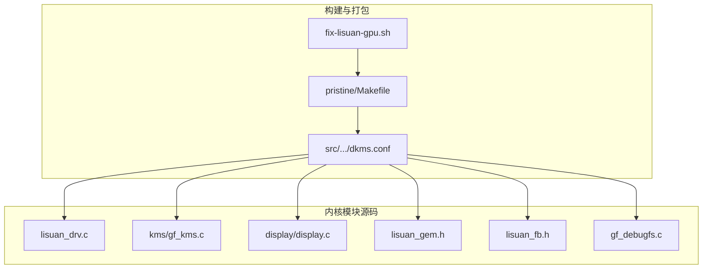
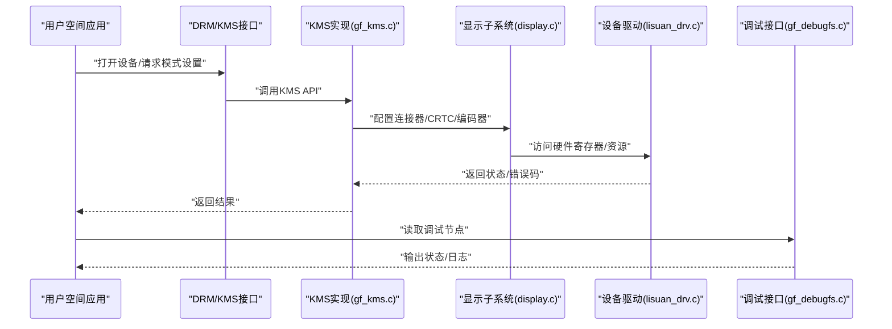
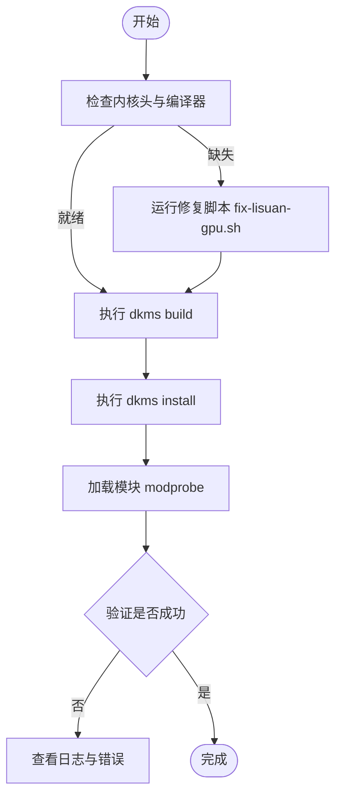
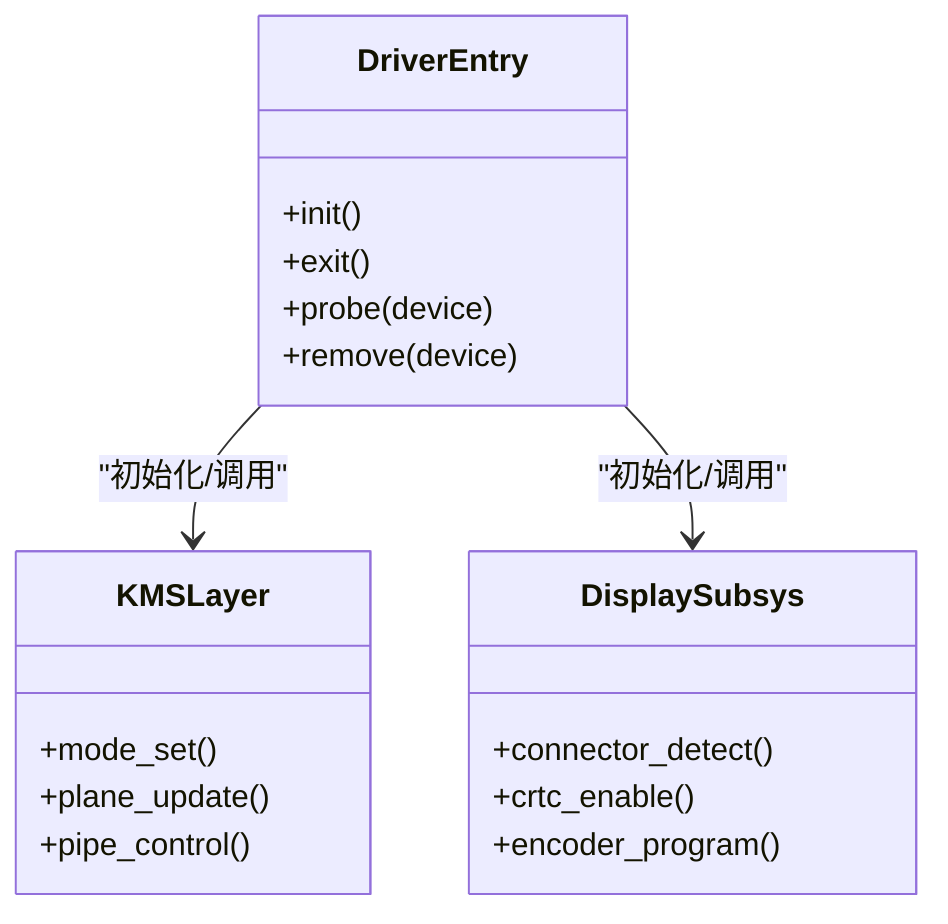
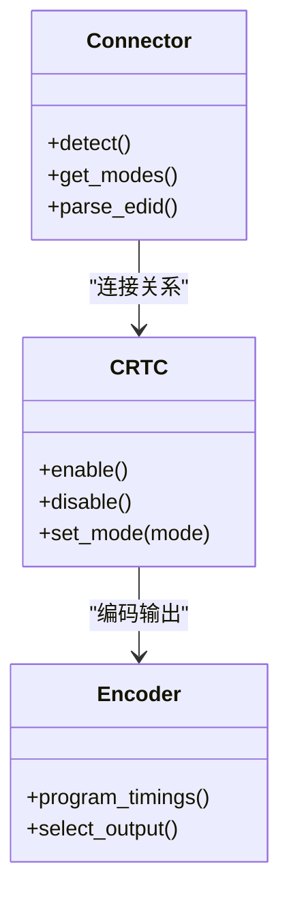
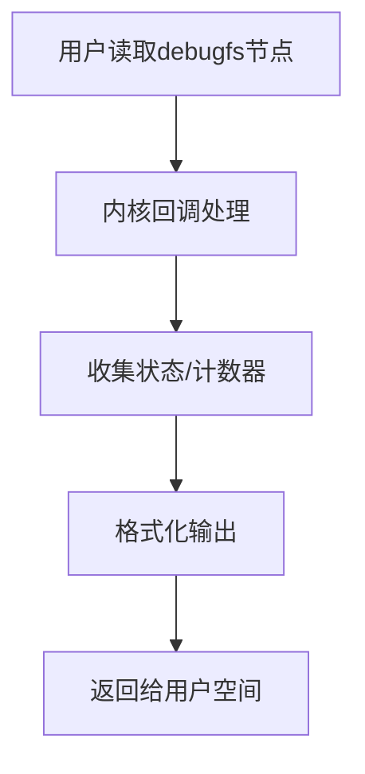
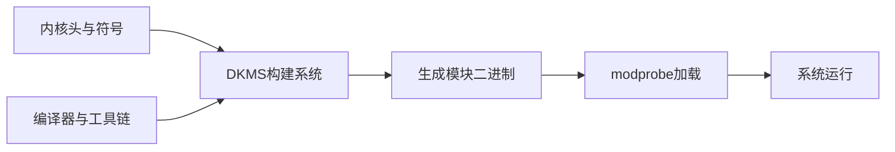

# 快速开始

<cite>
**本文引用的文件**   
- [Makefile](file://_work/pristine/Makefile)
- [dkms.conf](file://_work/src/usr/src/lisuangpu-dkms-262.2.0.56/dkms.conf)
- [fix-lisuan-gpu.sh](file://_work/fix-lisuan-gpu.sh)
- [display.c](file://_work/src/usr/src/lisuangpu-dkms-262.2.0.56/display/display.c)
- [lisuan_drv.c](file://_work/src/usr/src/lisuangpu-dkms-262.2.0.56/lisuan_drv.c)
- [gf_kms.c](file://_work/src/usr/src/lisuangpu-dkms-262.2.0.56/kms/gf_kms.c)
- [disp_device.c](file://_work/src/usr/src/lisuangpu-dkms-262.2.0.56/display/disp_device.c)
- [disp_connector.h](file://_work/src/usr/src/lisuangpu-dkms-262.2.0.56/display/connector/disp_connector.h)
- [disp_crtc.h](file://_work/src/usr/src/lisuangpu-dkms-262.2.0.56/display/crtc/disp_crtc.h)
- [disp_encoder.h](file://_work/src/usr/src/lisuangpu-dkms-262.2.0.56/display/encoder/disp_encoder.h)
- [lisuan_gem.h](file://_work/src/usr/src/lisuangpu-dkms-262.2.0.56/lisuan_gem.h)
- [lisuan_fb.h](file://_work/src/usr/src/lisuangpu-dkms-262.2.0.56/lisuan_fb.h)
- [gf_debugfs.c](file://_work/src/usr/src/lisuangpu-dkms-262.2.0.56/gf_debugfs.c)
</cite>

## 目录
1. [简介](#简介)
2. [项目结构](#项目结构)
3. [核心组件](#核心组件)
4. [架构总览](#架构总览)
5. [详细组件分析](#详细组件分析)
6. [依赖关系分析](#依赖关系分析)
7. [性能注意事项](#性能注意事项)
8. [故障排除指南](#故障排除指南)
9. [结论](#结论)
10. [附录](#附录)

## 简介
本指南面向首次接触丽山GPU显示驱动的用户，目标是帮助你快速完成安装、基础配置与验证，理解DKMS模块的编译与安装流程，并在遇到问题时能自行排查。文档基于仓库中的源码与构建脚本进行说明，确保内容与实际实现一致。

## 项目结构
该仓库包含DKMS打包所需文件、内核模块源码以及辅助脚本。关键目录与职责如下：
- _work/pristine/Makefile：顶层构建入口，定义编译目标与参数
- _work/src/usr/src/lisuangpu-dkms-262.2.0.56/dkms.conf：DKMS配置文件，描述模块名、版本、源目录与构建命令
- _work/fix-lisuan-gpu.sh：系统适配或修复脚本（例如处理内核头路径、依赖包等）
- display/*：显示子系统相关代码（连接器、CRTC、编码器、寄存器、VBT等）
- kms/*：KMS接口实现（模式设置、HDR、CRC等）
- lisuan_*.*：GPU核心驱动（设备初始化、GEM内存管理、帧缓冲、调度、同步等）
- gf_*.*：通用框架与调试接口（中断、任务、环形缓冲区、调试FS等）

**图示来源** 
- [Makefile](file://_work/pristine/Makefile)
- [dkms.conf](file://_work/src/usr/src/lisuangpu-dkms-262.2.0.56/dkms.conf)
- [fix-lisuan-gpu.sh](file://_work/fix-lisuan-gpu.sh)
- [lisuan_drv.c](file://_work/src/usr/src/lisuangpu-dkms-262.2.0.56/lisuan_drv.c)
- [gf_kms.c](file://_work/src/usr/src/lisuangpu-dkms-262.2.0.56/kms/gf_kms.c)
- [display.c](file://_work/src/usr/src/lisuangpu-dkms-262.2.0.56/display/display.c)
- [lisuan_gem.h](file://_work/src/usr/src/lisuangpu-dkms-262.2.0.56/lisuan_gem.h)
- [lisuan_fb.h](file://_work/src/usr/src/lisuangpu-dkms-262.2.0.56/lisuan_fb.h)
- [gf_debugfs.c](file://_work/src/usr/src/lisuangpu-dkms-262.2.0.56/gf_debugfs.c)

**章节来源**
- [Makefile](file://_work/pristine/Makefile)
- [dkms.conf](file://_work/src/usr/src/lisuangpu-dkms-262.2.0.56/dkms.conf)
- [fix-lisuan-gpu.sh](file://_work/fix-lisuan-gpu.sh)

## 核心组件
- 驱动入口与设备注册：由驱动主文件负责初始化、探测与卸载流程，并注册到内核子系统
- KMS接口：提供模式设置、平面/管道控制、HDR支持、CRC校验等
- 显示子系统：连接器（HDMI/DP/DVO）、CRTC、编码器、PLL、PWM、EDID、DisplayID等
- GPU核心：GEM对象、帧缓冲、调度器、同步原语、VM管理、中断与任务队列
- 调试与诊断：debugfs接口用于查看状态与日志

**章节来源**
- [lisuan_drv.c](file://_work/src/usr/src/lisuangpu-dkms-262.2.0.56/lisuan_drv.c)
- [gf_kms.c](file://_work/src/usr/src/lisuangpu-dkms-262.2.0.56/kms/gf_kms.c)
- [display.c](file://_work/src/usr/src/lisuangpu-dkms-262.2.0.56/display/display.c)
- [disp_connector.h](file://_work/src/usr/src/lisuangpu-dkms-262.2.0.56/display/connector/disp_connector.h)
- [disp_crtc.h](file://_work/src/usr/src/lisuangpu-dkms-262.2.0.56/display/crtc/disp_crtc.h)
- [disp_encoder.h](file://_work/src/usr/src/lisuangpu-dkms-262.2.0.56/display/encoder/disp_encoder.h)
- [lisuan_gem.h](file://_work/src/usr/src/lisuangpu-dkms-262.2.0.56/lisuan_gem.h)
- [lisuan_fb.h](file://_work/src/usr/src/lisuangpu-dkms-262.2.0.56/lisuan_fb.h)
- [gf_debugfs.c](file://_work/src/usr/src/lisuangpu-dkms-262.2.0.56/gf_debugfs.c)

## 架构总览
下图展示了从用户态到内核态的关键交互路径：用户空间通过DRM/KMS接口调用，进入KMS层，再落到显示子系统和GPU核心；调试信息通过debugfs暴露。

**图示来源** 
- [gf_kms.c](file://_work/src/usr/src/lisuangpu-dkms-262.2.0.56/kms/gf_kms.c)
- [display.c](file://_work/src/usr/src/lisuangpu-dkms-262.2.0.56/display/display.c)
- [lisuan_drv.c](file://_work/src/usr/src/lisuangpu-dkms-262.2.0.56/lisuan_drv.c)
- [gf_debugfs.c](file://_work/src/usr/src/lisuangpu-dkms-262.2.0.56/gf_debugfs.c)

## 详细组件分析

### DKMS模块编译与安装流程
DKMS（动态内核模块支持）会在内核更新后自动重新编译模块。仓库中提供了dkms.conf与Makefile，配合修复脚本可简化环境准备。

**图示来源** 
- [dkms.conf](file://_work/src/usr/src/lisuangpu-dkms-262.2.0.56/dkms.conf)
- [Makefile](file://_work/pristine/Makefile)
- [fix-lisuan-gpu.sh](file://_work/fix-lisuan-gpu.sh)

**章节来源**
- [dkms.conf](file://_work/src/usr/src/lisuangpu-dkms-262.2.0.56/dkms.conf)
- [Makefile](file://_work/pristine/Makefile)
- [fix-lisuan-gpu.sh](file://_work/fix-lisuan-gpu.sh)

### 驱动入口与设备生命周期
驱动主文件负责模块初始化、设备探测、资源分配与清理。典型流程包括：
- 模块入口函数注册驱动
- 探测阶段识别GPU设备
- 初始化KMS与显示子系统
- 提供卸载与错误恢复路径

**图示来源** 
- [lisuan_drv.c](file://_work/src/usr/src/lisuangpu-dkms-262.2.0.56/lisuan_drv.c)
- [gf_kms.c](file://_work/src/usr/src/lisuangpu-dkms-262.2.0.56/kms/gf_kms.c)
- [display.c](file://_work/src/usr/src/lisuangpu-dkms-262.2.0.56/display/display.c)

**章节来源**
- [lisuan_drv.c](file://_work/src/usr/src/lisuangpu-dkms-262.2.0.56/lisuan_drv.c)
- [gf_kms.c](file://_work/src/usr/src/lisuangpu-dkms-262.2.0.56/kms/gf_kms.c)
- [display.c](file://_work/src/usr/src/lisuangpu-dkms-262.2.0.56/display/display.c)

### 显示子系统关键接口
显示子系统围绕连接器、CRTC与编码器展开，负责模式选择与时序配置。

**图示来源** 
- [disp_connector.h](file://_work/src/usr/src/lisuangpu-dkms-262.2.0.56/display/connector/disp_connector.h)
- [disp_crtc.h](file://_work/src/usr/src/lisuangpu-dkms-262.2.0.56/display/crtc/disp_crtc.h)
- [disp_encoder.h](file://_work/src/usr/src/lisuangpu-dkms-262.2.0.56/display/encoder/disp_encoder.h)

**章节来源**
- [disp_connector.h](file://_work/src/usr/src/lisuangpu-dkms-262.2.0.56/display/connector/disp_connector.h)
- [disp_crtc.h](file://_work/src/usr/src/lisuangpu-dkms-262.2.0.56/display/crtc/disp_crtc.h)
- [disp_encoder.h](file://_work/src/usr/src/lisuangpu-dkms-262.2.0.56/display/encoder/disp_encoder.h)

### GPU核心与内存管理
GPU核心提供GEM对象与帧缓冲管理，支撑渲染与显示数据通路。

**图示来源** 
- [lisuan_gem.h](file://_work/src/usr/src/lisuangpu-dkms-262.2.0.56/lisuan_gem.h)
- [lisuan_fb.h](file://_work/src/usr/src/lisuangpu-dkms-262.2.0.56/lisuan_fb.h)

**章节来源**
- [lisuan_gem.h](file://_work/src/usr/src/lisuangpu-dkms-262.2.0.56/lisuan_gem.h)
- [lisuan_fb.h](file://_work/src/usr/src/lisuangpu-dkms-262.2.0.56/lisuan_fb.h)

### 调试与诊断
调试接口通过debugfs暴露运行时状态与日志，便于定位问题。

**图示来源** 
- [gf_debugfs.c](file://_work/src/usr/src/lisuangpu-dkms-262.2.0.56/gf_debugfs.c)

**章节来源**
- [gf_debugfs.c](file://_work/src/usr/src/lisuangpu-dkms-262.2.0.56/gf_debugfs.c)

## 依赖关系分析
DKMS构建依赖内核头、编译器与工具链；模块加载依赖正确的内核版本与符号。dkms.conf指定了模块名、版本与源目录，Makefile定义了构建规则，修复脚本用于补齐环境。

**图示来源** 
- [dkms.conf](file://_work/src/usr/src/lisuangpu-dkms-262.2.0.56/dkms.conf)
- [Makefile](file://_work/pristine/Makefile)
- [fix-lisuan-gpu.sh](file://_work/fix-lisuan-gpu.sh)

**章节来源**
- [dkms.conf](file://_work/src/usr/src/lisuangpu-dkms-262.2.0.56/dkms.conf)
- [Makefile](file://_work/pristine/Makefile)
- [fix-lisuan-gpu.sh](file://_work/fix-lisuan-gpu.sh)

## 性能注意事项
- 合理选择分辨率与刷新率，避免超出连接器/编码器能力
- 使用合适的像素格式与压缩（如DSC）以降低带宽压力
- 减少不必要的模式切换与平面更新频率
- 利用调试接口监控中断与任务队列，避免拥塞

[本节为通用指导，不直接分析具体文件]

## 故障排除指南
常见问题与解决思路：
- 编译失败：检查内核头与编译器版本是否匹配；运行修复脚本以补齐依赖
- 模块加载失败：确认内核版本与模块签名；查看dmesg与debugfs输出
- 无显示输出：检查连接器检测与EDID解析；确认CRTC与编码器配置正确
- 性能异常：观察中断与任务队列状态，调整刷新率与像素格式

建议的诊断步骤：
- 查看系统日志与内核消息
- 读取debugfs节点获取运行时状态
- 核对dkms构建日志与错误输出
- 逐步验证连接器、CRTC与编码器链路

**章节来源**
- [gf_debugfs.c](file://_work/src/usr/src/lisuangpu-dkms-262.2.0.56/gf_debugfs.c)
- [dkms.conf](file://_work/src/usr/src/lisuangpu-dkms-262.2.0.56/dkms.conf)
- [Makefile](file://_work/pristine/Makefile)
- [fix-lisuan-gpu.sh](file://_work/fix-lisuan-gpu.sh)

## 结论
通过本指南，你应该能够完成丽山GPU显示驱动的DKMS安装与基础配置，理解驱动架构与关键组件的职责，并在遇到问题时进行有效排查。建议在正式环境中先进行小规模验证，确保稳定性后再全面部署。

[本节为总结性内容，不直接分析具体文件]

## 附录
- 快速验证清单
  - 确认dkms构建成功且模块已安装
  - 使用modprobe加载模块
  - 检查dmesg与debugfs输出是否正常
  - 尝试设置一个基本显示模式并验证输出

[本节为补充信息，不直接分析具体文件]