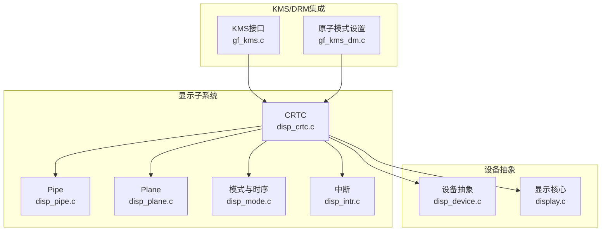
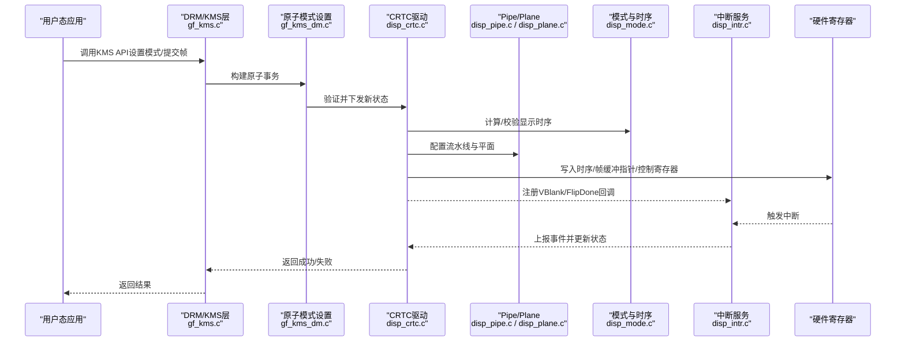
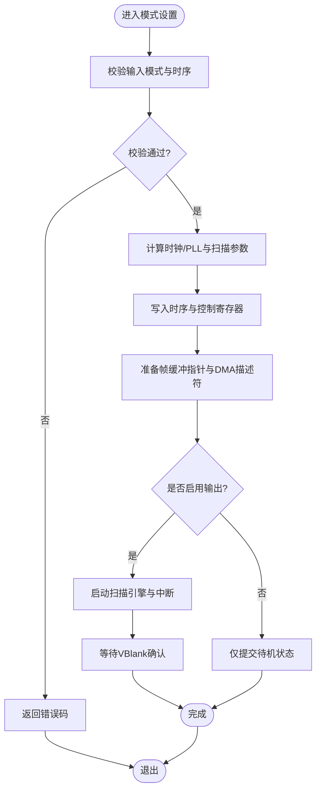
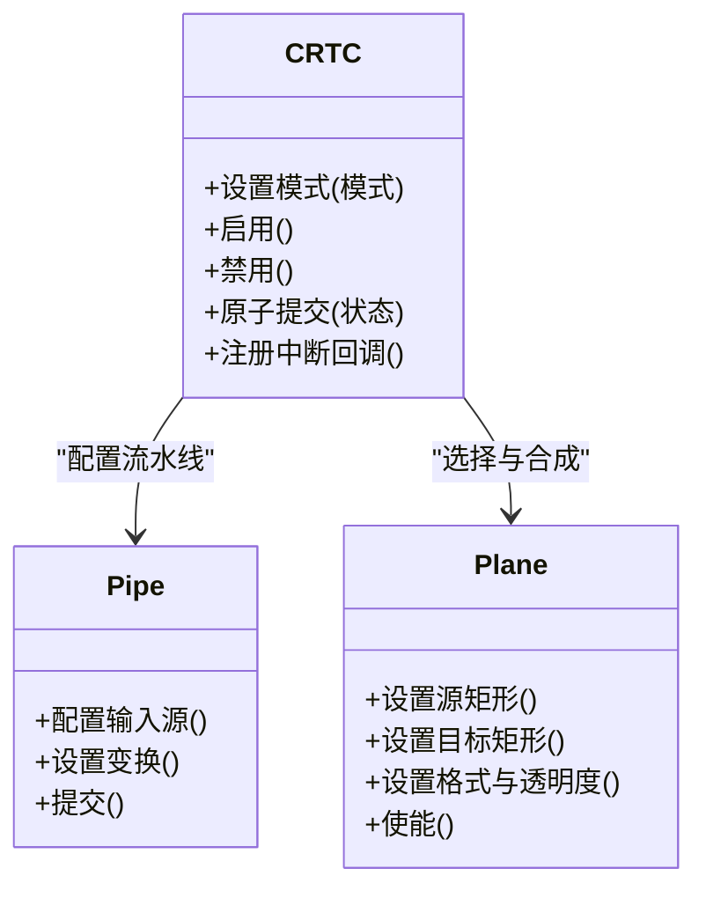
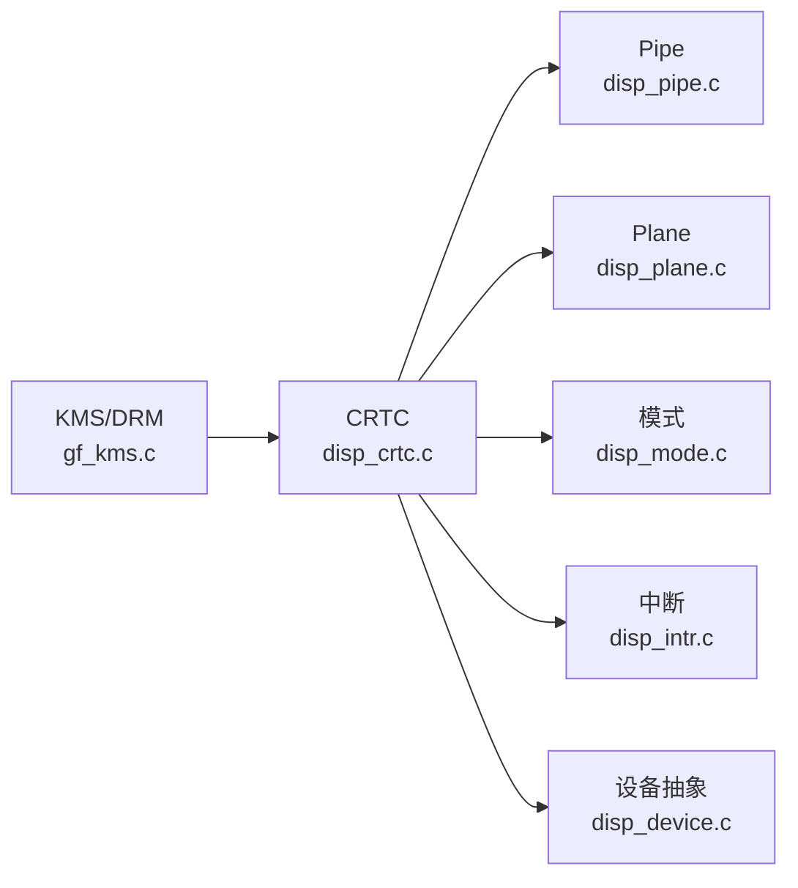

# CRTC核心组件

<cite>
**本文引用的文件**   
- [disp_crtc.c](file://_work/src/usr/src/lisuan-gpu-dkms-262.2.0.56/display/crtc/disp_crtc.c)
- [disp_crtc.h](file://_work/src/usr/src/lisuan-gpu-dkms-262.2.0.56/display/crtc/disp_crtc.h)
- [disp_pipe.c](file://_work/src/usr/src/lisuan-gpu-dkms-262.2.0.56/display/crtc/disp_pipe.c)
- [disp_pipe.h](file://_work/src/usr/src/lisuan-gpu-dkms-262.2.0.56/display/crtc/disp_pipe.h)
- [disp_plane.c](file://_work/src/usr/src/lisuan-gpu-dkms-262.2.0.56/display/crtc/disp_plane.c)
- [disp_plane.h](file://_work/src/usr/src/lisuan-gpu-dkms-262.2.0.56/display/crtc/disp_plane.h)
- [disp_mode.c](file://_work/src/usr/src/lisuan-gpu-dkms-262.2.0.56/display/connector/disp_mode.c)
- [disp_mode.h](file://_work/src/usr/src/lisuan-gpu-dkms-262.2.0.56/display/connector/disp_mode.h)
- [disp_intr.c](file://_work/src/usr/src/lisuan-gpu-dkms-262.2.0.56/display/intr/disp_intr.c)
- [disp_intr.h](file://_work/src/usr/src/lisuan-gpu-dkms-262.2.0.56/display/intr/disp_intr.h)
- [gf_kms.c](file://_work/src/usr/src/lisuan-gpu-dkms-262.2.0.56/kms/gf_kms.c)
- [gf_kms.h](file://_work/src/usr/src/lisuan-gpu-dkms-262.2.0.56/kms/gf_kms.h)
- [gf_kms_dm.c](file://_work/src/usr/src/lisuan-gpu-dkms-262.2.0.56/kms/gf_kms_dm.c)
- [gf_kms_dm.h](file://_work/src/usr/src/lisuan-gpu-dkms-262.2.0.56/kms/gf_kms_dm.h)
- [display.c](file://_work/src/usr/src/lisuan-gpu-dkms-262.2.0.56/display/display.c)
- [display.h](file://_work/src/usr/src/lisuan-gpu-dkms-262.2.0.56/display/display.h)
- [disp_device.c](file://_work/src/usr/src/lisuan-gpu-dkms-262.2.0.56/display/disp_device.c)
- [disp_device.h](file://_work/src/usr/src/lisuan-gpu-dkms-262.2.0.56/display/disp_device.h)
</cite>

## 目录
1. [简介](#简介)
2. [项目结构](#项目结构)
3. [核心组件](#核心组件)
4. [架构总览](#架构总览)
5. [详细组件分析](#详细组件分析)
6. [依赖关系分析](#依赖关系分析)
7. [性能考虑](#性能考虑)
8. [故障排查指南](#故障排查指南)
9. [结论](#结论)
10. [附录](#附录)

## 简介
本文件面向丽山GPU显示驱动中的CRTC（阴极射线管控制器）核心组件，系统性阐述其职责与工作机制：扫描输出、帧缓冲管理、显示时序控制；并覆盖初始化流程、模式设置、启用/禁用机制与中断处理。同时说明与DRM/KMS子系统的集成方式、原子操作支持与状态同步机制，并提供配置CRTC、设置显示模式和处理垂直同步事件的实践指引。

## 项目结构
CRTC相关代码位于display/crtc目录，并与connector（模式与时序）、encoder（编码输出）、intr（中断）、drm/kms接口层以及设备抽象层紧密协作。关键文件包括：
- crtc: disp_crtc.c/.h, disp_pipe.c/.h, disp_plane.c/.h
- connector: disp_mode.c/.h
- intr: disp_intr.c/.h
- kms: gf_kms.c/.h, gf_kms_dm.c/.h
- display: display.c/.h, disp_device.c/.h

图表来源
- [disp_crtc.c](file://_work/src/usr/src/lisuan-gpu-dkms-262.2.0.56/display/crtc/disp_crtc.c)
- [disp_pipe.c](file://_work/src/usr/src/lisuan-gpu-dkms-262.2.0.56/display/crtc/disp_pipe.c)
- [disp_plane.c](file://_work/src/usr/src/lisuan-gpu-dkms-262.2.0.56/display/crtc/disp_plane.c)
- [disp_mode.c](file://_work/src/usr/src/lisuan-gpu-dkms-262.2.0.56/display/connector/disp_mode.c)
- [disp_intr.c](file://_work/src/usr/src/lisuan-gpu-dkms-262.2.0.56/display/intr/disp_intr.c)
- [gf_kms.c](file://_work/src/usr/src/lisuan-gpu-dkms-262.2.0.56/kms/gf_kms.c)
- [gf_kms_dm.c](file://_work/src/usr/src/lisuan-gpu-dkms-262.2.0.56/kms/gf_kms_dm.c)
- [display.c](file://_work/src/usr/src/lisuan-gpu-dkms-262.2.0.56/display/display.c)
- [disp_device.c](file://_work/src/usr/src/lisuan-gpu-dkms-262.2.0.56/display/disp_device.c)

章节来源
- [disp_crtc.c](file://_work/src/usr/src/lisuan-gpu-dkms-262.2.0.56/display/crtc/disp_crtc.c)
- [disp_crtc.h](file://_work/src/usr/src/lisuan-gpu-dkms-262.2.0.56/display/crtc/disp_crtc.h)
- [disp_pipe.c](file://_work/src/usr/src/lisuan-gpu-dkms-262.2.0.56/display/crtc/disp_pipe.c)
- [disp_pipe.h](file://_work/src/usr/src/lisuan-gpu-dkms-262.2.0.56/display/crtc/disp_pipe.h)
- [disp_plane.c](file://_work/src/usr/src/lisuan-gpu-dkms-262.2.0.56/display/crtc/disp_plane.c)
- [disp_plane.h](file://_work/src/usr/src/lisuan-gpu-dkms-262.2.0.56/display/crtc/disp_plane.h)
- [disp_mode.c](file://_work/src/usr/src/lisuan-gpu-dkms-262.2.0.56/display/connector/disp_mode.c)
- [disp_mode.h](file://_work/src/usr/src/lisuan-gpu-dkms-262.2.0.56/display/connector/disp_mode.h)
- [disp_intr.c](file://_work/src/usr/src/lisuan-gpu-dkms-262.2.0.56/display/intr/disp_intr.c)
- [disp_intr.h](file://_work/src/usr/src/lisuan-gpu-dkms-262.2.0.56/display/intr/disp_intr.h)
- [gf_kms.c](file://_work/src/usr/src/lisuan-gpu-dkms-262.2.0.56/kms/gf_kms.c)
- [gf_kms.h](file://_work/src/usr/src/lisuan-gpu-dkms-262.2.0.56/kms/gf_kms.h)
- [gf_kms_dm.c](file://_work/src/usr/src/lisuan-gpu-dkms-262.2.0.56/kms/gf_kms_dm.c)
- [gf_kms_dm.h](file://_work/src/usr/src/lisuan-gpu-dkms-262.2.0.56/kms/gf_kms_dm.h)
- [display.c](file://_work/src/usr/src/lisuan-gpu-dkms-262.2.0.56/display/display.c)
- [display.h](file://_work/src/usr/src/lisuan-gpu-dkms-262.2.0.56/display/display.h)
- [disp_device.c](file://_work/src/usr/src/lisuan-gpu-dkms-262.2.0.56/display/disp_device.c)
- [disp_device.h](file://_work/src/usr/src/lisuan-gpu-dkms-262.2.0.56/display/disp_device.h)

## 核心组件
- CRTC控制器：负责将合成后的像素流按显示时序扫描输出到编码器，管理帧缓冲指针、扫描位置、刷新周期等。
- Pipe管线：承载像素混合、缩放、色彩空间转换等流水线阶段，CRTC驱动通过Pipe完成数据准备。
- Plane图层：提供多个可叠加的图像源，CRTC在每帧选择并组合Plane输出。
- 模式与时序：解析EDID/VBT/用户请求，生成H/V时序参数，供CRTC和Encoder使用。
- 中断模块：提供VBlank、FlipDone、错误等中断事件，驱动据此更新状态并通知上层。
- DRM/KMS接口：暴露标准接口给内核图形栈，支持原子模式设置与状态同步。

章节来源
- [disp_crtc.c](file://_work/src/usr/src/lisuan-gpu-dkms-262.2.0.56/display/crtc/disp_crtc.c)
- [disp_pipe.c](file://_work/src/usr/src/lisuan-gpu-dkms-262.2.0.56/display/crtc/disp_pipe.c)
- [disp_plane.c](file://_work/src/usr/src/lisuan-gpu-dkms-262.2.0.56/display/crtc/disp_plane.c)
- [disp_mode.c](file://_work/src/usr/src/lisuan-gpu-dkms-262.2.0.56/display/connector/disp_mode.c)
- [disp_intr.c](file://_work/src/usr/src/lisuan-gpu-dkms-262.2.0.56/display/intr/disp_intr.c)
- [gf_kms.c](file://_work/src/usr/src/lisuan-gpu-dkms-262.2.0.56/kms/gf_kms.c)
- [gf_kms_dm.c](file://_work/src/usr/src/lisuan-gpu-dkms-262.2.0.56/kms/gf_kms_dm.c)

## 架构总览
下图展示CRTC在显示子系统与KMS/DRM之间的交互关系，以及硬件寄存器访问路径。

图表来源
- [gf_kms.c](file://_work/src/usr/src/lisuan-gpu-dkms-262.2.0.56/kms/gf_kms.c)
- [gf_kms_dm.c](file://_work/src/usr/src/lisuan-gpu-dkms-262.2.0.56/kms/gf_kms_dm.c)
- [disp_crtc.c](file://_work/src/usr/src/lisuan-gpu-dkms-262.2.0.56/display/crtc/disp_crtc.c)
- [disp_pipe.c](file://_work/src/usr/src/lisuan-gpu-dkms-262.2.0.56/display/crtc/disp_pipe.c)
- [disp_plane.c](file://_work/src/usr/src/lisuan-gpu-dkms-262.2.0.56/display/crtc/disp_plane.c)
- [disp_mode.c](file://_work/src/usr/src/lisuan-gpu-dkms-262.2.0.56/display/connector/disp_mode.c)
- [disp_intr.c](file://_work/src/usr/src/lisuan-gpu-dkms-262.2.0.56/display/intr/disp_intr.c)

## 详细组件分析

### CRTC控制器（disp_crtc.c/.h）
- 职责
  - 维护CRTC状态（当前/待生效模式、使能标志、帧计数、光标位置等）。
  - 实现模式设置、启用/禁用、原子提交、VBlank/Flip事件上报。
  - 协调Pipe/Plane与Encoder的时序与帧缓冲切换。
- 关键流程
  - 初始化：分配资源、注册中断、建立与设备抽象层的连接。
  - 模式设置：校验时序、计算PLL/时钟、写入时序寄存器、准备帧缓冲指针。
  - 启用/禁用：开启扫描引擎、使能中断、启动或停止输出。
  - 中断处理：响应VBlank/FlipDone，更新状态机，唤醒等待者。
- 原子操作与同步
  - 通过KMS原子接口进行状态校验与批量提交，确保多组件一致性。
  - 内部状态机保证“先备后切”，避免撕裂与闪烁。

图表来源
- [disp_crtc.c](file://_work/src/usr/src/lisuan-gpu-dkms-262.2.0.56/display/crtc/disp_crtc.c)
- [disp_mode.c](file://_work/src/usr/src/lisuan-gpu-dkms-262.2.0.56/display/connector/disp_mode.c)
- [disp_intr.c](file://_work/src/usr/src/lisuan-gpu-dkms-262.2.0.56/display/intr/disp_intr.c)

章节来源
- [disp_crtc.c](file://_work/src/usr/src/lisuan-gpu-dkms-262.2.0.56/display/crtc/disp_crtc.c)
- [disp_crtc.h](file://_work/src/usr/src/lisuan-gpu-dkms-262.2.0.56/display/crtc/disp_crtc.h)

### Pipe与Plane（disp_pipe.c/.h, disp_plane.c/.h）
- Pipe
  - 负责像素混合、缩放、色彩空间转换等流水线阶段。
  - CRTC在每帧开始前配置Pipe输入源、变换矩阵与输出格式。
- Plane
  - 表示一个可叠加的图像源，包含源矩形、目标矩形、格式、透明度等属性。
  - CRTC根据优先级与可见性决定最终合成顺序。

图表来源
- [disp_pipe.c](file://_work/src/usr/src/lisuan-gpu-dkms-262.2.0.56/display/crtc/disp_pipe.c)
- [disp_plane.c](file://_work/src/usr/src/lisuan-gpu-dkms-262.2.0.56/display/crtc/disp_plane.c)

章节来源
- [disp_pipe.c](file://_work/src/usr/src/lisuan-gpu-dkms-262.2.0.56/display/crtc/disp_pipe.c)
- [disp_pipe.h](file://_work/src/usr/src/lisuan-gpu-dkms-262.2.0.56/display/crtc/disp_pipe.h)
- [disp_plane.c](file://_work/src/usr/src/lisuan-gpu-dkms-262.2.0.56/display/crtc/disp_plane.c)
- [disp_plane.h](file://_work/src/usr/src/lisuan-gpu-dkms-262.2.0.56/display/crtc/disp_plane.h)

### 模式与时序（disp_mode.c/.h）
- 功能
  - 解析EDID/VBT/用户请求，生成H/V时序参数（行/场计数、前后肩、同步脉冲宽度等）。
  - 校验时序合法性，计算像素时钟与带宽需求。
- 与CRTC的关系
  - CRTC在模式设置时调用该模块获取并写入时序寄存器，确保扫描引擎正确工作。

章节来源
- [disp_mode.c](file://_work/src/usr/src/lisuan-gpu-dkms-262.2.0.56/display/connector/disp_mode.c)
- [disp_mode.h](file://_work/src/usr/src/lisuan-gpu-dkms-262.2.0.56/display/connector/disp_mode.h)

### 中断处理（disp_intr.c/.h）
- 功能
  - 注册并处理VBlank、FlipDone、错误等中断。
  - 更新CRTC状态机，唤醒等待VBlank/Flip的应用或线程。
- 与CRTC的关系
  - CRTC在中断中完成帧切换确认、统计刷新次数、上报事件。

章节来源
- [disp_intr.c](file://_work/src/usr/src/lisuan-gpu-dkms-262.2.0.56/display/intr/disp_intr.c)
- [disp_intr.h](file://_work/src/usr/src/lisuan-gpu-dkms-262.2.0.56/display/intr/disp_intr.h)

### DRM/KMS集成（gf_kms.c/.h, gf_kms_dm.c/.h）
- 功能
  - 暴露标准KMS接口，支持枚举连接器、模式、属性查询。
  - 原子模式设置：构建原子事务，校验一致性，批量下发至各组件。
- 与CRTC的关系
  - KMS层将用户请求转换为CRTC/Pipe/Plane的状态变更，并通过原子提交确保一致性。

章节来源
- [gf_kms.c](file://_work/src/usr/src/lisuan-gpu-dkms-262.2.0.56/kms/gf_kms.c)
- [gf_kms.h](file://_work/src/usr/src/lisuan-gpu-dkms-262.2.0.56/kms/gf_kms.h)
- [gf_kms_dm.c](file://_work/src/usr/src/lisuan-gpu-dkms-262.2.0.56/kms/gf_kms_dm.c)
- [gf_kms_dm.h](file://_work/src/usr/src/lisuan-gpu-dkms-262.2.0.56/kms/gf_kms_dm.h)

### 设备抽象与显示核心（disp_device.c/.h, display.c/.h）
- 功能
  - 封装硬件寄存器读写、电源与时钟管理、设备生命周期。
  - 提供统一的底层访问接口，供CRTC/Pipe/Plane等模块调用。
- 与CRTC的关系
  - CRTC通过设备抽象层访问寄存器、管理电源与时钟，确保稳定运行。

章节来源
- [disp_device.c](file://_work/src/usr/src/lisuan-gpu-dkms-262.2.0.56/display/disp_device.c)
- [disp_device.h](file://_work/src/usr/src/lisuan-gpu-dkms-262.2.0.56/display/disp_device.h)
- [display.c](file://_work/src/usr/src/lisuan-gpu-dkms-262.2.0.56/display/display.c)
- [display.h](file://_work/src/usr/src/lisuan-gpu-dkms-262.2.0.56/display/display.h)

## 依赖关系分析
- 组件耦合
  - CRTC强依赖Pipe/Plane以完成像素合成，依赖Mode以生成时序，依赖Intr以完成事件上报。
  - KMS/DRM作为上层接口，对CRTC进行状态管理与原子提交。
  - 设备抽象层为所有显示组件提供统一的硬件访问能力。
- 外部依赖
  - DRM/KMS子系统、中断框架、内存/GEM管理（帧缓冲对象）。
- 潜在循环依赖
  - 通过分层设计（CRTC不直接依赖KMS，而是通过接口回调）避免循环。

图表来源
- [gf_kms.c](file://_work/src/usr/src/lisuan-gpu-dkms-262.2.0.56/kms/gf_kms.c)
- [disp_crtc.c](file://_work/src/usr/src/lisuan-gpu-dkms-262.2.0.56/display/crtc/disp_crtc.c)
- [disp_pipe.c](file://_work/src/usr/src/lisuan-gpu-dkms-262.2.0.56/display/crtc/disp_pipe.c)
- [disp_plane.c](file://_work/src/usr/src/lisuan-gpu-dkms-262.2.0.56/display/crtc/disp_plane.c)
- [disp_mode.c](file://_work/src/usr/src/lisuan-gpu-dkms-262.2.0.56/display/connector/disp_mode.c)
- [disp_intr.c](file://_work/src/usr/src/lisuan-gpu-dkms-262.2.0.56/display/intr/disp_intr.c)
- [disp_device.c](file://_work/src/usr/src/lisuan-gpu-dkms-262.2.0.56/display/disp_device.c)

章节来源
- [disp_crtc.c](file://_work/src/usr/src/lisuan-gpu-dkms-262.2.0.56/display/crtc/disp_crtc.c)
- [gf_kms.c](file://_work/src/usr/src/lisuan-gpu-dkms-262.2.0.56/kms/gf_kms.c)
- [disp_device.c](file://_work/src/usr/src/lisuan-gpu-dkms-262.2.0.56/display/disp_device.c)

## 性能考虑
- 原子提交减少多次寄存器写带来的抖动与撕裂风险。
- VBlank等待与FlipDone确认避免过早切换导致画面撕裂。
- 合理选择Plane叠加顺序与缩放策略，降低带宽压力。
- 时钟与PLL计算需满足带宽与时序约束，避免过频导致不稳定。
- 中断处理尽量轻量，避免阻塞关键路径。

[本节为通用指导，无需特定文件引用]

## 故障排查指南
- 无显示输出
  - 检查CRTC是否启用、模式是否正确、时序参数是否合法。
  - 确认Pipe/Plane已正确配置且可见。
  - 查看中断是否触发（VBlank/FlipDone），必要时增加调试日志。
- 画面撕裂/闪烁
  - 确认是否在VBlank后进行帧切换。
  - 检查原子提交是否完整，是否存在未生效的状态。
- 黑屏或异常分辨率
  - 校验EDID/VBT解析结果与时序计算。
  - 检查电源与时钟是否正常。
- 中断风暴或丢失
  - 检查中断屏蔽与清除逻辑，避免重复触发。
  - 确认中断上下文是否过长。

章节来源
- [disp_crtc.c](file://_work/src/usr/src/lisuan-gpu-dkms-262.2.0.56/display/crtc/disp_crtc.c)
- [disp_intr.c](file://_work/src/usr/src/lisuan-gpu-dkms-262.2.0.56/display/intr/disp_intr.c)
- [disp_mode.c](file://_work/src/usr/src/lisuan-gpu-dkms-262.2.0.56/display/connector/disp_mode.c)

## 结论
丽山GPU CRTC核心组件通过清晰的层次化设计与原子操作机制，实现了可靠的扫描输出、帧缓冲管理与显示时序控制。与DRM/KMS的深度集成确保了标准化接口与跨平台兼容性。遵循本文档的流程与实践建议，可有效提升显示稳定性与性能。

[本节为总结，无需特定文件引用]

## 附录

### 配置CRTC与设置显示模式（步骤指引）
- 步骤
  - 初始化CRTC与设备抽象层。
  - 解析或构造显示模式（分辨率、时序、像素时钟）。
  - 通过KMS原子接口提交CRTC/Pipe/Plane的新状态。
  - 启用CRTC并等待VBlank确认。
- 参考路径
  - [CRTC初始化与模式设置入口](file://_work/src/usr/src/lisuan-gpu-dkms-262.2.0.56/display/crtc/disp_crtc.c)
  - [模式与时序计算](file://_work/src/usr/src/lisuan-gpu-dkms-262.2.0.56/display/connector/disp_mode.c)
  - [KMS原子模式设置](file://_work/src/usr/src/lisuan-gpu-dkms-262.2.0.56/kms/gf_kms_dm.c)

### 处理垂直同步事件（步骤指引）
- 步骤
  - 注册VBlank回调。
  - 在中断上下文中更新CRTC状态并唤醒等待者。
  - 应用侧基于VBlank进行渲染调度或帧切换。
- 参考路径
  - [中断注册与处理](file://_work/src/usr/src/lisuan-gpu-dkms-262.2.0.56/display/intr/disp_intr.c)
  - [CRTC事件上报](file://_work/src/usr/src/lisuan-gpu-dkms-262.2.0.56/display/crtc/disp_crtc.c)