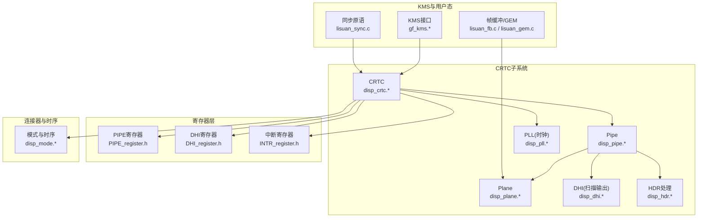
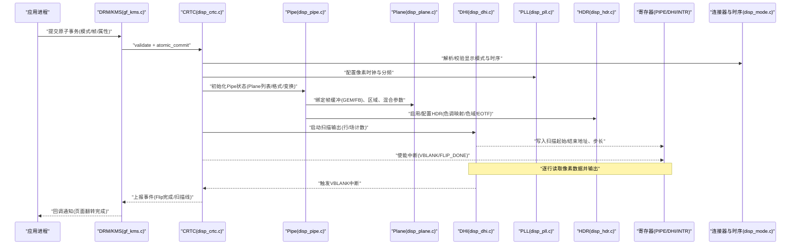
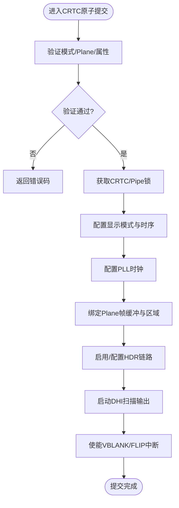
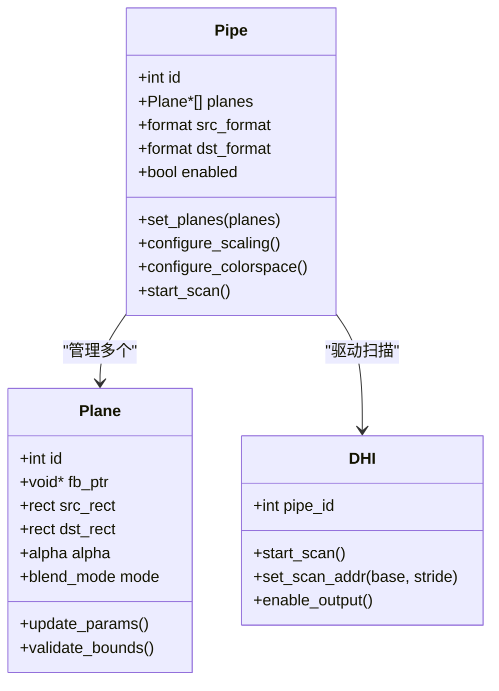
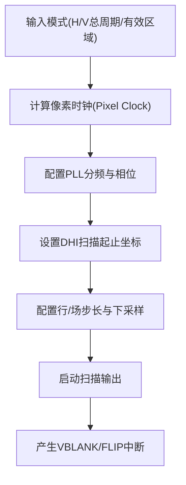
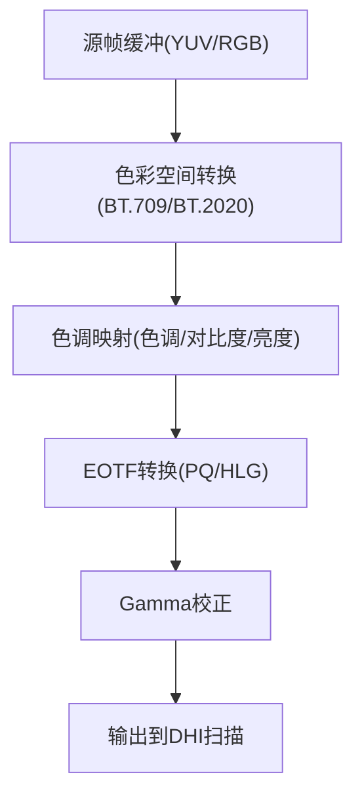
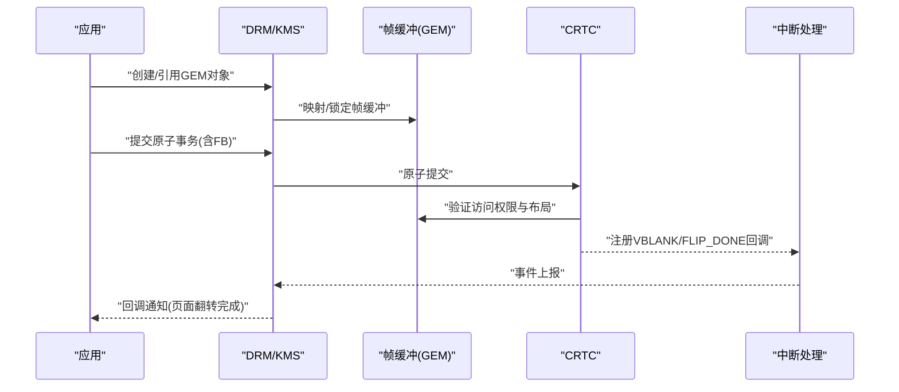
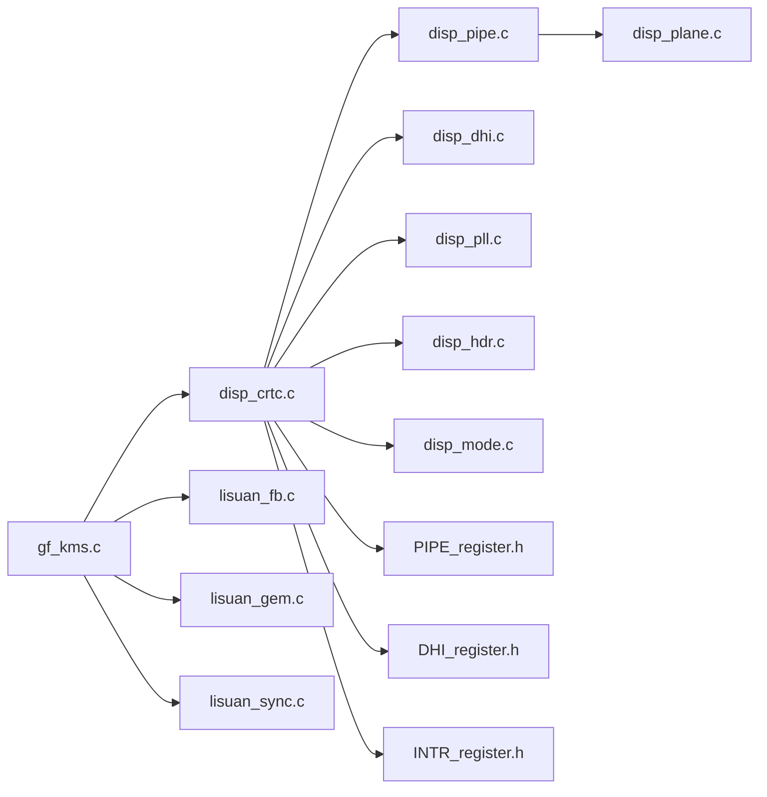

# CRTC管道管理

<cite>
**本文档引用的文件**
- [disp_crtc.c](file://_work/src/usr/src/lisuangpu-dkms-262.2.0.56/display/crtc/disp_crtc.c)
- [disp_crtc.h](file://_work/src/usr/src/lisuangpu-dkms-262.2.0.56/display/crtc/disp_crtc.h)
- [disp_pipe.c](file://_work/src/usr/src/lisuangpu-dkms-262.2.0.56/display/crtc/disp_pipe.c)
- [disp_pipe.h](file://_work/src/usr/src/lisuangpu-dkms-262.2.0.56/display/crtc/disp_pipe.h)
- [disp_plane.c](file://_work/src/usr/src/lisuangpu-dkms-262.2.0.56/display/crtc/disp_plane.c)
- [disp_plane.h](file://_work/src/usr/src/lisuangpu-dkms-262.2.0.56/display/crtc/disp_plane.h)
- [disp_hdr.c](file://_work/src/usr/src/lisuangpu-dkms-262.2.0.56/display/crtc/disp_hdr.c)
- [disp_hdr.h](file://_work/src/usr/src/lisuangpu-dkms-262.2.0.56/display/crtc/disp_hdr.h)
- [disp_dhi.c](file://_work/src/usr/src/lisuangpu-dkms-262.2.0.56/display/crtc/disp_dhi.c)
- [disp_dhi.h](file://_work/src/usr/src/lisuangpu-dkms-262.2.0.56/display/crtc/disp_dhi.h)
- [disp_pll.c](file://_work/src/usr/src/lisuangpu-dkms-262.2.0.56/display/crtc/disp_pll.c)
- [disp_pll.h](file://_work/src/usr/src/lisuangpu-dkms-262.2.0.56/display/crtc/disp_pll.h)
- [PIPE_register.h](file://_work/src/usr/src/lisuangpu-dkms-262.2.0.56/display/register/PIPE_register.h)
- [DHI_register.h](file://_work/src/usr/src/lisuangpu-dkms-262.2.0.56/display/register/DHI_register.h)
- [INTR_register.h](file://_work/src/usr/src/lisuangpu-dkms-262.2.0.56/display/register/INTR_register.h)
- [disp_mode.c](file://_work/src/usr/src/lisuangpu-dkms-262.2.0.56/display/connector/disp_mode.c)
- [disp_mode.h](file://_work/src/usr/src/lisuangpu-dkms-262.2.0.56/display/connector/disp_mode.h)
- [gf_kms.c](file://_work/src/usr/src/lisuangpu-dkms-262.2.0.56/kms/gf_kms.c)
- [gf_kms_dm.c](file://_work/src/usr/src/lisuangpu-dkms-262.2.0.56/kms/gf_kms_dm.c)
- [gf_kms_hdr.c](file://_work/src/usr/src/lisuangpu-dkms-262.2.0.56/kms/gf_kms_hdr.c)
- [lisuan_fb.c](file://_work/src/usr/src/lisuangpu-dkms-262.2.0.56/lisuan_fb.c)
- [lisuan_gem.c](file://_work/src/usr/src/lisuangpu-dkms-262.2.0.56/lisuan_gem.c)
- [lisuan_sync.c](file://_work/src/usr/src/lisuangpu-dkms-262.2.0.56/lisuan_sync.c)
</cite>

## 目录
1. [简介](#简介)
2. [项目结构](#项目结构)
3. [核心组件](#核心组件)
4. [架构总览](#架构总览)
5. [详细组件分析](#详细组件分析)
6. [依赖关系分析](#依赖关系分析)
7. [性能考量](#性能考量)
8. [故障排查指南](#故障排查指南)
9. [结论](#结论)
10. [附录](#附录)

## 简介
本文件面向丽山GPU显示子系统的CRTC（彩色随机存取存储器控制器）管道管理，系统性阐述CRTC的职责、管道配置流程与平面混合器工作原理，覆盖扫描输出、帧缓冲管理与同步机制，并深入说明HDR支持、色彩空间转换与时序控制。文档同时提供多平面合成配置、显示模式设置与垂直同步中断处理的具体代码示例路径，帮助开发者快速定位实现并进行二次开发。

## 项目结构
CRTC相关代码主要位于display/crtc目录，配合寄存器定义、连接器与时序模块以及KMS层接口共同构成完整的显示管线。关键目录与职责如下：
- display/crtc：CRTC、Pipe、Plane、DHI、PLL、HDR等核心逻辑
- display/register：各硬件模块寄存器定义（PIPE、DHI、INTR等）
- display/connector：模式解析与时序生成（EDID、DisplayID、DP/HDMI连接器等）
- kms：KMS抽象与DRM交互（模式设置、原子提交、HDR属性等）
- lisuan_*：帧缓冲、GEM对象、同步原语等底层支撑

**图表来源**
- [disp_crtc.c:1-200](file://_work/src/usr/src/lisuangpu-dkms-262.2.0.56/display/crtc/disp_crtc.c#L1-L200)
- [disp_pipe.c:1-200](file://_work/src/usr/src/lisuangpu-dkms-262.2.0.56/display/crtc/disp_pipe.c#L1-L200)
- [disp_plane.c:1-200](file://_work/src/usr/src/lisuangpu-dkms-262.2.0.56/display/crtc/disp_plane.c#L1-L200)
- [disp_dhi.c:1-200](file://_work/src/usr/src/lisuangpu-dkms-262.2.0.56/display/crtc/disp_dhi.c#L1-L200)
- [disp_pll.c:1-200](file://_work/src/usr/src/lisuangpu-dkms-262.2.0.56/display/crtc/disp_pll.c#L1-L200)
- [disp_hdr.c:1-200](file://_work/src/usr/src/lisuangpu-dkms-262.2.0.56/display/crtc/disp_hdr.c#L1-L200)
- [PIPE_register.h:1-200](file://_work/src/usr/src/lisuangpu-dkms-262.2.0.56/display/register/PIPE_register.h#L1-L200)
- [DHI_register.h:1-200](file://_work/src/usr/src/lisuangpu-dkms-262.2.0.56/display/register/DHI_register.h#L1-L200)
- [INTR_register.h:1-200](file://_work/src/usr/src/lisuangpu-dkms-262.2.0.56/display/register/INTR_register.h#L1-L200)
- [disp_mode.c:1-200](file://_work/src/usr/src/lisuangpu-dkms-262.2.0.56/display/connector/disp_mode.c#L1-L200)
- [gf_kms.c:1-200](file://_work/src/usr/src/lisuangpu-dkms-262.2.0.56/kms/gf_kms.c#L1-L200)
- [lisuan_fb.c:1-200](file://_work/src/usr/src/lisuangpu-dkms-262.2.0.56/lisuan_fb.c#L1-L200)
- [lisuan_gem.c:1-200](file://_work/src/usr/src/lisuangpu-dkms-262.2.0.56/lisuan_gem.c#L1-L200)
- [lisuan_sync.c:1-200](file://_work/src/usr/src/lisuangpu-dkms-262.2.0.56/lisuan_sync.c#L1-L200)

**章节来源**
- [disp_crtc.c:1-200](file://_work/src/usr/src/lisuangpu-dkms-262.2.0.56/display/crtc/disp_crtc.c#L1-L200)
- [disp_pipe.c:1-200](file://_work/src/usr/src/lisuangpu-dkms-262.2.0.56/display/crtc/disp_pipe.c#L1-L200)
- [disp_plane.c:1-200](file://_work/src/usr/src/lisuangpu-dkms-262.2.0.56/display/crtc/disp_plane.c#L1-L200)
- [disp_dhi.c:1-200](file://_work/src/usr/src/lisuangpu-dkms-262.2.0.56/display/crtc/disp_dhi.c#L1-L200)
- [disp_pll.c:1-200](file://_work/src/usr/src/lisuangpu-dkms-262.2.0.56/display/crtc/disp_pll.c#L1-L200)
- [disp_hdr.c:1-200](file://_work/src/usr/src/lisuangpu-dkms-262.2.0.56/display/crtc/disp_hdr.c#L1-L200)
- [disp_mode.c:1-200](file://_work/src/usr/src/lisuangpu-dkms-262.2.0.56/display/connector/disp_mode.c#L1-L200)
- [gf_kms.c:1-200](file://_work/src/usr/src/lisuangpu-dkms-262.2.0.56/kms/gf_kms.c#L1-L200)
- [lisuan_fb.c:1-200](file://_work/src/usr/src/lisuangpu-dkms-262.2.0.56/lisuan_fb.c#L1-L200)
- [lisuan_gem.c:1-200](file://_work/src/usr/src/lisuangpu-dkms-262.2.0.56/lisuan_gem.c#L1-L200)
- [lisuan_sync.c:1-200](file://_work/src/usr/src/lisuangpu-dkms-262.2.0.56/lisuan_sync.c#L1-L200)

## 核心组件
- CRTC：负责整条显示管线的生命周期管理、模式设置、帧提交与中断协调。
- Pipe：将多个Plane进行组合、缩放、裁剪、格式转换，并驱动后续DHI扫描。
- Plane：表示一个独立的图像源（如UI层、视频层），包含帧缓冲、矩形区域、混合参数。
- DHI：扫描输出单元，按行/场时序从Pipe读取像素数据并输出到连接器。
- PLL：为显示引擎提供稳定的像素时钟与时基。
- HDR：负责色调映射、色域扩展、EOTF转换等HDR链路处理。
- 寄存器层：PIPE、DHI、INTR等硬件寄存器映射，供上层驱动读写。
- 连接器与时序：解析EDID/DisplayID，生成精确的显示模式与时序参数。
- KMS与用户态：通过DRM/KMS接口暴露能力，应用层提交帧缓冲与属性。

**章节来源**
- [disp_crtc.h:1-200](file://_work/src/usr/src/lisuangpu-dkms-262.2.0.56/display/crtc/disp_crtc.h#L1-L200)
- [disp_pipe.h:1-200](file://_work/src/usr/src/lisuangpu-dkms-262.2.0.56/display/crtc/disp_pipe.h#L1-L200)
- [disp_plane.h:1-200](file://_work/src/usr/src/lisuangpu-dkms-262.2.0.56/display/crtc/disp_plane.h#L1-L200)
- [disp_dhi.h:1-200](file://_work/src/usr/src/lisuangpu-dkms-262.2.0.56/display/crtc/disp_dhi.h#L1-L200)
- [disp_pll.h:1-200](file://_work/src/usr/src/lisuangpu-dkms-262.2.0.56/display/crtc/disp_pll.h#L1-L200)
- [disp_hdr.h:1-200](file://_work/src/usr/src/lisuangpu-dkms-262.2.0.56/display/crtc/disp_hdr.h#L1-L200)

## 架构总览
下图展示从KMS应用到硬件输出的端到端数据流与控制流，涵盖多平面合成、扫描输出、时钟与时序、中断同步与HDR处理。

**图表来源**
- [gf_kms.c:1-200](file://_work/src/usr/src/lisuangpu-dkms-262.2.0.56/kms/gf_kms.c#L1-L200)
- [disp_crtc.c:1-200](file://_work/src/usr/src/lisuangpu-dkms-262.2.0.56/display/crtc/disp_crtc.c#L1-L200)
- [disp_pipe.c:1-200](file://_work/src/usr/src/lisuangpu-dkms-262.2.0.56/display/crtc/disp_pipe.c#L1-L200)
- [disp_plane.c:1-200](file://_work/src/usr/src/lisuangpu-dkms-262.2.0.56/display/crtc/disp_plane.c#L1-L200)
- [disp_dhi.c:1-200](file://_work/src/usr/src/lisuangpu-dkms-262.2.0.56/display/crtc/disp_dhi.c#L1-L200)
- [disp_pll.c:1-200](file://_work/src/usr/src/lisuangpu-dkms-262.2.0.56/display/crtc/disp_pll.c#L1-L200)
- [disp_hdr.c:1-200](file://_work/src/usr/src/lisuangpu-dkms-262.2.0.56/display/crtc/disp_hdr.c#L1-L200)
- [disp_mode.c:1-200](file://_work/src/usr/src/lisuangpu-dkms-262.2.0.56/display/connector/disp_mode.c#L1-L200)
- [PIPE_register.h:1-200](file://_work/src/usr/src/lisuangpu-dkms-262.2.0.56/display/register/PIPE_register.h#L1-L200)
- [DHI_register.h:1-200](file://_work/src/usr/src/lisuangpu-dkms-262.2.0.56/display/register/DHI_register.h#L1-L200)
- [INTR_register.h:1-200](file://_work/src/usr/src/lisuangpu-dkms-262.2.0.56/display/register/INTR_register.h#L1-L200)

## 详细组件分析

### CRTC组件职责与控制流
- 职责
  - 管理显示生命周期：上电、模式设置、启用/禁用、电源管理。
  - 协调Pipe、Plane、DHI、PLL、HDR等子模块的状态机。
  - 处理原子提交：验证、锁存、切换双缓冲、上报事件。
  - 中断协调：VBLANK、FLIP_DONE、错误中断的上报与恢复。
- 关键流程
  - 模式设置：解析连接器EDID/DisplayID，计算像素时钟与时序，配置PLL与DHI。
  - 帧提交：绑定Plane帧缓冲，更新Pipe混合参数，触发DHI扫描。
  - 同步：基于sync fence与中断确保页面翻转安全。

**图表来源**
- [disp_crtc.c:1-200](file://_work/src/usr/src/lisuangpu-dkms-262.2.0.56/display/crtc/disp_crtc.c#L1-L200)
- [disp_mode.c:1-200](file://_work/src/usr/src/lisuangpu-dkms-262.2.0.56/display/connector/disp_mode.c#L1-L200)
- [disp_pll.c:1-200](file://_work/src/usr/src/lisuangpu-dkms-262.2.0.56/display/crtc/disp_pll.c#L1-L200)
- [disp_plane.c:1-200](file://_work/src/usr/src/lisuangpu-dkms-262.2.0.56/display/crtc/disp_plane.c#L1-L200)
- [disp_hdr.c:1-200](file://_work/src/usr/src/lisuangpu-dkms-262.2.0.56/display/crtc/disp_hdr.c#L1-L200)
- [disp_dhi.c:1-200](file://_work/src/usr/src/lisuangpu-dkms-262.2.0.56/display/crtc/disp_dhi.c#L1-L200)

**章节来源**
- [disp_crtc.c:1-200](file://_work/src/usr/src/lisuangpu-dkms-262.2.0.56/display/crtc/disp_crtc.c#L1-L200)
- [disp_crtc.h:1-200](file://_work/src/usr/src/lisuangpu-dkms-262.2.0.56/display/crtc/disp_crtc.h#L1-L200)

### Pipe与Plane混合器工作原理
- Pipe
  - 维护Plane列表与混合顺序，执行缩放、裁剪、旋转、格式转换。
  - 根据目标分辨率与时序生成扫描地址与步长，驱动DHI。
- Plane
  - 每个Plane对应一个帧缓冲（GEM对象或FB），可独立设置源矩形、目标矩形、透明度、混合模式。
  - 支持YUV/RGB、线性/Tiled布局、压缩格式（若硬件支持）。
- 混合算法
  - 按优先级叠加，Alpha混合、预乘/非预乘、颜色空间转换（BT.709/BT.2020）、伽马校正。

**图表来源**
- [disp_pipe.c:1-200](file://_work/src/usr/src/lisuangpu-dkms-262.2.0.56/display/crtc/disp_pipe.c#L1-L200)
- [disp_plane.c:1-200](file://_work/src/usr/src/lisuangpu-dkms-262.2.0.56/display/crtc/disp_plane.c#L1-L200)
- [disp_dhi.c:1-200](file://_work/src/usr/src/lisuangpu-dkms-262.2.0.56/display/crtc/disp_dhi.c#L1-L200)

**章节来源**
- [disp_pipe.c:1-200](file://_work/src/usr/src/lisuangpu-dkms-262.2.0.56/display/crtc/disp_pipe.c#L1-L200)
- [disp_plane.c:1-200](file://_work/src/usr/src/lisuangpu-dkms-262.2.0.56/display/crtc/disp_plane.c#L1-L200)
- [disp_plane.h:1-200](file://_work/src/usr/src/lisuangpu-dkms-262.2.0.56/display/crtc/disp_plane.h#L1-L200)

### 扫描输出与时序控制（DHI与PLL）
- DHI
  - 负责从Pipe读取像素数据并按行/场扫描输出至连接器。
  - 配置扫描起始/结束坐标、步长、下采样、去隔行等。
- PLL
  - 根据目标分辨率与刷新率计算像素时钟频率与分频比。
  - 保证时钟稳定与抖动最小化，支持动态调整。
- 时序
  - 由连接器与时序模块生成H/V总周期、有效区域、前后沿、消隐区。
  - 支持多种时序标准（CEA/VESA）与自定义模式。

**图表来源**
- [disp_dhi.c:1-200](file://_work/src/usr/src/lisuangpu-dkms-262.2.0.56/display/crtc/disp_dhi.c#L1-L200)
- [disp_pll.c:1-200](file://_work/src/usr/src/lisuangpu-dkms-262.2.0.56/display/crtc/disp_pll.c#L1-L200)
- [disp_mode.c:1-200](file://_work/src/usr/src/lisuangpu-dkms-262.2.0.56/display/connector/disp_mode.c#L1-L200)

**章节来源**
- [disp_dhi.c:1-200](file://_work/src/usr/src/lisuangpu-dkms-262.2.0.56/display/crtc/disp_dhi.c#L1-L200)
- [disp_pll.c:1-200](file://_work/src/usr/src/lisuangpu-dkms-262.2.0.56/display/crtc/disp_pll.c#L1-L200)
- [disp_mode.c:1-200](file://_work/src/usr/src/lisuangpu-dkms-262.2.0.56/display/connector/disp_mode.c#L1-L200)

### HDR支持与色彩空间转换
- HDR链路
  - 色调映射（PQ/HLG到SDR或HDR到HDR）、色域扩展（BT.709→BT.2020）、EOTF转换。
  - 元数据处理（Metadata传递、动态/静态HDR信息）。
- 色彩空间
  - 支持YUV420/422/444、RGB888/10/12/16、线性/对数编码。
  - 在Pipe中执行格式转换与伽马校正，确保输出符合显示器期望。
- 配置要点
  - 启用HDR属性（如HDR_OUTPUT_METADATA、COLORIMETRY）。
  - 校验源/目的格式与时序兼容性。

**图表来源**
- [disp_hdr.c:1-200](file://_work/src/usr/src/lisuangpu-dkms-262.2.0.56/display/crtc/disp_hdr.c#L1-L200)
- [disp_pipe.c:1-200](file://_work/src/usr/src/lisuangpu-dkms-262.2.0.56/display/crtc/disp_pipe.c#L1-L200)

**章节来源**
- [disp_hdr.c:1-200](file://_work/src/usr/src/lisuangpu-dkms-262.2.0.56/display/crtc/disp_hdr.c#L1-L200)
- [disp_hdr.h:1-200](file://_work/src/usr/src/lisuangpu-dkms-262.2.0.56/display/crtc/disp_hdr.h#L1-L200)

### 帧缓冲管理与同步机制
- 帧缓冲
  - 使用GEM对象管理显存分配、引用计数、共享内存。
  - 支持线性与Tiled布局，适配不同格式与硬件限制。
- 同步
  - 基于sync fence与DRM事件确保页面翻转安全。
  - 避免撕裂：等待前一次翻转完成再提交新帧。
- 中断
  - VBLANK用于刷新时机控制；FLIP_DONE用于确认页面切换完成。

**图表来源**
- [lisuan_fb.c:1-200](file://_work/src/usr/src/lisuangpu-dkms-262.2.0.56/lisuan_fb.c#L1-L200)
- [lisuan_gem.c:1-200](file://_work/src/usr/src/lisuangpu-dkms-262.2.0.56/lisuan_gem.c#L1-L200)
- [lisuan_sync.c:1-200](file://_work/src/usr/src/lisuangpu-dkms-262.2.0.56/lisuan_sync.c#L1-L200)
- [gf_kms.c:1-200](file://_work/src/usr/src/lisuangpu-dkms-262.2.0.56/kms/gf_kms.c#L1-L200)

**章节来源**
- [lisuan_fb.c:1-200](file://_work/src/usr/src/lisuangpu-dkms-262.2.0.56/lisuan_fb.c#L1-L200)
- [lisuan_gem.c:1-200](file://_work/src/usr/src/lisuangpu-dkms-262.2.0.56/lisuan_gem.c#L1-L200)
- [lisuan_sync.c:1-200](file://_work/src/usr/src/lisuangpu-dkms-262.2.0.56/lisuan_sync.c#L1-L200)

## 依赖关系分析
CRTC子系统与寄存器、连接器、KMS层之间存在清晰的依赖关系。下图展示了关键模块间的导入与调用关系。

**图表来源**
- [gf_kms.c:1-200](file://_work/src/usr/src/lisuangpu-dkms-262.2.0.56/kms/gf_kms.c#L1-L200)
- [disp_crtc.c:1-200](file://_work/src/usr/src/lisuangpu-dkms-262.2.0.56/display/crtc/disp_crtc.c#L1-L200)
- [disp_pipe.c:1-200](file://_work/src/usr/src/lisuangpu-dkms-262.2.0.56/display/crtc/disp_pipe.c#L1-L200)
- [disp_plane.c:1-200](file://_work/src/usr/src/lisuangpu-dkms-262.2.0.56/display/crtc/disp_plane.c#L1-L200)
- [disp_dhi.c:1-200](file://_work/src/usr/src/lisuangpu-dkms-262.2.0.56/display/crtc/disp_dhi.c#L1-L200)
- [disp_pll.c:1-200](file://_work/src/usr/src/lisuangpu-dkms-262.2.0.56/display/crtc/disp_pll.c#L1-L200)
- [disp_hdr.c:1-200](file://_work/src/usr/src/lisuangpu-dkms-262.2.0.56/display/crtc/disp_hdr.c#L1-L200)
- [disp_mode.c:1-200](file://_work/src/usr/src/lisuangpu-dkms-262.2.0.56/display/connector/disp_mode.c#L1-L200)
- [PIPE_register.h:1-200](file://_work/src/usr/src/lisuangpu-dkms-262.2.0.56/display/register/PIPE_register.h#L1-L200)
- [DHI_register.h:1-200](file://_work/src/usr/src/lisuangpu-dkms-262.2.0.56/display/register/DHI_register.h#L1-L200)
- [INTR_register.h:1-200](file://_work/src/usr/src/lisuangpu-dkms-262.2.0.56/display/register/INTR_register.h#L1-L200)
- [lisuan_fb.c:1-200](file://_work/src/usr/src/lisuangpu-dkms-262.2.0.56/lisuan_fb.c#L1-L200)
- [lisuan_gem.c:1-200](file://_work/src/usr/src/lisuangpu-dkms-262.2.0.56/lisuan_gem.c#L1-L200)
- [lisuan_sync.c:1-200](file://_work/src/usr/src/lisuangpu-dkms-262.2.0.56/lisuan_sync.c#L1-L200)

**章节来源**
- [gf_kms.c:1-200](file://_work/src/usr/src/lisuangpu-dkms-262.2.0.56/kms/gf_kms.c#L1-L200)
- [disp_crtc.c:1-200](file://_work/src/usr/src/lisuangpu-dkms-262.2.0.56/display/crtc/disp_crtc.c#L1-L200)

## 性能考量
- 时钟与带宽
  - 合理选择像素时钟与下采样比例，降低总线带宽压力。
  - 避免不必要的格式转换，尽量保持源/目的格式一致。
- 内存访问
  - 使用Tiled布局提升缓存命中率，减少碎片化访问。
  - 对齐帧缓冲基址与步长，满足硬件对齐要求。
- 中断与事件
  - 批量处理中断，减少上下文切换开销。
  - 使用事件队列与异步回调，避免阻塞主线程。
- 资源管理
  - 及时释放未使用的GEM对象与FB引用，防止内存泄漏。
  - 复用Pipe与Plane实例，减少初始化开销。

[本节为通用指导，不直接分析具体文件]

## 故障排查指南
- 常见问题
  - 闪烁/撕裂：检查VBLANK同步与页面翻转顺序。
  - 黑屏/花屏：核对模式与时序参数、PLL配置、DHI扫描地址。
  - HDR异常：确认元数据与色彩空间设置、EOTF与色调映射链。
- 调试手段
  - 启用调试日志与trace点，观察关键函数调用与寄存器值。
  - 使用drm设备节点与debugfs查看当前模式、Plane状态与事件。
  - 抓取VBLANK/FLIP_DONE中断时间戳，分析延迟与抖动。

**章节来源**
- [gf_kms.c:1-200](file://_work/src/usr/src/lisuangpu-dkms-262.2.0.56/kms/gf_kms.c#L1-L200)
- [disp_crtc.c:1-200](file://_work/src/usr/src/lisuangpu-dkms-262.2.0.56/display/crtc/disp_crtc.c#L1-L200)
- [disp_mode.c:1-200](file://_work/src/usr/src/lisuangpu-dkms-262.2.0.56/display/connector/disp_mode.c#L1-L200)

## 结论
丽山GPU CRTC管道管理系统以CRTC为核心，结合Pipe/Plane混合器、DHI扫描输出、PLL时钟与时序控制，实现了高效、灵活的显示管线。通过KMS接口暴露原子提交能力，支持多平面合成、HDR与色彩空间转换，并提供完善的同步与中断机制。遵循本文档的配置流程与最佳实践，可有效提升显示质量与系统稳定性。

[本节为总结性内容，不直接分析具体文件]

## 附录
- 多平面合成配置示例路径
  - 设置Plane列表与混合参数：[disp_plane.c:1-200](file://_work/src/usr/src/lisuangpu-dkms-262.2.0.56/display/crtc/disp_plane.c#L1-L200)
  - 配置Pipe混合与格式转换：[disp_pipe.c:1-200](file://_work/src/usr/src/lisuangpu-dkms-262.2.0.56/display/crtc/disp_pipe.c#L1-L200)
- 显示模式设置示例路径
  - 解析EDID/DisplayID与时序：[disp_mode.c:1-200](file://_work/src/usr/src/lisuangpu-dkms-262.2.0.56/display/connector/disp_mode.c#L1-L200)
  - 原子提交与模式验证：[gf_kms.c:1-200](file://_work/src/usr/src/lisuangpu-dkms-262.2.0.56/kms/gf_kms.c#L1-L200)
- 垂直同步中断处理示例路径
  - 中断使能与上报：[disp_crtc.c:1-200](file://_work/src/usr/src/lisuangpu-dkms-262.2.0.56/display/crtc/disp_crtc.c#L1-L200)
  - 事件回调与同步：[lisuan_sync.c:1-200](file://_work/src/usr/src/lisuangpu-dkms-262.2.0.56/lisuan_sync.c#L1-L200)