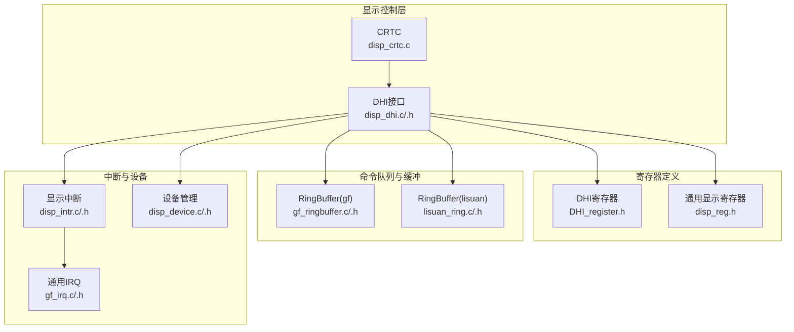
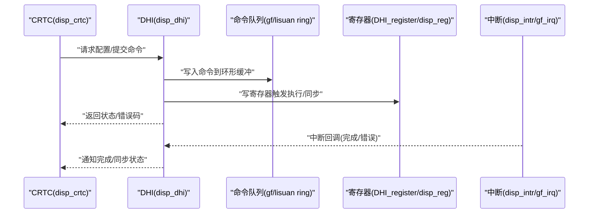
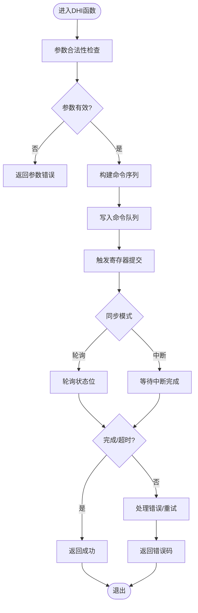
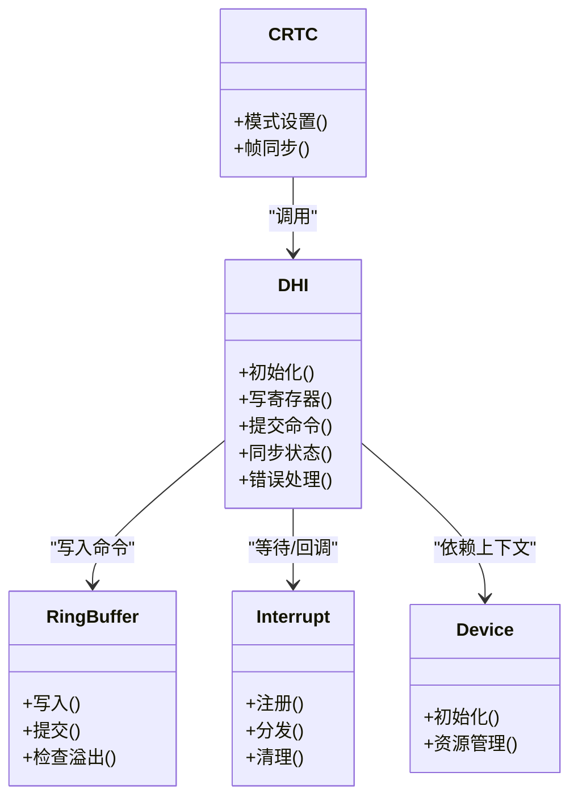

# DHI接口层

<cite>
**本文档引用的文件**   
- [disp_dhi.c](file://_work/src/usr/src/lisuangpu-dkms-262.2.0.56/display/crtc/disp_dhi.c)
- [disp_dhi.h](file://_work/src/usr/src/lisuangpu-dkms-262.2.0.56/display/crtc/disp_dhi.h)
- [disp_crtc.c](file://_work/src/usr/src/lisuangpu-dkms-262.2.0.56/display/crtc/disp_crtc.c)
- [disp_crtc.h](file://_work/src/usr/src/lisuangpu-dkms-262.2.0.56/display/crtc/disp_crtc.h)
- [DHI_register.h](file://_work/src/usr/src/lisuangpu-dkms-262.2.0.56/display/register/DHI_register.h)
- [disp_reg.h](file://_work/src/usr/src/lisuangpu-dkms-262.2.0.56/display/register/disp_reg.h)
- [disp_device.c](file://_work/src/usr/src/lisuangpu-dkms-262.2.0.56/display/disp_device.c)
- [disp_device.h](file://_work/src/usr/src/lisuangpu-dkms-262.2.0.56/display/disp_device.h)
- [gf_ringbuffer.c](file://_work/src/usr/src/lisuangpu-dkms-262.2.0.56/gf_ringbuffer.c)
- [gf_ringbuffer.h](file://_work/src/usr/src/lisuangpu-dkms-262.2.0.56/gf_ringbuffer.h)
- [lisuan_ring.c](file://_work/src/usr/src/lisuangpu-dkms-262.2.0.56/lisuan_ring.c)
- [lisuan_ring.h](file://_work/src/usr/src/lisuangpu-dkms-262.2.0.56/lisuan_ring.h)
- [gf_irq.c](file://_work/src/usr/src/lisuangpu-dkms-262.2.0.56/gf_irq.c)
- [gf_irq.h](file://_work/src/usr/src/lisuangpu-dkms-262.2.0.56/gf_irq.h)
- [disp_intr.c](file://_work/src/usr/src/lisuangpu-dkms-262.2.0.56/display/intr/disp_intr.c)
- [disp_intr.h](file://_work/src/usr/src/lisuangpu-dkms-262.2.0.56/display/intr/disp_intr.h)
</cite>

## 目录
1. [简介](#简介)
2. [项目结构](#项目结构)
3. [核心组件](#核心组件)
4. [架构总览](#架构总览)
5. [详细组件分析](#详细组件分析)
6. [依赖关系分析](#依赖关系分析)
7. [性能考虑](#性能考虑)
8. [故障排查指南](#故障排查指南)
9. [结论](#结论)
10. [附录](#附录)

## 简介
本文件面向丽山GPU显示子系统，聚焦DHI（Display Hardware Interface）接口层的抽象设计与实现。DHI作为显示硬件的抽象层，对上提供统一的命令提交、状态同步与错误处理接口；对下封装寄存器访问、内存映射I/O、中断协调与命令队列管理。其设计目标包括：
- 统一硬件寄存器访问模型，屏蔽不同显示引擎差异
- 构建高效的命令序列生成与提交机制
- 提供可靠的状态同步与中断协作，确保显示流水线一致性
- 为上层CRTC/Encoder/Connector等模块提供稳定、可复用的显示控制能力

## 项目结构
围绕DHI的相关代码主要分布在以下目录与文件中：
- display/crtc：DHI核心实现与CRTC集成
- display/register：DHI及相关模块的寄存器定义
- display/intr：显示中断处理
- gf_*与lisuan_*：环形缓冲、调度、IRQ等基础设施
- display/disp_device：设备级初始化与资源管理

图表来源
- [disp_dhi.c](file://_work/src/usr/src/lisuangpu-dkms-262.2.0.56/display/crtc/disp_dhi.c)
- [disp_dhi.h](file://_work/src/usr/src/lisuangpu-dkms-262.2.0.56/display/crtc/disp_dhi.h)
- [disp_crtc.c](file://_work/src/usr/src/lisuangpu-dkms-262.2.0.56/display/crtc/disp_crtc.c)
- [DHI_register.h](file://_work/src/usr/src/lisuangpu-dkms-262.2.0.56/display/register/DHI_register.h)
- [disp_reg.h](file://_work/src/usr/src/lisuangpu-dkms-262.2.0.56/display/register/disp_reg.h)
- [gf_ringbuffer.c](file://_work/src/usr/src/lisuangpu-dkms-262.2.0.56/gf_ringbuffer.c)
- [lisuan_ring.c](file://_work/src/usr/src/lisuangpu-dkms-262.2.0.56/lisuan_ring.c)
- [disp_intr.c](file://_work/src/usr/src/lisuangpu-dkms-262.2.0.56/display/intr/disp_intr.c)
- [gf_irq.c](file://_work/src/usr/src/lisuangpu-dkms-262.2.0.56/gf_irq.c)
- [disp_device.c](file://_work/src/usr/src/lisuangpu-dkms-262.2.0.56/display/disp_device.c)

章节来源
- [disp_dhi.c](file://_work/src/usr/src/lisuangpu-dkms-262.2.0.56/display/crtc/disp_dhi.c)
- [disp_dhi.h](file://_work/src/usr/src/lisuangpu-dkms-262.2.0.56/display/crtc/disp_dhi.h)
- [disp_crtc.c](file://_work/src/usr/src/lisuangpu-dkms-262.2.0.56/display/crtc/disp_crtc.c)
- [disp_crtc.h](file://_work/src/usr/src/lisuangpu-dkms-262.2.0.56/display/crtc/disp_crtc.h)
- [DHI_register.h](file://_work/src/usr/src/lisuangpu-dkms-262.2.0.56/display/register/DHI_register.h)
- [disp_reg.h](file://_work/src/usr/src/lisuangpu-dkms-262.2.0.56/display/register/disp_reg.h)
- [gf_ringbuffer.c](file://_work/src/usr/src/lisuangpu-dkms-262.2.0.56/gf_ringbuffer.c)
- [lisuan_ring.c](file://_work/src/usr/src/lisuangpu-dkms-262.2.0.56/lisuan_ring.c)
- [disp_intr.c](file://_work/src/usr/src/lisuangpu-dkms-262.2.0.56/display/intr/disp_intr.c)
- [gf_irq.c](file://_work/src/usr/src/lisuangpu-dkms-262.2.0.56/gf_irq.c)
- [disp_device.c](file://_work/src/usr/src/lisuangpu-dkms-262.2.0.56/display/disp_device.c)

## 核心组件
- DHI接口层（disp_dhi.c/.h）
  - 职责：封装显示硬件的命令写入、寄存器读写、状态轮询与同步、错误码返回
  - 关键能力：命令序列构造、批量提交、原子更新、超时与重试策略
- CRTC集成（disp_crtc.c/.h）
  - 职责：将DHI能力用于模式设置、扫描线同步、帧完成事件
- 寄存器定义（DHI_register.h, disp_reg.h）
  - 职责：定义DHI相关寄存器基址、字段偏移、位域掩码
- 命令队列与缓冲（gf_ringbuffer.c/.h, lisuan_ring.c/.h）
  - 职责：维护命令缓冲区、指针管理、边界检查、溢出保护
- 中断与设备（disp_intr.c/.h, gf_irq.c/.h, disp_device.c/.h）
  - 职责：中断注册、分发、清理；设备初始化、资源分配与释放

章节来源
- [disp_dhi.c](file://_work/src/usr/src/lisuangpu-dkms-262.2.0.56/display/crtc/disp_dhi.c)
- [disp_dhi.h](file://_work/src/usr/src/lisuangpu-dkms-262.2.0.56/display/crtc/disp_dhi.h)
- [disp_crtc.c](file://_work/src/usr/src/lisuangpu-dkms-262.2.0.56/display/crtc/disp_crtc.c)
- [disp_crtc.h](file://_work/src/usr/src/lisuangpu-dkms-262.2.0.56/display/crtc/disp_crtc.h)
- [DHI_register.h](file://_work/src/usr/src/lisuangpu-dkms-262.2.0.56/display/register/DHI_register.h)
- [disp_reg.h](file://_work/src/usr/src/lisuangpu-dkms-262.2.0.56/display/register/disp_reg.h)
- [gf_ringbuffer.c](file://_work/src/usr/src/lisuangpu-dkms-262.2.0.56/gf_ringbuffer.c)
- [lisuan_ring.c](file://_work/src/usr/src/lisuangpu-dkms-262.2.0.56/lisuan_ring.c)
- [disp_intr.c](file://_work/src/usr/src/lisuangpu-dkms-262.2.0.56/display/intr/disp_intr.c)
- [gf_irq.c](file://_work/src/usr/src/lisuangpu-dkms-262.2.0.56/gf_irq.c)
- [disp_device.c](file://_work/src/usr/src/lisuangpu-dkms-262.2.0.56/display/disp_device.c)

## 架构总览
DHI位于显示驱动栈的中层，向上对接CRTC/Encoder/Connector，向下通过寄存器定义与命令队列访问底层显示引擎。整体交互如下：

图表来源
- [disp_crtc.c](file://_work/src/usr/src/lisuangpu-dkms-262.2.0.56/display/crtc/disp_crtc.c)
- [disp_dhi.c](file://_work/src/usr/src/lisuangpu-dkms-262.2.0.56/display/crtc/disp_dhi.c)
- [gf_ringbuffer.c](file://_work/src/usr/src/lisuangpu-dkms-262.2.0.56/gf_ringbuffer.c)
- [lisuan_ring.c](file://_work/src/usr/src/lisuangpu-dkms-262.2.0.56/lisuan_ring.c)
- [DHI_register.h](file://_work/src/usr/src/lisuangpu-dkms-262.2.0.56/display/register/DHI_register.h)
- [disp_reg.h](file://_work/src/usr/src/lisuangpu-dkms-262.2.0.56/display/register/disp_reg.h)
- [disp_intr.c](file://_work/src/usr/src/lisuangpu-dkms-262.2.0.56/display/intr/disp_intr.c)
- [gf_irq.c](file://_work/src/usr/src/lisuangpu-dkms-262.2.0.56/gf_irq.c)

## 详细组件分析

### DHI接口层（disp_dhi.c/.h）
- 设计要点
  - 提供统一的寄存器读写API，内部根据平台选择MMIO或间接访问路径
  - 命令序列生成：按DHI寄存器定义拼装命令字，支持批量写入与原子提交
  - 状态同步：基于轮询+中断的组合，避免忙等与竞态
  - 错误处理：区分硬件不可用、参数非法、超时、总线错误等，并上报调用方
- 典型流程
  - 初始化：校验设备句柄、映射寄存器、复位DHI状态机、建立命令队列
  - 配置：组装显示模式相关命令，写入队列并提交
  - 同步：等待VBLANK或帧完成中断，更新状态标志
  - 错误：捕获异常中断，记录诊断信息，回滚部分配置

图表来源
- [disp_dhi.c](file://_work/src/usr/src/lisuangpu-dkms-262.2.0.56/display/crtc/disp_dhi.c)
- [DHI_register.h](file://_work/src/usr/src/lisuangpu-dkms-262.2.0.56/display/register/DHI_register.h)
- [gf_ringbuffer.c](file://_work/src/usr/src/lisuangpu-dkms-262.2.0.56/gf_ringbuffer.c)
- [lisuan_ring.c](file://_work/src/usr/src/lisuangpu-dkms-262.2.0.56/lisuan_ring.c)

章节来源
- [disp_dhi.c](file://_work/src/usr/src/lisuangpu-dkms-262.2.0.56/display/crtc/disp_dhi.c)
- [disp_dhi.h](file://_work/src/usr/src/lisuangpu-dkms-262.2.0.56/display/crtc/disp_dhi.h)

### CRTC与DHI集成（disp_crtc.c/.h）
- 职责
  - 将DHI能力用于模式设置、扫描线同步、帧事件上报
  - 在原子模式下协调DHI命令提交与状态一致性
- 交互
  - CRTC调用DHI进行寄存器配置与命令提交
  - 通过中断回调确认帧完成，更新CRTC状态

章节来源
- [disp_crtc.c](file://_work/src/usr/src/lisuangpu-dkms-262.2.0.56/display/crtc/disp_crtc.c)
- [disp_crtc.h](file://_work/src/usr/src/lisuangpu-dkms-262.2.0.56/display/crtc/disp_crtc.h)

### 寄存器定义（DHI_register.h, disp_reg.h）
- 内容
  - DHI相关寄存器基址、偏移、位域定义
  - 通用显示寄存器宏，便于跨模块一致访问
- 使用
  - DHI层通过宏组合出命令字，保证位域对齐与字节序正确

章节来源
- [DHI_register.h](file://_work/src/usr/src/lisuangpu-dkms-262.2.0.56/display/register/DHI_register.h)
- [disp_reg.h](file://_work/src/usr/src/lisuangpu-dkms-262.2.0.56/display/register/disp_reg.h)

### 命令队列与缓冲（gf_ringbuffer.c/.h, lisuan_ring.c/.h）
- 功能
  - 维护环形缓冲的读/写指针、容量、边界检查
  - 提供原子写入、批量提交、溢出保护
- 与DHI的关系
  - DHI将命令序列写入队列，再触发提交；队列满时阻塞或回退

章节来源
- [gf_ringbuffer.c](file://_work/src/usr/src/lisuangpu-dkms-262.2.0.56/gf_ringbuffer.c)
- [gf_ringbuffer.h](file://_work/src/usr/src/lisuangpu-dkms-262.2.0.56/gf_ringbuffer.h)
- [lisuan_ring.c](file://_work/src/usr/src/lisuangpu-dkms-262.2.0.56/lisuan_ring.c)
- [lisuan_ring.h](file://_work/src/usr/src/lisuangpu-dkms-262.2.0.56/lisuan_ring.h)

### 中断与设备（disp_intr.c/.h, gf_irq.c/.h, disp_device.c/.h）
- 中断
  - 注册显示中断，解析中断源，分发到DHI/CRTC回调
  - 处理异常中断，触发错误恢复流程
- 设备
  - 负责设备初始化、资源分配、电源与时钟管理
  - 为DHI提供稳定的硬件访问上下文

章节来源
- [disp_intr.c](file://_work/src/usr/src/lisuangpu-dkms-262.2.0.56/display/intr/disp_intr.c)
- [disp_intr.h](file://_work/src/usr/src/lisuangpu-dkms-262.2.0.56/display/intr/disp_intr.h)
- [gf_irq.c](file://_work/src/usr/src/lisuangpu-dkms-262.2.0.56/gf_irq.c)
- [gf_irq.h](file://_work/src/usr/src/lisuangpu-dkms-262.2.0.56/gf_irq.h)
- [disp_device.c](file://_work/src/usr/src/lisuangpu-dkms-262.2.0.56/display/disp_device.c)
- [disp_device.h](file://_work/src/usr/src/lisuangpu-dkms-262.2.0.56/display/disp_device.h)

## 依赖关系分析
DHI依赖寄存器定义、命令队列、中断与设备管理，形成清晰的层次耦合：

图表来源
- [disp_dhi.c](file://_work/src/usr/src/lisuangpu-dkms-262.2.0.56/display/crtc/disp_dhi.c)
- [disp_crtc.c](file://_work/src/usr/src/lisuangpu-dkms-262.2.0.56/display/crtc/disp_crtc.c)
- [gf_ringbuffer.c](file://_work/src/usr/src/lisuangpu-dkms-262.2.0.56/gf_ringbuffer.c)
- [lisuan_ring.c](file://_work/src/usr/src/lisuangpu-dkms-262.2.0.56/lisuan_ring.c)
- [disp_intr.c](file://_work/src/usr/src/lisuangpu-dkms-262.2.0.56/display/intr/disp_intr.c)
- [gf_irq.c](file://_work/src/usr/src/lisuangpu-dkms-262.2.0.56/gf_irq.c)
- [disp_device.c](file://_work/src/usr/src/lisuangpu-dkms-262.2.0.56/display/disp_device.c)

章节来源
- [disp_dhi.c](file://_work/src/usr/src/lisuangpu-dkms-262.2.0.56/display/crtc/disp_dhi.c)
- [disp_crtc.c](file://_work/src/usr/src/lisuangpu-dkms-262.2.0.56/display/crtc/disp_crtc.c)
- [gf_ringbuffer.c](file://_work/src/usr/src/lisuangpu-dkms-262.2.2.0.56/gf_ringbuffer.c)
- [lisuan_ring.c](file://_work/src/usr/src/lisuangpu-dkms-262.2.0.56/lisuan_ring.c)
- [disp_intr.c](file://_work/src/usr/src/lisuangpu-dkms-262.2.0.56/display/intr/disp_intr.c)
- [gf_irq.c](file://_work/src/usr/src/lisuangpu-dkms-262.2.0.56/gf_irq.c)
- [disp_device.c](file://_work/src/usr/src/lisuangpu-dkms-262.2.0.56/display/disp_device.c)

## 性能考虑
- 命令批量化：尽量合并寄存器写入，减少总线事务
- 异步提交：使用中断而非轮询，降低CPU占用
- 队列容量规划：合理设置环形缓冲大小，避免频繁扩容与拷贝
- 原子更新：在模式切换时使用原子提交，防止中间状态可见
- 错误快速失败：参数校验前置，减少无效命令下发

[本节为通用指导，不直接分析具体文件]

## 故障排查指南
- 常见问题
  - 命令队列溢出：检查写入速率与提交频率，增大缓冲或优化批处理
  - 寄存器写入失败：确认MMIO映射、权限与时钟使能
  - 中断未触发：检查中断路由、屏蔽位与回调注册
  - 状态不一致：增加调试日志，定位命令顺序与提交时机
- 建议步骤
  - 启用详细日志，记录命令序列与寄存器快照
  - 使用最小化测试用例验证单条命令有效性
  - 逐步扩大命令集，定位问题边界
  - 结合中断与状态位，交叉验证硬件响应

章节来源
- [disp_dhi.c](file://_work/src/usr/src/lisuangpu-dkms-262.2.0.56/display/crtc/disp_dhi.c)
- [disp_intr.c](file://_work/src/usr/src/lisuangpu-dkms-262.2.0.56/display/intr/disp_intr.c)
- [gf_irq.c](file://_work/src/usr/src/lisuangpu-dkms-262.2.0.56/gf_irq.c)

## 结论
DHI接口层通过统一的寄存器访问、命令队列与中断协作，为丽山GPU显示子系统提供了稳定、高效的硬件抽象。其设计兼顾了性能与可靠性，适合复杂显示流水线的管理与扩展。建议在开发中遵循原子提交、批处理与异步同步的最佳实践，以获得更优的稳定性与吞吐表现。

[本节为总结性内容，不直接分析具体文件]

## 附录
- 使用示例指引（以路径引用代替代码片段）
  - 初始化DHI：参考初始化流程与设备上下文准备
    - [disp_dhi.c](file://_work/src/usr/src/lisuangpu-dkms-262.2.0.56/display/crtc/disp_dhi.c)
    - [disp_device.c](file://_work/src/usr/src/lisuangpu-dkms-262.2.0.56/display/disp_device.c)
  - 配置显示模式：参考命令序列构建与提交
    - [disp_dhi.c](file://_work/src/usr/src/lisuangpu-dkms-262.2.0.56/display/crtc/disp_dhi.c)
    - [DHI_register.h](file://_work/src/usr/src/lisuangpu-dkms-262.2.0.56/display/register/DHI_register.h)
  - 同步与中断：参考状态同步与中断回调
    - [disp_dhi.c](file://_work/src/usr/src/lisuangpu-dkms-262.2.0.56/display/crtc/disp_dhi.c)
    - [disp_intr.c](file://_work/src/usr/src/lisuangpu-dkms-262.2.0.56/display/intr/disp_intr.c)
    - [gf_irq.c](file://_work/src/usr/src/lisuangpu-dkms-262.2.0.56/gf_irq.c)
  - 错误处理：参考错误码与恢复策略
    - [disp_dhi.c](file://_work/src/usr/src/lisuangpu-dkms-262.2.0.56/display/crtc/disp_dhi.c)

[本节为附录，不直接分析具体文件]