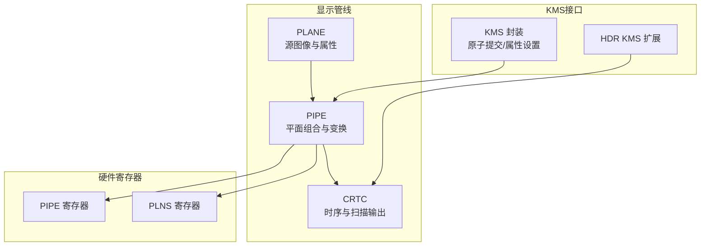
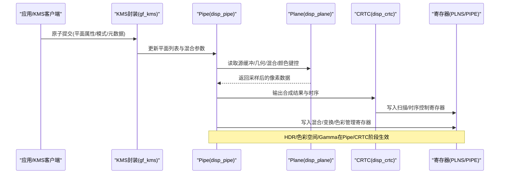
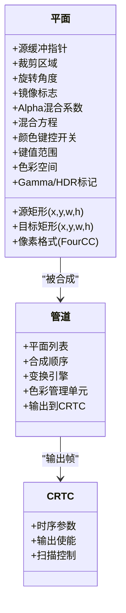
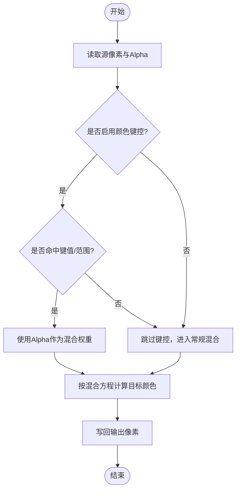
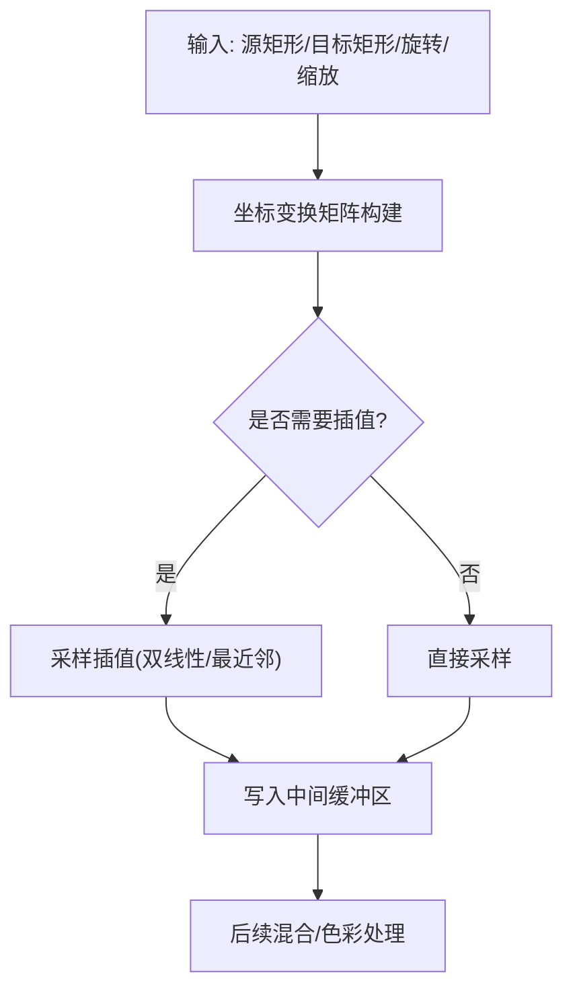
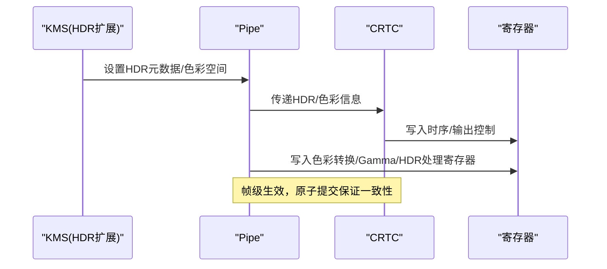
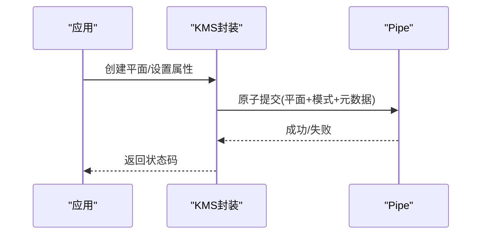
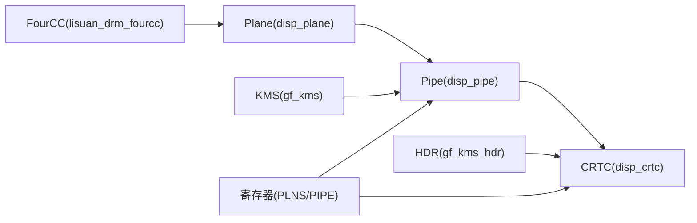

# 平面混合器

<cite>
**本文档引用的文件**   
- [disp_plane.c](file://_work/src/usr/src/lisuangpu-dkms-262.2.0.56/display/crtc/disp_plane.c)
- [disp_plane.h](file://_work/src/usr/src/lisuangpu-dkms-262.2.0.56/display/crtc/disp_plane.h)
- [disp_crtc.c](file://_work/src/usr/src/lisuangpu-dkms-262.2.0.56/display/crtc/disp_crtc.c)
- [disp_crtc.h](file://_work/src/usr/src/lisuangpu-dkms-262.2.0.56/display/crtc/disp_crtc.h)
- [disp_pipe.c](file://_work/src/usr/src/lisuangpu-dkms-262.2.0.56/display/crtc/disp_pipe.c)
- [disp_pipe.h](file://_work/src/usr/src/lisuangpu-dkms-262.2.0.56/display/crtc/disp_pipe.h)
- [disp_hdr.c](file://_work/src/usr/src/lisuangpu-dkms-262.2.0.56/display/crtc/disp_hdr.c)
- [disp_hdr.h](file://_work/src/usr/src/lisuangpu-dkms-262.2.0.56/display/crtc/disp_hdr.h)
- [gf_kms.c](file://_work/src/usr/src/lisuangpu-dkms-262.2.0.56/kms/gf_kms.c)
- [gf_kms.h](file://_work/src/usr/src/lisuangpu-dkms-262.2.0.56/kms/gf_kms.h)
- [gf_kms_hdr.c](file://_work/src/usr/src/lisuangpu-dkms-262.2.0.56/kms/gf_kms_hdr.c)
- [gf_kms_hdr.h](file://_work/src/usr/src/lisuangpu-dkms-262.2.0.56/kms/gf_kms_hdr.h)
- [lisuan_drm.h](file://_work/src/usr/src/lisuangpu-dkms-262.2.0.56/include/lisuan_drm.h)
- [lisuan_drm_fourcc.h](file://_work/src/usr/src/lisuangpu-dkms-262.2.0.56/include/lisuan_drm_fourcc.h)
- [PLNS_register.h](file://_work/src/usr/src/lisuangpu-dkms-262.2.0.56/display/register/PLNS_register.h)
- [PIPE_register.h](file://_work/src/usr/src/lisuangpu-dkms-262.2.0.56/display/register/PIPE_register.h)
</cite>

## 目录
1. [简介](#简介)
2. [项目结构](#项目结构)
3. [核心组件](#核心组件)
4. [架构总览](#架构总览)
5. [详细组件分析](#详细组件分析)
6. [依赖关系分析](#依赖关系分析)
7. [性能考虑](#性能考虑)
8. [故障排查指南](#故障排查指南)
9. [结论](#结论)
10. [附录](#附录)

## 简介
本文件面向丽山GPU显示子系统中的“平面混合器”模块，系统性阐述图形平面的概念、混合算法（Alpha混合、颜色键控、图层合成）、平面属性配置（位置、缩放、旋转）、HDR支持、色彩空间转换与伽马校正，并提供基于KMS接口创建与管理多个平面、设置混合模式与实现复杂视觉效果的实践指引。文档力求在工程细节与可读性之间取得平衡，既适合驱动开发者，也便于上层应用集成者理解。

## 项目结构
围绕平面混合器的关键代码主要分布在以下目录：
- display/crtc：CRTC、Pipe、Plane 等显示管线相关实现与头文件
- kms：KMS 用户态/内核态交互封装，含 HDR 扩展
- include：DRM 扩展定义、FourCC 像素格式定义
- display/register：寄存器定义（如 PLNS、PIPE）

图表来源
- [disp_crtc.c:1-200](file://_work/src/usr/src/lisuangpu-dkms-262.2.0.56/display/crtc/disp_crtc.c#L1-L200)
- [disp_pipe.c:1-200](file://_work/src/usr/src/lisuangpu-dkms-262.2.0.56/display/crtc/disp_pipe.c#L1-L200)
- [disp_plane.c:1-200](file://_work/src/usr/src/lisuangpu-dkms-262.2.0.56/display/crtc/disp_plane.c#L1-L200)
- [gf_kms.c:1-200](file://_work/src/usr/src/lisuangpu-dkms-262.2.0.56/kms/gf_kms.c#L1-L200)
- [gf_kms_hdr.c:1-200](file://_work/src/usr/src/lisuangpu-dkms-262.2.0.56/kms/gf_kms_hdr.c#L1-L200)
- [PLNS_register.h:1-200](file://_work/src/usr/src/lisuangpu-dkms-262.2.0.56/display/register/PLNS_register.h#L1-L200)
- [PIPE_register.h:1-200](file://_work/src/usr/src/lisuangpu-dkms-262.2.0.56/display/register/PIPE_register.h#L1-L200)

章节来源
- [disp_plane.c:1-200](file://_work/src/usr/src/lisuangpu-dkms-262.2.0.56/display/crtc/disp_plane.c#L1-L200)
- [disp_crtc.c:1-200](file://_work/src/usr/src/lisuangpu-dkms-262.2.0.56/display/crtc/disp_crtc.c#L1-L200)
- [disp_pipe.c:1-200](file://_work/src/usr/src/lisuangpu-dkms-262.2.0.56/display/crtc/disp_pipe.c#L1-L200)
- [gf_kms.c:1-200](file://_work/src/usr/src/lisuangpu-dkms-262.2.0.56/kms/gf_kms.c#L1-L200)
- [gf_kms_hdr.c:1-200](file://_work/src/usr/src/lisuangpu-dkms-262.2.0.56/kms/gf_kms_hdr.c#L1-L200)

## 核心组件
- 平面（Plane）：承载源图像数据与几何/混合属性的基本单元，支持位置、裁剪、缩放、旋转、混合模式、颜色键控、透明度等。
- 管道（Pipe）：将多个平面按优先级进行合成，执行变换、色彩空间转换、伽马/HDR处理，并输出到CRTC。
- CRTC：负责时序生成与最终帧缓冲输出到编码器/连接器。
- KMS封装：提供原子提交、平面/CRTC/Pipe属性设置接口，以及HDR扩展能力。
- 寄存器层：PLNS/PIPE寄存器映射具体硬件功能（混合、变换、色彩管理）。

章节来源
- [disp_plane.h:1-200](file://_work/src/usr/src/lisuangpu-dkms-262.2.0.56/display/crtc/disp_plane.h#L1-L200)
- [disp_pipe.h:1-200](file://_work/src/usr/src/lisuangpu-dkms-262.2.0.56/display/crtc/disp_pipe.h#L1-L200)
- [disp_crtc.h:1-200](file://_work/src/usr/src/lisuangpu-dkms-262.2.0.56/display/crtc/disp_crtc.h#L1-L200)
- [gf_kms.h:1-200](file://_work/src/usr/src/lisuangpu-dkms-262.2.0.56/kms/gf_kms.h#L1-L200)
- [gf_kms_hdr.h:1-200](file://_work/src/usr/src/lisuangpu-dkms-262.2.0.56/kms/gf_kms_hdr.h#L1-L200)

## 架构总览
下图展示了从KMS应用到硬件寄存器的整体数据流与控制流，重点标注了平面混合路径与HDR通道。

图表来源
- [gf_kms.c:1-200](file://_work/src/usr/src/lisuangpu-dkms-262.2.0.56/kms/gf_kms.c#L1-L200)
- [disp_pipe.c:1-200](file://_work/src/usr/src/lisuangpu-dkms-262.2.0.56/display/crtc/disp_pipe.c#L1-L200)
- [disp_plane.c:1-200](file://_work/src/usr/src/lisuangpu-dkms-262.2.0.56/display/crtc/disp_plane.c#L1-L200)
- [disp_crtc.c:1-200](file://_work/src/usr/src/lisuangpu-dkms-262.2.0.56/display/crtc/disp_crtc.c#L1-L200)
- [PLNS_register.h:1-200](file://_work/src/usr/src/lisuangpu-dkms-262.2.0.56/display/register/PLNS_register.h#L1-L200)
- [PIPE_register.h:1-200](file://_work/src/usr/src/lisuangpu-dkms-262.2.0.56/display/register/PIPE_register.h#L1-L200)

## 详细组件分析

### 平面（Plane）模型与属性
- 几何属性：源矩形、目标矩形、裁剪区域、旋转角度、镜像翻转。
- 混合属性：Alpha混合系数、预乘标志、混合方程选择（覆盖、相加、相乘等）。
- 颜色键控：启用/禁用、阈值范围、键值匹配规则。
- 色彩与HDR：源像素格式、色彩空间标识、Gamma曲线、HDR元数据传递。
- 同步与提交：原子属性集合、提交顺序保证、回滚机制。

图表来源
- [disp_plane.h:1-200](file://_work/src/usr/src/lisuangpu-dkms-262.2.0.56/display/crtc/disp_plane.h#L1-L200)
- [disp_pipe.h:1-200](file://_work/src/usr/src/lisuangpu-dkms-262.2.0.56/display/crtc/disp_pipe.h#L1-L200)
- [disp_crtc.h:1-200](file://_work/src/usr/src/lisuangpu-dkms-262.2.0.56/display/crtc/disp_crtc.h#L1-L200)

章节来源
- [disp_plane.c:1-200](file://_work/src/usr/src/lisuangpu-dkms-262.2.0.56/display/crtc/disp_plane.c#L1-L200)
- [disp_plane.h:1-200](file://_work/src/usr/src/lisuangpu-dkms-262.2.0.56/display/crtc/disp_plane.h#L1-L200)

### 混合算法与颜色键控
- Alpha混合：根据源/目标Alpha与混合方程计算最终颜色，支持预乘与非预乘路径。
- 颜色键控：对特定键值或范围进行透明替换，常用于叠加字幕、水印等。
- 图层合成：多平面按优先级逐层合成，支持半透明叠加与遮罩效果。

图表来源
- [disp_plane.c:1-200](file://_work/src/usr/src/lisuangpu-dkms-262.2.0.56/display/crtc/disp_plane.c#L1-L200)
- [PLNS_register.h:1-200](file://_work/src/usr/src/lisuangpu-dkms-262.2.0.56/display/register/PLNS_register.h#L1-L200)

章节来源
- [disp_plane.c:1-200](file://_work/src/usr/src/lisuangpu-dkms-262.2.0.56/display/crtc/disp_plane.c#L1-L200)
- [PLNS_register.h:1-200](file://_work/src/usr/src/lisuangpu-dkms-262.2.0.56/display/register/PLNS_register.h#L1-L200)

### 位置调整、缩放与旋转
- 位置与裁剪：通过源矩形与目标矩形定义采样区域与放置位置。
- 缩放：双线性/最近邻插值，支持非整数缩放比。
- 旋转：支持90/180/270度及镜像翻转，结合缩放形成复合变换。
- 原子提交：确保几何与混合参数在同一帧内一致更新。

图表来源
- [disp_plane.c:1-200](file://_work/src/usr/src/lisuangpu-dkms-262.2.0.56/display/crtc/disp_plane.c#L1-L200)
- [PIPE_register.h:1-200](file://_work/src/usr/src/lisuangpu-dkms-262.2.0.56/display/register/PIPE_register.h#L1-L200)

章节来源
- [disp_plane.c:1-200](file://_work/src/usr/src/lisuangpu-dkms-262.2.0.56/display/crtc/disp_plane.c#L1-L200)
- [PIPE_register.h:1-200](file://_work/src/usr/src/lisuangpu-dkms-262.2.0.56/display/register/PIPE_register.h#L1-L200)

### HDR支持与色彩空间转换、伽马校正
- HDR：支持高动态范围像素格式与元数据传递，在Pipe/CRTC阶段进行色调映射与亮度增强。
- 色彩空间：支持BT.601/BT.709/BT.2020等，进行RGB↔YUV转换与色域适配。
- Gamma校正：sRGB/自定义Gamma曲线，确保显示一致性。
- KMS扩展：通过HDR扩展接口设置元数据与显示特性。

图表来源
- [gf_kms_hdr.c:1-200](file://_work/src/usr/src/lisuangpu-dkms-262.2.0.56/kms/gf_kms_hdr.c#L1-L200)
- [disp_hdr.c:1-200](file://_work/src/usr/src/lisuangpu-dkms-262.2.0.56/display/crtc/disp_hdr.c#L1-L200)
- [disp_crtc.c:1-200](file://_work/src/usr/src/lisuangpu-dkms-262.2.0.56/display/crtc/disp_crtc.c#L1-L200)
- [PIPE_register.h:1-200](file://_work/src/usr/src/lisuangpu-dkms-262.2.0.56/display/register/PIPE_register.h#L1-L200)

章节来源
- [disp_hdr.c:1-200](file://_work/src/usr/src/lisuangpu-dkms-262.2.0.56/display/crtc/disp_hdr.c#L1-L200)
- [disp_hdr.h:1-200](file://_work/src/usr/src/lisuangpu-dkms-262.2.0.56/display/crtc/disp_hdr.h#L1-200)
- [gf_kms_hdr.c:1-200](file://_work/src/usr/src/lisuangpu-dkms-262.2.0.56/kms/gf_kms_hdr.c#L1-200)
- [gf_kms_hdr.h:1-200](file://_work/src/usr/src/lisuangpu-dkms-262.2.0.56/kms/gf_kms_hdr.h#L1-200)

### KMS接口与原子提交流程
- 平面创建与绑定：通过KMS接口创建平面对象，绑定到Pipe/CRTC。
- 属性设置：原子提交包含平面几何、混合、颜色键控、色彩/HDR元数据。
- 提交与回滚：失败时自动回滚，保证显示状态一致性。

图表来源
- [gf_kms.c:1-200](file://_work/src/usr/src/lisuangpu-dkms-262.2.0.56/kms/gf_kms.c#L1-200)
- [disp_pipe.c:1-200](file://_work/src/usr/src/lisuangpu-dkms-262.2.0.56/display/crtc/disp_pipe.c#L1-200)

章节来源
- [gf_kms.c:1-200](file://_work/src/usr/src/lisuangpu-dkms-262.2.0.56/kms/gf_kms.c#L1-200)
- [gf_kms.h:1-200](file://_work/src/usr/src/lisuangpu-dkms-262.2.0.56/kms/gf_kms.h#L1-200)

### 代码示例与实践指引
- 创建与管理多个平面：
  - 通过KMS接口创建多个平面对象，分别绑定不同源缓冲。
  - 为每个平面设置几何属性（源/目标矩形、旋转、缩放）。
  - 设置混合模式（Alpha、覆盖、相加等）与颜色键控参数。
  - 使用原子提交一次性更新所有平面属性，避免撕裂。
- 设置混合模式与颜色键控：
  - 启用颜色键控以隐藏特定背景色，用于叠加UI元素。
  - 调整Alpha混合系数以实现半透明叠加。
- 实现复杂视觉效果：
  - 多层平面叠加：前景、中景、背景分层合成。
  - 旋转与缩放组合：实现动画过渡与画中画效果。
  - HDR与色彩空间：针对内容类型切换BT.2020/sRGB与HDR元数据。

章节来源
- [lisuan_drm.h:1-200](file://_work/src/usr/src/lisuangpu-dkms-262.2.0.56/include/lisuan_drm.h#L1-200)
- [lisuan_drm_fourcc.h:1-200](file://_work/src/usr/src/lisuangpu-dkms-262.2.0.56/include/lisuan_drm_fourcc.h#L1-200)
- [gf_kms.c:1-200](file://_work/src/usr/src/lisuangpu-dkms-262.2.0.56/kms/gf_kms.c#L1-200)
- [disp_plane.c:1-200](file://_work/src/usr/src/lisuangpu-dkms-262.2.0.56/display/crtc/disp_plane.c#L1-200)

## 依赖关系分析
- 组件耦合：
  - Plane依赖Pipe进行合成；Pipe依赖CRTC进行输出。
  - KMS封装依赖Pipe/CRTC的原子接口；HDR扩展依赖CRTC/HDR模块。
- 外部依赖：
  - FourCC像素格式定义影响采样与色彩转换路径。
  - 寄存器定义决定硬件能力与配置项。
- 潜在循环依赖：
  - 通过分层设计避免循环引用（Plane→Pipe→CRTC单向依赖）。

图表来源
- [disp_plane.c:1-200](file://_work/src/usr/src/lisuangpu-dkms-262.2.0.56/display/crtc/disp_plane.c#L1-200)
- [disp_pipe.c:1-200](file://_work/src/usr/src/lisuangpu-dkms-262.2.0.56/display/crtc/disp_pipe.c#L1-200)
- [disp_crtc.c:1-200](file://_work/src/usr/src/lisuangpu-dkms-262.2.0.56/display/crtc/disp_crtc.c#L1-200)
- [gf_kms.c:1-200](file://_work/src/usr/src/lisuangpu-dkms-262.2.0.56/kms/gf_kms.c#L1-200)
- [gf_kms_hdr.c:1-200](file://_work/src/usr/src/lisuangpu-dkms-262.2.0.56/kms/gf_kms_hdr.c#L1-200)
- [lisuan_drm_fourcc.h:1-200](file://_work/src/usr/src/lisuangpu-dkms-262.2.0.56/include/lisuan_drm_fourcc.h#L1-200)
- [PLNS_register.h:1-200](file://_work/src/usr/src/lisuangpu-dkms-262.2.0.56/display/register/PLNS_register.h#L1-200)
- [PIPE_register.h:1-200](file://_work/src/usr/src/lisuangpu-dkms-262.2.0.56/display/register/PIPE_register.h#L1-200)

章节来源
- [disp_plane.c:1-200](file://_work/src/usr/src/lisuangpu-dkms-262.2.0.56/display/crtc/disp_plane.c#L1-200)
- [disp_pipe.c:1-200](file://_work/src/usr/src/lisuangpu-dkms-262.2.0.56/display/crtc/disp_pipe.c#L1-200)
- [disp_crtc.c:1-200](file://_work/src/usr/src/lisuangpu-dkms-262.2.0.56/display/crtc/disp_crtc.c#L1-200)
- [gf_kms.c:1-200](file://_work/src/usr/src/lisuangpu-dkms-262.2.0.56/kms/gf_kms.c#L1-200)
- [gf_kms_hdr.c:1-200](file://_work/src/usr/src/lisuangpu-dkms-262.2.0.56/kms/gf_kms_hdr.c#L1-200)
- [lisuan_drm_fourcc.h:1-200](file://_work/src/usr/src/lisuangpu-dkms-262.2.0.56/include/lisuan_drm_fourcc.h#L1-200)
- [PLNS_register.h:1-200](file://_work/src/usr/src/lisuangpu-dkms-262.2.0.56/display/register/PLNS_register.h#L1-200)
- [PIPE_register.h:1-200](file://_work/src/usr/src/lisuangpu-dkms-262.2.0.56/display/register/PIPE_register.h#L1-200)

## 性能考虑
- 原子提交减少撕裂与闪烁，提高帧一致性。
- 合理选择插值算法与缩放比例，避免过度计算。
- 颜色键控仅在必要时启用，降低额外判断开销。
- HDR与色彩空间转换应在Pipe/CRTC流水线中批量处理，减少重复计算。
- 多平面合成时优化优先级顺序，减少不必要的重采样。

## 故障排查指南
- 常见问题：
  - 平面未正确绑定到Pipe导致无输出。
  - 原子提交失败，检查属性合法性与资源占用。
  - HDR元数据不匹配造成色彩异常。
  - 颜色键控阈值设置不当导致背景未透明。
- 调试建议：
  - 使用KMS调试接口查看平面状态与提交结果。
  - 逐步简化平面属性定位问题（先关闭混合/键控）。
  - 检查FourCC与色彩空间配置是否与内容一致。
  - 观察寄存器日志确认硬件配置是否正确写入。

章节来源
- [gf_kms.c:1-200](file://_work/src/usr/src/lisuangpu-dkms-262.2.0.56/kms/gf_kms.c#L1-200)
- [disp_plane.c:1-200](file://_work/src/usr/src/lisuangpu-dkms-262.2.0.56/display/crtc/disp_plane.c#L1-200)
- [disp_hdr.c:1-200](file://_work/src/usr/src/lisuangpu-dkms-262.2.0.56/display/crtc/disp_hdr.c#L1-200)

## 结论
丽山GPU平面混合器通过Plane-Pipe-CRTC的分层架构，提供了灵活的图形平面管理与强大的混合能力。结合KMS原子提交与HDR扩展，可实现高质量的多图层合成与高动态范围显示。合理配置几何变换、混合模式与色彩管理，能够支撑丰富的视觉效果与高性能渲染需求。

## 附录
- 术语表：
  - 平面（Plane）：源图像与属性的载体。
  - 管道（Pipe）：多平面合成与处理的流水线。
  - CRTC：时序与输出控制单元。
  - 原子提交：一次性更新多个属性的机制。
  - HDR：高动态范围显示技术。
- 参考文件：
  - 平面定义与实现：[disp_plane.c](file://_work/src/usr/src/lisuangpu-dkms-262.2.0.56/display/crtc/disp_plane.c)、[disp_plane.h](file://_work/src/usr/src/lisuangpu-dkms-262.2.0.56/display/crtc/disp_plane.h)
  - 管道与CRTC：[disp_pipe.c](file://_work/src/usr/src/lisuangpu-dkms-262.2.0.56/display/crtc/disp_pipe.c)、[disp_crtc.c](file://_work/src/usr/src/lisuangpu-dkms-262.2.0.56/display/crtc/disp_crtc.c)
  - HDR与KMS扩展：[disp_hdr.c](file://_work/src/usr/src/lisuangpu-dkms-262.2.0.56/display/crtc/disp_hdr.c)、[gf_kms_hdr.c](file://_work/src/usr/src/lisuangpu-dkms-262.2.0.56/kms/gf_kms_hdr.c)
  - 寄存器定义：[PLNS_register.h](file://_work/src/usr/src/lisuangpu-dkms-262.2.0.56/display/register/PLNS_register.h)、[PIPE_register.h](file://_work/src/usr/src/lisuangpu-dkms-262.2.0.56/display/register/PIPE_register.h)
  - DRM扩展与FourCC：[lisuan_drm.h](file://_work/src/usr/src/lisuangpu-dkms-262.2.0.56/include/lisuan_drm.h)、[lisuan_drm_fourcc.h](file://_work/src/usr/src/lisuangpu-dkms-262.2.0.56/include/lisuan_drm_fourcc.h)