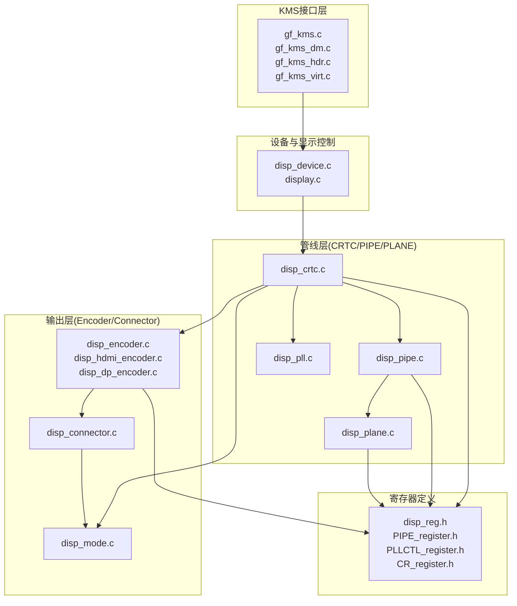
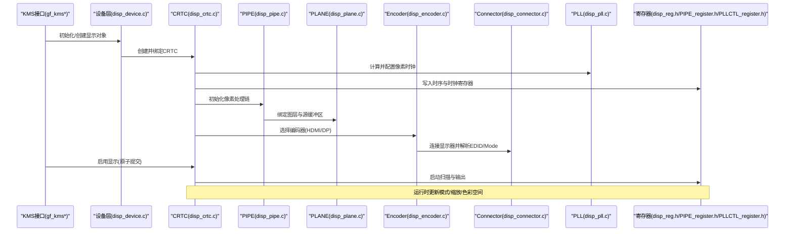
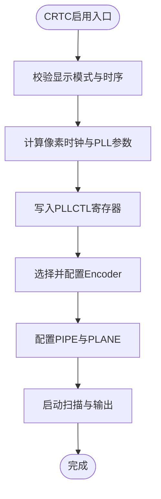
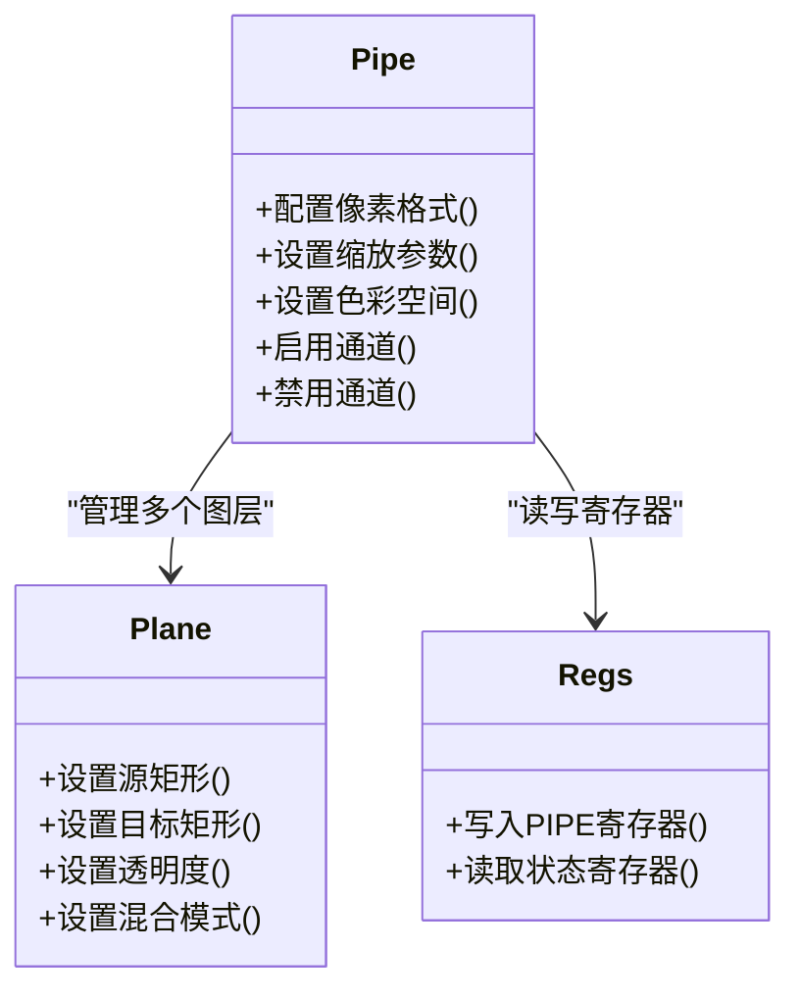
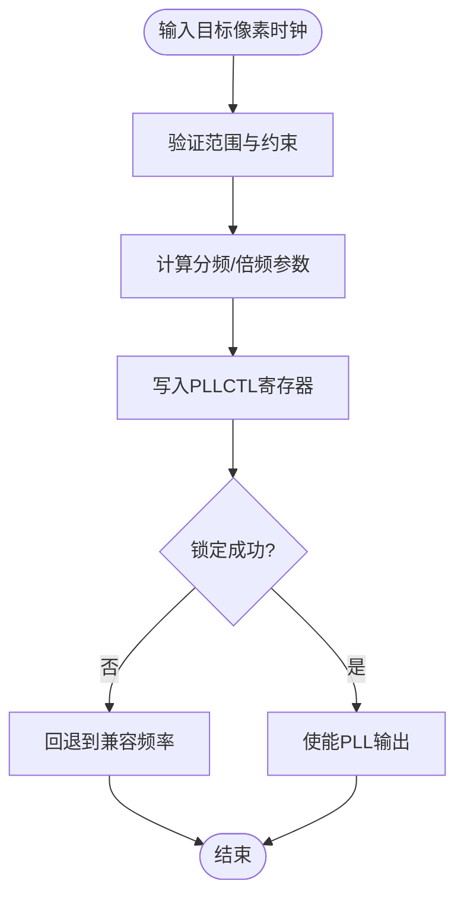
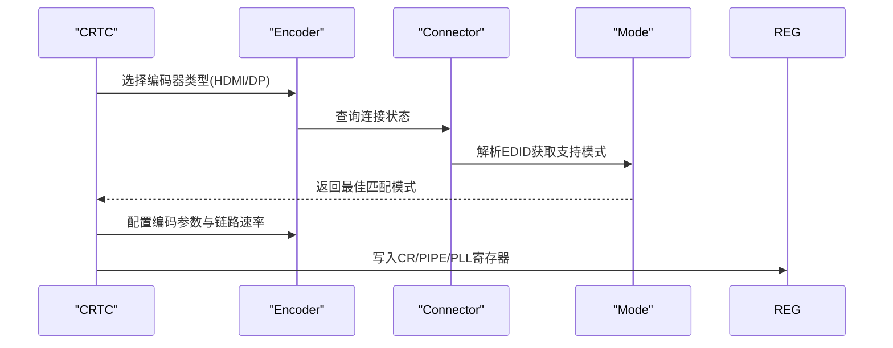
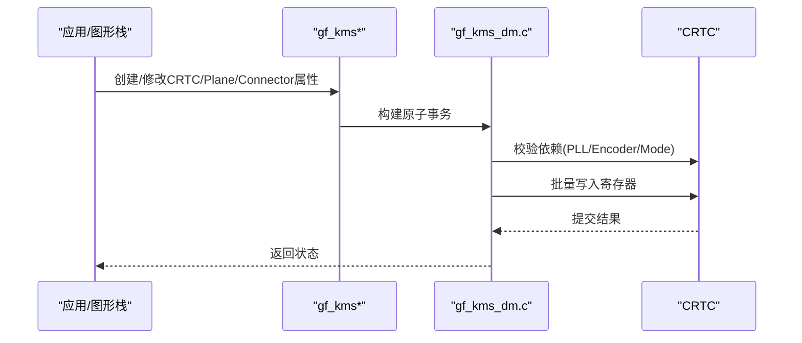
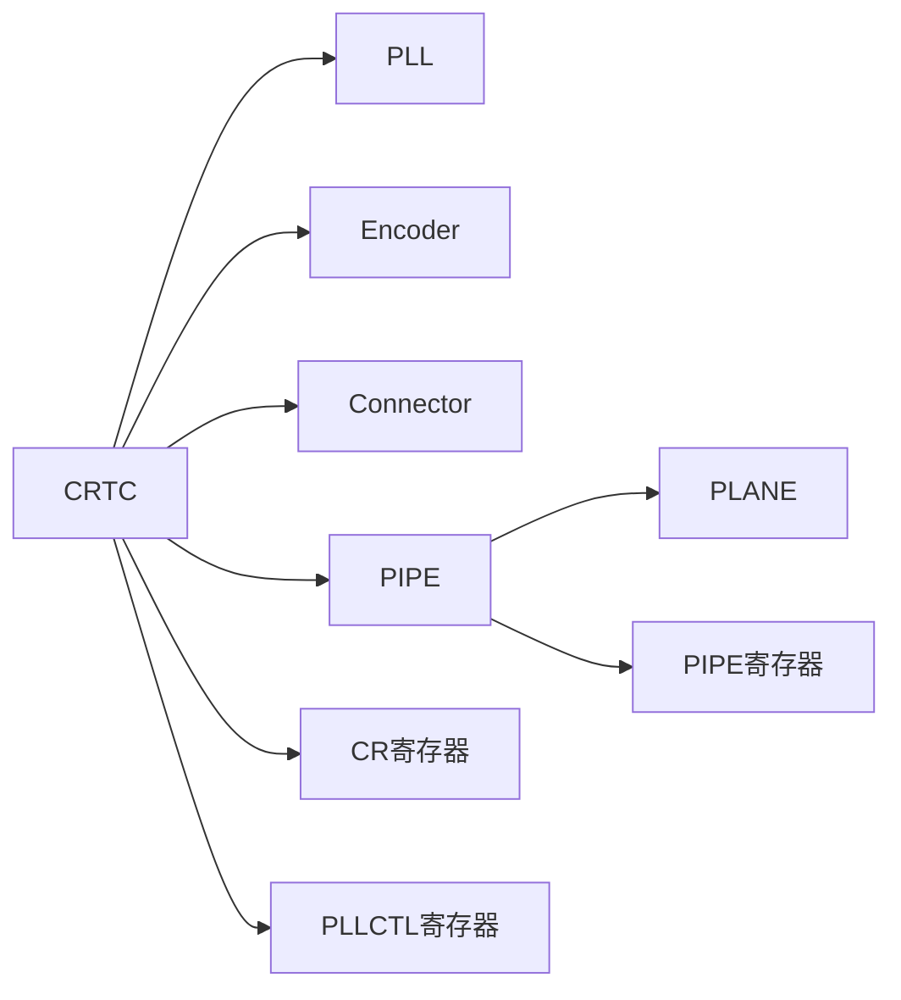

# 管道配置管理

<cite>
**本文引用的文件**
- [display.c](file://_work/src/usr/src/lisuangpu-dkms-262.2.0.56/display/display.c)
- [display.h](file://_work/src/usr/src/lisuangpu-dkms-262.2.0.56/display/display.h)
- [disp_device.c](file://_work/src/usr/src/lisuangpu-dkms-262.2.0.56/display/disp_device.c)
- [disp_device.h](file://_work/src/usr/src/lisuangpu-dkms-262.2.0.56/display/disp_device.h)
- [disp_crtc.c](file://_work/src/usr/src/lisuangpu-dkms-262.2.0.56/display/crtc/disp_crtc.c)
- [disp_crtc.h](file://_work/src/usr/src/lisuangpu-dkms-262.2.0.56/display/crtc/disp_crtc.h)
- [disp_pipe.c](file://_work/src/usr/src/lisuangpu-dkms-262.2.0.56/display/crtc/disp_pipe.c)
- [disp_pipe.h](file://_work/src/usr/src/lisuangpu-dkms-262.2.0.56/display/crtc/disp_pipe.h)
- [disp_plane.c](file://_work/src/usr/src/lisuangpu-dkms-262.2.0.56/display/crtc/disp_plane.c)
- [disp_plane.h](file://_work/src/usr/src/lisuangpu-dkms-262.2.0.56/display/crtc/disp_plane.h)
- [disp_pll.c](file://_work/src/usr/src/lisuangpu-dkms-262.2.0.56/display/crtc/disp_pll.c)
- [disp_pll.h](file://_work/src/usr/src/lisuangpu-dkms-262.2.0.56/display/crtc/disp_pll.h)
- [disp_encoder.c](file://_work/src/usr/src/lisuangpu-dkms-262.2.0.56/display/encoder/disp_encoder.c)
- [disp_encoder.h](file://_work/src/usr/src/lisuangpu-dkms-262.2.0.56/display/encoder/disp_encoder.h)
- [disp_hdmi_encoder.c](file://_work/src/usr/src/lisuangpu-dkms-262.2.0.56/display/encoder/disp_hdmi_encoder.c)
- [disp_dp_encoder.c](file://_work/src/usr/src/lisuangpu-dkms-262.2.0.56/display/encoder/disp_dp_encoder.c)
- [disp_connector.c](file://_work/src/usr/src/lisuangpu-dkms-262.2.0.56/display/connector/disp_connector.c)
- [disp_connector.h](file://_work/src/usr/src/lisuangpu-dkms-262.2.0.56/display/connector/disp_connector.h)
- [disp_mode.c](file://_work/src/usr/src/lisuangpu-dkms-262.2.0.56/display/connector/disp_mode.c)
- [disp_mode.h](file://_work/src/usr/src/lisuangpu-dkms-262.2.0.56/display/connector/disp_mode.h)
- [gf_kms.c](file://_work/src/usr/src/lisuangpu-dkms-262.2.0.56/kms/gf_kms.c)
- [gf_kms.h](file://_work/src/usr/src/lisuangpu-dkms-262.2.0.56/kms/gf_kms.h)
- [gf_kms_dm.c](file://_work/src/usr/src/lisuangpu-dkms-262.2.0.56/kms/gf_kms_dm.c)
- [gf_kms_dm.h](file://_work/src/usr/src/lisuangpu-dkms-262.2.0.56/kms/gf_kms_dm.h)
- [gf_kms_hdr.c](file://_work/src/usr/src/lisuangpu-dkms-262.2.0.56/kms/gf_kms_hdr.c)
- [gf_kms_hdr.h](file://_work/src/usr/src/lisuangpu-dkms-262.2.0.56/kms/gf_kms_hdr.h)
- [gf_kms_virt.c](file://_work/src/usr/src/lisuangpu-dkms-262.2.0.56/kms/gf_kms_virt.c)
- [gf_kms_virt.h](file://_work/src/usr/src/lisuangpu-dkms-262.2.0.56/kms/gf_kms_virt.h)
- [disp_reg.h](file://_work/src/usr/src/lisuangpu-dkms-262.2.0.56/display/register/disp_reg.h)
- [PIPE_register.h](file://_work/src/usr/src/lisuangpu-dkms-262.2.0.56/display/register/PIPE_register.h)
- [PLLCTL_register.h](file://_work/src/usr/src/lisuangpu-dkms-262.2.0.56/display/register/PLLCTL_register.h)
- [CR_register.h](file://_work/src/usr/src/lisuangpu-dkms-262.2.0.56/display/register/CR_register.h)
</cite>

## 目录
1. [简介](#简介)
2. [项目结构](#项目结构)
3. [核心组件](#核心组件)
4. [架构总览](#架构总览)
5. [详细组件分析](#详细组件分析)
6. [依赖关系分析](#依赖关系分析)
7. [性能考虑](#性能考虑)
8. [故障排查指南](#故障排查指南)
9. [结论](#结论)
10. [附录](#附录)

## 简介
本文件面向丽山GPU显示驱动中的“管道配置管理系统”，系统性阐述显示管道的层级结构、数据流向与关键配置参数，覆盖初始化、配置、启用与销毁流程。重点说明时钟生成器（PLL）配置、像素格式转换、缩放处理与色彩空间管理，并提供多管道系统配置、像素时钟设置与管道依赖关系的实践指引。文档以代码级分析与架构图示为主，兼顾非专业读者的可理解性。

## 项目结构
显示子系统按功能分层组织：KMS接口层、设备抽象层、CRTC/PIPE/PLANE管线层、编码器/连接器层、寄存器定义与公共工具。核心路径如下：
- KMS接口：kms/gf_kms*.c/.h、gf_kms_dm*.c/.h、gf_kms_hdr*.c/.h、gf_kms_virt*.c/.h
- 设备与顶层显示：display/*.c/.h、disp_device.*
- CRTC/PIPE/PLANE：display/crtc/disp_crtc.*、disp_pipe.*、disp_plane.*、disp_pll.*
- 编码器/连接器：display/encoder/*、display/connector/*
- 寄存器定义：display/register/*

图表来源
- [display.c:1-200](file://_work/src/usr/src/lisuangpu-dkms-262.2.0.56/display/display.c#L1-L200)
- [disp_device.c:1-200](file://_work/src/usr/src/lisuangpu-dkms-262.2.0.56/display/disp_device.c#L1-L200)
- [disp_crtc.c:1-200](file://_work/src/usr/src/lisuangpu-dkms-262.2.0.56/display/crtc/disp_crtc.c#L1-L200)
- [disp_pipe.c:1-200](file://_work/src/usr/src/lisuangpu-dkms-262.2.0.56/display/crtc/disp_pipe.c#L1-L200)
- [disp_plane.c:1-200](file://_work/src/usr/src/lisuangpu-dkms-262.2.0.56/display/crtc/disp_plane.c#L1-L200)
- [disp_pll.c:1-200](file://_work/src/usr/src/lisuangpu-dkms-262.2.0.56/display/crtc/disp_pll.c#L1-L200)
- [disp_encoder.c:1-200](file://_work/src/usr/src/lisuangpu-dkms-262.2.0.56/display/encoder/disp_encoder.c#L1-L200)
- [disp_connector.c:1-200](file://_work/src/usr/src/lisuangpu-dkms-262.2.0.56/display/connector/disp_connector.c#L1-L200)
- [disp_mode.c:1-200](file://_work/src/usr/src/lisuangpu-dkms-262.2.0.56/display/connector/disp_mode.c#L1-L200)
- [disp_reg.h:1-200](file://_work/src/usr/src/lisuangpu-dkms-262.2.0.56/display/register/disp_reg.h#L1-L200)
- [PIPE_register.h:1-200](file://_work/src/usr/src/lisuangpu-dkms-262.2.0.56/display/register/PIPE_register.h#L1-L200)
- [PLLCTL_register.h:1-200](file://_work/src/usr/src/lisuangpu-dkms-262.2.0.56/display/register/PLLCTL_register.h#L1-L200)
- [CR_register.h:1-200](file://_work/src/usr/src/lisuangpu-dkms-262.2.0.56/display/register/CR_register.h#L1-L200)

章节来源
- [display.c:1-200](file://_work/src/usr/src/lisuangpu-dkms-262.2.0.56/display/display.c#L1-L200)
- [disp_device.c:1-200](file://_work/src/usr/src/lisuangpu-dkms-262.2.0.56/display/disp_device.c#L1-L200)

## 核心组件
- 设备与显示控制：负责设备探测、资源分配、全局显示状态管理与生命周期控制。
- CRTC：扫描转换与时序控制器，协调PIPE、PLANE、ENC、PLL，完成帧缓冲读取、时序生成与输出使能。
- PIPE：像素处理流水线，包含像素格式转换、缩放、色彩空间变换、叠加等。
- PLANE：图层平面，提供源矩形、目标矩形、透明度、混合模式等。
- PLL：像素时钟发生器，根据模式计算并配置分频/倍频参数。
- Encoder/Connector：将数字信号编码为HDMI/DP等物理接口信号，解析EDID/Mode。
- KMS接口：上层图形栈通过DRM/KMS API调用，映射到上述组件。

章节来源
- [disp_crtc.c:1-200](file://_work/src/usr/src/lisuangpu-dkms-262.2.0.56/display/crtc/disp_crtc.c#L1-L200)
- [disp_pipe.c:1-200](file://_work/src/usr/src/lisuangpu-dkms-262.2.0.56/display/crtc/disp_pipe.c#L1-L200)
- [disp_plane.c:1-200](file://_work/src/usr/src/lisuangpu-dkms-262.2.0.56/display/crtc/disp_plane.c#L1-L200)
- [disp_pll.c:1-200](file://_work/src/usr/src/lisuangpu-dkms-262.2.0.56/display/crtc/disp_pll.c#L1-L200)
- [disp_encoder.c:1-200](file://_work/src/usr/src/lisuangpu-dkms-262.2.0.56/display/encoder/disp_encoder.c#L1-L200)
- [disp_connector.c:1-200](file://_work/src/usr/src/lisuangpu-dkms-262.2.0.56/display/connector/disp_connector.c#L1-L200)
- [disp_mode.c:1-200](file://_work/src/usr/src/lisuangpu-dkms-262.2.0.56/display/connector/disp_mode.c#L1-L200)

## 架构总览
显示管道从KMS接口进入，经设备层分发至CRTC；CRTC调度PIPE进行像素处理，再交由Encoder编码并通过Connector输出。PLL为CRTC提供像素时钟，MODE模块提供时序参数。寄存器定义贯穿各层，确保对硬件的精确控制。

图表来源
- [gf_kms.c:1-200](file://_work/src/usr/src/lisuangpu-dkms-262.2.0.56/kms/gf_kms.c#L1-L200)
- [disp_device.c:1-200](file://_work/src/usr/src/lisuangpu-dkms-262.2.0.56/display/disp_device.c#L1-L200)
- [disp_crtc.c:1-200](file://_work/src/usr/src/lisuangpu-dkms-262.2.0.56/display/crtc/disp_crtc.c#L1-L200)
- [disp_pipe.c:1-200](file://_work/src/usr/src/lisuangpu-dkms-262.2.0.56/display/crtc/disp_pipe.c#L1-L200)
- [disp_plane.c:1-200](file://_work/src/usr/src/lisuangpu-dkms-262.2.0.56/display/crtc/disp_plane.c#L1-L200)
- [disp_encoder.c:1-200](file://_work/src/usr/src/lisuangpu-dkms-262.2.0.56/display/encoder/disp_encoder.c#L1-L200)
- [disp_connector.c:1-200](file://_work/src/usr/src/lisuangpu-dkms-262.2.0.56/display/connector/disp_connector.c#L1-L200)
- [disp_pll.c:1-200](file://_work/src/usr/src/lisuangpu-dkms-262.2.0.56/display/crtc/disp_pll.c#L1-L200)
- [disp_reg.h:1-200](file://_work/src/usr/src/lisuangpu-dkms-262.2.0.56/display/register/disp_reg.h#L1-L200)
- [PIPE_register.h:1-200](file://_work/src/usr/src/lisuangpu-dkms-262.2.0.56/display/register/PIPE_register.h#L1-L200)
- [PLLCTL_register.h:1-200](file://_work/src/usr/src/lisuangpu-dkms-262.2.0.56/display/register/PLLCTL_register.h#L1-L200)

## 详细组件分析

### CRTC：扫描与时序控制
- 职责：维护显示模式、时序参数、帧同步、VBLANK事件；协调PIPE/PLANE/ENC/PLL；执行原子提交。
- 关键点：
  - 模式设置：解析EDID/Mode，计算HTOTAL/VTOTAL、HSYNC/VSYNC、像素时钟。
  - 时钟管理：调用PLL计算分频/倍频，写入PLLCTL寄存器。
  - 输出控制：选择Encoder，配置CR/PIPE相关寄存器，启动扫描。
  - 原子提交：校验依赖关系（PLL、Encoder、Connector），批量写寄存器。

图表来源
- [disp_crtc.c:1-200](file://_work/src/usr/src/lisuangpu-dkms-262.2.0.56/display/crtc/disp_crtc.c#L1-L200)
- [disp_mode.c:1-200](file://_work/src/usr/src/lisuangpu-dkms-262.2.0.56/display/connector/disp_mode.c#L1-L200)
- [disp_pll.c:1-200](file://_work/src/usr/src/lisuangpu-dkms-262.2.0.56/display/crtc/disp_pll.c#L1-L200)
- [disp_encoder.c:1-200](file://_work/src/usr/src/lisuangpu-dkms-262.2.0.56/display/encoder/disp_encoder.c#L1-L200)
- [PIPE_register.h:1-200](file://_work/src/usr/src/lisuangpu-dkms-262.2.0.56/display/register/PIPE_register.h#L1-L200)
- [PLLCTL_register.h:1-200](file://_work/src/usr/src/lisuangpu-dkms-262.2.0.56/display/register/PLLCTL_register.h#L1-L200)
- [CR_register.h:1-200](file://_work/src/usr/src/lisuangpu-dkms-262.2.0.56/display/register/CR_register.h#L1-L200)

章节来源
- [disp_crtc.c:1-200](file://_work/src/usr/src/lisuangpu-dkms-262.2.0.56/display/crtc/disp_crtc.c#L1-L200)
- [disp_mode.c:1-200](file://_work/src/usr/src/lisuangpu-dkms-262.2.0.56/display/connector/disp_mode.c#L1-L200)

### PIPE：像素处理流水线
- 职责：像素格式转换、缩放、色彩空间变换、叠加与混合。
- 关键点：
  - 像素格式：支持多种FourCC，进行YUV/RGB转换与位深调整。
  - 缩放：源矩形到目标矩形的双线性/双三次插值。
  - 色彩空间：BT.601/BT.709/BT.2020与HDR元数据路径。
  - 寄存器：通过PIPE寄存器配置通道开关、系数表、裁剪与缩放参数。

图表来源
- [disp_pipe.c:1-200](file://_work/src/usr/src/lisuangpu-dkms-262.2.0.56/display/crtc/disp_pipe.c#L1-L200)
- [disp_plane.c:1-200](file://_work/src/usr/src/lisuangpu-dkms-262.2.0.56/display/crtc/disp_plane.c#L1-L200)
- [PIPE_register.h:1-200](file://_work/src/usr/src/lisuangpu-dkms-262.2.0.56/display/register/PIPE_register.h#L1-L200)

章节来源
- [disp_pipe.c:1-200](file://_work/src/usr/src/lisuangpu-dkms-262.2.0.56/display/crtc/disp_pipe.c#L1-L200)
- [disp_plane.c:1-200](file://_work/src/usr/src/lisuangpu-dkms-262.2.0.56/display/crtc/disp_plane.c#L1-L200)

### PLL：像素时钟生成器
- 职责：根据目标像素时钟计算分频/倍频参数，稳定输出像素时钟。
- 关键点：
  - 输入参考时钟：通常为晶振或固定频率。
  - 目标频率：由显示模式决定（如25.175MHz、148.5MHz等）。
  - 寄存器：写入PLLCTL的分频、倍频、锁定检测与使能位。
  - 稳定性：检查锁定状态与抖动阈值，必要时回退频率。

图表来源
- [disp_pll.c:1-200](file://_work/src/usr/src/lisuangpu-dkms-262.2.0.56/display/crtc/disp_pll.c#L1-L200)
- [PLLCTL_register.h:1-200](file://_work/src/usr/src/lisuangpu-dkms-262.2.0.56/display/register/PLLCTL_register.h#L1-L200)

章节来源
- [disp_pll.c:1-200](file://_work/src/usr/src/lisuangpu-dkms-262.2.0.56/display/crtc/disp_pll.c#L1-L200)

### Encoder/Connector：输出与模式解析
- Encoder：将CRTC输出的像素流编码为HDMI/DP信号，配置PHY与链路速率。
- Connector：识别显示器能力（EDID）、枚举支持的分辨率与时序。
- Mode：封装时序参数（H/V total、sync、front/back porch、像素时钟）。

图表来源
- [disp_encoder.c:1-200](file://_work/src/usr/src/lisuangpu-dkms-262.2.0.56/display/encoder/disp_encoder.c#L1-L200)
- [disp_hdmi_encoder.c:1-200](file://_work/src/usr/src/lisuangpu-dkms-262.2.0.56/display/encoder/disp_hdmi_encoder.c#L1-L200)
- [disp_dp_encoder.c:1-200](file://_work/src/usr/src/lisuangpu-dkms-262.2.0.56/display/encoder/disp_dp_encoder.c#L1-L200)
- [disp_connector.c:1-200](file://_work/src/usr/src/lisuangpu-dkms-262.2.0.56/display/connector/disp_connector.c#L1-L200)
- [disp_mode.c:1-200](file://_work/src/usr/src/lisuangpu-dkms-262.2.0.56/display/connector/disp_mode.c#L1-L200)

章节来源
- [disp_encoder.c:1-200](file://_work/src/usr/src/lisuangpu-dkms-262.2.0.56/display/encoder/disp_encoder.c#L1-L200)
- [disp_connector.c:1-200](file://_work/src/usr/src/lisuangpu-dkms-262.2.0.56/display/connector/disp_connector.c#L1-L200)
- [disp_mode.c:1-200](file://_work/src/usr/src/lisuangpu-dkms-262.2.0.56/display/connector/disp_mode.c#L1-L200)

### KMS接口：原子提交与多管道管理
- 原子提交：一次性校验并提交CRTC/PIPE/PLANE/ENC/Connector的状态变更，保证一致性。
- 多管道：支持多个CRTC并行工作，每个CRTC独立PIPE/PLANE，共享PLL策略。
- HDR：通过gf_kms_hdr实现元数据处理与色彩空间切换。

图表来源
- [gf_kms.c:1-200](file://_work/src/usr/src/lisuangpu-dkms-262.2.0.56/kms/gf_kms.c#L1-L200)
- [gf_kms_dm.c:1-200](file://_work/src/usr/src/lisuangpu-dkms-262.2.0.56/kms/gf_kms_dm.c#L1-L200)
- [gf_kms_hdr.c:1-200](file://_work/src/usr/src/lisuangpu-dkms-262.2.0.56/kms/gf_kms_hdr.c#L1-L200)
- [disp_crtc.c:1-200](file://_work/src/usr/src/lisuangpu-dkms-262.2.0.56/display/crtc/disp_crtc.c#L1-L200)

章节来源
- [gf_kms.c:1-200](file://_work/src/usr/src/lisuangpu-dkms-262.2.0.56/kms/gf_kms.c#L1-L200)
- [gf_kms_dm.c:1-200](file://_work/src/usr/src/lisuangpu-dkms-262.2.0.56/kms/gf_kms_dm.c#L1-L200)
- [gf_kms_hdr.c:1-200](file://_work/src/usr/src/lisuangpu-dkms-262.2.0.56/kms/gf_kms_hdr.c#L1-L200)

## 依赖关系分析
- CRTC依赖：
  - PLL：必须优先配置并锁定，才能启动扫描。
  - Encoder/Connector：需先选择并建立连接，再启用输出。
  - PIPE/PLANE：需在CRTC启动前完成配置，避免闪烁。
- 寄存器访问：
  - CR寄存器：控制CRTC使能与扫描。
  - PIPE寄存器：控制像素处理链路与参数。
  - PLLCTL寄存器：控制时钟生成与锁定状态。

图表来源
- [disp_crtc.c:1-200](file://_work/src/usr/src/lisuangpu-dkms-262.2.0.56/display/crtc/disp_crtc.c#L1-L200)
- [disp_pipe.c:1-200](file://_work/src/usr/src/lisuangpu-dkms-262.2.0.56/display/crtc/disp_pipe.c#L1-L200)
- [disp_plane.c:1-200](file://_work/src/usr/src/lisuangpu-dkms-262.2.0.56/display/crtc/disp_plane.c#L1-L200)
- [disp_encoder.c:1-200](file://_work/src/usr/src/lisuangpu-dkms-262.2.0.56/display/encoder/disp_encoder.c#L1-L200)
- [disp_connector.c:1-200](file://_work/src/usr/src/lisuangpu-dkms-262.2.0.56/display/connector/disp_connector.c#L1-L200)
- [CR_register.h:1-200](file://_work/src/usr/src/lisuangpu-dkms-262.2.0.56/display/register/CR_register.h#L1-L200)
- [PIPE_register.h:1-200](file://_work/src/usr/src/lisuangpu-dkms-262.2.0.56/display/register/PIPE_register.h#L1-L200)
- [PLLCTL_register.h:1-200](file://_work/src/usr/src/lisuangpu-dkms-262.2.0.56/display/register/PLLCTL_register.h#L1-L200)

章节来源
- [disp_crtc.c:1-200](file://_work/src/usr/src/lisuangpu-dkms-262.2.0.56/display/crtc/disp_crtc.c#L1-L200)
- [disp_pipe.c:1-200](file://_work/src/usr/src/lisuangpu-dkms-262.2.0.56/display/crtc/disp_pipe.c#L1-L200)
- [disp_plane.c:1-200](file://_work/src/usr/src/lisuangpu-dkms-262.2.0.56/display/crtc/disp_plane.c#L1-L200)
- [disp_encoder.c:1-200](file://_work/src/usr/src/lisuangpu-dkms-262.2.0.56/display/encoder/disp_encoder.c#L1-L200)
- [disp_connector.c:1-200](file://_work/src/usr/src/lisuangpu-dkms-262.2.0.56/display/connector/disp_connector.c#L1-L200)
- [CR_register.h:1-200](file://_work/src/usr/src/lisuangpu-dkms-262.2.0.56/display/register/CR_register.h#L1-L200)
- [PIPE_register.h:1-200](file://_work/src/usr/src/lisuangpu-dkms-262.2.0.56/display/register/PIPE_register.h#L1-L200)
- [PLLCTL_register.h:1-200](file://_work/src/usr/src/lisuangpu-dkms-262.2.0.56/display/register/PLLCTL_register.h#L1-L200)

## 性能考虑
- 原子提交：减少多次寄存器写入带来的闪烁与不一致。
- 时钟优化：选择合适的PLL参数以降低抖动与功耗。
- 缩放算法：根据场景选择合适插值算法平衡质量与带宽。
- 色彩空间：在SDR/HDR间切换时最小化重配置开销。
- 多管道并发：合理分配CRTC与PLL资源，避免冲突。

## 故障排查指南
- 无输出：
  - 检查Connector连接状态与EDID解析是否成功。
  - 确认Encoder已正确选择且链路速率匹配。
  - 验证CRTC是否启动扫描（CR寄存器位）。
- 花屏/闪烁：
  - 检查原子提交是否失败或依赖未满足。
  - 确认PIPE/PLANE配置顺序与时序参数正确。
- 时钟不稳定：
  - 查看PLL锁定状态与抖动指标。
  - 回退到兼容频率或调整参考时钟。
- 色彩异常：
  - 核对像素格式与色彩空间配置。
  - 检查HDR元数据路径是否正确。

章节来源
- [disp_connector.c:1-200](file://_work/src/usr/src/lisuangpu-dkms-262.2.0.56/display/connector/disp_connector.c#L1-L200)
- [disp_encoder.c:1-200](file://_work/src/usr/src/lisuangpu-dkms-262.2.0.56/display/encoder/disp_encoder.c#L1-L200)
- [disp_crtc.c:1-200](file://_work/src/usr/src/lisuangpu-dkms-262.2.0.56/display/crtc/disp_crtc.c#L1-L200)
- [disp_pipe.c:1-200](file://_work/src/usr/src/lisuangpu-dkms-262.2.0.56/display/crtc/disp_pipe.c#L1-L200)
- [disp_pll.c:1-200](file://_work/src/usr/src/lisuangpu-dkms-262.2.0.56/display/crtc/disp_pll.c#L1-L200)

## 结论
丽山GPU显示管道通过清晰的层次结构与原子提交机制，实现了高可靠、高性能的显示输出。CRTC作为中枢协调PIPE/PLANE/ENC/PLL，配合KMS接口完成多管道管理与动态配置。遵循本文的流程与最佳实践，可有效解决常见显示问题并优化性能。

## 附录
- 多管道配置示例要点：
  - 为每个CRTC创建独立的PIPE与PLANE实例。
  - 合理分配PLL资源，避免频率冲突。
  - 使用原子提交统一更新所有CRTC状态。
- 像素时钟处理要点：
  - 根据模式计算目标频率，选择最接近的PLL参数。
  - 验证锁定状态与抖动阈值，必要时回退。
- 管道依赖关系要点：
  - 先配置PLL，再配置Encoder/Connector，最后启动CRTC。
  - PIPE/PLANE需在CRTC启动前完成配置。