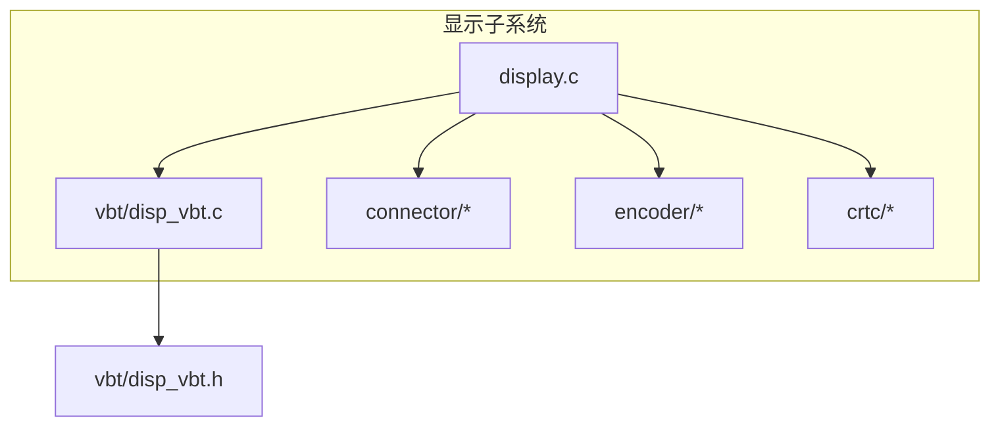
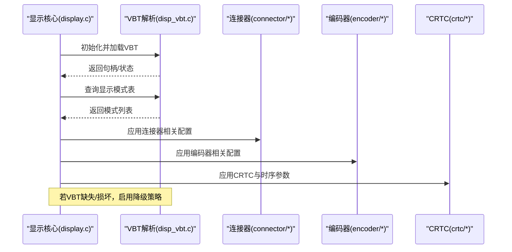
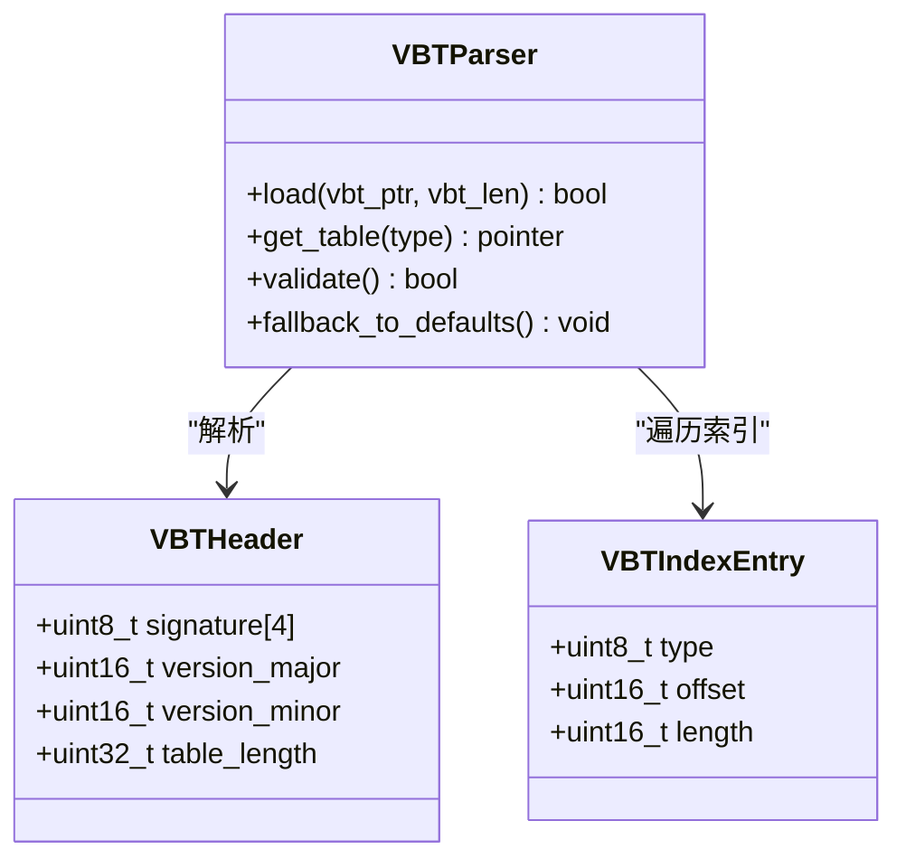
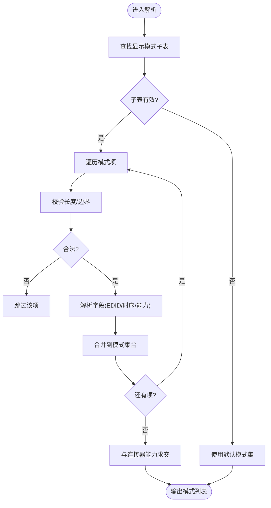
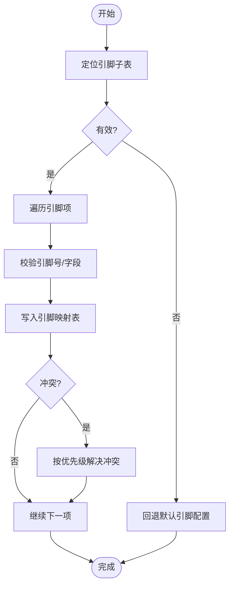
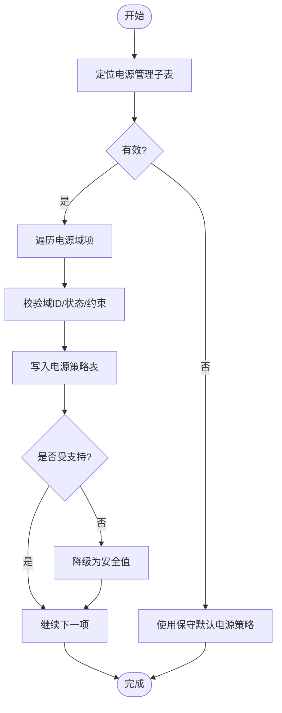
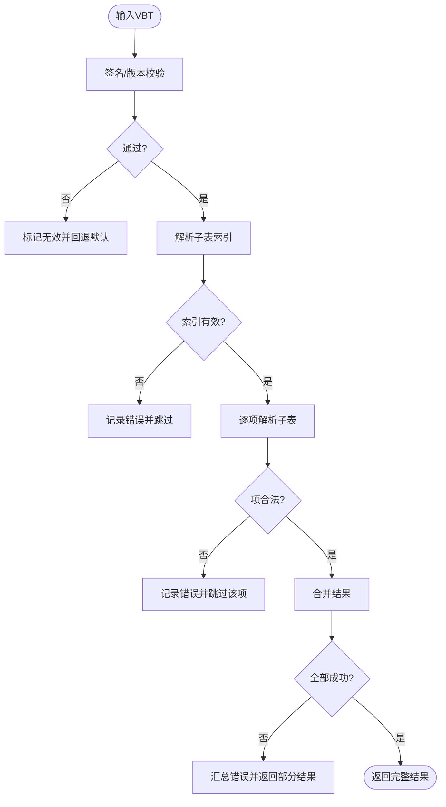
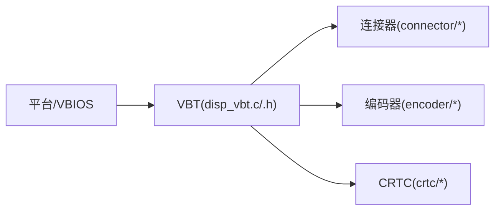

# VBT表支持

<cite>
**本文档引用的文件**   
- [disp_vbt.c](file://_work/src/usr/src/lisuan-gpu-dkms-262.2.0.56/display/vbt/disp_vbt.c)
- [disp_vbt.h](file://_work/src/usr/src/lisuan-gpu-dkms-262.2.0.56/display/vbt/disp_vbt.h)
</cite>

## 目录
1. [简介](#简介)
2. [项目结构](#项目结构)
3. [核心组件](#核心组件)
4. [架构总览](#架构总览)
5. [详细组件分析](#详细组件分析)
6. [依赖关系分析](#依赖关系分析)
7. [性能考虑](#性能考虑)
8. [故障排查指南](#故障排查指南)
9. [结论](#结论)
10. [附录](#附录)

## 简介
本文件面向丽山GPU驱动中的VBT（Video BIOS Table）支持，系统性阐述VBT表的格式与版本兼容、解析算法、显示模式表、引脚配置表与电源管理表的处理流程。文档同时覆盖数据校验、错误处理与降级策略，并提供编辑工具与调试方法建议，帮助开发者理解并维护硬件特定的显示配置。

## 项目结构
VBT相关实现位于display/vbt子目录，包含头文件与实现文件：
- disp_vbt.h：VBT数据结构、常量与接口声明
- disp_vbt.c：VBT加载、校验、解析与查询逻辑

图表来源
- [disp_vbt.c](file://_work/src/usr/src/lisuan-gpu-dkms-262.2.0.56/display/vbt/disp_vbt.c)
- [disp_vbt.h](file://_work/src/usr/src/lisuan-gpu-dkms-262.2.0.56/display/vbt/disp_vbt.h)

章节来源
- [disp_vbt.c](file://_work/src/usr/src/lisuan-gpu-dkms-262.2.0.56/display/vbt/disp_vbt.c)
- [disp_vbt.h](file://_work/src/usr/src/lisuan-gpu-dkms-262.2.0.56/display/vbt/disp_vbt.h)

## 核心组件
- VBT入口与生命周期
  - 初始化/销毁：负责从固件或系统存储中获取VBT指针与长度，建立内部缓存，供后续模块查询。
  - 查询接口：提供按类型（如显示模式、引脚、电源管理等）检索的API。
- 数据模型
  - 头部与签名：用于识别VBT有效性与版本。
  - 子表索引：指向各子表（显示模式、引脚、电源管理等）的偏移与长度。
  - 子表项：具体条目（如EDID、时序、GPIO、电源状态等）。
- 解析器
  - 版本兼容：根据主/次版本号选择解析路径。
  - 字段映射：将原始字节映射为结构化字段，处理大小端与对齐。
- 校验与容错
  - 边界检查：防止越界访问。
  - 完整性校验：校验和、签名、版本范围。
  - 降级策略：缺失或损坏时回退到默认配置或跳过该子表。

章节来源
- [disp_vbt.c](file://_work/src/usr/src/lisuan-gpu-dkms-262.2.0.56/display/vbt/disp_vbt.c)
- [disp_vbt.h](file://_work/src/usr/src/lisuan-gpu-dkms-262.2.0.56/display/vbt/disp_vbt.h)

## 架构总览
VBT在显示子系统中的作用是“硬件特定配置的权威来源”。上层模块通过统一接口查询VBT内容，避免直接操作原始字节。

图表来源
- [disp_vbt.c](file://_work/src/usr/src/lisuan-gpu-dkms-262.2.0.56/display/vbt/disp_vbt.c)
- [disp_vbt.h](file://_work/src/usr/src/lisuan-gpu-dkms-262.2.0.56/display/vbt/disp_vbt.h)

## 详细组件分析

### VBT数据结构与版本兼容
- 头部与签名
  - 通过固定签名与版本字段确认VBT有效性；不匹配则视为无效。
- 子表索引
  - 包含各子表类型、偏移与长度；解析器据此定位并读取子表。
- 版本兼容矩阵
  - 主版本决定解析路径；次版本控制可选字段存在性。
  - 对未知但向后兼容的版本采用“忽略未知字段”的策略。

图表来源
- [disp_vbt.h](file://_work/src/usr/src/lisuan-gpu-dkms-262.2.0.56/display/vbt/disp_vbt.h)
- [disp_vbt.c](file://_work/src/usr/src/lisuan-gpu-dkms-262.2.0.56/display/vbt/disp_vbt.c)

章节来源
- [disp_vbt.h](file://_work/src/usr/src/lisuan-gpu-dkms-262.2.0.56/display/vbt/disp_vbt.h)
- [disp_vbt.c](file://_work/src/usr/src/lisuan-gpu-dkms-262.2.0.56/display/vbt/disp_vbt.c)

### 显示模式表解析
- 目标：提取EDID、分辨率、刷新率、时序参数、扩展能力等。
- 流程要点：
  - 定位显示模式子表，逐项解析。
  - 校验每项长度与边界，丢弃非法项。
  - 合并EDID信息，生成可用模式集合。
  - 与连接器能力交集过滤，得到最终模式列表。

图表来源
- [disp_vbt.c](file://_work/src/usr/src/lisuan-gpu-dkms-262.2.0.56/display/vbt/disp_vbt.c)

章节来源
- [disp_vbt.c](file://_work/src/usr/src/lisuan-gpu-dkms-262.2.0.56/display/vbt/disp_vbt.c)

### 引脚配置表解析
- 目标：解析GPIO/引脚复用、电平、驱动强度、中断极性、默认状态等。
- 流程要点：
  - 定位引脚子表，逐项解析引脚描述。
  - 校验引脚号范围与保留位。
  - 构建引脚映射表，供连接器/编码器初始化使用。
  - 冲突检测：同一引脚多用途时按优先级取舍。

图表来源
- [disp_vbt.c](file://_work/src/usr/src/lisuan-gpu-dkms-262.2.0.56/display/vbt/disp_vbt.c)

章节来源
- [disp_vbt.c](file://_work/src/usr/src/lisuan-gpu-dkms-262.2.0.56/display/vbt/disp_vbt.c)

### 电源管理表解析
- 目标：解析电源域、时钟门控、功耗限制、唤醒源等。
- 流程要点：
  - 定位电源管理子表，解析各电源域配置。
  - 校验域ID、状态枚举与时序约束。
  - 生成电源策略表，供驱动电源管理模块调用。
  - 对不支持的域或状态进行安全降级（关闭或保守设置）。

图表来源
- [disp_vbt.c](file://_work/src/usr/src/lisuan-gpu-dkms-262.2.0.56/display/vbt/disp_vbt.c)

章节来源
- [disp_vbt.c](file://_work/src/usr/src/lisuan-gpu-dkms-262.2.0.56/display/vbt/disp_vbt.c)

### 数据验证、错误处理与降级策略
- 验证
  - 签名与版本检查、长度与边界检查、子表索引合法性校验。
- 错误处理
  - 记录错误码与上下文（类型、偏移、长度），便于定位。
  - 对单个子表失败不影响其他子表解析。
- 降级策略
  - 无VBT：使用内置默认配置。
  - 部分损坏：跳过损坏项，尽可能恢复可用配置。
  - 未知版本：仅解析已知字段，忽略未知字段。

图表来源
- [disp_vbt.c](file://_work/src/usr/src/lisuan-gpu-dkms-262.2.0.56/display/vbt/disp_vbt.c)

章节来源
- [disp_vbt.c](file://_work/src/usr/src/lisuan-gpu-dkms-262.2.0.56/display/vbt/disp_vbt.c)

## 依赖关系分析
- 内聚性
  - VBT模块职责单一：加载、校验、解析、查询。
- 耦合度
  - 对外暴露稳定接口，被连接器、编码器、CRTC等模块按需查询。
- 外部依赖
  - 依赖底层获取VBT指针与长度的机制（由平台/固件提供）。
  - 依赖显示子系统其他模块的能力协商（如连接器EDID）。

图表来源
- [disp_vbt.c](file://_work/src/usr/src/lisuan-gpu-dkms-262.2.0.56/display/vbt/disp_vbt.c)
- [disp_vbt.h](file://_work/src/usr/src/lisuan-gpu-dkms-262.2.0.56/display/vbt/disp_vbt.h)

章节来源
- [disp_vbt.c](file://_work/src/usr/src/lisuan-gpu-dkms-262.2.0.56/display/vbt/disp_vbt.c)
- [disp_vbt.h](file://_work/src/usr/src/lisuan-gpu-dkms-262.2.0.56/display/vbt/disp_vbt.h)

## 性能考虑
- 解析时机
  - 建议在初始化阶段一次性解析并缓存结果，避免重复计算。
- 内存占用
  - 子表项数量可能较多，需合理分配与释放，避免碎片化。
- 查询效率
  - 对常用查询（如模式、引脚）可建立索引或哈希表加速。
- 并发安全
  - 读多写少场景下，确保解析完成后只读共享，必要时加锁保护。

## 故障排查指南
- 常见问题
  - VBT签名不匹配或版本过新/过旧。
  - 子表索引越界或长度异常。
  - 引脚冲突导致功能不可用。
  - 电源域不受支持导致功能降级。
- 诊断步骤
  - 打印VBT头部与子表索引，核对签名与版本。
  - 逐项校验子表项长度与边界，定位非法项。
  - 对比连接器EDID与VBT模式，确认交集是否正确。
  - 检查引脚映射冲突与优先级规则。
  - 查看电源策略表是否包含所有必要域。
- 日志与调试
  - 在关键路径增加详细日志（类型、偏移、长度、错误码）。
  - 导出VBT原始数据与解析结果，便于离线分析。

章节来源
- [disp_vbt.c](file://_work/src/usr/src/lisuan-gpu-dkms-262.2.0.56/display/vbt/disp_vbt.c)
- [disp_vbt.h](file://_work/src/usr/src/lisuan-gpu-dkms-262.2.0.56/display/vbt/disp_vbt.h)

## 结论
VBT是丽山GPU显示子系统的关键配置来源。通过稳健的加载、校验、解析与查询机制，结合完善的错误处理与降级策略，可在不同硬件与固件组合下保持稳定行为。建议在生产环境中严格校验VBT，并在开发阶段充分测试各种边界情况。

## 附录

### VBT表编辑工具建议
- 二进制编辑器
  - 使用十六进制编辑器查看与修改VBT原始数据，注意保持签名与长度一致。
- 专用解析器
  - 基于现有解析逻辑编写命令行工具，输出JSON/XML格式的解析结果，便于比对与审计。
- 校验脚本
  - 自动化执行签名、版本、边界与一致性检查，快速发现异常。

### 调试方法
- 运行时开关
  - 提供调试开关以输出VBT解析详情与中间结果。
- 断点与单步
  - 在解析关键函数处设置断点，逐步验证字段映射。
- 回归测试
  - 针对常见VBT样本构建用例，确保解析正确性与鲁棒性。