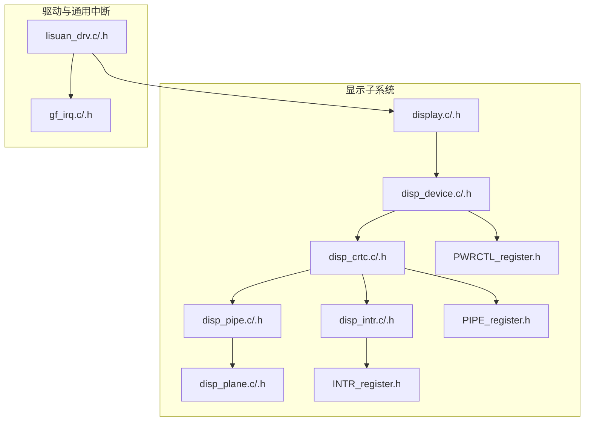
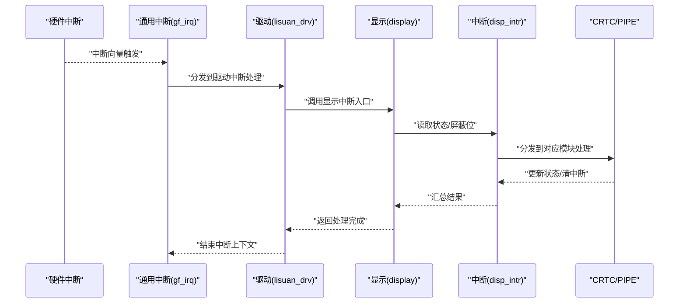
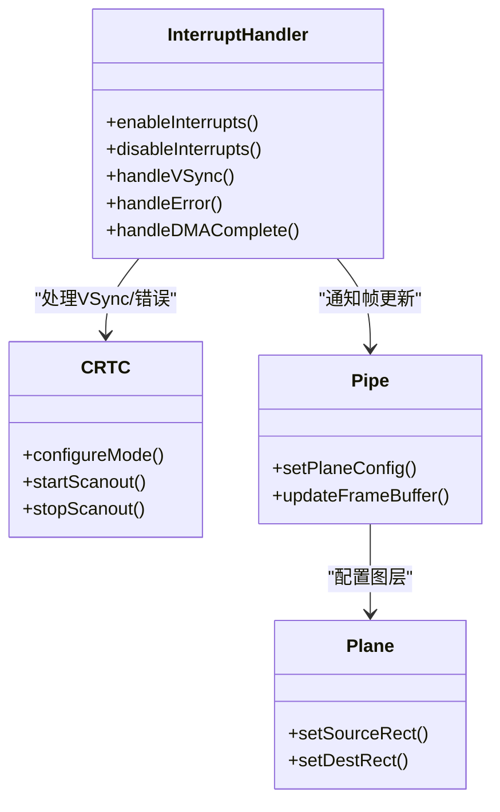
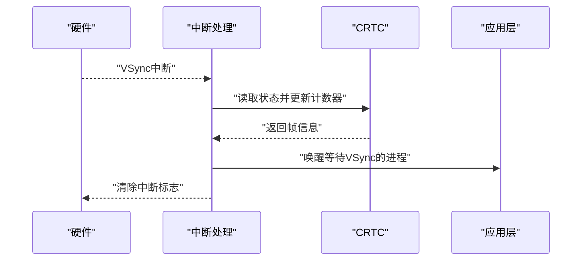
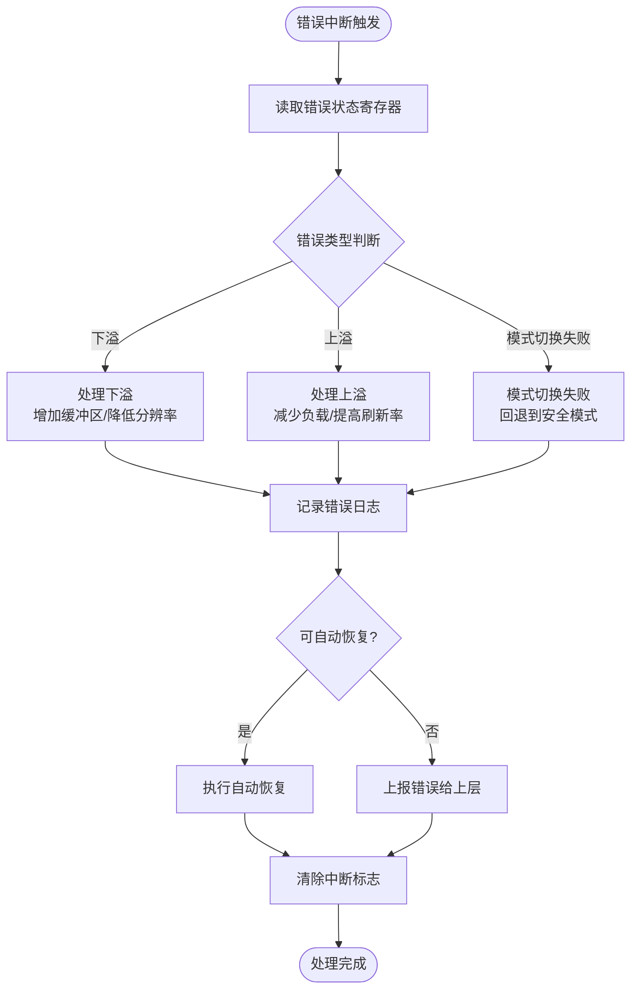
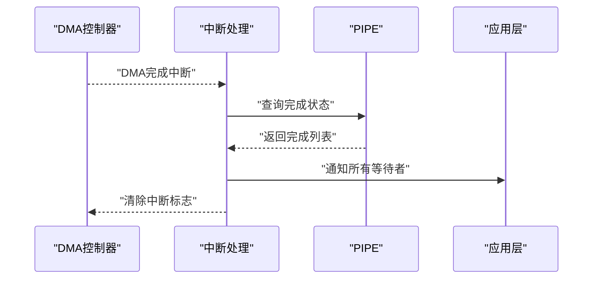
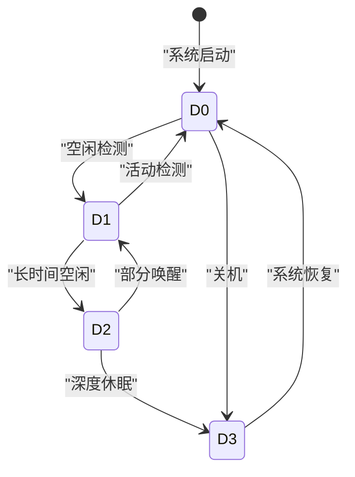
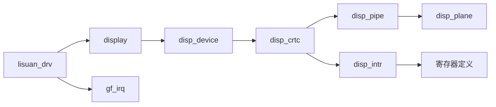

# 中断与电源管理

<cite>
**本文档引用的文件**   
- [display.c](file://_work/src/usr/src/lisuan-gpu-dkms-262.2.0.56/display/display.c)
- [display.h](file://_work/src/usr/src/lisuan-gpu-dkms-262.2.0.56/display/display.h)
- [disp_device.c](file://_work/src/usr/src/lisuan-gpu-dkms-262.2.0.56/display/disp_device.c)
- [disp_device.h](file://_work/src/usr/src/lisuan-gpu-dkms-262.2.0.56/display/disp_device.h)
- [disp_crtc.c](file://_work/src/usr/src/lisuan-gpu-dkms-262.2.0.56/display/crtc/disp_crtc.c)
- [disp_crtc.h](file://_work/src/usr/src/lisuan-gpu-dkms-262.2.0.56/display/crtc/disp_crtc.h)
- [disp_pipe.c](file://_work/src/usr/src/lisuan-gpu-dkms-262.2.0.56/display/crtc/disp_pipe.c)
- [disp_pipe.h](file://_work/src/usr/src/lisuan-gpu-dkms-262.2.0.56/display/crtc/disp_pipe.h)
- [disp_plane.c](file://_work/src/usr/src/lisuan-gpu-dkms-262.2.0.56/display/crtc/disp_plane.c)
- [disp_plane.h](file://_work/src/usr/src/lisuan-gpu-dkms-262.2.0.56/display/crtc/disp_plane.h)
- [disp_intr.c](file://_work/src/usr/src/lisuan-gpu-dkms-262.2.0.56/display/intr/disp_intr.c)
- [disp_intr.h](file://_work/src/usr/src/lisuan-gpu-dkms-262.2.0.56/display/intr/disp_intr.h)
- [INTR_register.h](file://_work/src/usr/src/lisuan-gpu-dkms-262.2.0.56/display/register/INTR_register.h)
- [PWRCTL_register.h](file://_work/src/usr/src/lisuan-gpu-dkms-262.2.0.56/display/register/PWRCTL_register.h)
- [PIPE_register.h](file://_work/src/usr/src/lisuan-gpu-dkms-262.2.0.56/display/register/PIPE_register.h)
- [gf_irq.c](file://_work/src/usr/src/lisuan-gpu-dkms-262.2.0.56/gf_irq.c)
- [gf_irq.h](file://_work/src/usr/src/lisuan-gpu-dkms-262.2.0.56/gf_irq.h)
- [lisuan_drv.c](file://_work/src/usr/src/lisuan-gpu-dkms-262.2.0.56/lisuan_drv.c)
- [lisuan_drv.h](file://_work/src/usr/src/lisuan-gpu-dkms-262.2.0.56/lisuan_drv.h)
</cite>

## 目录
1. [简介](#简介)
2. [项目结构](#项目结构)
3. [核心组件](#核心组件)
4. [架构总览](#架构总览)
5. [详细组件分析](#详细组件分析)
6. [依赖关系分析](#依赖关系分析)
7. [性能考虑](#性能考虑)
8. [故障排查指南](#故障排查指南)
9. [结论](#结论)
10. [附录](#附录)

## 简介
本文件面向丽山GPU显示子系统，系统性阐述中断与电源管理的整体设计、关键流程与最佳实践。重点覆盖：
- 显示子系统的中断架构、中断源分类与优先级管理
- 垂直同步中断（VSync）、错误中断、DMA完成中断的处理流程
- 电源状态转换、时钟门控与功耗优化策略
- 中断服务程序编写示例与电源管理实践建议

## 项目结构
显示子系统代码位于 display 目录，按功能划分为 connector、crtc、encoder、intr、register 等模块；驱动入口与通用中断框架位于 gf_irq.*、lisuan_drv.* 等文件。寄存器定义集中在 register 目录，便于统一维护硬件接口。

图表来源
- [display.c:1-200](file://_work/src/usr/src/lisuan-gpu-dkms-262.2.0.56/display/display.c#L1-L200)
- [disp_device.c:1-200](file://_work/src/usr/src/lisuan-gpu-dkms-262.2.0.56/display/disp_device.c#L1-L200)
- [disp_crtc.c:1-200](file://_work/src/usr/src/lisuan-gpu-dkms-262.2.0.56/display/crtc/disp_crtc.c#L1-L200)
- [disp_pipe.c:1-200](file://_work/src/usr/src/lisuan-gpu-dkms-262.2.0.56/display/crtc/disp_pipe.c#L1-L200)
- [disp_plane.c:1-200](file://_work/src/usr/src/lisuan-gpu-dkms-262.2.0.56/display/crtc/disp_plane.c#L1-L200)
- [disp_intr.c:1-200](file://_work/src/usr/src/lisuan-gpu-dkms-262.2.0.56/display/intr/disp_intr.c#L1-L200)
- [gf_irq.c:1-200](file://_work/src/usr/src/lisuan-gpu-dkms-262.2.0.56/gf_irq.c#L1-L200)
- [lisuan_drv.c:1-200](file://_work/src/usr/src/lisuan-gpu-dkms-262.2.0.56/lisuan_drv.c#L1-L200)

章节来源
- [display.c:1-200](file://_work/src/usr/src/lisuan-gpu-dkms-262.2.0.56/display/display.c#L1-L200)
- [disp_device.c:1-200](file://_work/src/usr/src/lisuan-gpu-dkms-262.2.0.56/display/disp_device.c#L1-L200)
- [disp_crtc.c:1-200](file://_work/src/usr/src/lisuan-gpu-dkms-262.2.0.56/display/crtc/disp_crtc.c#L1-L200)
- [disp_pipe.c:1-200](file://_work/src/usr/src/lisuan-gpu-dkms-262.2.0.56/display/crtc/disp_pipe.c#L1-L200)
- [disp_plane.c:1-200](file://_work/src/usr/src/lisuan-gpu-dkms-262.2.0.56/display/crtc/disp_plane.c#L1-L200)
- [disp_intr.c:1-200](file://_work/src/usr/src/lisuan-gpu-dkms-262.2.0.56/display/intr/disp_intr.c#L1-L200)
- [gf_irq.c:1-200](file://_work/src/usr/src/lisuan-gpu-dkms-262.2.0.56/gf_irq.c#L1-L200)
- [lisuan_drv.c:1-200](file://_work/src/usr/src/lisuan-gpu-dkms-262.2.0.56/lisuan_drv.c#L1-L200)

## 核心组件
- 设备与初始化：负责显示引擎的初始化、资源分配与生命周期管理
- CRTC/PIPE/PLANE：扫描输出管线，控制帧时序、混合与输出
- 中断子系统：屏蔽/使能、分发与处理各类显示相关中断
- 寄存器抽象：统一的寄存器读写与位域操作封装
- 驱动入口与通用中断：注册中断、路由到显示子系统

章节来源
- [disp_device.c:1-200](file://_work/src/usr/src/lisuan-gpu-dkms-262.2.0.56/display/disp_device.c#L1-L200)
- [disp_crtc.c:1-200](file://_work/src/usr/src/lisuan-gpu-dkms-262.2.0.56/display/crtc/disp_crtc.c#L1-L200)
- [disp_pipe.c:1-200](file://_work/src/usr/src/lisuan-gpu-dkms-262.2.0.56/display/crtc/disp_pipe.c#L1-L200)
- [disp_plane.c:1-200](file://_work/src/usr/src/lisuan-gpu-dkms-262.2.0.56/display/crtc/disp_plane.c#L1-L200)
- [disp_intr.c:1-200](file://_work/src/usr/src/lisuan-gpu-dkms-262.2.0.56/display/intr/disp_intr.c#L1-L200)
- [gf_irq.c:1-200](file://_work/src/usr/src/lisuan-gpu-dkms-262.2.0.56/gf_irq.c#L1-L200)
- [lisuan_drv.c:1-200](file://_work/src/usr/src/lisuan-gpu-dkms-262.2.0.56/lisuan_drv.c#L1-L200)

## 架构总览
显示子系统采用分层架构：驱动层负责中断注册与调度，显示层实现CRTC/PIPE/PLANE逻辑，中断层集中处理并分发至具体模块，寄存器层提供底层访问能力。

图表来源
- [gf_irq.c:1-200](file://_work/src/usr/src/lisuan-gpu-dkms-262.2.0.56/gf_irq.c#L1-L200)
- [lisuan_drv.c:1-200](file://_work/src/usr/src/lisuan-gpu-dkms-262.2.0.56/lisuan_drv.c#L1-L200)
- [display.c:1-200](file://_work/src/usr/src/lisuan-gpu-dkms-262.2.0.56/display/display.c#L1-L200)
- [disp_intr.c:1-200](file://_work/src/usr/src/lisuan-gpu-dkms-262.2.0.56/display/intr/disp_intr.c#L1-L200)
- [disp_crtc.c:1-200](file://_work/src/usr/src/lisuan-gpu-dkms-262.2.0.56/display/crtc/disp_crtc.c#L1-L200)

## 详细组件分析

### 中断架构与优先级管理
- 中断源分类
  - 垂直同步中断（VSync）：用于帧时序对齐与刷新控制
  - 错误中断：包括下溢、上溢、模式切换失败等异常事件
  - DMA完成中断：表示显存搬运或命令提交完成
  - 其他：如编码器状态变更、HDMI/DP链路事件等
- 优先级策略
  - 错误中断优先于常规数据流中断，确保快速恢复
  - VSync作为周期性基准，通常具有较高优先级以保证时序稳定
  - DMA完成中断在批量传输场景下可合并处理以降低开销
- 屏蔽与使能
  - 通过寄存器位域精确控制各中断源的使能/屏蔽
  - 支持原子操作避免竞态条件

章节来源
- [disp_intr.c:1-200](file://_work/src/usr/src/lisuan-gpu-dkms-262.2.0.56/display/intr/disp_intr.c#L1-L200)
- [INTR_register.h:1-200](file://_work/src/usr/src/lisuan-gpu-dkms-262.2.0.56/display/register/INTR_register.h#L1-L200)
- [gf_irq.c:1-200](file://_work/src/usr/src/lisuan-gpu-dkms-262.2.0.56/gf_irq.c#L1-L200)

#### 类图：中断处理组件关系

图表来源
- [disp_intr.c:1-200](file://_work/src/usr/src/lisuan-gpu-dkms-262.2.0.56/display/intr/disp_intr.c#L1-L200)
- [disp_crtc.c:1-200](file://_work/src/usr/src/lisuan-gpu-dkms-262.2.0.56/display/crtc/disp_crtc.c#L1-L200)
- [disp_pipe.c:1-200](file://_work/src/usr/src/lisuan-gpu-dkms-262.2.0.56/display/crtc/disp_pipe.c#L1-L200)
- [disp_plane.c:1-200](file://_work/src/usr/src/lisuan-gpu-dkms-262.2.0.56/display/crtc/disp_plane.c#L1-L200)

### 垂直同步中断（VSync）处理流程
- 触发时机：每帧结束时由硬件产生
- 处理步骤：
  1. 读取VSync状态寄存器确认中断源
  2. 更新帧计数与时间戳
  3. 通知上层等待VSync的线程或队列
  4. 清理中断标志位防止重复触发
- 优化策略：
  - 使用忙等替代轮询以提升能效
  - 批量处理多个管道的VSync事件

章节来源
- [disp_crtc.c:1-200](file://_work/src/usr/src/lisuan-gpu-dkms-262.2.0.56/display/crtc/disp_crtc.c#L1-L200)
- [disp_intr.c:1-200](file://_work/src/usr/src/lisuan-gpu-dkms-262.2.0.56/display/intr/disp_intr.c#L1-L200)

#### 序列图：VSync处理流程

图表来源
- [disp_intr.c:1-200](file://_work/src/usr/src/lisuan-gpu-dkms-262.2.0.56/display/intr/disp_intr.c#L1-L200)
- [disp_crtc.c:1-200](file://_work/src/usr/src/lisuan-gpu-dkms-262.2.0.56/display/crtc/disp_crtc.c#L1-L200)

### 错误中断处理流程
- 常见错误类型：
  - 下溢（Underrun）：像素数据供应不足
  - 上溢（Overrun）：像素消费速度慢于生产速度
  - 模式切换失败：分辨率或刷新率设置不兼容
- 处理策略：
  1. 立即记录错误详情和上下文
  2. 尝试自动恢复（如重置管道）
  3. 上报给上层进行用户提示或回退策略
  4. 统计错误频率用于系统调优

章节来源
- [disp_intr.c:1-200](file://_work/src/usr/src/lisuan-gpu-dkms-262.2.0.56/display/intr/disp_intr.c#L1-L200)
- [disp_crtc.c:1-200](file://_work/src/usr/src/lisuan-gpu-dkms-262.2.0.56/display/crtc/disp_crtc.c#L1-L200)

#### 流程图：错误中断处理算法

图表来源
- [disp_intr.c:1-200](file://_work/src/usr/src/lisuan-gpu-dkms-262.2.0.56/display/intr/disp_intr.c#L1-L200)
- [disp_crtc.c:1-200](file://_work/src/usr/src/lisuan-gpu-dkms-262.2.0.56/display/crtc/disp_crtc.c#L1-L200)

### DMA完成中断处理流程
- 触发条件：显存拷贝、命令缓冲提交等操作完成
- 处理步骤：
  1. 识别具体的DMA通道和请求ID
  2. 更新请求状态为完成
  3. 唤醒等待该操作的进程
  4. 释放相关资源
- 性能优化：
  - 批量处理多个DMA完成事件
  - 使用环形缓冲区减少内存拷贝

章节来源
- [disp_intr.c:1-200](file://_work/src/usr/src/lisuan-gpu-dkms-262.2.0.56/display/intr/disp_intr.c#L1-L200)
- [disp_pipe.c:1-200](file://_work/src/usr/src/lisuan-gpu-dkms-262.2.0.56/display/crtc/disp_pipe.c#L1-L200)

#### 序列图：DMA完成中断处理

图表来源
- [disp_intr.c:1-200](file://_work/src/usr/src/lisuan-gpu-dkms-262.2.0.56/display/intr/disp_intr.c#L1-L200)
- [disp_pipe.c:1-200](file://_work/src/usr/src/lisuan-gpu-dkms-262.2.0.56/display/crtc/disp_pipe.c#L1-L200)

### 电源管理与功耗优化
- 电源状态模型：
  - D0：完全工作模式，所有模块启用
  - D1：部分模块关闭，保留基本功能
  - D2：深度睡眠，仅保留唤醒能力
  - D3：断电模式，需要重新初始化
- 时钟门控策略：
  - 空闲时关闭未使用的时钟域
  - 动态调整时钟频率匹配当前负载
  - 分层时钟管理避免级联延迟
- 功耗优化技术：
  - 预测性电源管理：基于使用模式预加载/卸载模块
  - 细粒度电源门控：按功能块独立控制
  - 电压频率调节：根据负载动态调整

章节来源
- [disp_device.c:1-200](file://_work/src/usr/src/lisuan-gpu-dkms-262.2.0.56/display/disp_device.c#L1-L200)
- [PWRCTL_register.h:1-200](file://_work/src/usr/src/lisuan-gpu-dkms-262.2.0.56/display/register/PWRCTL_register.h#L1-L200)

#### 状态图：电源状态转换

图表来源
- [disp_device.c:1-200](file://_work/src/usr/src/lisuan-gpu-dkms-262.2.0.56/display/disp_device.c#L1-L200)
- [PWRCTL_register.h:1-200](file://_work/src/usr/src/lisuan-gpu-dkms-262.2.0.56/display/register/PWRCTL_register.h#L1-L200)

### 中断服务程序编写示例
以下为典型的中断服务程序编写要点：

- 基本结构：
  1. 保存现场环境
  2. 读取中断状态寄存器
  3. 根据中断类型分派处理函数
  4. 清除中断标志位
  5. 恢复现场并返回

- 最佳实践：
  - 避免在中断上下文中执行耗时操作
  - 使用原子操作保证并发安全
  - 合理设置中断屏蔽位防止重入
  - 实现超时机制避免死锁

章节来源
- [disp_intr.c:1-200](file://_work/src/usr/src/lisuan-gpu-dkms-262.2.0.56/display/intr/disp_intr.c#L1-L200)
- [gf_irq.c:1-200](file://_work/src/usr/src/lisuan-gpu-dkms-262.2.0.56/gf_irq.c#L1-L200)

### 电源管理最佳实践
- 懒加载策略：按需启用模块，减少静态功耗
- 预测性管理：基于历史行为预测未来需求
- 层次化电源域：按功能划分电源域，精细控制
- 监控与反馈：实时监控功耗指标，动态调整策略

章节来源
- [disp_device.c:1-200](file://_work/src/usr/src/lisuan-gpu-dkms-262.2.0.56/display/disp_device.c#L1-L200)
- [PWRCTL_register.h:1-200](file://_work/src/usr/src/lisuan-gpu-dkms-262.2.0.56/display/register/PWRCTL_register.h#L1-L200)

## 依赖关系分析
显示子系统内部组件间的依赖关系如下：

图表来源
- [lisuan_drv.c:1-200](file://_work/src/usr/src/lisuan-gpu-dkms-262.2.0.56/lisuan_drv.c#L1-L200)
- [display.c:1-200](file://_work/src/usr/src/lisuan-gpu-dkms-262.2.0.56/display/display.c#L1-L200)
- [disp_device.c:1-200](file://_work/src/usr/src/lisuan-gpu-dkms-262.2.0.56/display/disp_device.c#L1-L200)
- [disp_crtc.c:1-200](file://_work/src/usr/src/lisuan-gpu-dkms-262.2.0.56/display/crtc/disp_crtc.c#L1-L200)
- [disp_pipe.c:1-200](file://_work/src/usr/src/lisuan-gpu-dkms-262.2.0.56/display/crtc/disp_pipe.c#L1-L200)
- [disp_plane.c:1-200](file://_work/src/usr/src/lisuan-gpu-dkms-262.2.0.56/display/crtc/disp_plane.c#L1-L200)
- [disp_intr.c:1-200](file://_work/src/usr/src/lisuan-gpu-dkms-262.2.0.56/display/intr/disp_intr.c#L1-L200)
- [gf_irq.c:1-200](file://_work/src/usr/src/lisuan-gpu-dkms-262.2.0.56/gf_irq.c#L1-L200)

章节来源
- [lisuan_drv.c:1-200](file://_work/src/usr/src/lisuan-gpu-dkms-262.2.0.56/lisuan_drv.c#L1-L200)
- [display.c:1-200](file://_work/src/usr/src/lisuan-gpu-dkms-262.2.0.56/display/display.c#L1-L200)
- [disp_device.c:1-200](file://_work/src/usr/src/lisuan-gpu-dkms-262.2.0.56/display/disp_device.c#L1-L200)
- [disp_crtc.c:1-200](file://_work/src/usr/src/lisuan-gpu-dkms-262.2.0.56/display/crtc/disp_crtc.c#L1-L200)
- [disp_pipe.c:1-200](file://_work/src/usr/src/lisuan-gpu-dkms-262.2.0.56/display/crtc/disp_pipe.c#L1-L200)
- [disp_plane.c:1-200](file://_work/src/usr/src/lisuan-gpu-dkms-262.2.0.56/display/crtc/disp_plane.c#L1-L200)
- [disp_intr.c:1-200](file://_work/src/usr/src/lisuan-gpu-dkms-262.2.0.56/display/intr/disp_intr.c#L1-L200)
- [gf_irq.c:1-200](file://_work/src/usr/src/lisuan-gpu-dkms-262.2.0.56/gf_irq.c#L1-L200)

## 性能考虑
- 中断合并：将多个小中断合并处理减少CPU开销
- 异步处理：将非关键路径操作移到工作队列
- 缓存友好：数据结构设计考虑CPU缓存局部性
- 负载均衡：多核环境下合理分配中断处理任务
- 内存管理：避免频繁分配/释放，使用对象池

## 故障排查指南
- 常见问题诊断：
  - 中断丢失：检查中断屏蔽位和优先级设置
  - 电源状态异常：验证状态转换条件和超时设置
  - 性能下降：分析中断频率和处理时长
- 调试工具：
  - 启用详细日志记录
  - 使用性能分析工具监控中断延迟
  - 实施硬件仿真测试

章节来源
- [disp_intr.c:1-200](file://_work/src/usr/src/lisuan-gpu-dkms-262.2.0.56/display/intr/disp_intr.c#L1-L200)
- [disp_device.c:1-200](file://_work/src/usr/src/lisuan-gpu-dkms-262.2.0.56/display/disp_device.c#L1-L200)

## 结论
丽山GPU显示子系统采用了清晰的分层架构和高效的中断处理机制。通过合理的电源管理和功耗优化策略，能够在保证显示质量的同时最大化能效。建议在实际应用中遵循本文档的最佳实践，并根据具体需求进行适当调整。

## 附录
- 术语表：
  - VSync：垂直同步信号
  - CRTC：阴极射线管控制器，现代GPU中泛指显示控制器
  - PIPE：像素处理流水线
  - PLANE：叠加图层
  - DMA：直接内存访问
- 参考文档：
  - 硬件寄存器手册
  - 驱动程序API文档
  - 电源管理规范