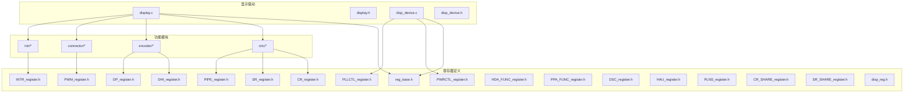
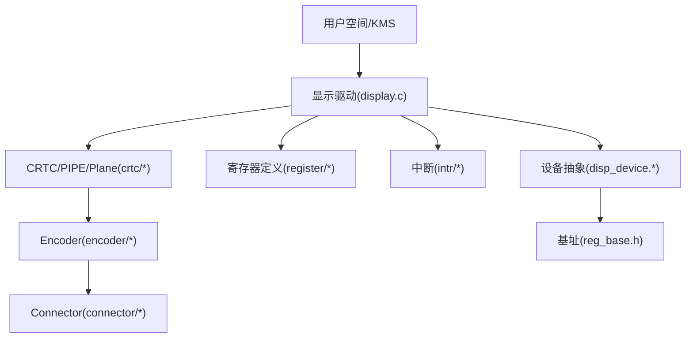
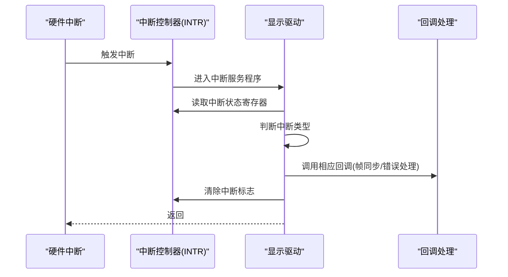
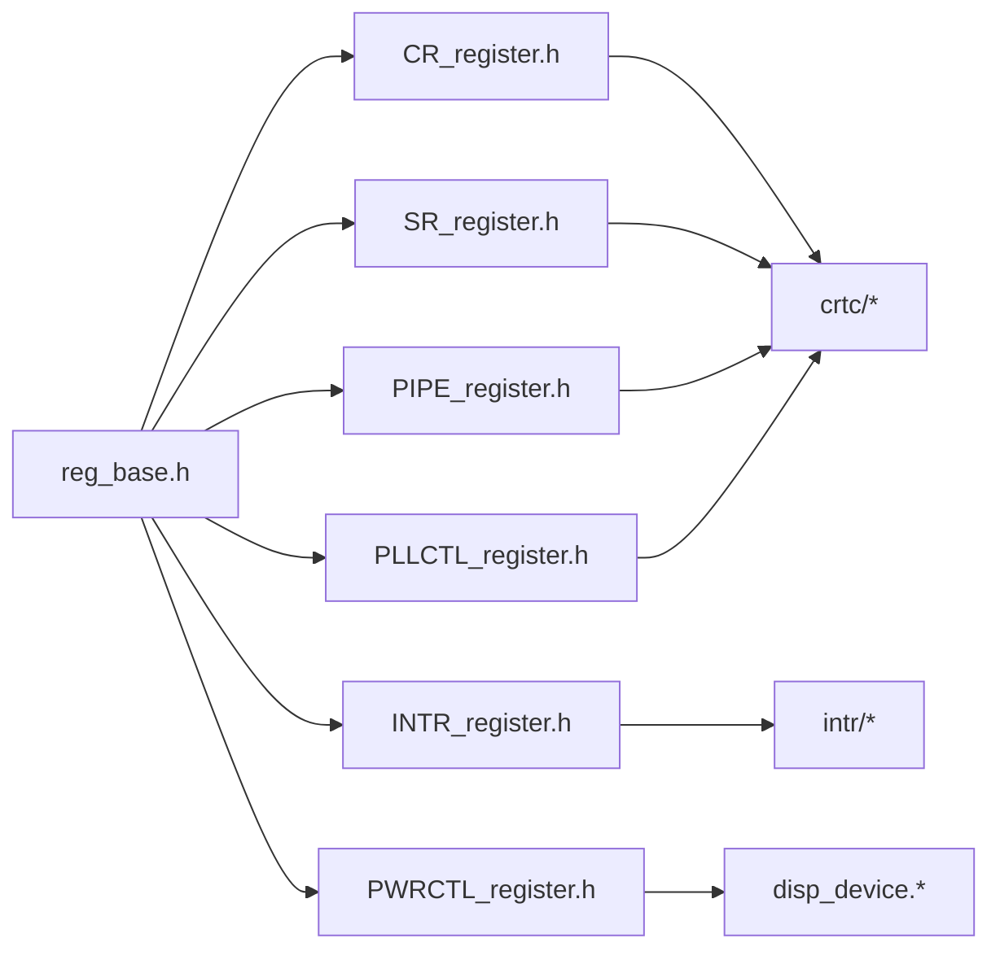

# 寄存器接口定义

<cite>
**本文引用的文件**   
- [display.h](file://_work/src/usr/src/lisuangpu-dkms-262.2.0.56/display/display.h)
- [display.c](file://_work/src/usr/src/lisuangpu-dkms-262.2.0.56/display/display.c)
- [disp_device.h](file://_work/src/usr/src/lisuangpu-dkms-262.2.0.56/display/disp_device.h)
- [disp_device.c](file://_work/src/usr/src/lisuangpu-dkms-262.2.0.56/display/disp_device.c)
- [reg_base.h](file://_work/src/usr/src/lisuangpu-dkms-262.2.0.56/include/reg_base.h)
- [CR_register.h](file://_work/src/usr/src/lisuangpu-dkms-262.2.0.56/display/register/CR_register.h)
- [SR_register.h](file://_work/src/usr/src/lisuangpu-dkms-262.2.0.56/display/register/SR_register.h)
- [PIPE_register.h](file://_work/src/usr/src/lisuangpu-dkms-262.2.0.56/display/register/PIPE_register.h)
- [PWRCTL_register.h](file://_work/src/usr/src/lisuangpu-dkms-262.2.0.56/display/register/PWRCTL_register.h)
- [PLLCTL_register.h](file://_work/src/usr/src/lisuangpu-dkms-262.2.0.56/display/register/PLLCTL_register.h)
- [INTR_register.h](file://_work/src/usr/src/lisuangpu-dkms-262.2.0.56/display/register/INTR_register.h)
- [DHI_register.h](file://_work/src/usr/src/lisuangpu-dkms-262.2.0.56/display/register/DHI_register.h)
- [DP_register.h](file://_work/src/usr/src/lisuangpu-dkms-262.2.0.56/display/register/DP_register.h)
- [PWM_register.h](file://_work/src/usr/src/lisuangpu-dkms-262.2.0.56/display/register/PWM_register.h)
- [HDA_FUNC_register.h](file://_work/src/usr/src/lisuangpu-dkms-262.2.0.56/display/register/HDA_FUNC_register.h)
- [PPA_FUNC_register.h](file://_work/src/usr/src/lisuangpu-dkms-262.2.0.56/display/register/PPA_FUNC_register.h)
- [DSC_register.h](file://_work/src/usr/src/lisuangpu-dkms-262.2.0.56/display/register/DSC_register.h)
- [HAU_register.h](file://_work/src/usr/src/lisuangpu-dkms-262.2.0.56/display/register/HAU_register.h)
- [PLNS_register.h](file://_work/src/usr/src/lisuangpu-dkms-262.2.0.56/display/register/PLNS_register.h)
- [CR_SHARE_register.h](file://_work/src/usr/src/lisuangpu-dkms-262.2.0.56/display/register/CR_SHARE_register.h)
- [SR_SHARE_register.h](file://_work/src/usr/src/lisuangpu-dkms-262.2.0.56/display/register/SR_SHARE_register.h)
- [disp_reg.h](file://_work/src/usr/src/lisuangpu-dkms-262.2.0.56/display/register/disp_reg.h)
- [disp_crtc.h](file://_work/src/usr/src/lisuangpu-dkms-262.2.0.56/display/crtc/disp_crtc.h)
- [disp_crtc.c](file://_work/src/usr/src/lisuangpu-dkms-262.2.0.56/display/crtc/disp_crtc.c)
- [disp_pipe.h](file://_work/src/usr/src/lisuangpu-dkms-262.2.0.56/display/crtc/disp_pipe.h)
- [disp_plane.h](file://_work/src/usr/src/lisuangpu-dkms-262.2.0.56/display/crtc/disp_plane.h)
- [disp_encoder.h](file://_work/src/usr/src/lisuangpu-dkms-262.2.0.56/display/encoder/disp_encoder.h)
- [disp_connector.h](file://_work/src/usr/src/lisuangpu-dkms-262.2.0.56/display/connector/disp_connector.h)
- [disp_intr.h](file://_work/src/usr/src/lisuangpu-dkms-262.2.0.56/display/intr/disp_intr.h)
- [disp_intr.c](file://_work/src/usr/src/lisuangpu-dkms-262.2.0.56/display/intr/disp_intr.c)
</cite>

## 目录
1. [简介](#简介)
2. [项目结构](#项目结构)
3. [核心组件](#核心组件)
4. [架构总览](#架构总览)
5. [详细组件分析](#详细组件分析)
6. [依赖关系分析](#依赖关系分析)
7. [性能考虑](#性能考虑)
8. [故障排查指南](#故障排查指南)
9. [结论](#结论)
10. [附录](#附录)

## 简介
本参考文档面向丽山GPU显示子系统的寄存器接口，系统性说明显示相关寄存器的地址映射、位域定义与访问权限，覆盖控制寄存器、状态寄存器、数据寄存器、中断寄存器、电源管理寄存器与时钟控制寄存器。文档提供读写示例与调试技巧，帮助开发者理解并操作底层硬件。

## 项目结构
显示子系统代码主要位于 display 目录及其子模块（crtc、encoder、connector、register、intr 等），寄存器定义集中在 register 目录下的多个头文件中；基地址与通用宏在 include/reg_base.h 中定义；设备初始化与寄存器访问封装在 disp_device.* 与 display.* 中。

**图表来源** 
- [display.c:1-200](file://_work/src/usr/src/lisuangpu-dkms-262.2.0.56/display/display.c#L1-L200)
- [disp_device.c:1-200](file://_work/src/usr/src/lisuangpu-dkms-262.2.0.56/display/disp_device.c#L1-L200)
- [reg_base.h:1-200](file://_work/src/usr/src/lisuangpu-dkms-262.2.0.56/include/reg_base.h#L1-L200)

**章节来源**
- [display.h:1-200](file://_work/src/usr/src/lisuangpu-dkms-262.2.0.56/display/display.h#L1-L200)
- [display.c:1-200](file://_work/src/usr/src/lisuangpu-dkms-262.2.0.56/display/display.c#L1-L200)
- [disp_device.h:1-200](file://_work/src/usr/src/lisuangpu-dkms-262.2.0.56/display/disp_device.h#L1-L200)
- [disp_device.c:1-200](file://_work/src/usr/src/lisuangpu-dkms-262.2.0.56/display/disp_device.c#L1-L200)
- [reg_base.h:1-200](file://_work/src/usr/src/lisuangpu-dkms-262.2.0.56/include/reg_base.h#L1-L200)

## 核心组件
- 寄存器基址与偏移：由 reg_base.h 统一提供，所有模块通过基址+偏移访问具体寄存器。
- 寄存器定义头：各功能块（CRTC、PIPE、编码器、连接器、中断、电源、时钟等）的寄存器位域与枚举在对应 *_register.h 中定义。
- 设备抽象与访问封装：disp_device.* 提供 mmio/iomap、读写屏障、原子操作封装，确保并发安全与一致性。
- 显示管线：crtc/pipe/plane 负责扫描输出、平面合成与时序生成；encoder/connector 负责信号编码与物理接口适配。
- 中断处理：intr 模块将硬件中断映射到显示事件回调，完成帧同步、错误上报等。

**章节来源**
- [reg_base.h:1-200](file://_work/src/usr/src/lisuangpu-dkms-262.2.0.56/include/reg_base.h#L1-L200)
- [disp_device.h:1-200](file://_work/src/usr/src/lisuangpu-dkms-262.2.0.56/display/disp_device.h#L1-L200)
- [disp_device.c:1-200](file://_work/src/usr/src/lisuangpu-dkms-262.2.0.56/display/disp_device.c#L1-L200)

## 架构总览
显示子系统采用分层设计：上层驱动调用显示管线（CRTC/PIPE/Plane），经编码器（Encoder）与连接器（Connector）输出至物理接口；寄存器定义集中管理，访问路径通过设备抽象层统一封装，中断模块负责异步事件处理。

**图表来源** 
- [display.c:1-200](file://_work/src/usr/src/lisuangpu-dkms-262.2.0.56/display/display.c#L1-L200)
- [disp_crtc.h:1-200](file://_work/src/usr/src/lisuangpu-dkms-262.2.0.56/display/crtc/disp_crtc.h#L1-L200)
- [disp_encoder.h:1-200](file://_work/src/usr/src/lisuangpu-dkms-262.2.0.56/display/encoder/disp_encoder.h#L1-L200)
- [disp_connector.h:1-200](file://_work/src/usr/src/lisuangpu-dkms-262.2.0.56/display/connector/disp_connector.h#L1-L200)
- [disp_device.c:1-200](file://_work/src/usr/src/lisuangpu-dkms-262.2.0.56/display/disp_device.c#L1-L200)
- [reg_base.h:1-200](file://_work/src/usr/src/lisuangpu-dkms-262.2.0.56/include/reg_base.h#L1-L200)

## 详细组件分析

### 控制寄存器（CR_*）
- 用途：配置显示引擎工作模式、扫描方向、像素格式、时序参数、使能/禁用标志等。
- 典型字段：模式选择、时钟分频、输出极性、行/列计数阈值、VSYNC/HSYNC 极性、扫描顺序、像素编码选择。
- 访问权限：通常需具备写权限；部分只读状态位用于校验当前模式是否生效。
- 配置建议：先关闭输出再修改关键时序字段，最后重新启用；避免在扫描期间动态更改导致撕裂。

**章节来源**
- [CR_register.h:1-200](file://_work/src/usr/src/lisuangpu-dkms-262.2.0.56/display/register/CR_register.h#L1-L200)
- [disp_crtc.c:1-200](file://_work/src/usr/src/lisuangpu-dkms-262.2.0.56/display/crtc/disp_crtc.c#L1-L200)

### 状态寄存器（SR_*）
- 用途：反映硬件当前运行状态，如扫描位置、帧计数、锁相环锁定状态、错误标志、缓冲区就绪等。
- 典型字段：扫描行/列计数器、帧同步标志、PLL 锁定位、中断挂起位、错误码。
- 访问权限：多为只读；部分可通过写特定位进行清中断或复位。
- 使用方式：轮询或结合中断读取，用于同步帧边界与错误诊断。

**章节来源**
- [SR_register.h:1-200](file://_work/src/usr/src/lisuangpu-dkms-262.2.0.56/display/register/SR_register.h#L1-L200)
- [disp_crtc.c:1-200](file://_work/src/usr/src/lisuangpu-dkms-262.2.0.56/display/crtc/disp_crtc.c#L1-L200)

### 数据寄存器（PIPE_*）
- 用途：传输像素数据、纹理坐标、颜色查找表、缩放参数、混合系数等。
- 典型字段：源地址、步长、宽度/高度、像素格式、缩放比例、Alpha 值、混合模式。
- 访问权限：可读写；写入时需保证内存对齐与总线事务大小匹配。
- 优化建议：批量写入减少总线开销；使用 DMA 或环形缓冲降低 CPU 负载。

**章节来源**
- [PIPE_register.h:1-200](file://_work/src/usr/src/lisuangpu-dkms-262.2.0.56/display/register/PIPE_register.h#L1-L200)
- [disp_pipe.h:1-200](file://_work/src/usr/src/lisuangpu-dkms-262.2.0.56/display/crtc/disp_pipe.h#L1-L200)

### 中断寄存器（INTR_*）
- 用途：屏蔽/使能中断源、清除中断标志、上报异常事件。
- 典型字段：帧结束中断、垂直空白中断、错误中断、DMA 完成中断。
- 访问权限：可读可写；写 1 清位或写掩码控制。
- 使用流程：注册中断处理函数 -> 使能所需中断源 -> 在中断中读取状态并清理标志 -> 回调上层。

**图表来源** 
- [INTR_register.h:1-200](file://_work/src/usr/src/lisuangpu-dkms-262.2.0.56/display/register/INTR_register.h#L1-L200)
- [disp_intr.c:1-200](file://_work/src/usr/src/lisuangpu-dkms-262.2.0.56/display/intr/disp_intr.c#L1-L200)

**章节来源**
- [INTR_register.h:1-200](file://_work/src/usr/src/lisuangpu-dkms-262.2.0.56/display/register/INTR_register.h#L1-L200)
- [disp_intr.h:1-200](file://_work/src/usr/src/lisuangpu-dkms-262.2.0.56/display/intr/disp_intr.h#L1-L200)
- [disp_intr.c:1-200](file://_work/src/usr/src/lisuangpu-dkms-262.2.0.56/display/intr/disp_intr.c#L1-L200)

### 电源管理寄存器（PWRCTL_*）
- 用途：控制显示模块电源域、时钟门控、复位信号、低功耗模式切换。
- 典型字段：电源开关、复位释放、时钟使能、待机模式、功耗统计。
- 访问权限：需具备写权限；建议在系统初始化与挂起/恢复时操作。
- 注意事项：上电顺序需遵循硬件手册；避免在活跃扫描时断电。

**章节来源**
- [PWRCTL_register.h:1-200](file://_work/src/usr/src/lisuangpu-dkms-262.2.0.56/display/register/PWRCTL_register.h#L1-L200)
- [disp_device.c:1-200](file://_work/src/usr/src/lisuangpu-dkms-262.2.0.56/display/disp_device.c#L1-L200)

### 时钟控制寄存器（PLLCTL_*）
- 用途：配置 PLL 频率、分频比、反馈/前分频、锁定检测。
- 典型字段：参考时钟源、N/M/K 分频、输出使能、锁定状态、抖动抑制。
- 访问权限：可读写；修改后需等待锁定状态稳定。
- 调优建议：根据分辨率与刷新率计算目标频率；避免瞬态抖动影响图像质量。

**章节来源**
- [PLLCTL_register.h:1-200](file://_work/src/usr/src/lisuangpu-dkms-262.2.0.56/display/register/PLLCTL_register.h#L1-L200)
- [disp_crtc.c:1-200](file://_work/src/usr/src/lisuangpu-dkms-262.2.0.56/display/crtc/disp_crtc.c#L1-L200)

### 其他功能寄存器
- DHI/DP/PWM/HDA/PPA/DSC/HAU/PLNS 等：分别对应数字接口、DisplayPort、背光 PWM、音频、图像处理、压缩、辅助单元、平面合成等功能。
- 使用要点：按模块初始化顺序配置；注意跨模块依赖（如 DP 需要 DSC 与 PHY 协同）。

**章节来源**
- [DHI_register.h:1-200](file://_work/src/usr/src/lisuangpu-dkms-262.2.0.56/display/register/DHI_register.h#L1-L200)
- [DP_register.h:1-200](file://_work/src/usr/src/lisuangpu-dkms-262.2.0.56/display/register/DP_register.h#L1-L200)
- [PWM_register.h:1-200](file://_work/src/usr/src/lisuangpu-dkms-262.2.0.56/display/register/PWM_register.h#L1-L200)
- [HDA_FUNC_register.h:1-200](file://_work/src/usr/src/lisuangpu-dkms-262.2.0.56/display/register/HDA_FUNC_register.h#L1-L200)
- [PPA_FUNC_register.h:1-200](file://_work/src/usr/src/lisuangpu-dkms-262.2.0.56/display/register/PPA_FUNC_register.h#L1-L200)
- [DSC_register.h:1-200](file://_work/src/usr/src/lisuangpu-dkms-262.2.0.56/display/register/DSC_register.h#L1-L200)
- [HAU_register.h:1-200](file://_work/src/usr/src/lisuangpu-dkms-262.2.0.56/display/register/HAU_register.h#L1-L200)
- [PLNS_register.h:1-200](file://_work/src/usr/src/lisuangpu-dkms-262.2.0.56/display/register/PLNS_register.h#L1-L200)

## 依赖关系分析
- 基址依赖：所有寄存器访问均依赖 reg_base.h 提供的基址与偏移宏。
- 模块耦合：CRTC/PIPE 依赖时钟与电源模块；Encoder/Connector 依赖 DP/HDMI/DVO 等接口寄存器。
- 中断耦合：中断控制器与显示模块通过 INTR_* 关联，回调链需与状态寄存器一致。

**图表来源** 
- [reg_base.h:1-200](file://_work/src/usr/src/lisuangpu-dkms-262.2.0.56/include/reg_base.h#L1-L200)
- [CR_register.h:1-200](file://_work/src/usr/src/lisuangpu-dkms-262.2.0.56/display/register/CR_register.h#L1-L200)
- [SR_register.h:1-200](file://_work/src/usr/src/lisuangpu-dkms-262.2.0.56/display/register/SR_register.h#L1-L200)
- [PIPE_register.h:1-200](file://_work/src/usr/src/lisuangpu-dkms-262.2.0.56/display/register/PIPE_register.h#L1-L200)
- [INTR_register.h:1-200](file://_work/src/usr/src/lisuangpu-dkms-262.2.0.56/display/register/INTR_register.h#L1-L200)
- [PWRCTL_register.h:1-200](file://_work/src/usr/src/lisuangpu-dkms-262.2.0.56/display/register/PWRCTL_register.h#L1-L200)
- [PLLCTL_register.h:1-200](file://_work/src/usr/src/lisuangpu-dkms-262.2.0.56/display/register/PLLCTL_register.h#L1-L200)

**章节来源**
- [reg_base.h:1-200](file://_work/src/usr/src/lisuangpu-dkms-262.2.0.56/include/reg_base.h#L1-L200)
- [disp_device.c:1-200](file://_work/src/usr/src/lisuangpu-dkms-262.2.0.56/display/disp_device.c#L1-L200)

## 性能考虑
- 批量写入：合并相邻寄存器写入以减少总线事务。
- 中断节流：合理设置中断频率，避免频繁上下文切换。
- 内存对齐：数据寄存器写入需满足对齐要求，提升 DMA 效率。
- 时钟规划：PLL 配置后等待锁定，避免抖动导致的重绘。
- 电源管理：仅在必要时切换低功耗模式，减少唤醒延迟。

[本节为通用指导，不直接分析具体文件]

## 故障排查指南
- 无显示输出：检查电源与时钟寄存器是否已正确使能；确认 CRTC/PIPE 模式配置与分辨率匹配。
- 画面撕裂：核对 VSYNC/HSYNC 极性与时序；确保在帧边界更新关键寄存器。
- 中断风暴：检查中断屏蔽位与清标志逻辑；避免未清中断导致重复触发。
- 图像异常：验证像素格式、缩放参数、颜色查找表；检查 DSC/PPA 压缩与处理链路。
- 调试技巧：
  - 读取 SR_* 状态位定位卡点。
  - 逐步启用中断源缩小范围。
  - 使用日志打印关键寄存器值变化。
  - 借助示波器/逻辑分析仪观察 HSYNC/VSYNC 波形。

**章节来源**
- [SR_register.h:1-200](file://_work/src/usr/src/lisuangpu-dkms-262.2.0.56/display/register/SR_register.h#L1-L200)
- [INTR_register.h:1-200](file://_work/src/usr/src/lisuangpu-dkms-262.2.0.56/display/register/INTR_register.h#L1-L200)
- [disp_crtc.c:1-200](file://_work/src/usr/src/lisuangpu-dkms-262.2.0.56/display/crtc/disp_crtc.c#L1-L200)

## 结论
丽山GPU显示子系统通过清晰的寄存器分层与统一的设备抽象，提供了可控、可扩展的底层接口。掌握控制、状态、数据、中断、电源与时钟寄存器的使用方法，是高效开发与调试的关键。建议结合状态寄存器与中断机制进行稳健的运行时监控与故障定位。

[本节为总结性内容，不直接分析具体文件]

## 附录

### 寄存器读写示例（步骤）
- 读取状态寄存器：
  1. 计算寄存器地址 = 基址 + 偏移。
  2. 执行内存映射读操作。
  3. 解析位域获取状态信息。
- 写入控制寄存器：
  1. 准备新值，保留只读位。
  2. 执行内存映射写操作。
  3. 等待状态位确认生效。
- 中断处理：
  1. 读取中断状态。
  2. 执行对应处理逻辑。
  3. 清除中断标志。

[本节为概念性步骤，不直接分析具体文件]

### 常用调试命令（概念）
- 查看寄存器快照：导出关键寄存器值到日志。
- 波形捕获：记录 HSYNC/VSYNC 与像素时钟。
- 压力测试：长时间运行不同分辨率与刷新率组合。

[本节为概念性指导，不直接分析具体文件]