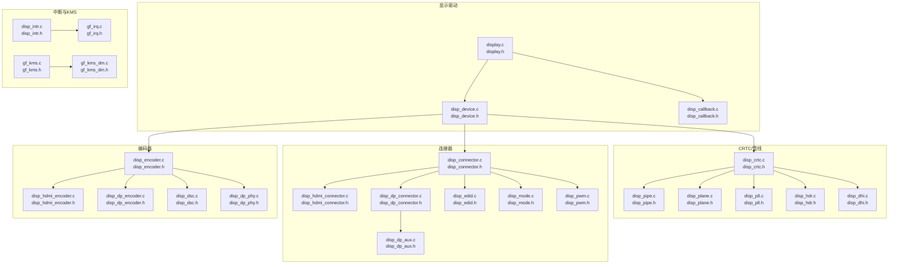
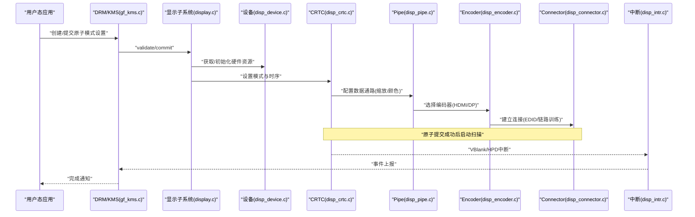
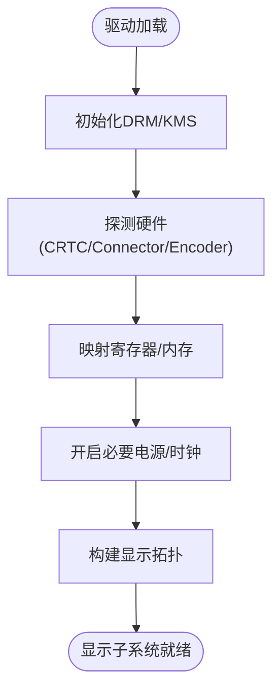
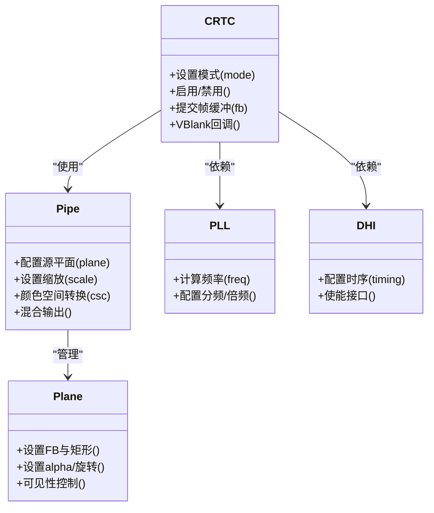
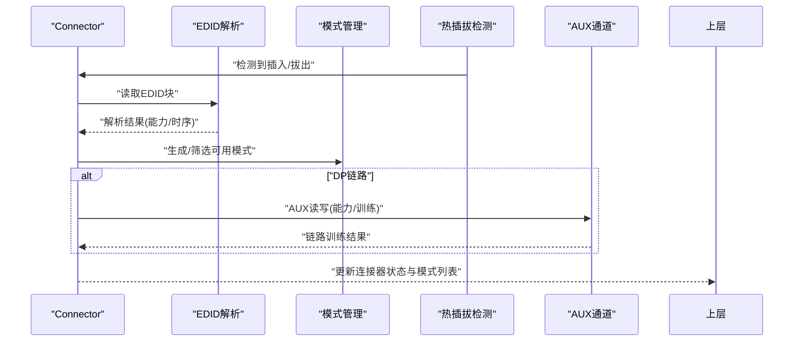
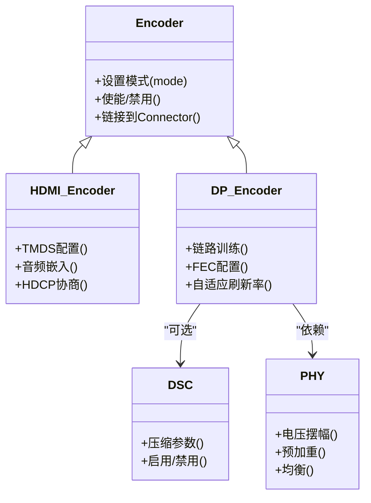
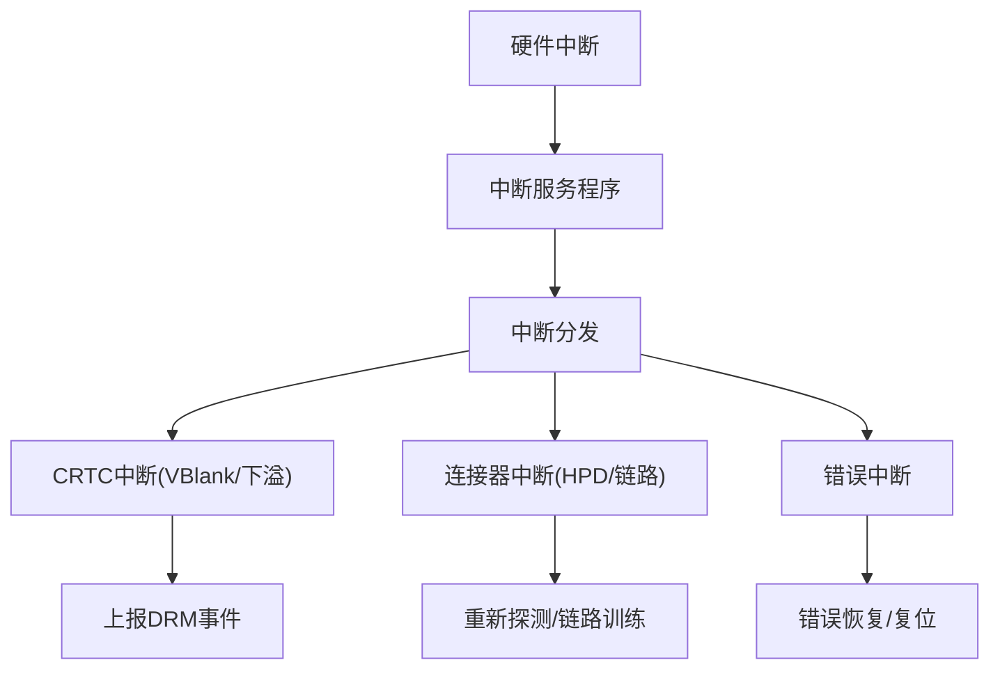
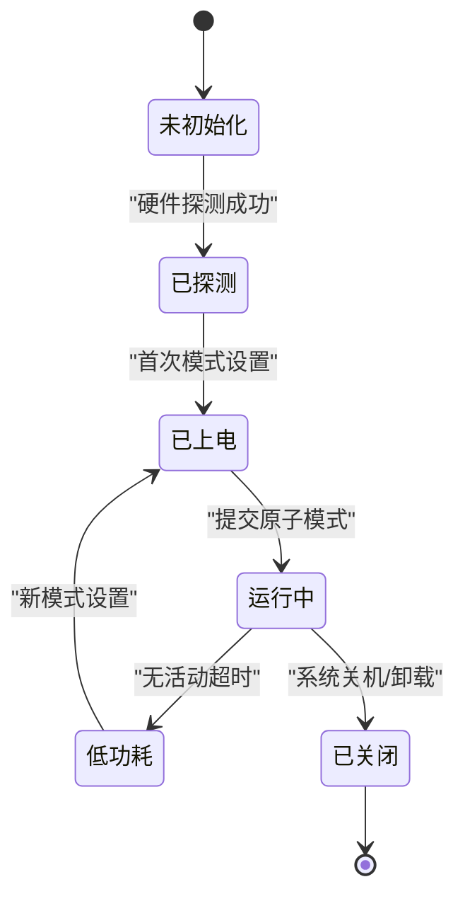
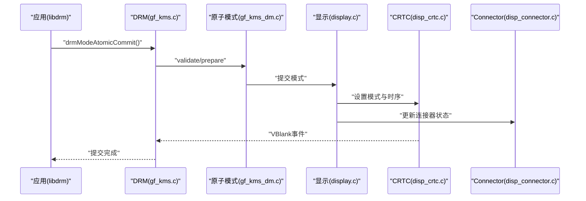
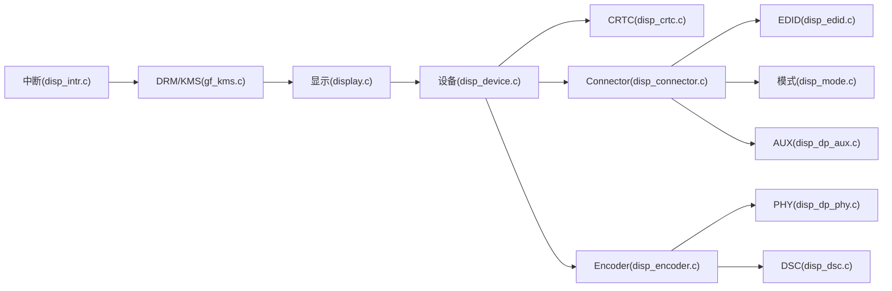

# 显示子系统

<cite>
**本文引用的文件**   
- [display.c](file://_work/src/usr/src/lisuangpu-dkms-262.2.0.56/display/display.c)
- [display.h](file://_work/src/usr/src/lisuangpu-dkms-262.2.0.56/display/display.h)
- [disp_device.c](file://_work/src/usr/src/lisuangpu-dkms-262.2.0.56/display/disp_device.c)
- [disp_device.h](file://_work/src/usr/src/lisuangpu-dkms-262.2.0.56/display/disp_device.h)
- [disp_crtc.c](file://_work/src/usr/src/lisuangpu-dkms-262.2.0.56/display/crtc/disp_crtc.c)
- [disp_crtc.h](file://_work/src/usr/src/lisuangpu-dkms-262.2.0.56/display/crtc/disp_crtc.h)
- [disp_pipe.c](file://_work/src/usr/src/lisuangpu-dkms-262.2.0.56/display/crtc/disp_pipe.c)
- [disp_pipe.h](file://_work/src/usr/src/lisuangpu-dkms-262.2.0.56/display/crtc/disp_pipe.h)
- [disp_plane.c](file://_work/src/usr/src/lisuangpu-dkms-262.2.0.56/display/crtc/disp_plane.c)
- [disp_plane.h](file://_work/src/usr/src/lisuangpu-dkms-262.2.0.56/display/crtc/disp_plane.h)
- [disp_connector.c](file://_work/src/usr/src/lisuangpu-dkms-262.2.0.56/display/connector/disp_connector.c)
- [disp_connector.h](file://_work/src/usr/src/lisuangpu-dkms-262.2.0.56/display/connector/disp_connector.h)
- [disp_hdmi_connector.c](file://_work/src/usr/src/lisuangpu-dkms-262.2.0.56/display/connector/disp_hdmi_connector.c)
- [disp_hdmi_connector.h](file://_work/src/usr/src/lisuangpu-dkms-262.2.0.56/display/connector/disp_hdmi_connector.h)
- [disp_dp_connector.c](file://_work/src/usr/src/lisuangpu-dkms-262.2.0.56/display/connector/disp_dp_connector.c)
- [disp_dp_connector.h](file://_work/src/usr/src/lisuangpu-dkms-262.2.0.56/display/connector/disp_dp_connector.h)
- [disp_edid.c](file://_work/src/usr/src/lisuangpu-dkms-262.2.0.56/display/connector/disp_edid.c)
- [disp_edid.h](file://_work/src/usr/src/lisuangpu-dkms-262.2.0.56/display/connector/disp_edid.h)
- [disp_mode.c](file://_work/src/usr/src/lisuangpu-dkms-262.2.0.56/display/connector/disp_mode.c)
- [disp_mode.h](file://_work/src/usr/src/lisuangpu-dkms-262.2.0.56/display/connector/disp_mode.h)
- [disp_encoder.c](file://_work/src/usr/src/lisuangpu-dkms-262.2.0.56/display/encoder/disp_encoder.c)
- [disp_encoder.h](file://_work/src/usr/src/lisuangpu-dkms-262.2.0.56/display/encoder/disp_encoder.h)
- [disp_hdmi_encoder.c](file://_work/src/usr/src/lisuangpu-dkms-262.2.0.56/display/encoder/disp_hdmi_encoder.c)
- [disp_hdmi_encoder.h](file://_work/src/usr/src/lisuangpu-dkms-262.2.0.56/display/encoder/disp_hdmi_encoder.h)
- [disp_dp_encoder.c](file://_work/src/usr/src/lisuangpu-dkms-262.2.0.56/display/encoder/disp_dp_encoder.c)
- [disp_dp_encoder.h](file://_work/src/usr/src/lisuangpu-dkms-262.2.0.56/display/encoder/disp_dp_encoder.h)
- [disp_dp_aux.c](file://_work/src/usr/src/lisuangpu-dkms-262.2.0.56/display/connector/disp_dp_aux.c)
- [disp_dp_aux.h](file://_work/src/usr/src/lisuangpu-dkms-262.2.0.56/display/connector/disp_dp_aux.h)
- [disp_intr.c](file://_work/src/usr/src/lisuangpu-dkms-262.2.0.56/display/intr/disp_intr.c)
- [disp_intr.h](file://_work/src/usr/src/lisuangpu-dkms-262.2.0.56/display/intr/disp_intr.h)
- [gf_irq.c](file://_work/src/usr/src/lisuangpu-dkms-262.2.0.56/gf_irq.c)
- [gf_irq.h](file://_work/src/usr/src/lisuangpu-dkms-262.2.0.56/gf_irq.h)
- [lisuan_drv.c](file://_work/src/usr/src/lisuangpu-dkms-262.2.0.56/lisuan_drv.c)
- [lisuan_drv.h](file://_work/src/usr/src/lisuangpu-dkms-262.2.0.56/lisuan_drv.h)
- [gf_kms.c](file://_work/src/usr/src/lisuangpu-dkms-262.2.0.56/kms/gf_kms.c)
- [gf_kms.h](file://_work/src/usr/src/lisuangpu-dkms-262.2.0.56/kms/gf_kms.h)
- [gf_kms_dm.c](file://_work/src/usr/src/lisuangpu-dkms-262.2.0.56/kms/gf_kms_dm.c)
- [gf_kms_dm.h](file://_work/src/usr/src/lisuangpu-dkms-262.2.0.56/kms/gf_kms_dm.h)
- [disp_callback.c](file://_work/src/usr/src/lisuangpu-dkms-262.2.0.56/display/disp_callback.c)
- [disp_callback.h](file://_work/src/usr/src/lisuangpu-dkms-262.2.0.56/display/disp_callback.h)
</cite>

## 目录
1. [简介](#简介)
2. [项目结构](#项目结构)
3. [核心组件](#核心组件)
4. [架构总览](#架构总览)
5. [详细组件分析](#详细组件分析)
6. [依赖关系分析](#依赖关系分析)
7. [性能考量](#性能考量)
8. [故障排查指南](#故障排查指南)
9. [结论](#结论)
10. [附录](#附录)

## 简介
本文件面向丽山GPU显示子系统的开发者与维护者，系统性阐述显示核心架构、设备管理、模式设置与连接器处理，覆盖显示管道初始化流程、电源管理与中断处理机制，并给出显示模式配置、EDID解析以及HDMI/DP接口实现要点。文档以代码级视角组织，配合架构图与时序图帮助读者快速定位关键路径与API调用模式。

## 项目结构
显示子系统位于 display 目录下，按功能分层组织：
- display: 顶层驱动入口、设备抽象与回调
- crtc: CRTC、Pipe、Plane、PLL/HDR/DHI等管线相关逻辑
- connector: 连接器（HDMI/DP）、EDID、模式、PWM等
- encoder: 编码器（HDMI/DP）、DSC、PHY等
- intr: 中断处理
- register: 寄存器定义
- vbt: VBT表解析
- kms: DRM/KMS桥接层
- include: 公共头文件与共享结构体

图表来源
- [display.c:1-200](file://_work/src/usr/src/lisuangpu-dkms-262.2.0.56/display/display.c#L1-L200)
- [disp_device.c:1-200](file://_work/src/usr/src/lisuangpu-dkms-262.2.0.56/display/disp_device.c#L1-L200)
- [disp_crtc.c:1-200](file://_work/src/usr/src/lisuangpu-dkms-262.2.0.56/display/crtc/disp_crtc.c#L1-L200)
- [disp_connector.c:1-200](file://_work/src/usr/src/lisuangpu-dkms-262.2.0.56/display/connector/disp_connector.c#L1-L200)
- [disp_encoder.c:1-200](file://_work/src/usr/src/lisuangpu-dkms-262.2.0.56/display/encoder/disp_encoder.c#L1-L200)
- [disp_intr.c:1-200](file://_work/src/usr/src/lisuangpu-dkms-262.2.0.56/display/intr/disp_intr.c#L1-L200)
- [gf_kms.c:1-200](file://_work/src/usr/src/lisuangpu-dkms-262.2.0.56/kms/gf_kms.c#L1-L200)

章节来源
- [display.c:1-200](file://_work/src/usr/src/lisuangpu-dkms-262.2.0.56/display/display.c#L1-L200)
- [disp_device.c:1-200](file://_work/src/usr/src/lisuangpu-dkms-262.2.0.56/display/disp_device.c#L1-L200)

## 核心组件
- 设备与驱动入口
  - 驱动加载与模块初始化由 lisuan_drv.c 负责，注册 DRM/KMS 框架，并初始化显示子系统。
  - display.c/h 提供显示子系统顶层接口，封装设备发现、资源分配与生命周期管理。
  - disp_device.c/h 抽象硬件设备访问、时钟/电源控制、寄存器映射与I/O操作。
- CRTC/管线
  - disp_crtc.c/h 实现CRTC对象，负责扫描出列、时序生成与帧同步。
  - disp_pipe.c/h 描述数据通路（源平面->混合器->输出），包含缩放、色彩空间转换等。
  - disp_plane.c/h 管理叠加平面，支持多平面合成。
  - disp_pll.c/h 与 disp_dhi.c/h 负责像素时钟与显示接口时序。
  - disp_hdr.c/h 处理HDR元数据与色调映射。
- 连接器与模式
  - disp_connector.c/h 抽象连接器基类，统一Hotplug、状态查询、辅助通道等。
  - disp_hdmi_connector.c/h 与 disp_dp_connector.c/h 分别实现HDMI/DP连接器。
  - disp_edid.c/h 解析EDID，提取显示器能力与时序。
  - disp_mode.c/h 维护显示模式集合、验证与时序计算。
  - disp_dp_aux.c/h 提供DisplayPort AUX通道读写。
- 编码器
  - disp_encoder.c/h 抽象编码器接口，封装信号编码与物理层控制。
  - disp_hdmi_encoder.c/h 与 disp_dp_encoder.c/h 分别实现HDMI/DP编码。
  - disp_dsc.c/h 与 disp_dp_phy.c/h 提供DSC压缩与DP物理层控制。
- 中断与KMS
  - disp_intr.c/h 与 gf_irq.c/h 实现中断注册、分发与上下文切换。
  - gf_kms.c/h 与 gf_kms_dm.c/h 对接DRM/KMS，暴露原子API与属性。

章节来源
- [lisuan_drv.c:1-200](file://_work/src/usr/src/lisuangpu-dkms-262.2.0.56/lisuan_drv.c#L1-L200)
- [display.c:1-200](file://_work/src/usr/src/lisuangpu-dkms-262.2.0.56/display/display.c#L1-L200)
- [disp_device.c:1-200](file://_work/src/usr/src/lisuangpu-dkms-262.2.0.56/display/disp_device.c#L1-L200)
- [disp_crtc.c:1-200](file://_work/src/usr/src/lisuangpu-dkms-262.2.0.56/display/crtc/disp_crtc.c#L1-L200)
- [disp_pipe.c:1-200](file://_work/src/usr/src/lisuangpu-dkms-262.2.0.56/display/crtc/disp_pipe.c#L1-L200)
- [disp_plane.c:1-200](file://_work/src/usr/src/lisuangpu-dkms-262.2.0.56/display/crtc/disp_plane.c#L1-L200)
- [disp_connector.c:1-200](file://_work/src/usr/src/lisuangpu-dkms-262.2.0.56/display/connector/disp_connector.c#L1-L200)
- [disp_hdmi_connector.c:1-200](file://_work/src/usr/src/lisuangpu-dkms-262.2.0.56/display/connector/disp_hdmi_connector.c#L1-L200)
- [disp_dp_connector.c:1-200](file://_work/src/usr/src/lisuangpu-dkms-262.2.0.56/display/connector/disp_dp_connector.c#L1-L200)
- [disp_edid.c:1-200](file://_work/src/usr/src/lisuangpu-dkms-262.2.0.56/display/connector/disp_edid.c#L1-L200)
- [disp_mode.c:1-200](file://_work/src/usr/src/lisuangpu-dkms-262.2.0.56/display/connector/disp_mode.c#L1-L200)
- [disp_encoder.c:1-200](file://_work/src/usr/src/lisuangpu-dkms-262.2.0.56/display/encoder/disp_encoder.c#L1-L200)
- [disp_hdmi_encoder.c:1-200](file://_work/src/usr/src/lisuangpu-dkms-262.2.0.56/display/encoder/disp_hdmi_encoder.c#L1-L200)
- [disp_dp_encoder.c:1-200](file://_work/src/usr/src/lisuangpu-dkms-262.2.0.56/display/encoder/disp_dp_encoder.c#L1-L200)
- [disp_dp_aux.c:1-200](file://_work/src/usr/src/lisuangpu-dkms-262.2.0.56/display/connector/disp_dp_aux.c#L1-L200)
- [disp_intr.c:1-200](file://_work/src/usr/src/lisuangpu-dkms-262.2.0.56/display/intr/disp_intr.c#L1-L200)
- [gf_irq.c:1-200](file://_work/src/usr/src/lisuangpu-dkms-262.2.0.56/gf_irq.c#L1-L200)
- [gf_kms.c:1-200](file://_work/src/usr/src/lisuangpu-dkms-262.2.0.56/kms/gf_kms.c#L1-L200)
- [gf_kms_dm.c:1-200](file://_work/src/usr/src/lisuangpu-dkms-262.2.0.56/kms/gf_kms_dm.c#L1-L200)

## 架构总览
显示子系统采用分层设计：上层通过KMS/DRM API发起请求，中间层进行模式验证与原子提交，底层CRTC/PIPE/ENCODER/CONNECTOR协同完成像素流水线与物理输出。

图表来源
- [gf_kms.c:1-200](file://_work/src/usr/src/lisuangpu-dkms-262.2.0.56/kms/gf_kms.c#L1-L200)
- [display.c:1-200](file://_work/src/usr/src/lisuangpu-dkms-262.2.0.56/display/display.c#L1-L200)
- [disp_device.c:1-200](file://_work/src/usr/src/lisuangpu-dkms-262.2.0.56/display/disp_device.c#L1-L200)
- [disp_crtc.c:1-200](file://_work/src/usr/src/lisuangpu-dkms-262.2.0.56/display/crtc/disp_crtc.c#L1-L200)
- [disp_pipe.c:1-200](file://_work/src/usr/src/lisuangpu-dkms-262.2.0.56/display/crtc/disp_pipe.c#L1-L200)
- [disp_encoder.c:1-200](file://_work/src/usr/src/lisuangpu-dkms-262.2.0.56/display/encoder/disp_encoder.c#L1-L200)
- [disp_connector.c:1-200](file://_work/src/usr/src/lisuangpu-dkms-262.2.0.56/display/connector/disp_connector.c#L1-L200)
- [disp_intr.c:1-200](file://_work/src/usr/src/lisuangpu-dkms-262.2.0.56/display/intr/disp_intr.c#L1-L200)

## 详细组件分析

### 设备管理与初始化
- 驱动入口 lisuan_drv.c 负责注册DRM设备、初始化显示子系统、分配中断与内存资源。
- display.c/h 提供显示子系统初始化函数，探测可用CRTC/Connector/Encoder，构建拓扑。
- disp_device.c/h 封装寄存器访问、时钟/电源门控、I/O映射与错误码处理。

图表来源
- [lisuan_drv.c:1-200](file://_work/src/usr/src/lisuangpu-dkms-262.2.0.56/lisuan_drv.c#L1-L200)
- [display.c:1-200](file://_work/src/usr/src/lisuangpu-dkms-262.2.0.56/display/display.c#L1-L200)
- [disp_device.c:1-200](file://_work/src/usr/src/lisuangpu-dkms-262.2.0.56/display/disp_device.c#L1-L200)

章节来源
- [lisuan_drv.c:1-200](file://_work/src/usr/src/lisuangpu-dkms-262.2.0.56/lisuan_drv.c#L1-L200)
- [display.c:1-200](file://_work/src/usr/src/lisuangpu-dkms-262.2.0.56/display/display.c#L1-L200)
- [disp_device.c:1-200](file://_work/src/usr/src/lisuangpu-dkms-262.2.0.56/display/disp_device.c#L1-L200)

### CRTC与显示管道
- CRTC(disp_crtc.c/h) 负责扫描出列、时序参数设置、帧缓冲更新与VBlank事件。
- Pipe(disp_pipe.c/h) 描述数据通路，包括源平面输入、缩放、颜色空间转换与混合。
- Plane(disp_plane.c/h) 管理多个叠加平面，支持alpha、裁剪、旋转等属性。
- PLL(disp_pll.c/h) 与 DHI(disp_dhi.c/h) 负责像素时钟与接口时序。
- HDR(disp_hdr.c/h) 处理HDR元数据与色调映射。

图表来源
- [disp_crtc.c:1-200](file://_work/src/usr/src/lisuangpu-dkms-262.2.0.56/display/crtc/disp_crtc.c#L1-L200)
- [disp_pipe.c:1-200](file://_work/src/usr/src/lisuangpu-dkms-262.2.0.56/display/crtc/disp_pipe.c#L1-L200)
- [disp_plane.c:1-200](file://_work/src/usr/src/lisuangpu-dkms-262.2.0.56/display/crtc/disp_plane.c#L1-L200)
- [disp_pll.c:1-200](file://_work/src/usr/src/lisuangpu-dkms-262.2.0.56/display/crtc/disp_pll.c#L1-L200)
- [disp_dhi.c:1-200](file://_work/src/usr/src/lisuangpu-dkms-262.2.0.56/display/crtc/disp_dhi.c#L1-L200)

章节来源
- [disp_crtc.c:1-200](file://_work/src/usr/src/lisuangpu-dkms-262.2.0.56/display/crtc/disp_crtc.c#L1-L200)
- [disp_pipe.c:1-200](file://_work/src/usr/src/lisuangpu-dkms-262.2.0.56/display/crtc/disp_pipe.c#L1-L200)
- [disp_plane.c:1-200](file://_work/src/usr/src/lisuangpu-dkms-262.2.0.56/display/crtc/disp_plane.c#L1-L200)

### 连接器与模式设置
- Connector(disp_connector.c/h) 抽象通用接口：Hotplug检测、状态查询、辅助通道、属性枚举。
- HDMI连接器(disp_hdmi_connector.c/h) 实现HDMI特性协商、音视频同步、深色度与扩展EDID。
- DP连接器(disp_dp_connector.c/h) 实现链路训练、AUX通信、自适应刷新率。
- EDID(disp_edid.c/h) 解析EDID块，提取显示器能力、标准时序与扩展信息。
- 模式(disp_mode.c/h) 维护模式列表、校验与计算，支持自定义时序。

图表来源
- [disp_connector.c:1-200](file://_work/src/usr/src/lisuangpu-dkms-262.2.0.56/display/connector/disp_connector.c#L1-L200)
- [disp_hdmi_connector.c:1-200](file://_work/src/usr/src/lisuangpu-dkms-262.2.0.56/display/connector/disp_hdmi_connector.c#L1-L200)
- [disp_dp_connector.c:1-200](file://_work/src/usr/src/lisuangpu-dkms-262.2.0.56/display/connector/disp_dp_connector.c#L1-L200)
- [disp_edid.c:1-200](file://_work/src/usr/src/lisuangpu-dkms-262.2.0.56/display/connector/disp_edid.c#L1-L200)
- [disp_mode.c:1-200](file://_work/src/usr/src/lisuangpu-dkms-262.2.0.56/display/connector/disp_mode.c#L1-L200)
- [disp_dp_aux.c:1-200](file://_work/src/usr/src/lisuangpu-dkms-262.2.0.56/display/connector/disp_dp_aux.c#L1-L200)

章节来源
- [disp_connector.c:1-200](file://_work/src/usr/src/lisuangpu-dkms-262.2.0.56/display/connector/disp_connector.c#L1-L200)
- [disp_hdmi_connector.c:1-200](file://_work/src/usr/src/lisuangpu-dkms-262.2.0.56/display/connector/disp_hdmi_connector.c#L1-L200)
- [disp_dp_connector.c:1-200](file://_work/src/usr/src/lisuangpu-dkms-262.2.0.56/display/connector/disp_dp_connector.c#L1-L200)
- [disp_edid.c:1-200](file://_work/src/usr/src/lisuangpu-dkms-262.2.0.56/display/connector/disp_edid.c#L1-L200)
- [disp_mode.c:1-200](file://_work/src/usr/src/lisuangpu-dkms-262.2.0.56/display/connector/disp_mode.c#L1-L200)
- [disp_dp_aux.c:1-200](file://_work/src/usr/src/lisuangpu-dkms-262.2.0.56/display/connector/disp_dp_aux.c#L1-L200)

### 编码器与物理层
- Encoder(disp_encoder.c/h) 抽象编码接口，统一HDMI/DP的时序与信号配置。
- HDMI编码器(disp_hdmi_encoder.c/h) 实现TMDS编码、音频嵌入、HDCP协商。
- DP编码器(disp_dp_encoder.c/h) 实现LTTPR、FEC、自适应刷新率。
- DSC(disp_dsc.c/h) 提供显示流压缩以降低带宽需求。
- PHY(disp_dp_phy.c/h) 控制DP物理层参数（电压摆幅、预加重等）。

图表来源
- [disp_encoder.c:1-200](file://_work/src/usr/src/lisuangpu-dkms-262.2.0.56/display/encoder/disp_encoder.c#L1-L200)
- [disp_hdmi_encoder.c:1-200](file://_work/src/usr/src/lisuangpu-dkms-262.2.0.56/display/encoder/disp_hdmi_encoder.c#L1-L200)
- [disp_dp_encoder.c:1-200](file://_work/src/usr/src/lisuangpu-dkms-262.2.0.56/display/encoder/disp_dp_encoder.c#L1-L200)
- [disp_dsc.c:1-200](file://_work/src/usr/src/lisuangpu-dkms-262.2.0.56/display/encoder/disp_dsc.c#L1-L200)
- [disp_dp_phy.c:1-200](file://_work/src/usr/src/lisuangpu-dkms-262.2.0.56/display/encoder/disp_dp_phy.c#L1-L200)

章节来源
- [disp_encoder.c:1-200](file://_work/src/usr/src/lisuangpu-dkms-262.2.0.56/display/encoder/disp_encoder.c#L1-L200)
- [disp_hdmi_encoder.c:1-200](file://_work/src/usr/src/lisuangpu-dkms-262.2.0.56/display/encoder/disp_hdmi_encoder.c#L1-L200)
- [disp_dp_encoder.c:1-200](file://_work/src/usr/src/lisuangpu-dkms-262.2.0.56/display/encoder/disp_dp_encoder.c#L1-L200)
- [disp_dsc.c:1-200](file://_work/src/usr/src/lisuangpu-dkms-262.2.0.56/display/encoder/disp_dsc.c#L1-L200)
- [disp_dp_phy.c:1-200](file://_work/src/usr/src/lisuangpu-dkms-262.2.0.56/display/encoder/disp_dp_phy.c#L1-L200)

### 中断处理机制
- disp_intr.c/h 负责中断注册、屏蔽/使能、ISR分发与上下文保存恢复。
- gf_irq.c/h 提供通用中断服务，将显示中断路由至对应模块（CRTC/Connector/Encoder）。
- 典型中断类型：VBlank、HPD、链路训练完成、错误异常。

图表来源
- [disp_intr.c:1-200](file://_work/src/usr/src/lisuangpu-dkms-262.2.0.56/display/intr/disp_intr.c#L1-L200)
- [gf_irq.c:1-200](file://_work/src/usr/src/lisuangpu-dkms-262.2.0.56/gf_irq.c#L1-L200)

章节来源
- [disp_intr.c:1-200](file://_work/src/usr/src/lisuangpu-dkms-262.2.0.56/display/intr/disp_intr.c#L1-L200)
- [gf_irq.c:1-200](file://_work/src/usr/src/lisuangpu-dkms-262.2.0.56/gf_irq.c#L1-L200)

### 电源管理与回调
- 电源管理贯穿设备初始化、模式切换与空闲休眠，确保按需上电/断电。
- disp_callback.c/h 提供回调钩子，用于在关键阶段执行定制逻辑（如固件加载、寄存器初始化）。

图表来源
- [disp_device.c:1-200](file://_work/src/usr/src/lisuangpu-dkms-262.2.0.56/display/disp_device.c#L1-L200)
- [disp_callback.c:1-200](file://_work/src/usr/src/lisuangpu-dkms-262.2.0.56/display/disp_callback.c#L1-L200)

章节来源
- [disp_device.c:1-200](file://_work/src/usr/src/lisuangpu-dkms-262.2.0.56/display/disp_device.c#L1-L200)
- [disp_callback.c:1-200](file://_work/src/usr/src/lisuangpu-dkms-262.2.0.56/display/disp_callback.c#L1-L200)

### KMS/DRM集成与API调用模式
- gf_kms.c/h 与 gf_kms_dm.c/h 实现DRM/KMS接口，暴露原子模式设置、属性查询与事件上报。
- 典型调用序列：用户态通过libdrm调用内核DRM，进入gf_kms，再调用display子系统完成模式设置。

图表来源
- [gf_kms.c:1-200](file://_work/src/usr/src/lisuangpu-dkms-262.2.0.56/kms/gf_kms.c#L1-L200)
- [gf_kms_dm.c:1-200](file://_work/src/usr/src/lisuangpu-dkms-262.2.0.56/kms/gf_kms_dm.c#L1-L200)
- [display.c:1-200](file://_work/src/usr/src/lisuangpu-dkms-262.2.0.56/display/display.c#L1-L200)
- [disp_crtc.c:1-200](file://_work/src/usr/src/lisuangpu-dkms-262.2.0.56/display/crtc/disp_crtc.c#L1-L200)
- [disp_connector.c:1-200](file://_work/src/usr/src/lisuangpu-dkms-262.2.0.56/display/connector/disp_connector.c#L1-L200)

章节来源
- [gf_kms.c:1-200](file://_work/src/usr/src/lisuangpu-dkms-262.2.0.56/kms/gf_kms.c#L1-L200)
- [gf_kms_dm.c:1-200](file://_work/src/usr/src/lisuangpu-dkms-262.2.0.56/kms/gf_kms_dm.c#L1-L200)
- [display.c:1-200](file://_work/src/usr/src/lisuangpu-dkms-262.2.0.56/display/display.c#L1-L200)

## 依赖关系分析
- 模块耦合
  - display.c 依赖 disp_device.c 进行硬件抽象；CRTC/Connector/Encoder 通过 disp_device.c 访问寄存器与电源。
  - Connector 依赖 EDID/MODE/AUX；Encoder 依赖 PHY/DSC。
  - 中断模块 disp_intr.c 与 gf_irq.c 为各模块提供统一中断服务。
- 外部依赖
  - DRM/KMS框架（gf_kms.c/h）作为用户态与内核态的桥梁。
  - 硬件寄存器定义位于 register 目录，供各模块直接访问。

图表来源
- [gf_kms.c:1-200](file://_work/src/usr/src/lisuangpu-dkms-262.2.0.56/kms/gf_kms.c#L1-L200)
- [display.c:1-200](file://_work/src/usr/src/lisuangpu-dkms-262.2.0.56/display/display.c#L1-L200)
- [disp_device.c:1-200](file://_work/src/usr/src/lisuangpu-dkms-262.2.0.56/display/disp_device.c#L1-L200)
- [disp_crtc.c:1-200](file://_work/src/usr/src/lisuangpu-dkms-262.2.0.56/display/crtc/disp_crtc.c#L1-L200)
- [disp_connector.c:1-200](file://_work/src/usr/src/lisuangpu-dkms-262.2.0.56/display/connector/disp_connector.c#L1-L200)
- [disp_encoder.c:1-200](file://_work/src/usr/src/lisuangpu-dkms-262.2.0.56/display/encoder/disp_encoder.c#L1-L200)
- [disp_edid.c:1-200](file://_work/src/usr/src/lisuangpu-dkms-262.2.0.56/display/connector/disp_edid.c#L1-L200)
- [disp_mode.c:1-200](file://_work/src/usr/src/lisuangpu-dkms-262.2.0.56/display/connector/disp_mode.c#L1-L200)
- [disp_dp_aux.c:1-200](file://_work/src/usr/src/lisuangpu-dkms-262.2.0.56/display/connector/disp_dp_aux.c#L1-L200)
- [disp_dp_phy.c:1-200](file://_work/src/usr/src/lisuangpu-dkms-262.2.0.56/display/encoder/disp_dp_phy.c#L1-L200)
- [disp_dsc.c:1-200](file://_work/src/usr/src/lisuangpu-dkms-262.2.0.56/display/encoder/disp_dsc.c#L1-L200)
- [disp_intr.c:1-200](file://_work/src/usr/src/lisuangpu-dkms-262.2.0.56/display/intr/disp_intr.c#L1-L200)

章节来源
- [gf_kms.c:1-200](file://_work/src/usr/src/lisuangpu-dkms-262.2.0.56/kms/gf_kms.c#L1-L200)
- [display.c:1-200](file://_work/src/usr/src/lisuangpu-dkms-262.2.0.56/display/display.c#L1-L200)
- [disp_device.c:1-200](file://_work/src/usr/src/lisuangpu-dkms-262.2.0.56/display/disp_device.c#L1-L200)

## 性能考量
- 模式验证与原子提交应尽量减少寄存器写入次数，合并批量更新。
- 使用DSC降低高带宽需求，尤其在高分辨率/高刷新率场景。
- 合理配置PLL分频与PHY参数，避免抖动与信号完整性问题。
- 中断处理需轻量化，避免阻塞关键路径；将耗时工作移至下半部或工作队列。
- 电源管理按需开关，减少空闲功耗；热点路径缓存常用配置。

[本节为通用指导，不直接分析具体文件]

## 故障排查指南
- 无输出/黑屏
  - 检查连接器状态与EDID解析是否成功；确认HPD中断是否正常触发。
  - 查看CRTC模式设置是否通过验证；确认编码器与PHY参数匹配。
- 闪烁/撕裂
  - 检查VBlank同步与帧缓冲提交时机；确认原子提交顺序正确。
  - 调整PLL与时序参数，避免过高的像素时钟。
- 链路训练失败(DP)
  - 检查AUX通道读写是否成功；确认线缆质量与端口能力。
  - 逐步降低速率/ lanes 数进行降级训练。
- 中断风暴/丢失
  - 检查中断屏蔽/使能逻辑；确认ISR中及时清除标志位。
  - 避免在中断上下文中执行长时间操作。

章节来源
- [disp_connector.c:1-200](file://_work/src/usr/src/lisuangpu-dkms-262.2.0.56/display/connector/disp_connector.c#L1-L200)
- [disp_edid.c:1-200](file://_work/src/usr/src/lisuangpu-dkms-262.2.0.56/display/connector/disp_edid.c#L1-L200)
- [disp_crtc.c:1-200](file://_work/src/usr/src/lisuangpu-dkms-262.2.0.56/display/crtc/disp_crtc.c#L1-L200)
- [disp_dp_encoder.c:1-200](file://_work/src/usr/src/lisuangpu-dkms-262.2.0.56/display/encoder/disp_dp_encoder.c#L1-L200)
- [disp_dp_aux.c:1-200](file://_work/src/usr/src/lisuangpu-dkms-262.2.0.56/display/connector/disp_dp_aux.c#L1-L200)
- [disp_intr.c:1-200](file://_work/src/usr/src/lisuangpu-dkms-262.2.0.56/display/intr/disp_intr.c#L1-L200)

## 结论
丽山GPU显示子系统采用清晰的分层架构，通过DRM/KMS暴露原子API，结合CRTC/Pipe/Plane/Encoder/Connector等模块完成显示流水线。EDID解析、HDMI/DP接口实现与中断处理机制共同保障稳定可靠的输出。遵循本文档的架构说明与最佳实践，可高效开发与维护显示功能。

[本节为总结，不直接分析具体文件]

## 附录
- 常见API调用模式
  - 初始化：驱动加载 -> 探测硬件 -> 映射寄存器 -> 上电 -> 构建拓扑
  - 模式设置：用户态drmModeAtomicCommit -> DRM验证 -> 提交 -> CRTC设置 -> 启动扫描
  - 事件处理：VBlank/HPD中断 -> 分发 -> 上报DRM事件 -> 用户态回调
- 调试建议
  - 启用日志与trace点，关注关键路径返回值
  - 使用dmesg与debugfs查看连接器状态与模式列表
  - 针对DP链路训练，记录AUX读写日志与训练步骤

[本节为补充信息，不直接分析具体文件]