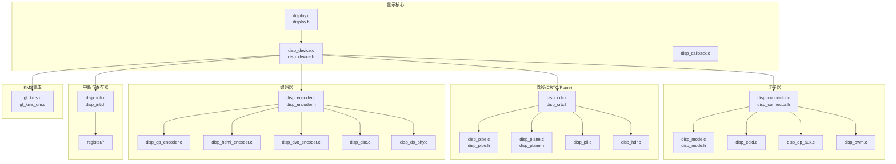
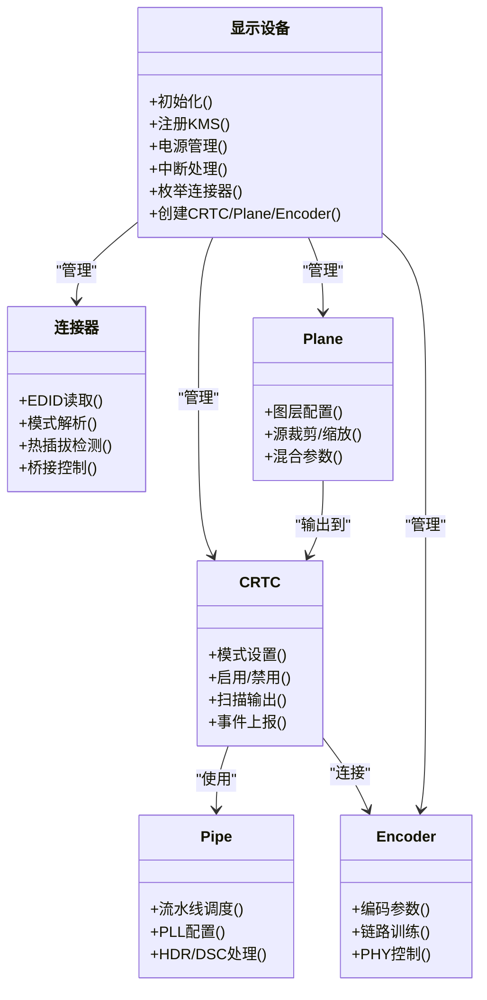
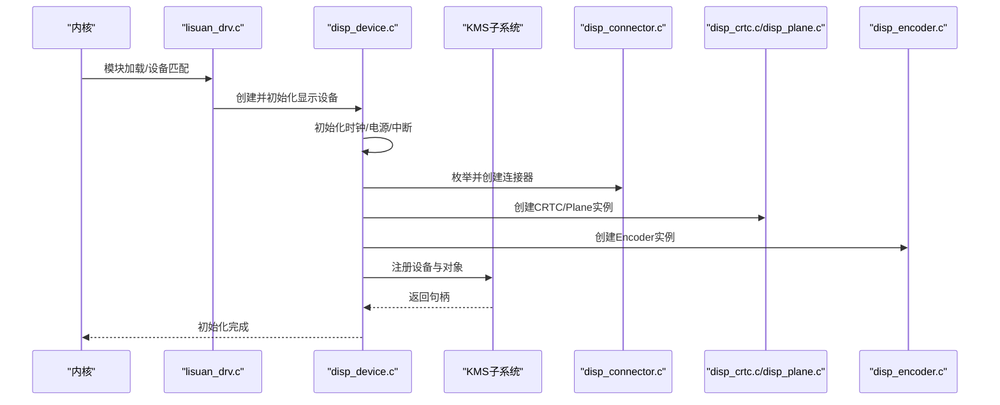
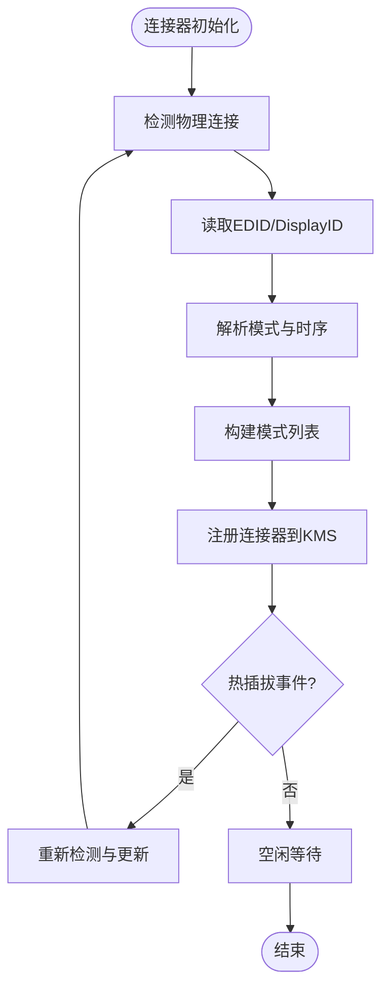
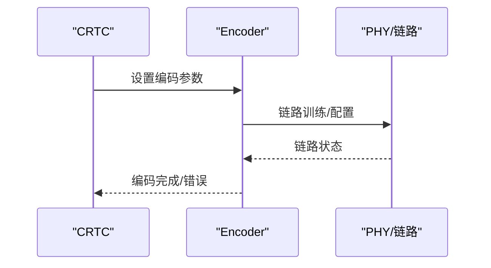
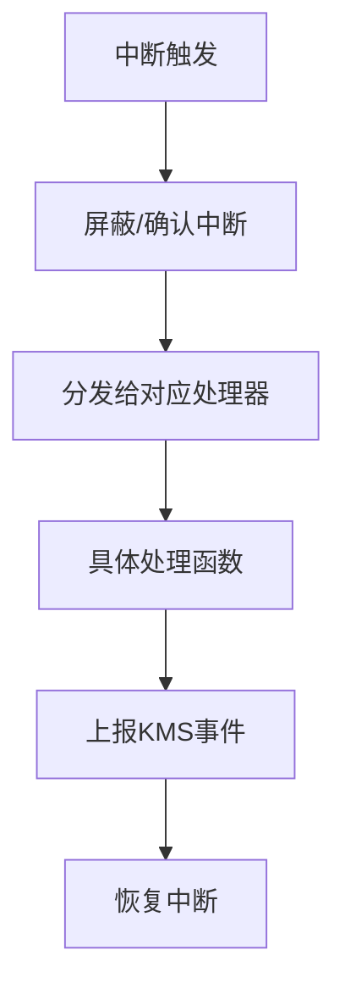
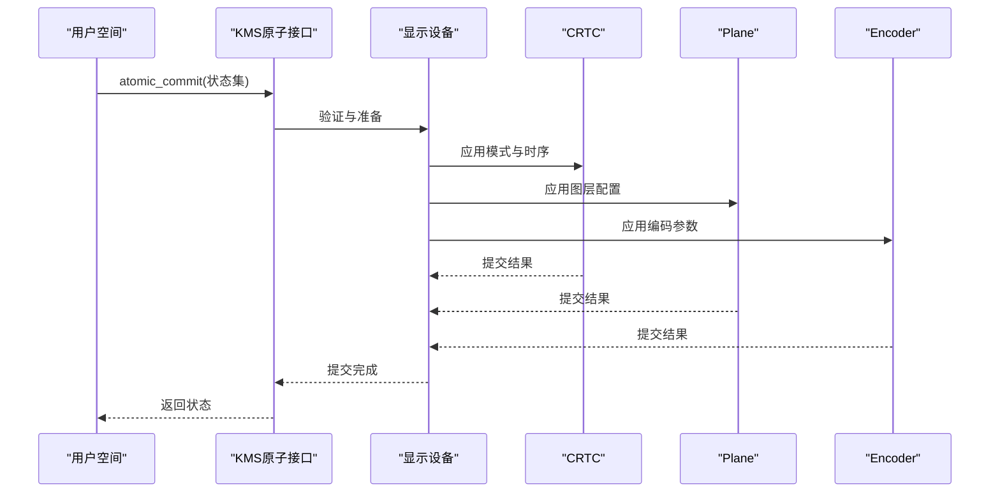
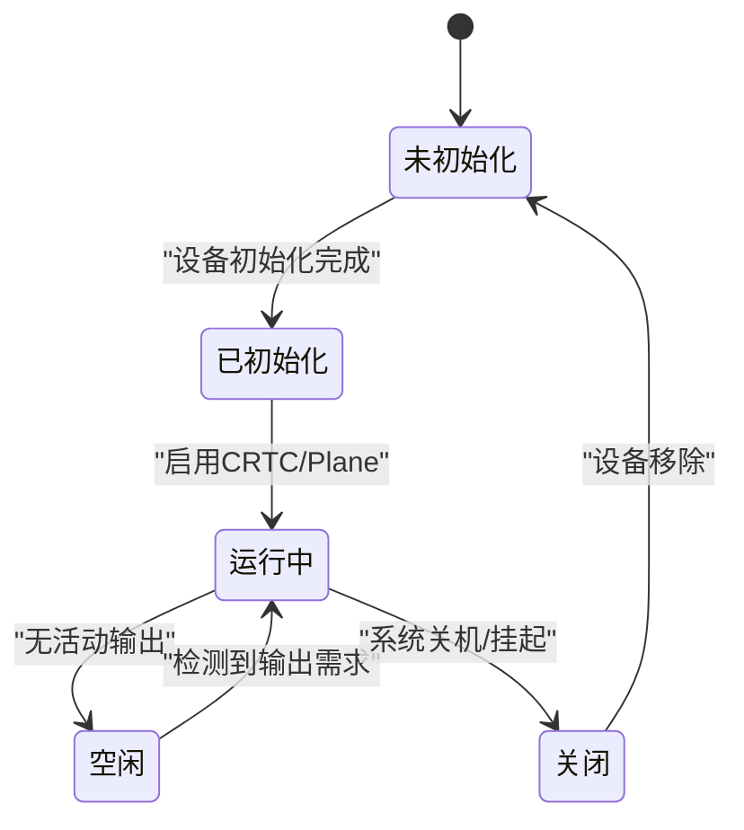
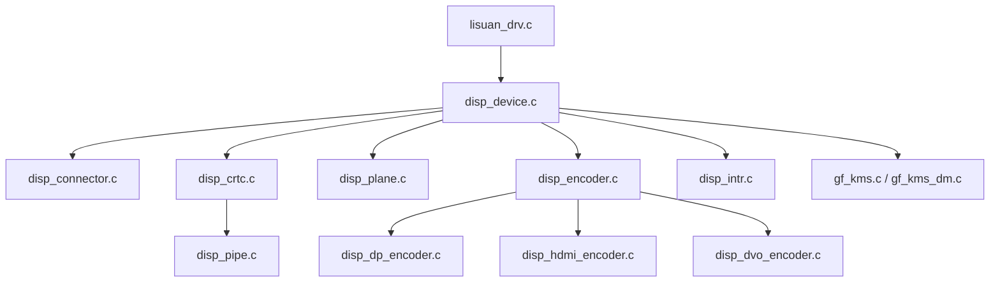

# 显示核心架构

<cite>
**本文档引用的文件**   
- [display.c](file://_work/src/usr/src/lisuanpu-dkms-262.2.0.56/display/display.c)
- [display.h](file://_work/src/usr/src/lisuanpu-dkms-262.2.0.56/display/display.h)
- [disp_device.c](file://_work/src/usr/src/lisuanpu-dkms-262.2.0.56/display/disp_device.c)
- [disp_device.h](file://_work/src/usr/src/lisuanpu-dkms-262.2.0.56/display/disp_device.h)
- [disp_connector.c](file://_work/src/usr/src/lisuanpu-dkms-262.2.0.56/display/connector/disp_connector.c)
- [disp_connector.h](file://_work/src/usr/src/lisuanpu-dkms-262.2.0.56/display/connector/disp_connector.h)
- [disp_crtc.c](file://_work/src/usr/src/lisuanpu-dkms-262.2.0.56/display/crtc/disp_crtc.c)
- [disp_crtc.h](file://_work/src/usr/src/lisuanpu-dkms-262.2.0.56/display/crtc/disp_crtc.h)
- [disp_pipe.c](file://_work/src/usr/src/lisuanpu-dkms-262.2.0.56/display/crtc/disp_pipe.c)
- [disp_pipe.h](file://_work/src/usr/src/lisuanpu-dkms-262.2.0.56/display/crtc/disp_pipe.h)
- [disp_plane.c](file://_work/src/usr/src/lisuanpu-dkms-262.2.0.56/display/crtc/disp_plane.c)
- [disp_plane.h](file://_work/src/usr/src/lisuanpu-dkms-262.2.0.56/display/crtc/disp_plane.h)
- [disp_encoder.c](file://_work/src/usr/src/lisuanpu-dkms-262.2.0.56/display/encoder/disp_encoder.c)
- [disp_encoder.h](file://_work/src/usr/src/lisuanpu-dkms-262.2.0.56/display/encoder/disp_encoder.h)
- [disp_dp_encoder.c](file://_work/src/usr/src/lisuanpu-dkms-262.2.0.56/display/encoder/disp_dp_encoder.c)
- [disp_hdmi_encoder.c](file://_work/src/usr/src/lisuanpu-dkms-262.2.0.56/display/encoder/disp_hdmi_encoder.c)
- [disp_dvo_encoder.c](file://_work/src/usr/src/lisuanpu-dkms-262.2.0.56/display/encoder/disp_dvo_encoder.c)
- [disp_mode.c](file://_work/src/usr/src/lisuanpu-dkms-262.2.0.56/display/connector/disp_mode.c)
- [disp_mode.h](file://_work/src/usr/src/lisuanpu-dkms-262.2.0.56/display/connector/disp_mode.h)
- [disp_intr.c](file://_work/src/usr/src/lisuanpu-dkms-262.2.0.56/display/intr/disp_intr.c)
- [disp_intr.h](file://_work/src/usr/src/lisuanpu-dkms-262.2.0.56/display/intr/disp_intr.h)
- [lisuan_drv.c](file://_work/src/usr/src/lisuanpu-dkms-262.2.0.56/lisuan_drv.c)
- [lisuan_device.c](file://_work/src/usr/src/lisuanpu-dkms-262.2.0.56/lisuan_device.c)
- [gf_kms.c](file://_work/src/usr/src/lisuanpu-dkms-262.2.0.56/kms/gf_kms.c)
- [gf_kms_dm.c](file://_work/src/usr/src/lisuanpu-dkms-262.2.0.56/kms/gf_kms_dm.c)
</cite>

## 目录
1. [简介](#简介)
2. [项目结构](#项目结构)
3. [核心组件](#核心组件)
4. [架构总览](#架构总览)
5. [详细组件分析](#详细组件分析)
6. [依赖关系分析](#依赖关系分析)
7. [性能考量](#性能考量)
8. [故障排查指南](#故障排查指南)
9. [结论](#结论)
10. [附录](#附录)

## 简介
本文件面向丽山GPU显示子系统的内核驱动与KMS集成，系统性阐述整体设计模式、设备初始化流程、核心数据结构与关键接口。重点覆盖：
- 显示设备的注册机制与生命周期管理
- 电源管理与中断处理框架
- 显示管道抽象层（CRTC/Plane/Encoder/Connector）及模式设置接口
- 连接器管理架构（HDMI/DP/DVO等）
- 扩展新显示设备与实现自定义功能的实践指引

## 项目结构
显示子系统按功能分层组织，主要目录包括：
- display: 显示核心与通用逻辑（设备、回调、公共模块）
- connector: 连接器与EDID/DisplayID、模式解析、PWM控制
- crtc: CRTC、Pipe、Plane、PLL/HDR等管线相关
- encoder: 编码器与PHY、DSC等编码链路
- intr: 中断处理
- register: 寄存器定义
- kms: KMS接口与原子模式设置、HDR、CRC等
- include: 头文件与共享定义

**图表来源** 
- [display.c](file://_work/src/usr/src/lisuanpu-dkms-262.2.0.56/display/display.c)
- [disp_device.c](file://_work/src/usr/src/lisuanpu-dkms-262.2.0.56/display/disp_device.c)
- [disp_connector.c](file://_work/src/usr/src/lisuanpu-dkms-262.2.0.56/display/connector/disp_connector.c)
- [disp_mode.c](file://_work/src/usr/src/lisuanpu-dkms-262.2.0.56/display/connector/disp_mode.c)
- [disp_crtc.c](file://_work/src/usr/src/lisuanpu-dkms-262.2.0.56/display/crtc/disp_crtc.c)
- [disp_pipe.c](file://_work/src/usr/src/lisuanpu-dkms-262.2.0.56/display/crtc/disp_pipe.c)
- [disp_plane.c](file://_work/src/usr/src/lisuanpu-dkms-262.2.0.56/display/crtc/disp_plane.c)
- [disp_encoder.c](file://_work/src/usr/src/lisuanpu-dkms-262.2.0.56/display/encoder/disp_encoder.c)
- [disp_dp_encoder.c](file://_work/src/usr/src/lisuanpu-dkms-262.2.0.56/display/encoder/disp_dp_encoder.c)
- [disp_hdmi_encoder.c](file://_work/src/usr/src/lisuanpu-dkms-262.2.0.56/display/encoder/disp_hdmi_encoder.c)
- [disp_dvo_encoder.c](file://_work/src/usr/src/lisuanpu-dkms-262.2.0.56/display/encoder/disp_dvo_encoder.c)
- [disp_mode.c](file://_work/src/usr/src/lisuanpu-dkms-262.2.0.56/display/connector/disp_mode.c)
- [disp_intr.c](file://_work/src/usr/src/lisuanpu-dkms-262.2.0.56/display/intr/disp_intr.c)
- [gf_kms.c](file://_work/src/usr/src/lisuanpu-dkms-262.2.0.56/kms/gf_kms.c)
- [gf_kms_dm.c](file://_work/src/usr/src/lisuanpu-dkms-262.2.0.56/kms/gf_kms_dm.c)

**章节来源**
- [display.c](file://_work/src/usr/src/lisuanpu-dkms-262.2.0.56/display/display.c)
- [disp_device.c](file://_work/src/usr/src/lisuanpu-dkms-262.2.0.56/display/disp_device.c)
- [disp_connector.c](file://_work/src/usr/src/lisuanpu-dkms-262.2.0.56/display/connector/disp_connector.c)
- [disp_mode.c](file://_work/src/usr/src/lisuanpu-dkms-262.2.0.56/display/connector/disp_mode.c)
- [disp_crtc.c](file://_work/src/usr/src/lisuanpu-dkms-262.2.0.56/display/crtc/disp_crtc.c)
- [disp_pipe.c](file://_work/src/usr/src/lisuanpu-dkms-262.2.0.56/display/crtc/disp_pipe.c)
- [disp_plane.c](file://_work/src/usr/src/lisuanpu-dkms-262.2.0.56/display/crtc/disp_plane.c)
- [disp_encoder.c](file://_work/src/usr/src/lisuanpu-dkms-262.2.0.56/display/encoder/disp_encoder.c)
- [disp_dp_encoder.c](file://_work/src/usr/src/lisuanpu-dkms-262.2.0.56/display/encoder/disp_dp_encoder.c)
- [disp_hdmi_encoder.c](file://_work/src/usr/src/lisuanpu-dkms-262.2.0.56/display/encoder/disp_hdmi_encoder.c)
- [disp_dvo_encoder.c](file://_work/src/usr/src/lisuanpu-dkms-262.2.0.56/display/encoder/disp_dvo_encoder.c)
- [disp_mode.c](file://_work/src/usr/src/lisuanpu-dkms-262.2.0.56/display/connector/disp_mode.c)
- [disp_intr.c](file://_work/src/usr/src/lisuanpu-dkms-262.2.0.56/display/intr/disp_intr.c)
- [gf_kms.c](file://_work/src/usr/src/lisuanpu-dkms-262.2.0.56/kms/gf_kms.c)
- [gf_kms_dm.c](file://_work/src/usr/src/lisuanpu-dkms-262.2.0.56/kms/gf_kms_dm.c)

## 核心组件
- 设备与驱动入口
  - 驱动加载与设备发现由驱动入口完成，随后创建并注册显示设备对象，完成资源分配、时钟/电源域初始化、中断注册与KMS对象构建。
  - 显示设备对象封装了CRTC/Plane/Encoder/Connector的集合以及全局状态机、锁与事件队列。
- 连接器(Connector)
  - 负责物理接口的枚举、EDID/DisplayID读取、热插拔检测、模式列表生成与桥接芯片控制。
  - 支持多种接口类型（HDMI、DP、DVO），通过统一的连接器接口进行抽象。
- 管线(CRTC/Plane/Pipe)
  - CRTC负责时序生成与扫描输出；Plane提供图层叠加能力；Pipe作为底层硬件流水线的抽象，协调CRTC与Plane。
  - 包含PLL配置、HDR处理、DSC压缩等可选功能。
- 编码器(Encoder)
  - 将像素数据转换为特定物理介质信号（如DP/HDMI），负责编码参数、链路训练与PHY控制。
- 中断与电源管理
  - 中断框架统一注册、分发与清理，屏蔽/使能特定事件，上报KMS事件。
  - 电源管理策略涵盖设备上下电、时钟门控、低功耗唤醒路径。
- KMS集成
  - 暴露KMS接口，实现原子模式设置、属性查询、FB/BO绑定、页面翻转与同步。

**章节来源**
- [lisuan_drv.c](file://_work/src/usr/src/lisuanpu-dkms-262.2.0.56/lisuan_drv.c)
- [lisuan_device.c](file://_work/src/usr/src/lisuanpu-dkms-262.2.0.56/lisuan_device.c)
- [display.c](file://_work/src/usr/src/lisuanpu-dkms-262.2.0.56/display/display.c)
- [disp_device.c](file://_work/src/usr/src/lisuanpu-dkms-262.2.0.56/display/disp_device.c)
- [disp_connector.c](file://_work/src/usr/src/lisuanpu-dkms-262.2.0.56/display/connector/disp_connector.c)
- [disp_crtc.c](file://_work/src/usr/src/lisuanpu-dkms-262.2.0.56/display/crtc/disp_crtc.c)
- [disp_pipe.c](file://_work/src/usr/src/lisuanpu-dkms-262.2.0.56/display/crtc/disp_pipe.c)
- [disp_plane.c](file://_work/src/usr/src/lisuanpu-dkms-262.2.0.56/display/crtc/disp_plane.c)
- [disp_encoder.c](file://_work/src/usr/src/lisuanpu-dkms-262.2.0.56/display/encoder/disp_encoder.c)
- [disp_intr.c](file://_work/src/usr/src/lisuanpu-dkms-262.2.0.56/display/intr/disp_intr.c)
- [gf_kms.c](file://_work/src/usr/src/lisuanpu-dkms-262.2.0.56/kms/gf_kms.c)
- [gf_kms_dm.c](file://_work/src/usr/src/lisuanpu-dkms-262.2.0.56/kms/gf_kms_dm.c)

## 架构总览
显示子系统采用“设备-连接器-CRTC-Plane-Encoder”的分层模型，结合KMS原子API实现跨设备的一致性操作。

**图表来源** 
- [disp_device.c](file://_work/src/usr/src/lisuanpu-dkms-262.2.0.56/display/disp_device.c)
- [disp_connector.c](file://_work/src/usr/src/lisuanpu-dkms-262.2.0.56/display/connector/disp_connector.c)
- [disp_crtc.c](file://_work/src/usr/src/lisuanpu-dkms-262.2.0.56/display/crtc/disp_crtc.c)
- [disp_plane.c](file://_work/src/usr/src/lisuanpu-dkms-262.2.0.56/display/crtc/disp_plane.c)
- [disp_encoder.c](file://_work/src/usr/src/lisuanpu-dkms-262.2.0.56/display/encoder/disp_encoder.c)
- [disp_pipe.c](file://_work/src/usr/src/lisuanpu-dkms-262.2.0.56/display/crtc/disp_pipe.c)

## 详细组件分析

### 设备初始化与注册流程
- 驱动入口完成PCI/平台设备探测，分配并初始化显示设备对象。
- 初始化时钟、电源域、内存映射、中断向量表。
- 枚举所有连接器，创建对应的CRTC/Plane/Encoder实例，建立拓扑关系。
- 向KMS子系统注册设备与对象，暴露属性与接口。

**图表来源** 
- [lisuan_drv.c](file://_work/src/usr/src/lisuanpu-dkms-262.2.0.56/lisuan_drv.c)
- [lisuan_device.c](file://_work/src/usr/src/lisuanpu-dkms-262.2.0.56/lisuan_device.c)
- [disp_device.c](file://_work/src/usr/src/lisuanpu-dkms-262.2.0.56/display/disp_device.c)
- [disp_connector.c](file://_work/src/usr/src/lisuanpu-dkms-262.2.0.56/display/connector/disp_connector.c)
- [disp_crtc.c](file://_work/src/usr/src/lisuanpu-dkms-262.2.0.56/display/crtc/disp_crtc.c)
- [disp_plane.c](file://_work/src/usr/src/lisuanpu-dkms-262.2.0.56/display/crtc/disp_plane.c)
- [disp_encoder.c](file://_work/src/usr/src/lisuanpu-dkms-262.2.0.56/display/encoder/disp_encoder.c)

**章节来源**
- [lisuan_drv.c](file://_work/src/usr/src/lisuanpu-dkms-262.2.0.56/lisuan_drv.c)
- [lisuan_device.c](file://_work/src/usr/src/lisuanpu-dkms-262.2.0.56/lisuan_device.c)
- [disp_device.c](file://_work/src/usr/src/lisuanpu-dkms-262.2.0.56/display/disp_device.c)

### 连接器管理架构
- 统一连接器接口，支持HDMI/DP/DVO等多种物理接口。
- EDID/DisplayID解析，生成模式列表，处理热插拔事件。
- 桥接芯片控制（如DP MST、HDMI音频/CEC）。

**图表来源** 
- [disp_connector.c](file://_work/src/usr/src/lisuanpu-dkms-262.2.0.56/display/connector/disp_connector.c)
- [disp_mode.c](file://_work/src/usr/src/lisuanpu-dkms-262.2.0.56/display/connector/disp_mode.c)

**章节来源**
- [disp_connector.c](file://_work/src/usr/src/lisuanpu-dkms-262.2.0.56/display/connector/disp_connector.c)
- [disp_mode.c](file://_work/src/usr/src/lisuanpu-dkms-262.2.0.56/display/connector/disp_mode.c)

### 显示管道抽象层（CRTC/Plane/Pipe）
- CRTC负责时序与扫描输出，Plane提供图层叠加与变换，Pipe抽象底层流水线。
- 模式设置接口遵循KMS原子API，确保多对象一致性更新。

**图表来源** 
- [disp_crtc.c](file://_work/src/usr/src/lisuanpu-dkms-262.2.0.56/display/crtc/disp_crtc.c)
- [disp_plane.c](file://_work/src/usr/src/lisuanpu-dkms-262.2.0.56/display/crtc/disp_plane.c)
- [disp_pipe.c](file://_work/src/usr/src/lisuanpu-dkms-262.2.0.56/display/crtc/disp_pipe.c)

**章节来源**
- [disp_crtc.c](file://_work/src/usr/src/lisuanpu-dkms-262.2.0.56/display/crtc/disp_crtc.c)
- [disp_plane.c](file://_work/src/usr/src/lisuanpu-dkms-262.2.0.56/display/crtc/disp_plane.c)
- [disp_pipe.c](file://_work/src/usr/src/lisuanpu-dkms-262.2.0.56/display/crtc/disp_pipe.c)

### 编码器与物理链路
- 编码器将像素流转换为特定介质信号，负责链路训练、DSC压缩与PHY控制。
- 不同接口（DP/HDMI/DVO）通过统一Encoder接口适配。

**图表来源** 
- [disp_encoder.c](file://_work/src/usr/src/lisuanpu-dkms-262.2.0.56/display/encoder/disp_encoder.c)
- [disp_dp_encoder.c](file://_work/src/usr/src/lisuanpu-dkms-262.2.0.56/display/encoder/disp_dp_encoder.c)
- [disp_hdmi_encoder.c](file://_work/src/usr/src/lisuanpu-dkms-262.2.0.56/display/encoder/disp_hdmi_encoder.c)
- [disp_dvo_encoder.c](file://_work/src/usr/src/lisuanpu-dkms-262.2.0.56/display/encoder/disp_dvo_encoder.c)

**章节来源**
- [disp_encoder.c](file://_work/src/usr/src/lisuanpu-dkms-262.2.0.56/display/encoder/disp_encoder.c)
- [disp_dp_encoder.c](file://_work/src/usr/src/lisuanpu-dkms-262.2.0.56/display/encoder/disp_dp_encoder.c)
- [disp_hdmi_encoder.c](file://_work/src/usr/src/lisuanpu-dkms-262.2.0.56/display/encoder/disp_hdmi_encoder.c)
- [disp_dvo_encoder.c](file://_work/src/usr/src/lisuanpu-dkms-262.2.0.56/display/encoder/disp_dvo_encoder.c)

### 中断处理框架
- 统一中断注册、屏蔽/使能、事件分发与上报。
- 支持VBLANK、HPD、错误中断等事件类型。

**图表来源** 
- [disp_intr.c](file://_work/src/usr/src/lisuanpu-dkms-262.2.0.56/display/intr/disp_intr.c)

**章节来源**
- [disp_intr.c](file://_work/src/usr/src/lisuanpu-dkms-262.2.0.56/display/intr/disp_intr.c)

### 模式设置接口与原子提交
- 基于KMS原子API，组合多个对象（CRTC/Plane/Encoder/Connector）的状态变更。
- 提交前校验一致性，提交后批量更新硬件寄存器。

**图表来源** 
- [gf_kms.c](file://_work/src/usr/src/lisuanpu-dkms-262.2.0.56/kms/gf_kms.c)
- [gf_kms_dm.c](file://_work/src/usr/src/lisuanpu-dkms-262.2.0.56/kms/gf_kms_dm.c)
- [disp_crtc.c](file://_work/src/usr/src/lisuanpu-dkms-262.2.0.56/display/crtc/disp_crtc.c)
- [disp_plane.c](file://_work/src/usr/src/lisuanpu-dkms-262.2.0.56/display/crtc/disp_plane.c)
- [disp_encoder.c](file://_work/src/usr/src/lisuanpu-dkms-262.2.0.56/display/encoder/disp_encoder.c)

**章节来源**
- [gf_kms.c](file://_work/src/usr/src/lisuanpu-dkms-262.2.0.56/kms/gf_kms.c)
- [gf_kms_dm.c](file://_work/src/usr/src/lisuanpu-dkms-262.2.0.56/kms/gf_kms_dm.c)
- [disp_crtc.c](file://_work/src/usr/src/lisuanpu-dkms-262.2.0.56/display/crtc/disp_crtc.c)
- [disp_plane.c](file://_work/src/usr/src/lisuanpu-dkms-262.2.0.56/display/crtc/disp_plane.c)
- [disp_encoder.c](file://_work/src/usr/src/lisuanpu-dkms-262.2.0.56/display/encoder/disp_encoder.c)

### 电源管理策略
- 设备级：上电/下电序列、时钟门控、复位控制。
- 组件级：CRTC/Plane/Encoder按需启停，空闲时进入低功耗。
- 事件驱动：热插拔、VBLANK、错误中断触发状态迁移。

[此图为概念性状态图，不直接映射具体源码文件]

## 依赖关系分析
显示子系统内部模块间耦合清晰，外部依赖主要为KMS与内核基础设施。

**图表来源** 
- [lisuan_drv.c](file://_work/src/usr/src/lisuanpu-dkms-262.2.0.56/lisuan_drv.c)
- [disp_device.c](file://_work/src/usr/src/lisuanpu-dkms-262.2.0.56/display/disp_device.c)
- [disp_connector.c](file://_work/src/usr/src/lisuanpu-dkms-262.2.0.56/display/connector/disp_connector.c)
- [disp_crtc.c](file://_work/src/usr/src/lisuanpu-dkms-262.2.0.56/display/crtc/disp_crtc.c)
- [disp_plane.c](file://_work/src/usr/src/lisuanpu-dkms-262.2.0.56/display/crtc/disp_plane.c)
- [disp_encoder.c](file://_work/src/usr/src/lisuanpu-dkms-262.2.0.56/display/encoder/disp_encoder.c)
- [disp_pipe.c](file://_work/src/usr/src/lisuanpu-dkms-262.2.0.56/display/crtc/disp_pipe.c)
- [disp_dp_encoder.c](file://_work/src/usr/src/lisuanpu-dkms-262.2.0.56/display/encoder/disp_dp_encoder.c)
- [disp_hdmi_encoder.c](file://_work/src/usr/src/lisuanpu-dkms-262.2.0.56/display/encoder/disp_hdmi_encoder.c)
- [disp_dvo_encoder.c](file://_work/src/usr/src/lisuanpu-dkms-262.2.0.56/display/encoder/disp_dvo_encoder.c)
- [disp_intr.c](file://_work/src/usr/src/lisuanpu-dkms-262.2.0.56/display/intr/disp_intr.c)
- [gf_kms.c](file://_work/src/usr/src/lisuanpu-dkms-262.2.0.56/kms/gf_kms.c)
- [gf_kms_dm.c](file://_work/src/usr/src/lisuanpu-dkms-262.2.0.56/kms/gf_kms_dm.c)

**章节来源**
- [lisuan_drv.c](file://_work/src/usr/src/lisuanpu-dkms-262.2.0.56/lisuan_drv.c)
- [disp_device.c](file://_work/src/usr/src/lisuanpu-dkms-262.2.0.56/display/disp_device.c)
- [disp_connector.c](file://_work/src/usr/src/lisuanpu-dkms-262.2.0.56/display/connector/disp_connector.c)
- [disp_crtc.c](file://_work/src/usr/src/lisuanpu-dkms-262.2.0.56/display/crtc/disp_crtc.c)
- [disp_plane.c](file://_work/src/usr/src/lisuanpu-dkms-262.2.0.56/display/crtc/disp_plane.c)
- [disp_encoder.c](file://_work/src/usr/src/lisuanpu-dkms-262.2.0.56/display/encoder/disp_encoder.c)
- [disp_pipe.c](file://_work/src/usr/src/lisuanpu-dkms-262.2.0.56/display/crtc/disp_pipe.c)
- [disp_dp_encoder.c](file://_work/src/usr/src/lisuanpu-dkms-262.2.0.56/display/encoder/disp_dp_encoder.c)
- [disp_hdmi_encoder.c](file://_work/src/usr/src/lisuanpu-dkms-262.2.0.56/display/encoder/disp_hdmi_encoder.c)
- [disp_dvo_encoder.c](file://_work/src/usr/src/lisuanpu-dkms-262.2.0.56/display/encoder/disp_dvo_encoder.c)
- [disp_intr.c](file://_work/src/usr/src/lisuanpu-dkms-262.2.0.56/display/intr/disp_intr.c)
- [gf_kms.c](file://_work/src/usr/src/lisuanpu-dkms-262.2.0.56/kms/gf_kms.c)
- [gf_kms_dm.c](file://_work/src/usr/src/lisuanpu-dkms-262.2.0.56/kms/gf_kms_dm.c)

## 性能考量
- 原子提交减少多次寄存器写入带来的闪烁与撕裂。
- 中断批处理与延迟上报降低CPU占用。
- 按需启停CRTC/Plane/Encoder，避免不必要的功耗。
- 合理选择编码格式与压缩（如DSC）以降低带宽压力。
- 模式切换时最小化重配置范围，避免全链路重建。

[本节为通用指导，不直接分析具体文件]

## 故障排查指南
- 常见现象
  - 黑屏或无输出：检查连接器枚举、EDID读取、模式列表生成。
  - 闪烁/撕裂：确认原子提交是否成功，页翻转与VBLANK同步是否正确。
  - 高CPU占用：排查中断风暴、重复热插拔检测。
  - 无法切换分辨率：核对CRTC/Plane/Encoder参数一致性与约束校验。
- 定位方法
  - 查看KMS属性与调试信息（drm_info、dmesg）。
  - 检查中断掩码与事件上报路径。
  - 验证电源与时钟状态，必要时执行复位序列。
- 修复建议
  - 修正模式时序与颜色空间配置。
  - 调整链路训练参数与PHY配置。
  - 优化中断处理与事件去抖逻辑。

**章节来源**
- [disp_connector.c](file://_work/src/usr/src/lisuanpu-dkms-262.2.0.56/display/connector/disp_connector.c)
- [disp_crtc.c](file://_work/src/usr/src/lisuanpu-dkms-262.2.0.56/display/crtc/disp_crtc.c)
- [disp_encoder.c](file://_work/src/usr/src/lisuanpu-dkms-262.2.0.56/display/encoder/disp_encoder.c)
- [disp_intr.c](file://_work/src/usr/src/lisuanpu-dkms-262.2.0.56/display/intr/disp_intr.c)
- [gf_kms.c](file://_work/src/usr/src/lisuanpu-dkms-262.2.0.56/kms/gf_kms.c)

## 结论
丽山GPU显示子系统以清晰的层次化设计与KMS原子API为核心，实现了可扩展、可维护且高性能的显示能力。通过统一的连接器、CRTC/Plane/Encoder抽象与中断/电源管理框架，开发者可以便捷地扩展新设备与自定义功能，同时保证系统稳定性与用户体验。

[本节为总结性内容，不直接分析具体文件]

## 附录
- 扩展新显示设备步骤（概览）
  - 在设备初始化阶段新增连接器类型与枚举逻辑。
  - 实现对应Encoder的编码参数与链路训练。
  - 在CRTC/Plane中添加必要的属性与约束。
  - 注册中断处理与电源管理回调。
  - 通过KMS接口暴露新能力并进行测试验证。
- 参考文件路径
  - 设备与驱动入口：[lisuan_drv.c](file://_work/src/usr/src/lisuanpu-dkms-262.2.0.56/lisuan_drv.c)、[lisuan_device.c](file://_work/src/usr/src/lisuanpu-dkms-262.2.0.56/lisuan_device.c)
  - 显示核心：[display.c](file://_work/src/usr/src/lisuanpu-dkms-262.2.0.56/display/display.c)、[disp_device.c](file://_work/src/usr/src/lisuanpu-dkms-262.2.0.56/display/disp_device.c)
  - 连接器：[disp_connector.c](file://_work/src/usr/src/lisuanpu-dkms-262.2.0.56/display/connector/disp_connector.c)、[disp_mode.c](file://_work/src/usr/src/lisuanpu-dkms-262.2.0.56/display/connector/disp_mode.c)
  - 管线：[disp_crtc.c](file://_work/src/usr/src/lisuanpu-dkms-262.2.0.56/display/crtc/disp_crtc.c)、[disp_plane.c](file://_work/src/usr/src/lisuanpu-dkms-262.2.0.56/display/crtc/disp_plane.c)、[disp_pipe.c](file://_work/src/usr/src/lisuanpu-dkms-262.2.0.56/display/crtc/disp_pipe.c)
  - 编码器：[disp_encoder.c](file://_work/src/usr/src/lisuanpu-dkms-262.2.0.56/display/encoder/disp_encoder.c)、[disp_dp_encoder.c](file://_work/src/usr/src/lisuanpu-dkms-262.2.0.56/display/encoder/disp_dp_encoder.c)、[disp_hdmi_encoder.c](file://_work/src/usr/src/lisuanpu-dkms-262.2.0.56/display/encoder/disp_hdmi_encoder.c)、[disp_dvo_encoder.c](file://_work/src/usr/src/lisuanpu-dkms-262.2.0.56/display/encoder/disp_dvo_encoder.c)
  - 中断：[disp_intr.c](file://_work/src/usr/src/lisuanpu-dkms-262.2.0.56/display/intr/disp_intr.c)
  - KMS集成：[gf_kms.c](file://_work/src/usr/src/lisuanpu-dkms-262.2.0.56/kms/gf_kms.c)、[gf_kms_dm.c](file://_work/src/usr/src/lisuanpu-dkms-262.2.0.56/kms/gf_kms_dm.c)