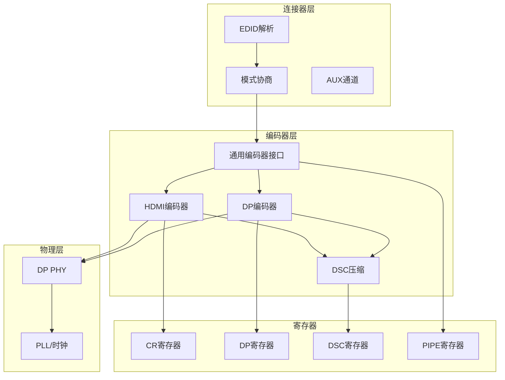
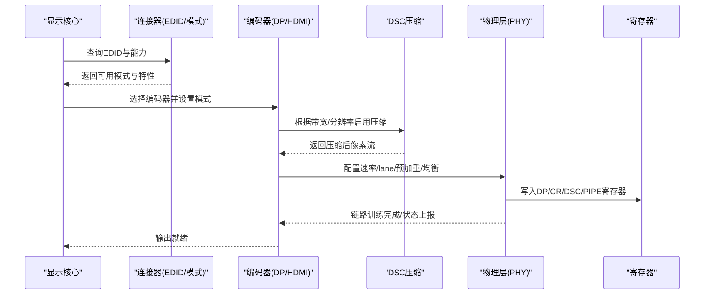
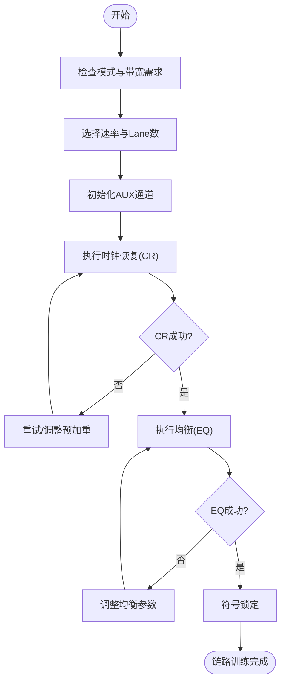
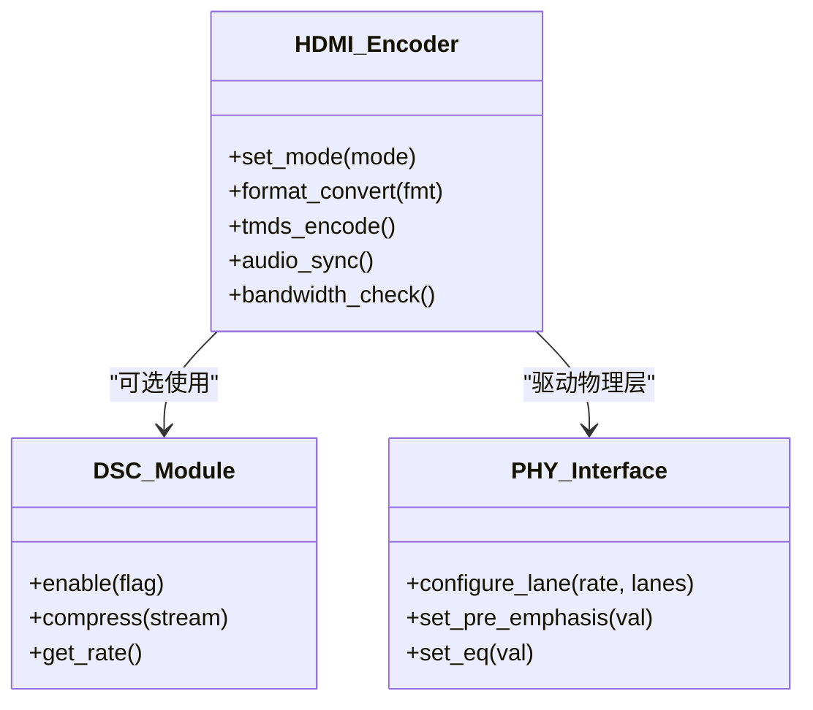
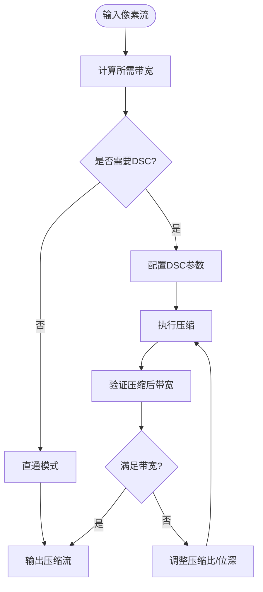
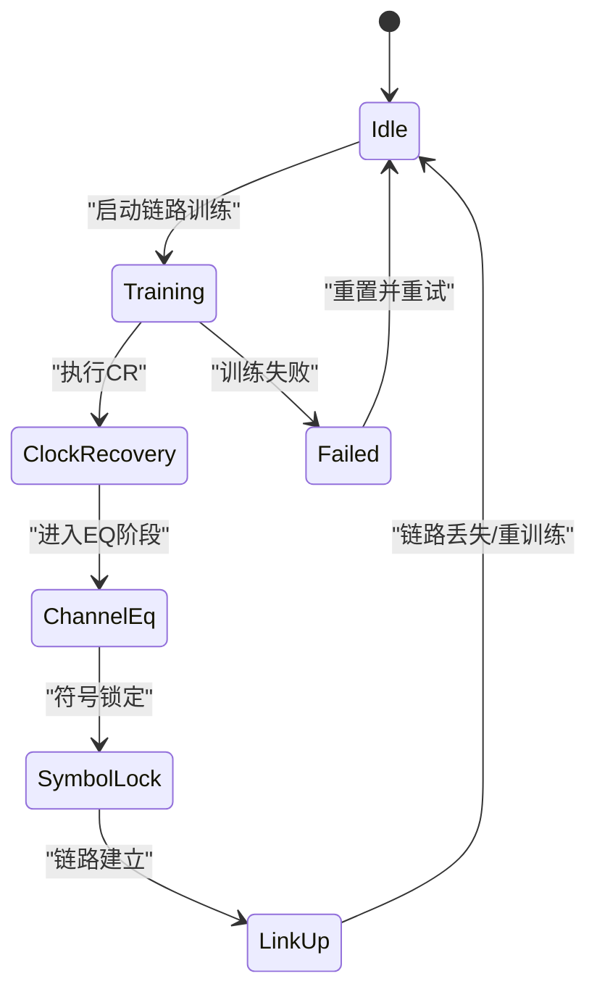
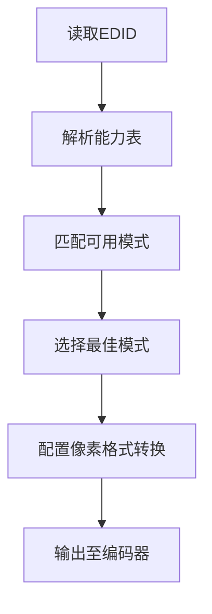
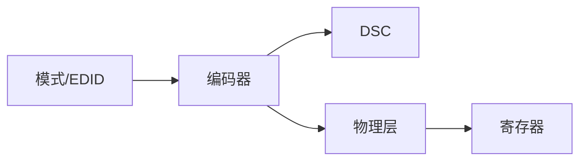

# 编码器与物理层

<cite>
**本文引用的文件**   
- [display.c](file://_work/src/usr/src/lisuanpu-dkms-262.2.0.56/display/display.c)
- [display.h](file://_work/src/usr/src/lisuanpu-dkms-262.2.0.56/display/display.h)
- [disp_encoder.c](file://_work/src/usr/src/lisuanpu-dkms-262.2.0.56/display/encoder/disp_encoder.c)
- [disp_encoder.h](file://_work/src/usr/src/lisuanpu-dkms-262.2.0.56/display/encoder/disp_encoder.h)
- [disp_dp_encoder.c](file://_work/src/usr/src/lisuanpu-dkms-262.2.0.56/display/encoder/disp_dp_encoder.c)
- [disp_dp_encoder.h](file://_work/src/usr/src/lisuanpu-dkms-262.2.0.56/display/encoder/disp_dp_encoder.h)
- [disp_dp_phy.c](file://_work/src/usr/src/lisuanpu-dkms-262.2.0.56/display/encoder/disp_dp_phy.c)
- [disp_dp_phy.h](file://_work/src/usr/src/lisuanpu-dkms-262.2.0.56/display/encoder/disp_dp_phy.h)
- [disp_hdmi_encoder.c](file://_work/src/usr/src/lisuanpu-dkms-262.2.0.56/display/encoder/disp_hdmi_encoder.c)
- [disp_hdmi_encoder.h](file://_work/src/usr/src/lisuanpu-dkms-262.2.0.56/display/encoder/disp_hdmi_encoder.h)
- [disp_dsc.c](file://_work/src/usr/src/lisuanpu-dkms-262.2.0.56/display/encoder/disp_dsc.c)
- [disp_dsc.h](file://_work/src/usr/src/lisuanpu-dkms-262.2.0.56/display/encoder/disp_dsc.h)
- [disp_mode.c](file://_work/src/usr/src/lisuanpu-dkms-262.2.0.56/display/connector/disp_mode.c)
- [disp_mode.h](file://_work/src/usr/src/lisuanpu-dkms-262.2.0.56/display/connector/disp_mode.h)
- [disp_connector.c](file://_work/src/usr/src/lisuanpu-dkms-262.2.0.56/display/connector/disp_connector.c)
- [disp_connector.h](file://_work/src/usr/src/lisuanpu-dkms-262.2.0.56/display/connector/disp_connector.h)
- [disp_dp_aux.c](file://_work/src/usr/src/lisuanpu-dkms-262.2.0.56/display/connector/disp_dp_aux.c)
- [disp_dp_aux.h](file://_work/src/usr/src/lisuanpu-dkms-262.2.0.56/display/connector/disp_dp_aux.h)
- [disp_edid.c](file://_work/src/usr/src/lisuanpu-dkms-262.2.0.56/display/connector/disp_edid.c)
- [disp_edid.h](file://_work/src/usr/src/lisuanpu-dkms-262.2.0.56/display/connector/disp_edid.h)
- [CR_register.h](file://_work/src/usr/src/lisuanpu-dkms-262.2.0.56/display/register/CR_register.h)
- [DP_register.h](file://_work/src/usr/src/lisuanpu-dkms-262.2.0.56/display/register/DP_register.h)
- [DSC_register.h](file://_work/src/usr/src/lisuanpu-dkms-262.2.0.56/display/register/DSC_register.h)
- [PIPE_register.h](file://_work/src/usr/src/lisuanpu-dkms-262.2.0.56/display/register/PIPE_register.h)
</cite>

## 目录
1. [简介](#简介)
2. [项目结构](#项目结构)
3. [核心组件](#核心组件)
4. [架构总览](#架构总览)
5. [详细组件分析](#详细组件分析)
6. [依赖关系分析](#依赖关系分析)
7. [性能考量](#性能考量)
8. [故障排查指南](#故障排查指南)
9. [结论](#结论)
10. [附录](#附录)

## 简介
本文件面向丽山GPU显示子系统，聚焦“视频信号编码”和“物理层配置”，覆盖DisplayPort与HDMI编码器的实现要点、链路训练与带宽管理、DSC压缩、像素格式转换与时钟恢复机制。文档以代码级分析为基础，辅以架构图、时序图与流程图，帮助读者理解从模式选择到物理层发送的完整数据流，并提供可操作的配置示例与调试方法，用于优化传输质量与定位信号问题。

## 项目结构
显示子系统按功能分层组织：连接器（Connector）、编码器（Encoder）、物理层（PHY）、寄存器定义（Register）以及公共模块（Common）。关键路径包括：
- 连接器层负责EDID读取、模式协商、AUX通道通信等；
- 编码器层负责像素格式转换、DSC压缩、TMDS/比特流编码；
- 物理层负责时钟生成、均衡、预加重、链路训练序列与速率/ lanes 配置；
- 寄存器层提供硬件控制接口。

图表来源
- [disp_connector.c:1-200](file://_work/src/usr/src/lisuanpu-dkms-262.2.0.56/display/connector/disp_connector.c#L1-L200)
- [disp_mode.c:1-200](file://_work/src/usr/src/lisuanpu-dkms-262.2.0.56/display/connector/disp_mode.c#L1-L200)
- [disp_dp_encoder.c:1-200](file://_work/src/usr/src/lisuanpu-dkms-262.2.0.56/display/encoder/disp_dp_encoder.c#L1-L200)
- [disp_hdmi_encoder.c:1-200](file://_work/src/usr/src/lisuanpu-dkms-262.2.0.56/display/encoder/disp_hdmi_encoder.c#L1-L200)
- [disp_dsc.c:1-200](file://_work/src/usr/src/lisuanpu-dkms-262.2.0.56/display/encoder/disp_dsc.c#L1-L200)
- [disp_dp_phy.c:1-200](file://_work/src/usr/src/lisuanpu-dkms-262.2.0.56/display/encoder/disp_dp_phy.c#L1-L200)
- [CR_register.h:1-200](file://_work/src/usr/src/lisuanpu-dkms-262.2.0.56/display/register/CR_register.h#L1-L200)
- [DP_register.h:1-200](file://_work/src/usr/src/lisuanpu-dkms-262.2.0.56/display/register/DP_register.h#L1-L200)
- [DSC_register.h:1-200](file://_work/src/usr/src/lisuanpu-dkms-262.2.0.56/display/register/DSC_register.h#L1-L200)
- [PIPE_register.h:1-200](file://_work/src/usr/src/lisuanpu-dkms-262.2.0.56/display/register/PIPE_register.h#L1-L200)

章节来源
- [display.c:1-200](file://_work/src/usr/src/lisuanpu-dkms-262.2.0.56/display/display.c#L1-L200)
- [display.h:1-200](file://_work/src/usr/src/lisuanpu-dkms-262.2.0.56/display/display.h#L1-L200)

## 核心组件
- 通用编码器接口：抽象出不同输出类型的统一编程模型，封装模式设置、像素格式转换、DSC使能、扫描参数配置等。
- DisplayPort编码器：实现DP TMDS/比特流编码、MST/分支设备支持、链路训练流程、带宽计算与自适应均衡。
- HDMI编码器：实现TMDS编码、像素重复、扩展色彩空间、音频同步与CEC辅助通道。
- DSC压缩：基于DSC寄存器与算法模块，对像素数据进行无损/近无损压缩以降低带宽需求。
- DP物理层：负责lane数量、速率、预加重、均衡、时钟恢复、链路训练状态机与错误统计。
- 模式与连接器：EDID解析、能力枚举、模式匹配、AUX事务、热插拔事件处理。

章节来源
- [disp_encoder.c:1-200](file://_work/src/usr/src/lisuanpu-dkms-262.2.0.56/display/encoder/disp_encoder.c#L1-L200)
- [disp_encoder.h:1-200](file://_work/src/usr/src/lisuanpu-dkms-262.2.0.56/display/encoder/disp_encoder.h#L1-L200)
- [disp_dp_encoder.c:1-200](file://_work/src/usr/src/lisuanpu-dkms-262.2.0.56/display/encoder/disp_dp_encoder.c#L1-L200)
- [disp_hdmi_encoder.c:1-200](file://_work/src/usr/src/lisuanpu-dkms-262.2.0.56/display/encoder/disp_hdmi_encoder.c#L1-L200)
- [disp_dsc.c:1-200](file://_work/src/usr/src/lisuanpu-dkms-262.2.0.56/display/encoder/disp_dsc.c#L1-L200)
- [disp_dp_phy.c:1-200](file://_work/src/usr/src/lisuanpu-dkms-262.2.0.56/display/encoder/disp_dp_phy.c#L1-L200)
- [disp_mode.c:1-200](file://_work/src/usr/src/lisuanpu-dkms-262.2.0.56/display/connector/disp_mode.c#L1-L200)
- [disp_connector.c:1-200](file://_work/src/usr/src/lisuanpu-dkms-262.2.0.56/display/connector/disp_connector.c#L1-L200)

## 架构总览
下图展示从模式协商到物理层发送的关键调用链路与数据流向，涵盖DP/HDMI两种路径及DSC压缩。

图表来源
- [disp_connector.c:1-200](file://_work/src/usr/src/lisuanpu-dkms-262.2.0.56/display/connector/disp_connector.c#L1-L200)
- [disp_mode.c:1-200](file://_work/src/usr/src/lisuanpu-dkms-262.2.0.56/display/connector/disp_mode.c#L1-L200)
- [disp_dp_encoder.c:1-200](file://_work/src/usr/src/lisuanpu-dkms-262.2.0.56/display/encoder/disp_dp_encoder.c#L1-L200)
- [disp_hdmi_encoder.c:1-200](file://_work/src/usr/src/lisuanpu-dkms-262.2.0.56/display/encoder/disp_hdmi_encoder.c#L1-L200)
- [disp_dsc.c:1-200](file://_work/src/usr/src/lisuanpu-dkms-262.2.0.56/display/encoder/disp_dsc.c#L1-L200)
- [disp_dp_phy.c:1-200](file://_work/src/usr/src/lisuanpu-dkms-262.2.0.56/display/encoder/disp_dp_phy.c#L1-L200)
- [DP_register.h:1-200](file://_work/src/usr/src/lisuanpu-dkms-262.2.0.56/display/register/DP_register.h#L1-L200)
- [CR_register.h:1-200](file://_work/src/usr/src/lisuanpu-dkms-262.2.0.56/display/register/CR_register.h#L1-L200)
- [DSC_register.h:1-200](file://_work/src/usr/src/lisuanpu-dkms-262.2.0.56/display/register/DSC_register.h#L1-L200)
- [PIPE_register.h:1-200](file://_work/src/usr/src/lisuanpu-dkms-262.2.0.56/display/register/PIPE_register.h#L1-L200)

## 详细组件分析

### DisplayPort编码器与链路训练
- 模式与带宽：根据分辨率、刷新率、位深与是否启用DSC计算所需带宽，选择合适速率（如1.2/1.4）与lane数。
- 链路训练：执行Clock Recovery、Channel Equalization、Symbol Lock等步骤，依据接收端反馈调整预加重与均衡参数。
- AUX通道：通过AUX进行DPCD读写、中断处理、MST拓扑发现与分支设备管理。
- 错误处理：检测Training Fail、Link Loss、CRC错误，触发重训练或降级策略。

图表来源
- [disp_dp_encoder.c:1-200](file://_work/src/usr/src/lisuanpu-dkms-262.2.0.56/display/encoder/disp_dp_encoder.c#L1-L200)
- [disp_dp_aux.c:1-200](file://_work/src/usr/src/lisuanpu-dkms-262.2.0.56/display/connector/disp_dp_aux.c#L1-L200)
- [DP_register.h:1-200](file://_work/src/usr/src/lisuanpu-dkms-262.2.0.56/display/register/DP_register.h#L1-200)

章节来源
- [disp_dp_encoder.c:1-200](file://_work/src/usr/src/lisuanpu-dkms-262.2.0.56/display/encoder/disp_dp_encoder.c#L1-L200)
- [disp_dp_aux.c:1-200](file://_work/src/usr/src/lisuanpu-dkms-262.2.0.56/display/connector/disp_dp_aux.c#L1-L200)
- [disp_dp_phy.c:1-200](file://_work/src/usr/src/lisuanpu-dkms-262.2.0.56/display/encoder/disp_dp_phy.c#L1-L200)

### HDMI编码器与TMDS
- 像素格式转换：将内部像素格式转换为TMDS所需的RGB/YUV与位深。
- TMDS编码：执行8b/10b编码、控制字符插入、消隐期填充。
- 音频同步：根据HDMI规范对齐音频采样与视频帧边界。
- 带宽管理：在高分辨率/高刷新场景下，考虑像素重复或降低色深以满足带宽限制。

图表来源
- [disp_hdmi_encoder.c:1-200](file://_work/src/usr/src/lisuanpu-dkms-262.2.0.56/display/encoder/disp_hdmi_encoder.c#L1-L200)
- [disp_dsc.c:1-200](file://_work/src/usr/src/lisuanpu-dkms-262.2.0.56/display/encoder/disp_dsc.c#L1-L200)
- [CR_register.h:1-200](file://_work/src/usr/src/lisuanpu-dkms-262.2.0.56/display/register/CR_register.h#L1-L200)

章节来源
- [disp_hdmi_encoder.c:1-200](file://_work/src/usr/src/lisuanpu-dkms-262.2.0.56/display/encoder/disp_hdmi_encoder.c#L1-L200)
- [disp_dsc.c:1-200](file://_work/src/usr/src/lisuanpu-dkms-262.2.0.56/display/encoder/disp_dsc.c#L1-L200)

### DSC压缩与带宽优化
- 压缩决策：根据目标带宽、分辨率、刷新率与位深，自动决定是否启用DSC及压缩比。
- 参数配置：设置DSC切片宽度、颜色深度、压缩模式等寄存器。
- 解码端兼容：确保接收端支持DSC版本与能力，避免不兼容导致的黑屏或闪烁。

图表来源
- [disp_dsc.c:1-200](file://_work/src/usr/src/lisuanpu-dkms-262.2.0.56/display/encoder/disp_dsc.c#L1-L200)
- [DSC_register.h:1-200](file://_work/src/usr/src/lisuanpu-dkms-262.2.0.56/display/register/DSC_register.h#L1-L200)

章节来源
- [disp_dsc.c:1-200](file://_work/src/usr/src/lisuanpu-dkms-262.2.0.56/display/encoder/disp_dsc.c#L1-L200)

### 物理层配置与时钟恢复
- 时钟恢复：在DP链路训练中，PHY根据接收端时钟信息调整本地PLL，确保符号同步。
- 均衡与预加重：根据信道损耗情况动态调整发射端预加重与接收端均衡，提升信号完整性。
- Lane与速率：根据模式需求配置lane数量与速率等级，支持自适应回退。

图表来源
- [disp_dp_phy.c:1-200](file://_work/src/usr/src/lisuanpu-dkms-262.2.0.56/display/encoder/disp_dp_phy.c#L1-L200)
- [DP_register.h:1-200](file://_work/src/usr/src/lisuanpu-dkms-262.2.0.56/display/register/DP_register.h#L1-L200)

章节来源
- [disp_dp_phy.c:1-200](file://_work/src/usr/src/lisuanpu-dkms-262.2.0.56/display/encoder/disp_dp_phy.c#L1-L200)

### 模式协商与像素格式转换
- EDID解析：读取显示器能力（分辨率、刷新率、色彩空间、DSC支持等）。
- 模式匹配：根据系统能力与显示器能力选择最佳模式。
- 像素格式转换：将源格式转换为编码器所需格式（如RGB888、YUV422等），必要时进行缩放或裁剪。

图表来源
- [disp_edid.c:1-200](file://_work/src/usr/src/lisuanpu-dkms-262.2.0.56/display/connector/disp_edid.c#L1-L200)
- [disp_mode.c:1-200](file://_work/src/usr/src/lisuanpu-dkms-262.2.0.56/display/connector/disp_mode.c#L1-L200)

章节来源
- [disp_connector.c:1-200](file://_work/src/usr/src/lisuanpu-dkms-262.2.0.56/display/connector/disp_connector.c#L1-L200)
- [disp_mode.c:1-200](file://_work/src/usr/src/lisuanpu-dkms-262.2.0.56/display/connector/disp_mode.c#L1-L200)

## 依赖关系分析
- 编码器依赖模式与连接器模块提供的能力与参数；
- DP/HDMI编码器共享DSC模块以降低带宽；
- 物理层依赖寄存器定义进行底层配置；
- 整体耦合度适中，模块化清晰，便于扩展新的输出类型。

图表来源
- [disp_mode.c:1-200](file://_work/src/usr/src/lisuanpu-dkms-262.2.0.56/display/connector/disp_mode.c#L1-L200)
- [disp_encoder.c:1-200](file://_work/src/usr/src/lisuanpu-dkms-262.2.0.56/display/encoder/disp_encoder.c#L1-L200)
- [disp_dsc.c:1-200](file://_work/src/usr/src/lisuanpu-dkms-262.2.0.56/display/encoder/disp_dsc.c#L1-L200)
- [disp_dp_phy.c:1-200](file://_work/src/usr/src/lisuanpu-dkms-262.2.0.56/display/encoder/disp_dp_phy.c#L1-L200)
- [DP_register.h:1-200](file://_work/src/usr/src/lisuanpu-dkms-262.2.0.56/display/register/DP_register.h#L1-L200)

章节来源
- [disp_encoder.c:1-200](file://_work/src/usr/src/lisuanpu-dkms-262.2.0.56/display/encoder/disp_encoder.c#L1-L200)
- [disp_dp_encoder.c:1-200](file://_work/src/usr/src/lisuanpu-dkms-262.2.0.56/display/encoder/disp_dp_encoder.c#L1-L200)
- [disp_hdmi_encoder.c:1-200](file://_work/src/usr/src/lisuanpu-dkms-262.2.0.56/display/encoder/disp_hdmi_encoder.c#L1-L200)
- [disp_dsc.c:1-200](file://_work/src/usr/src/lisuanpu-dkms-262.2.0.56/display/encoder/disp_dsc.c#L1-L200)
- [disp_dp_phy.c:1-200](file://_work/src/usr/src/lisuanpu-dkms-262.2.0.56/display/encoder/disp_dp_phy.c#L1-L200)

## 性能考量
- 带宽优化：优先启用DSC以减少带宽压力，避免在高刷新率下出现丢帧；
- 均衡与预加重：根据线缆长度与质量动态调整，减少误码率；
- 时钟稳定性：确保PLL锁定范围与抖动指标满足规范，避免闪烁；
- 模式回退：当链路不稳定时自动降级速率或lane数，保证基本显示。

[本节为通用指导，无需特定文件引用]

## 故障排查指南
- 链路训练失败：检查AUX通信是否正常、EDID可读性、线缆质量与端口兼容性；查看DP寄存器中的训练状态与错误计数。
- 画面闪烁或黑屏：确认时钟恢复与符号锁定状态，检查DSC配置是否与接收端兼容；尝试关闭DSC或降低位深。
- 带宽不足：降低分辨率/刷新率/位深，或启用DSC；检查lane数量与速率配置。
- 音频不同步：核对HDMI音频参数与视频帧边界对齐，检查音频流配置。

章节来源
- [disp_dp_encoder.c:1-200](file://_work/src/usr/src/lisuanpu-dkms-262.2.0.56/display/encoder/disp_dp_encoder.c#L1-L200)
- [disp_dp_aux.c:1-200](file://_work/src/usr/src/lisuanpu-dkms-262.2.0.56/display/connector/disp_dp_aux.c#L1-L200)
- [disp_dp_phy.c:1-200](file://_work/src/usr/src/lisuanpu-dkms-262.2.0.56/display/encoder/disp_dp_phy.c#L1-L200)
- [DP_register.h:1-200](file://_work/src/usr/src/lisuanpu-dkms-262.2.0.56/display/register/DP_register.h#L1-L200)

## 结论
丽山GPU显示子系统通过清晰的模块化设计，实现了DisplayPort与HDMI编码、DSC压缩、物理层链路训练与时钟恢复等关键功能。合理配置模式、带宽与物理层参数，可有效提升视频传输质量与稳定性。建议在生产环境中结合EDID能力与线缆质量，动态调整DSC与均衡参数，以获得最佳显示效果。

[本节为总结，无需特定文件引用]

## 附录
- 配置示例（概念性）：
  - 选择模式：根据EDID能力选择最高刷新率与位深；若带宽紧张则启用DSC。
  - 链路训练：先执行CR，再EQ，最后符号锁定；失败时逐步降低速率或lane数。
  - 物理层调优：根据线缆长度调整预加重与均衡，监控误码率与抖动。
- 调试方法：
  - 读取DP/CR/DSC/PIPE寄存器状态，观察训练标志与错误计数；
  - 使用AUX工具检查DPCD与EDID可读性；
  - 通过示波器测量眼图与抖动，评估信号完整性。

[本节为补充说明，无需特定文件引用]