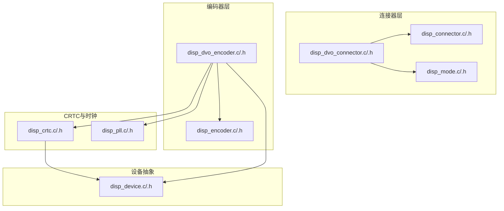
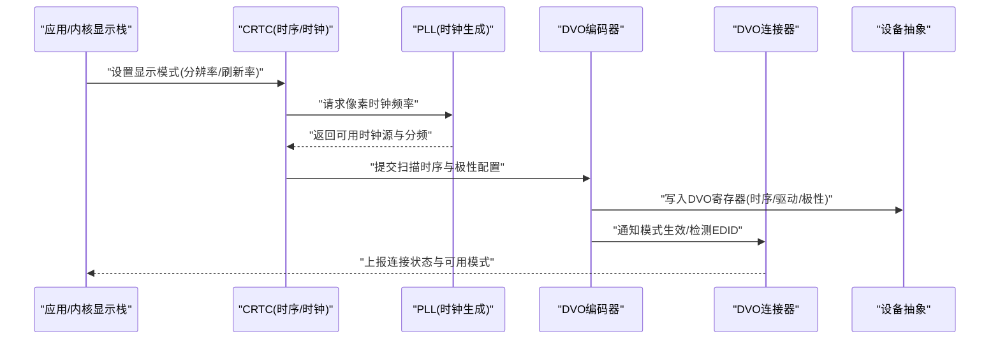
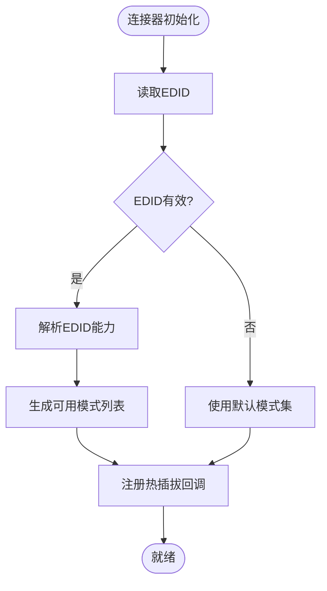
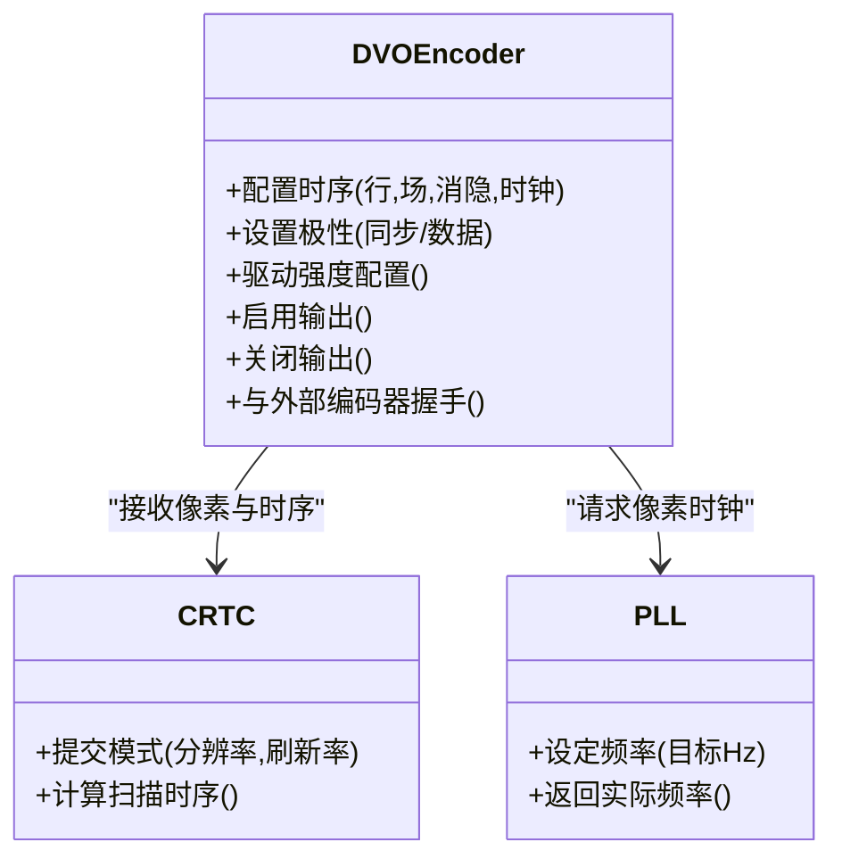
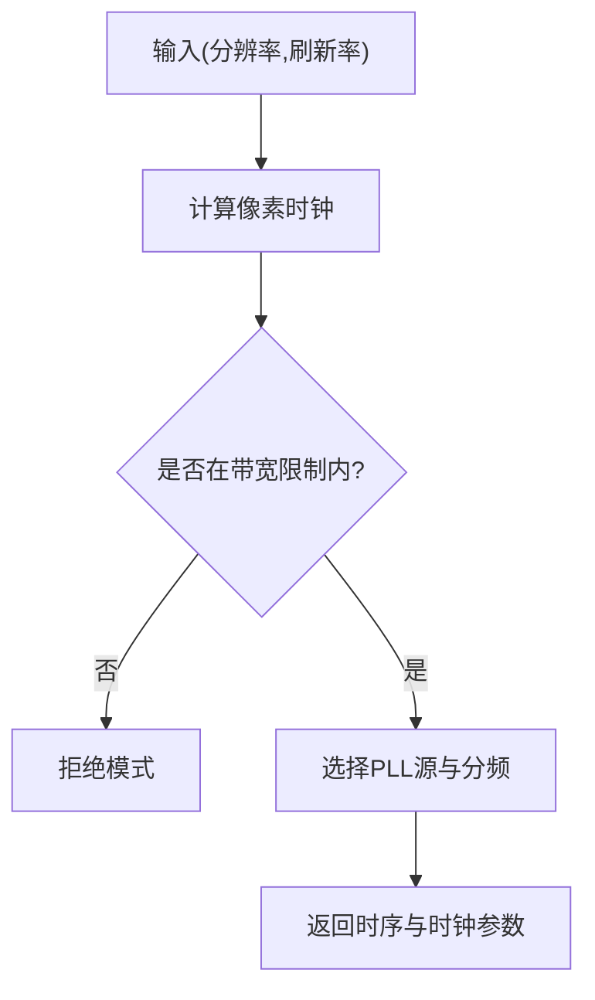
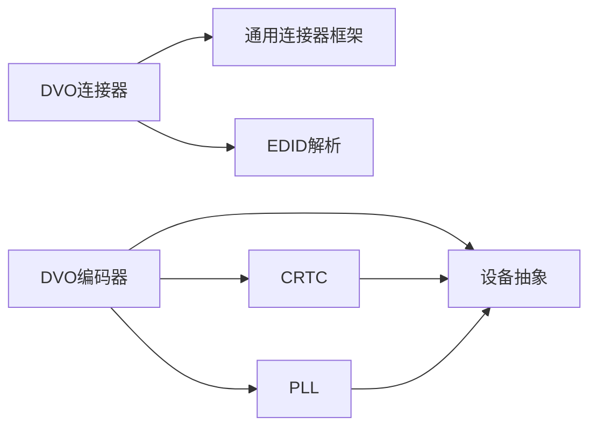

# DVO连接器实现

<cite>
**本文档引用的文件**   
- [disp_dvo_connector.c](file://_work/src/usr/src/lisuangpu-dkms-262.2.0.56/display/connector/disp_dvo_connector.c)
- [disp_dvo_connector.h](file://_work/src/usr/src/lisuangpu-dkms-262.2.0.56/display/connector/disp_dvo_connector.h)
- [disp_dvo_encoder.c](file://_work/src/usr/src/lisuangpu-dkms-262.2.0.56/display/encoder/disp_dvo_encoder.c)
- [disp_dvo_encoder.h](file://_work/src/usr/src/lisuangpu-dkms-262.2.0.56/display/encoder/disp_dvo_encoder.h)
- [disp_connector.c](file://_work/src/usr/src/lisuangpu-dkms-262.2.0.56/display/connector/disp_connector.c)
- [disp_connector.h](file://_work/src/usr/src/lisuangpu-dkms-262.2.0.56/display/connector/disp_connector.h)
- [disp_encoder.c](file://_work/src/usr/src/lisuangpu-dkms-262.2.0.56/display/encoder/disp_encoder.c)
- [disp_encoder.h](file://_work/src/usr/src/lisuangpu-dkms-262.2.0.56/display/encoder/disp_encoder.h)
- [disp_mode.c](file://_work/src/usr/src/lisuangpu-dkms-262.2.0.56/display/connector/disp_mode.c)
- [disp_mode.h](file://_work/src/usr/src/lisuangpu-dkms-262.2.0.56/display/connector/disp_mode.h)
- [disp_crtc.c](file://_work/src/usr/src/lisuangpu-dkms-262.2.0.56/display/crtc/disp_crtc.c)
- [disp_crtc.h](file://_work/src/usr/src/lisuangpu-dkms-262.2.0.56/display/crtc/disp_crtc.h)
- [disp_pll.c](file://_work/src/usr/src/lisuangpu-dkms-262.2.0.56/display/crtc/disp_pll.c)
- [disp_pll.h](file://_work/src/usr/src/lisuangpu-dkms-262.2.0.56/display/crtc/disp_pll.h)
- [disp_device.c](file://_work/src/usr/src/lisuangpu-dkms-262.2.0.56/display/disp_device.c)
- [disp_device.h](file://_work/src/usr/src/lisuangpu-dkms-262.2.0.56/display/disp_device.h)
</cite>

## 目录
1. [简介](#简介)
2. [项目结构](#项目结构)
3. [核心组件](#核心组件)
4. [架构总览](#架构总览)
5. [详细组件分析](#详细组件分析)
6. [依赖关系分析](#依赖关系分析)
7. [性能考虑](#性能考虑)
8. [故障排查指南](#故障排查指南)
9. [结论](#结论)
10. [附录：配置示例与调优清单](#附录配置示例与调优清单)

## 简介
本文件面向丽山GPU的DVO（Digital Video Output）连接器实现，系统性阐述DVO接口的硬件特性、时钟生成与信号输出配置，覆盖DVO模式的时序参数设置、分辨率支持与兼容性处理，以及与外部编码器的集成方式和信号质量优化策略。文档同时提供可操作的配置示例与性能调优指南，帮助开发者快速、稳定地启用并优化DVO输出路径。

## 项目结构
DVO相关代码位于display子系统的connector与encoder层，配合crtc与时钟模块完成模式设置与时钟生成，并通过设备抽象层进行寄存器访问与电源管理。关键文件组织如下：
- connector层：DVO连接器定义、EDID解析、模式枚举与连接状态管理
- encoder层：DVO编码器实现，负责将CRTC像素流转换为DVO并行LVDS/TTL信号
- crtc与时钟：模式验证、扫描时序计算、PLL频率规划与分频配置
- 设备抽象：寄存器读写、中断、电源域控制等底层能力

图表来源
- [disp_connector.c](file://_work/src/usr/src/lisuangpu-dkms-262.2.0.56/display/connector/disp_connector.c)
- [disp_dvo_connector.c](file://_work/src/usr/src/lisuangpu-dkms-262.2.0.56/display/connector/disp_dvo_connector.c)
- [disp_mode.c](file://_work/src/usr/src/lisuangpu-dkms-262.2.0.56/display/connector/disp_mode.c)
- [disp_encoder.c](file://_work/src/usr/src/lisuangpu-dkms-262.2.0.56/display/encoder/disp_encoder.c)
- [disp_dvo_encoder.c](file://_work/src/usr/src/lisuangpu-dkms-262.2.0.56/display/encoder/disp_dvo_encoder.c)
- [disp_crtc.c](file://_work/src/usr/src/lisuangpu-dkms-262.2.0.56/display/crtc/disp_crtc.c)
- [disp_pll.c](file://_work/src/usr/src/lisuangpu-dkms-262.2.0.56/display/crtc/disp_pll.c)
- [disp_device.c](file://_work/src/usr/src/lisuangpu-dkms-262.2.0.56/display/disp_device.c)

章节来源
- [disp_dvo_connector.c](file://_work/src/usr/src/lisuangpu-dkms-262.2.0.56/display/connector/disp_dvo_connector.c)
- [disp_dvo_connector.h](file://_work/src/usr/src/lisuangpu-dkms-262.2.0.56/display/connector/disp_dvo_connector.h)
- [disp_dvo_encoder.c](file://_work/src/usr/src/lisuangpu-dkms-262.2.0.56/display/encoder/disp_dvo_encoder.c)
- [disp_dvo_encoder.h](file://_work/src/usr/src/lisuangpu-dkms-262.2.0.56/display/encoder/disp_dvo_encoder.h)
- [disp_connector.c](file://_work/src/usr/src/lisuangpu-dkms-262.2.0.56/display/connector/disp_connector.c)
- [disp_connector.h](file://_work/src/usr/src/lisuangpu-dkms-262.2.0.56/display/connector/disp_connector.h)
- [disp_encoder.c](file://_work/src/usr/src/lisuangpu-dkms-262.2.0.56/display/encoder/disp_encoder.c)
- [disp_encoder.h](file://_work/src/usr/src/lisuangpu-dkms-262.2.0.56/display/encoder/disp_encoder.h)
- [disp_mode.c](file://_work/src/usr/src/lisuangpu-dkms-262.2.0.56/display/connector/disp_mode.c)
- [disp_mode.h](file://_work/src/usr/src/lisuangpu-dkms-262.2.0.56/display/connector/disp_mode.h)
- [disp_crtc.c](file://_work/src/usr/src/lisuangpu-dkms-262.2.0.56/display/crtc/disp_crtc.c)
- [disp_crtc.h](file://_work/src/usr/src/lisuangpu-dkms-262.2.0.56/display/crtc/disp_crtc.h)
- [disp_pll.c](file://_work/src/usr/src/lisuangpu-dkms-262.2.0.56/display/crtc/disp_pll.c)
- [disp_pll.h](file://_work/src/usr/src/lisuangpu-dkms-262.2.0.56/display/crtc/disp_pll.h)
- [disp_device.c](file://_work/src/usr/src/lisuangpu-dkms-262.2.0.56/display/disp_device.c)
- [disp_device.h](file://_work/src/usr/src/lisuangpu-dkms-262.2.0.56/display/disp_device.h)

## 核心组件
- DVO连接器（disp_dvo_connector）：负责DVO物理接口注册、EDID读取与解析、模式枚举、热插拔事件处理、连接状态同步。
- DVO编码器（disp_dvo_encoder）：将CRTC输出的像素数据转换为DVO并行时序（如LVDS/TTL），配置行场时序、像素时钟、极性、数据使能等。
- CRTC与时钟（disp_crtc、disp_pll）：根据目标分辨率与刷新率计算扫描时序，选择合适PLL源与分频比，确保像素时钟精度满足DVO要求。
- 通用连接器/编码器框架（disp_connector、disp_encoder）：提供统一接口与生命周期管理，屏蔽具体接口差异。
- 设备抽象（disp_device）：封装寄存器读写、中断、电源域控制等底层操作。

章节来源
- [disp_dvo_connector.c](file://_work/src/usr/src/lisuangpu-dkms-262.2.0.56/display/connector/disp_dvo_connector.c)
- [disp_dvo_connector.h](file://_work/src/usr/src/lisuangpu-dkms-262.2.0.56/display/connector/disp_dvo_connector.h)
- [disp_dvo_encoder.c](file://_work/src/usr/src/lisuangpu-dkms-262.2.0.56/display/encoder/disp_dvo_encoder.c)
- [disp_dvo_encoder.h](file://_work/src/usr/src/lisuangpu-dkms-262.2.0.56/display/encoder/disp_dvo_encoder.h)
- [disp_connector.c](file://_work/src/usr/src/lisuangpu-dkms-262.2.0.56/display/connector/disp_connector.c)
- [disp_connector.h](file://_work/src/usr/src/lisuangpu-dkms-262.2.0.56/display/connector/disp_connector.h)
- [disp_encoder.c](file://_work/src/usr/src/lisuangpu-dkms-262.2.0.56/display/encoder/disp_encoder.c)
- [disp_encoder.h](file://_work/src/usr/src/lisuangpu-dkms-262.2.0.56/display/encoder/disp_encoder.h)
- [disp_crtc.c](file://_work/src/usr/src/lisuangpu-dkms-262.2.0.56/display/crtc/disp_crtc.c)
- [disp_crtc.h](file://_work/src/usr/src/lisuangpu-dkms-262.2.0.56/display/crtc/disp_crtc.h)
- [disp_pll.c](file://_work/src/usr/src/lisuangpu-dkms-262.2.0.56/display/crtc/disp_pll.c)
- [disp_pll.h](file://_work/src/usr/src/lisuangpu-dkms-262.2.0.56/display/crtc/disp_pll.h)
- [disp_device.c](file://_work/src/usr/src/lisuangpu-dkms-262.2.0.56/display/disp_device.c)
- [disp_device.h](file://_work/src/usr/src/lisuangpu-dkms-262.2.0.56/display/disp_device.h)

## 架构总览
DVO输出路径从CRTC到DVO编码器的数据流与时钟流如下：
- CRTC根据当前模式计算扫描时序与像素时钟
- PLL按目标频率配置分频与倍频，输出稳定的像素时钟
- DVO编码器将像素数据转换为DVO并行信号，配置行场时序、极性与驱动强度
- DVO连接器负责EDID解析、模式匹配与热插拔事件上报

图表来源
- [disp_crtc.c](file://_work/src/usr/src/lisuangpu-dkms-262.2.0.56/display/crtc/disp_crtc.c)
- [disp_pll.c](file://_work/src/usr/src/lisuangpu-dkms-262.2.0.56/display/crtc/disp_pll.c)
- [disp_dvo_encoder.c](file://_work/src/usr/src/lisuangpu-dkms-262.2.0.56/display/encoder/disp_dvo_encoder.c)
- [disp_dvo_connector.c](file://_work/src/usr/src/lisuangpu-dkms-262.2.0.56/display/connector/disp_dvo_connector.c)
- [disp_device.c](file://_work/src/usr/src/lisuangpu-dkms-262.2.0.56/display/disp_device.c)

## 详细组件分析

### DVO连接器（disp_dvo_connector）
- 功能要点
  - 初始化与注册：在系统启动时创建DVO连接器实例，绑定EDID读取与热插拔回调
  - EDID解析：读取显示器能力（分辨率、刷新率、颜色深度、扩展块），过滤出DVO兼容模式
  - 模式枚举：基于EDID与平台限制生成可用模式列表，支持标准VESA/CVT与自定义模式
  - 热插拔处理：监听连接器状态变化，动态更新可用模式与显示路径
- 关键数据结构与流程
  - 连接器描述符包含物理接口类型、EDID缓存、模式链表、状态机
  - 模式匹配遵循“最佳分辨率优先、刷新率接近目标、色彩格式兼容”的策略
- 错误与边界
  - EDID读取失败回退到保守模式集
  - 不支持的分辨率或刷新率被拒绝并记录日志

图表来源
- [disp_dvo_connector.c](file://_work/src/usr/src/lisuangpu-dkms-262.2.0.56/display/connector/disp_dvo_connector.c)
- [disp_connector.c](file://_work/src/usr/src/lisuangpu-dkms-262.2.0.56/display/connector/disp_connector.c)

章节来源
- [disp_dvo_connector.c](file://_work/src/usr/src/lisuangpu-dkms-262.2.0.56/display/connector/disp_dvo_connector.c)
- [disp_dvo_connector.h](file://_work/src/usr/src/lisuangpu-dkms-262.2.0.56/display/connector/disp_dvo_connector.h)
- [disp_connector.c](file://_work/src/usr/src/lisuangpu-dkms-262.2.0.56/display/connector/disp_connector.c)
- [disp_connector.h](file://_work/src/usr/src/lisuangpu-dkms-262.2.0.56/display/connector/disp_connector.h)

### DVO编码器（disp_dvo_encoder）
- 功能要点
  - 像素流转换：将CRTC输出的RGB/YUV像素转换为DVO并行数据总线格式
  - 时序配置：设置行/场同步、消隐区间、像素时钟分频、极性控制
  - 信号驱动：配置输出驱动强度、预加重、端接电阻（若由外部PHY控制则通过寄存器间接配置）
  - 与外部编码器集成：当DVO后级为外部LVDS/TTL编码器时，通过I2C/GPIO或专用总线握手，确保时序对齐与使能信号正确
- 关键流程
  - 模式设置阶段：校验时序参数，计算PLL分频，写入DVO时序寄存器
  - 启用阶段：开启像素时钟、激活数据总线、拉高同步信号
  - 关闭阶段：先停数据流，再关时钟，避免闪烁与毛刺

图表来源
- [disp_dvo_encoder.c](file://_work/src/usr/src/lisuangpu-dkms-262.2.0.56/display/encoder/disp_dvo_encoder.c)
- [disp_dvo_encoder.h](file://_work/src/usr/src/lisuangpu-dkms-262.2.0.56/display/encoder/disp_dvo_encoder.h)
- [disp_crtc.c](file://_work/src/usr/src/lisuangpu-dkms-262.2.0.56/display/crtc/disp_crtc.c)
- [disp_pll.c](file://_work/src/usr/src/lisuangpu-dkms-262.2.0.56/display/crtc/disp_pll.c)

章节来源
- [disp_dvo_encoder.c](file://_work/src/usr/src/lisuangpu-dkms-262.2.0.56/display/encoder/disp_dvo_encoder.c)
- [disp_dvo_encoder.h](file://_work/src/usr/src/lisuangpu-dkms-262.2.0.56/display/encoder/disp_dvo_encoder.h)
- [disp_encoder.c](file://_work/src/usr/src/lisuangpu-dkms-262.2.0.56/display/encoder/disp_encoder.c)
- [disp_encoder.h](file://_work/src/usr/src/lisuangpu-dkms-262.2.0.56/display/encoder/disp_encoder.h)

### CRTC与时钟（disp_crtc、disp_pll）
- 功能要点
  - 模式验证：检查分辨率、刷新率、像素带宽与时序约束
  - 时序计算：根据目标刷新率与分辨率计算行周期、场周期、消隐区间与像素时钟
  - 时钟规划：选择最优PLL源与分频比，保证抖动与锁定时间满足DVO要求
- 关键算法
  - 像素时钟近似匹配：在误差阈值内选择最接近的目标频率
  - 带宽限制：根据DVO总线位宽与最大频率限制筛选可行模式

图表来源
- [disp_crtc.c](file://_work/src/usr/src/lisuangpu-dkms-262.2.0.56/display/crtc/disp_crtc.c)
- [disp_crtc.h](file://_work/src/usr/src/lisuangpu-dkms-262.2.0.56/display/crtc/disp_crtc.h)
- [disp_pll.c](file://_work/src/usr/src/lisuangpu-dkms-262.2.0.56/display/crtc/disp_pll.c)
- [disp_pll.h](file://_work/src/usr/src/lisuangpu-dkms-262.2.0.56/display/crtc/disp_pll.h)

章节来源
- [disp_crtc.c](file://_work/src/usr/src/lisuangpu-dkms-262.2.0.56/display/crtc/disp_crtc.c)
- [disp_crtc.h](file://_work/src/usr/src/lisuangpu-dkms-262.2.0.56/display/crtc/disp_crtc.h)
- [disp_pll.c](file://_work/src/usr/src/lisuangpu-dkms-262.2.0.56/display/crtc/disp_pll.c)
- [disp_pll.h](file://_work/src/usr/src/lisuangpu-dkms-262.2.0.56/display/crtc/disp_pll.h)

### 设备抽象（disp_device）
- 功能要点
  - 寄存器读写：提供原子性写、读-改-写序列，确保时序配置一致性
  - 电源域管理：按需上电/下电DVO相关域，降低功耗
  - 中断处理：处理热插拔、链路训练完成等事件

章节来源
- [disp_device.c](file://_work/src/usr/src/lisuangpu-dkms-262.2.0.56/display/disp_device.c)
- [disp_device.h](file://_work/src/usr/src/lisuangpu-dkms-262.2.0.56/display/disp_device.h)

## 依赖关系分析
DVO实现的关键依赖关系如下：
- DVO连接器依赖通用连接器框架与EDID解析
- DVO编码器依赖CRTC与时钟模块，以及设备抽象层
- CRTC与时钟模块依赖设备抽象层进行寄存器访问
- 所有组件共同依赖统一的显示子系统接口

图表来源
- [disp_dvo_connector.c](file://_work/src/usr/src/lisuangpu-dkms-262.2.0.56/display/connector/disp_dvo_connector.c)
- [disp_connector.c](file://_work/src/usr/src/lisuangpu-dkms-262.2.0.56/display/connector/disp_connector.c)
- [disp_dvo_encoder.c](file://_work/src/usr/src/lisuangpu-dkms-262.2.0.56/display/encoder/disp_dvo_encoder.c)
- [disp_crtc.c](file://_work/src/usr/src/lisuangpu-dkms-262.2.0.56/display/crtc/disp_crtc.c)
- [disp_pll.c](file://_work/src/usr/src/lisuangpu-dkms-262.2.0.56/display/crtc/disp_pll.c)
- [disp_device.c](file://_work/src/usr/src/lisuangpu-dkms-262.2.0.56/display/disp_device.c)

章节来源
- [disp_dvo_connector.c](file://_work/src/usr/src/lisuangpu-dkms-262.2.0.56/display/connector/disp_dvo_connector.c)
- [disp_dvo_encoder.c](file://_work/src/usr/src/lisuangpu-dkms-262.2.0.56/display/encoder/disp_dvo_encoder.c)
- [disp_crtc.c](file://_work/src/usr/src/lisuangpu-dkms-262.2.0.56/display/crtc/disp_crtc.c)
- [disp_pll.c](file://_work/src/usr/src/lisuangpu-dkms-262.2.0.56/display/crtc/disp_pll.c)
- [disp_device.c](file://_work/src/usr/src/lisuangpu-dkms-262.2.0.56/display/disp_device.c)

## 性能考虑
- 时钟精度与抖动
  - 选择低抖动的PLL源，必要时增加锁相环滤波电容（硬件层面）
  - 合理设置分频比，避免高频谐波干扰
- 带宽与吞吐
  - 在高刷新率与大分辨率下，确认DVO总线位宽与时钟上限是否足够
  - 减少不必要的色彩扩展（如10bit/12bit）以节省带宽
- 信号完整性
  - 调整输出驱动强度与预加重，匹配线缆长度与负载
  - 保持走线阻抗一致，避免反射与串扰
- 功耗管理
  - 在无显示输出时关闭DVO电源域
  - 动态调节时钟频率以适应不同场景

[本节为通用指导，不直接分析具体文件]

## 故障排查指南
- 无输出或黑屏
  - 检查EDID是否成功读取；若失败，回退到保守模式集
  - 确认DVO编码器已启用且时序寄存器写入成功
  - 验证PLL是否锁定，像素时钟频率是否符合目标
- 画面撕裂或闪烁
  - 检查行/场同步极性与消隐区间是否正确
  - 确认CRTC与DVO编码器启用顺序，避免数据提前到达
- 分辨率或刷新率不可用
  - 查看模式验证结果，确认带宽与时钟限制
  - 检查外部编码器能力与握手状态
- 信号质量差（重影、噪点）
  - 调整驱动强度与预加重
  - 检查线缆与连接器接触情况，必要时缩短走线

章节来源
- [disp_dvo_connector.c](file://_work/src/usr/src/lisuangpu-dkms-262.2.0.56/display/connector/disp_dvo_connector.c)
- [disp_dvo_encoder.c](file://_work/src/usr/src/lisuangpu-dkms-262.2.0.56/display/encoder/disp_dvo_encoder.c)
- [disp_crtc.c](file://_work/src/usr/src/lisuangpu-dkms-262.2.0.56/display/crtc/disp_crtc.c)
- [disp_pll.c](file://_work/src/usr/src/lisuangpu-dkms-262.2.0.56/display/crtc/disp_pll.c)
- [disp_device.c](file://_work/src/usr/src/lisuangpu-dkms-262.2.0.56/display/disp_device.c)

## 结论
丽山GPU的DVO连接器与编码器实现提供了完整的数字视频输出路径，涵盖模式枚举、时序计算、时钟生成与信号驱动。通过合理的配置与调优，可在多种分辨率与刷新率下获得稳定、高质量的DVO输出。建议在实际部署中结合EDID能力与硬件限制，选择合适的模式与参数，并进行信号完整性与功耗的综合评估。

[本节为总结性内容，不直接分析具体文件]

## 附录：配置示例与调优清单
- 典型配置步骤
  - 初始化DVO连接器并读取EDID
  - 选择目标分辨率与刷新率，验证模式可用性
  - 配置CRTC扫描时序与PLL时钟
  - 设置DVO编码器时序、极性与驱动强度
  - 启用输出并验证画面质量
- 常用参数参考
  - 像素时钟：根据分辨率与刷新率计算，需落在PLL可用范围
  - 行/场时序：确保消隐区间满足DVO规范
  - 极性：同步与数据极性需与显示器一致
  - 驱动强度：依据线缆长度与负载调整
- 调优清单
  - 时钟抖动最小化：选择低抖动PLL源，避免过高分频
  - 带宽充足：确认DVO位宽与时钟上限满足需求
  - 信号完整性：调整驱动强度与预加重，优化布线
  - 功耗优化：按需开关电源域，动态降频

[本节为概念性指导，不直接分析具体文件]