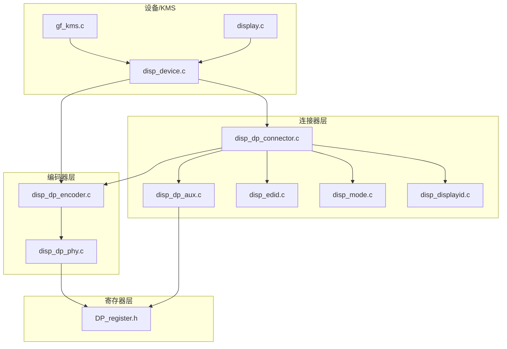
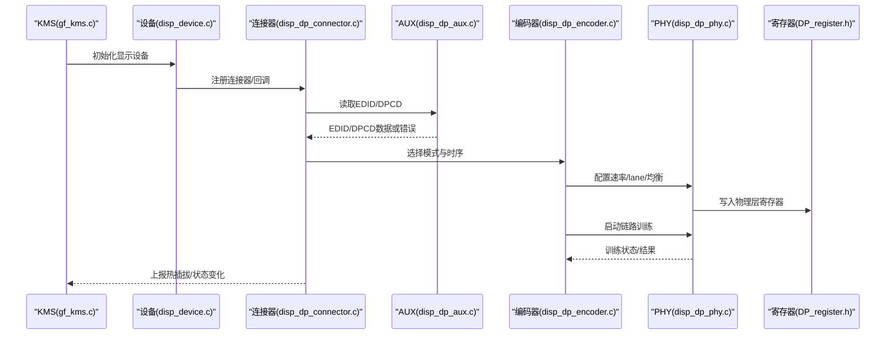
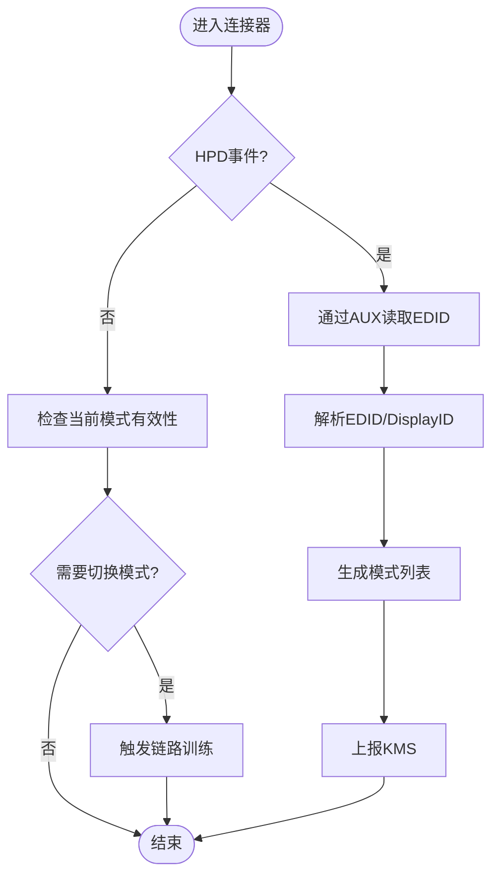
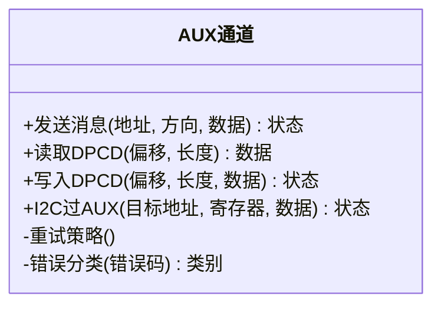
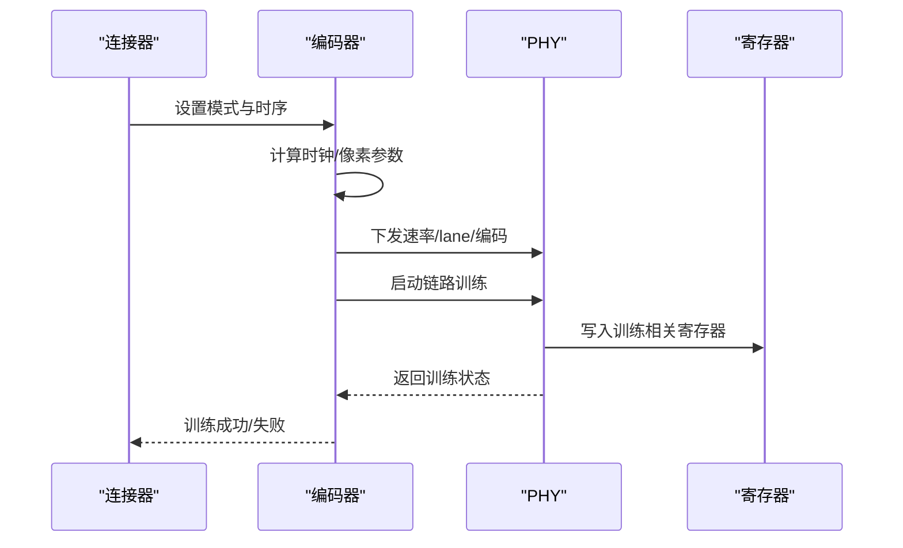
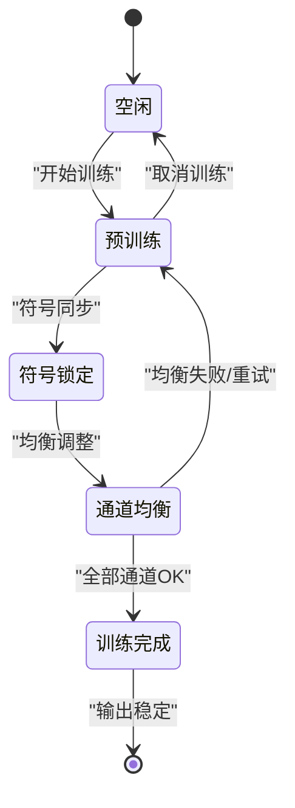
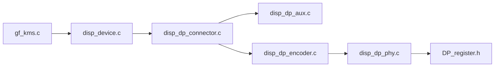

# DisplayPort连接器实现

<cite>
**本文引用的文件**
- [disp_dp_connector.c](file://_work/src/usr/src/lisuangpu-dkms-262.2.0.56/display/connector/disp_dp_connector.c)
- [disp_dp_connector.h](file://_work/src/usr/src/lisuangpu-dkms-262.2.0.56/display/connector/disp_dp_connector.h)
- [disp_dp_aux.c](file://_work/src/usr/src/lisuangpu-dkms-262.2.0.56/display/connector/disp_dp_aux.c)
- [disp_dp_aux.h](file://_work/src/usr/src/lisuangpu-dkms-262.2.0.56/display/connector/disp_dp_aux.h)
- [disp_dp_encoder.c](file://_work/src/usr/src/lisuangpu-dkms-262.2.0.56/display/encoder/disp_dp_encoder.c)
- [disp_dp_encoder.h](file://_work/src/usr/src/lisuangpu-dkms-262.2.0.56/display/encoder/disp_dp_encoder.h)
- [disp_dp_phy.c](file://_work/src/usr/src/lisuangpu-dkms-262.2.0.56/display/encoder/disp_dp_phy.c)
- [disp_dp_phy.h](file://_work/src/usr/src/lisuangpu-dkms-262.2.0.56/display/encoder/disp_dp_phy.h)
- [DP_register.h](file://_work/src/usr/src/lisuangpu-dkms-262.2.0.56/display/register/DP_register.h)
- [disp_edid.c](file://_work/src/usr/src/lisuangpu-dkms-262.2.0.56/display/connector/disp_edid.c)
- [disp_edid.h](file://_work/src/usr/src/lisuangpu-dkms-262.2.0.56/display/connector/disp_edid.h)
- [disp_mode.c](file://_work/src/usr/src/lisuangpu-dkms-262.2.0.56/display/connector/disp_mode.c)
- [disp_mode.h](file://_work/src/usr/src/lisuangpu-dkms-262.2.0.56/display/connector/disp_mode.h)
- [disp_displayid.c](file://_work/src/usr/src/lisuangpu-dkms-262.2.0.56/display/connector/disp_displayid.c)
- [disp_displayid.h](file://_work/src/usr/src/lisuangpu-dkms-262.2.0.56/display/connector/disp_displayid.h)
- [disp_device.c](file://_work/src/usr/src/lisuangpu-dkms-262.2.0.56/display/disp_device.c)
- [disp_device.h](file://_work/src/usr/src/lisuangpu-dkms-262.2.0.56/display/disp_device.h)
- [display.c](file://_work/src/usr/src/lisuangpu-dkms-262.2.0.56/display/display.c)
- [display.h](file://_work/src/usr/src/lisuangpu-dkms-262.2.0.56/display/display.h)
- [gf_kms.c](file://_work/src/usr/src/lisuangpu-dkms-262.2.0.56/kms/gf_kms.c)
- [gf_kms.h](file://_work/src/usr/src/lisuangpu-dkms-262.2.0.56/kms/gf_kms.h)
</cite>

## 目录
1. [简介](#简介)
2. [项目结构](#项目结构)
3. [核心组件](#核心组件)
4. [架构总览](#架构总览)
5. [详细组件分析](#详细组件分析)
6. [依赖关系分析](#依赖关系分析)
7. [性能考虑](#性能考虑)
8. [故障排查指南](#故障排查指南)
9. [结论](#结论)
10. [附录](#附录)

## 简介
本文件面向丽山GPU的DisplayPort（DP）连接器实现，系统性说明物理层配置、链路训练流程、DPCD读写机制、AUX通道通信协议与错误处理，以及多显示器支持、MST（多流传输）和热插拔检测的实现要点。文档同时提供DP模式配置示例与调试方法，帮助读者快速定位问题并优化显示子系统行为。

## 项目结构
本项目将DP相关功能按“连接器—编码器—PHY—寄存器”分层组织：
- 连接器层：负责EDID解析、模式枚举、热插拔事件、AUX通道封装、DPCD访问等
- 编码器层：负责DP编码、时钟/像素流水线控制、MST拓扑管理
- PHY层：负责DP物理层收发器配置、链路训练状态机、速率/ lane数协商
- 寄存器层：定义DP相关寄存器位域，供上层驱动读写
- KMS接口：向上层暴露KMS API，协调连接器/编码器/设备初始化

图表来源
- [disp_dp_connector.c](file://_work/src/usr/src/lisuangpu-dkms-262.2.0.56/display/connector/disp_dp_connector.c)
- [disp_dp_aux.c](file://_work/src/usr/src/lisuangpu-dkms-262.2.0.56/display/connector/disp_dp_aux.c)
- [disp_edid.c](file://_work/src/usr/src/lisuangpu-dkms-262.2.0.56/display/connector/disp_edid.c)
- [disp_mode.c](file://_work/src/usr/src/lisuangpu-dkms-262.2.0.56/display/connector/disp_mode.c)
- [disp_displayid.c](file://_work/src/usr/src/lisuangpu-dkms-262.2.0.56/display/connector/disp_displayid.c)
- [disp_dp_encoder.c](file://_work/src/usr/src/lisuangpu-dkms-262.2.0.56/display/encoder/disp_dp_encoder.c)
- [disp_dp_phy.c](file://_work/src/usr/src/lisuangpu-dkms-262.2.0.56/display/encoder/disp_dp_phy.c)
- [DP_register.h](file://_work/src/usr/src/lisuangpu-dkms-262.2.0.56/display/register/DP_register.h)
- [disp_device.c](file://_work/src/usr/src/lisuangpu-dkms-262.2.0.56/display/disp_device.c)
- [gf_kms.c](file://_work/src/usr/src/lisuangpu-dkms-262.2.0.56/kms/gf_kms.c)
- [display.c](file://_work/src/usr/src/lisuangpu-dkms-262.2.0.56/display/display.c)

章节来源
- [disp_dp_connector.c](file://_work/src/usr/src/lisuangpu-dkms-262.2.0.56/display/connector/disp_dp_connector.c)
- [disp_dp_encoder.c](file://_work/src/usr/src/lisuangpu-dkms-262.2.0.56/display/encoder/disp_dp_encoder.c)
- [disp_dp_phy.c](file://_work/src/usr/src/lisuangpu-dkms-262.2.0.56/display/encoder/disp_dp_phy.c)
- [DP_register.h](file://_work/src/usr/src/lisuangpu-dkms-262.2.0.56/display/register/DP_register.h)
- [disp_device.c](file://_work/src/usr/src/lisuangpu-dkms-262.2.0.56/display/disp_device.c)
- [gf_kms.c](file://_work/src/usr/src/lisuangpu-dkms-262.2.0.56/kms/gf_kms.c)
- [display.c](file://_work/src/usr/src/lisuangpu-dkms-262.2.0.56/display/display.c)

## 核心组件
- DP连接器（disp_dp_connector）：封装DP连接器的生命周期、热插拔检测、EDID读取、模式枚举、DPCD访问入口、MST桥接发现等
- AUX通道（disp_dp_aux）：实现DP AUX/I2C-over-AUX事务、重试与超时、错误码映射、缓冲管理
- DP编码器（disp_dp_encoder）：负责DP时序生成、像素/时钟配置、链路参数下发、MST拓扑控制
- DP PHY（disp_dp_phy）：物理层收发器配置、链路训练状态机、速率/lane协商、均衡与预加重设置
- 寄存器定义（DP_register.h）：DP控制器与PHY寄存器位域、中断标志、状态字段
- EDID与DisplayID（disp_edid / disp_displayid）：EDID块解析、扩展能力提取、DisplayID解析
- 模式枚举（disp_mode）：根据EDID/DisplayID与硬件限制计算有效模式与时序
- 设备与KMS（disp_device / gf_kms / display）：设备初始化、连接器注册、KMS属性绑定、事件上报

章节来源
- [disp_dp_connector.c](file://_work/src/usr/src/lisuangpu-dkms-262.2.0.56/display/connector/disp_dp_connector.c)
- [disp_dp_aux.c](file://_work/src/usr/src/lisuangpu-dkms-262.2.0.56/display/connector/disp_dp_aux.c)
- [disp_dp_encoder.c](file://_work/src/usr/src/lisuangpu-dkms-262.2.0.56/display/encoder/disp_dp_encoder.c)
- [disp_dp_phy.c](file://_work/src/usr/src/lisuangpu-dkms-262.2.0.56/display/encoder/disp_dp_phy.c)
- [DP_register.h](file://_work/src/usr/src/lisuangpu-dkms-262.2.0.56/display/register/DP_register.h)
- [disp_edid.c](file://_work/src/usr/src/lisuangpu-dkms-262.2.0.56/display/connector/disp_edid.c)
- [disp_displayid.c](file://_work/src/usr/src/lisuangpu-dkms-262.2.0.56/display/connector/disp_displayid.c)
- [disp_mode.c](file://_work/src/usr/src/lisuangpu-dkms-262.2.0.56/display/connector/disp_mode.c)
- [disp_device.c](file://_work/src/usr/src/lisuangpu-dkms-262.2.0.56/display/disp_device.c)
- [gf_kms.c](file://_work/src/usr/src/lisuangpu-dkms-262.2.0.56/kms/gf_kms.c)
- [display.c](file://_work/src/usr/src/lisuangpu-dkms-262.2.0.56/display/display.c)

## 架构总览
下图展示了从KMS到物理层的调用路径，涵盖热插拔、EDID/DPCD读取、链路训练与模式设置的典型流程。

图表来源
- [gf_kms.c](file://_work/src/usr/src/lisuangpu-dkms-262.2.0.56/kms/gf_kms.c)
- [disp_device.c](file://_work/src/usr/src/lisuangpu-dkms-262.2.0.56/display/disp_device.c)
- [disp_dp_connector.c](file://_work/src/usr/src/lisuangpu-dkms-262.2.0.56/display/connector/disp_dp_connector.c)
- [disp_dp_aux.c](file://_work/src/usr/src/lisuangpu-dkms-262.2.0.56/display/connector/disp_dp_aux.c)
- [disp_dp_encoder.c](file://_work/src/usr/src/lisuangpu-dkms-262.2.0.56/display/encoder/disp_dp_encoder.c)
- [disp_dp_phy.c](file://_work/src/usr/src/lisuangpu-dkms-262.2.0.56/display/encoder/disp_dp_phy.c)
- [DP_register.h](file://_work/src/usr/src/lisuangpu-dkms-262.2.0.56/display/register/DP_register.h)

## 详细组件分析

### DP连接器（disp_dp_connector）
- 职责
  - 热插拔检测：通过HPD引脚/中断触发，更新连接器状态
  - EDID读取：经AUX通道读取EDID，解析能力与最大分辨率/刷新率
  - 模式枚举：结合EDID/DisplayID与硬件限制，生成可用模式列表
  - DPCD访问：封装DPCD读/写，用于查询链路能力、MST拓扑、面板能力
  - MST支持：枚举下游端口、桥接设备，维护拓扑树
- 关键流程
  - 热插拔回调：清理缓存、重新读取EDID、通知上层
  - 模式匹配：根据请求模式与EDID能力进行裁剪与验证
  - DPCD读写：统一错误处理与重试策略

图表来源
- [disp_dp_connector.c](file://_work/src/usr/src/lisuangpu-dkms-262.2.0.56/display/connector/disp_dp_connector.c)
- [disp_edid.c](file://_work/src/usr/src/lisuangpu-dkms-262.2.0.56/display/connector/disp_edid.c)
- [disp_displayid.c](file://_work/src/usr/src/lisuangpu-dkms-262.2.0.56/display/connector/disp_displayid.c)
- [disp_mode.c](file://_work/src/usr/src/lisuangpu-dkms-262.2.0.56/display/connector/disp_mode.c)

章节来源
- [disp_dp_connector.c](file://_work/src/usr/src/lisuangpu-dkms-262.2.0.56/display/connector/disp_dp_connector.c)
- [disp_edid.c](file://_work/src/usr/src/lisuangpu-dkms-262.2.0.56/display/connector/disp_edid.c)
- [disp_displayid.c](file://_work/src/usr/src/lisuangpu-dkms-262.2.0.56/display/connector/disp_displayid.c)
- [disp_mode.c](file://_work/src/usr/src/lisuangpu-dkms-262.2.0.56/display/connector/disp_mode.c)

### AUX通道（disp_dp_aux）
- 职责
  - 实现DP AUX事务：读/写DPCD、I2C-over-AUX、消息分段与重试
  - 错误处理：超时、NACK、CRC校验失败、缓冲区溢出等
  - 并发与同步：保护AUX总线独占访问，避免竞态
- 数据格式
  - AUX消息头包含地址、方向、长度、命令类型
  - 数据载荷按固定大小分片，必要时启用重试与退避
- 错误处理策略
  - 区分可恢复错误（如临时忙）与不可恢复错误（如设备无响应）
  - 记录错误计数与诊断信息，便于上层决策

图表来源
- [disp_dp_aux.c](file://_work/src/usr/src/lisuangpu-dkms-262.2.0.56/display/connector/disp_dp_aux.c)
- [DP_register.h](file://_work/src/usr/src/lisuangpu-dkms-262.2.0.56/display/register/DP_register.h)

章节来源
- [disp_dp_aux.c](file://_work/src/usr/src/lisuangpu-dkms-262.2.0.56/display/connector/disp_dp_aux.c)
- [DP_register.h](file://_work/src/usr/src/lisuangpu-dkms-262.2.0.56/display/register/DP_register.h)

### DP编码器（disp_dp_encoder）
- 职责
  - 模式应用：根据所选模式配置像素时钟、扫描方式、极性与时序
  - 链路参数：下发速率、lane数、编码格式（如8b/10b或128b/132b）
  - MST拓扑：管理上游/下游端口、分支设备、流分配
- 关键流程
  - 模式设置：计算时钟、配置PLL与时基
  - 链路训练：触发PHY训练，监控状态位，失败回退

图表来源
- [disp_dp_encoder.c](file://_work/src/usr/src/lisuangpu-dkms-262.2.0.56/display/encoder/disp_dp_encoder.c)
- [disp_dp_phy.c](file://_work/src/usr/src/lisuangpu-dkms-262.2.0.56/display/encoder/disp_dp_phy.c)
- [DP_register.h](file://_work/src/usr/src/lisuangpu-dkms-262.2.0.56/display/register/DP_register.h)

章节来源
- [disp_dp_encoder.c](file://_work/src/usr/src/lisuangpu-dkms-262.2.0.56/display/encoder/disp_dp_encoder.c)
- [disp_dp_phy.c](file://_work/src/usr/src/lisuangpu-dkms-262.2.0.56/display/encoder/disp_dp_phy.c)
- [DP_register.h](file://_work/src/usr/src/lisuangpu-dkms-262.2.0.56/display/register/DP_register.h)

### DP PHY（disp_dp_phy）
- 职责
  - 物理层配置：速率（1.62/2.7/5.4/8.1 Gbps）、lane数（1/2/4）、预加重与均衡
  - 链路训练状态机：符号锁定、通道均衡、比特对齐、训练完成判定
  - 错误恢复：训练失败回退、重试、降级速率
- 关键状态
  - 空闲、预训练、符号锁定、通道均衡、训练完成、失败

图表来源
- [disp_dp_phy.c](file://_work/src/usr/src/lisuangpu-dkms-262.2.0.56/display/encoder/disp_dp_phy.c)
- [DP_register.h](file://_work/src/usr/src/lisuangpu-dkms-262.2.0.56/display/register/DP_register.h)

章节来源
- [disp_dp_phy.c](file://_work/src/usr/src/lisuangpu-dkms-262.2.0.56/display/encoder/disp_dp_phy.c)
- [DP_register.h](file://_work/src/usr/src/lisuangpu-dkms-262.2.0.56/display/register/DP_register.h)

### EDID与DisplayID解析
- EDID：读取制造商/产品ID、支持的最大分辨率/刷新率、颜色深度、HDMI/DP能力
- DisplayID：扩展能力描述，如VESA标准、HDR、可变刷新率等
- 模式生成：基于EDID/DisplayID与硬件限制，过滤无效模式，生成最优候选

章节来源
- [disp_edid.c](file://_work/src/usr/src/lisuangpu-dkms-262.2.0.56/display/connector/disp_edid.c)
- [disp_displayid.c](file://_work/src/usr/src/lisuangpu-dkms-262.2.0.56/display/connector/disp_displayid.c)
- [disp_mode.c](file://_work/src/usr/src/lisuangpu-dkms-262.2.0.56/display/connector/disp_mode.c)

### 设备与KMS集成
- 设备初始化：注册连接器、编码器、PHY、中断与电源管理
- KMS接口：暴露连接器属性、模式设置、原子提交、事件上报
- 事件上报：热插拔、模式变更、训练状态变化

章节来源
- [disp_device.c](file://_work/src/usr/src/lisuangpu-dkms-262.2.0.56/display/disp_device.c)
- [gf_kms.c](file://_work/src/usr/src/lisuangpu-dkms-262.2.0.56/kms/gf_kms.c)
- [display.c](file://_work/src/usr/src/lisuangpu-dkms-262.2.0.56/display/display.c)

## 依赖关系分析
- 连接器依赖AUX进行EDID/DPCD访问，依赖编码器进行模式应用
- 编码器依赖PHY进行物理层配置与链路训练
- PHY依赖寄存器定义进行底层操作
- 设备/KMS作为顶层编排，协调各组件生命周期与事件

图表来源
- [gf_kms.c](file://_work/src/usr/src/lisuangpu-dkms-262.2.0.56/kms/gf_kms.c)
- [disp_device.c](file://_work/src/usr/src/lisuangpu-dkms-262.2.0.56/display/disp_device.c)
- [disp_dp_connector.c](file://_work/src/usr/src/lisuangpu-dkms-262.2.0.56/display/connector/disp_dp_connector.c)
- [disp_dp_aux.c](file://_work/src/usr/src/lisuangpu-dkms-262.2.0.56/display/connector/disp_dp_aux.c)
- [disp_dp_encoder.c](file://_work/src/usr/src/lisuangpu-dkms-262.2.0.56/display/encoder/disp_dp_encoder.c)
- [disp_dp_phy.c](file://_work/src/usr/src/lisuangpu-dkms-262.2.0.56/display/encoder/disp_dp_phy.c)
- [DP_register.h](file://_work/src/usr/src/lisuangpu-dkms-262.2.0.56/display/register/DP_register.h)

章节来源
- [disp_dp_connector.c](file://_work/src/usr/src/lisuangpu-dkms-262.2.0.56/display/connector/disp_dp_connector.c)
- [disp_dp_encoder.c](file://_work/src/usr/src/lisuangpu-dkms-262.2.0.56/display/encoder/disp_dp_encoder.c)
- [disp_dp_phy.c](file://_work/src/usr/src/lisuangpu-dkms-262.2.0.56/display/encoder/disp_dp_phy.c)
- [DP_register.h](file://_work/src/usr/src/lisuangpu-dkms-262.2.0.56/display/register/DP_register.h)
- [disp_device.c](file://_work/src/usr/src/lisuangpu-dkms-262.2.0.56/display/disp_device.c)
- [gf_kms.c](file://_work/src/usr/src/lisuangpu-dkms-262.2.0.56/kms/gf_kms.c)

## 性能考虑
- AUX通道优化：批量读取EDID/DPCD、减少重试次数、合理设置超时
- 链路训练优化：优先尝试高带宽组合，失败时快速回退；避免频繁重训
- 模式选择：优先选择EDID首选模式，减少不必要的时序计算
- 资源占用：避免在热点路径中分配大内存，使用环形缓冲与零拷贝
- 中断与轮询：合理使用中断降低CPU占用，轮询用于关键状态检查

[本节为通用指导，不直接分析具体文件]

## 故障排查指南
- AUX通道错误
  - 现象：DPCD读取失败、EDID为空、I2C-over-AUX超时
  - 排查：检查AUX总线电平、线缆质量、重试策略与超时配置
  - 参考：AUX错误分类与重试逻辑
- 链路训练失败
  - 现象：无法建立显示、闪烁、黑屏
  - 排查：确认速率/lane配置、均衡与预加重设置、线缆等级
  - 参考：PHY状态机与训练失败回退
- 热插拔异常
  - 现象：未检测到显示器、重复插拔抖动
  - 排查：HPD引脚配置、去抖滤波、中断屏蔽
  - 参考：连接器热插拔回调与状态更新
- 模式不生效
  - 现象：分辨率/刷新率不符合预期
  - 排查：EDID能力、DisplayID扩展、模式裁剪规则
  - 参考：模式枚举与验证流程

章节来源
- [disp_dp_aux.c](file://_work/src/usr/src/lisuangpu-dkms-262.2.0.56/display/connector/disp_dp_aux.c)
- [disp_dp_connector.c](file://_work/src/usr/src/lisuangpu-dkms-262.2.0.56/display/connector/disp_dp_connector.c)
- [disp_dp_phy.c](file://_work/src/usr/src/lisuangpu-dkms-262.2.0.56/display/encoder/disp_dp_phy.c)
- [disp_mode.c](file://_work/src/usr/src/lisuangpu-dkms-262.2.0.56/display/connector/disp_mode.c)

## 结论
丽山GPU的DP连接器实现以清晰的层次化设计，将AUX通道、DPCD读写、EDID/DisplayID解析、模式枚举、链路训练与MST拓扑管理有机结合。通过合理的错误处理与性能优化，能够在复杂显示环境中保持稳定与高效。建议在实际部署中关注线缆质量、PHY配置与AUX超时策略，以获得最佳显示体验。

[本节为总结性内容，不直接分析具体文件]

## 附录
- DP模式配置示例
  - 步骤：读取EDID → 选择首选模式 → 计算时钟与时序 → 配置编码器 → 启动链路训练 → 验证输出
  - 关键点：确保模式不超过EDID能力与硬件限制；训练失败时自动回退
- 调试方法
  - 启用AUX日志：记录DPCD读写与错误码
  - 观察PHY状态：打印训练状态机转换与失败原因
  - 模式验证：对比EDID能力与实际输出，定位裁剪规则
  - 热插拔跟踪：记录HPD事件与状态变化，排查抖动与误报

[本节为概念性指导，不直接分析具体文件]