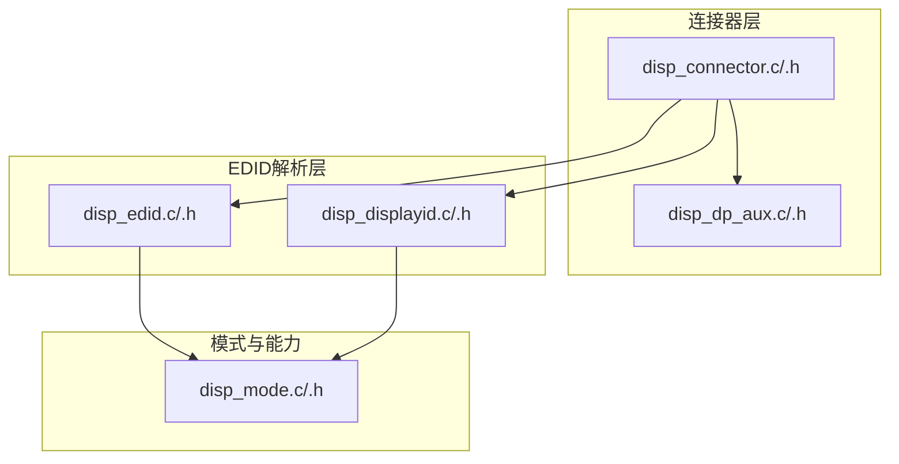
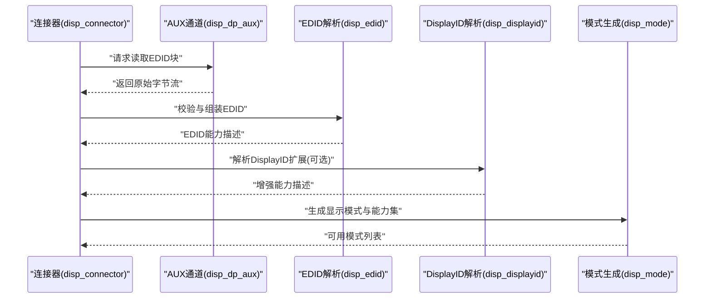
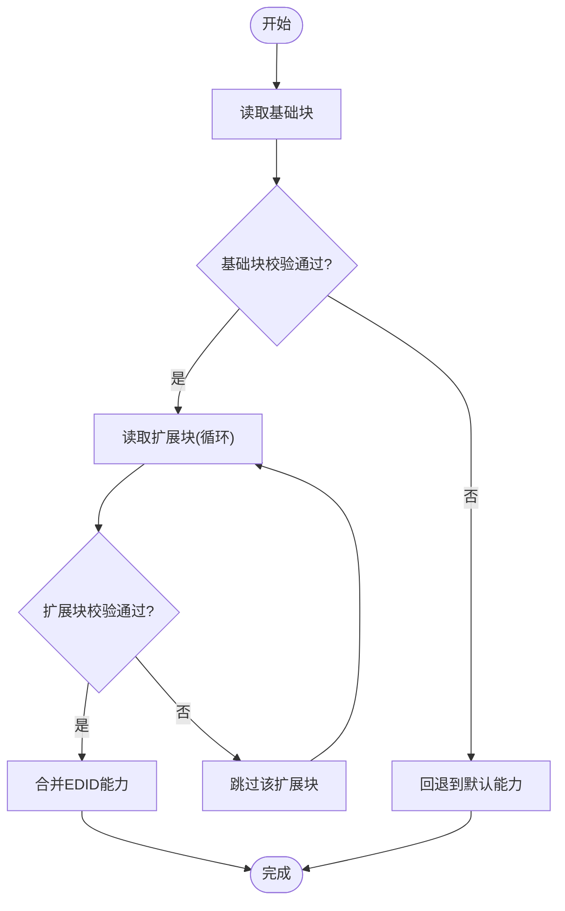
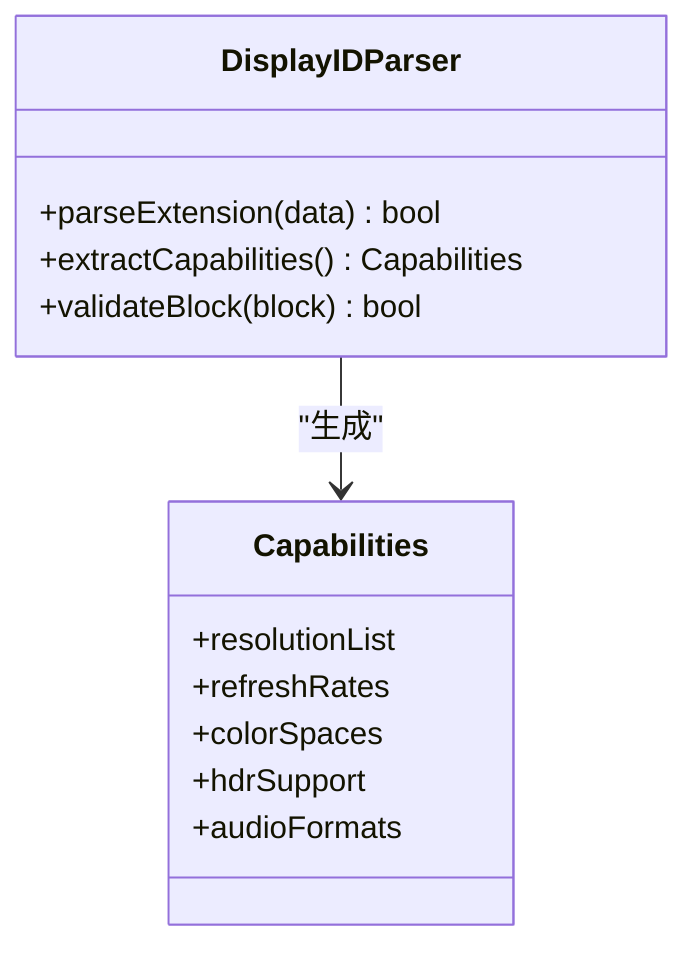
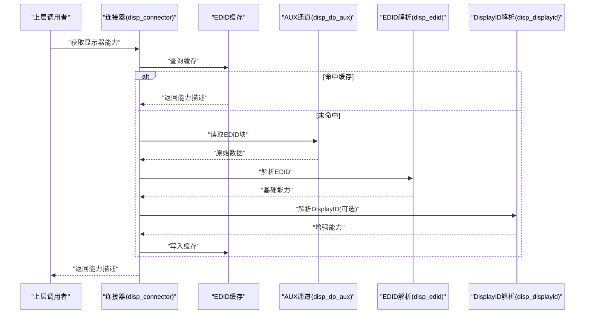
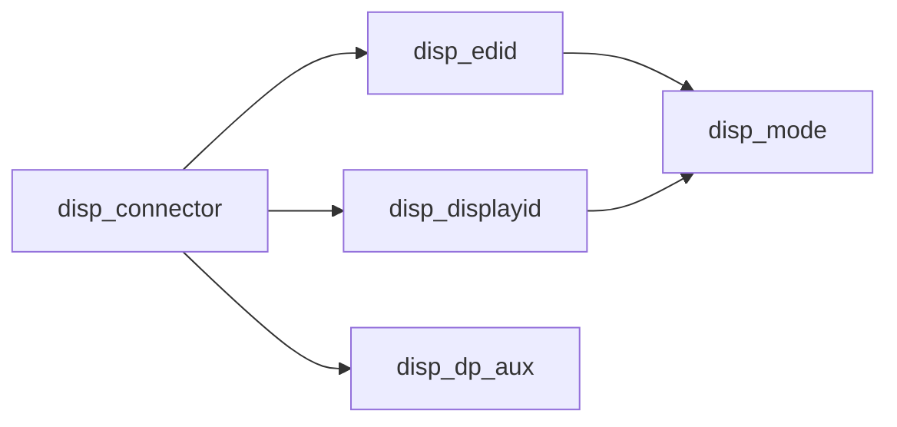

# EDID解析与处理

<cite>
**本文档引用的文件**   
- [disp_edid.c](file://_work/src/usr/src/lisuangpu-dkms-262.2.0.56/display/connector/disp_edid.c)
- [disp_edid.h](file://_work/src/usr/src/lisuangpu-dkms-262.2.0.56/display/connector/disp_edid.h)
- [disp_displayid.c](file://_work/src/usr/src/lisuangpu-dkms-262.2.0.56/display/connector/disp_displayid.c)
- [disp_displayid.h](file://_work/src/usr/src/lisuangpu-dkms-262.2.0.56/display/connector/disp_displayid.h)
- [disp_connector.c](file://_work/src/usr/src/lisuangpu-dkms-262.2.0.56/display/connector/disp_connector.c)
- [disp_connector.h](file://_work/src/usr/src/lisuangpu-dkms-262.2.0.56/display/connector/disp_connector.h)
- [disp_dp_aux.c](file://_work/src/usr/src/lisuangpu-dkms-262.2.0.56/display/connector/disp_dp_aux.c)
- [disp_dp_aux.h](file://_work/src/usr/src/lisuangpu-dkms-262.2.0.56/display/connector/disp_dp_aux.h)
- [disp_mode.c](file://_work/src/usr/src/lisuangpu-dkms-262.2.0.56/display/connector/disp_mode.c)
- [disp_mode.h](file://_work/src/usr/src/lisuangpu-dkms-262.2.0.56/display/connector/disp_mode.h)
</cite>

## 目录
1. [简介](#简介)
2. [项目结构](#项目结构)
3. [核心组件](#核心组件)
4. [架构总览](#架构总览)
5. [详细组件分析](#详细组件分析)
6. [依赖关系分析](#依赖关系分析)
7. [性能考虑](#性能考虑)
8. [故障排查指南](#故障排查指南)
9. [结论](#结论)
10. [附录](#附录)

## 简介
本文件面向丽山GPU显示子系统的EDID（Extended Display Identification Data）解析与处理能力，系统性说明EDID标准数据结构、解析流程、验证机制，以及对DisplayID扩展的支持。文档还涵盖自定义显示能力处理、EDID缓存策略、读取失败回退策略、显示器能力检测算法，并提供数据处理示例与调试工具使用建议，帮助开发者快速定位问题并优化系统行为。

## 项目结构
与EDID相关的关键代码位于display/connector目录下，主要包含：
- EDID解析与校验模块：disp_edid.c/.h
- DisplayID扩展解析模块：disp_displayid.c/.h
- 连接器抽象与调用入口：disp_connector.c/.h
- DP AUX通道读写：disp_dp_aux.c/.h
- 模式生成与能力聚合：disp_mode.c/.h

图表来源
- [disp_connector.c](file://_work/src/usr/src/lisuangpu-dkms-262.2.0.56/display/connector/disp_connector.c)
- [disp_dp_aux.c](file://_work/src/usr/src/lisuangpu-dkms-262.2.0.56/display/connector/disp_dp_aux.c)
- [disp_edid.c](file://_work/src/usr/src/lisuangpu-dkms-262.2.0.56/display/connector/disp_edid.c)
- [disp_displayid.c](file://_work/src/usr/src/lisuangpu-dkms-262.2.0.56/display/connector/disp_displayid.c)
- [disp_mode.c](file://_work/src/usr/src/lisuangpu-dkms-262.2.0.56/display/connector/disp_mode.c)

章节来源
- [disp_connector.c](file://_work/src/usr/src/lisuangpu-dkms-262.2.0.56/display/connector/disp_connector.c)
- [disp_edid.c](file://_work/src/usr/src/lisuangpu-dkms-262.2.0.56/display/connector/disp_edid.c)
- [disp_displayid.c](file://_work/src/usr/src/lisuangpu-dkms-262.2.0.56/display/connector/disp_displayid.c)
- [disp_mode.c](file://_work/src/usr/src/lisuangpu-dkms-262.2.0.56/display/connector/disp_mode.c)

## 核心组件
- EDID解析器（disp_edid）：负责从I2C/DP AUX读取EDID块，校验基础块与扩展块，构建统一的显示器能力描述。
- DisplayID解析器（disp_displayid）：解析DisplayID扩展数据块，提取更丰富的时序、色彩、HDR、音频等能力信息。
- 连接器接口（disp_connector）：封装具体物理接口（如HDMI/DP/DVO），提供EDID读取、重试、缓存与回退的统一入口。
- AUX通道（disp_dp_aux）：为DP链路提供低层读写能力，用于EDID与DisplayID数据的传输。
- 模式与能力（disp_mode）：将EDID/DisplayID能力转换为系统可用的显示模式列表与能力位图。

章节来源
- [disp_edid.c](file://_work/src/usr/src/lisuangpu-dkms-262.2.0.56/display/connector/disp_edid.c)
- [disp_edid.h](file://_work/src/usr/src/lisuangpu-dkms-262.2.0.56/display/connector/disp_edid.h)
- [disp_displayid.c](file://_work/src/usr/src/lisuangpu-dkms-262.2.0.56/display/connector/disp_displayid.c)
- [disp_displayid.h](file://_work/src/usr/src/lisuangpu-dkms-262.2.0.56/display/connector/disp_displayid.h)
- [disp_connector.c](file://_work/src/usr/src/lisuangpu-dkms-262.2.0.56/display/connector/disp_connector.c)
- [disp_connector.h](file://_work/src/usr/src/lisuangpu-dkms-262.2.0.56/display/connector/disp_connector.h)
- [disp_dp_aux.c](file://_work/src/usr/src/lisuangpu-dkms-262.2.0.56/display/connector/disp_dp_aux.c)
- [disp_dp_aux.h](file://_work/src/usr/src/lisuangpu-dkms-262.2.0.56/display/connector/disp_dp_aux.h)
- [disp_mode.c](file://_work/src/usr/src/lisuangpu-dkms-262.2.0.56/display/connector/disp_mode.c)
- [disp_mode.h](file://_work/src/usr/src/lisuangpu-dkms-262.2.0.56/display/connector/disp_mode.h)

## 架构总览
EDID读取与解析的整体流程如下：连接器根据接口类型选择底层通道（如DP AUX或I2C），按EDID规范分块读取并校验；若存在DisplayID扩展则进一步解析；最终由模式模块生成可用显示模式与能力集合。

图表来源
- [disp_connector.c](file://_work/src/usr/src/lisuangpu-dkms-262.2.0.56/display/connector/disp_connector.c)
- [disp_dp_aux.c](file://_work/src/usr/src/lisuangpu-dkms-262.2.0.56/display/connector/disp_dp_aux.c)
- [disp_edid.c](file://_work/src/usr/src/lisuangpu-dkms-262.2.0.56/display/connector/disp_edid.c)
- [disp_displayid.c](file://_work/src/usr/src/lisuangpu-dkms-262.2.0.56/display/connector/disp_displayid.c)
- [disp_mode.c](file://_work/src/usr/src/lisuangpu-dkms-262.2.0.56/display/connector/disp_mode.c)

## 详细组件分析

### EDID解析器（disp_edid）
- 功能要点
  - 分块读取基础块与扩展块，进行校验和验证。
  - 合并多块EDID，构建统一的能力描述结构。
  - 支持常见VESA标准字段解析（分辨率、刷新率、像素时钟、颜色空间等）。
- 关键流程
  - 读取基础块 → 校验 → 读取扩展块（循环）→ 合并 → 输出能力描述。
- 错误处理
  - 读取失败时记录错误码并回退到默认能力。
  - 校验失败时丢弃异常块并尝试下一块。
- 性能特性
  - 避免重复读取已缓存的EDID块。
  - 对大块数据采用增量解析，降低内存占用。

图表来源
- [disp_edid.c](file://_work/src/usr/src/lisuangpu-dkms-262.2.0.56/display/connector/disp_edid.c)
- [disp_edid.h](file://_work/src/usr/src/lisuangpu-dkms-262.2.0.56/display/connector/disp_edid.h)

章节来源
- [disp_edid.c](file://_work/src/usr/src/lisuangpu-dkms-262.2.0.56/display/connector/disp_edid.c)
- [disp_edid.h](file://_work/src/usr/src/lisuangpu-dkms-262.2.0.56/display/connector/disp_edid.h)

### DisplayID扩展解析器（disp_displayid）
- 功能要点
  - 解析DisplayID扩展数据块，提取高级能力（如高刷新率、宽色域、HDR、音频格式等）。
  - 与EDID基础能力融合，形成更完整的显示器能力描述。
- 关键流程
  - 识别DisplayID扩展标识 → 解析各功能段 → 映射为内部能力位图。
- 错误处理
  - 扩展块缺失或格式不合法时降级为仅使用EDID基础能力。
- 性能特性
  - 按需解析，仅在检测到DisplayID扩展时启用。

图表来源
- [disp_displayid.c](file://_work/src/usr/src/lisuangpu-dkms-262.2.0.56/display/connector/disp_displayid.c)
- [disp_displayid.h](file://_work/src/usr/src/lisuangpu-dkms-262.2.0.56/display/connector/disp_displayid.h)

章节来源
- [disp_displayid.c](file://_work/src/usr/src/lisuangpu-dkms-262.2.0.56/display/connector/disp_displayid.c)
- [disp_displayid.h](file://_work/src/usr/src/lisuangpu-dkms-262.2.0.56/display/connector/disp_displayid.h)

### 连接器接口（disp_connector）
- 功能要点
  - 统一EDID读取入口，屏蔽不同物理接口差异（HDMI/DP/DVO）。
  - 管理EDID缓存与失效策略。
  - 协调EDID与DisplayID解析顺序，生成最终能力集。
- 关键流程
  - 检查缓存 → 若无则调用底层读取 → 调用EDID/DisplayID解析 → 更新缓存 → 返回结果。
- 错误处理
  - 读取失败时触发重试与回退逻辑。
  - 缓存不一致时强制刷新。

图表来源
- [disp_connector.c](file://_work/src/usr/src/lisuangpu-dkms-262.2.0.56/display/connector/disp_connector.c)
- [disp_connector.h](file://_work/src/usr/src/lisuangpu-dkms-262.2.0.56/display/connector/disp_connector.h)
- [disp_dp_aux.c](file://_work/src/usr/src/lisuangpu-dkms-262.2.0.56/display/connector/disp_dp_aux.c)
- [disp_edid.c](file://_work/src/usr/src/lisuangpu-dkms-262.2.0.56/display/connector/disp_edid.c)
- [disp_displayid.c](file://_work/src/usr/src/lisuangpu-dkms-262.2.0.56/display/connector/disp_displayid.c)

章节来源
- [disp_connector.c](file://_work/src/usr/src/lisuangpu-dkms-262.2.0.56/display/connector/disp_connector.c)
- [disp_connector.h](file://_work/src/usr/src/lisuangpu-dkms-262.2.0.56/display/connector/disp_connector.h)

### AUX通道（disp_dp_aux）
- 功能要点
  - 提供DP链路的低层读写操作，用于EDID与DisplayID数据传输。
  - 处理重试、超时与错误恢复。
- 关键流程
  - 构造AUX事务 → 发送请求 → 接收响应 → 错误处理与重试。
- 错误处理
  - 通信失败时返回错误码，供上层决定回退策略。

章节来源
- [disp_dp_aux.c](file://_work/src/usr/src/lisuangpu-dkms-262.2.0.56/display/connector/disp_dp_aux.c)
- [disp_dp_aux.h](file://_work/src/usr/src/lisuangpu-dkms-262.2.0.56/display/connector/disp_dp_aux.h)

### 模式与能力（disp_mode）
- 功能要点
  - 将EDID/DisplayID能力转换为系统可用的显示模式列表。
  - 过滤不支持的模式，生成能力位图（分辨率、刷新率、色彩、HDR等）。
- 关键流程
  - 输入能力描述 → 规则匹配 → 生成模式列表 → 输出能力位图。
- 性能特性
  - 预计算常用模式，减少运行时开销。

章节来源
- [disp_mode.c](file://_work/src/usr/src/lisuangpu-dkms-262.2.0.56/display/connector/disp_mode.c)
- [disp_mode.h](file://_work/src/usr/src/lisuangpu-dkms-262.2.0.56/display/connector/disp_mode.h)

## 依赖关系分析
EDID子系统各组件之间的依赖关系如下：

图表来源
- [disp_connector.c](file://_work/src/usr/src/lisuangpu-dkms-262.2.0.56/display/connector/disp_connector.c)
- [disp_edid.c](file://_work/src/usr/src/lisuangpu-dkms-262.2.0.56/display/connector/disp_edid.c)
- [disp_displayid.c](file://_work/src/usr/src/lisuangpu-dkms-262.2.0.56/display/connector/disp_displayid.c)
- [disp_dp_aux.c](file://_work/src/usr/src/lisuangpu-dkms-262.2.0.56/display/connector/disp_dp_aux.c)
- [disp_mode.c](file://_work/src/usr/src/lisuangpu-dkms-262.2.0.56/display/connector/disp_mode.c)

章节来源
- [disp_connector.c](file://_work/src/usr/src/lisuangpu-dkms-262.2.0.56/display/connector/disp_connector.c)
- [disp_edid.c](file://_work/src/usr/src/lisuangpu-dkms-262.2.0.56/display/connector/disp_edid.c)
- [disp_displayid.c](file://_work/src/usr/src/lisuangpu-dkms-262.2.0.56/display/connector/disp_displayid.c)
- [disp_dp_aux.c](file://_work/src/usr/src/lisuangpu-dkms-262.2.0.56/display/connector/disp_dp_aux.c)
- [disp_mode.c](file://_work/src/usr/src/lisuangpu-dkms-262.2.0.56/display/connector/disp_mode.c)

## 性能考虑
- 缓存策略
  - 在连接器层维护EDID缓存，避免重复读取。
  - 支持热插拔事件触发缓存失效与重新解析。
- 解析优化
  - 仅解析必要的扩展块，减少CPU与内存占用。
  - 对DisplayID扩展进行懒加载，仅在需要时启用。
- I/O优化
  - 批量读取与重试机制，降低AUX/I2C通信失败的影响。
  - 超时控制与错误快速失败，避免阻塞主线程。

[本节为通用指导，无需特定文件引用]

## 故障排查指南
- 常见问题
  - EDID读取失败：检查AUX/I2C通道状态、线缆连接与显示器供电。
  - 校验失败：确认EDID块完整性，必要时强制刷新缓存。
  - DisplayID解析异常：降级为EDID基础能力，确保基本显示正常。
- 调试步骤
  - 启用详细日志，观察读取与解析过程。
  - 使用调试接口导出原始EDID数据进行分析。
  - 验证缓存一致性，必要时清除缓存并重试。
- 回退策略
  - 读取失败时回退到默认模式，保证最小可用显示能力。
  - 自定义显示能力作为最后手段，仅在明确配置时启用。

章节来源
- [disp_connector.c](file://_work/src/usr/src/lisuangpu-dkms-262.2.0.56/display/connector/disp_connector.c)
- [disp_edid.c](file://_work/src/usr/src/lisuangpu-dkms-262.2.0.56/display/connector/disp_edid.c)
- [disp_displayid.c](file://_work/src/usr/src/lisuangpu-dkms-262.2.0.56/display/connector/disp_displayid.c)

## 结论
丽山GPU EDID解析系统通过模块化设计实现了稳健的EDID与DisplayID解析能力，结合缓存与回退策略，确保在不同硬件与连接条件下都能提供可靠的显示能力检测与模式生成。开发者可基于本文档进行定制开发与问题定位，充分利用系统提供的调试接口与优化机制。

[本节为总结性内容，无需特定文件引用]

## 附录
- EDID数据结构参考
  - 基础块：制造商信息、产品代码、序列号、制造周/年、EDID版本、显示器类型、屏幕尺寸、颜色特性、时序表等。
  - 扩展块：CEA-861、VESA DMT/VIC、DisplayID等，用于扩展能力描述。
- 数据处理示例
  - 读取EDID原始数据 → 校验与解析 → 生成能力描述 → 转换为显示模式。
- 调试工具使用
  - 启用内核日志级别以捕获EDID读取细节。
  - 导出原始EDID二进制文件进行离线分析。
  - 模拟EDID数据测试解析器健壮性。

[本节为概念性内容，无需特定文件引用]