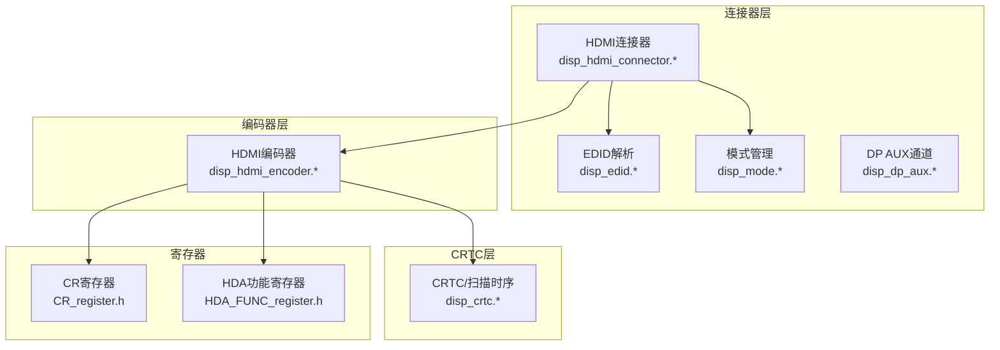
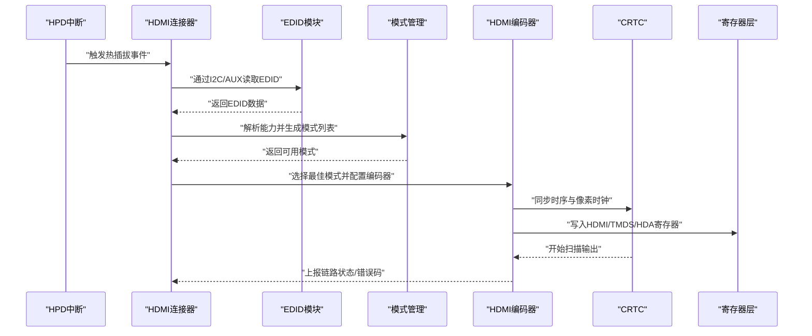
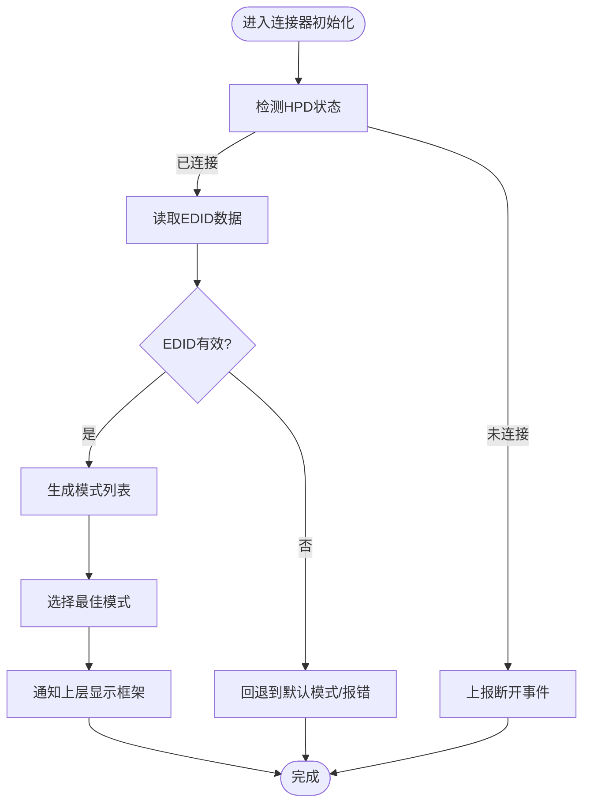
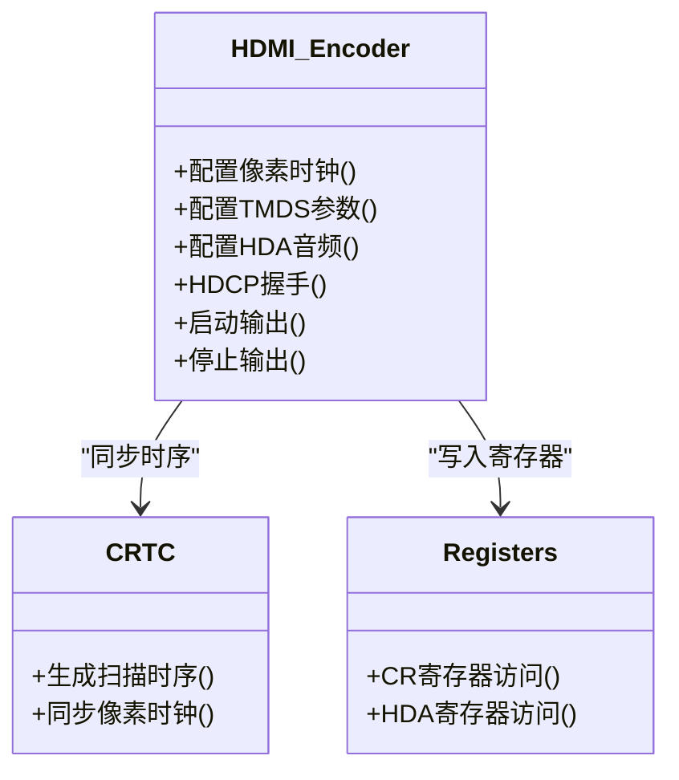
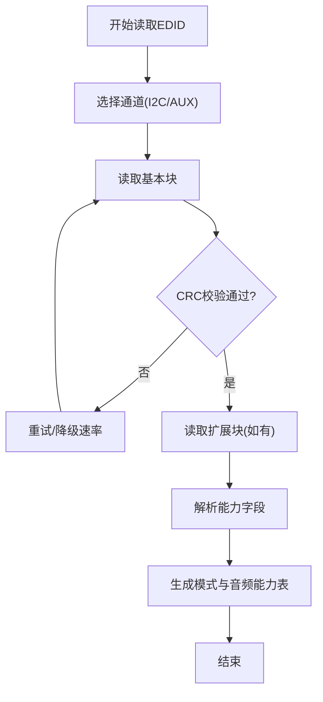
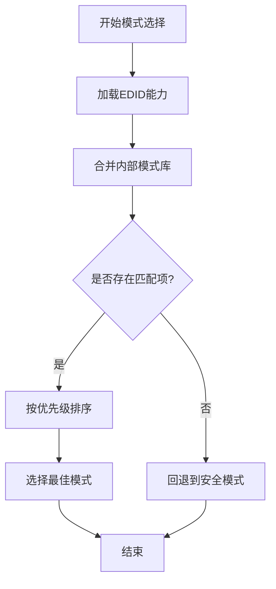
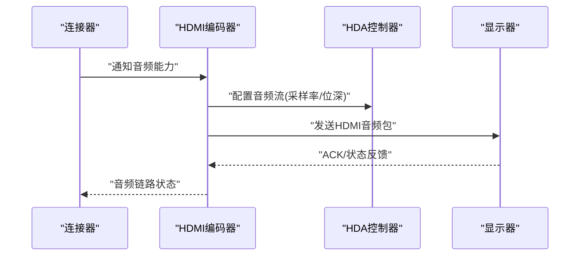
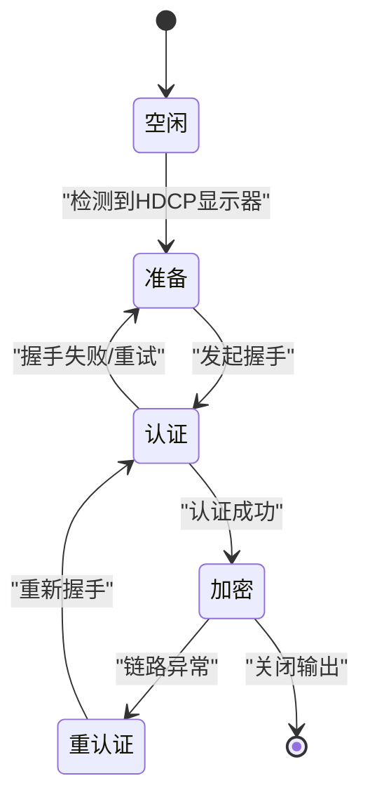
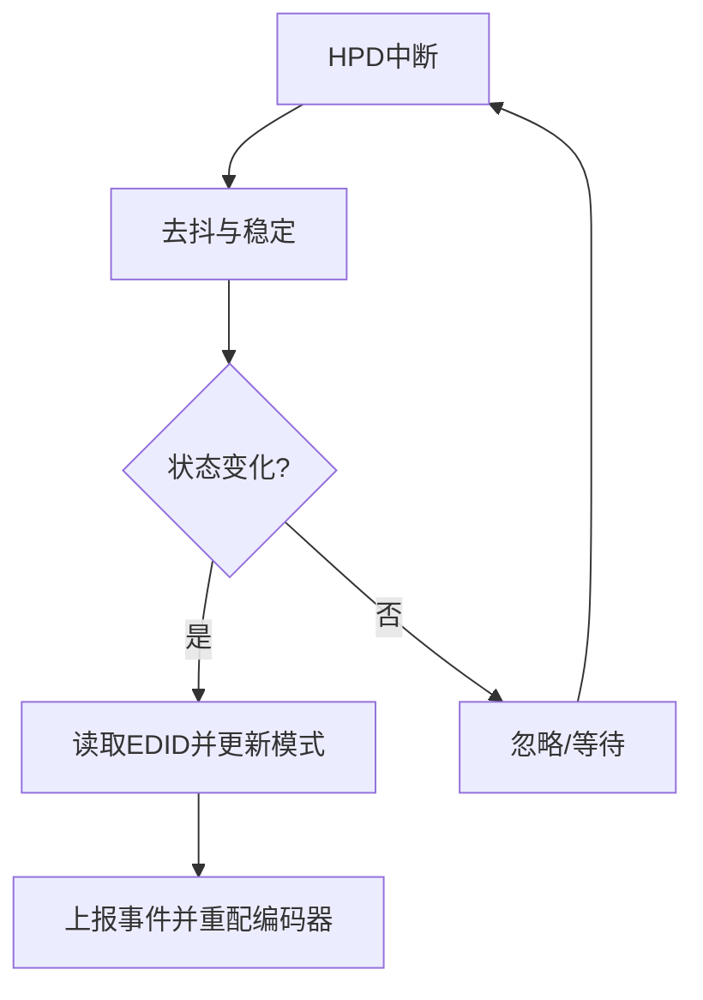
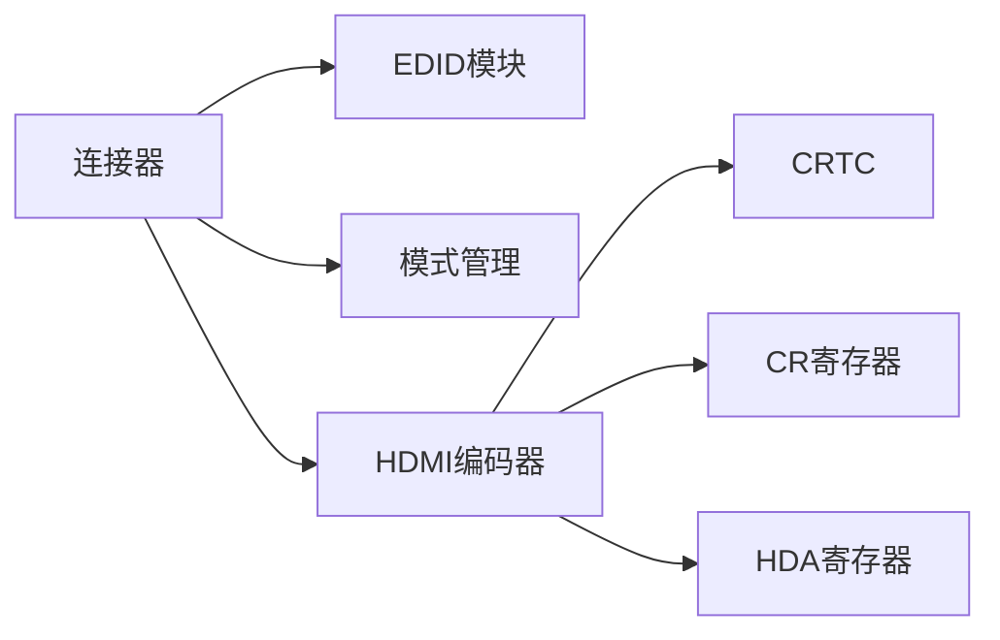

# HDMI连接器实现

<cite>
**本文档引用的文件**   
- [disp_hdmi_connector.c](file://_work/src/usr/lisuan-dkms-262.2.0.56/display/connector/disp_hdmi_connector.c)
- [disp_hdmi_connector.h](file://_work/src/usr/lisuan-dkms-262.2.0.56/display/connector/disp_hdmi_connector.h)
- [disp_hdmi_encoder.c](file://_work/src/usr/lisuan-dkms-262.2.0.56/display/encoder/disp_hdmi_encoder.c)
- [disp_hdmi_encoder.h](file://_work/src/usr/lisuan-dkms-262.2.0.56/display/encoder/disp_hdmi_encoder.h)
- [disp_edid.c](file://_work/src/usr/lisuan-dkms-262.2.0.56/display/connector/disp_edid.c)
- [disp_edid.h](file://_work/src/usr/lisuan-dkms-262.2.0.56/display/connector/disp_edid.h)
- [disp_mode.c](file://_work/src/usr/lisuan-dkms-262.2.0.56/display/connector/disp_mode.c)
- [disp_mode.h](file://_work/src/usr/lisuan-dkms-262.2.0.56/display/connector/disp_mode.h)
- [disp_dp_aux.c](file://_work/src/usr/lisuan-dkms-262.2.0.56/display/connector/disp_dp_aux.c)
- [disp_dp_aux.h](file://_work/src/usr/lisuan-dkms-262.2.0.56/display/connector/disp_dp_aux.h)
- [disp_crtc.c](file://_work/src/usr/lisuan-dkms-262.2.0.56/display/crtc/disp_crtc.c)
- [disp_crtc.h](file://_work/src/usr/lisuan-dkms-262.2.0.56/display/crtc/disp_crtc.h)
- [disp_device.c](file://_work/src/usr/lisuan-dkms-262.2.0.56/display/disp_device.c)
- [disp_device.h](file://_work/src/usr/lisuan-dkms-262.2.0.56/display/disp_device.h)
- [HDA_FUNC_register.h](file://_work/src/usr/lisuan-dkms-262.2.0.56/display/register/HDA_FUNC_register.h)
- [CR_register.h](file://_work/src/usr/lisuan-dkms-262.2.0.56/display/register/CR_register.h)
</cite>

## 目录
1. [简介](#简介)
2. [项目结构](#项目结构)
3. [核心组件](#核心组件)
4. [架构总览](#架构总览)
5. [详细组件分析](#详细组件分析)
6. [依赖关系分析](#依赖关系分析)
7. [性能考虑](#性能考虑)
8. [故障排除指南](#故障排除指南)
9. [结论](#结论)
10. [附录](#附录)

## 简介
本文件面向丽山GPU的HDMI连接器实现，系统性说明以下方面：
- HDMI接口硬件配置与时序控制
- EDID读取机制与分辨率检测、兼容性处理
- HDCP支持要点（如存在）
- 音频传输路径与配置
- 热插拔检测流程
- HDMI模式设置与常见场景示例
- 常见问题定位与排障建议

文档以代码级为依据，结合架构图、时序图与流程图，帮助读者从高层到细节全面理解HDMI子系统。

## 项目结构
HDMI相关代码主要分布在display子系统的connector、encoder、crtc以及寄存器定义中：
- connector层负责连接管理、EDID读取、热插拔事件、模式枚举与选择
- encoder层负责将像素数据编码为HDMI信号，并驱动物理层输出
- crtc层负责扫描时序生成与显示流水线控制
- 寄存器定义提供HDMI/HDA等外设的寄存器访问基础

图表来源
- [disp_hdmi_connector.c](file://_work/src/usr/lisuan-dkms-262.2.0.56/display/connector/disp_hdmi_connector.c)
- [disp_hdmi_encoder.c](file://_work/src/usr/lisuan-dkms-262.2.0.56/display/encoder/disp_hdmi_encoder.c)
- [disp_edid.c](file://_work/src/usr/lisuan-dkms-262.2.0.56/display/connector/disp_edid.c)
- [disp_mode.c](file://_work/src/usr/lisuan-dkms-262.2.0.56/display/connector/disp_mode.c)
- [disp_crtc.c](file://_work/src/usr/lisuan-dkms-262.2.0.56/display/crtc/disp_crtc.c)
- [CR_register.h](file://_work/src/usr/lisuan-dkms-262.2.0.56/display/register/CR_register.h)
- [HDA_FUNC_register.h](file://_work/src/usr/lisuan-dkms-262.2.0.56/display/register/HDA_FUNC_register.h)

章节来源
- [disp_hdmi_connector.c](file://_work/src/usr/lisuan-dkms-262.2.0.56/display/connector/disp_hdmi_connector.c)
- [disp_hdmi_encoder.c](file://_work/src/usr/lisuan-dkms-262.2.0.56/display/encoder/disp_hdmi_encoder.c)
- [disp_edid.c](file://_work/src/usr/lisuan-dkms-262.2.0.56/display/connector/disp_edid.c)
- [disp_mode.c](file://_work/src/usr/lisuan-dkms-262.2.0.56/display/connector/disp_mode.c)
- [disp_crtc.c](file://_work/src/usr/lisuan-dkms-262.2.0.56/display/crtc/disp_crtc.c)

## 核心组件
- HDMI连接器（Connector）
  - 职责：连接状态管理、EDID读取、模式枚举、热插拔事件上报、与编码器绑定
  - 关键能力：I2C/AUX通道访问、EDID块读取与校验、标准/自定义模式生成、HPD中断处理
- HDMI编码器（Encoder）
  - 职责：像素格式转换、TMDS/像素时钟配置、音视频打包、HDCP握手（若启用）、物理层驱动
  - 关键能力：时序参数下发、音频流配置、HDCP状态机、链路训练（如适用）
- EDID模块
  - 职责：EDID解析、扩展块处理、显示器能力提取、兼容模式推导
- 模式管理
  - 职责：标准VESA/CVT/RRB模式库、分辨率/刷新率/色彩空间匹配、最佳模式选择
- CRTC
  - 职责：扫描时序生成、帧缓冲更新、与编码器协同完成显示输出

章节来源
- [disp_hdmi_connector.c](file://_work/src/usr/lisuan-dkms-262.2.0.56/display/connector/disp_hdmi_connector.c)
- [disp_hdmi_encoder.c](file://_work/src/usr/lisuan-dkms-262.2.0.56/display/encoder/disp_hdmi_encoder.c)
- [disp_edid.c](file://_work/src/usr/lisuan-dkms-262.2.0.56/display/connector/disp_edid.c)
- [disp_mode.c](file://_work/src/usr/lisuan-dkms-262.2.0.56/display/connector/disp_mode.c)
- [disp_crtc.c](file://_work/src/usr/lisuan-dkms-262.2.0.56/display/crtc/disp_crtc.c)

## 架构总览
下图展示HDMI子系统在显示栈中的位置与交互关系，包括连接器、编码器、CRTC与寄存器层的协作。

图表来源
- [disp_hdmi_connector.c](file://_work/src/usr/lisuan-dkms-262.2.0.56/display/connector/disp_hdmi_connector.c)
- [disp_edid.c](file://_work/src/usr/lisuan-dkms-262.2.0.56/display/connector/disp_edid.c)
- [disp_mode.c](file://_work/src/usr/lisuan-dkms-262.2.0.56/display/connector/disp_mode.c)
- [disp_hdmi_encoder.c](file://_work/src/usr/lisuan-dkms-262.2.0.56/display/encoder/disp_hdmi_encoder.c)
- [disp_crtc.c](file://_work/src/usr/lisuan-dkms-262.2.0.56/display/crtc/disp_crtc.c)

## 详细组件分析

### HDMI连接器（Connector）
- 功能要点
  - 热插拔检测：监听HPD引脚变化，触发EDID重读与模式重新评估
  - EDID读取：通过I2C或AUX通道读取基本块与扩展块，进行CRC校验与版本兼容处理
  - 模式枚举：基于EDID能力与内部模式库，生成可支持的分辨率/刷新率/色彩空间组合
  - 连接状态：维护“已连接/未连接”状态，向上层显示框架上报事件
- 关键流程
  - 热插拔事件→EDID读取→模式生成→编码器配置→CRTC启动
- 典型问题
  - EDID读取失败：检查I2C/AUX通道可用性、线缆质量、显示器EDID完整性
  - 模式不匹配：确认显示器EDID声明与实际能力一致，必要时使用强制模式

图表来源
- [disp_hdmi_connector.c](file://_work/src/usr/lisuan-dkms-262.2.0.56/display/connector/disp_hdmi_connector.c)
- [disp_edid.c](file://_work/src/usr/lisuan-dkms-262.2.0.56/display/connector/disp_edid.c)
- [disp_mode.c](file://_work/src/usr/lisuan-dkms-262.2.0.56/display/connector/disp_mode.c)

章节来源
- [disp_hdmi_connector.c](file://_work/src/usr/lisuan-dkms-262.2.0.56/display/connector/disp_hdmi_connector.c)
- [disp_edid.c](file://_work/src/usr/lisuan-dkms-262.2.0.56/display/connector/disp_edid.c)
- [disp_mode.c](file://_work/src/usr/lisuan-dkms-262.2.0.56/display/connector/disp_mode.c)

### HDMI编码器（Encoder）
- 功能要点
  - 像素与时钟：根据所选模式计算像素时钟、TMDS速率、极性与时序参数
  - 音视频打包：将视频帧与音频帧打包为HDMI数据包，配置HDA音频流
  - HDCP支持：若启用，执行密钥协商、认证与加密数据传输
  - 物理层驱动：通过寄存器配置HDMI/TMDS/HDA相关寄存器，确保链路稳定
- 关键流程
  - 模式参数→时序计算→寄存器写入→链路训练（可选）→输出使能
- 典型问题
  - 无图像/花屏：检查像素时钟、TMDS速率、极性与线缆带宽
  - 黑屏但有声音：确认视频通道配置与HDCP状态
  - 音频无声：检查HDA流配置、采样率/位深与HDMI音频包

图表来源
- [disp_hdmi_encoder.c](file://_work/src/usr/lisuan-dkms-262.2.0.56/display/encoder/disp_hdmi_encoder.c)
- [disp_crtc.c](file://_work/src/usr/lisuan-dkms-262.2.0.56/display/crtc/disp_crtc.c)
- [CR_register.h](file://_work/src/usr/lisuan-dkms-262.2.0.56/display/register/CR_register.h)
- [HDA_FUNC_register.h](file://_work/src/usr/lisuan-dkms-262.2.0.56/display/register/HDA_FUNC_register.h)

章节来源
- [disp_hdmi_encoder.c](file://_work/src/usr/lisuan-dkms-262.2.0.56/display/encoder/disp_hdmi_encoder.c)
- [disp_crtc.c](file://_work/src/usr/lisuan-dkms-262.2.0.56/display/crtc/disp_crtc.c)
- [CR_register.h](file://_work/src/usr/lisuan-dkms-262.2.0.56/display/register/CR_register.h)
- [HDA_FUNC_register.h](file://_work/src/usr/lisuan-dkms-262.2.0.56/display/register/HDA_FUNC_register.h)

### EDID读取与解析
- 功能要点
  - 读取策略：优先I2C，回退AUX；分块读取基本块与扩展块
  - 校验与兼容：CRC校验、版本号判断、厂商/显示器能力提取
  - 能力映射：分辨率、刷新率、色彩空间、音频能力、HDCP支持标志
- 关键流程
  - 通道选择→读取EDID→校验→解析→能力表生成
- 典型问题
  - EDID不完整：重试读取、降低速率、检查线缆与显示器固件
  - 能力不一致：使用模式覆盖或强制模式

图表来源
- [disp_edid.c](file://_work/src/usr/lisuan-dkms-262.2.0.56/display/connector/disp_edid.c)
- [disp_dp_aux.c](file://_work/src/usr/lisuan-dkms-262.2.0.56/display/connector/disp_dp_aux.c)

章节来源
- [disp_edid.c](file://_work/src/usr/lisuan-dkms-262.2.0.56/display/connector/disp_edid.c)
- [disp_dp_aux.c](file://_work/src/usr/lisuan-dkms-262.2.0.56/display/connector/disp_dp_aux.c)

### 模式管理与分辨率检测
- 功能要点
  - 模式库：标准VESA/CVT/RRB模式、显示器EDID模式合并
  - 匹配策略：按分辨率/刷新率/色彩空间优先级选择最佳模式
  - 兼容性处理：当EDID缺失或不完整时，回退到安全模式
- 关键流程
  - 输入EDID能力→合并内部模式库→排序与筛选→输出最佳模式
- 典型问题
  - 刷新率异常：确认显示器EDID与线缆带宽是否支持
  - 色彩空间异常：检查编码器与显示器能力一致性

图表来源
- [disp_mode.c](file://_work/src/usr/lisuan-dkms-262.2.0.56/display/connector/disp_mode.c)
- [disp_edid.c](file://_work/src/usr/lisuan-dkms-262.2.0.56/display/connector/disp_edid.c)

章节来源
- [disp_mode.c](file://_work/src/usr/lisuan-dkms-262.2.0.56/display/connector/disp_mode.c)
- [disp_edid.c](file://_work/src/usr/lisuan-dkms-262.2.0.56/display/connector/disp_edid.c)

### 音频传输（HDA）
- 功能要点
  - 音频流配置：采样率、位深、声道数、数据包类型
  - 与视频同步：确保音频与视频帧对齐，避免音画不同步
  - 设备发现：通过EDID音频能力与HDA寄存器状态判断音频通路
- 关键流程
  - 音频能力获取→HDA流配置→与编码器同步→输出使能
- 典型问题
  - 无声：检查HDA流配置、显示器音频支持与线缆质量
  - 爆音/卡顿：调整采样率与时序同步

图表来源
- [disp_hdmi_encoder.c](file://_work/src/usr/lisuan-dkms-262.2.0.56/display/encoder/disp_hdmi_encoder.c)
- [HDA_FUNC_register.h](file://_work/src/usr/lisuan-dkms-262.2.0.56/display/register/HDA_FUNC_register.h)

章节来源
- [disp_hdmi_encoder.c](file://_work/src/usr/lisuan-dkms-262.2.0.56/display/encoder/disp_hdmi_encoder.c)
- [HDA_FUNC_register.h](file://_work/src/usr/lisuan-dkms-262.2.0.56/display/register/HDA_FUNC_register.h)

### HDCP支持（如启用）
- 功能要点
  - 握手流程：KSV验证、密钥交换、认证与加密
  - 状态机：空闲→准备→认证→加密→重认证
  - 错误处理：链路失败回退、重试策略、日志上报
- 关键流程
  - 检测到HDCP显示器→发起握手→认证成功→加密输出
- 典型问题
  - 黑屏但其他正常：检查HDCP认证状态与线缆带宽
  - 频繁重认证：检查链路稳定性与显示器固件

图表来源
- [disp_hdmi_encoder.c](file://_work/src/usr/lisuan-dkms-262.2.0.56/display/encoder/disp_hdmi_encoder.c)

章节来源
- [disp_hdmi_encoder.c](file://_work/src/usr/lisuan-dkms-262.2.0.56/display/encoder/disp_hdmi_encoder.c)

### 热插拔检测（HPD）
- 功能要点
  - 中断驱动：HPD引脚变化触发中断，进入连接器处理流程
  - 去抖与稳定：延时确认、多次采样避免误触发
  - 事件上报：向显示框架上报连接/断开事件，触发EDID重读与模式重建
- 关键流程
  - HPD中断→去抖确认→EDID读取→模式更新→编码器重配
- 典型问题
  - 频繁抖动：检查线缆接触与屏蔽
  - 无法识别：确认HPD引脚配置与中断路由

图表来源
- [disp_hdmi_connector.c](file://_work/src/usr/lisuan-dkms-262.2.0.56/display/connector/disp_hdmi_connector.c)

章节来源
- [disp_hdmi_connector.c](file://_work/src/usr/lisuan-dkms-262.2.0.56/display/connector/disp_hdmi_connector.c)

## 依赖关系分析
HDMI子系统各组件之间的依赖关系如下：
- 连接器依赖EDID与模式管理，用于能力解析与模式选择
- 编码器依赖CRTC与时序寄存器，用于像素与时钟配置
- 音频依赖HDA寄存器与显示器能力
- HDCP依赖编码器状态机与链路稳定性

图表来源
- [disp_hdmi_connector.c](file://_work/src/usr/lisuan-dkms-262.2.0.56/display/connector/disp_hdmi_connector.c)
- [disp_edid.c](file://_work/src/usr/lisuan-dkms-262.2.0.56/display/connector/disp_edid.c)
- [disp_mode.c](file://_work/src/usr/lisuan-dkms-262.2.0.56/display/connector/disp_mode.c)
- [disp_hdmi_encoder.c](file://_work/src/usr/lisuan-dkms-262.2.0.56/display/encoder/disp_hdmi_encoder.c)
- [disp_crtc.c](file://_work/src/usr/lisuan-dkms-262.2.0.56/display/crtc/disp_crtc.c)
- [CR_register.h](file://_work/src/usr/lisuan-dkms-262.2.0.56/display/register/CR_register.h)
- [HDA_FUNC_register.h](file://_work/src/usr/lisuan-dkms-262.2.0.56/display/register/HDA_FUNC_register.h)

章节来源
- [disp_hdmi_connector.c](file://_work/src/usr/lisuan-dkms-262.2.0.56/display/connector/disp_hdmi_connector.c)
- [disp_hdmi_encoder.c](file://_work/src/usr/lisuan-dkms-262.2.0.56/display/encoder/disp_hdmi_encoder.c)
- [disp_crtc.c](file://_work/src/usr/lisuan-dkms-262.2.0.56/display/crtc/disp_crtc.c)

## 性能考虑
- 时钟与带宽
  - 合理选择像素时钟与TMDS速率，避免超频导致不稳定
  - 高刷新率/高分辨率需保证线缆与显示器带宽充足
- EDID读取优化
  - 缓存EDID结果，减少重复读取
  - 失败重试策略与速率降级
- 音频同步
  - 确保音频采样率与视频帧率匹配，避免缓冲区溢出
- HDCP开销
  - 握手过程可能引入延迟，应尽量减少重认证频率

[本节为通用指导，无需特定文件引用]

## 故障排除指南
- 无图像
  - 检查HPD状态与EDID读取结果
  - 确认像素时钟与TMDS速率是否在显示器支持范围内
  - 查看HDCP状态是否为加密成功
- 有图像无声音
  - 检查HDA流配置与显示器音频能力
  - 确认线缆质量与HDMI音频支持
- 闪烁/花屏
  - 检查线缆长度与屏蔽，尝试更换高质量线缆
  - 降低刷新率或分辨率测试稳定性
- 频繁热插拔抖动
  - 检查HPD去抖配置与中断路由
  - 检查连接器物理接触与屏蔽

章节来源
- [disp_hdmi_connector.c](file://_work/src/usr/lisuan-dkms-262.2.0.56/display/connector/disp_hdmi_connector.c)
- [disp_hdmi_encoder.c](file://_work/src/usr/lisuan-dkms-262.2.0.56/display/encoder/disp_hdmi_encoder.c)
- [disp_edid.c](file://_work/src/usr/lisuan-dkms-262.2.0.56/display/connector/disp_edid.c)

## 结论
丽山GPU的HDMI连接器实现通过连接器、编码器、CRTC与寄存器层的紧密协作，实现了完整的HDMI输出能力。EDID读取与模式管理确保了兼容性，音频与HDCP支持提升了用户体验。合理的配置与调试策略可有效解决常见问题，保障系统稳定运行。

[本节为总结性内容，无需特定文件引用]

## 附录
- 配置示例（概念性）
  - 设置1080p@60Hz：选择对应模式，配置像素时钟与TMDS速率，启用HDMI输出
  - 启用音频：根据显示器EDID音频能力配置HDA流，确保采样率与位深匹配
  - 启用HDCP：在支持HDCP的显示器上自动握手，成功后输出加密视频
- 参考文件
  - 连接器与编码器实现：disp_hdmi_connector.c、disp_hdmi_encoder.c
  - EDID与模式管理：disp_edid.c、disp_mode.c
  - CRTC与时序：disp_crtc.c
  - 寄存器定义：CR_register.h、HDA_FUNC_register.h

[本节为补充信息，无需特定文件引用]