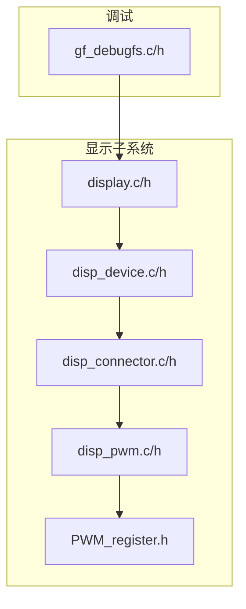
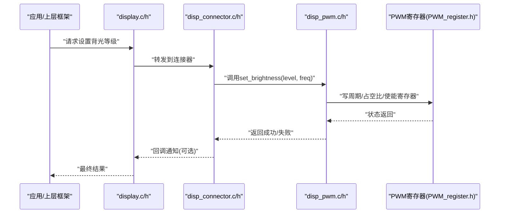
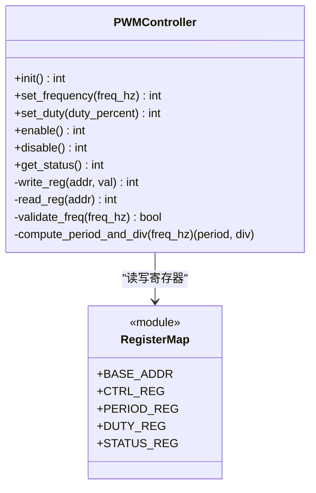
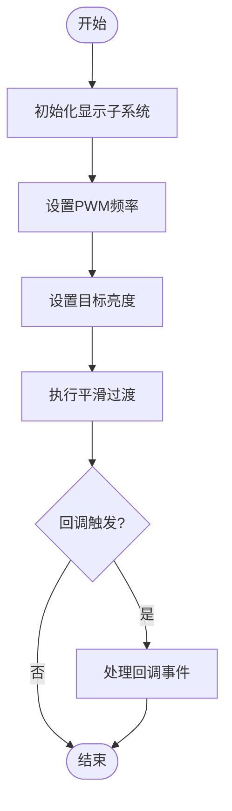

# PWM背光控制

<cite>
**本文引用的文件**   
- [disp_pwm.c](file://_work/src/usr/src/lisuanpu-dkms-262.2.0.56/display/connector/disp_pwm.c)
- [disp_pwm.h](file://_work/src/usr/src/lisuanpu-dkms-262.2.0.56/display/connector/disp_pwm.h)
- [PWM_register.h](file://_work/src/usr/src/lisuanpu-dkms-262.2.0.56/display/register/PWM_register.h)
- [disp_connector.c](file://_work/src/usr/src/lisuanpu-dkms-262.2.0.56/display/connector/disp_connector.c)
- [disp_connector.h](file://_work/src/usr/src/lisuanpu-dkms-262.2.0.56/display/connector/disp_connector.h)
- [display.c](file://_work/src/usr/src/lisuanpu-dkms-262.2.0.56/display/display.c)
- [display.h](file://_work/src/usr/src/lisuanpu-dkms-262.2.0.56/display/display.h)
- [disp_device.c](file://_work/src/usr/src/lisuanpu-dkms-262.2.0.56/display/disp_device.c)
- [disp_device.h](file://_work/src/usr/src/lisuanpu-dkms-262.2.0.56/display/disp_device.h)
- [gf_debugfs.c](file://_work/src/usr/src/lisuanpu-dkms-262.2.0.56/gf_debugfs.c)
- [gf_debugfs.h](file://_work/src/usr/src/lisuanpu-dkms-262.2.0.56/gf_debugfs.h)
</cite>

## 目录
1. [简介](#简介)
2. [项目结构](#项目结构)
3. [核心组件](#核心组件)
4. [架构总览](#架构总览)
5. [详细组件分析](#详细组件分析)
6. [依赖关系分析](#依赖关系分析)
7. [性能与功耗考量](#性能与功耗考量)
8. [故障排查指南](#故障排查指南)
9. [结论](#结论)
10. [附录：API使用示例与调试方法](#附录api使用示例与调试方法)

## 简介
本文件面向丽山GPU的PWM背光控制系统，系统性说明PWM信号生成原理、频率配置、亮度调节算法、背光级别映射、平滑过渡策略、功耗优化、回调机制、硬件限制处理与异常恢复。文档同时提供面向驱动层与上层应用的API使用示例和调试方法，帮助读者快速定位问题并优化显示体验。

## 项目结构
与PWM背光相关的代码主要位于display子系统中，关键文件包括：
- 连接器层：disp_pwm.c/h（PWM控制器封装）、disp_connector.*（连接器抽象）
- 寄存器定义：PWM_register.h（PWM相关寄存器位域）
- 显示子系统入口：display.c/h、disp_device.c/h（设备初始化、资源管理）
- 调试接口：gf_debugfs.c/h（内核态调试输出）

图表来源
- [display.c:1-200](file://_work/src/usr/src/lisuanpu-dkms-262.2.0.56/display/display.c#L1-L200)
- [disp_device.c:1-200](file://_work/src/usr/src/lisuanpu-dkms-262.2.0.56/display/disp_device.c#L1-L200)
- [disp_connector.c:1-200](file://_work/src/usr/src/lisuanpu-dkms-262.2.0.56/display/connector/disp_connector.c#L1-L200)
- [disp_pwm.c:1-200](file://_work/src/usr/src/lisuanpu-dkms-262.2.0.56/display/connector/disp_pwm.c#L1-L200)
- [PWM_register.h:1-200](file://_work/src/usr/src/lisuanpu-dkms-262.2.0.56/display/register/PWM_register.h#L1-L200)
- [gf_debugfs.c:1-200](file://_work/src/usr/src/lisuanpu-dkms-262.2.0.56/gf_debugfs.c#L1-L200)

章节来源
- [display.c:1-200](file://_work/src/usr/src/lisuanpu-dkms-262.2.0.56/display/display.c#L1-L200)
- [disp_device.c:1-200](file://_work/src/usr/src/lisuanpu-dkms-262.2.0.56/display/disp_device.c#L1-L200)
- [disp_connector.c:1-200](file://_work/src/usr/src/lisuanpu-dkms-262.2.0.56/display/connector/disp_connector.c#L1-L200)
- [disp_pwm.c:1-200](file://_work/src/usr/src/lisuanpu-dkms-262.2.0.56/display/connector/disp_pwm.c#L1-L200)
- [PWM_register.h:1-200](file://_work/src/usr/src/lisuanpu-dkms-262.2.0.56/display/register/PWM_register.h#L1-L200)
- [gf_debugfs.c:1-200](file://_work/src/usr/src/lisuanpu-dkms-262.2.0.56/gf_debugfs.c#L1-L200)

## 核心组件
- PWM控制器封装（disp_pwm.c/h）
  - 负责PWM时钟源选择、分频、周期与占空比设置、使能/关闭、中断与状态查询等。
  - 对外暴露初始化、配置、设置亮度、销毁等接口。
- 连接器抽象（disp_connector.c/h）
  - 将PWM控制器与具体连接器绑定，完成电源与时钟门控、回调解耦、回调注册。
- 寄存器定义（PWM_register.h）
  - 定义PWM模块的基地址、控制寄存器、周期/占空比寄存器、状态寄存器及位域宏。
- 显示子系统入口（display.c/h、disp_device.c/h）
  - 负责设备探测、资源分配、子系统初始化、回调分发与错误恢复。
- 调试接口（gf_debugfs.c/h）
  - 提供debugfs节点用于读取/写入PWM参数、触发测试序列、打印状态。

章节来源
- [disp_pwm.c:1-200](file://_work/src/usr/src/lisuanpu-dkms-262.2.0.56/display/connector/disp_pwm.c#L1-L200)
- [disp_pwm.h:1-200](file://_work/src/usr/src/lisuanpu-dkms-262.2.0.56/display/connector/disp_pwm.h#L1-L200)
- [disp_connector.c:1-200](file://_work/src/usr/src/lisuanpu-dkms-262.2.0.56/display/connector/disp_connector.c#L1-L200)
- [disp_connector.h:1-200](file://_work/src/usr/src/lisuanpu-dkms-262.2.0.56/display/connector/disp_connector.h#L1-L200)
- [PWM_register.h:1-200](file://_work/src/usr/src/lisuanpu-dkms-262.2.0.56/display/register/PWM_register.h#L1-L200)
- [display.c:1-200](file://_work/src/usr/src/lisuanpu-dkms-262.2.0.56/display/display.c#L1-L200)
- [display.h:1-200](file://_work/src/usr/src/lisuanpu-dkms-262.2.0.56/display/display.h#L1-L200)
- [disp_device.c:1-200](file://_work/src/usr/src/lisuanpu-dkms-262.2.0.56/display/disp_device.c#L1-L200)
- [disp_device.h:1-200](file://_work/src/usr/src/lisuanpu-dkms-262.2.0.56/display/disp_device.h#L1-L200)
- [gf_debugfs.c:1-200](file://_work/src/usr/src/lisuanpu-dkms-262.2.0.56/gf_debugfs.c#L1-L200)
- [gf_debugfs.h:1-200](file://_work/src/usr/src/lisuanpu-dkms-262.2.0.56/gf_debugfs.h#L1-L200)

## 架构总览
PWM背光控制采用分层设计：显示子系统通过连接器抽象访问PWM控制器；PWM控制器直接操作寄存器；调试接口提供运行时观测能力。

图表来源
- [display.c:1-200](file://_work/src/usr/src/lisuanpu-dkms-262.2.0.56/display/display.c#L1-L200)
- [disp_connector.c:1-200](file://_work/src/usr/src/lisuanpu-dkms-262.2.0.56/display/connector/disp_connector.c#L1-L200)
- [disp_pwm.c:1-200](file://_work/src/usr/src/lisuanpu-dkms-262.2.0.56/display/connector/disp_pwm.c#L1-L200)
- [PWM_register.h:1-200](file://_work/src/usr/src/lisuanpu-dkms-262.2.0.56/display/register/PWM_register.h#L1-L200)

## 详细组件分析

### PWM控制器封装（disp_pwm.c/h）
- 功能要点
  - 初始化：获取时钟、复位、默认配置。
  - 频率配置：根据目标频率计算分频与周期寄存器值，确保在硬件允许范围内。
  - 亮度设置：将目标亮度映射为占空比，更新寄存器并启用输出。
  - 平滑过渡：支持线性或指数插值，避免阶跃变化导致闪烁。
  - 回调机制：在切换完成或发生错误时回调上层进行状态同步。
  - 异常恢复：检测寄存器读写失败、时钟不可用、频率越界等，回滚到安全状态。
- 数据结构与复杂度
  - 典型结构包含：时钟句柄、基地址指针、当前频率、当前占空比、锁/互斥保护、回调函数指针。
  - 时间复杂度：单次设置O(1)，平滑过渡按步数线性O(N)。
- 依赖关系
  - 依赖寄存器定义（PWM_register.h），被连接器调用。
- 优化点
  - 缓存最近一次有效配置，减少重复写入。
  - 批量更新周期与占空比，避免中间态闪烁。

图表来源
- [disp_pwm.c:1-200](file://_work/src/usr/src/lisuanpu-dkms-262.2.0.56/display/connector/disp_pwm.c#L1-L200)
- [PWM_register.h:1-200](file://_work/src/usr/src/lisuanpu-dkms-262.2.0.56/display/register/PWM_register.h#L1-L200)

章节来源
- [disp_pwm.c:1-200](file://_work/src/usr/src/lisuanpu-dkms-262.2.0.56/display/connector/disp_pwm.c#L1-L200)
- [disp_pwm.h:1-200](file://_work/src/usr/src/lisuanpu-dkms-262.2.0.56/display/connector/disp_pwm.h#L1-L200)
- [PWM_register.h:1-200](file://_work/src/usr/src/lisuanpu-dkms-262.2.0.56/display/register/PWM_register.h#L1-L200)

### 连接器与回调（disp_connector.c/h）
- 功能要点
  - 将PWM控制器与具体连接器实例绑定，管理电源与时钟门控。
  - 提供统一的背光设置接口，内部委托给PWM控制器。
  - 注册回调：在背光切换完成、频率变更、错误发生时通知上层。
- 数据流
  - 上层调用连接器背光接口 → 连接器校验参数 → 调用PWM控制器 → 回调通知。
- 错误处理
  - 参数越界、时钟不可用、寄存器失败等场景统一上报，并提供降级策略（如保持上一级亮度）。

章节来源
- [disp_connector.c:1-200](file://_work/src/usr/src/lisuanpu-dkms-262.2.0.56/display/connector/disp_connector.c#L1-L200)
- [disp_connector.h:1-200](file://_work/src/usr/src/lisuanpu-dkms-262.2.0.56/display/connector/disp_connector.h#L1-L200)

### 显示子系统入口（display.c/h、disp_device.c/h）
- 功能要点
  - 设备初始化：扫描连接器、创建PWM控制器实例、建立回调链。
  - 资源管理：分配/释放内存、时钟、寄存器映射。
  - 错误恢复：在初始化失败时回滚已分配资源，保证系统稳定。
- 集成点
  - 与连接器层交互，提供统一的背光控制入口。
  - 与调试接口对接，暴露必要的诊断信息。

章节来源
- [display.c:1-200](file://_work/src/usr/src/lisuanpu-dkms-262.2.0.56/display/display.c#L1-L200)
- [display.h:1-200](file://_work/src/usr/src/lisuanpu-dkms-262.2.0.56/display/display.h#L1-L200)
- [disp_device.c:1-200](file://_work/src/usr/src/lisuanpu-dkms-262.2.0.56/display/disp_device.c#L1-L200)
- [disp_device.h:1-200](file://_work/src/usr/src/lisuanpu-dkms-262.2.0.56/display/disp_device.h#L1-L200)

### 调试接口（gf_debugfs.c/h）
- 功能要点
  - 提供debugfs节点，用于读取/写入PWM频率、占空比、状态。
  - 支持触发测试序列（如阶梯亮度、正弦波占空比），便于验证平滑过渡效果。
  - 打印关键路径日志，辅助定位异常。

章节来源
- [gf_debugfs.c:1-200](file://_work/src/usr/src/lisuanpu-dkms-262.2.0.56/gf_debugfs.c#L1-L200)
- [gf_debugfs.h:1-200](file://_work/src/usr/src/lisuanpu-dkms-262.2.0.56/gf_debugfs.h#L1-L200)

## 依赖关系分析
- 模块耦合
  - display.c/h 依赖 disp_device.c/h 进行设备管理。
  - disp_device.c/h 依赖 disp_connector.c/h 进行连接器实例化。
  - disp_connector.c/h 依赖 disp_pwm.c/h 进行PWM控制。
  - disp_pwm.c/h 依赖 PWM_register.h 进行寄存器操作。
- 外部依赖
  - 时钟管理、内存分配、互斥锁等由底层OS提供。
- 潜在循环依赖
  - 通过回调与事件机制解耦，避免直接循环引用。

图表来源
- [display.c:1-200](file://_work/src/usr/src/lisuanpu-dkms-262.2.0.56/display/display.c#L1-L200)
- [disp_device.c:1-200](file://_work/src/usr/src/lisuanpu-dkms-262.2.0.56/display/disp_device.c#L1-L200)
- [disp_connector.c:1-200](file://_work/src/usr/src/lisuanpu-dkms-262.2.0.56/display/connector/disp_connector.c#L1-L200)
- [disp_pwm.c:1-200](file://_work/src/usr/src/lisuanpu-dkms-262.2.0.56/display/connector/disp_pwm.c#L1-L200)
- [PWM_register.h:1-200](file://_work/src/usr/src/lisuanpu-dkms-262.2.0.56/display/register/PWM_register.h#L1-L200)
- [gf_debugfs.c:1-200](file://_work/src/usr/src/lisuanpu-dkms-262.2.0.56/gf_debugfs.c#L1-L200)

章节来源
- [display.c:1-200](file://_work/src/usr/src/lisuanpu-dkms-262.2.0.56/display/display.c#L1-L200)
- [disp_device.c:1-200](file://_work/src/usr/src/lisuanpu-dkms-262.2.0.56/display/disp_device.c#L1-L200)
- [disp_connector.c:1-200](file://_work/src/usr/src/lisuanpu-dkms-262.2.0.56/display/connector/disp_connector.c#L1-L200)
- [disp_pwm.c:1-200](file://_work/src/usr/src/lisuanpu-dkms-262.2.0.56/display/connector/disp_pwm.c#L1-L200)
- [PWM_register.h:1-200](file://_work/src/usr/src/lisuanpu-dkms-262.2.0.56/display/register/PWM_register.h#L1-L200)
- [gf_debugfs.c:1-200](file://_work/src/usr/src/lisuanpu-dkms-262.2.0.56/gf_debugfs.c#L1-L200)

## 性能与功耗考量
- 频率配置
  - 选择合适的PWM频率以避免可见闪烁并降低EMI；低频可能引起闪烁，高频增加开关损耗。
  - 动态调整频率：低亮度时使用较低频率以降低功耗，高亮度时使用较高频率提升响应速度。
- 亮度映射
  - 非线性映射：人眼对暗部更敏感，建议采用伽马校正或分段线性映射，提升感知均匀性。
  - 最小步进：确保最低亮度可分辨且不过亮，避免“全黑”时的漏光。
- 平滑过渡
  - 插值步数与时长权衡：步数越多越平滑但耗时更长；建议根据刷新率自适应步长。
  - 防抖与去噪：在快速连续设置中合并请求，避免频繁寄存器写入。
- 功耗优化
  - 空闲关闭：无显示任务时关闭PWM输出与相关时钟。
  - 批量更新：周期与占空比原子更新，减少中间态功耗波动。
  - 温度与电压补偿：在高负载或高温环境下微调占空比以维持一致亮度。

[本节为通用指导，不直接分析具体文件]

## 故障排查指南
- 常见问题
  - 背光不亮：检查PWM使能、时钟是否开启、寄存器写入是否成功。
  - 闪烁或条纹：确认频率是否在允许范围，占空比更新是否原子。
  - 亮度跳变：检查映射曲线与插值步数，避免阶跃过大。
  - 回调未触发：确认回调注册是否正确，事件路径是否被阻塞。
- 调试步骤
  - 使用debugfs读取当前频率、占空比、状态寄存器。
  - 触发测试序列观察波形与亮度变化。
  - 查看内核日志，定位错误码与回滚路径。
- 恢复策略
  - 自动回滚到上次有效配置。
  - 超时重试与降级模式（如固定中等亮度）。

章节来源
- [gf_debugfs.c:1-200](file://_work/src/usr/src/lisuanpu-dkms-262.2.0.56/gf_debugfs.c#L1-L200)
- [disp_pwm.c:1-200](file://_work/src/usr/src/lisuanpu-dkms-262.2.0.56/display/connector/disp_pwm.c#L1-L200)

## 结论
丽山GPU的PWM背光控制通过清晰的分层架构实现了可靠的频率配置、亮度映射与平滑过渡。结合回调机制与调试接口，开发者可以快速集成并优化显示体验。建议在产品阶段引入自适应频率与功耗管理策略，进一步提升能效与稳定性。

[本节为总结，不直接分析具体文件]

## 附录：API使用示例与调试方法

### API使用示例（概念流程）
- 初始化
  - 调用显示子系统初始化，创建连接器与PWM控制器实例。
- 设置频率
  - 指定目标频率，控制器计算分频与周期，写入寄存器并验证。
- 设置亮度
  - 输入目标亮度等级，控制器映射为占空比，执行平滑过渡后生效。
- 回调处理
  - 实现回调函数，接收切换完成或错误事件，进行状态同步或告警。

图表来源
- [display.c:1-200](file://_work/src/usr/src/lisuanpu-dkms-262.2.0.56/display/display.c#L1-L200)
- [disp_connector.c:1-200](file://_work/src/usr/src/lisuanpu-dkms-262.2.0.56/display/connector/disp_connector.c#L1-L200)
- [disp_pwm.c:1-200](file://_work/src/usr/src/lisuanpu-dkms-262.2.0.56/display/connector/disp_pwm.c#L1-L200)

### 调试方法
- 读取状态
  - 通过debugfs节点读取当前频率、占空比、状态寄存器值。
- 触发测试
  - 写入测试序列命令，观察亮度变化与回调触发情况。
- 日志分析
  - 查看内核日志中的错误码与回滚路径，定位问题根因。

章节来源
- [gf_debugfs.c:1-200](file://_work/src/usr/src/lisuanpu-dkms-262.2.0.56/gf_debugfs.c#L1-L200)
- [gf_debugfs.h:1-200](file://_work/src/usr/src/lisuanpu-dkms-262.2.0.56/gf_debugfs.h#L1-L200)