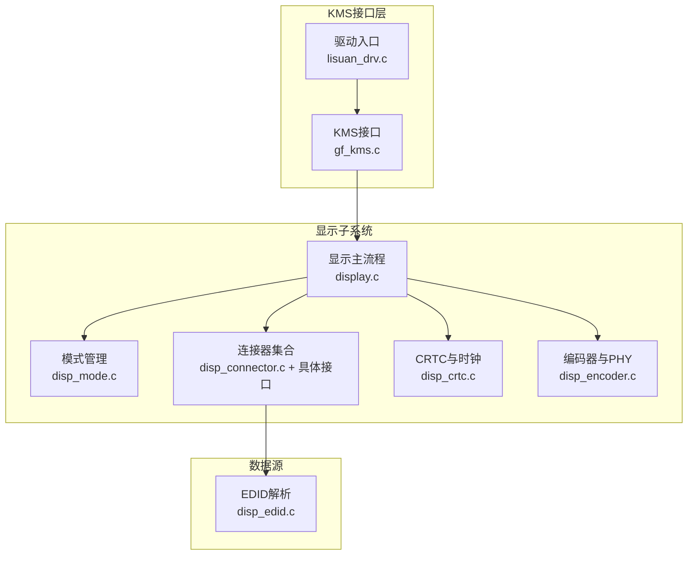
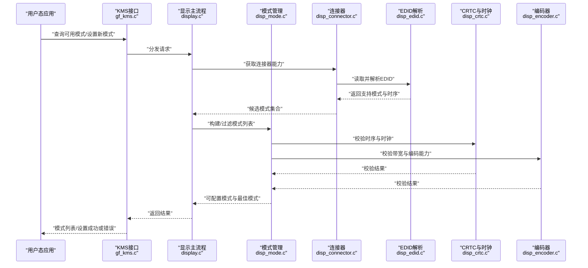
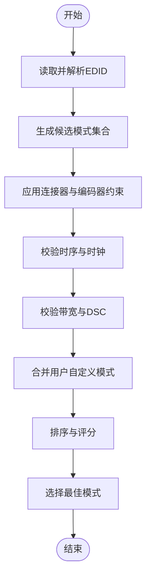
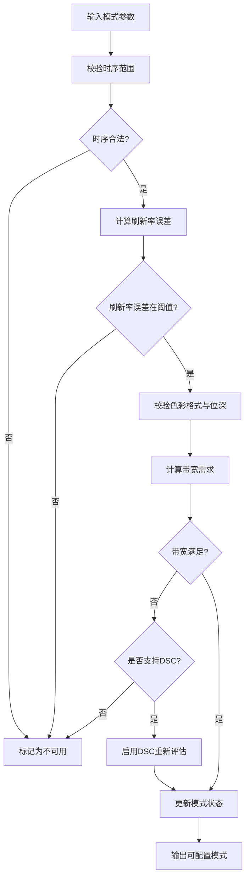
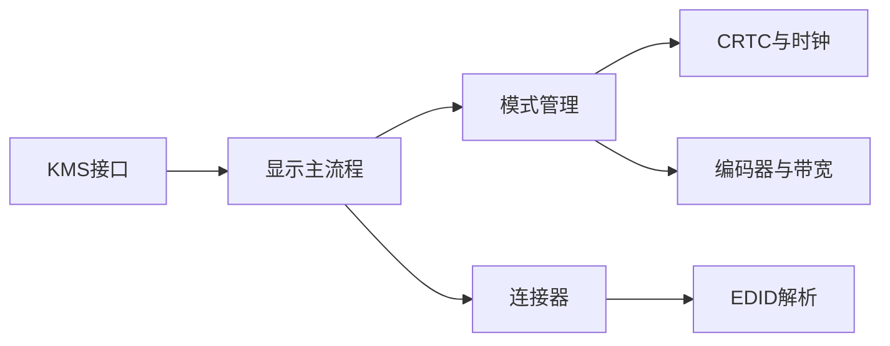

# 显示模式管理

<cite>
**本文档引用的文件**   
- [display.c](file://_work/src/usr/src/lisuangpu-dkms-262.2.0.56/display/display.c)
- [display.h](file://_work/src/usr/src/lisuangpu-dkms-262.2.0.56/display/display.h)
- [disp_mode.c](file://_work/src/usr/src/lisuangpu-dkms-262.2.0.56/display/connector/disp_mode.c)
- [disp_mode.h](file://_work/src/usr/src/lisuangpu-dkms-262.2.0.56/display/connector/disp_mode.h)
- [disp_connector.c](file://_work/src/usr/src/lisuangpu-dkms-262.2.0.56/display/connector/disp_connector.c)
- [disp_connector.h](file://_work/src/usr/src/lisuangpu-dkms-262.2.0.56/display/connector/disp_connector.h)
- [disp_edid.c](file://_work/src/usr/src/lisuangpu-dkms-262.2.0.56/display/connector/disp_edid.c)
- [disp_edid.h](file://_work/src/usr/src/lisuangpu-dkms-262.2.0.56/display/connector/disp_edid.h)
- [disp_dp_connector.c](file://_work/src/usr/src/lisuangpu-dkms-262.2.0.56/display/connector/disp_dp_connector.c)
- [disp_hdmi_connector.c](file://_work/src/usr/src/lisuangpu-dkms-262.2.0.56/display/connector/disp_hdmi_connector.c)
- [disp_dvo_connector.c](file://_work/src/usr/src/lisuangpu-dkms-262.2.0.56/display/connector/disp_dvo_connector.c)
- [disp_crtc.c](file://_work/src/usr/src/lisuangpu-dkms-262.2.0.56/display/crtc/disp_crtc.c)
- [disp_crtc.h](file://_work/src/usr/src/lisuangpu-dkms-262.2.0.56/display/crtc/disp_crtc.h)
- [disp_encoder.c](file://_work/src/usr/src/lisuangpu-dkms-262.2.0.56/display/encoder/disp_encoder.c)
- [disp_encoder.h](file://_work/src/usr/src/lisuangpu-dkms-262.2.0.56/display/encoder/disp_encoder.h)
- [gf_kms.c](file://_work/src/usr/src/lisuangpu-dkms-262.2.0.56/kms/gf_kms.c)
- [gf_kms.h](file://_work/src/usr/src/lisuangpu-dkms-262.2.0.56/kms/gf_kms.h)
- [lisuan_drv.c](file://_work/src/usr/src/lisuangpu-dkms-262.2.0.56/lisuan_drv.c)
- [lisuan_drv.h](file://_work/src/usr/src/lisuangpu-dkms-262.2.0.56/lisuan_drv.h)
</cite>

## 目录
1. [简介](#简介)
2. [项目结构](#项目结构)
3. [核心组件](#核心组件)
4. [架构总览](#架构总览)
5. [详细组件分析](#详细组件分析)
6. [依赖关系分析](#依赖关系分析)
7. [性能考虑](#性能考虑)
8. [故障排查指南](#故障排查指南)
9. [结论](#结论)
10. [附录](#附录)

## 简介
本文件面向丽山GPU显示模式管理系统，聚焦显示模式的定义、验证与选择算法，涵盖分辨率、刷新率与色彩格式的兼容性检查；说明模式列表构建流程、最佳模式选择策略以及用户自定义模式的处理方式。同时提供模式配置的API使用示例与性能优化建议，帮助开发者快速集成与调优。

## 项目结构
显示子系统采用分层设计：KMS接口层、连接器（Connector）层、CRTC/编码器（Encoder）层、公共硬件抽象与寄存器定义。关键目录与职责如下：
- display/: 显示子系统入口与设备初始化、模式枚举与设置的主流程
- connector/: 各物理接口（DP/HDMI/DVO等）的EDID解析、模式发现与接口能力约束
- crtc/: CRTC与时钟PLL相关逻辑，负责时序计算与频率校验
- encoder/: 编码与PHY/DSC等输出路径，约束带宽与时序
- kms/: KMS接口实现，暴露给用户态的模式查询与设置API
- include/: 公共头文件与四色格式定义

图表来源
- [display.c:1-200](file://_work/src/usr/src/lisuangpu-dkms-262.2.0.56/display/display.c#L1-L200)
- [disp_mode.c:1-200](file://_work/src/usr/src/lisuangpu-dkms-262.2.0.56/display/connector/disp_mode.c#L1-L200)
- [disp_connector.c:1-200](file://_work/src/usr/src/lisuangpu-dkms-262.2.0.56/display/connector/disp_connector.c#L1-L200)
- [disp_edid.c:1-200](file://_work/src/usr/src/lisuangpu-dkms-262.2.0.56/display/connector/disp_edid.c#L1-L200)
- [disp_crtc.c:1-200](file://_work/src/usr/src/lisuangpu-dkms-262.2.0.56/display/crtc/disp_crtc.c#L1-L200)
- [disp_encoder.c:1-200](file://_work/src/usr/src/lisuangpu-dkms-262.2.0.56/display/encoder/disp_encoder.c#L1-L200)
- [gf_kms.c:1-200](file://_work/src/usr/src/lisuangpu-dkms-262.2.0.56/kms/gf_kms.c#L1-L200)
- [lisuan_drv.c:1-200](file://_work/src/usr/src/lisuangpu-dkms-262.2.0.56/lisuan_drv.c#L1-L200)

章节来源
- [display.c:1-200](file://_work/src/usr/src/lisuangpu-dkms-262.2.0.56/display/display.c#L1-L200)
- [disp_mode.c:1-200](file://_work/src/usr/src/lisuangpu-dkms-262.2.0.56/display/connector/disp_mode.c#L1-L200)
- [disp_connector.c:1-200](file://_work/src/usr/src/lisuangpu-dkms-262.2.0.56/display/connector/disp_connector.c#L1-L200)
- [disp_edid.c:1-200](file://_work/src/usr/src/lisuangpu-dkms-262.2.0.56/display/connector/disp_edid.c#L1-L200)
- [disp_crtc.c:1-200](file://_work/src/usr/src/lisuangpu-dkms-262.2.0.56/display/crtc/disp_crtc.c#L1-L200)
- [disp_encoder.c:1-200](file://_work/src/usr/src/lisuangpu-dkms-262.2.0.56/display/encoder/disp_encoder.c#L1-L200)
- [gf_kms.c:1-200](file://_work/src/usr/src/lisuangpu-dkms-262.2.0.56/kms/gf_kms.c#L1-L200)
- [lisuan_drv.c:1-200](file://_work/src/usr/src/lisuangpu-dkms-262.2.0.56/lisuan_drv.c#L1-L200)

## 核心组件
- 模式定义与数据结构
  - 模式对象包含分辨率、时序参数、刷新率、色彩格式、像素时钟、带宽需求等字段，用于后续验证与选择。
  - 支持标准模式（由EDID或VBT生成）与用户自定义模式（通过KMS接口注入）。
- 模式列表构建
  - 从EDID解析出显示器支持的CEA/VBE扩展与时序，结合连接器能力（如HDMI/DP版本、最大分辨率、DSC支持）生成候选模式集。
  - 对每个候选模式进行带宽与时钟合法性校验，过滤不可用项。
- 模式验证与兼容性检查
  - 分辨率与时序：水平/垂直同步宽度、前后肩、消隐区是否满足CRTC与时钟约束。
  - 刷新率：像素时钟与目标刷新率的匹配性，考虑整数倍频/分频限制。
  - 色彩格式：位深与颜色空间（如RGB/YUV、8/10/12bit）需与连接器、编码器、面板能力一致。
  - 带宽：像素时钟×分辨率×位深×色彩采样≤链路带宽（含DSC压缩后的有效带宽）。
- 最佳模式选择
  - 优先级策略：首选原生分辨率与最高刷新率；其次按清晰度、色彩质量、功耗与稳定性综合评分。
  - 回退机制：当高带宽模式不可用时，自动降级至较低分辨率或刷新率，或启用DSC。
- 用户自定义模式处理
  - 允许上层注入时序参数，但必须通过全部验证流程；失败时返回错误码并提示修正点。

章节来源
- [disp_mode.c:1-200](file://_work/src/usr/src/lisuangpu-dkms-262.2.0.56/display/connector/disp_mode.c#L1-L200)
- [disp_mode.h:1-200](file://_work/src/usr/src/lisuangpu-dkms-262.2.0.56/display/connector/disp_mode.h#L1-L200)
- [disp_connector.c:1-200](file://_work/src/usr/src/lisuangpu-dkms-262.2.0.56/display/connector/disp_connector.c#L1-L200)
- [disp_edid.c:1-200](file://_work/src/usr/src/lisuangpu-dkms-262.2.0.56/display/connector/disp_edid.c#L1-L200)
- [disp_crtc.c:1-200](file://_work/src/usr/src/lisuangpu-dkms-262.2.0.56/display/crtc/disp_crtc.c#L1-L200)
- [disp_encoder.c:1-200](file://_work/src/usr/src/lisuangpu-dkms-262.2.0.56/display/encoder/disp_encoder.c#L1-L200)

## 架构总览
显示模式管理的整体调用链从KMS接口开始，经显示子系统协调连接器、CRTC与编码器完成模式验证与选择。

图表来源
- [gf_kms.c:1-200](file://_work/src/usr/src/lisuangpu-dkms-262.2.0.56/kms/gf_kms.c#L1-L200)
- [display.c:1-200](file://_work/src/usr/src/lisuangpu-dkms-262.2.0.56/display/display.c#L1-L200)
- [disp_mode.c:1-200](file://_work/src/usr/src/lisuangpu-dkms-262.2.0.56/display/connector/disp_mode.c#L1-L200)
- [disp_connector.c:1-200](file://_work/src/usr/src/lisuangpu-dkms-262.2.0.56/display/connector/disp_connector.c#L1-L200)
- [disp_edid.c:1-200](file://_work/src/usr/src/lisuangpu-dkms-262.2.0.56/display/connector/disp_edid.c#L1-L200)
- [disp_crtc.c:1-200](file://_work/src/usr/src/lisuangpu-dkms-262.2.0.56/display/crtc/disp_crtc.c#L1-L200)
- [disp_encoder.c:1-200](file://_work/src/usr/src/lisuangpu-dkms-262.2.0.56/display/encoder/disp_encoder.c#L1-L200)

## 详细组件分析

### 模式定义与数据结构
- 模式对象字段包括：
  - 分辨率（宽×高）、像素时钟、刷新率
  - 时序参数（水平/垂直总长、前肩、后肩、同步宽度）
  - 色彩格式（位深、颜色空间、采样方式）
  - 带宽需求与DSC状态
- 数据结构组织便于遍历、排序与筛选，支持快速比较与评分。

章节来源
- [disp_mode.h:1-200](file://_work/src/usr/src/lisuangpu-dkms-262.2.0.56/display/connector/disp_mode.h#L1-L200)
- [disp_mode.c:1-200](file://_work/src/usr/src/lisuangpu-dkms-262.2.0.56/display/connector/disp_mode.c#L1-L200)

### 模式列表构建流程
- 步骤概览：
  1. 读取EDID，提取标准模式与时序块
  2. 根据连接器类型（DP/HDMI/DVO）添加接口能力约束
  3. 生成候选模式集合
  4. 执行带宽与时钟校验，剔除不合法模式
  5. 合并用户自定义模式（若存在）
  6. 排序并标记最佳模式

图表来源
- [disp_edid.c:1-200](file://_work/src/usr/src/lisuangpu-dkms-262.2.0.56/display/connector/disp_edid.c#L1-L200)
- [disp_connector.c:1-200](file://_work/src/usr/src/lisuangpu-dkms-262.2.0.56/display/connector/disp_connector.c#L1-L200)
- [disp_mode.c:1-200](file://_work/src/usr/src/lisuangpu-dkms-262.2.0.56/display/connector/disp_mode.c#L1-L200)
- [disp_crtc.c:1-200](file://_work/src/usr/src/lisuangpu-dkms-262.2.0.56/display/crtc/disp_crtc.c#L1-L200)
- [disp_encoder.c:1-200](file://_work/src/usr/src/lisuangpu-dkms-262.2.0.56/display/encoder/disp_encoder.c#L1-L200)

章节来源
- [disp_mode.c:1-200](file://_work/src/usr/src/lisuangpu-dkms-262.2.0.56/display/connector/disp_mode.c#L1-L200)
- [disp_edid.c:1-200](file://_work/src/usr/src/lisuangpu-dkms-262.2.0.56/display/connector/disp_edid.c#L1-L200)
- [disp_connector.c:1-200](file://_work/src/usr/src/lisuangpu-dkms-262.2.0.56/display/connector/disp_connector.c#L1-L200)

### 兼容性检查算法
- 分辨率与时序：
  - 检查水平/垂直总像素数、同步脉冲宽度是否在CRTC支持范围内
  - 像素时钟需满足PLL分频/倍频精度要求
- 刷新率：
  - 刷新率=像素时钟/(水平总长×垂直总长)，误差需在阈值内
- 色彩格式：
  - 位深与颜色空间需与连接器、编码器、面板能力一致
  - 对于YUV采样，需检查子采样比例与带宽影响
- 带宽：
  - 像素时钟×分辨率×位深×采样因子≤链路带宽（DP/HDMI版本限制）
  - DSC开启时可降低有效带宽需求，但需确认两端支持

图表来源
- [disp_crtc.c:1-200](file://_work/src/usr/src/lisuangpu-dkms-262.2.0.56/display/crtc/disp_crtc.c#L1-L200)
- [disp_encoder.c:1-200](file://_work/src/usr/src/lisuangpu-dkms-262.2.0.56/display/encoder/disp_encoder.c#L1-L200)
- [disp_mode.c:1-200](file://_work/src/usr/src/lisuangpu-dkms-262.2.0.56/display/connector/disp_mode.c#L1-L200)

章节来源
- [disp_crtc.c:1-200](file://_work/src/usr/src/lisuangpu-dkms-262.2.0.56/display/crtc/disp_crtc.c#L1-L200)
- [disp_encoder.c:1-200](file://_work/src/usr/src/lisuangpu-dkms-262.2.0.56/display/encoder/disp_encoder.c#L1-L200)
- [disp_mode.c:1-200](file://_work/src/usr/src/lisuangpu-dkms-262.2.0.56/display/connector/disp_mode.c#L1-L200)

### 最佳模式选择策略
- 评分维度：
  - 分辨率优先（接近或等于面板原生分辨率）
  - 刷新率优先（在带宽与时钟允许下取最高）
  - 色彩质量（位深与颜色空间）
  - 稳定性与功耗（避免极限时钟与带宽）
- 回退策略：
  - 当高分辨率/高刷新率不可用时，逐步降级至次优选项
  - 若DSC可用，则优先考虑启用以维持高分辨率与刷新率

章节来源
- [disp_mode.c:1-200](file://_work/src/usr/src/lisuangpu-dkms-262.2.0.56/display/connector/disp_mode.c#L1-L200)
- [disp_connector.c:1-200](file://_work/src/usr/src/lisuangpu-dkms-262.2.0.56/display/connector/disp_connector.c#L1-L200)

### 用户自定义模式处理
- 注入流程：
  - 上层通过KMS接口提交自定义时序参数
  - 系统执行与标准模式相同的验证流程
  - 验证通过后加入模式列表，参与最佳模式选择
- 错误反馈：
  - 若验证失败，返回具体错误原因（时序越界、带宽不足、色彩不支持等），便于上层修正

章节来源
- [gf_kms.c:1-200](file://_work/src/usr/src/lisuangpu-dkms-262.2.0.56/kms/gf_kms.c#L1-L200)
- [disp_mode.c:1-200](file://_work/src/usr/src/lisuangpu-dkms-262.2.0.56/display/connector/disp_mode.c#L1-L200)

### API示例与用法
- 查询可用模式：
  - 调用KMS接口获取当前连接器的模式列表，包含分辨率、刷新率、色彩格式与状态
- 设置显示模式：
  - 提交目标模式参数，系统执行验证与切换；成功返回，失败返回错误码与原因
- 注入自定义模式：
  - 提交自定义时序与色彩参数，系统验证后纳入模式列表

章节来源
- [gf_kms.c:1-200](file://_work/src/usr/src/lisuangpu-dkms-262.2.0.56/kms/gf_kms.c#L1-L200)
- [display.c:1-200](file://_work/src/usr/src/lisuangpu-dkms-262.2.0.56/display/display.c#L1-L200)

## 依赖关系分析
- 组件耦合：
  - KMS接口依赖显示主流程，显示主流程依赖模式管理与连接器
  - 模式管理依赖CRTC与时钟、编码器与带宽约束
  - 连接器依赖EDID解析以获取显示器能力
- 外部依赖：
  - EDID数据源、VBT（可选）、硬件寄存器访问（PLL/CRTC/Encoder）

图表来源
- [gf_kms.c:1-200](file://_work/src/usr/src/lisuangpu-dkms-262.2.0.56/kms/gf_kms.c#L1-L200)
- [display.c:1-200](file://_work/src/usr/src/lisuangpu-dkms-262.2.0.56/display/display.c#L1-L200)
- [disp_mode.c:1-200](file://_work/src/usr/src/lisuangpu-dkms-262.2.0.56/display/connector/disp_mode.c#L1-L200)
- [disp_connector.c:1-200](file://_work/src/usr/src/lisuangpu-dkms-262.2.0.56/display/connector/disp_connector.c#L1-L200)
- [disp_edid.c:1-200](file://_work/src/usr/src/lisuangpu-dkms-262.2.0.56/display/connector/disp_edid.c#L1-L200)
- [disp_crtc.c:1-200](file://_work/src/usr/src/lisuangpu-dkms-262.2.0.56/display/crtc/disp_crtc.c#L1-L200)
- [disp_encoder.c:1-200](file://_work/src/usr/src/lisuangpu-dkms-262.2.0.56/display/encoder/disp_encoder.c#L1-L200)

章节来源
- [gf_kms.c:1-200](file://_work/src/usr/src/lisuangpu-dkms-262.2.0.56/kms/gf_kms.c#L1-L200)
- [display.c:1-200](file://_work/src/usr/src/lisuangpu-dkms-262.2.0.56/display/display.c#L1-L200)
- [disp_mode.c:1-200](file://_work/src/usr/src/lisuangpu-dkms-262.2.0.56/display/connector/disp_mode.c#L1-L200)
- [disp_connector.c:1-200](file://_work/src/usr/src/lisuangpu-dkms-262.2.0.56/display/connector/disp_connector.c#L1-L200)
- [disp_edid.c:1-200](file://_work/src/usr/src/lisuangpu-dkms-262.2.0.56/display/connector/disp_edid.c#L1-L200)
- [disp_crtc.c:1-200](file://_work/src/usr/src/lisuangpu-dkms-262.2.0.56/display/crtc/disp_crtc.c#L1-L200)
- [disp_encoder.c:1-200](file://_work/src/usr/src/lisuangpu-dkms-262.2.0.56/display/encoder/disp_encoder.c#L1-L200)

## 性能考虑
- 模式列表缓存：
  - 对EDID解析与模式构建结果进行缓存，减少重复计算
- 带宽与时钟预计算：
  - 提前计算常见分辨率与时序的带宽与时钟需求，加速验证
- DSC优化：
  - 在高带宽场景优先评估DSC可用性，避免频繁回退
- 并发与锁：
  - 模式切换期间加锁保护，避免并发修改导致不一致
- 日志与追踪：
  - 记录模式验证失败原因与耗时，便于定位瓶颈

[本节为通用指导，不直接分析具体文件]

## 故障排查指南
- 常见问题与定位：
  - 模式不可用：检查时序越界、像素时钟超出PLL范围、带宽不足
  - 闪烁或黑屏：刷新率误差过大、同步参数不正确
  - 色彩异常：位深或颜色空间不匹配
- 调试手段：
  - 启用详细日志，查看EDID解析结果与模式验证过程
  - 使用KMS接口查询当前模式状态与错误码
  - 逐步缩小问题范围（仅分辨率、仅刷新率、仅色彩格式）

章节来源
- [disp_edid.c:1-200](file://_work/src/usr/src/lisuangpu-dkms-262.2.0.56/display/connector/disp_edid.c#L1-L200)
- [disp_mode.c:1-200](file://_work/src/usr/src/lisuangpu-dkms-262.2.0.56/display/connector/disp_mode.c#L1-L200)
- [gf_kms.c:1-200](file://_work/src/usr/src/lisuangpu-dkms-262.2.0.56/kms/gf_kms.c#L1-L200)

## 结论
丽山GPU显示模式管理系统通过分层架构与严格的验证流程，确保不同分辨率、刷新率与色彩格式的兼容性与稳定性。模式列表构建与最佳模式选择兼顾性能与用户体验，用户自定义模式得到充分支持与反馈。通过合理的缓存与优化策略，系统在复杂显示场景中保持高效与可靠。

[本节为总结，不直接分析具体文件]

## 附录
- 术语表：
  - EDID：显示器识别数据，描述显示器能力与时序
  - CRTC：彩色随机存取存储器控制器，负责扫描与时序
  - 编码器：将数字信号转换为特定接口信号（DP/HDMI）
  - DSC：显示流压缩技术，降低带宽需求
- 参考文件：
  - 模式定义与验证：disp_mode.c/h
  - 连接器与EDID：disp_connector.c/h, disp_edid.c/h
  - CRTC与时钟：disp_crtc.c/h
  - 编码器与带宽：disp_encoder.c/h
  - KMS接口：gf_kms.c/h
  - 驱动入口：lisuan_drv.c/h

[本节为补充信息，不直接分析具体文件]