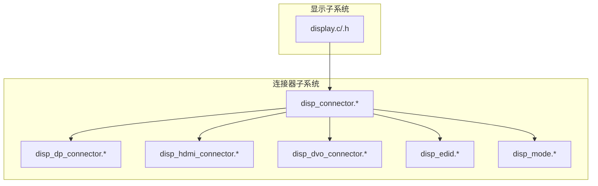
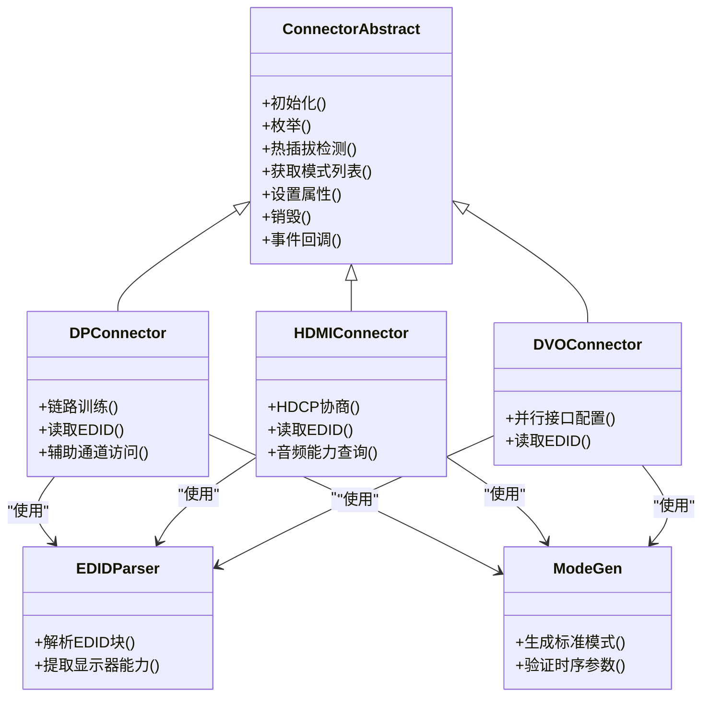
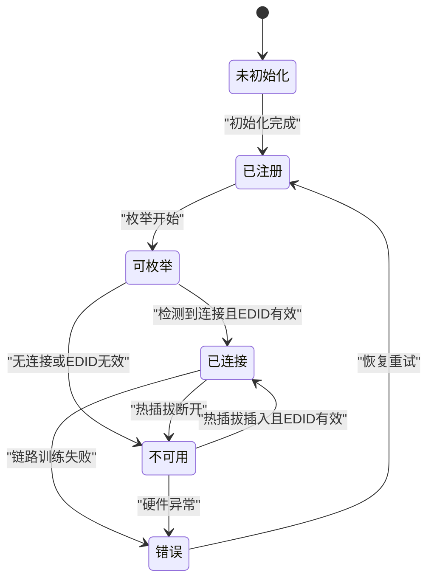
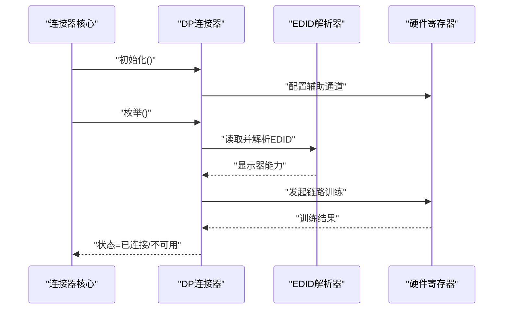
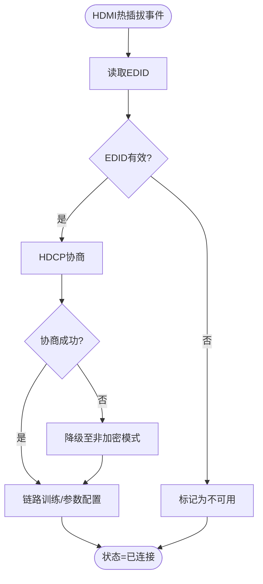
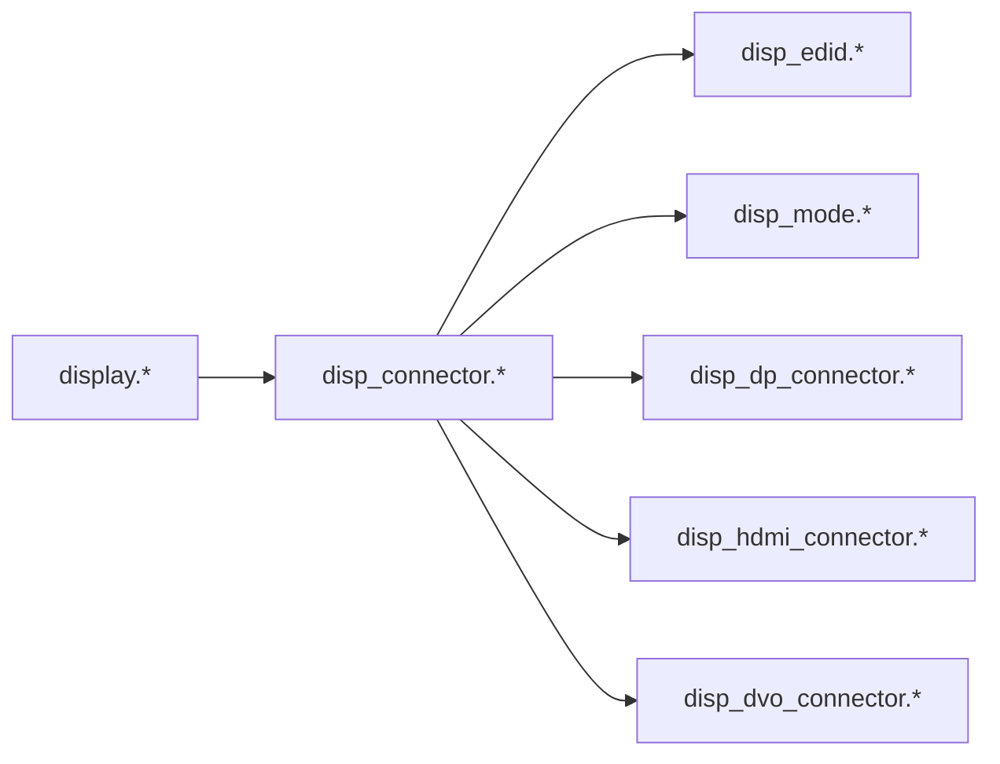

# 连接器基础框架

<cite>
**本文引用的文件**   
- [disp_connector.c](file://_work/src/usr/src/lisuangpu-dkms-262.2.0.56/display/connector/disp_connector.c)
- [disp_connector.h](file://_work/src/usr/src/lisuangpu-dkms-262.2.0.56/display/connector/disp_connector.h)
- [disp_dp_connector.c](file://_work/src/usr/src/lisuangpu-dkms-262.2.0.56/display/connector/disp_dp_connector.c)
- [disp_dp_connector.h](file://_work/src/usr/src/lisuangpu-dkms-262.2.0.56/display/connector/disp_dp_connector.h)
- [disp_hdmi_connector.c](file://_work/src/usr/src/lisuangpu-dkms-262.2.0.56/display/connector/disp_hdmi_connector.c)
- [disp_hdmi_connector.h](file://_work/src/usr/src/lisuangpu-dkms-262.2.0.56/display/connector/disp_hdmi_connector.h)
- [disp_dvo_connector.c](file://_work/src/usr/src/lisuangpu-dkms-262.2.0.56/display/connector/disp_dvo_connector.c)
- [disp_dvo_connector.h](file://_work/src/usr/src/lisuangpu-dkms-262.2.0.56/display/connector/disp_dvo_connector.h)
- [disp_edid.c](file://_work/src/usr/src/lisuangpu-dkms-262.2.0.56/display/connector/disp_edid.c)
- [disp_edid.h](file://_work/src/usr/src/lisuangpu-dkms-262.2.0.56/display/connector/disp_edid.h)
- [disp_mode.c](file://_work/src/usr/src/lisuangpu-dkms-262.2.0.56/display/connector/disp_mode.c)
- [disp_mode.h](file://_work/src/usr/src/lisuangpu-dkms-262.2.0.56/display/connector/disp_mode.h)
- [display.c](file://_work/src/usr/src/lisuangpu-dkms-262.2.0.56/display/display.c)
- [display.h](file://_work/src/usr/src/lisuangpu-dkms-262.2.0.56/display/display.h)
</cite>

## 目录
1. [简介](#简介)
2. [项目结构](#项目结构)
3. [核心组件](#核心组件)
4. [架构总览](#架构总览)
5. [详细组件分析](#详细组件分析)
6. [依赖关系分析](#依赖关系分析)
7. [性能考虑](#性能考虑)
8. [故障排查指南](#故障排查指南)
9. [结论](#结论)
10. [附录：API使用示例与扩展指南](#附录api使用示例与扩展指南)

## 简介
本文件面向丽山GPU显示驱动中的“连接器（Connector）”基础框架，系统性阐述其抽象层设计、通用接口定义、生命周期管理、初始化流程、状态机管理与事件处理机制。文档覆盖连接器的注册、枚举与销毁完整流程，并提供扩展新连接器类型与处理连接器事件的实践指导，帮助开发者快速理解并安全扩展该子系统。

## 项目结构
连接器相关代码集中在 display/connector 目录下，围绕统一的抽象接口实现多种物理接口（DP、HDMI、DVO等），并复用EDID解析与时序模式生成能力。顶层 display 模块负责设备级初始化与连接器子系统的装配。

图表来源
- [disp_connector.c](file://_work/src/usr/src/lisuangpu-dkms-262.2.0.56/display/connector/disp_connector.c)
- [disp_dp_connector.c](file://_work/src/usr/src/lisuangpu-dkms-262.2.0.56/display/connector/disp_dp_connector.c)
- [disp_hdmi_connector.c](file://_work/src/usr/src/lisuangpu-dkms-262.2.0.56/display/connector/disp_hdmi_connector.c)
- [disp_dvo_connector.c](file://_work/src/usr/src/lisuangpu-dkms-262.2.0.56/display/connector/disp_dvo_connector.c)
- [disp_edid.c](file://_work/src/usr/src/lisuangpu-dkms-262.2.0.56/display/connector/disp_edid.c)
- [disp_mode.c](file://_work/src/usr/src/lisuangpu-dkms-262.2.0.56/display/connector/disp_mode.c)
- [display.c](file://_work/src/usr/src/lisuangpu-dkms-262.2.0.56/display/display.c)

章节来源
- [disp_connector.c](file://_work/src/usr/src/lisuangpu-dkms-262.2.0.56/display/connector/disp_connector.c)
- [disp_connector.h](file://_work/src/usr/src/lisuangpu-dkms-262.2.0.56/display/connector/disp_connector.h)
- [display.c](file://_work/src/usr/src/lisuangpu-dkms-262.2.0.56/display/display.c)
- [display.h](file://_work/src/usr/src/lisuangpu-dkms-262.2.0.56/display/display.h)

## 核心组件
- 连接器抽象层（disp_connector.*）
  - 定义连接器对象模型、统一接口表（初始化、枚举、热插拔检测、模式查询、属性设置等）、生命周期钩子与状态机。
  - 提供连接器注册/注销、全局链表维护、事件分发与回调调度。
- 具体连接器实现
  - DP/HDMI/DVO 等物理接口实现，继承抽象接口，填充硬件相关的探测、EDID读取、链路训练、信号完整性检查等逻辑。
- EDID 与模式支持（disp_edid.* / disp_mode.*）
  - EDID解析、显示器能力提取、标准/自定义时序模式生成与校验。
- 显示子系统集成（display.*）
  - 在设备初始化阶段创建并注册各连接器实例，建立与编码器、CRTC的关联，启动热插拔监控与事件上报。

章节来源
- [disp_connector.h](file://_work/src/usr/src/lisuangpu-dkms-262.2.0.56/display/connector/disp_connector.h)
- [disp_connector.c](file://_work/src/usr/src/lisuangpu-dkms-262.2.0.56/display/connector/disp_connector.c)
- [disp_dp_connector.h](file://_work/src/usr/src/lisuangpu-dkms-262.2.0.56/display/connector/disp_dp_connector.h)
- [disp_dp_connector.c](file://_work/src/usr/src/lisuangpu-dkms-262.2.0.56/display/connector/disp_dp_connector.c)
- [disp_hdmi_connector.h](file://_work/src/usr/src/lisuangpu-dkms-262.2.0.56/display/connector/disp_hdmi_connector.h)
- [disp_hdmi_connector.c](file://_work/src/usr/src/lisuangpu-dkms-262.2.0.56/display/connector/disp_hdmi_connector.c)
- [disp_dvo_connector.h](file://_work/src/usr/src/lisuangpu-dkms-262.2.0.56/display/connector/disp_dvo_connector.h)
- [disp_dvo_connector.c](file://_work/src/usr/src/lisuangpu-dkms-262.2.0.56/display/connector/disp_dvo_connector.c)
- [disp_edid.h](file://_work/src/usr/src/lisuangpu-dkms-262.2.0.56/display/connector/disp_edid.h)
- [disp_edid.c](file://_work/src/usr/src/lisuangpu-dkms-262.2.0.56/display/connector/disp_edid.c)
- [disp_mode.h](file://_work/src/usr/src/lisuangpu-dkms-262.2.0.56/display/connector/disp_mode.h)
- [disp_mode.c](file://_work/src/usr/src/lisuangpu-dkms-262.2.0.56/display/connector/disp_mode.c)
- [display.h](file://_work/src/usr/src/lisuangpu-dkms-262.2.0.56/display/display.h)
- [display.c](file://_work/src/usr/src/lisuangpu-dkms-262.2.0.56/display/display.c)

## 架构总览
连接器子系统采用“抽象接口 + 多态实现”的设计：上层通过统一接口操作任意类型的连接器；底层根据具体物理接口实现差异化行为。EDID与模式库作为共享能力被所有连接器复用。

图表来源
- [disp_connector.h](file://_work/src/usr/src/lisuangpu-dkms-262.2.0.56/display/connector/disp_connector.h)
- [disp_dp_connector.h](file://_work/src/usr/src/lisuangpu-dkms-262.2.0.56/display/connector/disp_dp_connector.h)
- [disp_hdmi_connector.h](file://_work/src/usr/src/lisuangpu-dkms-262.2.0.56/display/connector/disp_hdmi_connector.h)
- [disp_dvo_connector.h](file://_work/src/usr/src/lisuangpu-dkms-262.2.0.56/display/connector/disp_dvo_connector.h)
- [disp_edid.h](file://_work/src/usr/src/lisuangpu-dkms-262.2.0.56/display/connector/disp_edid.h)
- [disp_mode.h](file://_work/src/usr/src/lisuangpu-dkms-262.2.0.56/display/connector/disp_mode.h)

## 详细组件分析

### 连接器抽象层与通用接口
- 抽象接口职责
  - 定义连接器对象的生命周期方法：初始化、枚举、热插拔检测、模式查询、属性设置、销毁。
  - 提供事件回调入口，用于上报连接状态变化、EDID更新、链路训练结果等。
- 状态机管理
  - 典型状态包括：未初始化、已注册、可枚举、已连接、不可用、错误等。状态转换由热插拔事件、EDID读取结果、链路训练结果驱动。
- 注册与全局管理
  - 连接器实例通过注册接口加入全局管理器，支持按类型或端口遍历、查找与引用计数管理。

图表来源
- [disp_connector.c](file://_work/src/usr/src/lisuangpu-dkms-262.2.0.56/display/connector/disp_connector.c)
- [disp_connector.h](file://_work/src/usr/src/lisuangpu-dkms-262.2.0.56/display/connector/disp_connector.h)

章节来源
- [disp_connector.h](file://_work/src/usr/src/lisuangpu-dkms-262.2.0.56/display/connector/disp_connector.h)
- [disp_connector.c](file://_work/src/usr/src/lisuangpu-dkms-262.2.0.56/display/connector/disp_connector.c)

### DP连接器实现
- 关键能力
  - 通过辅助通道读取EDID，执行链路训练（时钟/符号同步），支持DisplayPort版本特性协商。
- 事件处理
  - 监听热插拔中断，触发EDID重读与链路重训练；失败时回退到安全模式或标记为不可用。

图表来源
- [disp_dp_connector.c](file://_work/src/usr/src/lisuangpu-dkms-262.2.0.56/display/connector/disp_dp_connector.c)
- [disp_dp_connector.h](file://_work/src/usr/src/lisuangpu-dkms-262.2.0.56/display/connector/disp_dp_connector.h)
- [disp_edid.c](file://_work/src/usr/src/lisuangpu-dkms-262.2.0.56/display/connector/disp_edid.c)

章节来源
- [disp_dp_connector.h](file://_work/src/usr/src/lisuangpu-dkms-262.2.0.56/display/connector/disp_dp_connector.h)
- [disp_dp_connector.c](file://_work/src/usr/src/lisuangpu-dkms-262.2.0.56/display/connector/disp_dp_connector.c)
- [disp_edid.h](file://_work/src/usr/src/lisuangpu-dkms-262.2.0.56/display/connector/disp_edid.h)
- [disp_edid.c](file://_work/src/usr/src/lisuangpu-dkms-262.2.0.56/display/connector/disp_edid.c)

### HDMI连接器实现
- 关键能力
  - 读取EDID，进行HDCP协商，查询音频能力，处理TMDS时钟与像素格式选择。
- 事件处理
  - 热插拔触发EDID重读与HDCP重新协商；若失败则降级至非加密模式或标记不可用。

图表来源
- [disp_hdmi_connector.c](file://_work/src/usr/src/lisuangpu-dkms-262.2.0.56/display/connector/disp_hdmi_connector.c)
- [disp_hdmi_connector.h](file://_work/src/usr/src/lisuangpu-dkms-262.2.0.56/display/connector/disp_hdmi_connector.h)
- [disp_edid.c](file://_work/src/usr/src/lisuangpu-dkms-262.2.0.56/display/connector/disp_edid.c)

章节来源
- [disp_hdmi_connector.h](file://_work/src/usr/src/lisuangpu-dkms-262.2.0.56/display/connector/disp_hdmi_connector.h)
- [disp_hdmi_connector.c](file://_work/src/usr/src/lisuangpu-dkms-262.2.0.56/display/connector/disp_hdmi_connector.c)
- [disp_edid.h](file://_work/src/usr/src/lisuangpu-dkms-262.2.0.56/display/connector/disp_edid.h)
- [disp_edid.c](file://_work/src/usr/src/lisuangpu-dkms-262.2.0.56/display/connector/disp_edid.c)

### DVO连接器实现
- 关键能力
  - 配置并行数字视频输出接口，读取EDID，适配不同分辨率与时序。
- 事件处理
  - 热插拔后重新读取EDID并调整输出参数；若无法匹配则回退到默认模式。

章节来源
- [disp_dvo_connector.h](file://_work/src/usr/src/lisuangpu-dkms-262.2.0.56/display/connector/disp_dvo_connector.h)
- [disp_dvo_connector.c](file://_work/src/usr/src/lisuangpu-dkms-262.2.0.56/display/connector/disp_dvo_connector.c)
- [disp_edid.h](file://_work/src/usr/src/lisuangpu-dkms-262.2.0.56/display/connector/disp_edid.h)
- [disp_edid.c](file://_work/src/usr/src/lisuangpu-dkms-262.2.0.56/display/connector/disp_edid.c)

### EDID与模式库
- EDID解析
  - 从I2C/辅助通道读取EDID数据块，解析显示器能力（分辨率、刷新率、颜色空间、音频支持等）。
- 模式生成
  - 基于EDID与标准时序规则生成可用模式集合，并进行参数合法性校验。

章节来源
- [disp_edid.h](file://_work/src/usr/src/lisuangpu-dkms-262.2.0.56/display/connector/disp_edid.h)
- [disp_edid.c](file://_work/src/usr/src/lisuangpu-dkms-262.2.0.56/display/connector/disp_edid.c)
- [disp_mode.h](file://_work/src/usr/src/lisuangpu-dkms-262.2.0.56/display/connector/disp_mode.h)
- [disp_mode.c](file://_work/src/usr/src/lisuangpu-dkms-262.2.0.56/display/connector/disp_mode.c)

## 依赖关系分析
- 耦合关系
  - 连接器抽象层对EDID与模式库存在强依赖；具体连接器实现仅依赖抽象接口与共享库。
- 外部集成点
  - 与显示子系统（display.*）集成，负责连接器实例的创建、注册与生命周期管理。
- 潜在循环依赖
  - 通过接口解耦避免循环依赖；具体连接器不直接调用显示子系统高层，而是通过回调与事件机制交互。

图表来源
- [display.c](file://_work/src/usr/src/lisuangpu-dkms-262.2.0.56/display/display.c)
- [disp_connector.c](file://_work/src/usr/src/lisuangpu-dkms-262.2.0.56/display/connector/disp_connector.c)
- [disp_edid.c](file://_work/src/usr/src/lisuangpu-dkms-262.2.0.56/display/connector/disp_edid.c)
- [disp_mode.c](file://_work/src/usr/src/lisuangpu-dkms-262.2.0.56/display/connector/disp_mode.c)
- [disp_dp_connector.c](file://_work/src/usr/src/lisuangpu-dkms-262.2.0.56/display/connector/disp_dp_connector.c)
- [disp_hdmi_connector.c](file://_work/src/usr/src/lisuangpu-dkms-262.2.0.56/display/connector/disp_hdmi_connector.c)
- [disp_dvo_connector.c](file://_work/src/usr/src/lisuangpu-dkms-262.2.0.56/display/connector/disp_dvo_connector.c)

章节来源
- [display.h](file://_work/src/usr/src/lisuangpu-dkms-262.2.0.56/display/display.h)
- [display.c](file://_work/src/usr/src/lisuangpu-dkms-262.2.0.56/display/display.c)
- [disp_connector.h](file://_work/src/usr/src/lisuangpu-dkms-262.2.0.56/display/connector/disp_connector.h)
- [disp_connector.c](file://_work/src/usr/src/lisuangpu-dkms-262.2.0.56/display/connector/disp_connector.c)

## 性能考虑
- EDID读取优化
  - 缓存EDID结果，仅在热插拔或显式请求时重新读取，减少I2C/辅助通道开销。
- 模式生成与校验
  - 预计算常用模式集合并缓存，避免重复计算；校验失败快速返回，降低CPU占用。
- 热插拔事件处理
  - 使用异步任务队列处理热插拔事件，避免阻塞主路径；失败重试需限流防抖。
- 资源管理
  - 严格遵循引用计数与生命周期管理，防止内存泄漏与悬挂指针。

[本节为通用性能建议，不直接分析具体文件]

## 故障排查指南
- 常见问题定位
  - 热插拔无响应：检查中断注册与事件分发；确认EDID读取是否超时。
  - 链路训练失败：查看DP/HDMI链路参数配置与硬件状态寄存器；必要时回退到安全模式。
  - 模式不可用：核对EDID能力与模式参数一致性；检查时序合法性。
- 调试手段
  - 启用连接器日志与状态转储；打印EDID原始数据与解析结果；记录状态机转换轨迹。

章节来源
- [disp_connector.c](file://_work/src/usr/src/lisuangpu-dkms-262.2.0.56/display/connector/disp_connector.c)
- [disp_dp_connector.c](file://_work/src/usr/src/lisuangpu-dkms-262.2.0.56/display/connector/disp_dp_connector.c)
- [disp_hdmi_connector.c](file://_work/src/usr/src/lisuangpu-dkms-262.2.0.56/display/connector/disp_hdmi_connector.c)
- [disp_dvo_connector.c](file://_work/src/usr/src/lisuangpu-dkms-262.2.0.56/display/connector/disp_dvo_connector.c)
- [disp_edid.c](file://_work/src/usr/src/lisuangpu-dkms-262.2.0.56/display/connector/disp_edid.c)

## 结论
丽山GPU连接器基础框架通过清晰的抽象层设计与统一接口，实现了多物理接口的可扩展性与一致性。EDID与模式库的复用提升了开发效率与稳定性。完善的生命周期管理与状态机机制保障了连接器的健壮性。按照本文档的扩展指南，开发者可以安全地新增连接器类型并正确处理事件。

[本节为总结性内容，不直接分析具体文件]

## 附录：API使用示例与扩展指南

### 连接器初始化与注册流程
- 步骤概览
  - 创建连接器实例并填充接口函数表。
  - 调用初始化接口完成硬件相关配置。
  - 注册到连接器管理器，进入可枚举状态。
- 参考路径
  - [连接器抽象接口定义](file://_work/src/usr/src/lisuangpu-dkms-262.2.0.56/display/connector/disp_connector.h)
  - [连接器初始化与注册实现](file://_work/src/usr/src/lisuangpu-dkms-262.2.0.56/display/connector/disp_connector.c)
  - [显示子系统装配连接器](file://_work/src/usr/src/lisuangpu-dkms-262.2.0.56/display/display.c)

章节来源
- [disp_connector.h](file://_work/src/usr/src/lisuangpu-dkms-262.2.0.56/display/connector/disp_connector.h)
- [disp_connector.c](file://_work/src/usr/src/lisuangpu-dkms-262.2.0.56/display/connector/disp_connector.c)
- [display.c](file://_work/src/usr/src/lisuangpu-dkms-262.2.0.56/display/display.c)

### 连接器枚举与模式查询
- 步骤概览
  - 触发枚举：读取EDID，生成模式列表。
  - 查询模式：遍历模式集合，过滤不支持的能力。
- 参考路径
  - [EDID解析与能力提取](file://_work/src/usr/src/lisuangpu-dkms-262.2.0.56/display/connector/disp_edid.c)
  - [模式生成与校验](file://_work/src/usr/src/lisuangpu-dkms-262.2.0.56/display/connector/disp_mode.c)

章节来源
- [disp_edid.h](file://_work/src/usr/src/lisuangpu-dkms-262.2.0.56/display/connector/disp_edid.h)
- [disp_edid.c](file://_work/src/usr/src/lisuangpu-dkms-262.2.0.56/display/connector/disp_edid.c)
- [disp_mode.h](file://_work/src/usr/src/lisuangpu-dkms-262.2.0.56/display/connector/disp_mode.h)
- [disp_mode.c](file://_work/src/usr/src/lisuangpu-dkms-262.2.0.56/display/connector/disp_mode.c)

### 热插拔事件处理
- 步骤概览
  - 接收热插拔中断，更新连接器状态。
  - 重新读取EDID并触发链路训练。
  - 上报状态变化给显示子系统。
- 参考路径
  - [DP连接器事件处理](file://_work/src/usr/src/lisuangpu-dkms-262.2.0.56/display/connector/disp_dp_connector.c)
  - [HDMI连接器事件处理](file://_work/src/usr/src/lisuangpu-dkms-262.2.0.56/display/connector/disp_hdmi_connector.c)
  - [DVO连接器事件处理](file://_work/src/usr/src/lisuangpu-dkms-262.2.0.56/display/connector/disp_dvo_connector.c)

章节来源
- [disp_dp_connector.h](file://_work/src/usr/src/lisuangpu-dkms-262.2.0.56/display/connector/disp_dp_connector.h)
- [disp_dp_connector.c](file://_work/src/usr/src/lisuangpu-dkms-262.2.0.56/display/connector/disp_dp_connector.c)
- [disp_hdmi_connector.h](file://_work/src/usr/src/lisuangpu-dkms-262.2.0.56/display/connector/disp_hdmi_connector.h)
- [disp_hdmi_connector.c](file://_work/src/usr/src/lisuangpu-dkms-262.2.0.56/display/connector/disp_hdmi_connector.c)
- [disp_dvo_connector.h](file://_work/src/usr/src/lisuangpu-dkms-262.2.0.56/display/connector/disp_dvo_connector.h)
- [disp_dvo_connector.c](file://_work/src/usr/src/lisuangpu-dkms-262.2.0.56/display/connector/disp_dvo_connector.c)

### 连接器销毁流程
- 步骤概览
  - 停止热插拔监控与事件回调。
  - 释放硬件资源与内存。
  - 从连接器管理器注销实例。
- 参考路径
  - [连接器销毁接口](file://_work/src/usr/src/lisuangpu-dkms-262.2.0.56/display/connector/disp_connector.c)

章节来源
- [disp_connector.c](file://_work/src/usr/src/lisuangpu-dkms-262.2.0.56/display/connector/disp_connector.c)

### 扩展新的连接器类型
- 步骤概览
  - 定义新连接器结构体，继承抽象接口。
  - 实现初始化、枚举、热插拔检测、模式查询、属性设置、销毁等方法。
  - 在显示子系统初始化中注册新连接器实例。
- 参考路径
  - [抽象接口定义](file://_work/src/usr/src/lisuangpu-dkms-262.2.0.56/display/connector/disp_connector.h)
  - [现有实现参考（DP/HDMI/DVO）](file://_work/src/usr/src/lisuangpu-dkms-262.2.0.56/display/connector/disp_dp_connector.c)
  - [显示子系统装配](file://_work/src/usr/src/lisuangpu-dkms-262.2.0.56/display/display.c)

章节来源
- [disp_connector.h](file://_work/src/usr/src/lisuangpu-dkms-262.2.0.56/display/connector/disp_connector.h)
- [disp_dp_connector.c](file://_work/src/usr/src/lisuangpu-dkms-262.2.0.56/display/connector/disp_dp_connector.c)
- [disp_hdmi_connector.c](file://_work/src/usr/src/lisuangpu-dkms-262.2.0.56/display/connector/disp_hdmi_connector.c)
- [disp_dvo_connector.c](file://_work/src/usr/src/lisuangpu-dkms-262.2.0.56/display/connector/disp_dvo_connector.c)
- [display.c](file://_work/src/usr/src/lisuangpu-dkms-262.2.0.56/display/display.c)